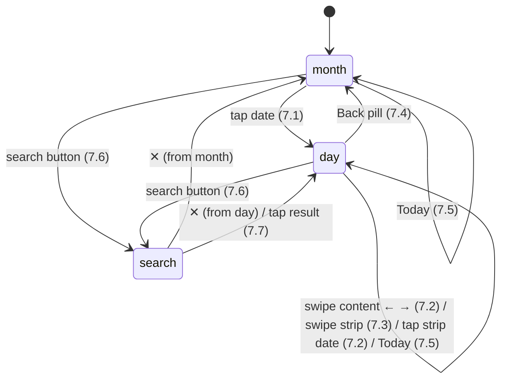

# Calendar — design (normative)

> What MakeReady builds. Evidence and timestamps: [`01-video-analysis.md`](01-video-analysis.md).
> Reference stills: [`frames/`](frames/) (440 pt wide, so 1 px = 1 pt). Build spec: [`SPEC.md`](SPEC.md).
>
> **Rule of thumb for the builder:** the calendar *body* (month grid, day cells, event indicators,
> weekday header, week strip, day timeline, event blocks) copies the reference's look and
> motion. Only the **chrome controls** become MakeReady 2.0 components (§3). Where this doc gives
> a number, it is the number; "≈" values are measured from video and may be rounded by ±1 pt.

Screen id: **`calendar-home`** (the id already reserved in `docs/ui2/README.md` and `screen-map.md`).
Platform: **iPhone** (UI 2.0 preview module). Canvas reference: 440 × 956 pt.

---

## 1. Modes

The screen has exactly three modes. There is no week mode, no list mode and no year mode.

| Mode | Entered by | Body |
|---|---|---|
| `month` | initial state; Back pill in `day`; ✕ in `search` | continuous vertical month grid (§4) |
| `day(date)` | tap a date in `month`; tap a search result | week strip + one day's timeline (§5) |
| `search` | search button in `month` **or** `day` | search field + results / empty state (§6) |

`search` remembers the mode it was opened from and returns to it (same scroll position / same day) on ✕.

## 2. Page layout (top → bottom)

Root-level tab page: **no C-040 PageHeader**, no avatar, no title bar. Background
`color-layout-background` everywhere. The app-level **C-084 TabBar** is pinned at the bottom with
`selected: .calendar` (84 pt, owns its fill). Everything below is laid out above it.

```
┌ status bar (system) ───────────────────────────────┐
│ [‹ July]                         [🔍] [+]          │ ← Control row, 44 pt tall (§2.1)
│ September                                          │ ← Large month title — month mode only
│  S    M    T    W    T    F    S                   │ ← Weekday header (pinned, both modes)
│────────────────────────────────────────────────────│
│                 body (§4 / §5 / §6)                │
│ [Today]                                            │ ← floating, bottom-left
├────────────────────────────────────────────────────┤
│  C-084 TabBar  (home · calendar● · + · search · profile)
└────────────────────────────────────────────────────┘
```

### 2.1 Control row
- Height 44 pt, top = safe-area top + 6 pt, side insets `space-page-margin` (16).
- **Left slot**
  - `month`: **empty** (D2 — the year pill navigates to a year view, which does not exist).
  - `day`: **C-105 Button**, `leadingGlyph: chevron-left`, `label` = full month name of the
    *selected date* ("July", "October"). Tap → collapse to `month` (§7.4).
- **Right slot**: two **C-102 IconButton**s, `style: outlined`, `tone: default`, gap 8 pt, right-aligned:
  1. `search-carbon`, accessibilityLabel "Search events" → enter `search` (§7.6)
  2. `add-large-carbon`, accessibilityLabel "New event" → `onAddEvent(date)` where `date` is the
     selected date in `day` and today in `month` (destination: D6).
- The row floats over the scrolling body with no fill of its own; the body scrolls **under** the
  large title / weekday header area, which is opaque `color-layout-background`.

### 2.2 Large month title (`month` only)
- Text: full month name of the **top-most visible month** (§4.5). When that month is not in the
  current year, append the year in `color-text-secondary`: "April **2027**" (D2).
- Bold 32 pt, line 38, x = 16 (`space-page-margin`), 8 pt below the control row.
- Changes by **crossfade 0.15 s** as the scroll crosses a month boundary.

### 2.3 Weekday header
- Letters `S M T W T F S` (locale `veryShortStandaloneWeekdaySymbols`, week starts Sunday — D9),
  semibold 10 pt, `color-white-50`, one per column, columns as §4.1.
- 18 pt tall, 6 pt below the title (`month`) or 6 pt below the control row (`day`, where the title
  is gone and the strip numerals follow directly — §5.1).
- Hairline `color-white-10`, 1 px, full width, directly under the header in `month`.

### 2.4 Today button
- **C-105 Button**, `label: "Today"`, no glyphs. Floating, leading = 16 pt, bottom = TabBar top − 12 pt.
- Visible in `month` and `day`; hidden in `search` while the keyboard is up; shown **centred** at the
  same bottom offset in `search` once results are listed (§6.3).
- Behaviour: §7.5. Always enabled (tapping while already showing today is a harmless no-op scroll).

## 3. Component map

| Region | Component | Status |
|---|---|---|
| Back pill (`day`) | **C-105 Button** (`chevron-left` + month label) | existing |
| Search / Add | **C-102 IconButton** `outlined` (`search-carbon`, `add-large-carbon`) | existing |
| Today | **C-105 Button** "Today" | existing |
| Search field | **C-034 SearchField** (placeholder "Search events") | existing |
| Close search | **C-102 IconButton** `outlined`, glyph `x` | existing |
| Bottom navigation | **C-084 TabBar** `selected: .calendar` | existing |
| Weekday header | **WeekdayHeader** | new — mint |
| Month grid | **MonthGrid** (section per month) | new — mint |
| One date in the grid | **MonthDayCell** | new — mint |
| Under-date indicator | **EventIndicator** | new — mint |
| Day-mode week strip | **WeekStrip** | new — mint |
| Day timeline | **DayTimeline** | new — mint |
| Timed event | **CalendarEventBlock** | new — mint |
| All-day event | **AllDayEventChip** | new — mint |
| Now line | **NowIndicator** | new — mint |
| Search result row | **CalendarEventRow** | new — mint |
| No results | **CalendarEmptyState** (glyph + title + body) | new — mint |

New names are role-based per the registry naming rules; IDs come from `mint_component_id` at build
time (never pre-named in prose). None of the new rows has a Figma source: their contract **is this
document**.

## 4. Month mode

### 4.1 Grid geometry
- **7 equal columns spanning the full screen width** (no side margin): `colW = width / 7`.
- **Week row height 69 pt.** Numeral centre at row top + 22 pt; indicator centre at row top + 51 pt.
- One **section per month**, stacked continuously, no gap other than the label band (§4.3).
  A month's first row starts at the weekday column of its 1st; only the month's own dates are drawn
  (no greyed leading/trailing days).
- Week separator: 1 px `color-white-10` at the **top** of every week row, spanning **only the columns
  that contain this month's dates in that row** (the first row of a month starts at its 1st's column;
  the last row ends after its last date's column). See frame 01.

### 4.2 MonthDayCell
| State | Numeral | Background |
|---|---|---|
| weekday (Mon–Fri) | semibold 19 pt `color-white-100` | none |
| weekend (Sat, Sun) | semibold 19 pt `color-white-50` | none |
| today | bold 19 pt `color-white-100` | circle Ø 40 `color-negative` (red) |
| pressed (touch-down, ephemeral) | unchanged | circle Ø 40 `color-white-30` |

- No selected state in month mode (selection only exists in `day`).
- Whole cell (colW × 69) is the hit target. accessibilityLabel "Tuesday, October 20, 2026, 3 events".

### 4.3 Month label band
- Each month section begins with a 27 pt band holding its 3-letter month name ("Oct") bold 17 pt,
  centred over the column of its 1st, baseline 6 pt above the band bottom.
- Colour: `color-negative` for the **current** month, `color-white-100` otherwise.
- The band of the month at the very top of the viewport scrolls under the pinned header like any
  other content (it is not sticky — the large title does that job).

### 4.4 EventIndicator
- Centred under the numeral (centre y = row top + 51). Height 4, radius 2.
- Width by count: 0 → nothing · 1 → 5 pt dot · 2 → 14 pt · 3 → 22 pt · ≥ 4 → 30 pt.
- Filled with **one equal segment per event (max 4 segments)**, each in its event colour (§8),
  ordered by start time, all-day first. Today's cell uses the same indicator (it sits below the
  red circle, never on it).

### 4.5 Scrolling
- **Continuous vertical scroll with momentum, never paged.** Range: 24 months back → 24 months
  forward from today, extended by 12 months whenever the user comes within 3 months of either end
  (D8).
- **Top-most visible month** = the month whose section contains the point 1 pt below the weekday
  header's bottom edge. It drives the large title (§2.2).
- No horizontal gestures in month mode.
- Initial position on first appearance: today's month section top aligned under the header.

## 5. Day mode

### 5.1 Header in day mode (pinned)
Control row (§2.1) → weekday header letters (§2.3) → **WeekStrip** → subtitle → hairline.

| Part | Geometry |
|---|---|
| WeekStrip | 7 columns as §4.1; numeral centre 30 pt below the letters' centre; row height 44 |
| Subtitle | "Wednesday – Jul 29, 2026" (`EEEE – MMM d, yyyy`, en dash), semibold 15 pt `color-white-100`, centred, 10 pt below the strip; hairlines 1 px `color-white-10` above and below it |

### 5.2 WeekStrip date states
| State | Numeral | Background |
|---|---|---|
| weekday, not selected | regular 19 pt `color-white-100` | — |
| weekend, not selected | regular 19 pt `color-white-50` | — |
| today, not selected | semibold 19 pt `color-negative` | — |
| selected (not today) | bold 19 pt `color-black` | circle Ø 36 `color-white-100` |
| selected + today | bold 19 pt `color-white-100` | circle Ø 36 `color-negative` |
| pressed / in-flight | unchanged | circle Ø 36 `color-white-30` |

The strip carries **no** event indicators.

### 5.3 DayTimeline
- One page per day; each page scrolls vertically, **12 AM → 12 AM** (24 h).
- **50 pt per hour**; 8 pt top and bottom padding.
- Gutter 60 pt: hour labels right-aligned at x = 56: numeral 13 pt `color-white-50` + "AM"/"PM"
  8 pt `color-white-50`; 12 PM reads **"Noon"**; the closing 12 AM is labelled.
- Hour hairlines 1 px `color-white-10` from x = 64 to the trailing edge, at each label's centre.
- **All-day row** (only when the day has all-day events): pinned between the subtitle and the
  scrolling hours, label "all-day" 9 pt `color-white-50` in the gutter, one **AllDayEventChip** per
  event stacked with 2 pt gaps (max 3 visible, then "+N more" chip that expands the row).
- **NowIndicator** (today's page only): 1 px `color-negative` line from x = 60 to the edge at the
  current time, with a capsule in the gutter (bold 9 pt white "10:42" on `color-negative`, 4 pt
  horizontal padding) centred on the line. Updates every minute.
- Default scroll anchor when a page is first shown (D10):
  - today → current time placed at 70 % of the visible timeline height;
  - otherwise → top of the visible area at `min(5 AM, earliest timed event − 1 h)`, clamped ≥ 12 AM.

### 5.4 CalendarEventBlock
- x from 66 to trailing − 2; y = start (min height 20 pt); height = duration × 50 pt/h.
- Fill = event colour at 25 % over the background, radius `radius-card-sm` (4), 1 pt inner gap
  between stacked blocks.
- Left bar 3 pt wide, inset 3 pt, full height − 6, solid event colour, radius 1.5.
- Title semibold 13 pt in the event colour lightened (`mix(eventColor, white, 0.55)`); second line
  regular 11 pt same tint at 80 %: location (`map-pin` glyph 10 pt) or group name; repeat glyph
  (`repeat-arrows` 10 pt) top-right when the event belongs to a recurrence. Lines truncate with "…";
  the second line hides when the block is < 34 pt tall.
- **Overlaps:** events whose time ranges intersect form a cluster; the cluster is split into equal
  columns (greedy, by start time), each block taking its column's width with a 2 pt gap (frame 07).
- Tap → `onOpenEvent(event)` (destination: D7). Press feedback: block opacity 0.6.

## 6. Search mode

### 6.1 Chrome
- Control row is replaced by **C-034 SearchField** (fills from x 16 to the close button − 8,
  placeholder "Search events", focused on entry) + **C-102 IconButton** `x` (accessibilityLabel
  "Close search") at the right.
- Large title / weekday header / grid (or day view) remain where they are behind it until a query
  produces a result state (§6.2).

### 6.2 States
| Query | Body |
|---|---|
| empty | the mode it came from, unchanged (grid / day), keyboard up |
| ≥ 2 chars, fetching | unchanged body + C-076 ActivitySpinner centred under the field after 300 ms |
| ≥ 2 chars, 0 results | **CalendarEmptyState**: `search-carbon` glyph 40 pt `color-white-50`, "No Results" semibold 17 pt, "Check the spelling or try a new search." 13 pt `color-white-50`; centred 120 pt below the field |
| ≥ 2 chars, ≥ 1 result | results list (§6.3) |
| request failed | empty state with title "Search unavailable", body "Check your connection and try again." |

Debounce 300 ms; minimum 2 characters (matches `search-home`).

### 6.3 Results list
- **Chronological ascending** across all years; grouped by day; header "Thursday – Oct 17, 2019"
  semibold 13 pt `color-white-50`, 16 pt side inset, hairline under it.
- One **CalendarEventRow** per event: 3 pt colour bar (left), title regular 15 pt white, second line
  11 pt `color-white-50` with glyph (location / group), right column 11 pt: start over end time,
  "Ends 12:30 AM" for overnight continuations, or "all-day". Past events at 50 % opacity.
- On first display, the list scrolls so the first event **on or after today** is at the top.
- A centred C-105 "Today" button floats at the bottom; tap → scroll the list back to that row.
- Row tap → close search, enter `day(event.date)` with that event's hour visible (transition §7.7).
- Scrolling the list dismisses the keyboard (interactive).

## 7. Navigation & gestures (the state machine)



### 7.1 Month → Day (tap a date) — "curtain" expand
1. Touch-down: pressed circle on the cell (§4.2).
2. Touch-up (a tap, not a scroll start — 10 pt slop): run, as **one spring (response 0.5 s,
   damping 0.85, ≈ 0.55 s to settle)**:
   - the tapped **week row** moves from its grid position to the WeekStrip position and becomes the
     strip (same column centres, so numerals do not shift horizontally);
   - every row **above** it (and the large title) translates up by its distance to the header and
     fades to 0;
   - every row **below** it translates down off the bottom edge;
   - the day timeline is revealed in the gap, fading 0 → 1, already at its default anchor (§5.3);
   - the tapped date's circle goes pressed-grey → selected (white, or red for today) by 0.25 s;
   - subtitle fades in during the last 40 %;
   - control row: left slot fades in the C-105 back button, right slot unchanged.
3. Gestures are ignored until the spring settles.

### 7.2 Day → Day (page by one day)
- **Swipe the day content** horizontally: the page tracks the finger 1:1. Commit when released past
  35 % of the width **or** with velocity > 300 pt/s; otherwise spring back. Swipe left = next day,
  right = previous day.
- **Tap a date in the WeekStrip**: same page transition, direction by date order.
- On commit: selection circle crossfades old → new (0.1 s); page finishes in **0.3 s ease-out**;
  subtitle and back-button label travel / update with the page (label changes when the month does).
- Paging **inside the same week preserves the vertical hour offset**.
- When the new day is in another week (swiping past Saturday / Sunday), the WeekStrip pages to that
  week with the same 0.3 s ease-out, simultaneously.

### 7.3 Week paging (swipe the WeekStrip)
- The strip tracks the finger; the day content does **not** move during the drag.
- Commit threshold as §7.2. On commit the strip snaps a full week; the **selection moves to the same
  weekday** in the new week; then the day page slides in the matching direction (0.3 s ease-out).
- The new day opens at its **default anchor** (§5.3), not the previous offset.

### 7.4 Day → Month (Back pill)
- Exact reverse of §7.1 in **0.45 s** (same spring, settles faster because nothing overshoots):
  strip returns to its row in the grid, rows above slide down into place, rows below rise from the
  bottom, timeline and subtitle fade out, title fades in, the selection circle fades out.
- The month grid is positioned so that the selected date's week row lands **where it would be with
  its month's section top aligned under the header**; if the selected date's month differs from the
  one the user tapped into (they paged across a month boundary), the grid uses the selected date's
  month.
- No horizontal edge-swipe back (root page) and no pull-down gesture (D11).

### 7.5 Today
| From | Result |
|---|---|
| `month`, today's month within ±1 screen height | animated scroll (0.35 s ease-in-out) to today's month section top |
| `month`, further away | **instant jump** (no animation), today's month section top under the header |
| `day`, today in the visible week | §7.2 page to today |
| `day`, other week | WeekStrip jumps (no animation) to today's week, then §7.2 page to today with a 0.2 s crossfade instead of a slide |

The C-105 pressed state (0.6 opacity) is the only feedback.

### 7.6 Enter / leave search
- Enter: the right IconButtons fade out (0.15 s) while C-034 + ✕ fade/slide in from the right
  (0.25 s ease-out); keyboard rises in parallel; field focused. Back button (day) fades out.
- Leave (✕): keyboard down, results / empty state fade out (0.2 s), the body it came from is shown
  exactly as left; control row restores (0.25 s).
- The TabBar stays visible; the keyboard covers it while up.

### 7.7 Search result → Day
- Close search (as §7.6) and enter `day(result.date)` with a 0.25 s crossfade (no curtain — there is
  no tapped row to animate), anchoring the timeline so the event's start is at 25 % of the visible
  height.

### 7.8 Reduce Motion
With iOS Reduce Motion on, every spring / slide above becomes a 0.2 s crossfade; finger-tracked drags
still track.

## 8. Event colour
Colour by `Event.type` (D5):

| type | token |
|---|---|
| LESSON | `color-accent` |
| MEETING | `color-positive` |
| ONLINE | `color-brand-highlight` |
| DEADLINE | `color-warning` |
| SOCIAL | `color-highlight` |
| OTHER | `color-text-secondary` |

Red (`color-negative`) is reserved for today / now and never used as an event colour.

## 9. States (screen level)
| State | Rendering |
|---|---|
| first load, no cache | grid renders immediately with no indicators; C-076 spinner in the control row's left slot until the first range arrives |
| refreshing with cache | silent |
| range failed | grid without indicators + the app error banner "Couldn't load your calendar" with Retry (`ios-error-surface`) |
| no events at all | normal grid, no indicators; day pages show only hours; no empty-state copy |
| day with no events | hours only (no copy) |

## 10. Accessibility
- MonthDayCell / WeekStrip date: button trait, label "Tuesday, October 20, 2026, today, 3 events";
  selected adds the selected trait.
- Swipe paging has VoiceOver equivalents: `accessibilityScrollAction` / custom actions "Next day",
  "Previous day", "Next week", "Previous week" on the day page and strip.
- CalendarEventBlock label: "{title}, {start} to {end}, {location}".
- Dynamic Type: numerals and timeline text are fixed-size (grid geometry depends on them), matching
  the reference; event titles and search rows scale up to XXL.
