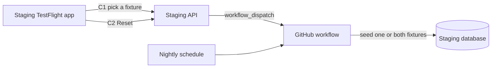

# staging-fixtures — spec
> ✅ SHIPPED 2026-11-05 — merged into main · no ticket · 🤖 agent signed off (no walk), not human-tested · quick-checked
> md · ticket none

## Idea

**Why.** The owner and the QA team need to feel what the app is like for a brand new group leader and for one with a lot of content. Today fixtures exist only on the owner's Mac: they seed locally and sign in through a Local-only login, and TestFlight builds can only reach production.

**What success looks like.** A tester installs the staging TestFlight app, picks Fully populated or New group on Profile, and is in that world with no account of their own. When New group is no longer new, they tap Reset. The production app and API behave exactly as before, and at go-live nothing has to be removed from the store build, because it never had this.

**In your words.** "I would like two fixtures: 1. Fully populated 2. New group" → D1, D2. ""Local" is for me, but if myself or my QA team uses the testflight app, they can select "Staging" environment and then see the fixture options below to pick from for testing." → D3, D4. "Once we go live these options will be disabled of course on the profile" → D4, D9.

**The concept.**

**How it fits today.** `npm run fixtures:reset` wipes and seeds fixed ids under one org; its guard refuses anything but a local database. Profile's Local identity signs in through `POST /auth/dev-login`, which takes any email with no password and answers 404 unless `NODE_ENV=development`. The switcher needs `DEV_MODE=YES`, which only Debug has. The Xcode project has only Debug and Release configurations: `Staging.xcconfig` exists, with its own bundle id `com.makeready.app.staging`, but nothing uses it. The API image contains no `fixtures/`, and the same image is promoted to production.

**Approaches considered.** Chosen: a separate staging app, a key-gated login limited to fixture accounts, and seeding from a GitHub workflow. Rejected: `DEV_MODE=YES` in Release (one flag from store users); enabling dev-login on staging (any user's account, no password); the seeder inside the API image (data-deleting code and 84 MB of images in the production image); one copy per tester (fixed ids make that a rebuild).

## Apps

| App | In scope | What changes | Section |
|---|---|---|---|
| server | ✅ | Fixture login and reset endpoints, New group scenario, guard, GitHub workflow | §server |
| client | ⬜ | No web surface: fixtures are picked in the iPhone app only | — |
| iphone | ✅ | Staging build configuration and scheme, Profile fixture picker and Reset | §iphone |

**Sequencing:** contract settled → server implements and verifies (contract FREEZES) → iphone builds against it → the owner's staging walk.

**Backward compatibility:** additive. A released iPhone build never calls C1 or C2, and both answer 404 wherever the flag is unset, production included.

**Blast radius:** `server/fixtures/guard.ts` protects every database from a wipe, and `wipe.ts` runs against a shared staging database that may hold real data (D7, D8). `AuthManager.signIn` is shared by every build; only the staging build takes the new path.

**Prerequisite (owner):** staging must deploy again. `build-api-image.yml` fails with Railway `Not Authorized` until `RAILWAY_API_TOKEN` is replaced, so nothing here reaches QA before that (F1).

## Decisions

<!-- The one place rulings live. Record the DECISION — and, in one line, why, and why the rejected option lost. A stated preference
     is the INPUT to a row, not the row. Write each Ruling as something later code can be checked
     against without re-interpretation:
       · positive and specific — "store the full number, mask at render", not "don't truncate"
       · scope named — which apps, screens or endpoints it binds
       · "etc." / "and so on" expanded into the list, or the test for membership stated
       · the rejected alternative named, with the reason it lost (check-obligations warns on a bare one)
       · the enforcement hook, where one exists (lint rule, script, test)
     🔴 NEVER quote the user's prompt as the ruling. Operationalize it: a closed list, a measured
     value, an enumerated set of deviations. A ruling a stranger could implement two ways is not
     written yet.
     Who/date carries the provenance, so the Ruling itself needs no quote marks.
     The owner's own words go in §Idea "In your words", linked to this row — never in the Ruling.
     OPEN rows block the build go-ahead. Never delete a ruling; supersede it in place with a date. -->

| # | Decision | Ruling | Who / date |
|---|---|---|---|
| D1 | The two fixtures | Closed list, in this order: `full` shown as "Fully populated", the existing `full` scenario and `fixtures@makeready.local`; `new-group` shown as "New group", a new scenario with its own user and org ids. Both exist at once on staging, and resetting one never touches the other. Rejected: one scenario at a time (a reset for one tester would replace everyone's world). | owner 2026-11-05 |
| D2 | What New group contains | A new user `fixtures-new@makeready.local`, Owner of a new org `New Group Fixtures`, with one active group `My First Group`, and no members, programs, enrollments, events, posts or media of its own. Rejected: the existing `empty` scenario (its base world has 24 members and is not new). | (assumed at spec) 2026-11-05 |
| D3 | How TestFlight reaches staging | A new Xcode build configuration `Staging`, on the project and every target's configuration list, over `iphone/Staging.xcconfig` (moved from the unreferenced `iphone/MakeReady/Configuration/Staging.xcconfig`, beside the `Debug` and `Release` xcconfigs the project actually uses), and a shared scheme `MakeReady Staging` that archives with it, published as its own TestFlight app under the existing bundle id `com.makeready.app.staging`, named MakeReady-Staging. The `MakeReady` target's own `Staging` settings set `PRODUCT_BUNDLE_IDENTIFIER = com.makeready.app.staging`, because a target setting beats the xcconfig, and keep `PRODUCT_NAME = $(TARGET_NAME)` so the Swift module name stays `MakeReady`; the home-screen name comes from `CFBundleDisplayName`. `MakeReady` and Release are unchanged. Rejected: `DEV_MODE=YES` in Release (one flag from store users). | owner 2026-11-05 **Superseded in part 2026-11-05 (owner):** the staging build uses the existing MakeReady Groups record and bundle id `com.makeready.app`, so no new App ID or record. Rejected: the separate `com.makeready.app.staging` app (second app for QA, owner setup, no store users to protect yet). Accepted risk: a staging build could be submitted by mistake, so store builds come only from the `MakeReady` scheme. |
| D4 | Where the picker shows | The Profile stopgap (`ProfileStopgapContainer`), only when the build has a fixture key and the selected environment is Staging: a group titled "Test data" with one `RadioOptionRow` per D1 fixture and a Reset action. A Release or Debug build has no key, so it never shows. Rejected: showing in Debug (Local keeps its own identity picker). | owner 2026-11-05 |
| D5 | Environments in the staging build | `Staging.xcconfig` sets `DEV_MODE = YES`. The switcher and its health probes list Staging and Production only, because Local cannot be reached from a tester's phone, and the first launch selects Staging: with nothing saved, `selectedEnvironment` defaults to Staging in this build and stays Production in every other. Both are pure functions of the build's `AppConfiguration.Environment`, so XCTest can check them from a Debug build. | (assumed at spec) 2026-11-05 |
| D6 | Signing in | C1, on the staging API only. It answers only for D1's two accounts, takes no email, and requires the `FIXTURE_LOGIN_ENABLED=true` server setting, a non-empty `FIXTURE_ACCESS_KEY` and a matching `X-Fixture-Key`, compared in constant time over SHA-256 digests so a length difference cannot throw or leak. An unset or empty server key, or an empty header, always fails. Failing the gate calls `next()`, so the answer is Express's own 404 for an unknown route, not dev-login's JSON one. `/auth/dev-login` stays Local-only. On Staging in the staging build, `AuthManager.signIn` uses C1 with the selected fixture, default `full`, and never opens Google. Rejected: dev-login on staging (signs in as any user with no password). | owner 2026-11-05 |
| D7 | Shared accounts | Every tester on a fixture signs in to the same account and sees the same data. Rejected: one copy per tester (fixed ids make that a rebuild; the team is small). | owner 2026-11-05 |
| D8 | Guard | `checkGuard` keeps its local rule and adds exactly one more way through, with the `NODE_ENV` check still required: `FIXTURES_TARGET=staging`, `DATABASE_URL` and `DIRECT_URL` both set, and each URL's `host:port` equal to `FIXTURES_STAGING_DB_ENDPOINT`, a setting that must include a port. Hostname alone is not enough: Railway's public proxies are shared names such as `<name>.proxy.rlwy.net`, told apart by port, so a staging and a production database can have the same hostname. Nothing is removed, and `reset` deletes only rows under fixed fixture ids and the fixture orgs, groups and users (tester-created rows hanging off them go too), because staging's contents are unknown and may be real. Rejected: removing the guard (it is what stops a production wipe); comparing hostnames only (cannot tell the two databases apart). | owner 2026-11-05; host:port auto (recommended) 2026-11-05 |
| D9 | Going live | Stop publishing the staging app and unset `FIXTURE_LOGIN_ENABLED`. No store build ever contains a fixture key, and production never sets the flag. | owner 2026-11-05 |
| D10 | Reset | GitHub workflow `reset-staging-fixtures.yml` runs nightly at 08:00 UTC for both fixtures and on `workflow_dispatch` with input `fixture` = `full`, `new-group` or `all`, with one concurrency group so two runs never overlap. GitHub keeps at most one pending run in a group and cancels an older pending one, so a reset can be dropped when several are started close together; the nightly run repairs it. `all` runs `full` then `new-group`. The job has `timeout-minutes: 30`. A scheduled run with the staging secrets unset skips with a notice and passes, while a manual run fails naming the missing secrets. Seeding never runs inside the API image. Rejected: seeder in the image (data-deleting code and 84 MB of images promoted to production). | owner 2026-11-05 |
| D11 | Reset button | C2 lets a tester start a reset of the fixture they are on, and the staging server dispatches D10's workflow with `FIXTURE_RESET_GITHUB_TOKEN`, scoped to Actions read and write on `lukekeith/makeready`, against ref `main` with a 10-second timeout; GitHub's 204 becomes C2's 202. The app shows "Reset started. This takes a few minutes and affects everyone on this fixture." after a confirm, with no progress tracking. Rejected: nightly only (QA would wait a day or ask the owner). | owner 2026-11-05 |
| D12 | During a reset | The fixture's rows are briefly gone, so a tester on it may see empty lists, or be signed out and able to sign in again once it finishes. C1 answers `fixtures_not_seeded` until the user exists, and the app shows "This test data is being reset. Try again in a few minutes." through a new `AuthError` case, because `fixturesNotSeeded`'s text tells a developer to run a command. The user row is seeded first, so C1 can succeed while the rest of the world is still arriving; a tester may see a partial world until the run ends. The selected fixture is kept on this failure, unlike Local's identity, which reverts to You, so the next sign-in retries it. Accepted over locking testers out: a small team, a short window. | (assumed at spec) 2026-11-05 |
| D13 | Secrets | `X-Fixture-Key` comes from a git-ignored `iphone/Staging.local.xcconfig` (a new `.gitignore` row) that `Staging.xcconfig` includes with `#include?`, and reaches the app through `Info.plist`. The key is alphanumeric only, because `//` starts a comment in an xcconfig. It ships inside the staging binary, so it is a gate, not a secret: it opens only the fixture accounts on staging, and rotating the server setting and rebuilding revokes it. | (assumed at spec) 2026-11-05 |
| D14 | Reset's confirm and failure | Reset opens `ActionMenuOverlay`, the pattern UI 2.0 containers already use, titled "Reset this test data?" with the message "Reset <fixture title> for everyone on it?", a destructive "Reset" and "Cancel". D11's message and any failure show inline where the stopgap shows `switchError`; a failure reads "Couldn't start the reset. Try again." and is logged with `recordError(surface: false)`. Rejected: a banner (the stopgap has no banner host). | auto (recommended) 2026-11-05 |
| D15 | Seeing a finished reset | The app does not watch for the end of a reset and does not sign the tester out when it starts. A tester sees the fresh world by signing out and back in, which runs `clearAllData()`; other testers on that fixture do the same. Rejected: signing out on 202 (it signs out only the tester who tapped, and the sign-in then fails until the reset ends). | auto (recommended) 2026-11-05 |
| D16 | Where `new-group` lives in the runner | A module of its own, `fixtures/new-group.ts`, with its own wipe, seed and counts, not a screen layer and not in `LAYER_SCENARIOS`, because layers may not create users, orgs or groups and every scenario in `runFixtures` runs `wipeFixtures` and `seedBase`. `runFixtures` branches on it before either. `FIXTURE_USER_IDS` and `fixtureUserExists` keep their three users, so `full` cannot touch it. Rejected: an extra branch inside `seedBase` (it would make every scenario's base conditional). | auto (recommended) 2026-11-05 |
| D17 | Server layout of C1 and C2 | Routes stay in `routes/auth.ts`, thin. A new `services/fixture-access.ts` owns the gate, the fixture-to-email map and the GitHub dispatch. Order in each route: gate, then zod on `{ fixture }`, so an unknown fixture answers 400 only to a caller holding the key. Neither route gets an `@openapi` block, as dev-login has none. Rejected: inline like dev-login (house rule: routes thin, integrations behind a service). | auto (recommended) 2026-11-05 |

## Contract

| Contract | Producer | Consumers | Auth | Request | Response | Errors |
|---|---|---|---|---|---|---|
| C1 `POST /auth/fixture-login` | server | iphone | `X-Fixture-Key` + `FIXTURE_LOGIN_ENABLED=true` | `{ fixture: "full" \| "new-group" }` | 200, same body as `/auth/dev-login`: `{ success: true, user: { id, email, name, avatarURL }, sessionCookie }` | 404 (Express's unknown-route answer, not JSON) when the flag is unset, the server key is unset or empty, or the key is missing or wrong; 400 unknown fixture; 404 `{ success: false, error: "fixtures_not_seeded" }` when its user is missing, so the app decides on the body; 429 from the shared `/auth/` limiter |
| C2 `POST /auth/fixture-reset` | server | iphone | as C1 | `{ fixture: "full" \| "new-group" }` | 202 `{ success: true }` once GitHub accepts the dispatch | 404 as C1; 400 unknown fixture; 502 `{ success: false, error: "reset_unavailable" }` when GitHub refuses or times out, or no token is set; 429 from the shared `/auth/` limiter |

## Schema & API changes

No schema change (established 2026-11-05).

**Data plan:** no migration. The workflow writes rows only under fixed fixture ids on staging; `new-group`'s ids are new `fixtureId` values in a range of their own (`n` = 900 and up), so they cannot collide with an existing layer's. Nothing existing is backfilled.

## server

- **Routes:** C1 and C2 sit in `routes/auth.ts` beside dev-login, behind the `/auth/` limiter every auth route already gets, and look identical to an unknown route until the gate passes (D6, D17). C1 maps the fixture to a fixed email and creates a session as dev-login does.
- **Runner:** `fixtures:reset -- new-group` seeds D2 through D16's module. Its wipe, in order: `client_events` of its org (no FK), then groups, programs and templates of its org (`organizationId` has no FK on these), then its user, which cascades the org. Member rows a tester added stay, because they may be real people's, but lose their org and group links with it, so the world still reads as empty. `full`'s wipe never touches those ids (D1). Its seed looks up the system Owner role as `seedBase` does and sets no `User.organizationId`, as the fixture user has none.
- **Guard:** D8, in `guard.ts`, unit-tested with a production-looking URL refused.
- **Workflow:** checks out the repo, runs `npm ci` at the root (the only lockfile; the repo uses npm workspaces), generates Prisma in `server/`, sets `NODE_ENV=development`, `FIXTURES_TARGET=staging` and staging secrets, and runs the reset. Images use `FIXTURE_IMAGES=off` unless staging's own R2 settings are present (F2).
- **Server settings (staging only):** `FIXTURE_LOGIN_ENABLED`, `FIXTURE_ACCESS_KEY`, `FIXTURE_RESET_GITHUB_TOKEN`. GitHub secrets: `STAGING_DATABASE_URL`, `STAGING_DIRECT_URL`, `FIXTURES_STAGING_DB_ENDPOINT`. The three server settings join `server/.env.example`, commented as staging only.
- **Docs:** `server/fixtures/README.md` gains `new-group`, the staging guard path and the workflow.

## iphone

- **Build:** the `Staging` configuration and `MakeReady Staging` scheme of D3. The moved `Staging.xcconfig` gains what `Release.xcconfig` carries: `DEV_MODE = YES` (D5), `MARKETING_VERSION` and `ENABLE_USER_SCRIPT_SANDBOXING = NO`. `FIXTURE_ACCESS_KEY` joins `Info.plist` and is empty in Debug and Release. `CFBundleDisplayName` joins `Info.plist` as a new `APP_DISPLAY_NAME` build setting: MakeReady in Debug and Release, MakeReady-Staging in Staging. Staging's `SWIFT_ACTIVE_COMPILATION_CONDITIONS = STAGING` has no `DEBUG`, as Release has none, and the audit checked each `#if DEBUG`: the Login bypass and demo pages drop out, and push registers as `production`, which is right for TestFlight.
- **Config:** `AppConfiguration.fixtureAccessKey`, the environment list and default of D5, and a persisted `StagingFixture` beside `DevLoginIdentity` (`full`, `new-group`, title, default `full`).
- **Auth:** `AuthManager.fixtureLogin(_:)` stores the session and runs the `/auth/leader-access` check as `devLogin` does; `signIn` routes by D6: Local to dev-login, Staging with a key to C1, otherwise Google. Its failures map as D12 says, through `LoginOutcome`, which `LoginContainer` already renders. The login button's label is unchanged, since `LoginScreen` is d2m's.
- **Profile:** the stopgap's Test data group reuses `RadioOptionRow`, as `identityPicker` does, and `PageActionButton` for Reset with D14's confirm. Picking a fixture signs out and in as it, and C2 is called, through `EnvironmentActions`. The stopgap is not a d2m file, so no d2m change. No `.sheet`, `.fullScreenCover` or `asyncAfter`. The legacy `ProfilePage` also lists environments but is unreachable: `MakeReadyApp` mounts only `UI2Root`.

## Testing

**server (vitest, never `makeready_dev`):** C1 and C2 both answer 404 with the flag unset, with no key, with a wrong key, and with the flag set but the server key unset and the header empty; C1 signs in only the two accounts and ignores an email in the body; 400 on an unknown fixture; `fixtures_not_seeded`; C2 dispatches the right input against ref `main` and answers 502 when GitHub refuses or times out and when no token is set, with `fetch` stubbed. Guard: staging rule passes only with all settings and matching `host:port`; the same hostname on another port, an endpoint with no port, a production-looking host and an unset `DIRECT_URL` are all refused. `reset -- new-group` then `reset -- full` leaves both worlds intact, and D2's world has no programs, enrollments, events, posts or media. Rows created under the New group user and org (a group, a program, a template, a post, a client event, a member) are gone from the org after `reset -- new-group`, the member row itself survives, and a second reset succeeds.

**iphone (XCTest, which runs in Debug, so the first two are pure-function checks):** the picker shows only with a key on Staging; the environment list omits Local and the default is Staging for the staging build, and neither changes for the others; `signIn` routes to C1 on Staging with a key, and to the existing paths otherwise; decode of C1; D12's message on `fixtures_not_seeded`, with the selected fixture kept; a non-JSON 404 is not `fixtures_not_seeded`.

**iphone (Staging build):** the suites build only Debug and this feature has no agent walk, so the phase's gate also builds `MakeReady Staging` for a generic simulator with signing off and asserts from the built `Info.plist`: bundle id `com.makeready.app.staging`, `DEV_MODE` YES, and the same build of `MakeReady` in Release has `DEV_MODE` NO and an empty `FIXTURE_ACCESS_KEY`.

**Cross-app walk (the staging TestFlight app against staging, by the owner):**
1. Fresh install: the app opens on Staging, and sign-in lands in Fully populated with no Google screen.
2. Profile shows Test data with both fixtures. Pick New group: an empty world with one group.
3. Create something in New group, tap Reset and confirm: the message shows. After a few minutes, sign out and back in (D15): the world is new again, with Fully populated unchanged.
4. Switch to Production: Test data disappears and sign-in is Google.
5. The production TestFlight app: no switcher, and C1 against production is a 404.

## Out of scope

- A New group option on Local: the owner keeps the Local identity picker (owner 2026-11-05).
- Per-tester copies (D7).
- Reset progress or completion in the app (D11).
- Web fixtures.
- Fixing the failing `invitations` and `enrollment-create` CI tests, which fail on `main` already.

## Findings & risks

| # | Finding | Resolution |
|---|---|---|
| F1 | Staging deploys fail with Railway `Not Authorized`, on 2026-11-02 and 2026-11-05. | Owner replaces `RAILWAY_API_TOKEN`. Blocks the walk, not the build. |
| F2 | Staging's R2 bucket is not known to be separate from production's. Fixture images must not land in a production bucket. `assertFixtureBucket` refuses only production's known name and URL. | `build-time risk`: settled at the workflow task. Images stay off until the owner confirms a separate bucket, so fixtures may show no pictures. `full` already seeds with images off under vitest. |
| F3 | Staging's database contents are unknown (asked, not yet answered) and it needs to be reachable from GitHub Actions. Seeding also needs the system Owner role there, and `seedBase` refuses without it. | D8 keeps writes to fixed ids. `build-time risk`: the workflow task confirms a public staging connection exists; the owner's first dispatch proves the role and the environment `fixtures:reset` needs. |
| F4 | The staging app needs an App Store Connect record, an App ID and any push capability for `com.makeready.app.staging`. The server sends with one topic, `APNS_BUNDLE_ID` (`push-notification.ts:118`), so pushes reach the staging app only if staging's setting names its bundle id. The repo has no entitlements file. | Owner step before the first TestFlight upload. Push is not part of this feature's walk. Superseded 2026-11-05: D3 now uses the existing record, so this owner step is gone. |
| F5 | The workflow seeds from `main`, so it needs staging's schema to match. A stale staging deploy would fail the seed, and `reset` is not one transaction, so a failure after the wipe leaves that fixture missing or partial. | Follows F1. The run fails visibly, and C1 answers D12 if the user is gone. The next good run repairs it, because each run wipes by id first. |
| F6 | **Data integrity.** The spec's guard compared hostnames only, and a Railway proxy hostname can be shared by staging and production, which differ by port (`server/fixtures/__tests__/guard.test.ts:30` shows the URL form). A correct-looking setting could have allowed a wipe of production's fixture-id rows. | Fixed in D8, §Testing. |
| F7 | **Security.** A flag set with no server key, sent an empty header, would have compared equal. | Fixed in D6, C1, §Testing. |
| F8 | `iphone/MakeReady/Configuration/Staging.xcconfig` is unreferenced by the project, which uses `iphone/Debug.xcconfig` and `iphone/Release.xcconfig` (`project.pbxproj:1301`), and it lacks `DEV_MODE`. The target's `PRODUCT_BUNDLE_IDENTIFIER = com.makeready.app` (`project.pbxproj:4622`) beats any xcconfig, so a Staging build copied from Release would have shipped under the production bundle id. | Fixed in D3, §iphone, §Testing's Staging build gate. |
| F9 | Without a key in `Staging.local.xcconfig`, a staging archive shows no picker and signs in through Google on Staging. Nothing fails the build. | `build-time risk`: settled at the build task, which writes this archive step into `iphone/README.md`; the owner's walk step 1 catches it. |
| F10 | Seed time over the public proxy is unmeasured, since `full` writes six months of history. D11's message says a few minutes. | `build-time risk`: the owner's first dispatch measures it; D10's timeout bounds it. If it runs far longer, D11's text changes through `/builder:revise`. |
| F11 | The `/auth/` limiter allows 10 requests a minute per IP (`server/src/index.ts:169`), and a fixture switch costs about four (logout, C1, leader-access, session check). A QA team on one network can hit 429, which reads as a sign-in failure. | Accepted: a small team, and it clears in a minute. |
| F12 | The cached `AppState` of a tester still signed in can show rows from before a reset. | Settled by D15. `build-time risk`: the Reset task checks that sign-out and sign-in shows the fresh world. |
| F13 | Both apps register the `makeready` URL scheme, so with both installed a `makeready://` link may open either. OAuth's callback is tied to its session and is unaffected. | Accepted for a test app. |
| F14 | `iphone/scripts/capture-targets.rb` copies settings per configuration name and creates Debug and Release on new targets, and the agent walk harness runs it against a project that now has a third configuration. | `build-time risk`: the build-configuration task runs the script once and confirms the Debug capture targets still build, then restores the project. |
| L1 | lesson for §Standing traps: The verifier's iPhone suites build Debug only, so a change to Xcode configurations or schemes needs `cd iphone && node ../scripts/builder-verify.mjs staging-build` on the branch before it merges; after the merge its diff is empty and it passes without building. | proposed |
