# 02 — YouTube recording 2: Shorts camera, control rail, timer, effects and filters

## Source

| | |
|---|---|
| File | `~/MakeReady/youtube-2.MP4` (not in the repo) |
| Format | 1320×2868 (440×956 pt @3x), 60 fps, 49.32 s, 2,960 frames. The audio track is silent: −91 dB mean and max |
| Reference app | YouTube for iOS, Create → **Short** camera (pre-record state only) |
| Companion | `01-youtube-1-analysis.md` covers the longer recording, youtube-1 (134.9 s) |

## Method

1. 2 fps timestamped contact sheets across the whole recording, for the outline.
2. 10–30 fps windows on every transition: duration toggle, timer sheet open and close, rail expand
   and collapse, Effects sheet open and close, Filters sheet open and close, and the final second.
3. A 2 fps strip of the filter carousel from 21 s to 42 s, to read the filter names, their order and
   which one was selected at each moment.
4. Full-resolution 3× crops of the rail, the bottom row, the top chrome and the Timer sheet, to read
   the glyphs and labels. Every measurement is in points (px ÷ 3), ±2 pt.
5. `silencedetect` + `volumedetect` on the audio. It is digital silence, so the recording can't tell
   us anything about sounds or beeps.

**Limits:**

- **Nothing is ever recorded.** The clip shows only the pre-record camera. The record button is never
  pressed (at 48.8 s a hand moves toward the lens and the clip ends). So this clip shows **no**
  recording state, pause, segment bar filling, undo, end-of-length warning, review, editor, text
  tool, layers or export. All of that has to come from `01`. **Edit mode, the owner's priority, does
  not appear in this clip.**
- **The Timer countdown never runs.** The sheet is closed with ✕, not START.
- **The stop slider in the Timer sheet is never dragged.** It sits at 180 s the whole time.
- **No audio**, so beeps and haptics can't be checked. Every haptic below is *(inferred)*.
- **The finger isn't visible.** Tap moments are inferred from the first frame that changes, ±1 frame
  in the 20–30 fps windows.
- **Tap or drag on the countdown segments is unclear.** The selection pill stretches between
  segments, which happens on both a tap and a drag.
- **Dusk is outlined as soon as the Filters sheet opens (21.7 s)**, before the thumbnails load. It
  was either already selected or is the default. The preview doesn't look obviously graded at that
  point, so we can't tell which.
- **Effects, Speed, Green screen, Retouch, Lighting, Add sound, the sparkle (AI) button, Add
  (gallery) and the effect carousel are never opened** (Effects is opened but nothing is picked).
  Only their resting look is documented.

## Timestamped outline

± 0.25 s, except **bold** rows, which were measured at 20–30 fps.

| t (s) | What it shows |
|---|---|
| 0.0–2.9 | Camera at rest: top chrome, collapsed rail (7 slots), Duration reads **15s**, bottom row, mode tabs (Short) |
| **3.0–3.2** | **Duration tapped: 15s → 3m. A centered "3 minutes" toast fades in over ~0.2 s** |
| **4.2** | **Tapped again: 15s. The toast text swaps to "15 seconds" in one frame, without a fade** |
| **5.2** | **Tapped again: 3m, "3 minutes"** |
| **6.15–6.30** | **Timer tapped: the sheet rises (≈150 ms) while the chrome and rail fade. The preview dims over 6.2–6.75 and the toast fades out by 6.6** |
| 6.5–9.6 | Timer sheet at rest: Countdown 3s (selected), 10s, 20s; stop slider 0s…180s; START |
| 8.2–8.6 | Countdown pill slides and stretches 3s → 20s |
| **9.6–9.93** | **Pill slides back to 3s (≈0.3 s, stretched mid-way)** |
| **10.2–10.4** | **✕ tapped: the sheet drops (≈130 ms) and the chrome and rail fade back in. No countdown starts** |
| 10.5–11.0 | Chevron tapped: the rail expands to 10 slots with labels. The top chrome and bottom row hide |
| 11.0–15.3 | Expanded rail at rest |
| **15.35–15.55** | **Effects tapped: the sheet rises and the preview shrinks to 258×461 pt in the same motion. The rail fades** |
| 15.6–17.2 | Effects sheet at rest; nothing picked |
| **17.25–17.45** | **✓ tapped: the sheet falls and the preview grows back. The camera returns with the rail *collapsed*** |
| 17.5–19.3 | Camera at rest |
| ~19.4 | Rail expanded again |
| **21.45–21.75** | **Filters tapped: the sheet rises and the preview shrinks to 382×677 pt. Thumbnails fill in by 21.9** |
| 21.7–23.5 | Dusk outlined; strip scrolled |
| 24.0 / 24.5 / 25.5 | Vibrant, then Vivid, then Electric picked |
| 26.0–29.5 | Intensity slider dragged back and forth on Electric. The value bubble reads 78, 37, 33, 72, 51, 24, 88, 74 |
| 30.0–35.5 | Strip scrolled back to Pop, then all the way to the end (Oldie) |
| 36.0 | Twilight (black-and-white) picked. The intensity knob jumps back to the right end (100) |
| 37.0 / 38.0 | Hazy, then Moody picked |
| 39.5–40.0 | Moody's intensity dragged to 38, then back to 100 (the bubble reads "100") |
| **41.9–42.1** | **✓ tapped: the sheet falls, the preview grows and the chrome fades in. Moody stays applied to the live camera** |
| 42.2–43.7 | Camera at rest with the filter on. The rail shows no "filter active" mark |
| **43.73–44.13** | **Chevron tapped: rail expansion (detail in §3)** |
| 44.1–47.9 | Expanded rail at rest |
| **48.0–48.3** | **Close tapped: the rail collapses (labels fade bottom-first) and the top chrome and bottom row fade back in** |
| 48.3–49.3 | Camera at rest; a hand covers the lens. End |

## 1. Camera screen (pre-record) — anatomy

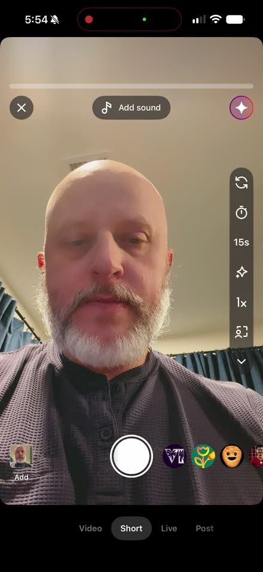

The whole screen is black. The **live preview is a 9:16 card**, x 0–440 pt, y 62–843 pt (440×781),
with about 20 pt continuous corners on all four sides. It starts just under the status bar.
Everything except the mode tabs floats over the preview.

**Top chrome** (over the preview):

- **Progress track**: a full-width hairline bar, x 16–424 pt, about 4 pt tall, at y ≈ 143 pt. It is
  a translucent white-grey capsule and is empty here. In Shorts this is where the recorded segments
  fill *(inferred, never seen filling in this clip)*.
- **Close ✕**: a 40 pt dark translucent circle at the left (centre 36, 180), with a white ✕.
- **Add sound**: a centered dark translucent capsule (≈130×40 pt) with a ♪ glyph and the label "Add
  sound".
- **Sparkle (AI) button**: a 40 pt circle at the right (centre 404, 180). A four-point white star on a
  translucent pink fill, ringed with a purple → red gradient stroke. Never tapped.

**Right-side control rail, collapsed** (x ≈ 385–425 pt, y ≈ 280–620 pt): a single vertical capsule,
about 40 pt wide, filled with black at roughly 55–65 % opacity. Its slots are 50 pt apart. Icons are
white line glyphs, about 22 pt. Text values are white, semibold, about 17 pt. From top to bottom:

| # | Glyph (collapsed) | Label (expanded) | What it does here |
|---|---|---|---|
| 1 | Two curved arrows in a circle (refresh / flip) | Flip | Switches between the front and back camera *(never tapped)* |
| 2 | Stopwatch | Timer | Opens the Timer sheet (§4) |
| 3 | Text **"15s"** / **"3m"** | Duration | Toggles the maximum length; a toast confirms it (§2) |
| 4 | Four-point sparkle with a small sparkle beside it | Effects | Opens the Effects sheet (§5) |
| 5 | Text **"1x"** | Speed | *(never tapped)* |
| 6 | Person inside viewfinder corner brackets | Green screen | *(never tapped)* |
| 7 | Chevron ⌄ | — | Expands the rail (§3) |

Expanded slots 7–10 replace the chevron: **Filters** (three overlapping circles, a Venn-style colour
glyph), **Retouch** (magic wand with sparkles), **Lighting** (sun), and **Close** (chevron ⌃). See
`assets/y2-t012.5-rail-3x-crop.jpg`.

**Bottom row** (over the preview, its centreline at y ≈ 762 pt):

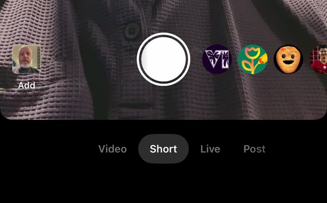

- **Record button**, centred (x 220): a 72 pt white ring around a 60 pt white disc, with a thin dark
  gap between them. At rest it shows no red.
- **Left, "Add"**: a 40 pt rounded-square thumbnail of the latest camera-roll item, labelled "Add"
  underneath. This is the gallery import.
- **Right, the effect carousel**: a horizontal row of 40 pt circular effect thumbnails on a 48 pt
  pitch, starting at x ≈ 292 pt and running off the right edge (GTA VI, Color canvas, Cookie, a
  footballer, and more). These are one-tap AR effects / AI looks.

**Mode tabs** (below the card, at y ≈ 883 pt, on black): **Video · Short · Live · Post**. The
selected tab sits in a dark-grey capsule (≈68×40 pt). The others are mid-grey text. The tabs stay
visible while the rail is expanded, and are covered whenever a sheet is open.

## 2. Duration toggle

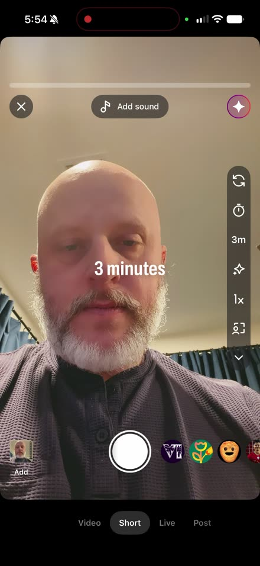

- Here Duration is a **two-state toggle, 15 s ↔ 3 min**. Each tap flips the rail's text between
  "15s" and "3m" (3.0, 4.2 and 5.2 s).
- A **toast** appears in the centre of the preview (y ≈ 453 pt): white, bold, condensed, about 28 pt,
  with a soft shadow and no background. It reads "3 minutes" or "15 seconds".
- The first toast **fades in over ~0.2 s**. When a tap comes while a toast is still showing, the text
  **swaps in one frame**. The toast stays up for at least 1 s after the last tap, then fades with the
  chrome when the Timer sheet opens (gone by 6.6 s).
- The Timer sheet's stop slider then reads **0s … 180s**. So its range follows the chosen Duration
  *(inferred from one sample)*.

## 3. Rail expand / collapse

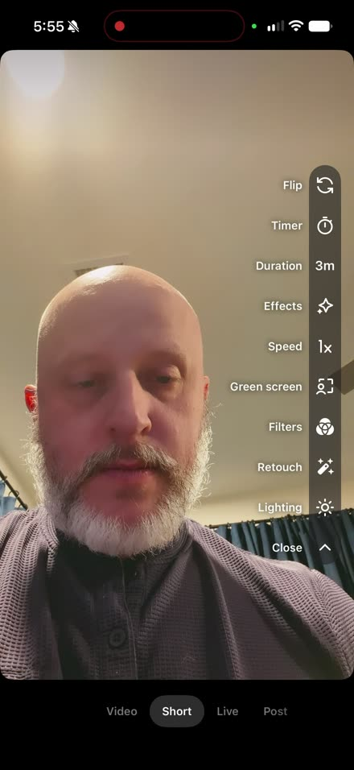 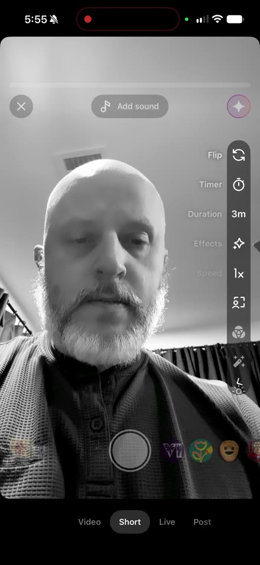

**Expanded state:**

- The capsule becomes 10 slots tall and runs from y ≈ 205 to 697 pt. Its top moves **up** about
  75 pt, into the space the top chrome leaves.
- Each slot gets a **label to its left**: white, about 15 pt, medium weight, right-aligned about 8 pt
  from the capsule, with a soft shadow and no background.
- The **top chrome (✕, Add sound, sparkle, progress track) and the whole bottom row (Add, record
  button, carousel) fade out**. The expanded rail is a modal "settings" moment: you can't record from
  it.
- The last slot, **"Close ⌃"**, collapses it again. After opening Effects or Filters from the
  expanded rail, closing the sheet brings the camera back with the rail **collapsed**.

**Expand motion (43.73–44.13 s, 30 fps):**

1. +0 ms: the chevron is tapped.
2. 0–170 ms: the capsule grows downward and slides up to its expanded top as one motion. New glyphs
   appear in the lower slots, and the top chrome fades out (gone by ~+170 ms).
3. +70–400 ms: the labels fade in **top to bottom, staggered** about 30 ms per row. Flip shows first;
   Lighting and Close are last (fully opaque at ~+400 ms).
4. The bottom row fades out in the same window.

The motion is an ease-out with no visible overshoot, so a critically damped spring of about 0.35 s
fits it *(inferred)*.

**Collapse (48.0–48.3 s):** the reverse. The labels fade out **bottom-first**, the capsule shrinks
back to 7 slots and slides down to y ≈ 280, and the top chrome and bottom row fade in. While it fades
in, the record disc shows mid-grey for 1–2 frames (white at partial opacity over the dark preview).
That is not a pressed state.

## 4. Timer sheet

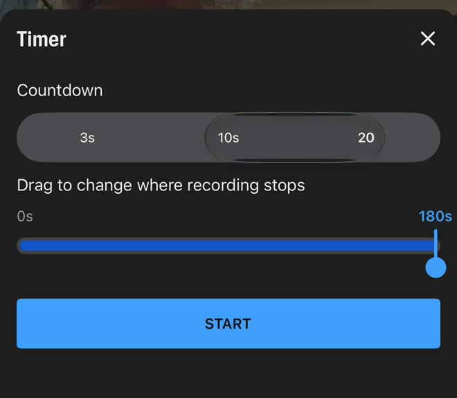

- **Presentation**: a bottom sheet in dark grey (≈ #212121), top edge at y ≈ 579 pt, about 16 pt top
  corners, no grabber. The preview behind it **dims** to about 40 % brightness. The top chrome, rail
  and bottom row hide.
- **Header**: "Timer" (bold, ~20 pt) on the left, 16 pt inset; a ✕ glyph on the right.
- **Countdown**: a label, then a 48 pt tall segmented capsule (mid-grey track) with **3s · 10s ·
  20s**. The selection is a darker **glass-style pill** that slides between segments and **stretches**
  across two segments mid-move (≈0.3 s). Default: **3s**.
- **"Drag to change where recording stops"**: a label, then "0s" at the left end and the current stop
  value at the right end, in blue above the handle ("180s"). The track is about 6 pt thick: a blue
  fill on a dark track. The handle is a 20 pt blue disc with a thin vertical blue line rising from it
  to the value label.
- **START**: a full-width (16 pt inset) blue button, 48 pt tall, about 4 pt corners, with black
  uppercase "START". It starts the countdown and then recording *(inferred; never tapped)*.
- **Motion**: it rises in about 150 ms with no overshoot and drops in about 130 ms. The chrome
  cross-fades in step.
- **What persists**: the countdown choice was set back to 3s before closing, so we can't tell whether
  the sheet remembers it.

## 5. Effects sheet

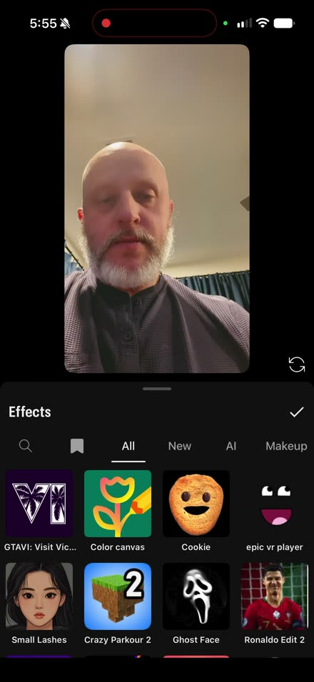

- **Preview shrinks**: when the sheet rises, the live preview scales down to **258×461 pt** (still
  9:16), keeps its top at y 62 and is centred horizontally. A small **flip-camera** glyph sits outside
  its bottom-right corner. The preview and the sheet move in one 0.15–0.2 s motion.
- **Sheet**: black, top at y ≈ 535 pt, with a grabber. "Effects" title and a ✓ to confirm.
- **Tabs**: search 🔍 · bookmark (saved) · **All** (selected, with an underline) · New · AI · Makeup.
- **Grid**: 4 columns of rounded-square effect thumbnails, each with a name under it (GTAVI: Visit
  Vic…, Color canvas, Cookie, epic vr player, Small Lashes, Crazy Parkour 2, Ghost Face, Ronaldo Edit
  2, …).
- ✓ closes it and the preview grows back.

## 6. Filters sheet (the part to keep)

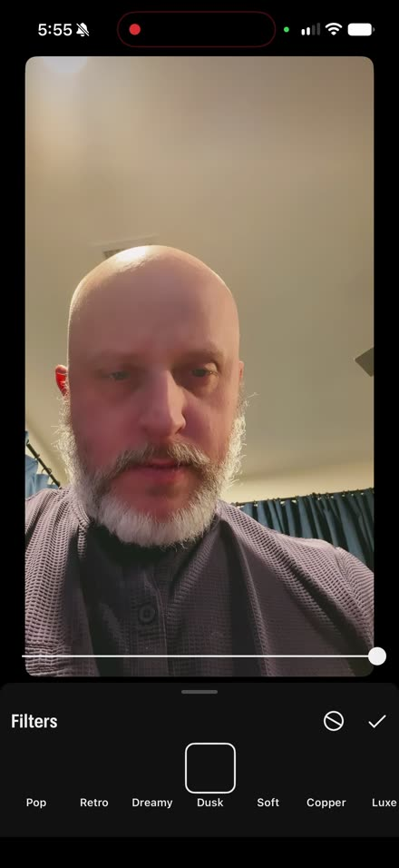 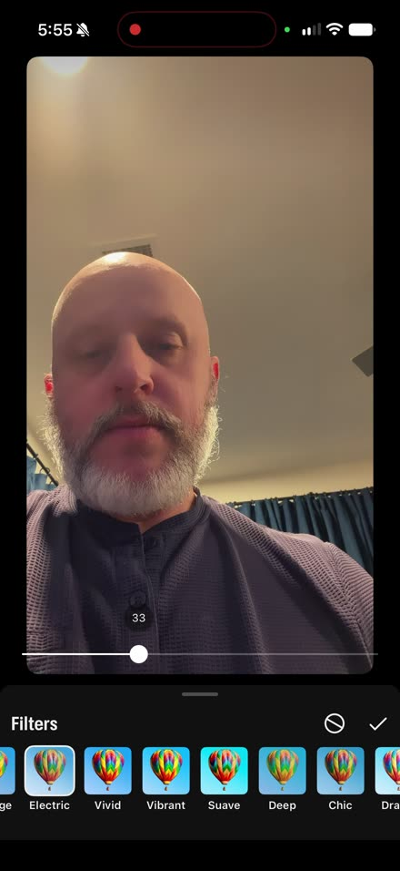 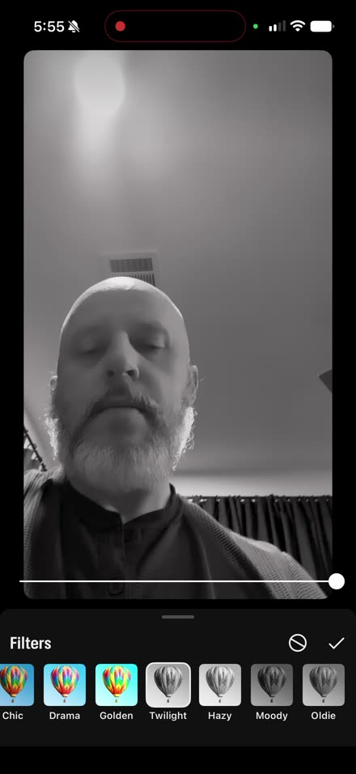

**Layout:**

- The **preview shrinks to 382×677 pt** (9:16), x 29–411, top kept at y 62.
- An **intensity slider lies over the bottom of the preview**: track x ≈ 24–416 pt at y ≈ 718 pt.
  The track is a thin (~2 pt) white line and the knob is a 22 pt white disc. **Range 0–100,
  default 100.**
- While dragging, a **value bubble** floats about 40 pt above the knob: a dark translucent circle,
  ~28 pt, with the white number in it ("33", "38", "100"). It disappears on release.
- **Sheet**: black, top at y ≈ 752 pt, with a grabber. "Filters" title on the left. At the right, a
  **⊘ "no filter"** button, then **✓** to confirm.
- **Carousel**: one horizontally scrolling row of 53 pt rounded-square thumbnails (≈8 pt corners) on
  a 64 pt pitch. Each is the **same sample image (a hot-air balloon on sky) graded with that filter**,
  so the row is a swatch strip. The name sits under each, white, ~13 pt. The **selected** thumbnail
  gets a 2 pt white rounded outline.

**Filter names, in order (20):** Pop, Retro, Dreamy, Dusk, Soft, Copper, Luxe, Vintage, Electric,
Vivid, Vibrant, Suave, Deep, Chic, Drama, Golden, Twilight, Hazy, Moody, Oldie. Twilight, Hazy, Moody
and Oldie are monochrome. One frame shows a stray label ("Drage", "Cld") where two labels overlap
mid-scroll; that is a render artefact, not an extra filter.

**Behaviour:**

1. Tapping a thumbnail applies the filter to the **live preview** at once; no fade was seen between
   two 30 fps frames.
2. Picking a new filter **resets the intensity to 100**. That was seen for Twilight at 36.0, and
   Moody started at 100.
3. Dragging the slider changes the strength continuously (24–88 swept on Electric).
4. ✓ closes the sheet: it falls in about 150 ms, the preview grows back to the full card and the
   chrome fades in. **The filter stays applied** to the camera (42.2 s). The rail shows no
   active-filter badge.
5. ⊘ removes the filter *(inferred; never tapped)*.
6. A light selection haptic on each pick is likely *(inferred)*.

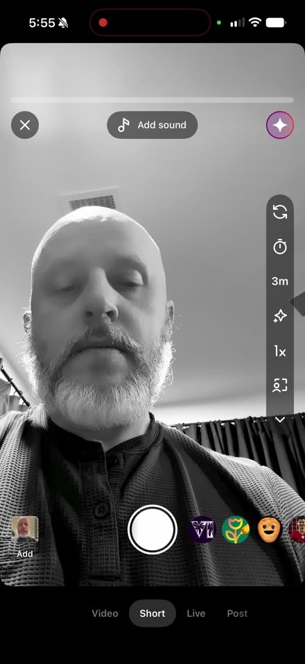

## 7. Motion summary

| Transition | Duration | Character |
|---|---|---|
| Duration toast in | ~200 ms | opacity fade; later toasts swap the text with no animation |
| Timer sheet rise / fall | ~150 / ~130 ms | fast ease-out; chrome cross-fades; preview dims over ~550 ms |
| Countdown pill move | ~300 ms | slide with stretch (glass "liquid" pill) |
| Rail expand | ~170 ms capsule + staggered labels to ~400 ms | ease-out, no overshoot; labels top → bottom |
| Rail collapse | ~300 ms | reverse; labels bottom → top |
| Effects / Filters sheet with preview resize | 150–200 ms | sheet and preview move as one; no overshoot |

## 8. Owner rulings for MakeReady

| Element | Ruling | Note |
|---|---|---|
| Full-bleed 9:16 preview card, black surround | **Keep** | |
| Close ✕ (top left) | **Keep** | |
| Progress track (top) | **Keep** | Shows segments and the chosen length (see `01` for the recording behaviour) |
| Add sound | Drop *(not ruled; not in scope)* | Owner to confirm |
| Sparkle (AI) button, top right | **Drop** | AI tools |
| Effect carousel to the right of record | **Drop** | "AI/other recording overlays and tools to the right of the record button" |
| Add (gallery) to the left of record | Keep *(not ruled)* | Owner to confirm |
| Record button | **Keep** | |
| Mode tabs (Video / Short / Live / Post) | Drop *(not ruled)* | MakeReady has one recording mode; owner to confirm |
| Rail: collapsible capsule with labels on expand | **Keep** | The pattern itself |
| Rail: Flip | **Keep** | |
| Rail: Timer (pre-roll countdown 3/10/20 s) | **Keep** *(not ruled)* | Owner to confirm |
| Rail: Duration 15s / 3m toggle + Timer's "where recording stops" slider | **Change** | One **length slider snapping to 10 s steps, max 2:00**, chosen before recording, plus a **countdown as recording nears the end**. The Timer sheet's stop slider (§4) is the closest visual model: a value label riding the handle. The Duration toast (§2) works as confirmation |
| Rail: Effects + Effects sheet | **Drop** | |
| Rail: Speed | Drop *(not ruled)* | Owner to confirm |
| Rail: Green screen | Drop *(not ruled)* | Owner to confirm |
| Rail: Filters + Filters sheet (§6) | **Keep** | Names, swatch strip, ⊘, ✓ and the 0–100 intensity slider over the preview |
| Rail: Retouch | **Drop** | |
| Rail: Lighting | **Drop** | |
| Rail: **Teleprompter** | **Add** | A new rail slot; icon to be chosen. MakeReady's existing recorder already has a teleprompter (root `CLAUDE.md`) |
| Edit mode with styled, movable text layers | **Keep — emphasise** | **Not shown in this clip**; see `01` |

With the drops applied, the rail is down to **Flip, Timer (if kept), Length, Filters,
Teleprompter**: 4–5 slots. That may fit without the expand / collapse chevron at all, which is a
design call.

## Stills

`assets/` holds 440 pt-wide stills named `y2-t<seconds>-<what>.jpg`, plus three 3× crops:
`y2-t012.5-rail-3x-crop.jpg`, `y2-t000.5-bottom-row-3x-crop.jpg` and
`y2-t008.5-timer-sheet-3x-crop.jpg`. Any other moment can be re-extracted:

```
ffmpeg -ss <t> -i ~/MakeReady/youtube-2.MP4 -frames:v 1 out.png
```
