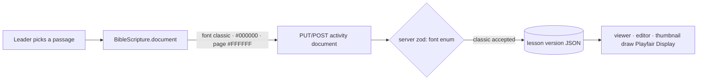

# bible-activity-defaults — spec
> lg · ticket none

## Idea

**Why.** Leaders building a Bible activity on the iPhone get a black page with white Poppins text, the same starting point as a text activity. The owner wants scripture to have its own look from the first frame: a white page, black text, and a classic serif. That serif should be a choice in the font picker for any text too.

**What success looks like.** A leader adds a Bible activity, picks a passage, and sees the verses and the reference line in black Playfair Display on a white page without touching a tool. Every leader sees a fifth font, Playfair Display, in the editor's font picker for text and Bible activities, and text activities still start in Poppins on black.

**In your words.** "New default font option for Bible text is … Playfair Display, Poppins is the default font for normal text" → D3, D4, D5. "Default background color for bible activities is white" → D1. "Default font color on bible activities is black" → D2.

**The concept.**

**How it fits today.** The phone builds every new Bible activity in `BibleScripture.document`¹: a scripture object and a citation object, both font key `display` (Poppins, bible-verse-picker D44) and colour `#FFFFFF`, over `ActivityBackground.default` (`#000000`)² because `ActivityNewContainer` passes no background³. A passage change keeps the leader's page (`replacingPassage`)⁴. Font keys are a closed set of four (`display` Poppins, `sans` Inter, `serif` Source Serif 4, `mono` Courier Prime). The d2m component C-092 `CanvasTextObject` owns that set⁵ and draws each face⁶. The server's zod enum validates it⁷. The app measures text with `ActivityViewerMapper.uiFont`⁸, whitelists keys in `ActivitiesEditorMapper.fontKeys` (unknown → `sans`)⁹, labels them in the editor's one font chip strip, shared by the text and Bible tools¹⁰, and maps them in `ActivityThumbnail`¹¹ and the player¹². White and Black are already in the editor's palettes¹³, and the toolbar turns dark on a light page (bible-verse-picker D35)¹⁴. The web client renders no activity documents.

**Approaches considered.** Chosen: a fifth role-named font key, `classic`, added to the server enum first and then to C-092 through d2m. Rejected: re-pointing `serif` from Source Serif 4 to Playfair Display (silently restyles every existing serif text and removes a face leaders have). Rejected: colours as a separate quick change first (owner chose one spec, 2026-11-12).

¹ `iphone/MakeReady/UI2/Containers/Bible/BibleScripture.swift:63,104` · ² `iphone/MakeReady/State/Models/ActivityDocument.swift:325` · ³ `iphone/MakeReady/UI2/Containers/Programs/ActivityNewContainer.swift:280` · ⁴ `iphone/MakeReady/UI2/Containers/Programs/ActivitiesEditorContainer.swift:805` · ⁵ `iphone/MakeReadyUI/CanvasTextObject.swift:41` · ⁶ `iphone/MakeReadyUI/CanvasTextObject.swift:1031` · ⁷ `server/src/services/activity-document.ts:36` · ⁸ `iphone/MakeReady/UI2/Viewer/ActivityViewerMapper.swift:355` · ⁹ `iphone/MakeReady/UI2/Containers/Programs/ActivitiesEditorMapper.swift:146` · ¹⁰ `iphone/MakeReadyUI/Screens/Activities/ActivitiesEditorScreen.swift:2980` · ¹¹ `iphone/MakeReady/UI2/Containers/Programs/ActivityThumbnail.swift:183` · ¹² `iphone/MakeReadyUI/Screens/Activities/ActivitiesPlayerScreen.swift:889` · ¹³ `ActivitiesEditorScreen.swift:2935,2955` · ¹⁴ `ActivitiesEditorMapper.swift:121`

## Apps

| App | In scope | What changes | Section |
|---|---|---|---|
| server | ✅ | Text-object font enum accepts `classic`; Bible fixtures use the new defaults | §server |
| client | ⬜ | Renders no activity documents (no reader of `content.objects` or `font` in `client/`), so nothing to draw | — |
| iphone | ✅ | Playfair Display bundled; C-092 font set gains `classic` (via d2m); editor picker, viewer, thumbnail and player map it; new Bible activities default to `classic`, black text, white page | §iphone |

**Sequencing:** contract settled → server accepts `classic` and verifies (contract FREEZES) → iphone builds against it → the walk.

**Backward compatibility:** additive. The server accepting one more enum value breaks no reader. A RELEASED iPhone build decodes `font` as a `String` and maps an unknown key to `sans` (`ActivitiesEditorMapper.fontKey`), so a `classic` activity shows in Inter there rather than failing. A released build never writes `classic`. The iPhone must not write `classic` before the server accepts it, which the sequencing guarantees.

**Blast radius:** every activity document write goes through the zod schema (`activity-document.ts`) — lesson-version saves, program publish/export/import, templates. Widening the enum changes none of them. C-092 is drawn by the editor, the player, the viewer and thumbnails.

## Decisions

<!-- The one place rulings live. Record the DECISION — and, in one line, why, and why the rejected option lost. A stated preference
     is the INPUT to a row, not the row. Write each Ruling as something later code can be checked
     against without re-interpretation:
       · positive and specific — "store the full number, mask at render", not "don't truncate"
       · scope named — which apps, screens or endpoints it binds
       · "etc." / "and so on" expanded into the list, or the test for membership stated
       · the rejected alternative named, with the reason it lost (check-obligations warns on a bare one)
       · the enforcement hook, where one exists (lint rule, script, test)
     🔴 NEVER quote the user's prompt as the ruling. Operationalize it: a closed list, a measured
     value, an enumerated set of deviations. A ruling a stranger could implement two ways is not
     written yet.
     Who/date carries the provenance, so the Ruling itself needs no quote marks.
     The owner's own words go in §Idea "In your words", linked to this row — never in the Ruling.
     OPEN rows block the build go-ahead. Never delete a ruling; supersede it in place with a date. -->

| # | Decision | Ruling | Who / date |
|---|---|---|---|
| D1 | New Bible activity page | `BibleScripture.document` writes `background: { color: "#FFFFFF" }` when no background is passed. Bible kind only: `ActivityBackground.default` stays `#000000`, so text activities keep the black page. A passage change keeps the leader's background. Rejected: changing the shared default (would turn text activities white too). | owner 2026-11-12 |
| D2 | New Bible text colour | Both objects `BibleScripture.document` writes, scripture and citation, get `color: "#000000"`. Rejected: white (unreadable on D1's page). | owner 2026-11-12 |
| D3 | New Bible face | Both objects get `font: "classic"`, drawn in Playfair Display, and `BibleScripture.height` measures with key `classic` at weight 400. Supersedes bible-verse-picker D44 (Poppins). Rejected: Poppins (the owner chose a scripture serif). | owner 2026-11-12 |
| D4 | Text default face | New text activities and objects keep `display` (Poppins). Nothing outside the Bible path changes its default face. Rejected: Playfair Display for all new text (the owner kept Poppins as the text look). | owner 2026-11-12 |
| D5 | Where Playfair Display is offered | One font list of five, in this order: Poppins (`display`), Inter (`sans`), Source Serif 4 (`serif`), Courier Prime (`mono`), Playfair Display (`classic`). It is used by both the text tool and the Bible tool. Rejected: Bible-only (a second list to keep in step, for no gain). | owner 2026-11-12 |
| D6 | The key's name | `classic`: a role, never a platform name (C-092 D6). Rejected: `playfair` (names the family, breaks C-092 D6). | (assumed at brainstorm) 2026-11-12 |
| D7 | Existing activities | No migration and no backfill: documents already stored keep their font, colours and page. Rejected: restyling stored Bible activities (zero users, and it would overwrite leader choices). | (assumed at brainstorm) 2026-11-12 |
| D8 | Fixtures | `server/fixtures/screens/bible-reader.ts` `d10Document` uses `font: 'classic'` on both objects, `color: '#000000'` and page `#FFFFFF`. `legacyDocument` (the converter-shaped sample, bible-verse-picker D23) and `activity-samples.ts` are unchanged. Rejected: leaving d10 as is (a walk would show the old look). | (assumed at brainstorm) 2026-11-12 |
| D9 | Bundled faces | Playfair Display static TTFs from Google Fonts (SIL OFL 1.1): Regular, Medium, Bold and their italics, under `iphone/MakeReadyUI/Resources/Fonts/PlayfairDisplay/` with `OFL.txt`, registered by C-092's font registration like the other families. Weights map 400 → Regular, 500 → Medium, 700 → Bold, as for Poppins. Rejected: the variable font (only `serif` uses a variable face; static files keep `face()` and `uiFont` one-line cases). | (assumed at spec) 2026-11-12 |
| D10 | How C-092 changes | The iPhone change to `CanvasTextObject.Font`, C-092 `face()`, and the editor's `fontItems` (`ActivitiesEditorScreen`, a d2m-built view) goes to d2m through `request_project_change`, never edited in place. App-side files (`ActivitiesEditorMapper`, `ActivityViewerMapper`, `ActivityThumbnail`, `BibleScripture`) are edited by the build. Rejected: editing `iphone/MakeReadyUI/` directly (d2m owns it; root CLAUDE.md rule). | (assumed at spec) 2026-11-12 |
| D12 | Font chip sample | C-035 FilterChip's `fontFace` draws the `classic` chip label in Playfair Display Regular (`CanvasTextObject.Font.classic.face(weight: .regular, …)`), as `serif` is drawn Regular. C-092's system fallback (`CanvasTextObject.swift:1104`) maps `classic` → `.serif` design. Both are carried in the D10 d2m request. Rejected: Bold, as `display` uses (Playfair Display's Regular already reads as a display serif; Bold crowds the 36pt chip). | (assumed at audit) 2026-11-12 |
| D11 | Editor preview default | `ActivitiesEditorScreen.State.bibleFace`'s preview default becomes `classic`, carried in the same d2m request as D10. Rejected: leaving `serif` (the preview would disagree with what a new activity gets). | (assumed at spec) 2026-11-12 |

## Contract

| Contract | Producer | Consumers | Auth | Request | Response | Errors |
|---|---|---|---|---|---|---|
| Activity document text object `font` (every endpoint that accepts an activity document: lesson-version activity create/update, publish, import, templates) | server | iphone | unchanged (each endpoint's own) | `content.objects[].font` ∈ `display` · `sans` · `serif` · `mono` · **`classic`** | unchanged; stored documents echo `font` as written | unchanged: any other value → the existing 400 zod validation error |

## Schema & API changes

| # | ADD/EDIT/RENAME/REMOVE | Model.field | Wire | Reason | Status |
|---|---|---|---|---|---|
| SC1 | EDIT | activity document `TextObject.font` (JSON, zod in `activity-document.ts`) | enum gains `classic` | D3, D5 | proposed |

No database schema change: the document is stored as JSON, so no migration (established 2026-11-12).

**Data plan:** none. Additive enum value, no stored row changes (D7).

## server

- `server/src/services/activity-document.ts:36`: `font: z.enum(['display', 'sans', 'serif', 'mono', 'classic'])`.
- `server/fixtures/activity-documents.ts:13`: the helper's `font` type gains `'classic'` (the `server-fixture-types` check compiles it).
- `server/fixtures/screens/bible-reader.ts`: D8.
- Tests: a document with `font: 'classic'` validates; `font: 'playfair'` still fails with the existing validation error.
- 🔴 `docker restart makeready-server` after the edit.

## iphone

1. **Fonts (d2m, D9/D10):** one `request_project_change` to d2m covering C-092 and the editor screen:
   - bundle Playfair Display (D9) and register it;
   - `CanvasTextObject.Font` gains `.classic`, and `face()` draws it as `PlayfairDisplay-<Regular|Medium|Bold>[Italic]`;
   - `ActivitiesEditorScreen.fontItems` becomes D5's five-item list, with the label "Playfair Display";
   - C-035 `FilterChip.fontFace` (`FilterChip.swift:264`) and C-092's system fallback (`CanvasTextObject.swift:1104`) handle `.classic`, per D12. Both switches are exhaustive, so the build fails without them;
   - the capture fixtures' string → `Font` mappings (`MakeReadyCaptureTests/ViewRegistry.swift:1007`, `:2832`) gain `classic`;
   - the screen's key ⇄ `Font` mapping (`ActivitiesEditorScreen.swift:2861`, `:2870`) and the player's mapping (`ActivitiesPlayerScreen.swift:889`) handle `classic`;
   - D11.

   Pass this SPEC as a `references` document on the branch. Wait with `wait_project_change` and settle any handback from this spec.
2. **App-side mapping:**
   - `ActivitiesEditorMapper.fontKeys` gains `classic`;
   - `ActivityViewerMapper.uiFont` draws `classic` as `PlayfairDisplay-<style>`, falling back to the system font like the others;
   - `ActivityThumbnail` maps `classic` → `.classic`.
3. **Bible defaults (D1–D3):** in `BibleScripture`:
   - `textObject` writes `font: "classic"` and `color: "#000000"`;
   - `document(for:background:)` falls back to `{ color: "#FFFFFF" }`, not `ActivityBackground.default`;
   - `height(of:)` measures with key `classic`;
   - comments citing D44 are updated to this spec.
4. **Tests (XCTest, `MakeReadyCaptureTests`):**
   - a new Bible document has both objects `font == "classic"` and `color == "#000000"`, and background colour `#FFFFFF`;
   - a passage change keeps a custom background (existing coverage, extended if absent);
   - `ActivitiesEditorMapper.fontKey("classic") == "classic"`;
   - the measuring font for `classic` resolves to a Playfair Display face, not the system fallback.

   Test class names match their files (iphone-xctest-class-must-match-file).

## Testing

**server:** the zod tests above, in the server vitest suite.
**iphone:** the XCTests above, plus the d2m preview captures that d2m re-renders for C-092 and the editor screen.
**Cross-app walk (the one E2E):** local server on this branch; iPhone dev build on Local, identity Fixtures.
1. Open a program's lesson → add activity → Bible → pick John 3:16–18. The page is white, the verses and the reference line are black Playfair Display, and the toolbar icons are dark.
2. Open the font tool on the scripture. Five fonts show in D5's order, with Playfair Display selected. Switch to Poppins, then back. The text redraws each time.
3. Add a highlight. It reads clearly on white.
4. Add a text activity. It starts in Poppins on the black page. Its font picker lists the same five, and choosing Playfair Display saves without error.
5. Change the Bible activity's passage. The white page and black text stay.
6. Leave the lesson and come back. The thumbnail and viewer show Playfair Display.

**Human verification:** the owner runs the walk above on the device and signs off.

## Out of scope

- The web client (renders no activity documents).
- Restyling stored activities (D7).
- Changing the text activity defaults (D4).
- New highlight colours for light pages. The walk checks contrast (step 3), and a failure becomes a follow-up.

## Findings & risks

| # | Finding | Resolution |
|---|---|---|
| F1 | The iPhone font change waits on a d2m handover (D10); d2m may hand questions back. | build-time risk: Phase 2 Task 1 settles it through `wait_project_change`. |
| F2 | Highlight colours were chosen against dark pages. | build-time risk: walk step 3; a follow-up if they read poorly. |
| F3 | Two more exhaustive switches over `CanvasTextObject.Font` exist outside the editor: C-035 `FilterChip.fontFace` (`FilterChip.swift:264`) and C-092's system fallback (`CanvasTextObject.swift:1104`). Adding `.classic` breaks the build without them. | fixed in place: §iphone item 1 and D12 add both to the d2m request. |
| F4 | The server fixture helper declares its own font union (`server/fixtures/activity-documents.ts:13`); D8's `'classic'` fails `server-fixture-types` without it. | fixed in place: §server. |
| F5 | contract: parity checked. The server's single zod enum (`activity-document.ts:36`) is the only server reader. The iPhone decodes `font` as `String` (`ActivityDocument.swift:46`), and every app-side mapping defaults unknown keys. Client ⬜ re-derived: no reader of activity documents in `client/`. Additive for released builds. | no change. |

## Plan

The plan, task by task: `docs/features/bible-activity-defaults/PLAN.md` (§PLAN.md).

- Phase 1 · Task 1 · Accept the `classic` font key and restyle the Bible fixture
- Phase 2 · Task 2 · d2m adds Playfair Display to the canvas text components
- Phase 2 · Task 3 · Map `classic` app-side and default new Bible activities to it
