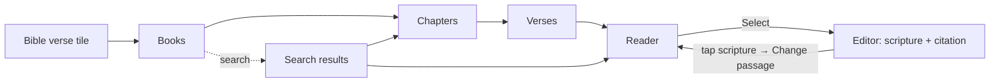

# bible-verse-picker — spec
> lg · ticket none

## Idea

**Why.** Leaders building a lesson in the UI 2.0 iPhone app cannot add scripture: the **Bible verse** tile on the
activity type grid is dimmed and inert. The 1.0 app's passage picker had the right flow; it needs to live in 2.0,
look like 2.0, and make scripture first-class — chosen at word level, always cited exactly, and tied to its verses
so every highlight knows where it is.

**What success looks like.** A leader taps **Bible verse**, finds John 3 by browsing or by typing "john 3:16",
highlights exactly the words they want (down to part of a verse), taps **Select**, and lands back in the editor
with the scripture on the page under a citation like *John 3:16b–18 KJV*. They can restyle and highlight it, tap it
to change the passage, and the highlights stay on the right words.

**In your words.**
- "the experience we had in the 1.0 app is correct in terms of the flow and how it works, however it needs to be
  styled to match the aesthetic of the 2.0 UI" → D1
- "it loads the modal from the right and pushes the main content to the left" → D2
- "minimal and simple, try not to create new components if you can help it. If you feel a new component is
  necessary, let's discuss before you do it." → D3, D4
- "text highlighting and identification of the reference is super important" → D4, D8, D9, D10, D11, D13
- "we have to preserve the book colors so people can easily identify groups of books like major and minor
  prophets" → D5

**The concept.** The 1.0 flow — books → chapters → verses → reader, with search and a translation menu — rebuilt as
2.0 pushed pages. The reader is the one new component: verse rows that select at word level. What is selected is
stored as verse + word offsets into a canonical verse text the server defines, so the picker, the stored activity,
the editor's highlights and (spec 2) members' highlights all point at the same words.

**How it fits today.** The server already accepts a `bible` activity kind whose content is a canvas plus
`passages[]`[^1]; the editor and player already draw `listStyle: bibleVerse` text with superscript numbers and
yellow highlights[^2]. The 1.0 picker is a 2,145-line UIKit overlay[^3] outside the 2.0 app target. Chapters,
search and recents are served by existing endpoints[^4].

**Approaches considered.** Chosen: a dedicated verse-row reader (owner's pick). Rejected: giving C-092
CanvasTextObject a selecting state (one text component everywhere, but the owner preferred a reader built for
selection); a verse-number grid without a reader (leaders couldn't read while choosing).

[^1]: `server/src/services/activity-document.ts:12, :83-98`
[^2]: `iphone/MakeReadyUI/CanvasTextObject.swift:65, :443-452, :655`
[^3]: `iphone/MakeReady/Pages/Bible/BibleReaderOverlay.swift`
[^4]: `server/src/routes/bible.ts:92, :328`; `server/src/routes/search.ts:877, :1202`

## Apps

| App | In scope | What changes | Section |
|---|---|---|---|
| server | ✅ | `passages` gain word offsets + translation; chapter verse text normalized; per-item recent-search delete; `bible` document validation | §server |
| iphone | ✅ | the picker (4 pushed pages + search), the verse-row reader, DayChip/SearchResultRow variants, category colour tokens, Bible activity create + edit | §iphone |
| client | ⬜ | Leaders author in the iPhone app; the web admin has no 2.0 activity editor. Member reading/highlighting on web is spec 2 (member-highlights) | — |
| capture | ⬜ | Removed 2026-10-30; d2m's render lane captures the new previews as part of the iPhone work | — |

**Sequencing:** contract settled → server implements and verifies (contract FREEZES) → iPhone builds against it →
d2m captures → the walk.

**Backward compatibility:** the iPhone app is a released artifact. A released 1.0 build reads
`GET /api/bible/:code/:book/:chapter`; normalizing verse text (D9) removes `¶` and stray whitespace it already
stripped on screen — safe. The `passages` fields are additive and optional; a document without them reads as whole
verses. No released build creates `bible` activities.

**Blast radius:** the activities player (reads `passages`, draws scripture), lesson thumbnails
(`ActivityThumbnail` renders canvas kinds incl. `bible`), search recents (shared with Search home).

## Decisions

<!-- The one place rulings live. Record the DECISION — and, in one line, why, and why the rejected option lost. A stated preference
     is the INPUT to a row, not the row. Write each Ruling as something later code can be checked
     against without re-interpretation:
       · positive and specific — "store the full number, mask at render", not "don't truncate"
       · scope named — which apps, screens or endpoints it binds
       · "etc." / "and so on" expanded into the list, or the test for membership stated
       · the rejected alternative named, with the reason it lost (check-obligations warns on a bare one)
       · the enforcement hook, where one exists (lint rule, script, test)
     🔴 NEVER quote the user's prompt as the ruling. Operationalize it: a closed list, a measured
     value, an enumerated set of deviations. A ruling a stranger could implement two ways is not
     written yet.
     Who/date carries the provenance, so the Ruling itself needs no quote marks.
     The owner's own words go in §Idea "In your words", linked to this row — never in the Ruling.
     OPEN rows block the build go-ahead. Never delete a ruling; supersede it in place with a date. -->

| # | Decision | Ruling | Who / date |
|---|---|---|---|
| D1 | The flow | The picker has exactly these screens: Books, Chapters, Verses, Reader, and Search (a state of Books). Navigation: Books → tap book → Chapters → tap chapter → Verses → tap verse → Reader at that verse; Search → tap a verse result → Reader at that verse; Search → tap a book result → Chapters. A one-chapter book still shows Chapters. Rejected: skipping levels (diverges from the 1.0 flow the owner ruled correct) | owner 2026-11-10 |
| D2 | Presentation | Each screen is its own 2.0 push (`NavigationStack`, slides in from the right, edge-swipe back), `isFullScreen` (no TabBar), header C-040 PageHeader. Books shows a back chevron that leaves the picker; the Reader uses `.backAndLink` with trailing **Select**, enabled only while a selection exists. Select pops the whole picker and returns the pick to its caller. Rejected: 1.0's slide-up sheet (owner: same transition as the rest of 2.0) | owner 2026-11-10 |
| D3 | Components | The picker uses only existing 2.0 components plus: one **(new)** component, the verse-row reader (D4); variants on C-052 DayChip (D5) and C-085 SearchResultRow (D6); seven colour tokens (D5). Any other new component returns to the owner first. Reused unchanged: C-040, C-131, C-034, C-035, C-036, C-066, C-076, C-132, C-088 | owner 2026-11-10 |
| D4 | The reader | **(new)** component BibleVerseReader: one row per verse — the verse number in a left gutter, the verse text beside it in `passageVerse` (18/25.2) — preceded by a chapter heading. Selection: touch-and-hold on a word starts a selection at that word and dragging extends it across rows; selections snap outward to whole words; once a selection exists, a handle at each end adjusts it. Tapping a verse number selects that whole verse, or extends the selection to include it when one exists; tapping a number inside the selection clears it; tapping outside the selection clears it. Selected words draw on `accent20`; words already used by this lesson draw a fainter `accent20` underlay (D16). Horizontal swipe moves to the next/previous chapter (crossing books; rubber-bands at Genesis 1 and Revelation 22) and clears the selection. One contiguous range within one chapter. Rejected: extending C-092 with a selecting state (owner chose a reader built for selection) | owner 2026-11-10 (selection gestures assumed at spec) |
| D5 | Grid cells | C-052 DayChip gains a text-label content case. Books: 5 columns, OLD TESTAMENT then NEW TESTAMENT under `sectionOverline` captions, each chip filled with its category colour — Law and Pauline Epistles olive, History and Major Prophets teal, Wisdom green, Minor Prophets and General Epistles brown, Gospels/Acts and Apocalyptic maroon (1.0's hexes as seven new colour tokens via d2m `set_color_token`). Chapters and verses: DayChip number cells, 6 columns. A book, chapter or verse used by this lesson (D16) shows a 2 pt `accent` outline; the fill never changes for "used". Rejected: dropping category colours (owner: groups must be identifiable); a 66-row book list | owner 2026-11-10 |
| D6 | Search rows | C-085 SearchResultRow gains `book` (book name; "N chapters · Old/New Testament"; a category-colour dot) and `verse` (reference; one-line snippet, or a named passage's title + 2-line summary) kinds. Recents use C-085's trailing remove. Rejected: plain C-085 (book and verse results indistinguishable) | owner 2026-11-10 |
| D7 | Translation | Books carries C-131 SearchFilterHeader (`underScreenHeader`); its chip row holds one C-035 FilterChip `menu` showing the full translation code ("WEBBE", never truncated), opening C-036 single-select listing `GET /api/bible/translations` popular-first (KJV, NIV, ESV, NASB, NLT, NKJV, CSB, BSB, WEB, ASV) then by name. The choice is the app-wide `selectedBibleTranslation` (default KJV). Switching in the Reader reloads the chapter at the verse currently at the top and clears the selection; switching re-runs an active search. Rejected: 1.0's chip inside the field (4-char truncation; search not re-run) | owner 2026-11-10 (assumed at brainstorm: chip row) |
| D8 | Passage shape | A passage is `{bookNumber, chapterStart, verseStart, chapterEnd, verseEnd, startOffset?, endOffset?, translation}`: `startOffset` is the UTF-16 offset into verse `verseStart`'s canonical text (D9) where the selection begins, `endOffset` the exclusive end within `verseEnd`; absent = whole verse. `translation` is the code the text came from. Rejected: whole verses only (owner: select by highlighting words) | owner 2026-11-10 |
| D9 | Canonical verse text | The server normalizes every verse's `text` in chapter responses: remove `¶`, replace `\r` and `\n` with a space, collapse runs of spaces to one, trim. Offsets (D8), the stored scripture (D10) and highlights all index into this exact string; the client never re-normalizes. Enforced by a server test over a fixture verse with `¶` and line breaks. Rejected: client-side cleaning (1.0 cleaned on screen but not on save, so offsets drifted) | (assumed at spec) 2026-11-10 |
| D10 | The inserted scripture | Select creates (or, D12, replaces) a `bible` activity whose canvas holds: one text object `role: scripture`, `listStyle: bibleVerse`, `startNumber` = `verseStart`, `text` = the selected verses joined by `\n` (first and last verse trimmed by the offsets), `font: serif`, `reference` = `{start:{book, chapter, verse, offset?}, end:{…}, translation}`; and one text object `role: citation` whose text is the reference formatted by BibleReferenceFormatter plus the translation code (e.g. "John 3:16b–18 KJV", `b` marking a partial verse). `content.passages` holds the D8 passage. Activity title = the citation without the translation. Rejected: a free text block (verse identity lost) | owner 2026-11-10 (layout assumed at spec) |
| D11 | Locked scripture | In the editor, `role: scripture` and `role: citation` objects cannot be typed into, and their text cannot be deleted; they can be moved, scaled, rotated, restyled (font, size, colour, alignment, animation, effect) and highlighted, with notes. Deleting the object deletes the whole passage after a confirmation. Rejected: editable text (highlight→verse mapping breaks); a fixed scripture style | owner 2026-11-10 |
| D12 | Changing the passage | Tapping the scripture or citation object in Idle opens C-066 ActionMenuOverlay with **Change passage** and **Highlight**. Change passage pushes the picker at the current passage (Reader, current chapter, current selection shown). Highlight enters Highlighting mode on it. Rejected: a sixth tool (adds a tool); a tappable citation alone (not discoverable) | owner 2026-11-10 |
| D13 | Highlights on change | When the passage changes, a highlight whose words are all inside the new passage is kept and re-anchored by verse + offset; any other highlight is removed. If any would be removed, a C-066 confirmation states the count ("2 highlights are outside the new passage and will be removed") before saving. Rejected: clearing all (loses work on unchanged verses) | owner 2026-11-10 |
| D14 | Long passages | A passage whose scripture does not fit the page at its default size is split at verse boundaries into consecutive `bible` activities in the lesson, inserted where the activity is (D37 slot), each with its own `passages` entry and citation. Fit = the laid-out scripture + citation height at the default style exceeds the page's text area (440×956 reference, minus 96 pt top and bottom). Rejected: shrinking to fit (unreadable); capping the selection (limits leaders) | owner 2026-11-10 (split as activities assumed at spec) |
| D15 | Entry points | The **Bible verse** tile is enabled on the New Activity page and in the editor's in-place type grid (`unavailableTypes` loses `bibleVerse`). Tapping it pushes Books; Select creates the activity at the placeholder slot (text-activity-v2 D37) and opens it in the editor; Back from Books creates nothing. Rejected: — (owner asked for the tile to work) | owner 2026-11-10 |
| D16 | "Used" | Used = any word covered by a `passages` entry of a `bible` activity in the same lesson's draft (D5 outline, D4 underlay). Rejected: program-wide (noisy across 30 days) | (assumed at spec) 2026-11-10 |
| D17 | Search | Search behaves as 1.0: focusing the field shows recents (or "Type to search the Bible"); typing searches after 300 ms with no minimum; results show a Books section then a Verses section; return dismisses the keyboard. Recents delete one at a time (C-085 remove). Errors surface the top banner with Retry; no results shows C-132 "No results found". Rejected: — | owner 2026-11-10 (behaviour from 1.0) |
| D18 | 1.0 defects not carried | The verses grid shows a spinner until the chapter's count arrives (never the previous chapter's); a chapter load failure shows the banner with Retry; abbreviations are unique ("Phil" Philippians, "Phlm" Philemon); no hardcoded colours. Rejected: — | (assumed at spec) 2026-11-10 |
| D19 | Member highlights | Out of this spec: member highlighting (server storage + member web) is spec 2, keyed on D8/D9's verse + offset identity. Rejected: one spec across three apps (long build, one late walk) | owner 2026-11-10 |
| D20 | Translation copyright | The citation shows the translation code only; the chapter's `copyright` text is shown under the Reader's last verse. Rejected: copyright in every citation (clutters the page) | (assumed at spec) 2026-11-10 |

## Contract

| Contract | Producer | Consumers | Auth | Request | Response | Errors |
|---|---|---|---|---|---|---|
| `GET /api/bible/translations` (unchanged) | server | iphone | session | — | `{translations:[{id, code, name, language, copyright, popularity}]}` | 500 |
| `GET /api/bible/:code/:book/:chapter` (EDIT: D9) | server | iphone | session | path params | `{verses:[{verse, text}], copyright, …}` — `text` normalized per D9 | 404 empty chapter |
| `POST /api/search/smart` (unchanged) | server | iphone | session | `{query, translation, limit:10}` | `direct` / `grouped` (`books[]`, `verses[]`) | 400, 500 |
| `GET /api/search/recent?type=bible` (unchanged) | server | iphone | session | — | `{searches:[{id, query, type, createdAt}]}` | — |
| `DELETE /api/search/recent/:id` (NEW) | server | iphone | session | path `id` | `{success:true}` | 404 not the caller's |
| `POST /api/lesson-versions/:id/activities` (EDIT: `bible`) | server | iphone | session | `{kind:"bible", title, document}` — passages per D8, objects per D10 | `{activity}` | 400 invalid passage, 409 not draft |
| `PUT /api/content-activities/:id` (EDIT: `bible`) | server | iphone | session | `{document}` | `{activity}` | 400, 409 |
| `PATCH /api/lesson-versions/:id/activities/order` (unchanged) | server | iphone | session | `{activityIds}` | `{activities}` | 400, 409 |

## Schema & API changes

| # | ADD/EDIT/RENAME/REMOVE | Model.field | Wire | Reason | Status |
|---|---|---|---|---|---|
| SC1 | EDIT | activity-document `bibleContent.passages[]` | `+startOffset?: int ≥0, +endOffset?: int ≥0, +translation: string` | D8 | planned |
| SC2 | EDIT | activity-document `textObject.reference` (bible) | validated: `{start:{book:int, chapter:int, verse?:int, offset?:int}, end?:{…}, translation:string}` | D10 | planned |
| SC3 | EDIT | `GET /api/bible/:code/:book/:chapter` verse `text` | normalized per D9 | D9 | planned |
| SC4 | ADD | route `DELETE /api/search/recent/:id` | caller's own row only | D17 | planned |

**Data plan:** no table changes — `passages` and `reference` live in the activity document JSON. Existing `bible`
documents (none created by any released client) stay valid: the new fields are optional except `translation`,
which the server fills with `KJV` when absent on read.

## server

- `activity-document.ts`: extend `bibleContent.passages` (SC1) and validate a `bible` document's `role: scripture`
  object `reference` (SC2); a `bible` document must hold exactly one `scripture` object per passage, its
  `startNumber` equal to `verseStart`.
- `routes/bible.ts`: one `normalizeVerseText` (D9) applied wherever chapter verses are returned (SC3).
- `routes/search.ts`: `DELETE /recent/:id` (SC4), scoped to the caller (user or member).
- Tests: normalizer fixture; passages validation (offsets, translation, reversed range → 400); delete-recent scope.

## iphone

- **Destinations** (`UI2ShellModel`): `.bibleBooks(context)`, `.bibleChapters(book, context)`,
  `.bibleVerses(book, chapter, context)`, `.bibleReader(book, chapter, verse, context)`, all `isFullScreen`.
  `context` carries the caller (new activity in a lesson at a slot, or an existing activity to change) and the
  lesson's used passages; the pick returns through a result hand-back like `ActivityBackgroundPick`.
- **Screens (d2m-built, `MakeReadyUI/Screens/Bible/`)**: BibleBooksScreen (C-040 + C-131 + DayChip grid + search
  results), BibleChaptersScreen, BibleVersesScreen (DayChip grids), BibleReaderScreen (C-040 `.backAndLink` +
  BibleVerseReader). Requested through d2m (`request_project_change`) with this SPEC as the reference.
- **Components (d2m)**: BibleVerseReader **(new)**; C-052 DayChip label case + category fill + used outline;
  C-085 `book`/`verse` kinds; seven category colour tokens.
- **State/Actions**: `BibleActions` (translations, chapter fetch with the existing disk cache, smart search,
  recents load/delete) writing AppState; `selectedBibleTranslation` stays app-wide.
- **Containers**: the four pages; the editor's Bible handling — D11 locking in `ActivitiesEditorContainer`, the
  D12 menu, D13 re-anchoring, D14 splitting, creating via `ActivityNewContainer.Actions` (kind `bible`).
- **Recipes**: `/present-overlay` for the D12/D13 menus, `/ios-error-surface` for D17/D18 banners.

## Testing

- **server** (vitest): D9 normalizer; SC1/SC2 validation incl. offsets past the verse length → 400; SC4 scope.
- **iphone** (XCTest): passage → document mapping (D10) incl. partial verses and the citation string; D13
  re-anchoring (kept / removed counts); D14 split points; D16 used computation; D7 popular-first ordering;
  BibleActions decoding.
- **Cross-app E2E walk** (device, Local server):
  1. Lesson → ＋ → Bible verse → Books shows OT/NT colour groups; Minor Prophets read as one colour.
  2. Search "john 3:16" → verse result → Reader at 3:16; hold "loved" and drag to "life" (3:16–3:18) → Select.
  3. Editor shows the scripture with numbers 16–18 and "John 3:16b–18 KJV"; the text can't be typed into.
  4. Highlight "eternal life"; tap the scripture → Change passage → extend to 3:21 → highlight kept.
  5. Change to 3:1–2 → confirmation names the removed highlight.
  6. Pick John 3:1–36 → it splits into consecutive Bible activities, each with its own citation.
  7. Switch to WEB in the Reader → chapter reloads at the current verse, selection cleared.
- **Human verification script:** the walk above, steps 1–7, on device.

## Out of scope

- Member highlighting and member-side Bible reading — spec 2 (member-highlights, server + member web).
- More than one passage per pick, and passages spanning chapters (1.0 picked one range in one chapter).
- Changing the 1.0 overlay (stays on disk, outside the 2.0 app target).
- Bookmarks and Bible notes (`/api/bible/bookmarks`, `/notes` — member features).

## Findings & risks

| # | Finding | Resolution |
|---|---|---|
| F1 | 1.0's word-snap logic (`HighlightSnapping.swift`) was deleted in d168a9ee | Reference only: `git show 1647dc88:iphone/MakeReady/Utilities/HighlightSnapping.swift` |
| F2 | Whether `BibleCacheManager` / `BibleSearchService` are in the 2.0 app target is unverified | The audit checks target membership; if absent, `BibleActions` takes over their endpoints |
| F3 | Some translations' licences may require the copyright notice with quoted text | D20 shows it in the Reader; the audit checks `copyright` values for an explicit requirement |
