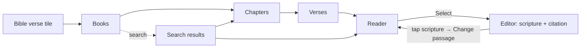

# bible-verse-picker — spec
> lg · ticket none

## Idea

**Why.** Leaders building a lesson in the UI 2.0 iPhone app cannot add scripture: the **Bible verse** tile on the
activity type grid is dimmed and inert. The 1.0 app's passage picker had the right flow; it needs to live in 2.0,
look like 2.0, and make scripture first-class — chosen at word level, always cited exactly, and tied to its verses
so every highlight knows where it is.

**What success looks like.** A leader taps **Bible verse**, finds John 3 by browsing or by typing "john 3:16",
highlights exactly the words they want (down to part of a verse), taps **Select**, and lands back in the editor
with the scripture on the page under a citation like *John 3:16b-18 KJV*. They can restyle and highlight it, tap it
to change the passage, and the highlights stay on the right words.

**In your words.**
- "the experience we had in the 1.0 app is correct in terms of the flow and how it works, however it needs to be
  styled to match the aesthetic of the 2.0 UI" → D1
- "it loads the modal from the right and pushes the main content to the left" → D2
- "minimal and simple, try not to create new components if you can help it. If you feel a new component is
  necessary, let's discuss before you do it." → D3, D4
- "text highlighting and identification of the reference is super important" → D4, D8, D9, D10, D11, D13
- "we have to preserve the book colors so people can easily identify groups of books like major and minor
  prophets" → D5

**The concept.** The 1.0 flow — books → chapters → verses → reader, with search and a translation menu — rebuilt as
2.0 pushed pages. The reader is the one new component: verse rows that select at word level. What is selected is
stored as verse + word offsets into a canonical verse text the server defines, so the picker, the stored activity,
the editor's highlights and (spec 2) members' highlights all point at the same words.

**How it fits today.** The server already accepts a `bible` activity kind whose content is a canvas plus
`passages[]`[^1]; the editor and player already draw `listStyle: bibleVerse` text with superscript numbers and
yellow highlights[^2]. The 1.0 picker is a 2,145-line UIKit overlay[^3] outside the 2.0 app target. Chapters,
search and recents are served by existing endpoints[^4].

**Approaches considered.** Chosen: a dedicated verse-row reader (owner's pick). Rejected: giving C-092
CanvasTextObject a selecting state (one text component everywhere, but the owner preferred a reader built for
selection); a verse-number grid without a reader (leaders couldn't read while choosing).

[^1]: `server/src/services/activity-document.ts:12, :83-98`
[^2]: `iphone/MakeReadyUI/CanvasTextObject.swift:65, :443-452, :655`
[^3]: `iphone/MakeReady/Pages/Bible/BibleReaderOverlay.swift`
[^4]: `server/src/routes/bible.ts:92, :328`; `server/src/routes/search.ts:877, :1202`

## Apps

| App | In scope | What changes | Section |
|---|---|---|---|
| server | ✅ | `passages` gain word offsets + translation; chapter verse text normalized (and fetched without section titles); per-query recent-search delete; `record` flag on smart search; `bible` document validation for scripture carrying a `reference`, and SC6's `verseNumbers`/`inset` | §server |
| iphone | ✅ | the picker (4 pushed pages + search), the verse-row reader, DayChip/SearchResultRow variants, five category colour tokens, Bible activity create + edit, and the editor changes D21 names (highlight tool on scripture, locked scripture objects, highlight range selection); the page-laid-out scripture (D26–D29): verse-number modes, the Bible style panel, a scrolling tall page in the editor and the player (D30) | §iphone |
| client | ⬜ | Consumes the affected data read-only and is unaffected: member lesson playback and the leader passage picker read `GET /api/bible/…` through the proxies (`client/routes/web.php:198`, `/admin/api/bible`) and already strip `¶`/line breaks itself (`scripture-content-normalizer.ts:171-178`), so D9 is a no-op there; its stored selections index block `content`, never chapter-endpoint text; it calls `/api/search/smart` and GET `/api/search/recent` (`leader-bible.store.ts:157`), both unchanged for it (SC5's `record` defaults to true); it has no 2.0 canvas editor and never reads 2.0 `passages`. Member reading/highlighting on web is spec 2 | — |
| capture | ⬜ | Removed 2026-10-30; d2m's render lane captures the new previews as part of the iPhone work | — |

**Sequencing:** contract settled → server implements and verifies (contract FREEZES) → iPhone builds against it →
d2m captures → the walk.

**Backward compatibility (SC6, 2026-11-11):** additive — `verseNumbers` and `inset` are optional; a document without them renders as before (`inline`, 32 pt). No released build reads 2.0 `bible` documents.

**Backward compatibility:** the iPhone app is a released artifact. A released 1.0 build reads
`GET /api/bible/:code/:book/:chapter` and already cleans verse text on screen (`¶`, `\n`, `\r`, literal `\\n`/`\\r`,
double spaces, trim — `BibleReaderOverlay.swift:924-933`), so D9 is safe for it; dropping section titles from
chapter text removes words it would have shown glued onto the previous verse — a correction. The `passages` fields
and SC5's `record` are additive and optional. **`bible` documents already exist in production**: the 1.0→2.0
converter (`server/scripts/content-convert.ts:317-360`) wrote them with several scripture objects, deduped passages
and none of `translation`/`listStyle`/`startNumber`/`reference`. They stay valid (D22) and the editor treats them as
legacy scripture (D23). No released 1.0 build creates or reads 2.0 `bible` activities.

**Blast radius:** the iPhone activities player (`ActivityViewerMapper.swift:418-419` reads `listStyle`/`startNumber`
from the object; it ignores `passages`), lesson thumbnails (`ActivityThumbnail.swift:~153-166` ignores
`listStyle`/`startNumber`/highlights — fixed here, F13), server readers of `documentPassages` (`og-meta.ts:134`,
`claude.ts:192, 243`, `program-export.ts`, template save `templates.ts:132, 604`) which must accept the extended
passage shape. Bible recents are **not** shared with Search home (it uses `/api/search/recent-results`).

## Decisions

<!-- The one place rulings live. Record the DECISION — and, in one line, why, and why the rejected option lost. A stated preference
     is the INPUT to a row, not the row. Write each Ruling as something later code can be checked
     against without re-interpretation:
       · positive and specific — "store the full number, mask at render", not "don't truncate"
       · scope named — which apps, screens or endpoints it binds
       · "etc." / "and so on" expanded into the list, or the test for membership stated
       · the rejected alternative named, with the reason it lost (check-obligations warns on a bare one)
       · the enforcement hook, where one exists (lint rule, script, test)
     🔴 NEVER quote the user's prompt as the ruling. Operationalize it: a closed list, a measured
     value, an enumerated set of deviations. A ruling a stranger could implement two ways is not
     written yet.
     Who/date carries the provenance, so the Ruling itself needs no quote marks.
     The owner's own words go in §Idea "In your words", linked to this row — never in the Ruling.
     OPEN rows block the build go-ahead. Never delete a ruling; supersede it in place with a date. -->

| # | Decision | Ruling | Who / date |
|---|---|---|---|
| D1 | The flow | The picker has exactly these screens: Books, Chapters, Verses, Reader, and Search (a state of Books). Navigation: Books → tap book → Chapters → tap chapter → Verses → tap verse → Reader at that verse; Search → tap a verse result → Reader at that verse, with a named passage's range (`verseEnd`) preselected; Search → tap a book result → Chapters. A one-chapter book still shows Chapters. Rejected: skipping levels (diverges from the 1.0 flow the owner ruled correct) | owner 2026-11-10 · audit corrections auto (recommended) 2026-11-10 |
| D2 | Presentation | Each screen is its own 2.0 push (`NavigationStack`, slides in from the right, edge-swipe back), `isFullScreen` (no TabBar), header C-040 PageHeader. Books shows a back chevron that leaves the picker; the Reader uses `.backAndLink` with trailing **Select**, enabled only while a selection exists. Select pops the whole picker at once (one navigator write: pop to the caller's depth, then replace or push — a new `UI2Navigation` operation) and returns the pick to its caller, which does the create/replace, as the Text tile does (`ActivityNewContainer.swift:178-201`); the pick is keyed by a flow id, not an activity id. `rightButtons: []`. Rejected: 1.0's slide-up sheet (owner: same transition as the rest of 2.0) | owner 2026-11-10 · audit corrections auto (recommended) 2026-11-10 |
| D3 | Components | The picker uses only existing 2.0 components plus: one **(new)** component, the verse-row reader (D4); variants on C-052 DayChip (D5) and C-085 SearchResultRow (D6); five colour tokens (D5); the C-092 and editor changes D21 lists. Any other new component returns to the owner first. Reused unchanged: C-040, C-131, C-034, C-035, C-036, C-066, C-076, C-132, C-088, and C-020 SectionHeader for the OLD/NEW TESTAMENT captions, the Books/Verses result headers and "Recent searches" (audit 2026-11-10) | owner 2026-11-10 · audit corrections auto (recommended) 2026-11-10 |
| D4 | The reader | **(new)** component BibleVerseReader: one row per verse — the verse number in a left gutter, the verse text beside it in `passageVerse` (18/25.2) — preceded by a chapter heading. Selection: touch-and-hold on a word starts a selection at that word and dragging extends it across rows; selections snap outward to whole words; once a selection exists, a handle at each end adjusts it. Tapping a verse number selects that whole verse, or extends the selection to include it when one exists; tapping a number inside the selection clears it; tapping outside the selection clears it. Selected words draw on `accent20`; words already used by this lesson draw a fainter `accent20` underlay (D16). Horizontal swipe moves to the next/previous chapter (crossing books by the bundled chapter counts, never the server's `navigation` block; rubber-bands at Genesis 1 and Revelation 22) and clears the selection; the swipe starts only outside the shell's leading edge-swipe zone so back still works. One contiguous range within one chapter. Rejected: extending C-092 with a selecting state (owner chose a reader built for selection) | owner 2026-11-10 (selection gestures assumed at spec) · audit corrections auto (recommended) 2026-11-10 |
| D5 | Grid cells | C-052 DayChip gains a text-label content case whose width fills its grid column (the 40×48 fixed box and its clip stay for `day`/`weekday`); labels are the in-target `bookData` abbreviations. Books: 5 columns, OLD TESTAMENT then NEW TESTAMENT under `sectionOverline` captions, each chip filled with its category colour — Law and Pauline Epistles olive, History and Major Prophets teal, Wisdom green, Minor Prophets and General Epistles brown, Gospels/Acts and Apocalyptic maroon (1.0's five distinct hexes `#424216` `#143F45` `#254422` `#563B2D` `#563139` — `BibleData.swift:32-43` — as five new colour tokens via d2m `set_color_token`). Chapters and verses: DayChip number cells, 6 columns. A book, chapter or verse used by this lesson (D16) shows a 2 pt solid `accent` outline, distinct from DayChip's dashed `isEmpty` outline; the fill never changes for "used". Rejected: dropping category colours (owner: groups must be identifiable); a 66-row book list | owner 2026-11-10 · audit corrections auto (recommended) 2026-11-10 |
| D6 | Search rows | C-085 SearchResultRow gains `book` (book name; "N chapters · Old/New Testament"; a category-colour dot — a new leading part) and `verse` (reference; one-line snippet, or a named passage's title + 2-line summary — a 2-line description, new) kinds. A recent is a query string: it renders as kind `verse` with the query as title, no description, and C-085's trailing remove. Rejected: plain C-085 (book and verse results indistinguishable) | owner 2026-11-10 · audit corrections auto (recommended) 2026-11-10 |
| D7 | Translation | Books carries C-131 SearchFilterHeader (`underScreenHeader`); its chip row holds one C-035 FilterChip `menu` showing the full translation code ("WEBBE", never truncated), opening C-036 single-select listing `GET /api/bible/translations` ordered by the server's `popularity` descending, then name (the iPhone decodes `popularity`; ESV, NLT, NKJV and CSB are not on API.Bible). The chip shows, and `passages.translation` stores, the list's `code` exactly as served (e.g. `ENGKJV`, `NIV11`, `WEBBE`). The choice is the app-wide `selectedBibleTranslation` (default KJV). The Reader carries the same C-035 chip in a row under its C-040 header; switching there reloads the chapter at the verse currently at the top and clears the selection; switching re-runs an active search. Rejected: 1.0's chip inside the field (4-char truncation; search not re-run) | owner 2026-11-10 (assumed at brainstorm: chip row) · audit corrections auto (recommended) 2026-11-10 |
| D8 | Passage shape | A passage is `{bookNumber, chapterStart, verseStart, chapterEnd, verseEnd, startOffset?, endOffset?, translation}`: `startOffset` is the UTF-16 offset into verse `verseStart`'s canonical text (D9) where the selection begins, `endOffset` the exclusive end within `verseEnd`; absent = whole verse. `translation` is the code the text came from. Rejected: whole verses only (owner: select by highlighting words) | owner 2026-11-10 |
| D9 | Canonical verse text | The server normalizes every verse's `text` inside `getChapterVerses` (`bible-chapter.ts`, both the cache-hit and cache-miss branches): remove `¶`, replace `\r`, `\n` and the literal two-character sequences `\\r`/`\\n` with a space, collapse whitespace runs to one space, trim. Chapters are fetched with section titles off (`include-titles:false`) so headings never land in a verse, and the server chapter cache key and the iPhone disk cache key both gain a version so 14-day cached raw text is refetched. Offsets (D8), the stored scripture (D10) and highlights all index into this exact string; the client never re-normalizes. Enforced by a server test over a fixture verse with `¶` and line breaks. Rejected: client-side cleaning (1.0 cleaned on screen but not on save, so offsets drifted) | (assumed at spec) 2026-11-10 · audit corrections auto (recommended) 2026-11-10 |
| D10 | The inserted scripture | Select creates (or, D12, replaces) a `bible` activity whose canvas holds: one text object `role: scripture`, `listStyle: bibleVerse`, `startNumber` = `verseStart`, `text` = the selected verses joined by `\n` (first and last verse trimmed by the offsets), `font: serif`, `reference` = `{start:{book, chapter, verse, offset?}, end:{…}, translation}`; and one text object `role: citation` whose text is the reference formatted by BibleReferenceFormatter plus the translation code, hyphenated per the owner's C-092 ruling OQ-C-092-004 (e.g. "John 3:16b-18 ENGKJV"): a start verse beginning mid-verse takes `b`, an end verse ending mid-verse takes `a` (the formatter is extended for both). The scripture object never passes `reference` to C-092's own citation line (it would draw twice). Default layout: scripture `serif` 18 pt, left-aligned, 32 pt side insets, top at 96 pt on the 440×956 reference; citation 16 pt below it, same face at 14 pt. `content.passages` holds the D8 passage. Activity title = the citation without the translation. Rejected: a free text block (verse identity lost) | owner 2026-11-10 (layout assumed at spec) · audit corrections auto (recommended) 2026-11-10 |
| D11 | Locked scripture | ~~In the editor, `role: scripture` and `role: citation` objects cannot be typed into, and their text cannot be deleted; they can be moved, scaled, rotated, restyled (font, size, colour, alignment, animation, effect) and highlighted, with notes. Deleting the object deletes the whole passage after a confirmation. Rejected: editable text (highlight→verse mapping breaks); a fixed scripture style~~ **Superseded 2026-11-11 by D26:** the text still cannot be typed into or deleted, deleting the object still deletes the whole passage after a confirmation, highlights and notes stay; moving, scaling and rotating are removed — the page lays the passage out (D26) | owner 2026-11-10 · superseded owner 2026-11-11 |
| D12 | Changing the passage | Tapping the scripture or citation object in Idle opens C-066 ActionMenuOverlay (2.0 `actionMenuPresentation`, copying `ActivitySlideMenu`) with **Change passage** and **Highlight**, glyphs picked from the d2m glyph set at the d2m request. Change passage pushes the picker at the current passage (Reader, current chapter, current selection shown). Highlight enters Highlighting mode on it. Rejected: a sixth tool (adds a tool); a tappable citation alone (not discoverable) | owner 2026-11-10 · audit corrections auto (recommended) 2026-11-10 |
| D13 | Highlights on change | When the passage changes, a highlight whose words are all inside the new passage is kept and re-anchored by verse + offset; any other highlight is removed. If any would be removed, a C-066 confirmation (title "Change passage?", message "2 highlights are outside the new passage and will be removed", confirm "Change", cancel "Cancel") states the count before saving. A translation change removes every highlight on the passage (offsets do not carry across translations), with the same confirmation. A changed passage that no longer fits splits per D14. Rejected: clearing all (loses work on unchanged verses) | owner 2026-11-10 · audit corrections auto (recommended) 2026-11-10 |
| D14 | Long passages | ~~A passage whose scripture does not fit the page at its default size is split at verse boundaries into consecutive `bible` activities in the lesson, inserted where the activity is (D37 slot), each with its own `passages` entry and citation. Fit = the laid-out scripture + citation height at the D10 default style exceeds the page's text area (440×956 reference, minus 96 pt top and bottom). Saving is ordered POST each extra activity → `PATCH …/order` → PUT the original last; a failure stops, surfaces the top banner with Retry, and Retry resumes from the failed request (no batch endpoint). Rejected: shrinking to fit (unreadable); capping the selection (limits leaders)~~ **Superseded 2026-11-11 by D29:** a passage is never split and has no length cap; the page grows to fit it | owner 2026-11-10 · superseded owner 2026-11-11 |
| D15 | Entry points | The **Bible verse** tile is enabled on the New Activity page and in the editor's in-place type grid (`unavailableTypes` loses `bibleVerse`). Tapping it pushes Books; Select creates the activity at the placeholder slot (text-activity-v2 D37) and opens it in the editor; Back from Books creates nothing. Rejected: — (owner asked for the tile to work) | owner 2026-11-10 |
| D16 | "Used" | Used = any word covered by a `passages` entry of a `bible` activity in the same lesson's draft (D5 outline, D4 underlay). Rejected: program-wide (noisy across 30 days) | (assumed at spec) 2026-11-10 |
| D17 | Search | Search behaves as 1.0: focusing the field shows recents (or "Type to search the Bible"); typing searches after 300 ms with no minimum, sending `record:false` (SC5); the return key searches with `record:true`, the only moment a recent is written; results show a Books section then a Verses section; return dismisses the keyboard. Recents delete one at a time (C-085 remove; SC4 removes every stored row of that query). Errors — including a 200 `{type:"error"}` — surface the top banner with Retry; no results shows C-132 (glyph `search`, title "No results found", message "Try a book, a reference or words from a verse."). Rejected: — | owner 2026-11-10 (behaviour from 1.0) · audit corrections auto (recommended) 2026-11-10 |
| D18 | 1.0 defects not carried | The verses grid shows a spinner until the chapter's count arrives (never the previous chapter's); a chapter load failure shows the banner with Retry; abbreviations are unique ("Phil" Philippians, "Phlm" Philemon); no hardcoded colours. Rejected: — | (assumed at spec) 2026-11-10 |
| D19 | Member highlights | Out of this spec: member highlighting (server storage + member web) is spec 2, keyed on D8/D9's verse + offset identity. Rejected: one spec across three apps (long build, one late walk) | owner 2026-11-10 |
| D20 | Translation copyright | The citation shows the translation code only; the chapter's `copyright` text (the chapter response's, since `/translations` `copyright` is always empty) is shown under the Reader's last verse. FUMS reporting and the licence question of storing scripture in documents are F14. Rejected: copyright in every citation (clutters the page) | (assumed at spec) 2026-11-10 · audit corrections auto (recommended) 2026-11-10 |
| D21 | Editor highlighting for scripture | Highlighting exists in ActivitiesEditorScreen but is hidden (text-activity D17, text-activity-v2 D15) and cannot report a selected range. For `bible` activities only: the container sets `showsHighlightTool` true; `role: scripture`/`citation` objects get a per-object `locked` flag (no text input, no text deletion — D11) and a Highlighting mode entered from the D12 menu without the keyboard, where touch-and-hold-drag selects a word-snapped range reported as UTF-16 offsets into the object text, then toggles a highlight and adds a note through the existing callbacks. These are d2m handover changes to ActivitiesEditorScreen and C-092, requested with this SPEC as the reference. `text` activities keep the tool hidden. Rejected: shipping Bible without editor highlighting (the walk and D13 depend on it); enabling it for every kind (widens text-activity's ruling) | auto (recommended) 2026-11-10 |
| D22 | Validation scope | The strict scripture rules (exactly one `role: scripture` object per passage, `startNumber` = `verseStart`, its `reference` equal to its passage's book/chapter/verses/offsets/translation, `chapterStart` = `chapterEnd`, start ≤ end, `startOffset` < `endOffset` within one verse) apply only to scripture objects that carry `reference`, each paired with the passage it equals. Passages with no paired `reference` object — every converter-written document — are validated structurally only, with `translation` optional. Offsets are never checked against verse length on the server (that would put an API.Bible fetch inside the draft lock); the iPhone is the authority on lengths. Rejected: validating every `bible` document (every imported lesson would fail to save); migrating legacy documents (no owner call to rewrite production content) | auto (recommended) 2026-11-10 |
| D23 | Legacy scripture in the editor | A scripture-looking object with no `reference` (converter output, the fixture sample) is ordinary text in the editor: not locked, no D12 menu, no `used` contribution; the Bible tile's create path never produces one. Rejected: inferring a reference from legacy text (unreliable, HTML-derived) | auto (recommended) 2026-11-10 |
| D24 | Offline and load states per screen | Books and Chapters work offline (bundled book list and chapter counts). Verses and Reader read the chapter from the versioned disk cache, else the network: a spinner until it arrives, the top banner with Retry on failure (D18). Search and recents need the network: on failure the banner with Retry, and the field stays usable. No picker screen has a deep link. Rejected: an offline empty state per screen (the banner already says it) | auto (recommended) 2026-11-10 |
| D25 | Select while saving | Select never waits on the network: the picker pops at once (D2) and the caller creates or replaces the activity, showing the editor's existing save state; a failed save surfaces the banner with Retry in the editor. C-040 needs no loading state. Rejected: a spinner on Select (C-040 has none — a component change) | auto (recommended) 2026-11-10 |
| D26 | Scripture is laid out by the page | On a `bible` activity, the `role: scripture` and `role: citation` objects carry no free transform: the editor offers no move, scale or rotate for them, and every renderer (editor, player, thumbnail) ignores their `transform` and places them itself. Scripture spans the page width minus `inset` on each side, top at 96 pt on the 440-wide reference; the citation sits 16 pt below the scripture's last line, same `inset`, same alignment, 14/18 of the scripture's size. Other objects on the page keep their transform. Rejected: free transform (D11; long passages run off the page) | owner 2026-11-11 |
| D27 | Verse-number display | The scripture object's `verseNumbers` is one of `gutter` (each verse starts a new line, its number right-aligned in a column to the left of the text, the text wrapping inside its own column), `hidden` (verses run on as one paragraph, no numbers) or `inline` (verses run on as one paragraph, each number superscript inside the text — today's `listStyle: bibleVerse` drawing). A new pick defaults to `hidden` for one verse and `gutter` for two or more. A document with no `verseNumbers` reads as `inline` (every document written before this ruling). The control is a three-option choice in the Bible style panel (D28). Rejected: numbers always shown (owner wants them hideable) | owner 2026-11-11 (defaults: owner's B 2026-11-11) |
| D28 | Bible style controls | On a `bible` activity the toolbar shows Color, Background, Alignment, Font and Highlight; Animation and the effects tool are hidden. Font, for the scripture, edits: face (`display` · `sans` · `serif` · `mono`), weight (400 · 500 · 700), size 14–40 pt step 1 (default 18), line height 1.0–2.0× step 0.1 (default 1.4, stored in `lineHeight` as the multiple), padding from the page edge 16–64 pt step 4 (default 32, stored in `inset`) and D27's verse numbers. The citation follows the scripture's face, colour, alignment and `inset`. Color and Background behave exactly as on a `text` activity. Rejected: separate styling for the citation (one block reads as one unit) | owner 2026-11-11 (Animation hidden: owner's B 2026-11-11) |
| D29 | Page height | A `bible` page's height is max(956, 96 + laid-out scripture + 16 + citation + 96) on the 440-wide reference, computed at render from the D26–D28 layout and never stored. When it exceeds 956 the editor canvas scrolls vertically with the tool bar fixed; the background fills the whole page. Rejected: splitting (D14); shrinking to fit | owner 2026-11-11 |
| D30 | A tall page in the player and thumbnails | In the activities player a page taller than the screen scrolls vertically inside the page first; an upward drag that starts at the page's bottom edge, or a downward drag at its top edge, pages to the next or previous activity as today. The lesson thumbnail draws the page's top 440×956. Rejected: a tall page shrunk to one screen (unreadable) | owner 2026-11-11 (owner's B 2026-11-11) |
| D31 | Passage menu kept | D12's menu and D21's highlighting stand: tapping the scripture or citation in Idle opens Change passage · Highlight. Rejected: — | owner 2026-11-11 (owner's B 2026-11-11) |

## Contract

| Contract | Producer | Consumers | Auth | Request | Response | Errors |
|---|---|---|---|---|---|---|
| `GET /api/bible/translations` (unchanged) | server | iphone | none | — | `{translations:[{id, code, name, language, description, copyright, popularity}]}`, popularity-desc; `copyright` is always `""` | 500 |
| `GET /api/bible/:code/:book/:chapter` (EDIT: D9) | server | iphone (client reads it unchanged, §Apps) | none | path params | `{translation, book, chapter, verses:[{verse, text, reference, highlight?, notes?}], copyright, navigation, fumsToken}` — `text` normalized per D9, no section titles; envelope unchanged | 400 bad params, 404 empty chapter, 500 (API.Bible 404 surfaces as 500) |
| `POST /api/search/smart` (EDIT: SC5) | server | iphone (client unchanged) | none (recents saved for a signed-in user or member) | `{query, translation, limit:10, record?:boolean}` — `record` defaults true; the iPhone always sends `translation` (server default `NASB`) | 200 `{type:"direct", book{bookNumber,name,abbrev}, chapter, verses[{verse,text,reference}], copyright, fumsToken}` · `{type:"grouped"\|"semantic", books[{bookNumber,bookName,chapters,testament}], verses[{…, verseEnd?, title?, summary?, sourceTranslation?}]}` · `{type:"error", …}` | 400 missing `query`, 500 |
| `GET /api/search/recent?type=bible` (unchanged) | server | iphone (client unchanged) | user or member session | — | `{searches:[{id, query, searchType, resultCount, createdAt}]}`, deduped by lowercase query, newest id kept | — |
| `DELETE /api/search/recent/:id` (NEW: SC4) | server | iphone | user or member session | path `id` | `{success:true}` — removes every caller row whose lowercase `query` and `searchType` equal row `id`'s | 404 no such row, or not the caller's (malformed id included) |
| `POST /api/lesson-versions/:id/activities` (EDIT: `bible`) | server | iphone | user (`requireAuth`; access by `canManageOrgContent`) | `.strict()` `{kind:"bible", title, document}` — passages per D8, objects per D10, rules per D22; scripture objects may carry `verseNumbers?: "gutter"|"hidden"|"inline"` and `inset?: number` 16–64 (SC6, D27, D28) | 201 `{activity, media}`, appended last | `{success:false,error,code}`: 400 VALIDATION, 404 NOT_FOUND (no access), 409 NOT_DRAFT/CONFLICT, 413 TOO_LARGE |
| `PUT /api/content-activities/:id` (EDIT: `bible`) | server | iphone | user (as above) | `.strict()` `{document}` — as the POST row, incl. SC6 | `{activity, media}` | 400, 404, 409, 413 |
| `PATCH /api/lesson-versions/:id/activities/order` (unchanged) | server | iphone | user (as above) | `{activityIds}` — the version's exact id set | `{activities}` | 400, 404, 409 |

## Schema & API changes

| # | ADD/EDIT/RENAME/REMOVE | Model.field | Wire | Reason | Status |
|---|---|---|---|---|---|
| SC1 | EDIT | activity-document `bibleContent.passages[]` | `+startOffset?: int ≥0, +endOffset?: int ≥0, +translation?: string` (required on a passage paired with a `reference` object, D22) | D8, D22 | landed 91f06e58 (no migration) |
| SC2 | EDIT | activity-document `textObject.reference` (bible) | validated when present on `role: scripture`: `{start:{book:int, chapter:int, verse:int, offset?:int}, end:{…}, translation:string}`, equal to its passage (D22) | D10, D22 | landed 91f06e58 (no migration) |
| SC3 | EDIT | `GET /api/bible/:code/:book/:chapter` verse `text` | normalized per D9; chapters fetched with titles off; chapter cache key versioned | D9 | landed e58a5d14 (no migration) |
| SC4 | ADD | route `DELETE /api/search/recent/:id` | caller's own rows of that query only | D17 | landed 68377805, 35c3b244 (no migration) |
| SC6 | EDIT | activity-document `textObject` (`role: scripture`) | `+verseNumbers?: "gutter"\|"hidden"\|"inline"` (absent = inline), `+inset?: number` 16–64; `lineHeight` on scripture bounded 1.0–2.0 | D27, D28 | ✅ landed 67ba8916 (zod only, no migration) |
| SC5 | EDIT | `POST /api/search/smart` body | `+record?: boolean` (default true) — false skips `saveSearchHistory` | D17 | landed 68377805 (no migration) |

**Data plan:** no table changes — `passages` and `reference` live in the activity document JSON, and `SearchHistory`
(`schema.yaml:1912-1952`) already carries `userId?`/`memberId?`/`searchType`. Existing `bible` documents (written by
`content-convert.ts`) stay valid unchanged under D22; there is no read-time fill — a passage with no `translation`
reads as unknown and its citation omits the code. Cached chapter text expires by key version (D9). No ordering
constraints: every server change is independent.

## server

- `services/activity-document.ts:23-97, 184-216`: extend `bibleContent.passages` (SC1) and add the D22 rules in the
  existing `superRefine` style — only scripture objects carrying `reference`, each paired with its passage.
  Converter-written documents and `fixtures/activity-samples.ts:97-108` must still parse.
- SC6 (Task 16): `verseNumbers` enum and `inset` 16–64 on `role: scripture` objects, `lineHeight` 1.0–2.0 there; absent stays valid.
- `services/bible-chapter.ts:33-80`: `normalizeVerseText` (D9) applied to both branches of `getChapterVerses`;
  cache key versioned. `services/api-bible.ts:213-223`: chapter fetch with `include-titles:false`.
- `routes/search.ts`: `handleDirectReference` reads verses through `getChapterVerses` and slices, so a direct hit's
  snippet is canonical text; `/smart` honours `record` (SC5); `DELETE /recent/:id` (SC4) copying the identity block
  of `GET`/`DELETE /recent` (`:1202-1280`), deleting by the row's lowercase query + `searchType`.
- Tests: `src/utils/__tests__/` normalizer over a verse with `¶`, `\r\n`, literal `\\n`, double spaces;
  `src/services/__tests__/activity-document.test.ts` cases for D22 (paired/unpaired, reversed range, cross-chapter,
  equal offsets → 400; converter-shaped legacy doc → valid); search route tests (mocking `getChapterVerses` as
  `test/semantic-search.test.ts` does) for SC4 scope + dedupe and SC5 `record:false`. Server tests bind 127.0.0.1
  (standing trap) and never run on `makeready_dev`.

## iphone

- **Destinations** (`UI2ShellModel.swift:18-110`): `.bibleBooks(flow)`, `.bibleChapters(book, flow)`,
  `.bibleVerses(book, chapter, flow)`, `.bibleReader(book, chapter, verse, flow)`, all `isFullScreen`. `flow` is a
  Hashable flow id; the caller (new activity in a lesson at a slot, or an existing activity to change), its
  return depth and the lesson's used passages live in AppState keyed by it (the enrollment-draft precedent,
  `UI2ShellModel.swift:57-64`); the pick returns through a mailbox like `ActivityBackgroundPick` keyed by flow id.
  One new `UI2Navigation` operation pops to the caller's depth and pushes/replaces in one write (D2).
- **Screens (d2m-built, `MakeReadyUI/Screens/Bible/`)**: BibleBooksScreen (C-040 + C-131 + C-020 captions + DayChip
  grid + search results), BibleChaptersScreen, BibleVersesScreen (DayChip grids), BibleReaderScreen (C-040
  `.backAndLink` + translation chip row + BibleVerseReader + copyright footer). Requested through d2m
  (`request_project_change`) with this SPEC as the reference; each gets a screen id and a
  `server/fixtures/screens/<id>.ts` (house rule) — for the editor, a lesson holding a D10-shaped `bible` activity.
- **Components (d2m)**: BibleVerseReader **(new)**; C-052 DayChip label case + category fill + used outline;
  C-085 `book`/`verse` kinds + category dot + 2-line description; five category colour tokens; the D21 changes to
  ActivitiesEditorScreen and C-092 (locked flag, highlight range selection).
- **State/Actions**: `BibleActions` (translations incl. `popularity`, chapter fetch through a versioned disk cache
  exposing `copyright` and a typed error, smart search with `record`, recents load/delete) writing AppState,
  wrapping or replacing the URLSession calls in `BibleCacheManager`/`BibleSearchService` (both in the 2.0 target);
  book categories added to the in-target `bookData`; `selectedBibleTranslation` stays app-wide on AppState.
- **Models**: `TextObject` accessors for `role`, `reference`, `listStyle`, `startNumber`; `passages` decoding with
  offsets and translation (`State/Models/ActivityDocument.swift`). The document's `reference.start.book` is the
  book number (SC2); the mapper converts to C-092's display form.
- **Containers**: the four pages; the editor's Bible handling — `tapObject` routes a locked scripture/citation tap
  to the D12 menu, D11 locking, D13 re-anchoring, D14 splitting and multi-activity reorder
  (`placeAfterInsertPoint` today moves one), a `bible` create path beside `pickType`'s text path, via
  `ActivityNewContainer.Actions`. `ActivityThumbnail` honours `listStyle`/`startNumber`/highlights (F13).
- **Page-laid-out scripture (2026-11-11, Tasks 17–19)**: `BibleScripture` loses `split`/`fits` and gains the D26–D29 layout (`pageHeight`); `BibleSave` keeps one-activity create/replace; the d2m handover (Task 18) gives C-092 the `gutter`/`hidden` modes, ActivitiesEditorScreen a vertically scrolling page, no transform handles on page-laid-out objects and the D28 style panel, and ActivitiesPlayerScreen D30's in-page scroll; the containers wire them (Task 19).
- **Recipes**: the 2.0 `actionMenuPresentation` pattern of `ActivitySlideMenu.swift` for the D12/D13 menus (not
  `/present-overlay`, which covers 1.0 routes); `/ios-error-surface` for D17/D18/D24/D25 banners;
  `/transition-review` for the Reader's swipe.

## Testing

- **server** (vitest): D9 normalizer; D22 validation (paired/unpaired, reversed, cross-chapter, legacy doc valid);
  SC4 scope and dedupe; SC5 `record:false` writes no history.
- **iphone** (XCTest, one class per file named after it): passage → document mapping (D10) incl. partial verses and
  the citation string (`b`/`a`, hyphen); D13 re-anchoring (kept / removed counts, translation change removes all);
  D14 split points and save ordering; D16 used computation; D7 popularity ordering; BibleActions decoding incl.
  every smart-search `type`.
- **Cross-app E2E walk** (device, Local server; chapter text comes from API.Bible, so the walk needs network):
  1. Lesson → ＋ → Bible verse → Books shows OT/NT colour groups; Minor Prophets read as one colour.
  2. Search "john 3:16" → verse result → Reader at 3:16; hold "loved" and drag to "life" in 3:18 → Select.
  3. Editor shows the scripture numbered 16–18 and "John 3:16b-18 ENGKJV" (the default translation's code); the
     text can't be typed into.
  4. Highlight "eternal life"; tap the scripture → Change passage → extend to 3:21 → highlight kept.
  5. Change to 3:1–2 → confirmation names the removed highlight.
  6. Pick John 3:1–36 → one Bible activity; the editor page scrolls to the citation below 3:36; the passage can't be dragged or rotated.
  6b. Verse numbers: switch gutter → hidden → inline; padding 16 → 64; line height 1.0 → 2.0; size 40 — the page grows and still scrolls.
  6c. In the player, the tall page scrolls; at its bottom an upward drag pages to the next activity.
  7. Switch to WEB in the Reader → chapter reloads at the current verse, selection cleared.
- **Human verification script:** the walk above, steps 1–7, on device.

## Out of scope

- Member highlighting and member-side Bible reading — spec 2 (member-highlights, server + member web).
- More than one passage per pick, and passages spanning chapters (1.0 picked one range in one chapter).
- Changing the 1.0 overlay (stays on disk, outside the 2.0 app target).
- Bookmarks and Bible notes (`/api/bible/bookmarks`, `/notes` — member features).

## Findings & risks

| # | Finding | Resolution |
|---|---|---|
| F1 | 1.0's word-snap logic (`HighlightSnapping.swift`) was deleted in d168a9ee | Reference only: `git show 1647dc88:iphone/MakeReady/Utilities/HighlightSnapping.swift` |
| F2 | Target membership of the Bible services | Resolved (audit 2026-11-10): `BibleCacheManager`, `BibleSearchService` and `BibleVerseTextLayout` are in the MakeReady target; `BibleData`, `BibleReaderOverlay`, `BibleVersionMenu`, `BibleReaderBridge` are not. Both services call URLSession directly and hide failures and `copyright` — BibleActions wraps them (§iphone) |
| F3 | Licence notice | API.Bible requires the copyright shown alongside scripture (`bible.ts:320-324`); `/translations` `copyright` is always empty, the chapter's is real. D20 shows it in the Reader. Editor/player display is F14 |
| F4 | contract: chapter text carried section headings glued to the previous verse (`include-titles:true`, `bible-content-parser.ts:69-71`) and only the parser's whitespace clean; nothing removed `¶` | D9 corrected: titles off, `¶` removed in `getChapterVerses`, cache key versioned (SC3) |
| F5 | contract: §Contract had wrong shapes — `/translations` lacks `description`; chapter has more fields and no auth; smart search has no auth, a 200 `type:"error"`, a `semantic` type; recents carry `searchType`/`resultCount`; POST returns 201 `{activity, media}`; error body `{success:false,error,code}` with 404/413 | §Contract corrected in place |
| F6 | contract: `GET /recent` dedupes by query, so deleting one row by id resurfaced an older duplicate | SC4 deletes every caller row of that query |
| F7 | contract: `/smart` saves every query as a recent, so a 300 ms debounce with no minimum would fill recents with "j", "jo", "joh" | SC5 `record` flag; D17 records on return only. Client keeps the default (true) |
| F8 | contract / data: production already holds converter-written `bible` documents (several scripture objects, no new fields); the fixture sample has passages without `translation` and inline "16 " text; the spec's strict rules would 400 every save and the claimed read-time KJV fill has no layer to live in | D22 (scope), D23 (legacy in editor); Data plan corrected; read fill dropped |
| F9 | contract: D7's popular-first list named translations API.Bible doesn't serve; codes are API.Bible abbreviations (`ENGKJV`, `NIV11`) | D7 corrected: server `popularity` order; `code` stored and shown as served |
| F10 | The editor's highlight tool is hidden and cannot report a range; C-092 has no locked mode and draws its own citation from `reference` | D21; D10 (never pass `reference` to C-092) |
| F11 | C-052 is a fixed 40×48 clipping box; C-085 has no category dot or 2-line description; C-132 needs glyph + message; C-066 rows need glyphs; captions had no component | D5, D6, D17, D12, D3 (C-020) corrected |
| F12 | D10's en-dash citation contradicted the owner's C-092 ruling OQ-C-092-004 (hyphen); end-partial marker unstated; no default layout for D14's fit test | D10 corrected |
| F13 | `ActivityThumbnail` ignores `listStyle`/`startNumber`/highlights, so Bible thumbnails lose verse numbers | build-time risk — settled by the iPhone editor/thumbnail task (§iphone Containers) |
| F14 | Licensing: scripture text is stored permanently in lesson documents while API.Bible terms cite a 14-day cache and ≤500 consecutive verses (`bible.ts:193-212`); copyright appears only in the Reader, not the editor or player; no client reports the FUMS token | Not a blocker — 1.0 stored scripture in read blocks the same way. Owner review after landing; FUMS reporting and editor/player copyright are a follow-on feature |
| F15 | D14 split and D13 change are several requests with no batch endpoint; a partial failure leaves a half-split lesson | D14: ordered POSTs → reorder → PUT last, banner + Retry resuming from the failure. build-time risk on the iPhone D14 task |
| F16 | No screen ids, d2m screens or fixtures exist for the picker pages; registry rows C-076+ live only in d2m | build-time risk — the d2m request task mints the screens; each wiring task adds its `server/fixtures/screens/<id>.ts` |
| F17 | The Reader's chapter swipe and touch-and-hold drag compete with the shell edge-swipe and vertical scroll | D4 corrected; build-time risk on the BibleVerseReader task |
| F18 | A whole-verse `Highlight`/`VerseNote` model already exists and overlays chapter responses (`bible.ts:360-376, 1002-1395`) | Input for spec 2 (member-highlights); untouched here |
| F19 | contract: client ⬜ claim gave the wrong reason — the client does read chapter text and recents | §Apps client row restated; still ⬜ (no change needed there) |

## Plan

The plan, task by task: `docs/features/bible-verse-picker/PLAN.md` (§PLAN.md).

- Phase 1 · Task 1 · Canonical verse text, titles off, versioned chapter cache
- Phase 1 · Task 2 · Validate passages with offsets and paired scripture references
- Phase 1 · Task 3 · Smart search `record`, per-query recent delete, canonical direct hits
- Phase 1 · Task 4 · Picker fixtures, then freeze the contract
- Phase 2 · Task 5 · Decode passages and scripture objects
- Phase 2 · Task 6 · The book catalog — categories, unique abbreviations, chapter stepping
- Phase 2 · Task 7 · `BibleActions` and the AppState Bible domain
- Phase 3 · Task 8 · File the d2m handover requests and wait for the builds
- Phase 4 · Task 9 · Picker destinations, flow state and the one-write return
- Phase 4 · Task 10 · Books (with search and translation), Chapters and Verses pages
- Phase 4 · Task 11 · The Reader page — selection, chapter swipe, translation, Select
- Phase 5 · Task 12 · Scripture document logic — mapping, used, re-anchoring, splitting
- Phase 5 · Task 13 · The Bible tile creates activities, split and ordered
- Phase 5 · Task 14 · The editor — locked scripture, the passage menu, highlighting, change passage
- Phase 5 · Task 15 · Thumbnails and the player draw verse numbers and highlights
- Phase 6 · Task 16 · SC6 — verse-number mode and inset on scripture objects
- Phase 7 · Task 17 · Scripture document without split — defaults and page height
- Phase 8 · Task 18 · d2m — verse-number modes, the scrolling Bible page, the style panel, the player's in-page scroll
- Phase 9 · Task 19 · The editor, player and thumbnails run page-laid-out scripture
