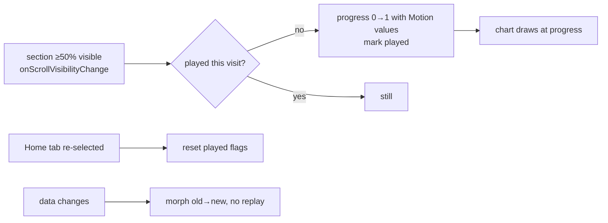

# dashboard-chart-intros — spec
> md · no ticket

## Idea

**Why.** Every chart on the UI 2.0 iPhone home dashboard renders instantly and stays still
(`docs/ui2/screens/home-dashboard.md:81` — "no bespoke motion … chart entrance animation is a
build-suite decision"). Leaders opening Home see a static page; the data never "arrives". This
gives each chart an intro animation the first time it scrolls into view, so the dashboard feels alive
and the eye is led through each chart's story (planned vs done, the shape of a day).

**What success looks like.** A leader opens the Home tab and scrolls: each chart animates in once as
it reaches the middle of the screen, finishing within 1.2 s, then stays still. Scrolling back up does
not replay it. Leaving the Home tab and coming back plays them again. Pull-to-refresh and a
cache→fresh load move bars, arcs and numbers smoothly from old to new values. With Reduce Motion
on, charts appear with a short crossfade and no movement. Simulator captures stay pixel-identical.

**In your words.** "when a chart (activity, sessions, etc.) scrolls into the viewing area, I would
like the chart to have an intro animation" → D1, D4 · "I like all your chart ideas" → D1, D3

**The concept — layered chart intros.** Every per-chart idea from the brainstorm, layered, on one
shared set of motion values:

- **Overview** (KPI rail) — cards cascade in; each card's spark bars rise in a left-to-right wave,
  the average line draws across, the value counts up, the trend arrow springs in.
- **Activity** — day-card spark bars expand from their midline; the DualSeriesBarChart's scheduled
  columns sweep in toward today, the completed fill climbs inside each, then the today rule drops and
  its badge pops.
- **Sessions** — the RadialDayClock sweeps clockwise from midnight, each arc blooming outward as the
  sweep reaches it, hour dots lighting as passed, the center value counting up; the
  TimeActivityChart below grows left to right in step with the sweep.
- **Engagement** — the PercentBar fills from 0 with a slight spring overshoot, the percent counts
  up, the status dot pulses once.

**How it fits today.** `HomeDashboardScreen` (MakeReadyUI) lays out five sections with no root
ScrollView; the shell's `HomeSectionLayout` page ScrollView scrolls it, so
`onScrollVisibilityChange` (iOS 18+; target is iOS 26) works on each section. The Home tab stays
mounted across tab switches (`UI2Shell.swift:28-30`, ui2-members-browse D2), so "a new visit" cannot
come from view identity and needs a signal from the shell. `PercentBar` already carries an optional
`FillAnimation` prop from the owner's 2026-09-12 note — `nil` = still, which every fixture passes so
captures stay deterministic (`PercentBar.swift:113-119`); every new intro prop follows that pattern.
`Tokens.swift` is generated from the d2m token register ("DO NOT EDIT"), so the motion values cannot
be added there by this build.

**Approaches considered.** Chosen: per-component optional intro props driven by a shared reveal
modifier — one place owns visibility and the visit flag, each chart owns how it draws partway.
Rejected: a quiet fade + mask wipe on every chart (too plain — the owner wanted the richer per-chart
ideas); a single grow-from-baseline family with no per-chart signature (less delight; its shared
motion values are kept as the base).

## Apps

| App | In scope | What changes | Section |
|---|---|---|---|
| server | ⬜ | Nothing. No endpoint, field or query changes; the dashboard data shape is unchanged (§Contract) | — |
| client | ⬜ | Nothing. The web app shares no code with the iPhone UI 2.0 module; the web dashboard is out of scope (D11) | — |
| iphone | ✅ | Intro props on 7 MakeReadyUI components, a reveal modifier, a Home-visit signal from the shell, motion constants | §iphone |
| capture | ⬜ | Nothing. Every capture and fixture leaves intros off (D7), so no re-capture and no fixture change; ViewRegistry lives under `iphone/` | — |

**Sequencing:** no producer change, so no freeze. iphone only: components first (each still at
`nil`), then the screen wiring, then the shell's visit signal.

**Backward compatibility:** no wire change. A released build is unaffected; this ships only in a new
build.

**Blast radius:** the 7 components are also rendered by `/compare`, the d2m build harness and
`MakeReadyCaptureTests/ViewRegistry.swift` — all pass no intro (default `nil`), so every render stays
pixel-identical. `RailCard` and `SparkBarChart` are used on other UI 2.0 screens; those pass nothing
and stay still.

## Decisions

<!-- The one place rulings live. Record the DECISION — and, in one line, why, and why the rejected option lost. A stated preference
     is the INPUT to a row, not the row. Write each Ruling as something later code can be checked
     against without re-interpretation:
       · positive and specific — "store the full number, mask at render", not "don't truncate"
       · scope named — which apps, screens or endpoints it binds
       · "etc." / "and so on" expanded into the list, or the test for membership stated
       · the rejected alternative named, with the reason it lost (check-obligations warns on a bare one)
       · the enforcement hook, where one exists (lint rule, script, test)
     🔴 NEVER quote the user's prompt as the ruling. Operationalize it: a closed list, a measured
     value, an enumerated set of deviations. A ruling a stranger could implement two ways is not
     written yet.
     Who/date carries the provenance, so the Ruling itself needs no quote marks.
     The owner's own words go in §Idea "In your words", linked to this row — never in the Ruling.
     OPEN rows block the build go-ahead. Never delete a ruling; supersede it in place with a date. -->

| # | Decision | Ruling | Who / date |
|---|---|---|---|
| D1 | Which charts get an intro | Exactly these, on the iPhone `HomeDashboardScreen` only: C-023 RailCard (metric + day) with its C-024 SparkBarChart, C-026 DualSeriesBarChart, C-029 RadialDayClock, C-030 TimeActivityChart, C-031 EnrollmentStatusRow with its PercentBar. Section headers, legend, Following group cards: no intro. Rejected: a uniform fade on every section — not what was asked | owner 2026-10-26 |
| D2 | Concept | Layered per-chart intros as listed in §Idea "The concept", every layer present. Sessions merge: the clock sweep sets arc order and each arc blooms outward when reached (bloom ordered by intensity rejected — it fights the sweep). Rejected: quiet fade + mask wipe (too plain); single shared style (less delight) | owner 2026-10-26 |
| D3 | Duration | Each chart's intro, start to last element settled, ≤ 1.2 s. Stagger between bars ≈ 15 ms, capped so a 24-bar wave fits. Rejected: no cap — a fast scroll would wait on animation | owner 2026-10-26 |
| D4 | Trigger | A chart's section starts its intro when ≥ 50 % of it is visible in the Home page scroll (`onScrollVisibilityChange(threshold: 0.5)`). Rejected: on mount — charts below the fold would play unseen | (assumed at brainstorm) 2026-10-26 |
| D5 | Replay | Each section plays once per visit; scrolling away and back does not replay. Rejected: every time in view (repetitive on a daily page); once per app launch (feels dead on return) | owner 2026-10-26 |
| D6 | What starts a new visit | Re-selecting the Home tab after another tab, and switching the Home TopNav section back to the dashboard (the dashboard is unmounted while Members shows), reset every section's played flag. Pushed pages, overlays/menus over Home, and app backgrounding do not. Rejected: any covering of Home replays (a detour into a detail page is the same look); backgrounding replays (a glance at another app is not a new visit) | owner 2026-10-26 (tab rule) · section switch (assumed at spec) 2026-10-26 |
| D7 | Off by default | Every new intro prop is optional and defaults to `nil` = render final state with no animation, exactly like `PercentBar.FillAnimation`. Only `HomeDashboardContainer` (the live app) turns intros on; ViewRegistry, `/compare`, d2m fixtures and every other screen pass nothing. Enforced by the existing capture diffs staying at 0 % change | (assumed at brainstorm) 2026-10-26 |
| D8 | Rail cards | Only the cards visible when a rail's section first reveals animate (cascade + their bars). A card that enters by horizontal swipe — on the KPI rail or the ~190-card lazy day rail — renders final state. Rejected: every card on entry (noisy, costly on the lazy rail) | owner 2026-10-26 |
| D9 | Data changes | When the data behind an already-revealed chart changes (pull-to-refresh, cache→fresh load, and a Sessions range change once the dropdown is wired — today its C-020 `.dropdown` accessory has no tap handler, so the range cannot change in the app and wiring it is out of scope), bars, arcs, fills and numbers animate from old to new values with the shared morph animation; no drop to zero. Data arriving for a section that has not revealed yet changes nothing visible — it intros with the new data. Rejected: replay the intro (jarring); snap (hides what changed) | owner 2026-10-26 |
| D10 | Reduce Motion | With `accessibilityReduceMotion` on, an intro is a 0.2 s opacity crossfade from 0 to 1 with no scale, translation, sweep, wave or count-up; a data change snaps. Rejected: playing the full intro (HIG) | (assumed at brainstorm) 2026-10-26 |
| D11 | Scope | iPhone UI 2.0 home dashboard only. Rejected: the web dashboard — it is a separate legacy surface and not asked for | (assumed at brainstorm) 2026-10-26 |
| D12 | Contracts | The build adds the intro props with a `// GAP — <C-###>: no contract prop for the intro (dashboard-chart-intros D12)` comment at each; it writes no contract, registry row, note or token. §iphone lists the six contracts and the token request for the owner to file afterwards via `/ui2-component-update` / d2m. Rejected: notes first (blocks the build on the owner) | owner 2026-10-26 |
| D13 | Motion values | Live in one `enum ChartIntroMotion` in MakeReadyUI beside the reveal modifier, each with a GAP comment naming the missing `Token.Motion` entry; `Tokens.swift` is generated and is not edited. Values: rise = `.spring(duration: 0.6, bounce: 0.15)`; draw = `.easeOut(duration: 0.5)`; count-up = `.easeOut(duration: 0.8)`; overshoot fill = `.spring(duration: 0.8, bounce: 0.25)`; morph = `.easeInOut(duration: 0.4)`; tuned at the walk within D3 | (assumed at spec) 2026-10-26 |
| D14 | Count-up | A numeric value string counts up by parsing its leading number (integer or decimal, grouping commas allowed) and keeping prefix/suffix (`%`, `min`) verbatim. The number is interpolated through an `Animatable` view (`animatableData` = the number, 0 → value), re-formatted each frame with the source's decimal places and grouping, so p = 1 renders the source string exactly. `.contentTransition(.numericText())` alone is not used: it animates the glyph swap, not the intermediate values. A string with no leading number fades in instead | (assumed at spec) 2026-10-26 |
| D15 | Where state lives | The played flags are view state on `HomeDashboardScreen` (`@State`), not `AppState` — nothing outside Home reads them and they are not persisted. ~~The visit signal is an `Int` generation the shell bumps when Home is re-selected, passed down as an environment value~~ (superseded 2026-10-26) The visit signal is a `Bool`, `UI2ShellModel.homeActive` (= `tab == .home`), passed down as the environment value `chartIntroActive` (default `true`). When it turns `false` the screen's ledger clears every played flag — the dashboard sits hidden at opacity 0, so charts drop to their start pose unseen; when it turns `true` the ledger marks every section currently ≥ 50 % visible as played, so those animate start → final. Rejected: an `Int` bumped on re-select — a replay needs two separate state changes (reset, then play), and one bump on return can make only one without `asyncAfter`/`Task.sleep` choreography, which the house rules ban. D6's list of what starts a new visit is unchanged | (assumed at spec) 2026-10-26 · revised auto (recommended) 2026-10-26 |
| D16 | Empty data | A chart whose series is empty or all-zero shows its existing empty rendering with the crossfade only (no wave over nothing) | (assumed at spec) 2026-10-26 |

## Contract

No producer change. The existing endpoints feeding the charts are read exactly as today:

| Contract | Producer | Consumers | Auth | Request | Response | Errors |
|---|---|---|---|---|---|---|
| `GET /api/home/sessions`, `/api/home/days`, `/api/home/engagement` (and the KPI/overview queries) | server | iphone (unchanged use) | session | unchanged | unchanged (home-dashboard-data §Contract) | unchanged |

## Schema & API changes

No schema change (established 2026-10-26).

## iphone

All in the `MakeReadyUI` module except the visit signal. Recipe: `/transition-review` (motion) and
`/animation-debug` when something stutters.

**Reveal modifier (new, MakeReadyUI).** `.chartIntro(id:)`-style modifier on each section: measures
its own height against the page scroll's visible bounds (`onGeometryChange` + `bounds(of: .scrollView)`, ≥ 50 % = revealed — `onScrollVisibilityChange` misfired on the rail sections, agent walk round 1), consults/sets the screen's played set (D5, D15), and
hands each chart a `ChartIntro?` whose `played` flips false → true once (start pose → final
pose, the final pose identical to the `nil` render). Resets on the visit signal (D6, D15).
Honours Reduce Motion (D10).
It keeps each section's last visibility: Home stays mounted at opacity 0 under another tab, so its
geometry never changes and `onScrollVisibilityChange` does not fire again on return — so the reset
happens when Home is LEFT (`chartIntroActive` false: every played flag cleared, unseen) and the
replay when Home RETURNS (`chartIntroActive` true: every section still ≥ 50 % visible is marked
played and animates). Staggers and sequencing use `Animation.delay(_:)` on one
`withAnimation` per step, never `asyncAfter` or `Task.sleep` choreography (house rule; SwiftLint
`asyncAfter`).

**Component props (all optional, default `nil` = today's still render, D7):**

| Component | New prop | Draws at progress p |
|---|---|---|
| C-024 SparkBarChart | `intro: SparkIntro?` (`.rise` bottom-aligned wave / `.expand` from midline) | bar i height × eased(p, delay i·stagger); average line trims 0→1 after the bars |
| C-023 RailCard | `intro` + `introIndex` | card offset y 8→0 + opacity, delayed by index (cascade); forwards to its SparkBarChart; value counts up (D14); TrendIndicator springs in (scale 0.6→1) |
| C-026 DualSeriesBarChart | `intro` | columns rise in a sweep ending at today; scheduled height first, completed fill climbs after; today rule drops (y offset) then badge scales in |
| C-029 RadialDayClock | `intro` | sweep angle 0→360° from midnight; each arc trims in and blooms (scale 0.85→1) as the sweep passes its start; hour dots fade in as passed; center value counts up |
| C-030 TimeActivityChart | `intro` | bars rise left to right timed to the clock's sweep (shared progress) |
| C-031 EnrollmentStatusRow / PercentBar | `intro` (row) → PercentBar's fill driven from the reveal, with a spring overshoot | bar fills 0→value; percent counts up; status dot pulses once (scale 1→1.3→1). PercentBar's existing `FillAnimation` starts in `.onAppear`, which fires when the dashboard mounts (its sections sit in a non-lazy VStack, so the Engagement row appears off screen) and its `Easing` has no spring — so the row does not pass `FillAnimation`; PercentBar gains an optional reveal input (or a `.spring` easing plus a start trigger) that is `nil` by default, leaving `FillAnimation`'s behaviour unchanged |

Each component also animates value changes with the morph animation when `intro` is non-nil and
its data changes after reveal (D9).

**HomeDashboardScreen.** Wraps Overview, Activity and Sessions/Engagement sections in the reveal
modifier; passes `intro` only when an `introsEnabled` flag is true (new init param, default `false`);
`HomeDashboardContainer` passes `true`. Only the cards on screen at reveal get `introIndex` (D8).

**Shell (MakeReady/UI2/Shell).** The visit signal is the computed `UI2ShellModel.homeActive`
(`tab == .home`) on the value-type model; `UI2Shell` sets `.environment(\.chartIntroActive,
model.homeActive)` on Home's stack (D6, D15). A pushed page or a re-tap of Home leaves it `true`,
so neither replays. Unit-tested beside the existing `MakeReadyCaptureTests/UI2ShellModelTests.swift`.
The TopNav switch to Members and back needs no signal: `UI2Shell.sectionContent` swaps
`HomeDashboardContainer` out, so the screen's `@State` played set is rebuilt on return.

**For the owner to file after the build (D12, D13)** — not written by this feature:
- contract props for C-023, C-024, C-026, C-029, C-030, C-031 (and PercentBar's overshoot easing)
  → `/ui2-component-update`;
- `Token.Motion` entries for rise, draw, count-up, overshoot, morph → d2m token register;
- `docs/ui2/screens/home-dashboard.md` §Motion line → `/ui2-resolve`.

## Testing

**iphone.** `npm run ios:build-check` and `swiftlint` (from `iphone/`, baseline) per phase.
XCTest: the count-up parser (D14: `"84%"`, `"1,204"`, `"32"`, `"4.5"`, `"—"`); the played-set logic
(reveal once, no replay on scroll back, cleared when Home is left, still-visible sections replay on return);
progress→geometry helpers per chart at p = 0, 0.5, 1 (p = 1 equals the `nil` render); and
`UI2ShellModel.homeActive` (false on Profile, true back on Home, true with a page pushed on Home).
Capture neutrality: the existing UI 2.0 captures for the 7 components and the home-dashboard screen
re-run with 0 % pixel change (D7).

**Human-verification script (the walk, on device or simulator, Fixtures identity):**
1. Open Home — Following shows; scroll down: Overview cards cascade, bars wave, values count up.
2. Keep scrolling: Activity columns sweep toward today, completed fill climbs, today badge pops; day
   cards' bars expand from the midline.
3. Sessions: ring sweeps from midnight with arcs blooming, center counts up, bar chart grows in step.
4. Engagement: bar fills with overshoot, percent counts up, dot pulses.
5. Each intro finishes within ~1.2 s. Scroll to top and back down — nothing replays.
6. Swipe the day rail far left — newly visible cards are already drawn.
7. Open a menu/pushed page and return — no replay. Switch to Profile tab and back — intros replay.
8. Pull to refresh — values morph, no drop to zero (the Sessions range dropdown is not wired in the app, D9).
9. Turn on Reduce Motion — charts only crossfade.

No cross-app E2E walk: no other app changes.

## Out of scope

- The web (client) dashboard and any other screen's charts.
- Haptics or sound on intros.
- Writing UI 2.0 contracts, notes or tokens (D12 — the owner files them).
- Animating swiped-in rail cards (D8).

## Findings & risks

| # | Finding | Resolution |
|---|---|---|
| F1 | Home stays mounted across tab switches, so a new visit needs a shell signal | D6/D15 — `homeActive` from `UI2ShellModel` |
| F2 | `Tokens.swift` is generated; motion values can't live there | D13 — local `ChartIntroMotion` + token request |
| F3 | Cache-first load: a section may be on screen before fresh data lands | D9 — morph after reveal; unrevealed sections intro with whatever data they hold |
| F4 | Under another tab Home is kept at opacity 0 (`UI2Shell.swift:31-37`), so its scroll geometry is unchanged and `onScrollVisibilityChange` never re-fires on return: a section already in view would not replay, breaking D6 | §iphone corrected — the reveal state keeps the last visibility and replays a visible section when Home returns (D15 revised); tested |
| F5 | `PercentBar.FillAnimation` starts in `.onAppear` (`PercentBar.swift:187-190`), which fires at dashboard mount, off screen, and has no spring easing | §iphone C-031 row corrected — the row drives the fill from the reveal through a new optional input, `FillAnimation` untouched |
| F6 | `.contentTransition(.numericText())` animates a glyph swap, not intermediate values, so D14 as written would not count up | D14 corrected — interpolate through an `Animatable` view |
| F7 | The Sessions dropdown has no tap handler (`HomeDashboardScreen.swift:369-374`, "the presenter's to wire at promotion"), so a range change is unreachable in the app | D9, §Idea and walk step 8 corrected; wiring the dropdown stays out of scope. Each chart's morph on data change is still covered by pull-to-refresh |
| F8 | The visit signal belongs on the value-type `UI2ShellModel` (already unit-tested), not in the view | §iphone Shell corrected — `homeActive` per D15 (revised); the Members section switch needs no signal (the container is swapped out) |
| F9 | C-031's OQ-C-031-001 ruling ("the bar sits at progress on first paint") stands for every caller that passes no intro (D7); only the live dashboard opts in | disposition: carried by D7 + D12 — the owner files the contract prop afterwards |
| F10 | build-time risk — whether `onScrollVisibilityChange` reports the sections already above the fold when Home first appears (Following sits first, so Overview may start partly visible), and its behaviour inside the `HomeSectionLayout` `ZStack` with the refresh `offset` | the reveal-modifier task's test + the walk's step 1 settle it; fallback: seed visibility from `onScrollGeometryChange` |
| F11 | build-time risk — per-frame cost of the count-up and 24-bar waves on the lazy day rail and 88 TimeActivityChart bins | the chart tasks; `/animation-debug` if the walk shows a stutter |

## Plan

The plan, with its code: `docs/features/dashboard-chart-intros/PLAN.md` (§PLAN.md).

- Phase 1 · Task 1 · ChartIntro, ChartIntroMotion and the count-up
- Phase 1 · Task 2 · The played ledger and the shell's homeActive signal
- Phase 2 · Task 3 · C-024 SparkBarChart and C-023 RailCard intros
- Phase 2 · Task 4 · C-026 DualSeriesBarChart intro
- Phase 2 · Task 5 · C-029 RadialDayClock and C-030 TimeActivityChart intros
- Phase 2 · Task 6 · C-031 EnrollmentStatusRow and PercentBar intro
- Phase 2 · Task 7 · Home dashboard turns the intros on

## Fixes

- [x] iphone: Overview intro (item 1 / E1) — expected the metric cards to hold their start pose until Overview is ≥ 50 % visible, then cascade, wave and count up; saw a ~38 pt first scroll (cards still below the scroll view's bottom edge) use up the intro, so the cards were already final when they came into view (agent walk round 1)
