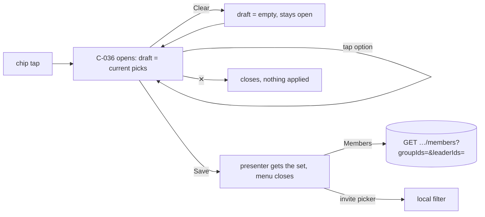

# filter-multiselect — spec
> lg · ticket none

## Idea

**Why.** Every UI 2.0 filter menu (C-036 FilterMenuOverlay) picks exactly one option and closes on
the tap, so a leader cannot see "members of Youth *or* Prayer Team" or "groups led by Tony or
Bruce". The owner wants every filter menu to take one or more picks and apply them with an explicit
Save.

**What success looks like.** On Members, a leader opens Leaders, checks two leaders, taps Save: the
chip reads "2 leaders" and the list shows members in either leader's groups. Clear empties the
checks without closing; ✕ closes and changes nothing. The same menu behaviour holds on the invite
flow's Select group (Leaders) and on Groups home (Orgs, Leaders).

**In your words.** "instead of the filter overlay going away when an option is selected, add a
"Save" text link top right on the same row as the clear button" → D1 · "every single one of these
should support multiselect" → D2.

**The concept.** C-036 holds a draft set seeded from the presenter's selection; option taps toggle
it; Save hands the set back. Each presenter stores a set instead of one value. The server's member
directory gains list parameters so Members can ask for several groups and leaders at once.

**How it fits today.** C-036 already has a `.multiple` mode where a tap toggles and the menu stays
open, but every consumer passes `.single`; its Clear link landed in `2f423e8`¹. Members maps one
label to one `groupId`/`leaderId` and sends them as single query params²; the server ANDs one group
and one leader filter (a leader is the group's `creatorId` — there is no co-leader model) and returns
an empty list when a narrowed caller leads no groups, names a group outside the groups they created,
or names a leader other than themselves³.
The invite picker filters locally by one creator name⁴. Groups home's screen is built but the Groups
section is still unwired⁵.

**Approaches considered.** *Chosen:* the draft lives inside C-036 — one implementation for every
consumer. *Rejected:* each presenter holds its own draft — the same logic four times.

¹ `iphone/MakeReadyUI/FilterMenuOverlay.swift` · ² `iphone/MakeReady/UI2/Containers/Members/MembersHomeContainer.swift:36-55`,
`MembersHomeMapper.swift:17-67`, `State/Actions/MemberActions.swift:33-36` · ³ `server/src/routes/organizations.ts:768-790`,
`server/src/services/organization.ts:234-271`, `services/member-access.ts:39-44` · ⁴ `iphone/MakeReady/UI2/Containers/Groups/InviteSelectGroupMapper.swift:29` ·
⁵ `iphone/MakeReady/UI2/Shell/UI2Shell.swift` (`sectionContent` default `EmptyPage`)

## Apps

| App | In scope | What changes | Section |
|---|---|---|---|
| server | ✅ | `GET /api/organizations/:orgId/members` accepts `groupIds` and `leaderIds` lists (OR within each, AND across); single params unchanged | §server |
| client | ⬜ | Not touched: no web caller of the members directory (grep of `client/` finds none) and the web filters are not UI 2.0 | — |
| iphone | ✅ | C-036 draft + Save; Members, invite picker and Groups home presenters hold sets; "All …" rows removed; chip labels; `MemberActions.loadDirectory` sends lists | §iphone |
| capture | ⬜ | Not touched: no new twin or adapter; d2m's own captures of C-036 / Members re-record when d2m catches up (F2) | — |

**Sequencing:** contract → server implements and verifies (contract FREEZES) → iphone builds against it → walk.

**Backward compatibility:** released iPhone builds send only `groupId`/`leaderId`; those keep their
exact meaning (D6). The response shape is unchanged.

**Blast radius:** the members directory is read only by the iPhone Members screen (2.0) — the 1.0
Members pages are out of the app target.

## Decisions

<!-- The one place rulings live. Record the DECISION — and, in one line, why, and why the rejected option lost. A stated preference
     is the INPUT to a row, not the row. Write each Ruling as something later code can be checked
     against without re-interpretation:
       · positive and specific — "store the full number, mask at render", not "don't truncate"
       · scope named — which apps, screens or endpoints it binds
       · "etc." / "and so on" expanded into the list, or the test for membership stated
       · the rejected alternative named, with the reason it lost (check-obligations warns on a bare one)
       · the enforcement hook, where one exists (lint rule, script, test)
     🔴 NEVER quote the user's prompt as the ruling. Operationalize it: a closed list, a measured
     value, an enumerated set of deviations. A ruling a stranger could implement two ways is not
     written yet.
     Who/date carries the provenance, so the Ruling itself needs no quote marks.
     The owner's own words go in §Idea "In your words", linked to this row — never in the Ruling.
     OPEN rows block the build go-ahead. Never delete a ruling; supersede it in place with a date. -->

| # | Decision | Ruling | Who / date |
|---|---|---|---|
| D1 | Menu row + Save | C-036's top row: C-049 "Clear" at the leading edge, C-049 "Save" at the trailing edge, same row, fixed above the option list. Option taps toggle a draft `Set<String>` held by the menu, seeded from `selectedIDs` when it opens; Save calls `onSave(draft)` and the presenter closes the menu; Clear empties the draft and the menu stays open; ✕ closes and discards the draft. No option tap closes the menu. Not *apply live per tap* (a directory refetch per tap; the owner asked for Save) | user 2026-10-26 |
| D2 | Which menus | Exactly these five, all multi-select: Members → Groups, Members → Leaders, invite Select group → Leaders, Groups home → Orgs, Groups home → Leaders. `SelectionMode.single` stays in C-036's API but no 2.0 screen uses it. The four other 2.0 screens whose chips call `onOpenFilter` but draw no menu and have no presenter — `InvitesHomeScreen`, `EnrollmentsHomeScreen`, `EnrollmentSelectProgramScreen`, `StudyProgramsScreen` — are out of scope here and adopt draft mode when they are wired. Not *single-select kept anywhere* (the owner's rule covers every menu) | user 2026-10-26 · unwired-screens clause auto (recommended) 2026-10-26 |
| D3 | "All …" rows | The "All Groups" / "All Leaders" option rows (Members) and any "All …" row on Groups home are removed from the option lists; an empty selection means no filter. Not *keep "All" as an exclusive row* (two ways to say the same thing) | user 2026-10-26 |
| D4 | Chip label | Empty selection → the chip's resting text exactly as today (Members "All Groups" / "All Leaders"; picker "Leaders"; Groups home "All Orgs" / "All Leaders"), `active: false`; one pick → that option's label; n ≥ 2 → "n groups" / "n leaders" / "n orgs"; `active: true` whenever ≥ 1 pick — Members and Groups home take `active` from their State (today both hard-code `false`). Not *a comma list* (overflows the chip) | user 2026-10-26 |
| D5 | How picks combine | Within one filter: any of the picks (OR). Across filters: both must hold (AND) — today's behaviour. Applies to the server directory and the invite picker's local filter. Not *AND within a filter* (two groups would mean members in both) | user 2026-10-26 |
| D6 | Server params | `GET /api/organizations/:orgId/members` accepts `groupIds` and `leaderIds`, each as a comma-separated list of uuids, additive; the single `groupId` / `leaderId` keep working and are unioned into the matching list when both forms arrive; empty / absent = no filter. Not *replacing `groupId`* (released iPhone builds send it) | user 2026-10-26 |
| D7 | Narrowed caller | For a group-scoped caller (`memberAccessScope` not `all`): out-of-scope ids are dropped from `groupIds` (ids not among the groups they created) and from `leaderIds` (any id but their own); if a list that was sent is empty after dropping, the response is `data: []`. A single out-of-scope `groupId` / `leaderId` with no list still returns `data: []` exactly as today (D6). Not *any out-of-scope id empties the whole result* (contradicts D5's OR: `{mine, foreign}` means mine) | (assumed at brainstorm) · superseded auto (recommended) 2026-10-26 |
| D8 | Clear / Save enablement | Clear enabled iff the draft is non-empty (C-049 50% otherwise); Save always enabled — saving an unchanged draft just closes. Not *disable Save when unchanged* (a dead-looking control) | (assumed at brainstorm) |
| D9 | d2m-owned views | The MakeReadyUI edits (FilterMenuOverlay, MembersHomeScreen, GroupsHomeScreen, EnrollmentSelectGroupScreen) are owner-approved in place, as for invite-member D7 on 2026-10-26; recording them in d2m is a follow-up (F2). Not *route to /d2m first* (the owner unblocked the same case with "just finish") | (assumed at brainstorm) |
| D10 | C-036 API | `FilterMenuOverlay` gains `onSave: ((Set<String>) -> Void)?`; when non-nil the menu runs D1's draft mode (and shows Save); `onSelect` still fires per toggle for callers that want it. `onClear` / `clearEnabled` from `2f423e8` are superseded by the draft-driven Clear (D8) when `onSave` is set | (assumed at spec) 2026-10-26 |
| D11 | Wire format | Lists are comma-joined in one query param (`groupIds=a,b`) — what the iPhone sends. The server also accepts the repeated form (`groupIds=a&groupIds=b`, which Express parses to an array): flatten, split each on commas, trim, drop empties; a list with no ids left is absent (no filter — never `in: []`). Each id is validated with `z.string().uuid()`; an invalid id, or any non-string/non-array shape, → 400. The 400 applies to `groupIds` / `leaderIds` only: single `groupId` / `leaderId` stay unvalidated as today, and a single value is unioned into its list only when it is a uuid (otherwise today's no-match behaviour). Not *comma form only* (the repeated form would be silently ignored and return everyone) | (assumed at spec) 2026-10-26 · amended auto (recommended) 2026-10-26 |
| D12 | Members presenter state | `MembersHomeMapper.Selection` holds `groupIds: Set<String>` and `leaderIds: Set<String>`; `MemberActions.loadDirectory(orgId:search:groupIds:leaderIds:)` sends the list params only (never the single ones), ids sorted; `OrgMemberDirectory.groupId` / `leaderId` become `groupIds` / `leaderIds: [String]` (sorted), and the store key stays `orgId` | (assumed at spec) 2026-10-26 · cache wording corrected at audit 2026-10-26 |
| D13 | Invite picker state | `InviteSelectGroupContainer` holds `leaders: Set<String>`; `InviteSelectGroupMapper` builds one leader option per distinct `creatorId` (label `creatorName`) and keeps a group when the set is empty or contains its `creatorId`. Not *filter by `creatorName`* (two leaders with the same name merge) | (assumed at spec) 2026-10-26 · ids not names auto (recommended) 2026-10-26 |
| D14 | Groups home | `GroupsHomeScreen`'s two menus run D1/D4; its State carries the selected org and leader sets (the screen holds only which menu is presented, as Members does); its `onSelectOrg` / `onSelectLeader` become set-valued (`onSaveOrgs` / `onSaveLeaders`). No container exists yet, so nothing filters — the screen is ready for when the Groups section is wired | (assumed at spec) 2026-10-26 |
| D15 | Option identity on Members | `MembersHomeScreen.State` carries parallel flat arrays — `groupOptionIDs` / `groupOptionLabels`, `leaderOptionIDs` / `leaderOptionLabels` — and `selectedGroupIDs` / `selectedLeaderIDs: Set<String>`; C-036 receives the real ids as option ids, so two same-named options (every unnamed leader reads "Group Leader") stay two rows. Every new State field has a default so `ViewRegistry` / `CaptureFixture` memberwise builds keep compiling. Not *labels as ids* (ticking one same-named row ticks all and sends only the first id) | auto (recommended) 2026-10-26 |

## Contract

| Contract | Producer | Consumers | Auth | Request | Response | Errors |
|---|---|---|---|---|---|---|
| `GET /api/organizations/:orgId/members` | server | iphone (`MemberActions.loadDirectory`, Members screen) | session; `member.read` on the org; narrowed scope per D7 | query: `search?`, `groupId?`, `leaderId?` (unchanged), **`groupIds?`**, **`leaderIds?`** (comma-separated uuids, or the repeated form — D6/D11), `includeInactive?` | unchanged: `{ success, data: OrgMemberListItem[], count, viewerScope }` | 400 an invalid uuid, or a non-string/array shape, in `groupIds` / `leaderIds` (single params never 400) · 403 permission · 500 |

## Schema & API changes

| # | ADD/EDIT/RENAME/REMOVE | Model.field | Wire | Reason | Status |
|---|---|---|---|---|---|
| SC1 | EDIT | `GET /api/organizations/:orgId/members` query | `groupIds`, `leaderIds` (additive) | D5/D6 — several groups and leaders at once | planned |

No schema change (established 2026-10-26) — query parameters only.

**Data plan:** none — nothing stored changes.

## server

- `routes/organizations.ts` `GET /:organizationId/members` (today an ad-hoc `text()` helper, no zod):
  parse `groupIds` / `leaderIds` per D11 with zod (already imported in the file), union the single
  forms in (D6), 400 on an invalid list; pass arrays (or `undefined`) to the service.
- `services/organization.ts` `OrgMembersQuery` gains `groupIds?: string[]`, `leaderIds?: string[]`
  (the single fields stay, folded into the arrays); `getOrganizationMembers` pushes one
  `activeIn({ id: { in: groupIds } })` and one `activeIn({ creatorId: { in: leaderIds } })` (OR
  within, AND across — D5), and applies D7 (drop out-of-scope ids; `data: []` when a sent list empties). A leader id
  that created no groups (e.g. an Owner/Admin listed by `/api/group-leaders`) contributes no members.
- Swagger block for the route (`organizations.ts:654-765`) documents the two params, both forms and
  the 400; its stale 200 schema (`Member`, no `viewerScope`) may be fixed in the same task.

## iphone

- **C-036** `MakeReadyUI/FilterMenuOverlay.swift`: D1/D8/D10 — `onSave`, the internal draft
  (`@State` seeded in `init` via `State(initialValue: selectedIDs)` — not `onAppear`, which flashes
  the old checks), the top row (C-049 `LinkButton` Clear leading, Save trailing, `style: .default`,
  disabled via `isEnabled`), option tap toggles the draft when `onSave` is set; the seed/toggle/clear
  logic is a static helper so it is unit-testable. Rewrite the file's R-01 ("controlled") and
  OQ-C-036-10 comments to describe draft mode (F4).
- **Members** `MakeReadyUI/Screens/Members/MembersHomeScreen.swift`: options without "All …" (D3);
  the menu in draft mode; `onSaveGroups(Set<String>)` / `onSaveLeaders(Set<String>)` replace the
  single-select closures; State carries the selected labels as sets for `selectedIDs` and chips.
  `UI2/Containers/Members/MembersHomeMapper.swift` + `MembersHomeContainer.swift`: D4 chip labels,
  D12 selection, D15 ids (replaces `labels.firstIndex(of:)`). Menu chips take `active` from State
  (`menuChip(label:active:onTap:)`). The shared menu position gets `.id(presentedMenu)` so a draft
  never carries from Groups to Leaders. `State/Actions/MemberActions.swift` + `State/Models/MemberModels.swift`: D12.
- **Invite picker** `UI2/Containers/Groups/InviteSelectGroupContainer.swift` + `InviteSelectGroupMapper.swift`: D13, D4 chip label.
  `MakeReadyUI/Screens/Groups/EnrollmentSelectGroupScreen.swift` only if its chip label input needs it (it takes a label string today — no change expected).
- **Groups home** `MakeReadyUI/Screens/Home/GroupsHomeScreen.swift`: D14, D4 (`active` from State).
- **Capture-test harness** `MakeReadyCaptureTests/ViewRegistry.swift` (C-036 :2456, Members :2498-2511,
  Groups home :2533-2543) and `CaptureFixture.swift` (:849-857, :921) build these States memberwise —
  update them with the new fields.
- swiftlint from `iphone/`; no `.sheet` / `.fullScreenCover`; previews keep compiling.

## Testing

- **server** — two layers, uuid-shaped ids in the list cases. *Route* (`routes/__tests__/organization-members.request.test.ts`,
  supertest, service mocked — asserts the service args): `groupIds=a,b` → `[a,b]`; repeated
  `groupIds=a&groupIds=b` → `[a,b]`; `groupIds=,` → absent; single `groupId` alone as before; `groupId`
  + `groupIds` union; an invalid uuid in a list → 400; a non-uuid single `groupId` → 200 as today.
  *Service* (`services/__tests__/organization-members.test.ts`, prisma mocked — asserts the `where`):
  two groups → one `id in`; groups + leaders → two AND'd `activeIn`; another org's group adds nothing;
  narrowed caller with `{mine, foreign}` → only mine; with only foreign → `data: []` (D7).
  `npx tsc --noEmit`, `npm run test:run`.
- **iphone** — XCTest in `iphone/MakeReadyCaptureTests/` (`MembersHomeMapperTests`, `MemberActionsTests`,
  `InviteSelectGroupMapperTests`, `UI2MembersComponentTests` — the "All …" assertions at
  `MembersHomeMapperTests.swift:83,92,106` and the `active: false` one at `UI2MembersComponentTests.swift:75` change):
  `MembersHomeMapper` chip labels for 0 / 1 / 3 picks, two same-named options stay distinct (D15);
  `MemberActions.loadDirectory` builds `groupIds=a,b&leaderIds=c` (sorted) and omits empty lists;
  `InviteSelectGroupMapper` keeps groups whose `creatorId` is in the set; C-036's draft logic (seed,
  toggle, clear, save emits the set) via its preview-state helper or a unit-testable reducer.
  `npm run ios:build-check -- --test`; swiftlint.
- **Cross-app E2E walk** (dev env, fixtures reset, Fixtures identity):
  1. Members → Leaders: no "All Leaders" row; Clear dimmed. Check two leaders → Clear enables; Save → chip "2 leaders", list = members of either leader's groups.
  2. Reopen Leaders: both still checked. Clear → none checked, menu still open; ✕ → chip still "2 leaders".
  3. Groups: pick one group + keep the leaders → list narrows to that group AND those leaders.
  4. "+" → Invite a member → Select group → Leaders: check two → Save → only those leaders' groups.
  5. curl `…/members?groupId=<g>` (single form) still returns that group's members.
- **Human verification:** the walk above on the phone.

## Out of scope

- Wiring the Groups section (Groups home stays unwired — D14).
- Web client filters.
- Persisting filter choices across launches.
- Recording the view edits in d2m (follow-up, F2).

## Findings & risks

| # | Finding | Resolution |
|---|---|---|
| F1 | The Members directory store is keyed by `orgId` only (`AppState.swift:147`); `OrgMemberDirectory` records `groupId`/`leaderId` of the query (`MemberModels.swift:70-76`, read only by tests). Nothing persisted to disk depends on the filter shape (member stores are memory-only; the old `FilterStateManager` is unused by 2.0), so a released build has nothing to mis-decode | resolved — D12 (record fields become sorted arrays; key unchanged) |
| F2 | MakeReadyUI views are d2m-owned; a d2m rebuild would drop these edits | build-time risk — owner follow-up: `/d2m:screen:update` for members-home, groups-home, enrollment-select-group and `/d2m:component:update C-036` after this lands |
| F3 | C-036's `onClear`/`clearEnabled` (2f423e8) are presenter-driven; draft mode makes them redundant | resolved by D10 — draft-driven Clear when `onSave` is set |
| F4 | C-036's documented rules R-01 ("the view never holds the selection") and OQ-C-036-10 (`.multiple` applies live, ✕ just closes) — `FilterMenuOverlay.swift:14-15,46-52` — contradict D1/D10 | build-time risk — C-036 task rewrites the comments; routed to the owner with F2's `/d2m:component:update C-036` |
| F5 | contract: the list params arrived only in comma form in the spec; Express parses repeated params to an array that the route's `text()` helper drops → unfiltered result | resolved — D11 accepts both forms, 400 on other shapes; route test covers the array form. Pass 2 (scoped to this row and D7): the iPhone sends the comma form (`DashboardActions.swift:211-215` leaves `,` unescaped) and already hides out-of-scope groups for narrowed callers (`MembersHomeMapper.swift:62,70`) — no consumer change |
| F6 | D7 as first written (any out-of-scope id empties the result) contradicted D5's OR | resolved — D7 superseded (drop out-of-scope ids) |
| F7 | An empty list after parsing pushed as `in: []` would match nothing | build-time risk — server route task: D11 treats it as absent; route test `groupIds=,` |
| F8 | Two Members options with the same label (unnamed leaders all read "Group Leader"; group names aren't unique) collapse under label-as-id | resolved — D15; invite picker likewise by D13 |
| F9 | The fixtures house rule (a feature wiring a UI 2.0 screen adds `server/fixtures/screens/<id>.ts`) — this feature wires no new screen (Groups home stays unwired, Members/invite already wired) | no fixture layer owed |
