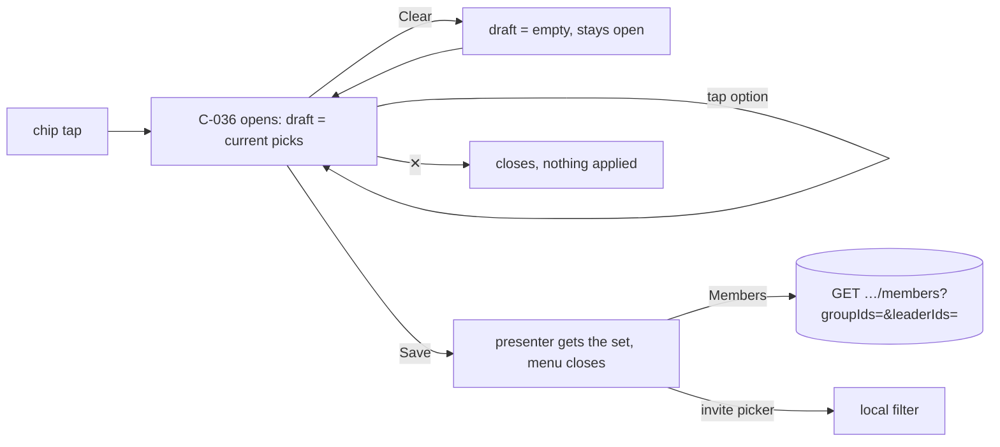

# filter-multiselect — spec
> lg · ticket none

## Idea

**Why.** Every UI 2.0 filter menu (C-036 FilterMenuOverlay) picks exactly one option and closes on
the tap, so a leader cannot see "members of Youth *or* Prayer Team" or "groups led by Tony or
Bruce". The owner wants every filter menu to take one or more picks and apply them with an explicit
Save.

**What success looks like.** On Members, a leader opens Leaders, checks two leaders, taps Save: the
chip reads "2 leaders" and the list shows members in either leader's groups. Clear empties the
checks without closing; ✕ closes and changes nothing. The same menu behaviour holds on the invite
flow's Select group (Leaders) and on Groups home (Orgs, Leaders).

**In your words.** "instead of the filter overlay going away when an option is selected, add a
"Save" text link top right on the same row as the clear button" → D1 · "every single one of these
should support multiselect" → D2.

**The concept.** C-036 holds a draft set seeded from the presenter's selection; option taps toggle
it; Save hands the set back. Each presenter stores a set instead of one value. The server's member
directory gains list parameters so Members can ask for several groups and leaders at once.

**How it fits today.** C-036 already has a `.multiple` mode where a tap toggles and the menu stays
open, but every consumer passes `.single`; its Clear link landed in `2f423e8`¹. Members maps one
label to one `groupId`/`leaderId` and sends them as single query params²; the server ANDs one group
and one leader filter and returns an empty list when a narrowed caller names anything out of scope³.
The invite picker filters locally by one creator name⁴. Groups home's screen is built but the Groups
section is still unwired⁵.

**Approaches considered.** *Chosen:* the draft lives inside C-036 — one implementation for every
consumer. *Rejected:* each presenter holds its own draft — the same logic four times.

¹ `iphone/MakeReadyUI/FilterMenuOverlay.swift` · ² `iphone/MakeReady/UI2/Containers/Members/MembersHomeContainer.swift:36-55`,
`MembersHomeMapper.swift:17-67`, `State/Actions/MemberActions.swift:33-36` · ³ `server/src/routes/organizations.ts:768-790`,
`server/src/services/organization.ts:234-270` · ⁴ `iphone/MakeReady/UI2/Containers/Groups/InviteSelectGroupMapper.swift:29` ·
⁵ `iphone/MakeReady/UI2/Shell/UI2Shell.swift` (`sectionContent` default `EmptyPage`)

## Apps

| App | In scope | What changes | Section |
|---|---|---|---|
| server | ✅ | `GET /api/organizations/:orgId/members` accepts `groupIds` and `leaderIds` lists (OR within each, AND across); single params unchanged | §server |
| client | ⬜ | Not touched: no web caller of the members directory (grep of `client/` finds none) and the web filters are not UI 2.0 | — |
| iphone | ✅ | C-036 draft + Save; Members, invite picker and Groups home presenters hold sets; "All …" rows removed; chip labels; `MemberActions.loadDirectory` sends lists | §iphone |
| capture | ⬜ | Not touched: no new twin or adapter; d2m's own captures of C-036 / Members re-record when d2m catches up (F2) | — |

**Sequencing:** contract → server implements and verifies (contract FREEZES) → iphone builds against it → walk.

**Backward compatibility:** released iPhone builds send only `groupId`/`leaderId`; those keep their
exact meaning (D6). The response shape is unchanged.

**Blast radius:** the members directory is read only by the iPhone Members screen (2.0) — the 1.0
Members pages are out of the app target.

## Decisions

<!-- The one place rulings live. Record the DECISION — and, in one line, why, and why the rejected option lost. A stated preference
     is the INPUT to a row, not the row. Write each Ruling as something later code can be checked
     against without re-interpretation:
       · positive and specific — "store the full number, mask at render", not "don't truncate"
       · scope named — which apps, screens or endpoints it binds
       · "etc." / "and so on" expanded into the list, or the test for membership stated
       · the rejected alternative named, with the reason it lost (check-obligations warns on a bare one)
       · the enforcement hook, where one exists (lint rule, script, test)
     🔴 NEVER quote the user's prompt as the ruling. Operationalize it: a closed list, a measured
     value, an enumerated set of deviations. A ruling a stranger could implement two ways is not
     written yet.
     Who/date carries the provenance, so the Ruling itself needs no quote marks.
     The owner's own words go in §Idea "In your words", linked to this row — never in the Ruling.
     OPEN rows block the build go-ahead. Never delete a ruling; supersede it in place with a date. -->

| # | Decision | Ruling | Who / date |
|---|---|---|---|
| D1 | Menu row + Save | C-036's top row: C-049 "Clear" at the leading edge, C-049 "Save" at the trailing edge, same row, fixed above the option list. Option taps toggle a draft `Set<String>` held by the menu, seeded from `selectedIDs` when it opens; Save calls `onSave(draft)` and the presenter closes the menu; Clear empties the draft and the menu stays open; ✕ closes and discards the draft. No option tap closes the menu. Not *apply live per tap* (a directory refetch per tap; the owner asked for Save) | user 2026-10-26 |
| D2 | Which menus | Exactly these five, all multi-select: Members → Groups, Members → Leaders, invite Select group → Leaders, Groups home → Orgs, Groups home → Leaders. `SelectionMode.single` stays in C-036's API but no 2.0 screen uses it. Not *single-select kept anywhere* (the owner's rule covers every menu) | user 2026-10-26 |
| D3 | "All …" rows | The "All Groups" / "All Leaders" option rows (Members) and any "All …" row on Groups home are removed from the option lists; an empty selection means no filter. Not *keep "All" as an exclusive row* (two ways to say the same thing) | user 2026-10-26 |
| D4 | Chip label | Empty selection → the chip's resting text exactly as today (Members "All Groups" / "All Leaders"; picker "Leaders"; Groups home "Orgs" / "Leaders"), `active: false`; one pick → that option's label; n ≥ 2 → "n groups" / "n leaders" / "n orgs"; `active: true` whenever ≥ 1 pick. Not *a comma list* (overflows the chip) | user 2026-10-26 |
| D5 | How picks combine | Within one filter: any of the picks (OR). Across filters: both must hold (AND) — today's behaviour. Applies to the server directory and the invite picker's local filter. Not *AND within a filter* (two groups would mean members in both) | user 2026-10-26 |
| D6 | Server params | `GET /api/organizations/:orgId/members` accepts `groupIds` and `leaderIds`, each as a comma-separated list of uuids, additive; the single `groupId` / `leaderId` keep working and are unioned into the matching list when both forms arrive; empty / absent = no filter. Not *replacing `groupId`* (released iPhone builds send it) | user 2026-10-26 |
| D7 | Narrowed caller | A group-scoped caller (`memberAccessScope` not `all`) who names any group id outside their scope, or any leader id other than their own, gets an empty list — today's rule applied to every id in the lists | (assumed at brainstorm) |
| D8 | Clear / Save enablement | Clear enabled iff the draft is non-empty (C-049 50% otherwise); Save always enabled — saving an unchanged draft just closes. Not *disable Save when unchanged* (a dead-looking control) | (assumed at brainstorm) |
| D9 | d2m-owned views | The MakeReadyUI edits (FilterMenuOverlay, MembersHomeScreen, GroupsHomeScreen, EnrollmentSelectGroupScreen) are owner-approved in place, as for invite-member D7 on 2026-10-26; recording them in d2m is a follow-up (F2). Not *route to /d2m first* (the owner unblocked the same case with "just finish") | (assumed at brainstorm) |
| D10 | C-036 API | `FilterMenuOverlay` gains `onSave: ((Set<String>) -> Void)?`; when non-nil the menu runs D1's draft mode (and shows Save); `onSelect` still fires per toggle for callers that want it. `onClear` / `clearEnabled` from `2f423e8` are superseded by the draft-driven Clear (D8) when `onSave` is set | (assumed at spec) 2026-10-26 |
| D11 | Wire format | Lists are comma-joined in one query param (`groupIds=a,b`); the server splits on commas, trims, drops empties and validates each as a uuid (400 on any invalid id) | (assumed at spec) 2026-10-26 |
| D12 | Members presenter state | `MembersHomeMapper.Selection` holds `groupIds: Set<String>` and `leaderIds: Set<String>`; `MemberActions.loadDirectory(orgId:search:groupIds:leaderIds:)` sends the list params only (never the single ones); the directory cache key includes the sorted ids | (assumed at spec) 2026-10-26 |
| D13 | Invite picker state | `InviteSelectGroupContainer` holds `leaders: Set<String>`; `InviteSelectGroupMapper` keeps a group when the set is empty or contains its `creatorName` | (assumed at spec) 2026-10-26 |
| D14 | Groups home | `GroupsHomeScreen`'s two menus run D1/D4 with screen-local sets; its `onSelectOrg` / `onSelectLeader` become set-valued (`onSaveOrgs` / `onSaveLeaders`). No container exists yet, so nothing filters — the screen is ready for when the Groups section is wired | (assumed at spec) 2026-10-26 |

## Contract

| Contract | Producer | Consumers | Auth | Request | Response | Errors |
|---|---|---|---|---|---|---|
| `GET /api/organizations/:orgId/members` | server | iphone (`MemberActions.loadDirectory`, Members screen) | session; `member.read` on the org; narrowed scope per D7 | query: `search?`, `groupId?`, `leaderId?` (unchanged), **`groupIds?`**, **`leaderIds?`** (comma-separated uuids, D6/D11), `includeInactive?` | unchanged: `{ success, data: OrgMemberListItem[], count, viewerScope }` | 400 an invalid uuid in a list · 403 permission · 500 |

## Schema & API changes

| # | ADD/EDIT/RENAME/REMOVE | Model.field | Wire | Reason | Status |
|---|---|---|---|---|---|
| SC1 | EDIT | `GET /api/organizations/:orgId/members` query | `groupIds`, `leaderIds` (additive) | D5/D6 — several groups and leaders at once | planned |

No schema change (established 2026-10-26) — query parameters only.

**Data plan:** none — nothing stored changes.

## server

- `routes/organizations.ts` `GET /:organizationId/members`: parse `groupIds` / `leaderIds` per D11,
  union the single forms in (D6), 400 on an invalid uuid; pass arrays to the service.
- `services/organization.ts` `OrgMembersQuery` gains `groupIds?: string[]`, `leaderIds?: string[]`
  (the single fields stay, folded into the arrays); `getOrganizationMembers` pushes one
  `activeIn({ id: { in: groupIds } })` and one `activeIn({ creatorId: { in: leaderIds } })` (OR
  within, AND across — D5), and applies D7 to every id.
- Swagger block for the route documents the two params.

## iphone

- **C-036** `MakeReadyUI/FilterMenuOverlay.swift`: D1/D8/D10 — `onSave`, the internal draft
  (`@State`, seeded on appear from `selectedIDs`), the top row (Clear leading, Save trailing,
  `type` of C-049 default), option tap toggles the draft when `onSave` is set.
- **Members** `MakeReadyUI/Screens/Members/MembersHomeScreen.swift`: options without "All …" (D3);
  the menu in draft mode; `onSaveGroups(Set<String>)` / `onSaveLeaders(Set<String>)` replace the
  single-select closures; State carries the selected labels as sets for `selectedIDs` and chips.
  `UI2/Containers/Members/MembersHomeMapper.swift` + `MembersHomeContainer.swift`: D4 chip labels,
  D12 selection, label↔id mapping for sets. `State/Actions/MemberActions.swift`: D12.
- **Invite picker** `UI2/Containers/Groups/InviteSelectGroupContainer.swift` + `InviteSelectGroupMapper.swift`: D13, D4 chip label.
  `MakeReadyUI/Screens/Groups/EnrollmentSelectGroupScreen.swift` only if its chip label input needs it (it takes a label string today — no change expected).
- **Groups home** `MakeReadyUI/Screens/Home/GroupsHomeScreen.swift`: D14.
- swiftlint from `iphone/`; no `.sheet` / `.fullScreenCover`; previews keep compiling.

## Testing

- **server** — route test for `/members`: `groupIds=a,b` returns members of either group;
  `groupIds` + `leaderIds` ANDs; single `groupId` alone behaves as before; both `groupId` and
  `groupIds` union; an invalid uuid in a list → 400; a narrowed caller naming an out-of-scope id in a
  list → empty (D7). `npx tsc --noEmit`, `npm run test:run`.
- **iphone** — XCTest: `MembersHomeMapper` chip labels for 0 / 1 / 3 picks and set↔id mapping;
  `MemberActions.loadDirectory` builds `groupIds=a,b&leaderIds=c` (sorted) and omits empty lists;
  `InviteSelectGroupMapper` keeps groups whose `creatorName` is in the set; C-036's draft logic (seed,
  toggle, clear, save emits the set) via its preview-state helper or a unit-testable reducer.
  `npm run ios:build-check -- --test`; swiftlint.
- **Cross-app E2E walk** (dev env, fixtures reset, Fixtures identity):
  1. Members → Leaders: no "All Leaders" row; Clear dimmed. Check two leaders → Clear enables; Save → chip "2 leaders", list = members of either leader's groups.
  2. Reopen Leaders: both still checked. Clear → none checked, menu still open; ✕ → chip still "2 leaders".
  3. Groups: pick one group + keep the leaders → list narrows to that group AND those leaders.
  4. "+" → Invite a member → Select group → Leaders: check two → Save → only those leaders' groups.
  5. curl `…/members?groupId=<g>` (single form) still returns that group's members.
- **Human verification:** the walk above on the phone.

## Out of scope

- Wiring the Groups section (Groups home stays unwired — D14).
- Web client filters.
- Persisting filter choices across launches.
- Recording the view edits in d2m (follow-up, F2).

## Findings & risks

| # | Finding | Resolution |
|---|---|---|
| F1 | The Members directory cache in AppState is keyed by the single filter values; set filters need a stable key | build-time risk — settled by D12 (sorted ids in the key) in the Members task |
| F2 | MakeReadyUI views are d2m-owned; a d2m rebuild would drop these edits | build-time risk — owner follow-up: `/d2m:screen:update` for members-home, groups-home, enrollment-select-group and `/d2m:component:update C-036` after this lands |
| F3 | C-036's `onClear`/`clearEnabled` (2f423e8) are presenter-driven; draft mode makes them redundant | resolved by D10 — draft-driven Clear when `onSave` is set |
