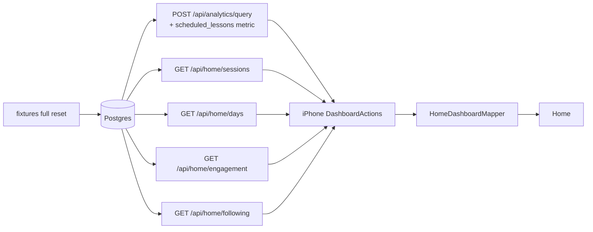

# home-dashboard-data — spec
> lg · no ticket

## Idea

**Why.** The UI 2.0 iPhone Home dashboard is the leader's first screen, and today most of it is
empty or flat even for the Fixtures identity, which exists to show every section with data.
Overview and the Activity day counts fill. The Activity columns, every day card's minutes and
mini-chart, Sessions, Engagement and Following do not. Some are empty because the server has no
endpoint for them, and some are flat because the iPhone mapper hard-codes zeros (ui2-shell F19).
This feature is for the owner and every leader building or reviewing UI 2.0 screens: they need to
see the real screen, populated, to judge it.

**What success looks like.** After `npm run fixtures:reset`, sign in as Fixtures on Local and
every Home section shows real, non-zero data from the real API:
- Overview KPIs and trend lines;
- Activity columns, with scheduled vs completed per day;
- every day card's minutes and its 12 bars;
- Sessions: the average session, the hour-of-day dial and the time-activity strip;
- Engagement: % current, members current, enrolled, groups and N active;
- Following: three followed enrollments grouped by program.

Nothing reads 0, "0 mins" or an empty state unless the data really is zero.

**In your words.** "I want every section to have data, every chart, everything, each day card,
average session data, engagement, etc." → D1 · sessions grouped by gap → D2 · current = caught up → D3
· follows stored as a preference → D4 · its own feature beside analytics → D5 · day cards show session
minutes → D6 · the 50/20 bands → D7.

**The concept.** The server adds what the screen needs and the iPhone wires it:

Sessions are derived on the server from the activity it already records, grouped by a 30-minute
gap (D2). Engagement counts caught-up and recently active members (D3). Following reads a per-user
preference (D4). The day cards use the same sessions (D6).

**How it fits today.** `DashboardActions` already queries `/api/analytics/query` for Overview and
the day counts¹. `HomeDashboardMapper` zeroes the scheduled series, the day series and the minutes².
`HomeDashboardScreen.State` already carries every field the remaining sections need³. The fixtures'
home-dashboard layer already seeds completions with times of day, video progress, `LESSON_OPENED`
client events and membership events⁴. The analytics registry is whitelist-only, and its query
contract was frozen by the analytics feature on 2026-07-30⁵.

¹ `iphone/MakeReady/State/Actions/DashboardActions.swift:22` · ² `iphone/MakeReady/UI2/Containers/Home/HomeDashboardMapper.swift:30-46` · ³ `iphone/MakeReadyUI/Screens/Home/HomeDashboardScreen.swift` `struct State` · ⁴ `server/fixtures/screens/home-dashboard.ts` · ⁵ `docs/features/analytics/MANIFEST.md`

**Approaches considered.** Chosen: a feature of its own that adds one registry metric and four
iPhone-only `/api/home/*` endpoints, plus fixture and mapper work (D5). Rejected: folding it into
analytics phase D (unplanned, so Home would wait on it); reopening the frozen query contract
(re-checks every consumer, including the web Program Analytics tab).

## Apps

| App | In scope | What changes | Section |
|---|---|---|---|
| server | ✅ | `scheduled_lessons` registry metric (+ its view arm); `/api/home/{sessions,days,engagement,following}`; fixtures home layer extended | §server |
| client | ⬜ | UI 2.0 leader screens are iPhone-only (docs/ui2/README.md:59); the web leader Home is frozen parity work | — |
| iphone | ✅ | `DashboardActions` fetches the new data; `HomeDashboardMapper` maps every section; `DashboardSnapshot` grows | §iphone |
| capture | ⬜ | Home captures render from fixture JSON (ViewRegistry), not the live API; no capture case changes | — |

**Sequencing:** contract settled → server (metric, endpoints, fixtures) verifies → contract freezes →
iPhone consumes it → the walk on Fixtures.

**Backward compatibility:** everything is additive. A released iPhone build doesn't call the new
endpoints, and `scheduled_lessons` is a new metric name, so existing queries are unchanged. Release
builds run 1.0 screens, not the UI2 Home (ui2-shell).

**Blast radius:** the `analytics_events` view gains one arm, and existing metrics filter by event
type, so their results don't change (the audit checks this). The preference key is new. Everything
else is read-only.

## Decisions

<!-- The one place rulings live. Record the DECISION — and, in one line, why, and why the rejected option lost. A stated preference
     is the INPUT to a row, not the row. Write each Ruling as something later code can be checked
     against without re-interpretation:
       · positive and specific — "store the full number, mask at render", not "don't truncate"
       · scope named — which apps, screens or endpoints it binds
       · "etc." / "and so on" expanded into the list, or the test for membership stated
       · the rejected alternative named, with the reason it lost (check-obligations warns on a bare one)
       · the enforcement hook, where one exists (lint rule, script, test)
     🔴 NEVER quote the user's prompt as the ruling. Operationalize it: a closed list, a measured
     value, an enumerated set of deviations. A ruling a stranger could implement two ways is not
     written yet.
     Who/date carries the provenance, so the Ruling itself needs no quote marks.
     The owner's own words go in §Idea "In your words", linked to this row — never in the Ruling.
     OPEN rows block the build go-ahead. Never delete a ruling; supersede it in place with a date. -->

| # | Decision | Ruling | Who / date |
|---|---|---|---|
| D1 | What "every section has data" means | After a `full` fixtures reset, as Fixtures on Local, each of these renders non-zero real-API data: Overview's KPI cards and series; Activity's C-026 completed **and** scheduled columns; every C-025 day card for the past 7 days, today included — minutes, "<n> complete" and 12 C-024 bars (older days may be zero; future days are zero by nature); Sessions' C-029 hour dial, centre value and C-030 strip for the default range, with every `sessionRange` (All time · Year · Month · Week) mapped from the snapshot (D13); Engagement's C-031 percent, count, progress, subtitle and the "N active" header; Following's header count, C-032 program headers and C-033 group cards. Enforced by the §Testing walk. Why: the owner wants the full screen judgeable. Rejected: Overview + Activity only (ui2-fixtures D1's scope, now outgrown) | user 2026-10-25 |
| D2 | What a session is | A member's activity moments are: `client_events.occurredAt` (rows with a non-null `memberId` only — leader events carry `userId`), `member_lesson_progress.completedAt`, and `member_video_progress` `startedAt`/`lastWatchedAt` (one cumulative row per member × activity, so a video watched over several days yields two distant moments — accepted, F6). Moments less than 30 min apart form one session. Its duration is last moment − first moment, with a 60 s floor. Scope: D9's scope; `mlp`/`mvp` rows scoped through schedule → enrollment → group org. Computed on the server per request (no stored table). Why: the standard web-analytics definition, from data already recorded. Rejected: app-reported session start/end events (members use web, no history); one lesson = one session (sittings split, unfinished lessons have no end). Closes OQ-home-dashboard-2 | user 2026-10-25 |
| D3 | Current and active | *Enrolled member* per D15. *Current* = an enrolled member every one of whose non-removed lesson schedules (across all their enrollments) dated before today is completed, dates compared per D14. % current = round(current ÷ enrolled × 100). *N active* = distinct members with ≥1 session (D2) in the last 7 days, today included. Subtitle: "<enrolled> total members enrolled across <groups> groups". Why: "current" means up to date, and active is a separate fact. Rejected: current = active in 7 days (a member a week behind counts as current); current = ≥80% done (an arbitrary line). Closes the definition half of OQ-home-dashboard-1; the arrow's destination stays deferred | user 2026-10-25 |
| D4 | Where follows live | The per-user preference key `dashboard.followedEnrollments` holds a JSON-encoded **string** of an array of enrollment ids (the preference column is a string and PUT stores `String(value)`, `routes/preferences.ts`), through the existing `/api/preferences/{key}`. `/following` parses it in a try/catch, keeps string entries only, dedupes, caps at 50; unset, `''`, unparseable or empty → Following's empty state. Ids outside the caller's scope are dropped silently via `enrollmentManageFilter` (`permission.ts:337`). The future `home-follow-picker` writes the same key. Why: no schema change, the same mechanism as `dashboard.kpis`. Rejected: a follows table (a migration nothing else reads); follow-all (the picker loses its purpose, and big orgs get very long). Closes the storage half of OQ-home-dashboard-4 | user 2026-10-25 |
| D5 | Relation to the analytics feature | Its own feature. `scheduled_lessons` is registered in `analytics-metrics.ts` as an additive metric; per-member computations (sessions, day minutes, engagement) and the Following assembly are new iPhone-only endpoints under `/api/home`. The frozen `/api/analytics/query` contract is not reopened. Why: ships without analytics C/D. Rejected: fold into analytics D (unplanned); reopen the contract (consumer re-check) | user 2026-10-25 |
| D6 | Day card minutes and bars | Minutes = Σ session duration (D2) of in-scope members' sessions starting that local day, shown as "<n> mins" (rounded). The 12 C-024 bars = those session seconds per 2-hour block (index 0 = 12–2 AM, caller tz), each session attributed whole to the block it starts in, so Σ blocks = `sessionSeconds`. Line 2 (`dayLine2s`) = "<n> complete" from `lesson_completions` (today the mapper writes "<n> lessons", `HomeDashboardMapper.swift:49`). `dayDetailsStates` = `"default"` when the day has any session or completion, else `"nothing"` (lowercase, as the screen matches). Why: real time spent, consistent with Sessions. Rejected: video minutes (ignores reading/writing); bars = lesson counts (mixes units) | user 2026-10-25 |
| D7 | Completion colour bands | Green when percent ≥ 50, yellow when 20–49, red when < 20, for C-031's `color` and each C-033's `color`. Mapped on the iPhone (`HomeDashboardMapper`), unit-tested at 19/20/49/50. Why: the only cut-offs consistent with every value the design draws (55 and 89 green, 21 yellow, 12–13 red). Rejected: 70/40 and 80/50 (both contradict the design's 55% green). Closes OQ-home-dashboard-3's threshold half | user 2026-10-25 |
| D8 | Sessions by range | `range` ∈ all · year · month · week. The window is the last 365 / 30 / 7 days to today, and all = since max(the scope's first session, today − 730 days) (F1). Dial = mean session seconds per start hour (24 values, caller tz). Centre = mean duration rounded to whole minutes: `centerValue` "<m>", `centerUnit` "min", `centerCaption` unchanged. Strip (C-030) = 88 equal time bins across the window, each the summed session seconds in it, normalised 0–1; 4 tick labels at bins 0, 29, 58, 87, per D16. Why: C-030's x is time within the period (owner axis ruling, OQ-C-030-2) | (assumed at spec) 2026-10-25 |
| D9 | Endpoint scope and time | Every `/api/home/*` call uses `requireAuth` and the same scope `/api/analytics/query` derives — `deriveScope` (`routes/analytics.ts:72-83`: `getManageableOrgIds` = owned orgs + orgs where the caller holds a role, plus groups the caller created), moved into a service both routes share — narrowed by an optional `organizationId` that can only narrow (the iPhone already sends it, `DashboardActions.swift:77`). An empty scope returns 404 `{error:"Not found"}`, as analytics does (`analytics.service.ts:584-586`). `tz` (IANA, default UTC) is checked with `assertValidTimezone` → 400. So Group Leaders and org admins see what analytics shows them | (assumed at spec) 2026-10-25 · corrected by audit 2026-10-25 (there is no leader-access middleware and no 400 "No organization" in analytics) |
| D10 | Scheduled per day | New metric `scheduled_lessons` counts lesson schedules (one per enrollment × lesson) by their `scheduledDate`, through a new derived `analytics_events` arm `LESSON_SCHEDULED`: `event_id = 'ls:' || ls.id`, `entity_id = ls."enrollmentId"`, `member_id = NULL`, `organization_id`/`group_id` via enrollment → group, `occurred_at = ls."scheduledDate"`, `is_removed = (ls."removedAt" IS NOT NULL)`, `is_current_version = TRUE`; metric `versionSemantics: 'current-only'`, `dimensionsAllowed: true`, day bucketing per D14. The arm gets an `ls` entry in the post-refresh quality check (`analytics.service.ts:185-271`). The mapper fills `chartScheduled` from it over the chart's 36 days (today − 28 … today + 7; the server accepts a future `to`) | (assumed at spec) 2026-10-25 · columns named by audit 2026-10-25 |
| D11 | Following card content | Per followed enrollment: program title (`StudyProgram.name`), author (`creator.name`, `""` when none), "Created <MMM d, yyyy>" (from `createdAt`), group name, group photo URL (`Group.coverImageUrl`, null → initials), member count (the card adds "members" itself; `groupMembers` is the bare number), percent = round(completed ÷ scheduled-to-date member × schedule pairs × 100) across the enrollment's members (`groupPercents` = "<n>%"), `synced` = `syncMode != 'OFF'` (`prisma/schema.prisma:145-149`). Programs are ordered by title, groups by name | (assumed at spec) 2026-10-25 |
| D12 | Fixture coverage | The home-dashboard layer's `full` scenario also seeds: one `LESSON_OPENED` + completion + video span per completion so sessions last 5–40 min across morning, midday and evening; a mix of members (≥40% caught up per D3/D15, the rest 1–5 lessons behind; D17) so the percent sits in a band; one session inside each of the last 7 days (already met by the layer today); and `dashboard.followedEnrollments` for the fixture user = 3 enrollments across 2 programs (base has 4 enrollments across 2 programs), written as `JSON.stringify(ids)` with the next free fixed-ID kind (`0011`). Dates are from `ctx.now` | (assumed at spec) 2026-10-25 |
| D13 | The Sessions range can't be changed on Home today: the header is `.dropdown(label:)` with no `onAccessoryTap` (`HomeDashboardScreen.swift:368-374`), `onSelectSessionRange` is never called, and `MakeReadyUI/` belongs to d2m | `refresh()` fetches all four ranges into the snapshot and the mapper maps the container's selected range, so switching is a pure re-map and works offline; this feature does **not** wire the dropdown (a design-layer change, routed to `/ui2-resolve` for home-dashboard's C-036 menu); D1 and the walk check the default range only. Rejected: edit `HomeDashboardScreen` here (this family never writes the design) | auto (recommended) 2026-10-25 |
| D14 | Which day a schedule falls on | a schedule's day is the **calendar date stored** in `scheduledDate` (UTC date part; production writes UTC midnight from `new Date(body.startDate)`, `routes/enrollments.ts:197-198`), via a `timeColumn`/date-bucket option on `MetricDef` for `scheduled_lessons`; D3 compares that date to today's date in the caller's tz. Rejected: `occurred_at AT TIME ZONE tz` like event metrics (shifts every schedule a day early in US timezones; fixtures at Chicago noon would hide it) | auto (recommended) 2026-10-25 |
| D15 | Who counts as an enrolled member (enrollments have no status) | an active `GroupMember` with a non-null `memberId`, in an in-scope group having ≥1 enrollment with ≥1 non-removed schedule dated before today; `enrolledCount` = distinct such members, `groupCount` = distinct such groups. Rejected: every group member (counts groups with nothing scheduled); only enrollments still running (a finished enrollment's members vanish from the count) | auto (recommended) 2026-10-25 |
| D16 | C-030 tick labels for a range window | D8's window strip (the owner's axis ruling: x = time within the period), ticks at bins 0/29/58/87 as `sessionTickValues` = date "MMM d", `sessionTickUnits` = "" for every range; the screen's current hour ticks (OQ-C-030-2's proposed 24-hr default) are replaced in the mapper. OQ-C-030-2 stays the owner's to close in the design (routed to `/ui2-resolve`). Rejected: a 24-hour strip (duplicates the C-029 dial and ignores the range) | auto (recommended) 2026-10-25 |
| D17 | The caught-up mix vs Overview's built-to-target totals (`home-dashboard.ts:85-108,147-155`, ~240 completions; ≥40% caught up needs ~300) | keep D12's ≥40% target; the fixtures task re-derives the Overview construction so Overview stays non-zero with a positive trend, and updates `home-dashboard.db.test.ts`'s expected numbers in the same commit. Rejected: lower the target to one caught-up member (the percent sits at the bottom of the red band, hiding the D7 colours) | auto (recommended) 2026-10-25 |

## Contract

| Contract | Producer | Consumers | Auth | Request | Response | Errors |
|---|---|---|---|---|---|---|
| `scheduled_lessons` metric on `POST /api/analytics/query` | server | iphone | `requireAuth` + D9 scope | `{metrics:["scheduled_lessons"], dimensions:["day"], filters:{organizationId, from, to}, timezone}` | rows `{day, scheduled_lessons}` as for any count metric | as `/api/analytics/query` |
| `GET /api/home/sessions?range=&tz=&organizationId=` | server | iphone | `requireAuth` + D9 scope | `range` all/year/month/week | `{averageSeconds:int, sessionCount:int (unread by iphone today), hourly:[24 number], bins:[88 number 0–1], ticks:[4 "yyyy-MM-dd"]}` | 400 bad range / bad tz · 401 · 404 empty scope |
| `GET /api/home/days?from=&to=&tz=&organizationId=` | server | iphone | `requireAuth` + D9 scope | yyyy-MM-dd, ≤ 62 days | `{days:[{day:"yyyy-MM-dd", sessionSeconds:int, blocks:[12 int]}]}` — every day in range, zero-filled, Σ blocks = sessionSeconds | 400 range / bad tz · 401 · 404 empty scope |
| `GET /api/home/engagement?tz=&organizationId=` | server | iphone | `requireAuth` + D9 scope | — | `{currentCount:int, enrolledCount:int, groupCount:int, percent:int, activeCount:int}` | 400 bad tz · 401 · 404 empty scope |
| `GET /api/home/following?organizationId=` | server | iphone | `requireAuth` + D9 scope | — | `{programs:[{id, title, author:string ("" when none), createdAt:string (ISO 8601; iPhone decodes as String, not Date), groups:[{enrollmentId, groupName, photoUrl:string|null, memberCount:int, percent:int, synced:bool}]}]}` — `id`/`enrollmentId` unread today (their callbacks are no-ops), kept for the follow-up destinations | 401 · 404 empty scope |
| preference `dashboard.followedEnrollments` via `GET/PUT /api/preferences/{key}` (existing) | server | iphone, server (`/api/home/following` reads it) | `requireAuth` | value = JSON-encoded string of an id array (D4) | a string; `''` when unset | as today |

## Schema & API changes

| # | Kind | Model.field | Wire | Reason | Status |
|---|---|---|---|---|---|
| SC1 | ADD | `analytics_events` **materialized** view arm `ls:` (`LESSON_SCHEDULED`) | `scheduled_lessons` metric | D10 — scheduled side of Activity | ⬜ |
| SC2 | ADD | `/api/home/*` route module (4 GETs) | §Contract | D2, D3, D6, D8, D11 | ⬜ |

**Data plan:** SC1 is a new **hand-written** Atlas migration — the recorded exception to the schema:diff
rule, because `analytics_events` is a materialized view whose schema of record is its migration
(`server/atlas/migrations/20260730040000.sql:2-4,39`; `server/schema/schema.yaml:4405-4407` says the YAML
doesn't model matviews). It drops the matview, recreates it with the `ls:` arm, recreates its unique
index and the six secondary indexes (`20260730040000.sql:289-297`), then `atlas migrate hash`. No table
or row changes, no backfill; the recreate populates the view, and the 10-minute `CONCURRENTLY` refresh
carries on. SC2 has no data. Independent ordering.

## server

- **Metric:** add `LESSON_SCHEDULED` to `DERIVED_EVENT_TYPES`, and register `scheduled_lessons` (count, flow, `dimensionsAllowed`, `versionSemantics: 'current-only'`, the D14 date bucket), following the `lesson_completions` entry. The arm's columns are D10's. The migration is the hand-written matview recreate of §Data plan — the one recorded exception to `schema:diff`, because the YAML doesn't model matviews.
- **Scope:** move `deriveScope` out of `routes/analytics.ts` into a service shared by analytics and `/api/home` (D9), behaviour unchanged for analytics.
- **Sessions service** (`services/home-sessions.ts`): load the scope's moments for a window (D2 sources), sort them per member, split at gaps of 30 min or more, and emit `{memberId, start, end, seconds}`. Shared by `/sessions` (D8), `/days` (D6) and engagement's active count (D3).
- **Routes** (`routes/home.ts`, mounted at `/api/home`): the four GETs in §Contract, query zod-validated, `requireAuth`, D9's shared scope, `assertValidTimezone`; logic in `services/home-*.ts`.
- **Fixtures** (`server/fixtures/screens/home-dashboard.ts`): extend the `full` scenario per D12/D17, and write the preference through Prisma with a fixed ID (kind `0011`). `server/fixtures/README.md` notes the new coverage.

## iphone

- **`DashboardSnapshot`** gains `scheduledDays: [String:Int]`, `dayMinutes: [String:Int]`, `dayBlocks: [String:[Int]]`, `sessions` (all four ranges), `engagement` and `following`. It's cached and persisted like the existing fields (the D20 cache-first rule). Its decoder is a hand-written `decodeIfPresent` list (`DashboardModels.swift:17-27`): every new key and every nested type gets a defaulted `decodeIfPresent` and `Equatable`, because a failed decode drops the whole cached dashboard (`PersistedState.swift:300`).
- **`DashboardActions.refresh()`** adds the `scheduled_lessons` query (today − 28 … today + 7) plus `/api/home/days` (the same 36 days), `/api/home/engagement`, `/api/home/following` and `/api/home/sessions?range=` for **all four** ranges (D13). `APIClient.get` takes a raw path string (`APIClient.swift:218`), so the helper percent-encodes `tz` (`Etc/GMT+5`'s `+`). Each extra call is non-fatal: a failure logs (`recordError`, `surface:false`) and keeps the cached section, and a 401 still signs out (D27).
- **`HomeDashboardMapper`:**
  - fills `chartScheduled`;
  - fills `dayLine1s` ("<n> mins"), `dayLine2s` ("<n> complete"), `daySeries` (12 blocks, in minutes) and `dayDetailsStates` (`"default"` / `"nothing"`, D6);
  - fills the Sessions fields (`hourValues`, `centerValue`/`centerUnit`, `bins`, `sessionTickValues`/`sessionTickUnits`) from the container's selected range (D8, D16);
  - fills Engagement (`engagementPercent`, `engagementCount` = current, `engagementProgress` = percent/100, the subtitle, `engagementColor` by D7, and `activeCount`);
  - fills Following (`followedCount`, the program arrays incl. `programCreatedLabels`, the group arrays incl. `groupProgramIndices`, `groupMembers` as the bare count, `groupPercents` "<n>%", `groupColors` by D7, and `groupShowLinks` = synced); and `engagementLabel`.
- **Range picker:** the selected range stays the container's `@State`; changing it re-maps from the snapshot, no Action call (D13). Nothing on the screen calls `onSelectSessionRange` yet — wiring the dropdown is the design's (D13). The other no-op callbacks (D9 of ui2-shell) stay no-ops.
- **Commits** are `commit: manual`: staged for the owner's approval.

## Testing

- **server:**
  - Vitest for the sessionizer: a gap of exactly 30 min splits, 29:59 joins, a single moment = 60 s, and members are kept separate.
  - Vitest for `/days`, zero-filled with blocks in the caller's tz across a DST boundary.
  - Vitest for engagement: a member with one overdue lesson is not current; active is a 7-day window.
  - Vitest for `/following`: the preference order, an unknown id dropped, and a foreign-org id dropped.
  - A metric test proves `scheduled_lessons` counts schedules by their stored date (D14, incl. a UTC-midnight schedule queried with `America/Chicago`), skips removed ones, and that `lesson_completions` totals are unchanged by the new arm (no analytics unit tests exist yet — new ground).
  - Vitest for `/following` preference parsing: `''`, garbage, a non-array, non-string entries.
  - A fixtures DB test (`fixtures/__tests__/db-harness.ts`, gated on `FIXTURES_TEST_DATABASE_URL`) asserts that every D1 field source is non-zero after `full`, and the updated Overview expectations (D17).
- **iphone:**
  - `HomeDashboardMapperTests` (`iphone/MakeReadyCaptureTests/`) for each new field, each of the four ranges mapped from one snapshot, the D7 bands at 19/20/49/50, and decoding an old snapshot JSON without the new keys.
  - `DashboardActionsTests` for a failed extra call keeping the cache.
  - `npm run ios:build-check -- --test`, and swiftlint from `iphone/`.
- **Cross-app walk:**
  1. `fixtures:reset`.
  2. iPhone Debug on Local, identity Fixtures.
  3. Home: check every D1 item in order (Sessions on its default range — D13).
  4. Leave Home and come back (there is no pull-to-refresh in UI2), then relaunch offline: the cached sections still render.
- **Human verification:** the walk above, judged by eye on a device.

## Out of scope

- The `home-follow-picker` overlay that writes `dashboard.followedEnrollments` (its own future spec).
- Where Engagement's arrow and the group cards lead (OQ-home-dashboard-1/4 destinations, deferred by the owner).
- The web client and the frozen web LeaderApp Home.
- Analytics phases C and D, and the `/api/engagement/*` route migration.
- Changing any design contract (C-025 … C-033), token or `MakeReadyUI/` screen — incl. wiring the Sessions range dropdown (D13) and closing OQ-C-030-2 (D16); both routed to `/ui2-resolve`.

## Findings & risks

| # | Finding | Resolution |
|---|---|---|
| F1 | The sessionizer runs per request over a scope's raw moments; a large org's "all time" could be slow, and `client_events` has no org index (only `occurredAt`), `mlp`/`mvp` only `[memberId, completedAt]` | build-time risk, settled by the sessions-service task: `all` capped at 730 days (D8); measure on fixtures; add an index through the schema YAML only if measured slow. A stored rollup is analytics phase D's |
| F2 | The C-033 group colour is not derived from the percent in the design (OQ-home-dashboard-3 narrowing) — D7 derives it anyway | D7 is the owner's ruling; the contract's independent prop still allows it |
| F3 | contract: D9 named a leader-access gate and 400 "No organization" that don't exist; analytics scopes by `deriveScope` and 404s an empty scope | fixed in place: D9 + §Contract errors |
| F4 | contract: the preference store is string-typed — a raw JSON array PUT becomes `"a,b"` | fixed in place: D4 + §Contract (JSON-encoded string, defensive parse) |
| F5 | contract: `/following` `createdAt` / `author` types unstated; the app's `.iso8601` decoder rejects Prisma's fractional seconds as `Date` | fixed in place: §Contract (`createdAt` string, `author` string) |
| F6 | `member_video_progress` is cumulative per member × activity — multi-day viewing yields two 60 s sessions days apart | accepted; noted in D2 |
| F7 | `analytics_events` is a hand-written matview, not a YAML-modelled view — no `CREATE OR REPLACE`, no `schema:diff` | fixed in place: §Data plan, §server; the arm needs non-null `event_id`/`entity_id` and an `ls` quality-check entry — build-time risk on the metric task |
| F8 | US-timezone day bucketing shifts UTC-midnight schedules a day early; fixtures at Chicago noon hide it | D14 + the metric test's UTC-midnight case |
| F9 | Nothing on Home can change the Sessions range (no dropdown tap) | D13; routed to `/ui2-resolve` |
| F10 | The day rail spans 36 days (7 in the future); D1's "every day card" could never be non-zero | fixed in place: D1 covers the past 7 days |
| F11 | `DashboardSnapshot` decoding is per-key by hand; one missed default drops the whole cache | build-time risk on the `DashboardSnapshot` task; old-cache test in §Testing |
| F12 | Mapper field names differ from the spec (`dayDetailsStates` lowercase, `dayLine2s`, centre/tick value+unit pairs, `groupProgramIndices`, `programCreatedLabels`, `engagementLabel`) | fixed in place: §iphone, D6, D8 |
| F13 | ⬜ client re-derived: no client code calls `/api/analytics/query` (web reads `/admin/api/programs/:id/analytics`, `leader-program.store.ts:761`), and every registry metric filters by explicit `eventTypes`, so the Program Analytics tab is unchanged | ⬜ holds |
| F14 | ⬜ capture re-derived: `screen.2.0.home-dashboard` renders from fixture JSON (`ViewRegistry.swift:1981-2000`); no State fields are added, so nothing changes | ⬜ holds |

## Plan

The plan, with its code: `docs/features/home-dashboard-data/PLAN.md` (§PLAN.md).

- Phase 1 · Task 1 · `scheduled_lessons` metric + the `ls:` matview arm
- Phase 2 · Task 2 · Shared analytics scope service
- Phase 2 · Task 3 · Sessions service (sessionizer + moment loader)
- Phase 2 · Task 4 · Home dashboard service — sessions by range, day minutes, engagement
- Phase 2 · Task 5 · Following service (preference parse + assembly)
- Phase 2 · Task 6 · `/api/home` routes
- Phase 3 · Task 7 · Fixtures — every Home section populated, then freeze the contract
- Phase 4 · Task 8 · DashboardSnapshot grows the /api/home sections (tolerant Codable types)
- Phase 4 · Task 9 · DashboardActions.refresh() fetches scheduled, days, engagement, following and four session ranges
- Phase 5 · Task 10 · HomeDashboardMapper fills Activity's scheduled columns and every day card
- Phase 5 · Task 11 · HomeDashboardMapper maps Sessions for the container's selected range
- Phase 5 · Task 12 · HomeDashboardMapper maps Engagement and Following with the D7 colour bands
