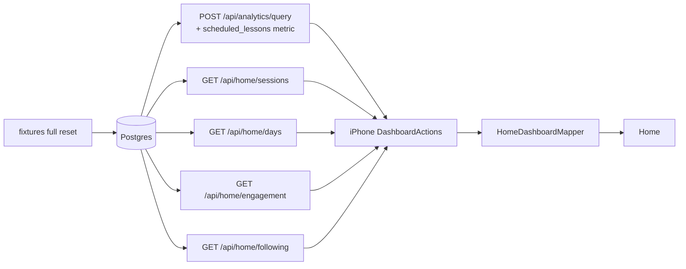

# home-dashboard-data — spec
> lg · no ticket

## Idea

**Why.** The UI 2.0 iPhone Home dashboard is the leader's first screen, and today most of it is
empty or flat even for the Fixtures identity, which exists to show every section with data.
Overview and the Activity day counts fill. The Activity columns, every day card's minutes and
mini-chart, Sessions, Engagement and Following do not. Some are empty because the server has no
endpoint for them, and some are flat because the iPhone mapper hard-codes zeros (ui2-shell F19).
This feature is for the owner and every leader building or reviewing UI 2.0 screens: they need to
see the real screen, populated, to judge it.

**What success looks like.** After `npm run fixtures:reset`, sign in as Fixtures on Local and
every Home section shows real, non-zero data from the real API:
- Overview KPIs and trend lines;
- Activity columns, with scheduled vs completed per day;
- every day card's minutes and its 12 bars;
- Sessions: the average session, the hour-of-day dial and the time-activity strip;
- Engagement: % current, members current, enrolled, groups and N active;
- Following: three followed enrollments grouped by program.

Nothing reads 0, "0 mins" or an empty state unless the data really is zero.

**In your words.** "I want every section to have data, every chart, everything, each day card,
average session data, engagement, etc." → D1 · sessions grouped by gap → D2 · current = caught up → D3
· follows stored as a preference → D4 · its own feature beside analytics → D5 · day cards show session
minutes → D6 · the 50/20 bands → D7.

**The concept.** The server adds what the screen needs and the iPhone wires it:

Sessions are derived on the server from the activity it already records, grouped by a 30-minute
gap (D2). Engagement counts caught-up and recently active members (D3). Following reads a per-user
preference (D4). The day cards use the same sessions (D6).

**How it fits today.** `DashboardActions` already queries `/api/analytics/query` for Overview and
the day counts¹. `HomeDashboardMapper` zeroes the scheduled series, the day series and the minutes².
`HomeDashboardScreen.State` already carries every field the remaining sections need³. The fixtures'
home-dashboard layer already seeds completions with times of day, video progress, `LESSON_OPENED`
client events and membership events⁴. The analytics registry is whitelist-only, and its query
contract was frozen by the analytics feature on 2026-07-30⁵.

¹ `iphone/MakeReady/State/Actions/DashboardActions.swift:22` · ² `iphone/MakeReady/UI2/Containers/Home/HomeDashboardMapper.swift:30-46` · ³ `iphone/MakeReadyUI/Screens/Home/HomeDashboardScreen.swift` `struct State` · ⁴ `server/fixtures/screens/home-dashboard.ts` · ⁵ `docs/features/analytics/MANIFEST.md`

**Approaches considered.** Chosen: a feature of its own that adds one registry metric and four
iPhone-only `/api/home/*` endpoints, plus fixture and mapper work (D5). Rejected: folding it into
analytics phase D (unplanned, so Home would wait on it); reopening the frozen query contract
(re-checks every consumer, including the web Program Analytics tab).

## Apps

| App | In scope | What changes | Section |
|---|---|---|---|
| server | ✅ | `scheduled_lessons` registry metric (+ its view arm); `/api/home/{sessions,days,engagement,following}`; fixtures home layer extended | §server |
| client | ⬜ | UI 2.0 leader screens are iPhone-only (docs/ui2/README.md:59); the web leader Home is frozen parity work | — |
| iphone | ✅ | `DashboardActions` fetches the new data; `HomeDashboardMapper` maps every section; `DashboardSnapshot` grows | §iphone |
| capture | ⬜ | Home captures render from fixture JSON (ViewRegistry), not the live API; no capture case changes | — |

**Sequencing:** contract settled → server (metric, endpoints, fixtures) verifies → contract freezes →
iPhone consumes it → the walk on Fixtures.

**Backward compatibility:** everything is additive. A released iPhone build doesn't call the new
endpoints, and `scheduled_lessons` is a new metric name, so existing queries are unchanged. Release
builds run 1.0 screens, not the UI2 Home (ui2-shell).

**Blast radius:** the `analytics_events` view gains one arm, and existing metrics filter by event
type, so their results don't change (the audit checks this). The preference key is new. Everything
else is read-only.

## Decisions

<!-- The one place rulings live. Record the DECISION — and, in one line, why, and why the rejected option lost. A stated preference
     is the INPUT to a row, not the row. Write each Ruling as something later code can be checked
     against without re-interpretation:
       · positive and specific — "store the full number, mask at render", not "don't truncate"
       · scope named — which apps, screens or endpoints it binds
       · "etc." / "and so on" expanded into the list, or the test for membership stated
       · the rejected alternative named, with the reason it lost (check-obligations warns on a bare one)
       · the enforcement hook, where one exists (lint rule, script, test)
     🔴 NEVER quote the user's prompt as the ruling. Operationalize it: a closed list, a measured
     value, an enumerated set of deviations. A ruling a stranger could implement two ways is not
     written yet.
     Who/date carries the provenance, so the Ruling itself needs no quote marks.
     The owner's own words go in §Idea "In your words", linked to this row — never in the Ruling.
     OPEN rows block the build go-ahead. Never delete a ruling; supersede it in place with a date. -->

| # | Decision | Ruling | Who / date |
|---|---|---|---|
| D1 | What "every section has data" means | After a `full` fixtures reset, as Fixtures on Local, each of these renders non-zero real-API data: Overview's KPI cards and series; Activity's C-026 completed **and** scheduled columns; every C-025 day card's minutes, completions and 12 C-024 bars; Sessions' C-029 hour dial, centre value and C-030 strip, for every `sessionRange` (All time · Year · Month · Week); Engagement's C-031 percent, count, progress, subtitle and the "N active" header; Following's header count, C-032 program headers and C-033 group cards. Enforced by the §Testing walk. Why: the owner wants the full screen judgeable. Rejected: Overview + Activity only (ui2-fixtures D1's scope, now outgrown) | user 2026-10-25 |
| D2 | What a session is | A member's activity moments are: `client_events` occurredAt, `member_lesson_progress` completions, and `video_progress` startedAt/lastWatchedAt. Moments less than 30 min apart form one session. Its duration is last moment − first moment, with a 60 s floor. Scope: the caller's owned organisation. Computed on the server per request (no stored table). Why: the standard web-analytics definition, from data already recorded. Rejected: app-reported session start/end events (members use web, no history); one lesson = one session (sittings split, unfinished lessons have no end). Closes OQ-home-dashboard-2 | user 2026-10-25 |
| D3 | Current and active | *Current* = an enrolled member of an in-scope group whose every lesson schedule with `scheduledDate` < today (caller tz) is completed. % current = round(current ÷ enrolled × 100). *N active* = distinct members with ≥1 session (D2) in the last 7 days, today included. Subtitle: "<enrolled> total members enrolled across <groups> groups". Why: "current" means up to date, and active is a separate fact. Rejected: current = active in 7 days (a member a week behind counts as current); current = ≥80% done (an arbitrary line). Closes the definition half of OQ-home-dashboard-1; the arrow's destination stays deferred | user 2026-10-25 |
| D4 | Where follows live | The per-user preference key `dashboard.followedEnrollments` holds a JSON array of enrollment ids, through the existing `/api/preferences/{key}`. Unset or empty → Following's empty state. Ids the caller can't see are dropped silently. The future `home-follow-picker` writes the same key. Why: no schema change, the same mechanism as `dashboard.kpis`. Rejected: a follows table (a migration nothing else reads); follow-all (the picker loses its purpose, and big orgs get very long). Closes the storage half of OQ-home-dashboard-4 | user 2026-10-25 |
| D5 | Relation to the analytics feature | Its own feature. `scheduled_lessons` is registered in `analytics-metrics.ts` as an additive metric; per-member computations (sessions, day minutes, engagement) and the Following assembly are new iPhone-only endpoints under `/api/home`. The frozen `/api/analytics/query` contract is not reopened. Why: ships without analytics C/D. Rejected: fold into analytics D (unplanned); reopen the contract (consumer re-check) | user 2026-10-25 |
| D6 | Day card minutes and bars | Minutes = Σ session duration (D2) of in-scope members' sessions starting that local day, shown as "<n> mins" (rounded). The 12 C-024 bars = those session seconds per 2-hour block (index 0 = 12–2 AM, caller tz). Line 2 = "<n> complete" from `lesson_completions`. Why: real time spent, consistent with Sessions. Rejected: video minutes (ignores reading/writing); bars = lesson counts (mixes units) | user 2026-10-25 |
| D7 | Completion colour bands | Green when percent ≥ 50, yellow when 20–49, red when < 20, for C-031's `color` and each C-033's `color`. Mapped on the iPhone (`HomeDashboardMapper`), unit-tested at 19/20/49/50. Why: the only cut-offs consistent with every value the design draws (55 and 89 green, 21 yellow, 12–13 red). Rejected: 70/40 and 80/50 (both contradict the design's 55% green). Closes OQ-home-dashboard-3's threshold half | user 2026-10-25 |
| D8 | Sessions by range | `range` ∈ all · year · month · week. The window is the last 365 / 30 / 7 days to today, and all = since the org's first session. Dial = mean session seconds per start hour (24 values, caller tz). Centre = mean duration, formatted "<m> min". Strip (C-030) = 88 equal time bins across the window, each the summed session seconds in it, normalised 0–1; 4 tick labels at bins 0, 29, 58, 87 (date, "MMM d"). Why: C-030's x is time within the period (owner axis ruling, OQ-C-030-2) | (assumed at spec) 2026-10-25 |
| D9 | Endpoint scope and time | Every `/api/home/*` call requires a leader session, scopes to the caller's owned organisation (as `/api/analytics/query`'s appliedScope does), and takes `tz` (IANA, default UTC) for day boundaries. A caller with no owned org gets 400 `{error:"No organization"}` | (assumed at spec) 2026-10-25 |
| D10 | Scheduled per day | New metric `scheduled_lessons` counts lesson schedules (one per enrollment × lesson) by their `scheduledDate`, through a new derived `analytics_events` arm `LESSON_SCHEDULED` (`ls:`); `dimensionsAllowed: true`. The mapper fills `chartScheduled` from it over the chart's 36 days | (assumed at spec) 2026-10-25 |
| D11 | Following card content | Per followed enrollment: program title, author name, "Created <MMM d, yyyy>", group name, group photo URL (or "" → initials), "<n> members", percent = round(completed ÷ scheduled-to-date lessons × 100) across the enrollment's members, `showLink` = the enrollment syncs with its program (`/api/enrollments/{id}/sync` semantics). Programs are ordered by title, groups by name | (assumed at spec) 2026-10-25 |
| D12 | Fixture coverage | The home-dashboard layer's `full` scenario also seeds: one `LESSON_OPENED` + completion + video span per completion so sessions last 5–40 min across morning, midday and evening; a mix of members (≥40% caught up, the rest 1–5 lessons behind) so the percent sits in a band; one session inside each of the last 7 days; and `dashboard.followedEnrollments` for the fixture user = 3 enrollments across 2 programs. Dates are from `ctx.now` | (assumed at spec) 2026-10-25 |

## Contract

| Contract | Producer | Consumers | Auth | Request | Response | Errors |
|---|---|---|---|---|---|---|
| `scheduled_lessons` metric on `POST /api/analytics/query` | server | iphone | leader session | `{metrics:["scheduled_lessons"], dimensions:["day"], filters:{organizationId, from, to}, timezone}` | rows `{day, scheduled_lessons}` as for any count metric | as `/api/analytics/query` |
| `GET /api/home/sessions?range=&tz=` | server | iphone | leader session | `range` all/year/month/week | `{averageSeconds:int, sessionCount:int, hourly:[24 number], bins:[88 number 0–1], ticks:[4 "yyyy-MM-dd"]}` | 400 bad range / no org · 401 |
| `GET /api/home/days?from=&to=&tz=` | server | iphone | leader session | yyyy-MM-dd, ≤ 62 days | `{days:[{day:"yyyy-MM-dd", sessionSeconds:int, blocks:[12 int]}]}` — every day in range, zero-filled | 400 range / no org · 401 |
| `GET /api/home/engagement?tz=` | server | iphone | leader session | — | `{currentCount:int, enrolledCount:int, groupCount:int, percent:int, activeCount:int}` | 400 no org · 401 |
| `GET /api/home/following` | server | iphone | leader session | — | `{programs:[{id, title, author, createdAt, groups:[{enrollmentId, groupName, photoUrl|null, memberCount:int, percent:int, synced:bool}]}]}` | 400 no org · 401 |
| preference `dashboard.followedEnrollments` via `GET/PUT /api/preferences/{key}` (existing) | server | iphone, server (`/api/home/following` reads it) | leader session | value = JSON array of enrollment ids | as today | as today |

## Schema & API changes

| # | Kind | Model.field | Wire | Reason | Status |
|---|---|---|---|---|---|
| SC1 | ADD | `analytics_events` view arm `ls:` (`LESSON_SCHEDULED`) | `scheduled_lessons` metric | D10 — scheduled side of Activity | ⬜ |
| SC2 | ADD | `/api/home/*` route module (4 GETs) | §Contract | D2, D3, D6, D8, D11 | ⬜ |

**Data plan:** SC1 is a new Atlas migration (`CREATE OR REPLACE VIEW` adding one arm); no table or
row changes, no backfill. The analytics matview refresh picks the arm up on its next 10-minute run.

## server

- **Metric:** add `LESSON_SCHEDULED` to `DERIVED_EVENT_TYPES`, and register `scheduled_lessons` (count, flow, `dimensionsAllowed`), following the `lesson_completions` entry. The view arm is projected from `lesson_schedules` joined to enrollment groups, carrying `organizationId`, `groupId`, `enrollmentId` and `scheduledDate` (as `occurred_at`). The migration goes through `server/schema` → `npm run schema:diff` per house rules, never hand-edited.
- **Sessions service** (`services/home-sessions.ts`): load the org's moments for a window (D2 sources), sort them per member, split at gaps of 30 min or more, and emit `{memberId, start, end, seconds}`. Shared by `/sessions` (D8), `/days` (D6) and engagement's active count (D3).
- **Routes** (`routes/home.ts`, mounted at `/api/home`): the four GETs in §Contract, zod-validated, using `requireAuth` and the same leader-access gate analytics uses.
- **Fixtures** (`server/fixtures/screens/home-dashboard.ts`): extend the `full` scenario per D12, and write the preference through Prisma. `server/fixtures/README.md` notes the new coverage.

## iphone

- **`DashboardSnapshot`** gains `scheduledDays: [String:Int]`, `dayMinutes: [String:Int]`, `dayBlocks: [String:[Int]]`, `sessions` (per range), `engagement` and `following`. It's cached and persisted like the existing fields (the D20 cache-first rule). Decoding is lenient, so an older cache without these keys still loads.
- **`DashboardActions.refresh()`** adds the `scheduled_lessons` query plus `/api/home/days` (the chart's 36 days), `/api/home/engagement`, `/api/home/following` and `/api/home/sessions?range=` for the selected range. Each extra call is non-fatal: a failure logs (`recordError`, `surface:false`) and keeps the cached section, and a 401 still signs out (D27).
- **`HomeDashboardMapper`:**
  - fills `chartScheduled`;
  - fills `dayLine1s` ("<n> mins"), `daySeries` (12 blocks, in minutes) and `dayDetailsStates` (`Default` when there's any activity, else `Nothing`);
  - fills the Sessions fields from the selected range (D8);
  - fills Engagement (`engagementPercent`, `engagementCount` = current, `engagementProgress` = percent/100, the subtitle, `engagementColor` by D7, and `activeCount`);
  - fills Following (`followedCount`, the program and group arrays, `groupColors` by D7, and `groupShowLinks` = synced).
- **Range picker:** `onSelectSessionRange` re-queries `/api/home/sessions` for the new range. The other no-op callbacks (D9 of ui2-shell) stay no-ops.
- **Commits** are `commit: manual`: staged for the owner's approval.

## Testing

- **server:**
  - Vitest for the sessionizer: a gap of exactly 30 min splits, 29:59 joins, a single moment = 60 s, and members are kept separate.
  - Vitest for `/days`, zero-filled with blocks in the caller's tz across a DST boundary.
  - Vitest for engagement: a member with one overdue lesson is not current; active is a 7-day window.
  - Vitest for `/following`: the preference order, an unknown id dropped, and a foreign-org id dropped.
  - A metric test proves `scheduled_lessons` counts schedules by date and that `lesson_completions` totals are unchanged by the new arm.
  - A fixtures DB test asserts that every D1 field source is non-zero after `full`.
- **iphone:**
  - `HomeDashboardMapperTests` for each new field, the D7 bands at 19/20/49/50, and lenient decoding of an old snapshot.
  - `DashboardActionsTests` for a failed extra call keeping the cache.
  - `npm run ios:build-check -- --test`, and swiftlint from `iphone/`.
- **Cross-app walk:**
  1. `fixtures:reset`.
  2. iPhone Debug on Local, identity Fixtures.
  3. Home: check every D1 item in order, and switch the Sessions range through all four values.
  4. Pull to refresh, then relaunch offline: the cached sections still render.
- **Human verification:** the walk above, judged by eye on a device.

## Out of scope

- The `home-follow-picker` overlay that writes `dashboard.followedEnrollments` (its own future spec).
- Where Engagement's arrow and the group cards lead (OQ-home-dashboard-1/4 destinations, deferred by the owner).
- The web client and the frozen web LeaderApp Home.
- Analytics phases C and D, and the `/api/engagement/*` route migration.
- Changing any design contract (C-025 … C-033) or token.

## Findings & risks

| # | Finding | Resolution |
|---|---|---|
| F1 | The sessionizer runs per request over an org's raw moments; a large org's "all time" could be slow | build-time risk: cap `all` at 730 days and measure on fixtures; a stored rollup is analytics phase D's |
| F2 | The C-033 group colour is not derived from the percent in the design (OQ-home-dashboard-3 narrowing) — D7 derives it anyway | D7 is the owner's ruling; the contract's independent prop still allows it |
