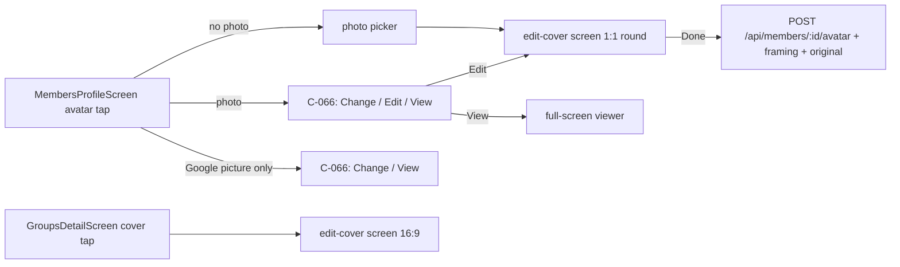

# image-framing-editor — spec
> lg · no ticket · follows `group-cover-image` (shipped 2026-10-27, `docs/features/_archive/group-cover-image/SPEC.md`)

## Idea

**Why.** group-cover-image built a Photos-style framing editor (pinch, twist, straighten dial, pan,
flip, rotate 90°, zero black edges, re-edit from the stored original), but only for a 16:9 group
cover. A member's avatar can only be replaced — never cropped, straightened or re-framed. This feature
turns the editor into one shared, aspect-parameterised editor and makes the member avatar (1:1, shown
round) its second user, with the group cover moved onto the shared pieces unchanged in behaviour.

**What success looks like.** On a member's profile the avatar is tappable: no photo → the photo
picker; a photo → Change image / Edit image / View image. Edit opens the same editor at 1:1 with a
round guide; Done saves; the new avatar shows on the profile and the Members list at once; Edit later
re-opens the full original at the saved framing. Group covers behave exactly as they do today.

**In your words.** "That way I can edit an avatar that is a 1:1, cover image for a study that is
16:9, etc." → D1, D2 · "Just do group cover and member avatar for now" → D2

**The concept.**

The editor's pieces (`CoverFramingMath`, the model, the render, the canvas) take the aspect and the
output size as inputs; the d2m screen `edit-cover` takes the aspect, mask and title. Each image kind
supplies its own save action and storage.

**How it fits today.** The framing math already works from the frame's measured size; only
`CoverFramingMath.frameAspect` (16:9) and the 1200×675 render are fixed[^1]. The saved framing is
relative (scale against the zoom floor, offsets as frame fractions), so it is aspect-independent[^2].
The avatar is `Member.profilePicture`, set by a multipart `POST /api/members/:memberId/avatar` that
re-encodes to a 512px WebP and deletes the previous file[^3]; the iPhone app never calls it, and the
web (profile page and admin) calls it with the field named `avatar` while the server reads `file`, so
web avatar uploads fail today[^4]. Four other paths write `profilePicture` — PATCH, two Google-sync routes and the link-time copy
`syncProfilePictureFromUrl`, which re-uploads the Google picture into the same avatar key space[^5]. The UI2 profile shows `profilePicture`, else the Google picture, display-only[^6].

**Approaches considered.** Chosen: generalise the one d2m screen and the app-side editor (every
future image — study covers, events — reuses it). Rejected: a second `edit-avatar` d2m screen (two
copies to keep in step, a copy per future image).

[^1]: `iphone/MakeReady/UI2/Containers/Groups/CoverFramingMath.swift:14`, `CoverImageRendering.swift:8`, `iphone/MakeReadyUI/Screens/Groups/EditCoverScreen.swift:91`
[^2]: archived group-cover-image D11/D21
[^3]: `server/src/routes/members.ts:1487-1580`, `server/src/services/storage.ts:148-210`
[^4]: `client/app/Http/Controllers/ProfileController.php:89`, `client/resources/js/islands/admin-island/stores/ui/profile.ui.ts:91`
[^5]: `server/src/routes/members.ts:1314` (PATCH zod), `:1626-1680` (`avatar/sync-google`), `:2015` + `services/member-google.ts:194` (`sync-google-profile`), `services/account-linking.ts:44-70` (`syncProfilePictureFromUrl` — OAuth link, user link, sync script)
[^6]: `iphone/MakeReady/UI2/Containers/Members/MemberProfileMapper.swift:32`, `iphone/MakeReadyUI/Screens/Members/MembersProfileScreen.swift:276`

## Apps

| App | In scope | What changes | Section |
|---|---|---|---|
| server | ✅ | `Member` keeps the avatar's original + framing; the avatar upload accepts them; legacy writes clear them | §server |
| client | ⬜ | No web code changes. The web posts multipart `avatar` (`ProfileController.php:89`, `profile.ui.ts:90`), which the server rejects today; D14 makes the server accept it, and that framing-less path clears the stored original + framing (D8) — server-side changes only | — |
| iphone | ✅ | Shared editor pieces; avatar tap, menu, editor, viewer on the member profile; group cover moved onto the shared pieces | §iphone |
| capture | ⬜ | No compare twin covers the editor or the avatar tap; the d2m previews are recaptured by the owner's d2m run, not this feature | — |

**Sequencing:** the owner generalises d2m `edit-cover` (D9) → server phase (schema, upload, payload;
contract FREEZES) → iphone phases (shared editor refactor first, then the avatar) → the walk.

**Backward compatibility:** iPhone 1.0 never uploads avatars and reads only `profilePicture`, which
keeps its meaning (the 512px rendered avatar). The two new member fields are additive. The web's
multipart upload starts working (D14); both web callers read only `data.url`, which stays.

**Blast radius:** `profilePicture` is read by member payloads, group-member lists, posts' author
avatars and the web; none of them change. Group cover storage and endpoints are untouched.

## Decisions

<!-- The one place rulings live. Record the DECISION — and, in one line, why, and why the rejected option lost. A stated preference
     is the INPUT to a row, not the row. Write each Ruling as something later code can be checked
     against without re-interpretation:
       · positive and specific — "store the full number, mask at render", not "don't truncate"
       · scope named — which apps, screens or endpoints it binds
       · "etc." / "and so on" expanded into the list, or the test for membership stated
       · the rejected alternative named, with the reason it lost (check-obligations warns on a bare one)
       · the enforcement hook, where one exists (lint rule, script, test)
     🔴 NEVER quote the user's prompt as the ruling. Operationalize it: a closed list, a measured
     value, an enumerated set of deviations. A ruling a stranger could implement two ways is not
     written yet.
     Who/date carries the provenance, so the Ruling itself needs no quote marks.
     The owner's own words go in §Idea "In your words", linked to this row — never in the Ruling.
     OPEN rows block the build go-ahead. Never delete a ruling; supersede it in place with a date. -->

| # | Decision | Ruling | Who / date |
|---|---|---|---|
| D1 | One shared editor | The framing math, the editor model, the render and the canvas take the frame aspect and the output pixel size as inputs; no 16:9 constant remains outside the group cover's own call site. Every framed image (today: group cover 16:9, member avatar 1:1) uses these pieces with its own save action. Rejected: an avatar-specific copy (two editors drift) | Luke 2026-10-27 |
| D2 | Scope | This feature: the group cover (moved onto the shared pieces, behaviour unchanged — its archived D1–D30 still bind) and the member avatar (1:1). Not included: study program covers, event covers (no UI2 event page). Rejected: study covers now · event covers now (needs an event page first) | Luke 2026-10-27 |
| D3 | Avatar crop | The editor shows the 1:1 frame dimmed outside the circle inscribed in it; the saved image is the full square. Rejected: a plain square guide (round displays clip the framed corners) · a round transparent PNG (breaks `Avatar(.square)`, heavier than WebP) | Luke 2026-10-27 |
| D4 | Avatar tap | `MembersProfileScreen`'s avatar is tappable. `profilePicture` empty and no Google picture → the system photo picker (as the group cover, archived D3). `profilePicture` set → C-066 with Change image (`upload`) · Edit image (`edit`) · View image (`eye`), Done cancels. Google-only — `profilePicture` empty, or equal to `googlePicture`, or hosted on `googleusercontent.com`, with a Google picture shown → C-066 with Change image · View image only (no Edit; nothing is saved from the Google picture). An R2 copy made at account linking counts as uploaded (D15). Rejected: always the picker (no re-framing) · Edit on the Google picture (~96px → blurry avatars) | Luke 2026-10-27 |
| D5 | Existing avatars | An avatar with no stored original opens Edit with its current `profilePicture` image as the original at identity framing; the first save stores that image as the original. Rejected: Edit only after a fresh pick (Edit would be missing on almost every existing avatar) | Luke 2026-10-27 |
| D6 | Permission | The avatar tap shows for anyone the avatar route admits — the member themself, or a super admin / role-holder in one of the member's orgs (`requireMemberOrOrgOwner`); the visibility gate is D16 | (assumed at brainstorm) |
| D7 | Avatar output | The phone renders the framed square at 512×512 (JPEG 0.9) and sends it as `file`; the server keeps its 512px WebP re-encode, so `profilePicture` stays what every reader expects. The original is the picked photo, upright, longest side ≤ 2400px, JPEG 0.9 (the group-cover pick, archived D3) | (assumed at brainstorm) · render size (assumed at spec) 2026-10-27 |
| D8 | Avatar upload contract | `POST /api/members/:memberId/avatar` stays multipart. Fields: `file` (required — the rendered avatar, as today), `framing` (optional — a JSON string, the group cover's framing shape incl. `flipped`/`quarterTurns`, zod `.strict()`), `original` (optional second file — the original). With `framing` + `original`: stores both. `framing` alone: a re-edit — the update leaves `profilePictureOriginalUrl` out of the write; with no stored original → 400. `file` may also arrive named `avatar` (D14). `framing` is a JSON string, `JSON.parse`d then validated by `coverFramingSchema` (`services/group-cover.ts:16`); a parse failure → 400. Multer errors map to JSON: over the limit → 413, an unexpected field or file type → 400. `original` without `framing` → 400. Neither (the web, 1.0-era callers): the original and framing are cleared. Per-file limit 10MB on a dedicated avatar multer instance (a detailed 2400px JPEG 0.9 can approach 5MB; `uploadMemberAvatar`'s 5MB check applies only to the 512px WebP); the original is re-encoded server-side (`sharp().rotate().resize(2400,2400,{fit:'inside',withoutEnlargement:true}).jpeg({quality:90})`, EXIF orientation applied, metadata stripped) under `avatars/members/{id}/{ts}-original.jpeg`. Both uploads finish before one DB write sets `profilePicture`, `profilePictureOriginalUrl`, `profilePictureFraming`; an R2 failure → 500 and no DB change. The old avatar is deleted as today; a replaced or cleared original is deleted best-effort after the write. Response: `{success, data: {url, originalUrl, framing}}` — `data.url` kept for the web. Rejected: a new JSON endpoint (a second avatar path to keep in sync) | (assumed at spec) 2026-10-27 |
| D9 | d2m screen | The owner generalises d2m screen `edit-cover`: inputs `aspect` (width ÷ height; 16:9 and 1:1 designed), `mask` (`.rectangle` — today's dim outside the frame · `.circle` — dim outside the circle inscribed in the frame) and `title` ("Edit cover" / "Edit photo"), with its states recaptured at 1:1 circle. The build only wires it (group-cover-image D4). Rejected: a second `edit-avatar` screen (two near-copies to keep in step, one more per future image) | Luke 2026-10-27 |
| D10 | The avatar tap hook | `MembersProfileScreen` gains `onAvatarTap: () -> Void = {}` with its own accessibility label ("Add photo" with no photo, else "Profile photo" — the `onCoverTap` label precedent, `GroupsDetailScreen.swift:296`) and button trait — a mechanical build edit, routed to `/ui2-resolve` (the `onCoverTap` precedent). Rejected: waiting for a d2m re-spec of the profile (the tap is the whole change) | (assumed at spec) 2026-10-27 |
| D11 | Legacy writes clear | Every `profilePicture` write other than the avatar upload — `PATCH /api/members/:id` carrying the key, `POST /:memberId/avatar/sync-google`, `POST /:memberId/sync-google-profile` (`syncGoogleProfile`) and `syncProfilePictureFromUrl` (account linking) — sets `profilePictureOriginalUrl` to null and `profilePictureFraming` to `Prisma.DbNull` (and delete the stored original best-effort), so Edit never reopens a stale photo. Rejected: leaving them (Edit would reopen a photo that is no longer the avatar) | (assumed at spec) 2026-10-27 |
| D12 | Save states | As the group cover (archived D13): Done shows the C-040 spinner and disables every control; success pops to the profile, patches the returned fields into `AppState` — `memberDetails[memberId]` and `profilePicture` on every `orgMembersByOrgId[*].members` row with that id (memory-only stores; group-detail member rows refresh on their next load) — and seeds `Ui2ImageCache` with the rendered image under the new URL; failure → `recordError(…, surface: true, friendlyMessage: "Couldn't save the photo", retry:)`; 401 → sign-out; 403/404 → pop to the profile (the model gains a 403 outcome; today only 404 maps, `EditGroupCoverModel.swift:164`; the group cover keeps its 404 → Groups). Cancel with changes → C-066 "Discard changes" + Done | (assumed at spec) 2026-10-27 |
| D13 | Viewer | View image shows the stored original when there is one, else `profilePicture`, else the Google picture, in the group cover's full-screen viewer (`CoverViewerOverlay`, its accessibility label an input: "Profile photo"), unmasked. A Google picture shows at its served size (~96px, soft) — accepted | (assumed at spec) 2026-10-27 |
| D14 | Web avatar uploads | The avatar route takes the rendered image from the multipart field `file`, else `avatar` (`file ?? avatar`), so the web profile page (`ProfileController.php:89`) and admin (`profile.ui.ts:90`) uploads work again with no client change; that path carries no framing, so it clears the stored original + framing (D8). Test: a request with `avatar` succeeds. Rejected: leaving the web broken (a live bug on the same route) | Luke 2026-10-27 |
| D15 | Avatars copied from Google at linking | An R2 copy written by `syncProfilePictureFromUrl` is treated as an uploaded avatar: full C-066 menu incl. Edit, D5's own-original rule applies; no source column. Rejected: a `profilePictureSource` column (a schema add and linking-code change to hide Edit on a few soft avatars) | Luke 2026-10-27 |
| D16 | Who may replace an avatar | The avatar route applies the PATCH visibility gate (`viewerOf` + `canViewMember`, `members.ts:1325`) after `requireMemberOrOrgOwner`: a caller who cannot view the member gets 404; a member in no org can be changed only by themself. Test: a role-holder without visibility → 404. Rejected: today's route (a leader who gets 404 on GET can still replace the avatar) | Luke 2026-10-27 |

## Contract

| Contract | Producer | Consumers | Auth | Request | Response | Errors |
|---|---|---|---|---|---|---|
| `POST /api/members/:memberId/avatar` (extended) | server | iphone · client (unchanged call) | `requireMemberOrOrgOwner` | multipart per D8: `file`, `framing?` (JSON string), `original?` | `{success, data: {url, originalUrl, framing}}` | 400 no file · bad framing · `original` without `framing` · `framing` alone with no stored original · unexpected field / file type · undecodable image · 401 · 403 · 404 (D16) · 413 over 10MB per file · 500 R2/DB |
| `GET /api/members/:memberId` (extended) | server | iphone | as today | — | `data` + `profilePictureOriginalUrl` (string\|null), `profilePictureFraming` (framing \| null, through `parseStoredFraming`) | as today |

## Schema & API changes

| # | Kind | Model.field | Wire | Reason | Status |
|---|---|---|---|---|---|
| SC1 | ADD | `Member.profilePictureOriginalUrl` (text, null) | `profilePictureOriginalUrl` | Edit reopens the full photo; D5, D8 | pending |
| SC2 | ADD | `Member.profilePictureFraming` (YAML `json`, null) | `profilePictureFraming` | Edit restores zoom/rotate/position/flip/turns; D8 | pending |
| SC3 | EDIT | avatar upload body + response | D8 | framing + original in the same request; D8 | pending |
| SC4 | EDIT | the four non-upload `profilePicture` writers (D11) | — | clear SC1/SC2 on a legacy avatar write; D11 | pending |

**Data plan:** SC1–SC2 are nullable adds through `server/schema/schema.yaml` (Member, `profilePicture` at :591) →
`schema:diff` → one Atlas migration; no backfill — every member reads null and uses D5's fallback.
Undo = drop both columns.

## server

- Schema SC1–SC2 on `Member` → one Atlas migration (+ `atlas.sum`); `getScopedMember`
  (`services/member.ts:464`) spreads every scalar, so `GET /api/members/:memberId` carries both; emit the
  framing through `parseStoredFraming` (`group-payload.ts:53` precedent); add both to the `Member`
  schema (`src/docs/openapi-definition.ts:237`) and the avatar route's `@openapi`. `createMember` and the
  fixture avatar seed need no change (new rows read null).
- Avatar upload per D8: `upload.fields([{name:'file',maxCount:1},{name:'original',maxCount:1}])`,
  `coverFramingSchema` from `services/group-cover.ts:16` (one shared schema, not a copy), the original
  re-encode + upload (reuse group-cover's decode check and original re-encode — hoist them to a shared
  module rather than copy), one atomic `prisma.member.update`, old-avatar delete as today, old-original delete
  best-effort. The logic moves into `services/member-avatar.ts` (thin route — the `group-cover.ts`
  pattern).
- D11: the four non-upload writers null both fields (`UpdateMemberData` gains them; `Prisma.DbNull` for the json column).
- D14: `file ?? avatar`. D16: the PATCH visibility gate on the avatar route.

## iphone

- **Shared editor (D1):** rename and parameterise — `CoverFramingMath` → `ImageFramingMath` with
  `frameAspect` removed (callers pass the frame); `CoverImageRendering.render(_:framing:size:)`;
  `EditGroupCoverModel` → `ImageFramingModel` (no `groupId`; the save closure, output size and
  `saveFailedMessage` are inputs); `CoverFramingCanvas` moves out of `EditGroupCoverContainer.swift:230` into `ImageFramingCanvas.swift`
  (its accessibility label and the load-failure message are inputs); `CoverFraming` → `ImageFraming`
  (`typealias CoverFraming = ImageFraming` stays); `CoverEditSource` → `ImageEditSource` (both routes).
  The model's save closure returns the new rendered URL (`String`); `opening(group:)` moves to the group
  side; the model gains `outputSize`. `CoverViewerOverlay` takes an accessibility label. Renamed files
  are renamed in `project.pbxproj` (app + test targets), then `ruby iphone/scripts/capture-targets.rb`.
  `EditGroupCoverContainer` keeps its route and behaviour. Every existing test passes after mechanical
  renames; `CoverFramingMathTests.swift:37,154` (`frameAspect`) move to the group's 16:9 constant.
- **Wiring the generalised screen (D9):** both containers pass `aspect`, `mask` and `title` — group
  cover `16/9 · .rectangle · "Edit cover"`, avatar `1 · .circle · "Edit photo"`.
- **Member profile (D4, D10):** `MembersProfileScreen.onAvatarTap`; `MemberProfileContainer` routes it
  per D4 reading `AppState.memberDetails[id]`, not the screen state (a tap before the detail loads does
  nothing — the group precedent); the `.photosPicker` modifier on the container (as the
  group page); the C-066 menu through the overlay host; the viewer per D13.
- **Edit photo:** route `UI2Destination.editMemberAvatar(memberId:, source: .newPick(UIImage) | .stored)`
  → `EditMemberAvatarContainer` (sibling of `EditGroupCoverContainer`), D12 save states.
- **State:** `MemberDetail` (`MemberModels.swift:110`) gains `profilePictureOriginalUrl?` and
  `profilePictureFraming?` via `decodeIfPresent` (`try?` for the framing), so a server without them
  still decodes. `MemberActions.saveAvatar(memberId:, rendered:, framing:, original:)` builds the D8
  multipart body (each part `Content-Type: image/jpeg`; `framing` as a JSON string part), sends it
  through a new `APIClient.uploadWithStatus(endpoint:boundary:body:timeout:)` (120s; added to
  `APIClientProtocol` and `StubAPIClient`; non-2xx mapped through `statusError` — the existing
  `upload` loses the status, `APIClient.swift:310-316`), and patches the stores named in D12.

## Testing

- **server:** `server/src/routes/__tests__/members-avatar.request.test.ts` + a `member-avatar.ts`
  service unit test: upload with framing + original stores both (original ≤ 2400px under its key);
  framing alone keeps the original; `file` alone clears both (D8, the web path); `original` without
  framing 400; bad / unknown-key framing 400; undecodable image 400; non-manager 403; R2 failure leaves
  the row unchanged; old original deleted on replace; PATCH `profilePicture` clears (D11); Google-link
  clears (D11); `GET /api/members/:id` carries both fields; response keeps `data.url`.
- **iphone:** the shared math at 1:1 — zoom floor for wide and tall images at 0°, 45°, 90°, and at a
  quarter turn; render produces exactly 512×512 for the avatar and 1200×675 for the group cover; the
  group cover's existing tests unchanged after the rename; menu rows per photo state (none · uploaded ·
  Google-only — D4); has-photo read from AppState; decode of the new member fields, a bad framing, an
  old cache; save outcomes (401, 403/404, failure banner); `ios:build-check --test`; swiftlint baseline.
- **Fixtures:** `server/fixtures/screens/members-profile.ts` `full` gives one non-avatar member a
  Google link (`googleId`, `googleEmail`, `googlePicture` = a placed fixture image URL) for D4's
  Google-only state; `edit-cover` needs no layer (it reads `AppState` only).
- **Cross-app E2E (Fixtures):** on a fixture member with no avatar: pick a photo
  (`xcrun simctl addmedia`), frame it in the round guide, Done → profile and Members list show it; Edit
  reopens at the saved framing and zooms out past the old crop; View shows the original; a web-style
  upload (field `avatar`, no framing) then makes Edit open the avatar itself (D5); the Google-linked
  fixture member shows Change + View only (D4); a group cover still saves and re-edits.
- **Human walk (on device):** the round guide's feel at 1:1, the menu on a Google-only member.

## Out of scope

- Study program covers and event covers — owner 2026-10-27 (they plug into D1/D9 later).
- Removing an avatar; editing avatars on the web.
- Any adjustment beyond zoom / rotate / straighten / position / flip.

## Findings & risks

| # | Finding | Resolution |
|---|---|---|
| F1 | The iPhone phase needs d2m `edit-cover` generalised (D9) and `MembersProfileScreen.onAvatarTap` (D10) | build-time risk — the owner runs the d2m update before the iPhone phase; an agent run reaching it first parks as a human step |
| F3 | An uncommitted hand edit to d2m-owned `EditCoverScreen.swift` (toolbar pair centred, owner 2026-10-27) | build-time risk — commit it or fold it into d2m before the D9 run, or the regenerate loses it |
| F4 | Multer `LIMIT_FILE_SIZE` / unexpected-field errors reach Express's default handler as an HTML 500 today (`members.ts:48-61`, no error middleware) | settled in D8: the avatar route maps them to JSON 413 / 400 |
| F2 | Renaming the group cover's editor pieces touches code that shipped hours ago with agent sign-off only | build-time risk — the rename task runs the group cover's full test set before and after; behaviour unchanged is the gate |
