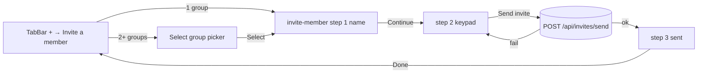

# invite-member — spec
> 🤖 AGENT SIGNED OFF 2026-10-26 — dfc433d · agent walk round 2 · not human-tested · evidence: .builder/invite-member/agent-walk/round-2/
> lg · ticket none

## Idea

**Why.** A leader in the UI 2.0 iPhone app has no way to invite anyone: the TabBar "+" menu's
"Invite a member" row only closes the menu, and the d2m-built `invite-member` screen is a preview
nothing opens. This feature wires that screen into the app so a leader can send an SMS invite to a
group from anywhere, and keeps the invitee's name on the invite for the leader's own records.

**What success looks like.** A signed-in leader taps "+" → "Invite a member", picks a group (only
when they lead more than one), types a full name, keys a 10-digit US number on the green keypad,
taps Send invite, and lands on "Invitation was sent to «name» / +1 (XXX) XXX-XXXX". The person
receives the existing group-invite SMS. The invite row on the server carries the name.

**In your words.** "wire up the invite-member page from d2m, which is the invite member experience"
→ D1, D2 · d2m owner description: "can be instantiated from anywhere in the app … the context is
inviting the member to the group the group leader is currently on" → D2, D3.

**The concept.** The built screen is the requirements (prototype mode, §Prototype). A thin
container in `iphone/MakeReady/UI2/` hosts it, owns the send's in-flight / failed state and calls a
new `InviteActions.sendInvite`. The group comes from the "+" menu path: one group → straight in;
two or more → the already-built "Select group" picker first.

**How it fits today.** The send endpoint exists and authorizes by the org-level check¹; the Invite
model has no name column²; `GET /api/groups` returns `creatorId` but no leader name³; the 2.0 shell
has only member destinations and an Add menu whose rows do nothing⁴; AppState has no invites store
and nothing in the app calls `/api/invites/send`⁵.

**Approaches considered.** *Chosen:* open from the TabBar "+" menu with a group pick, reusing the
built picker (D2). *Rejected:* wire `groups-detail` first so the Members "+" is the entry — the
design's own entry, but groups-detail's build is itself blocked on component rebuilds and would
make this a multi-screen feature; *first group only* — wrong for any leader of two or more groups.

¹ `server/src/routes/invites.ts:403-480` · ² `server/prisma/schema.prisma:289` · ³
`server/src/routes/groups.ts:234-280` · ⁴ `iphone/MakeReady/UI2/Shell/UI2Shell.swift:24-31,141-145`,
`UI2ShellModel.swift:18-21` · ⁵ `iphone/MakeReady/State/AppState.swift:262-269`

## Apps

| App | In scope | What changes | Section |
|---|---|---|---|
| server | ✅ | `Invite.recipientName` (schema + additive migration); send body accepts it; leader reads return it; `GET /api/groups` adds `creatorName`; fixtures layer `screens/invite-member.ts` (seeds the SMS campaigns, D18); `sendSMS` succeeds without Twilio in test mode (D17) | §server |
| client | ⬜ | Not touched: the design is iPhone-only (d2m `platform: ios`). Its `/admin/api/groups` readers (leader-groups, leader-library, leader-calendar, leader-dashboard, leader-enrollment-flow stores; `CheckMemberSession.php:77`) ignore the additive `creatorName` | — |
| iphone | ✅ | Add-menu row wired; two shell destinations; `InviteMemberContainer` + group-pick container; `InviteActions.sendInvite`; `UserGroup.creatorName` | §iphone |
| capture | ⬜ | Not touched: d2m already captures `invite-member` (`ui2s-invite-member`) and the picker; no new twin or adapter | — |

**Sequencing:** contract settled → server implements and verifies (contract FREEZES) → the d2m
screen update (D7, owned by `/d2m:*`, outside this pipeline) lands → iphone builds against the
frozen contract → the walk.

**Backward compatibility:** the released iPhone 1.0/2.0 builds decode `UserGroup` and never read
`recipientName`; both new fields are optional additions, so a released build sees no change. The
send endpoint keeps `recipientName` optional, so released callers (none call `/send` today) are
unaffected.

**Blast radius:** `Invite` rows are read by `GET /api/invites`, `PATCH /api/invites/:id`,
`GET /api/invites/:token` and `join.ts:310`; groups list is read by every client store above and
`GroupActions.fetchGroups`.

## Decisions

<!-- The one place rulings live. Record the DECISION — and, in one line, why, and why the rejected option lost. A stated preference
     is the INPUT to a row, not the row. Write each Ruling as something later code can be checked
     against without re-interpretation:
       · positive and specific — "store the full number, mask at render", not "don't truncate"
       · scope named — which apps, screens or endpoints it binds
       · "etc." / "and so on" expanded into the list, or the test for membership stated
       · the rejected alternative named, with the reason it lost (check-obligations warns on a bare one)
       · the enforcement hook, where one exists (lint rule, script, test)
     🔴 NEVER quote the user's prompt as the ruling. Operationalize it: a closed list, a measured
     value, an enumerated set of deviations. A ruling a stranger could implement two ways is not
     written yet.
     Who/date carries the provenance, so the Ruling itself needs no quote marks.
     The owner's own words go in §Idea "In your words", linked to this row — never in the Ruling.
     OPEN rows block the build go-ahead. Never delete a ruling; supersede it in place with a date. -->

| # | Decision | Ruling | Who / date |
|---|---|---|---|
| D1 | What is built | Wire the d2m-built `InviteMemberScreen` (iphone/MakeReadyUI/Screens/Groups/InviteMemberScreen.swift) with its 8 states (name-empty, name-ready, phone-empty, phone-partial, phone-ready, sending, send-failed, sent) and closed interactions exactly as d2m `invite-member` §2–§3 specify, except the deviations listed in D2, D4 and D7. Not a re-implementation: MakeReadyUI views are never hand-edited | design ref invite-member 2026-10-26 |
| D2 | Entry point | The TabBar "+" Add menu row "Invite a member" (`UI2Shell.addMenuActions`, glyph `c066-send-alt`) closes the menu and pushes onto the **selected tab's** stack: `.inviteSelectGroup` when the leader's group list (`AppState.groups`) has 2+ groups, else `.inviteMember(groupId:)` for the single group. Replaces d2m's entry (groups-detail Members `add`), which is unwired; not *wire groups-detail first* (blocked on rebuilds, much bigger) nor *first group only* (wrong for multi-group leaders) | user 2026-10-26 |
| D3 | Group pick | `.inviteSelectGroup` hosts the built `EnrollmentSelectGroupScreen` unchanged: rows = `AppState.groups` (alphabetical by name), chips = `creatorName` · `memberCount` · `AppState.enrollmentsFor(groupId:).count`; Leaders chip opens the existing C-036 full-screen filter menu (`ui2OverlayHost`) listing the distinct creator names, filtering locally; Orgs chip visible only when `AppState` lists 2+ organizations; search filters by name locally. Select pushes `.inviteMember(groupId:)` (the picker stays below it, so step-1 back returns to the picker). Not *fix it in the design* (blocks on d2m) nor *blank chips* (looks broken) | user 2026-10-26 |
| D4 | View invite | The confirmation step shows **Done only** — View invite is hidden until invite-home is wired (needs D7's switch). Not *wire invite-home too* (adds a by-id leader endpoint and a screen) nor *show it inert* (a dead button) | user 2026-10-26 |
| D5 | Invites store | `InviteActions.sendInvite(groupId:recipientPhone:recipientName:)` posts and returns the created invite's id; no `AppState` invites store in this feature — it arrives with the first screen that reads invites (invite-home / invites-home). Not *add the store now* (stores data no screen reads; the AppState rule keys on readers) | user 2026-10-26 |
| D6 | Invitee name visibility | `recipientName` is stored, and returned only on leader-authenticated reads: `GET /api/invites` and `PATCH /api/invites/:id`. The public `GET /api/invites/:token` and `join.ts` do not return it; the `group-invite-v1` SMS template and its context are unchanged. Not *greet them in the SMS* (a campaign-content change) nor *every read* (puts the name on a public URL) | user 2026-10-26 |
| D7 | Built-screen gaps | ~~SUPERSEDED 2026-10-26 (owner: "just finish")~~ — `InviteMemberScreen` gains `showsViewInvite: Bool = true` (false → Done alone on the sent step) and `.onChange(of: state.step)` adoption, edited in place on this branch (commit "D7 inputs") instead of through d2m; the d2m spec catch-up (`/d2m:screen:update invite-member`) is a follow-up, so a d2m rebuild must keep both. **Amended 2026-10-27 (auto, under the same owner override):** a third in-place edit — the step-1 name `FieldGroup` gets `editing:` (words capitalisation, focus on appear, the label as its spoken name) and `onChange: { name = $0 }`, as `SharedEditFieldTemplate` wires it; the d2m build drew it static (`editing: nil`), so no name could be typed and Continue never enabled (final review). The d2m catch-up now carries three changes. Was: Before the iphone phase, `/d2m:screen:update invite-member` (owned by `/d2m:*`) adds (a) a show-View-invite input, default `true`, and (b) adoption of later `State.step` changes so a host can move the screen to `sent` after an async send. The iphone phase is blocked until both land; the server phase is not. Not *keep View invite + rebuild the view by identity* (reverses D4, brittle) | user 2026-10-26 |
| D8 | recipientName shape | Optional on the send body: `z.string().trim().min(1).max(100).optional()`; stored as nullable `String` on `Invite`; existing rows stay `null` (no backfill). The iPhone sends the trimmed step-1 name | design ref invite-member 2026-10-26 |
| D9 | Leader name on groups | `GET /api/groups` adds `creatorName: string \| null` (the creator `User.name`, via `include: { creator: { select: { name: true } } }`); `UserGroup.creatorName: String?` decoded with `decodeIfPresent` | user 2026-10-26 |
| D10 | Send failure | On a thrown send, the container leaves the screen on step 2 with the number kept and `sending=false` (Send invite is the retry) and calls `state.recordError(error, context: "InviteMemberContainer.send", surface: true, friendlyMessage: <server error> ?? "Couldn't send the invite")` | design ref invite-member 2026-10-26 |
| D11 | Exits | Cancel (steps 1–2), Done, and step-3 back pop the whole flow (picker included) back to where "+" was tapped; step-1 back pops one page (to the picker or the caller); step-2 back returns to step 1 with the name kept (the screen's own rule) | (assumed at spec) 2026-10-26 |
| D12 | Zero groups | With `AppState.groups` empty after `GroupActions.loadGroups()`, the row pushes nothing and surfaces the error banner "Create a group before inviting members" (`recordError(surface: true)`). Not the picker's empty line, whose copy is "No groups ready to enroll" | (assumed at spec) 2026-10-26 |
| D13 | Group list freshness | Tapping the row awaits `GroupActions().loadGroups()` (cache-first) before deciding 1 vs 2+; a load failure with no cache surfaces "Couldn't load your groups" and pushes nothing | (assumed at spec) 2026-10-26 |
| D14 | Which groups | The picker lists every group `GET /api/groups` returns (already scoped by `groupManageFilter`); `allowInvites` is not consulted — it governs member-side sharing, not leader SMS invites | (assumed at spec) 2026-10-26 |
| D16 | Orgs chip on the group pick | `orgFilterVisible` is always `false` in `InviteSelectGroupContainer` for this feature. Why: `UserGroup` carries no `organizationId` (`GET /api/groups` returns none), so a visible Orgs chip could not filter anything, and `AppState.userOrganizations` holds at most one org today (`AppState.swift:162-166`), so D3's 2+ condition is never true. Rejected: *add `organizationId` to `GET /api/groups` and filter by it* — widens the server change for a state no leader can reach today | auto (recommended) 2026-10-26 |
| D17 | SMS in Twilio test mode | When `twilio.ts`'s `isTestMode` is true (`NODE_ENV=test` or `TEST_VERIFICATION_CODES` set), `sendSMS` calls no Twilio API and returns `{ success: true, messageSid: "test-<uuid>" }`, logging `[Twilio] test mode — SMS not sent to <to>`; with Twilio configured (no test-mode signal) nothing changes. Mirrors the verification test-code path (`twilio.ts:116`, `:166`). Why: today it throws "Twilio client not initialized" (`twilio.ts:283-285`), so `/send` returns 400 and deletes the invite in every test-mode env, the agent walk's included. Rejected: *real Twilio credentials in the walk env* — sends real SMS to fixture numbers and puts secrets in fleet worktrees | auto (recommended) 2026-10-26 |
| D18 | The `group-invite-v1` template in a fresh DB | the campaign definitions and their idempotent upsert move out of `src/scripts/seed-sms-campaigns.ts` into `src/services/sms-campaign-seed.ts` as `seedSmsCampaigns(prisma)` (the CLI keeps calling it; a separate module because importing the script runs its `main()`), and `fixtures/screens/invite-member.ts` calls it first in `full`, so `fixtures:reset` guarantees the template. Why: no seed or migration creates SMS templates (`server/seeds/manifest.yaml` lists none), so a reset DB answers `/send` with 400 `Template not found: group-invite-v1` (`sms-campaign.ts:147`). Rejected: *a dev seed YAML* — a second copy of the campaign definitions that drifts; *the versioned seeds* — prod would re-upsert edited live template copy | auto (recommended) 2026-10-26 |
| D15 | Fixtures | `server/fixtures/screens/invite-member.ts`, `full` scenario: one pending invite with `recipientName` "Tony Stark" on the base world's first fixture group, so `GET /api/invites` returns a named row; the base world's 3+ groups make the picker path walkable. Reads base entities only; dates from `ctx.now` | (assumed at spec) 2026-10-26 |

## Contract

| Contract | Producer | Consumers | Auth | Request | Response | Errors |
|---|---|---|---|---|---|---|
| `POST /api/invites/send` | server | iphone (`InviteActions.sendInvite`) | session; `canManageOrgContent` on the group's org | `{ groupId: uuid, recipientPhone: E.164, recipientName?: string 1–100 (trimmed) }` | `{ success: true, inviteId, inviteUrl, message }` (unchanged) | 400 `{ success:false, error }` invalid body / phone / send failure · 403 not authorized · 404 group not found · 500 |
| `GET /api/invites` | server | none in this feature (fixtures + walk step 5 via curl); the future invites store (D5) | session; own invites (`inviterId`) | `?groupId&status` | each invite gains `recipientName: string \| null`; every existing field unchanged | unchanged |
| `PATCH /api/invites/:id` | server | none in this feature | session; `canManageOrgContent` | unchanged | `invite` gains `recipientName: string \| null` | unchanged |
| `GET /api/invites/:token` | server | client join flow (unchanged) | public | — | unchanged — **no** `recipientName` (D6) | unchanged |
| `GET /api/groups` | server | iphone (`GroupActions.fetchGroups` → `UserGroup`); client stores (ignore the new field) | session; `groupManageFilter` | — | each group gains `creatorName: string \| null`; every existing field unchanged | unchanged |

## Schema & API changes

| # | ADD/EDIT/RENAME/REMOVE | Model.field | Wire | Reason | Status |
|---|---|---|---|---|---|
| SC1 | ADD | `Invite.recipientName` (String?, nullable) | `recipientName` | D8 — the invitee's name has nowhere to live | landed `20261027005642` |
| SC2 | EDIT | `POST /api/invites/send` body | `recipientName?` | D8 — accept and persist the name | landed |
| SC3 | EDIT | `GET /api/invites` and `PATCH /api/invites/:id` responses | `recipientName` | D6 — leader reads return the name | landed |
| SC4 | EDIT | `GET /api/groups` response | `creatorName` | D9 — the picker's leader chip and filter | landed |

**Data plan:** SC1 is one additive, nullable column via `server/schema/schema.yaml` → `npm run
schema:diff` (Atlas); existing invites read `null`; no backfill; undone by dropping the column.

**Alignment (2026-10-26)** — every value the design and the reused picker hand on, traced
producer model → zod → wire → endpoint → iphone property. No owner notes exist for
`invite-member` (`ui2-notes.mjs read` → `exists: false`).

| Value | Design / screen input | Producer today | iphone holds it in | Verdict |
|---|---|---|---|---|
| invitee name | `onSendInvite` arg 1 (trimmed, 1–100) | no column; `/send` zod strips it (`invites.ts:405-410`) | — (send body only, D5) | MISSING → SC1–SC3, T1–T3, T7 |
| phone | `onSendInvite` arg 2, `+1` + 10 digits | `Invite.recipientPhone` String?, zod `isValidPhoneNumber` | send body `recipientPhone` | ALIGNED |
| group | container's `groupId` | `/send` `groupId` uuid | `UserGroup.id` | ALIGNED |
| invite id | — (returned, unused on screen) | `/send` `inviteId` | `sendInvite` return value | ALIGNED |
| row name | `groupNames` | `Group.name` → `name` | `UserGroup.name` | ALIGNED |
| row photo | `groupPhotoURLs` | `coverImageUrl` (nullable) | `UserGroup.coverImageUrl` → `""` when nil | ALIGNED (layer name, mapped in the container) |
| leader chip / Leaders filter | `groupLeaderNames` | `creatorId` only; no name on the wire (`groups.ts:234-275`) | — | MISSING → SC4, T4, T6 |
| members chip | `groupMemberCounts` | `_count.members` (active) → `memberCount` | `UserGroup.memberCount` | ALIGNED |
| enrollments chip | `groupEnrollmentCounts` | per group only — `GET /api/groups/:groupId/enrollments`; no count on the groups list | `AppState.enrollmentsFor(groupId:)`, filled only for groups already opened | RESHAPE (derived; needs a per-group load) → T8 |
| Orgs chip visibility | `orgFilterVisible` | `/api/organizations/my/organization(s)` | `AppState.userOrganizations` (D3's "organizations" = this property) | ALIGNED; filtering by org has no `organizationId` on `UserGroup` → D16 |

**Released build:** `UserGroup` is disk-cached by the 1.0/2.0 builds; `creatorName` is read with
`decodeIfPresent`, so an old snapshot decodes `nil` and the new build re-fetches. Nothing a
released build stores is reshaped.

## server

- `server/schema/schema.yaml` `Invite.fields` gains `recipientName: { type: string, nullable: true }`;
  regenerate Prisma; generate the Atlas migration (never hand-edited).
- `services/invite.ts` `sendGroupInvite` takes `recipientName?: string` and writes it on create;
  the SMS call and its `context` are unchanged (D6).
- `routes/invites.ts` `/send` zod adds D8's field and passes it through (zod must not strip it);
  `GET /` and `PATCH /:id` responses add `recipientName`; `GET /:token` unchanged.
- `routes/groups.ts` `GET /` includes `creator { name }` and maps `creatorName` (D9).
- `fixtures/screens/invite-member.ts` per D15 (auto-discovered by `fixtures/runner.ts:82-104`), calling
  `seedSmsCampaigns(prisma)` first (D18).
- `services/twilio.ts` `sendSMS`: the test-mode short-circuit (D17).

## iphone

- **Model:** `UserGroup.creatorName: String?` (`State/Models/GroupModels.swift`), decoded with
  `decodeIfPresent`, plus the memberwise init default `nil`.
- **Action:** `InviteActions.sendInvite(groupId:recipientPhone:recipientName:) async throws -> String`
  (the invite id) — posts the §Contract body, throws `APIError.serverError(error)` when
  `success == false`. No AppState write (D5).
- **Shell:** `UI2Destination` gains `.inviteSelectGroup` and `.inviteMember(groupId: String)`;
  `UI2Shell.page(for:)` maps them; the Add menu's `onSelect` handles the "Invite a member" row per
  D2/D12/D13 (the other three rows keep closing the menu). A whole-flow pop (D11) uses a
  `UI2Navigator` capability to pop back to the stack depth at entry.
- **Containers** (new folder `UI2/Containers/Groups/`):
  - `InviteSelectGroupContainer` — maps AppState to `EnrollmentSelectGroupScreen.State` (D3), owns
    the query and the Leaders filter choice as UI state, presents the C-036 Leaders menu.
  - `InviteMemberContainer(groupId:)` — hosts `InviteMemberScreen` with `sending` and the step as
    local UI state (D7b), hides View invite (D7a, D4), runs the send (D10) and the exits (D11).
- Overlays through the typed shell/overlay host only — no `.sheet` / `.fullScreenCover`; errors via
  `recordError`; logging via `Log.*` (`/present-overlay`, `/ios-error-surface`).

## Testing

### server

- `routes/__tests__/invites.test.ts`: `/send` accepts and persists `recipientName`,
  rejects 0 or 101 chars, still accepts a body without it; `GET /` and `PATCH /:id` return it;
  `GET /:token` does not. `twilio` service test: in test mode `sendSMS` returns success with a
  `test-` sid and never constructs a Twilio call (D17). A `groups` route test: `creatorName` present and equal to the creator's
  name. `npx tsc --noEmit`, `-p fixtures`, `npm run test:run`, `schema:validate`.

### iphone

- XCTest: `InviteActions.sendInvite` request body + error mapping (stub API);
  `UserGroup` decodes with and without `creatorName`; the entry decision (0 / 1 / 2+ groups → none /
  `.inviteMember` / `.inviteSelectGroup`); the picker mapper (chips, alphabetical order, Leaders
  filter, Orgs visibility). `npm run ios:build-check -- --test`, swiftlint from `iphone/`.

### Cross-app E2E walk (dev env, fixtures reset, Fixtures identity)

1. Home → "+" → Invite a member → Select group lists the fixture groups with leader · members ·
   enrollments chips; Leaders filter narrows the list; pick one → Select.
2. Step 1: Continue disabled until a name; type "Ada Test" → Continue.
3. Step 2: key 9 digits — Send disabled; 10th digit enables it; an 11th is ignored; ⌫ removes one;
   long-press ⌫ clears; re-key → Send invite → buttons and keypad lock while sending.
4. Step 3 shows "Invitation was sent to / Ada Test / +1 (…) …-…" and Done only → Done returns to Home.
5. `GET /api/invites` (curl, leader session) shows the new invite with `recipientName: "Ada Test"`;
   `GET /api/invites/<token>` does not include it.
6. Invite the same number again (the template's 1200-minute rate limit, `sms-campaign.ts:174-180`,
   makes the server answer 400 "Rate limited: …") → stays on step 2 with the number kept, banner
   shows the server error. (The keypad cannot produce a number the E.164 check rejects.)

### Human verification

7. A single-group leader (exactly one group) taps "+" → Invite a member and lands straight on step 1 —
   no group picker. A person also walks steps 1–6 above on the dev simulator.

## Out of scope

- groups-detail and its Members "+" entry (owner, 2026-10-26 — D2).
- View invite / invite-home and its by-id leader endpoint (owner, 2026-10-26 — D4).
- An AppState invites store and any invite list screen (owner, 2026-10-26 — D5).
- Code/QR sharing (invite-qr), contacts import, non-US numbers (d2m invite-member §legacy, C-045 OQ-C-045-002).
- Greeting the invitee by name in the SMS (owner, 2026-10-26 — D6).
- The creator-only filter in `GET /api/invites` (known house-rule defect; untouched — no consumer here).
- The web client.

## Findings & risks

| # | Finding | Resolution |
|---|---|---|
| F1 | The "+" Add menu (action-menu-overlay) was uncommitted work this feature edits (`UI2Shell.swift`) | resolved — committed `bfb6d75` on this branch (`UI2Shell.swift:26-31,56-62`) |
| F2 | D7's d2m update is outside this pipeline and has **not landed** (2026-10-26: `InviteMemberScreen.init` has no show-View-invite parameter, `InviteMemberScreen.swift:56-71`, and no `onChange` adopting `State.step`); until it lands the iphone phase cannot satisfy D4/D7 | build-time risk — the iphone phase's first task checks the view for both; absent, that phase stops on the human step `/d2m:screen:update invite-member` (the server phase is not gated) |
| F3 | A local send cannot succeed today: `isDev` (`sms-campaign.ts:21,173`) only shortens the rate limit — the send still goes to Twilio, which throws in test mode (`twilio.ts:283`), and a reset DB has no `group-invite-v1` template (`sms-campaign.ts:147`) | D17 + D18 → T9, T10 |
| T1 | server: `schema.yaml` `Invite.recipientName` + Prisma regen + Atlas migration (SC1) | blocking |
| T2 | server: `/send` zod accepts `recipientName` (D8) and `sendGroupInvite` persists it; SMS context unchanged (SC2) | blocking |
| T3 | server: `GET /api/invites` and `PATCH /api/invites/:id` return `recipientName`; `GET /:token` unchanged (SC3) | blocking |
| T4 | server: `GET /api/groups` includes `creator { name }` and maps `creatorName` (SC4) | blocking |
| T5 | server: `fixtures/screens/invite-member.ts` (D15) — auto-discovered by `runner.ts:82-104`; invites cascade with the fixture groups in `wipe.ts:26` | blocking |
| T6 | iphone: `UserGroup.creatorName: String?` — CodingKeys, `decodeIfPresent`, memberwise init default `nil` (SC4 consumer) | trailing |
| T7 | iphone: `InviteActions.sendInvite(groupId:recipientPhone:recipientName:)` posting the §Contract body (SC2 consumer) | trailing |
| T8 | iphone: `InviteSelectGroupContainer` starts `EnrollmentActions().loadEnrollments(groupId:)` for each listed group with no cached enrollments, concurrently and console-only on failure; the chip reads `AppState.enrollmentsFor(groupId:).count` and updates as they land (no server count exists) | trailing |
| T9 | server: `sendSMS` test-mode short-circuit + its test (D17) — service-only | blocking |
| T10 | server: `seedSmsCampaigns(prisma)` in `services/sms-campaign-seed.ts`, called by `seed-sms-campaigns.ts`; the invite-member fixtures layer calls it (D18) — service-only | blocking |
| F6 | `UI2Navigator` has `push`, `pop`, `popIfTop` only (`UI2Navigation.swift:6-11`); D11's whole-flow pop needs a new capability on it and `UI2ShellModel` (pop the tab's path back to its depth at entry) | build-time risk — the iphone shell task adds it with a `UI2ShellModel` unit test |
| F7 | Open questions on the in-scope set: OQ-invite-member-003 (`recipientName` API gap) → D8; OQ-C-045-002 (non-US numbers) → §Out of scope; picker OQ-003 (Orgs chip) → D16; picker OQ-002 (already-enrolled warning) → not reachable, this host never sets a warning; picker OQ-001, OQ-004, OQ-005, OQ-006 and OQ-C-040-001 are settled inside the built view, nothing for the host | disposed |
| F8 | Render vs the frozen snapshots not re-diffed this pass: the capture server (`:5950`) did not answer and the audit starts no server. Both screens were built and diffed by d2m (snapshots 2026-10-19); `MakeReadyUI/**` is frozen here | build-time risk — the iphone phase's first task re-captures `invite-member` and `enrollment-select-group` with `capture/runners/ui2/capture.mjs` before wiring |
| R1 | repoint (iphone): Add-menu "Invite a member" ← `UI2Shell.swift:30` (row), `UI2Shell.swift:62` (`onSelect` closes the menu for every row) — the only callers | builder:plan's repoint + retire phase |
| R2 | repoint (iphone): `EnrollmentSelectGroupScreen` — no app caller today (grep of `iphone/MakeReady/UI2`); REUSES, nothing to repoint | none |
| R3 | repoint (iphone): `GroupInvitePage` ← `Pages/Manage/Group/GroupHomePage.swift`, `Pages/Manage/Member/MemberHomePage.swift` (legacy 1.0, outside the app target); `State/` hits are comments only | none — legacy files untouched |
| R4 | repoint (iphone): `Route.groupsInviteMenu` ← `Services/Route.swift:35,101,155` (legacy overlay routes) | none — legacy files untouched |
| F5 | The Orgs chip cannot filter: `UserGroup` has no `organizationId` | D16 |
| F4 | `EnrollmentSelectGroupScreen`'s copy is enrollment-flavoured only in its empty line ("No groups ready to enroll"), which D12 keeps from ever showing here | resolved by D12 |
| F9 | D10/D12/D13 call `recordError(surface: true)`, but ui2-shell D28 left the legacy `ErrorBannerHost` behind with `Components/` (not in the app target), so the 2.0 shell drew no banner (agent walk round 1, E6) | ruled 2026-10-26 (agent walk, unruled=recommend): `UI2Shell` mounts one `UI2ErrorBannerHost` (`UI2/Shell/UI2ErrorBannerHost.swift`) — the legacy behaviour (top slide-in, 4 s auto-dismiss, tap/swipe-up dismiss, newest replaces) in 2.0 tokens (`Token.error`, `labelEmphasis`), a stopgap until a designed 2.0 banner is specced; costs a restyle when one is |
| F10 | Pushed invite pages sat vertically centred: the d2m screens size to content (`maxWidth` only) (agent walk round 1, O1) | fixed host-side: `.ui2PushedPageFill()` (`UI2Navigation.swift`) on both invite containers — top-aligned, full height, `Token.layoutBackground`; `MakeReadyUI/**` untouched |

## Prototype

- **Ref:** `--ui2 invite-member` → d2m screen `invite-member` (groups section; Figma section
  `4720:52707` = frames `4638:41453` step 1, `4639:41502` step 2, `4641:43032` step 3; snapshots
  `invite-member-default|phone-entry|confirmation.png`, 2026-10-19).
- **Resolved set** (all specced and built): C-040 PageHeader · C-046 FieldGroup (→ C-045 TextInput) ·
  C-048 PageActionButton · C-107 NumberKeypad (→ C-108 KeypadKey) · C-109 ConfirmationMark ·
  screen `InviteMemberScreen` (built, "preview only"). Reused, not in the ref: `EnrollmentSelectGroupScreen`
  (d2m `enrollment-select-group`, built) and the C-036 filter menu.
- **Not in scope:** groups-detail, invite-home, invite-qr, invites-home.
- **Frozen paths:** `iphone/MakeReadyUI/**` (d2m-owned) — one owner-approved exception, D7: `InviteMemberScreen.swift`'s two inputs and its live name field.
- **Gap dispositions:** fixed in the design — 1 (D7: View-invite switch + step adoption) · written
  into the SPEC — 5 (D2 entry, D3 picker data, D6 visibility, D9 creatorName, D12 zero groups) ·
  out of scope — 3 (groups-detail entry, invite-home, invites store).
- **Seams:** `recipientName` (step 1 → send body → `Invite.recipientName`); `groupId` (picker /
  single group → send body); phone (keypad digits → `+1` + 10 → `recipientPhone`).

## Replaced surfaces

| # | Surface (file:line) | REPLACES/ABSORBS/REUSES | Fingerprint |
|---|---|---|---|
| R1 | `iphone/MakeReady/UI2/Shell/UI2Shell.swift:30` Add-menu row "Invite a member" (iphone) | ABSORBS — the row gains its destination | `.init(glyph: "c066-send-alt", label: "Invite a member")` |
| R2 | `iphone/MakeReadyUI/Screens/Groups/EnrollmentSelectGroupScreen.swift` (iphone) | REUSES — hosted unchanged for the group pick | `private static let pageTitle = "Select group"` |
| R3 | `iphone/MakeReady/Pages/Manage/Group/GroupInvitePage.swift` (iphone, legacy 1.0, out of the app target) | REPLACES as the group invite entry (d2m legacy-mapping) — file untouched | `GET /api/groups/{id}/invite` |
| R4 | `iphone/MakeReady/Components/Navigation/InviteMenu.swift` "Invite members" (iphone, legacy, out of target) | ABSORBS — that item becomes this flow; file untouched | `Route.groupsInviteMenu` |

**S#** — none: every surface the design replaces is identified above.

| # | Adds | Disposition | App |
|---|---|---|---|
| N1 | The group-pick step before step 1 (the design draws none) | D3 — built from the reused `EnrollmentSelectGroupScreen`; reads SC4 `creatorName`; no persistence of its own | iphone |

## Fixes

- [x] iphone: E6 send failure surfaces an error — expected the D10 error banner over step 2 (number kept, Send re-enabled), saw no banner at all: the UI 2.0 shell mounts no `ErrorBanner`/`activeSurfacedError` host (only legacy `MainView.swift` does), so every surfaced error — D10's, and D12/D13's "Create a group before inviting members" / "Couldn't load your groups" — is dropped; server reply was correct (400 "Rate limited: …") (agent walk round 1)
- [x] iphone: E7 single-group leader skips the picker — expected a leader with exactly one group to land straight on the invite page, saw it unwalkable: the fixtures seed no single-group leader identity (both dev identities see all 4 groups); add a fixture layer for one, or a test that pins the D13 skip (agent walk round 1)
- [x] iphone: pushed invite pages fill the screen — expected Select group and the three invite steps to sit top-aligned under the status bar, full height, saw each page vertically centred with the system background above and below (header ~96–220 pt down); `InviteMemberScreen` / `EnrollmentSelectGroupScreen` frames lack `maxHeight: .infinity` (agent walk round 1, seen in passing)
