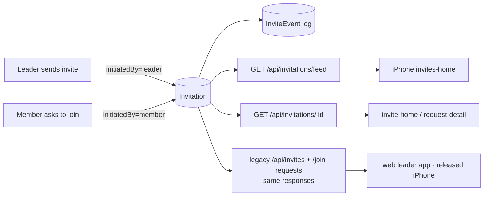

# invites — spec
> lg · ticket none · prototype mode (`ui2: invites-home, invite-home, request-detail`; Figma section 4773:11377)

## Idea

**Why.** A leader has no single place to see who has been invited and who has asked to join. The
UI 2.0 top nav already has an **Invites** tab, but it renders an empty page. Join requests can only be
answered group by group, and a leader sees only the invites they sent themselves. This feature makes
the Invites tab the org-wide place where a leader monitors invitations and acts on them: resend or
withdraw an invite, accept or reject a request.

**What success looks like.** A leader opens Home → Invites on the iPhone and sees, newest first, every
invite and join request across the orgs they manage. They search by phone or group and filter by
org, group, leader and status, using the same search field and filter rail as Members, Groups and
Enrollments. Tapping a Sent invite opens its detail page: who it went to, the linked member, every
group invitation to that phone, and a timeline. From there the leader can resend it or withdraw it.
Tapping a Requested row opens the join request, where Accept or Reject returns them to the list.
Every web screen and every released iPhone build that calls today's invite or join-request
endpoints keeps working unchanged.

**In your words.**
- "the topnav pattern with search + filter rail should all be the same pattern we use everywhere else" → D11
- "They are technically the same thing, the only difference is who initiated" → D1
- "Hide it from the list, but keep the record, We can add a filter for showing active and/or withdrawn invites." → D5, §Out of scope

**The concept.** One `Invitation` row is the relationship between a person and a group, and it
records who started it. A **leader-initiated** invitation is an invite: it has a link token, an
expiry and a sender. A **member-initiated** invitation is a join request: it has the requester's
message. Both move through the same statuses, `pending → accepted · rejected · expired · withdrawn`.
Every change writes an `InviteEvent`, and those events are the timelines on both detail pages.

**How it fits today.**
- The UI2 shell has `UI2Section.invites`, but `sectionContent` falls through to `EmptyPage`¹.
- All three screens are d2m-built preview views (InvitesHomeScreen, InviteHomeScreen,
  RequestDetailScreen), updated to the Figma section on 2026-11-02 (`9da5d240`). No container wires
  them.
- **Invites** live in `invites` (`schema.yaml:455`):
  - phone-keyed, with a token, a 7-day expiry and a sender;
  - status is a free string, and PATCH allows `pending|accepted|expired`²;
  - `GET /api/invites` lists only the caller's own invites³.
- **Join requests** live in `group_join_requests` (`schema.yaml:3259`):
  - member-keyed, unique per (group, member);
  - a request again resets the same row;
  - list, approve and reject work per group⁴.
- The two already overlap: a member who asks to join while holding a pending invite is joined at
  once, and the invite is marked accepted⁵.
- No invite event history exists. `MembershipEvent` records `INVITED` only for phones that already
  belong to a member.

**Approaches considered.**
- **Chosen:** one table plus compatibility endpoints (D1). It gives one copy of the data, and released
  clients see no change.
- **Rejected: one table with the old tables dual-written.** The two copies can drift, and nothing
  reads the old tables except code this feature rewrites anyway.
- **Rejected: two tables unified only at the read layer.** The owner asked for a shared schema, and
  the invite and request for the same person and group would stay two rows.

¹ `iphone/MakeReady/UI2/Shell/UI2Shell.swift:215-225` · ² `server/src/routes/invites.ts:669` · ³ `invites.ts:65` · ⁴ `server/src/routes/group-join-requests.ts:699,868,1095` · ⁵ `group-join-requests.ts:270-316`

## Apps

| App | In scope | What changes | Section |
|---|---|---|---|
| server | ✅ | The `invitations` + `invite_events` tables; one migration moves `invites` + `group_join_requests` into them and drops them. Feed, detail, resend and withdraw endpoints. Every legacy invite and join-request route reimplemented on the new table with identical responses. Event writes everywhere a status changes and on join-link clicks. Fixtures for 3 screens. | §server |
| iphone | ✅ | Wire Home → Invites (`InvitesHomeContainer`); an invitations store in AppState; `UI2Destination` cases for invite detail and request detail; Actions for feed, detail, resend, withdraw, accept and reject | §iphone |
| client | ⬜ | No screen changes. Its leader-app and admin stores call `/admin/api/invites` and `/admin/api/groups/:id/join-requests[/…]` (`leader-groups.store.ts:168,282,291`, `leader-group-home.store.ts:301,328`, `leader-library.store.ts:415`, `members.domain.ts:70,83`), and D2 keeps every one of those responses byte-identical | — |

**Sequencing:**
1. The contract is settled.
2. Server: response-snapshot tests of every legacy route (on the old tables), then the schema and
   migration, then the legacy routes rewritten onto the new table (the snapshots stay green), then
   the new endpoints, events and fixtures. The contract **freezes** when the server phase verifies.
3. The iphone consumer builds against the frozen contract.
4. The cross-app E2E walk.

**Backward compatibility:**
- **Released iPhone builds** call:
  - `POST /api/invites` and `POST /api/invites/send` (`InviteActions.swift:60,86`);
  - `GET`, `POST …/approve` and `POST …/reject` on `/api/groups/:id/join-requests` (`GroupActions.swift:703,725,745`);
  - the `makeready://join-requests/{groupId}` push deep link (`MakeReadyApp.swift:115`).

  Every one of these keeps its path, request and response shape (D2). A released build never sees
  `withdrawn`, because legacy list responses exclude withdrawn rows (D2). It never sees `rejected` on
  an invite either, because invites can't be declined (D4).
- **Old join links** (`/join/{token}`, `/api/invites/{token}`) keep working, because tokens are copied
  unchanged (D3).

**Blast radius:**
- `ActivityLog.inviteId` (`schema.yaml:4291`) is repointed to `invitations.id`. Ids are preserved, so
  existing rows stay valid.
- `MembershipEvent` writes (INVITED, REQUESTED, APPROVED, REJECTED) stay exactly where they are today.
- `groups.ts` (13 invite refs) and `members.ts` read invites and requests, and are repointed.
- The `/api/admin/join-requests` route (`server/src/index.ts:373`) is repointed.
- Fixtures `groups-detail.ts` and the `groups-browse` db test seed join requests, and are repointed.

## Decisions

<!-- The one place rulings live. Record the DECISION — and, in one line, why, and why the rejected option lost. A stated preference
     is the INPUT to a row, not the row. Write each Ruling as something later code can be checked
     against without re-interpretation:
       · positive and specific — "store the full number, mask at render", not "don't truncate"
       · scope named — which apps, screens or endpoints it binds
       · "etc." / "and so on" expanded into the list, or the test for membership stated
       · the rejected alternative named, with the reason it lost (check-obligations warns on a bare one)
       · the enforcement hook, where one exists (lint rule, script, test)
     🔴 NEVER quote the user's prompt as the ruling. Operationalize it: a closed list, a measured
     value, an enumerated set of deviations. A ruling a stranger could implement two ways is not
     written yet.
     Who/date carries the provenance, so the Ruling itself needs no quote marks.
     The owner's own words go in §Idea "In your words", linked to this row — never in the Ruling.
     OPEN rows block the build go-ahead. Never delete a ruling; supersede it in place with a date. -->

| # | Decision | Ruling | Who / date |
|---|---|---|---|
| D1 | One schema for invites and join requests | One `Invitation` model (table `invitations`), `initiatedBy ∈ {leader, member}`. Leader rows carry `inviterId`, `token` and `expiresAt`. Member rows carry `memberId` and `message`. Both carry `groupId?`, `organizationId`, `recipientPhone?`, `recipientName?`, `status`, `respondedById?`, `respondedAt?`, `acceptedAt?` and `createdAt`. Not two tables with a shared read layer (not a shared schema), and not dual-writing the old tables (drift). | owner 2026-11-02 |
| D2 | Legacy endpoints | Every route in §Contract C7 keeps its path, auth, request and response JSON byte-identical, now read from `invitations`. Enforced by snapshot tests captured on the old tables before the migration (§Testing S1). Join-request responses render `accepted` as `approved`, so the existing `pending/approved/rejected` vocabulary holds. Legacy list responses exclude `withdrawn` rows. Not reshaping `GET /api/invites`, which released iPhone builds read. | owner 2026-11-02 |
| D3 | Migration | One Atlas migration creates `invitations` + `invite_events`. It copies every `invites` row (same `id`, `token`, `status`, dates; `initiatedBy=leader`; `organizationId` from the group, or from the inviter's org when `groupId` is null) and every `group_join_requests` row (same `id`; `initiatedBy=member`; `recipientPhone` from `Member.phoneNumber`; `approved→accepted`; `reviewedById/At→respondedById/At`). It backfills `invite_events` from stored dates. It repoints `ActivityLog.inviteId`, then drops both old tables. Run on a scratch DB in tests, never `makeready_dev`. Not keeping the old tables (D1). | (assumed at spec) 2026-11-02 |
| D4 | Rejected | `rejected` is set only when a leader rejects a member-initiated invitation (a join request). Nothing lets a person decline an invite, and no client change is made. Not a Decline button on the web join page, which is undesigned and would bring in the client app. | owner 2026-11-02 |
| D5 | Withdrawn | Withdraw sets `status=withdrawn` and keeps the row. The feed and legacy lists exclude withdrawn rows. Detail still returns them, and its chips read Withdrawn. `/join/{token}` and `GET /api/invites/{token}` for a withdrawn invite show the same no-longer-valid response an expired invite shows today. Not a hard delete (it loses the record), and not a Withdrawn list row (hidden instead). | owner 2026-11-02 |
| D6 | Event log | New `InviteEvent` (table `invite_events`): `invitationId`, `type ∈ {sent, resent, link_clicked, accepted, withdrawn, expired, requested, approved, rejected}`, `at`, `actorId?`, `groupId?`, `metadata?`. Written in the same transaction as every status change. `link_clicked` is written on `GET /join/:token` and `GET /api/invites/:token` for a known token, at most once per invitation per 10 minutes. `expired` is backfilled only; nothing sweeps it live. Past link clicks are not reconstructed. Not derived from stored dates (no clicks or resends), and not `MembershipEvent` (keyed by member, so it can't hold non-member invitees). | owner 2026-11-02 |
| D7 | Display status | The feed maps each row to one of `sent · requested · accepted · rejected · expired` (C-089's states): leader+pending+not expired → sent; member+pending → requested; pending with `expiresAt < now` → expired (computed at query time; `status` is never rewritten); accepted → accepted; rejected → rejected. | (assumed at spec) 2026-11-02 |
| D8 | Leaders filter | `leaderId` matches leader rows whose `inviterId = leaderId`, and member rows whose group `leaderId` leads (the group's creator, or a holder of an org role over it that grants `canManageOrgContent`). Not the reviewer (pending requests would disappear), and not hiding requests under a leader filter. | owner 2026-11-02 |
| D9 | Feed scope and auth | The feed returns rows whose `organizationId` is one where `canManageOrgContent(user, org)` holds. A super admin sees all orgs. Newest first by display date (D10), at most 200 rows per call. Search runs on the device over that window (invites-home D40). No server `q` param. Not creator-only auth (the `canManageOrgContent` house rule). | (assumed at intake) 2026-11-02 |
| D10 | Row date | sent/requested → `createdAt`; accepted → `acceptedAt ?? respondedAt`; rejected → `respondedAt`; expired → `expiresAt`. The iPhone formats it "Just now" under 1 minute, otherwise "MMM d, yyyy" (OQ-invites-home-005). | (assumed at spec) 2026-11-02 |
| D11 | Invites tab pattern | `InvitesHomeContainer` + `InvitesHomeMapper` follow `MembersHomeContainer`: 300 ms debounced search; one C-036 overlay per chip with draft Clear/Save; a cancellable load task; `.pageRefresh`; TopNav hidden while searching (`UI2HidesTopNavKey`); row tap → `navigator.push`. The chip row is C-130 FilterRail. Chips are single-select with "All …" first (OQ-invites-home-004). | owner 2026-11-01 |
| D12 | Invite + pending request | When a leader sends an invite (`POST /api/invites/send` or `POST /api/invites`) to a phone with a pending member-initiated invitation for the same group, that row becomes `accepted` (respondedBy = the leader), the member joins exactly as the approve route adds them, and no second row is created. Events `approved`. Not a separate invite row, which would put two rows on one relationship. | owner 2026-11-02 |
| D13 | Request + pending invite | Today's auto-join stays (`group-join-requests.ts:270-316`). The pending leader row becomes `accepted` (event `accepted`), and the request call returns its current response. No member row is created. | (assumed at spec) 2026-11-02 |
| D14 | Asking again | A member asking again after a rejected or accepted invitation creates a NEW member row. Legacy `GET …/join-requests/me` returns that member's latest row for the group. Not resetting the old row, which loses the history the timeline shows. | (assumed at spec) 2026-11-02 |
| D15 | Resend | `POST /api/invitations/:id/resend` re-sends the SMS for every pending, non-expired leader invitation to the same `recipientPhone` in the caller's permitted orgs, reusing each token. It sets `expiresAt = now + 7 days` and writes `resent`. A row that is no longer pending is skipped. Not keeping the original expiry, which could leave the person a day. | owner 2026-11-02 |
| D16 | Withdraw | `POST /api/invitations/:id/withdraw` sets `withdrawn` on every pending leader invitation to the same `recipientPhone` in the caller's permitted orgs and writes `withdrawn`. Accepted rows are untouched. | (assumed at spec) 2026-11-02 |
| D17 | Resend/withdraw auth | Allowed for any user for whom `canManageOrgContent` holds over the row's org; refused with 403 otherwise. Not sender-only, because co-leaders see the same list. | owner 2026-11-02 |
| D18 | Linked member | Detail links a member by `memberId` if set, otherwise by an exact match of the E.164-normalised `recipientPhone` to `Member.phoneNumber` within the row's org. No match → the `unlinked` state. | (assumed at intake) 2026-11-02 |
| D19 | Design source | The three d2m screens were updated to Figma section 4773:11377 before this spec: Requested rows (C-089 `requested`) open request-detail; invite-home gains Resend and Withdraw (C-048 accent + send glyph, C-048 secondary); request-detail reads Accept. Committed `9da5d240`. | owner 2026-11-01 |
| D20 | Request accept/reject endpoints | iPhone UI2 calls the existing `POST /api/groups/:groupId/join-requests/:id/approve|reject`, now on `invitations` (they write `approved`/`rejected` events). There is no new accept or reject endpoint. | (assumed at spec) 2026-11-02 |

## Contract

| Contract | Producer | Consumers | Auth | Request | Response | Errors |
|---|---|---|---|---|---|---|
| C1 `GET /api/invitations/feed` | server | iphone | requireAuth; D9 | query `orgId?`, `groupId?`, `leaderId?`, `status?` (`sent\|requested\|accepted\|rejected\|expired`), `limit?` (≤200, default 200) | `{ items: [{ id, kind: "invite"\|"request", status, recipientPhone, recipientName?, memberId?, groupId?, groupName?, organizationId, inviterId?, inviterName?, date (ISO, D10), createdAt }], total, filters: { orgs: [{id,name}], groups: [{id,name,organizationId}], leaders: [{id,name}] } }`. `status` is the D7 display status; withdrawn is excluded. | 400 bad filter value · 401 |
| C2 `GET /api/invitations/:id` | server | iphone | requireAuth; `canManageOrgContent` over the row's org | — | `{ id, kind, status, recipientPhone, recipientName?, message?, createdAt, member?: { id, name, picture?, age?, role?, birthday?, joinedAt? }, invitations: [{ id, kind, groupId, groupName, groupPicture?, status (D7 + "withdrawn"), date }], events: [{ id, type, at, groupId?, groupName?, invitationId }], canResend, canWithdraw }`. `invitations` = every row to the same phone in permitted orgs, newest first. `events` covers those rows, newest first. `canResend`/`canWithdraw` = at least one pending, non-expired leader row (D15/D16). | 401 · 403 · 404 |
| C3 `POST /api/invitations/:id/resend` | server | iphone | requireAuth; D17 | — | the C2 payload, refreshed | 401 · 403 · 404 · 409 nothing pending · 502 SMS failed (no state change) |
| C4 `POST /api/invitations/:id/withdraw` | server | iphone | requireAuth; D17 | — | the C2 payload, refreshed | 401 · 403 · 404 · 409 nothing pending |
| C5 `POST /api/groups/:groupId/join-requests/:id/approve` · `…/reject` | server | iphone, client | unchanged (`groupManageFilter`) | unchanged | unchanged (D2) | unchanged |
| C6 `GET /join/:token` · `GET /api/invites/:token` | server | client (the recipient's browser, server-rendered landing) | public | unchanged | unchanged; withdrawn renders the expired response (D5); writes `link_clicked` (D6) | unchanged |
| C7 Legacy, byte-identical (D2): `GET/POST /api/invites`, `POST /api/invites/send`, `PATCH/DELETE /api/invites/:id`, `POST /api/groups/:groupId/join-requests`, `GET …/join-requests/me`, `GET …/join-requests`, `GET /api/admin/join-requests` | server | iphone, client | unchanged | unchanged | unchanged; lists exclude withdrawn; D12/D13 side effects | unchanged |

## Schema & API changes

| # | Change | Model.field | Wire | Reason | Status |
|---|---|---|---|---|---|
| SC1 | ADD | `Invitation` (table `invitations`), fields per D1; indexes `(organizationId, createdAt)`, `(recipientPhone)`, `(groupId, memberId)`, unique `token` | C1–C7 | one schema (D1) | planned |
| SC2 | ADD | `InviteEvent` (table `invite_events`): `id`, `invitationId` → Invitation (cascade), `type`, `at`, `actorId?`, `groupId?`, `metadata Json?`; index `(invitationId, at)` | C2 `events` | timelines (D6) | planned |
| SC3 | EDIT | `ActivityLog.inviteId` FK → `invitations.id` | — | ids preserved (D3) | planned |
| SC4 | REMOVE | `Invite` (table `invites`) | C7 unchanged | moved into SC1 (D3) | planned |
| SC5 | REMOVE | `GroupJoinRequest` (table `group_join_requests`) | C5/C7 unchanged | moved into SC1 (D3) | planned |
| SC6 | ADD | routes C1–C4 (`server/src/routes/invitations.ts`, service `services/invitation.ts`) | C1–C4 | the Invites tab | planned |

**Data plan:**
1. The migration is one transaction.
2. It creates SC1 and SC2.
3. It copies the rows: `INSERT … SELECT` from `invites`, then from `group_join_requests` (D3 field map). Ids are uuids, so the two sources cannot collide.
4. It backfills events:
   - a `sent` event at `createdAt` for every leader row;
   - an `accepted` event at `acceptedAt` where set;
   - a `requested` event at `createdAt` for every member row;
   - an `approved` or `rejected` event at `reviewedAt` where set;
   - an `expired` event at `expiresAt` where it is in the past and the row is still pending.
5. It repoints SC3 (SC3 before SC4).
6. It drops SC4 and SC5.

**Existing data:** every invite and request survives with the same id. Past link clicks and resends
are not reconstructed.

**Undo:** a reverse migration recreates the old tables from `invitations` by `initiatedBy`. It is
lossy only for rows created after the migration with a status the old tables lack (`withdrawn` →
`expired`).

The migration is generated from `server/schema/*.yaml` with `npm run schema:diff`. The data
statements are added by hand in the same new migration before it is committed, and no committed
migration is ever edited.

## server

- **Schema:** SC1–SC5 in `server/schema/schema.yaml`, plus the D3 migration.
- **Service `services/invitation.ts`:** owns all reads and writes. It has:
  - the status mapping (D7) and the date rule (D10);
  - feed, detail, resend and withdraw (D15, D16);
  - `recordEvent(tx, …)`;
  - the D12/D13 cross-acceptance;
  - the org-scope check: `canManageOrgContent`, never `creatorId`.
- **Routes:** `routes/invitations.ts` (C1–C4) stays thin.
- **Legacy routes on the new service** (D2), each response kept identical:
  - `routes/invites.ts`;
  - `routes/group-join-requests.ts`;
  - `routes/join.ts` (withdrawn → the expired response, plus `link_clicked`);
  - the `index.ts:373` admin route;
  - the invite and request reads in `routes/groups.ts` and `routes/members.ts`.
- **`services/invite.ts` `sendGroupInvite`:** creates a leader `Invitation` and writes `sent`, and
  applies D12.
- **Unchanged:** every `MembershipEvent` write stays as it is, and so does the push notification sent
  when a request arrives.
- **Fixtures:**
  - `server/fixtures/screens/invites-home.ts`: the `full` scenario has rows in all five display
    statuses across 2 groups and 2 leaders.
  - `invite-home.ts`: one phone with a Sent and an Accepted invitation, a linked member, and ≥5
    events.
  - `request-detail.ts`: one pending request with ≥2 events.
  - Repoint `groups-detail.ts` and `fixtures/__tests__/groups-browse.db.test.ts` to `invitations`.
- 🔴 `docker restart makeready-server` after every `server/src` edit.

## iphone

- **AppState:**
  - an `invitations` `EntityStore` keyed by id, holding the feed rows (C1) and the
    `invitationDetails[id]` payloads (C2);
  - `invitationFilters` (the C1 `filters` block);
  - the existing `pendingJoinRequestsByGroupId` is refreshed after accept or reject, so legacy and
    groups-detail stay correct.
- **Actions, new `InvitationActions.swift`:**
  - `loadInvitationFeed(filters)` (C1) and `loadInvitation(id)` (C2);
  - `resendInvitation(id)` (C3) and `withdrawInvitation(id)` (C4). Each merges the returned payload
    and refreshes the feed in the same call.
  - Accept and reject reuse `GroupActions.approveJoinRequest`/`rejectJoinRequest` (C5), then merge
    the refreshed detail and the feed.
- **Containers, under `MakeReady/UI2/Containers/Invites/`:**
  - `InvitesHomeContainer` + `InvitesHomeMapper` (D11). `UI2Shell.sectionContent` gets
    `case .invites`. The TopNav "+" for `.invites` stays a no-op.
  - `InviteDetailContainer` (invite-home): resend; withdraw through the confirm dialog
    ("Withdraw invitation?" / "«phone» will no longer be able to join with this invitation." /
    Cancel · Withdraw, destructive); the success toast "Invitation resent"; failures go to the top
    error banner (`/ios-error-surface`).
  - `RequestDetailContainer` (request-detail): Accept or Reject, then pop on success.
- **Navigation:**
  - `UI2Destination.inviteDetail(id)` and `.requestDetail(id)`, pushed from row taps by `kind`.
  - The linked-member block pushes the existing members-profile destination.
  - The group row on request-detail pushes groups-detail.
  - Typed `Route` only (`/push-page`, `/nav-route`). No `.sheet`, `.fullScreenCover` or `asyncAfter`.
- **d2m views:** the views in `MakeReadyUI/` are not edited. Containers feed their existing props and
  callbacks: `onOpenInvite`, `onOpenRequest`, `onResendInvitation`, `onWithdrawInvitation`,
  `onApprove`, `onReject`. A missing prop goes to d2m via `request_project_change`.
- `swiftlint` runs from `iphone/`.

## Testing

**server** (`npm run test:run`, `tsc --noEmit`, `tsc -p fixtures`, `schema:validate`; scratch DB only, never `makeready_dev`):
- **S1 legacy snapshots.** Written FIRST, on the old tables, and they must stay green after the
  migration. Each C5/C7 route captures the exact JSON for a seeded state: an invite pending, accepted
  and expired; a request pending, approved and rejected; null group.
- **S2 migration.** On seeded old tables: row counts, ids, tokens and status mapping are preserved;
  backfilled events are correct; `ActivityLog` stays valid; both old tables are gone.
- **S3 feed.**
  - Every D7 status.
  - The D8 leader rule.
  - Withdrawn excluded.
  - The D9 org scoping: a user without org access sees nothing; a super admin sees all.
  - The D10 dates.
  - The limit.
- **S4 detail.**
  - Aggregation by phone.
  - D18 member linking, linked and unlinked.
  - Events newest first.
  - `canResend`/`canWithdraw`.
  - 403 and 404.
- **S5 resend and withdraw.**
  - The D15/D16 effects and events.
  - Expiry reset.
  - Non-pending rows skipped.
  - 409 when nothing is pending.
  - 403 for a non-org user.
  - SMS failure gives 502 and no state change (Twilio mocked).
- **S6 cross-acceptance.** D12 and D13 produce one row and one membership. D14 asking again creates a
  new row, and `/me` returns the latest.
- **S7 join links.** `link_clicked` is written and throttled. Withdrawn shows the expired response.

**iphone** (`npm run ios:build-check -- --test`, `swiftlint --baseline`):
- `InvitesHomeMapper` tests: the status → C-089 state mapping, the debounce-free filter application,
  chip labels via `FilterMenuOverlay.chipLabel`, and the empty vs no-results states.
- `InvitationActions` tests: merge on resend and withdraw, and feed refresh after accept or reject.

**client:** `./vendor/bin/phpunit` and `npm test` unchanged-green (D2 guard). Reviewing
`leader-groups.store.ts` approve/reject against S1 snapshots is enough; there is no new test.

**Cross-app E2E walk (once, at verify):** fixtures reset, then the iPhone runs as the Fixtures identity:
1. Home → Invites shows 5 statuses.
2. Filter Status = Requested.
3. Open a request → Accept → back to the list.
4. The row now reads Accepted.
5. The web leader app (`/admin/groups`) shows that member in the group.
6. Open a Sent invite → Resend → toast.
7. Withdraw → confirm → chips read Withdrawn → back to the list, where the row is gone.
8. Open its `/join/{token}` link in a browser → the expired/invalid page.

**Human walk script:**
1. Search by phone.
2. Each filter chip, including Clear inside the overlay.
3. Pull to refresh.
4. Invite detail, unlinked and linked.
5. Resend.
6. Withdraw, confirm and cancel.
7. Request detail Accept.
8. Request detail Reject.
9. The legacy iPhone Members → requests page still lists and answers requests.

## Out of scope

- A filter to show active and/or withdrawn invites (owner 2026-11-02, "We can add a filter…").
- A recipient-side Decline on the web join page (D4, owner 2026-11-02).
- The Invites TopNav "+" action (no design; owner 2026-11-01 scope).
- The Sent group-invitation row chevron destination (OQ-invite-home-2, deferred in the d2m spec).
- Any web leader-app UI for the feed or detail. The web app only keeps working on the legacy
  endpoints (D2).
- Server-side search and pagination beyond the newest 200 rows (D9).
- Fixing `.claude/scripts/list-ui2-refs.mjs` (crashes: `fixtureDir is not defined`) — a separate fix.

## Findings & risks

| # | Finding | Resolution |
|---|---|---|
| F1 | d2m invite-home §5 says `Invite.status` already has a revoked-class value. It does not (`pending\|accepted\|expired`, `invites.ts:669`) | SC1 adds `withdrawn`. The d2m wording is corrected on its next update. |
| F2 | client `members.domain.ts:96` calls `DELETE /admin/api/groups/:id/join-requests/:id`, which has no server route today | Pre-existing; unchanged by D2. Not fixed here. |
| F3 | Expiry is never stored, only checked on read (`join.ts:~325`) | D7 computes it at query time; the backfill writes `expired` events only. |
| F4 | The table merge is the largest risk: a silent shape change in a legacy response breaks a released iPhone build | S1 snapshots first; the migration is tested on a scratch DB (S2). |

## Prototype

- **Ref:** `ui2: invites-home, invite-home, request-detail`, resolved through d2m `get_screen`. The
  config resolver crashes; see §Out of scope.
- **Figma:** section 4773:11377 "Invitations" = frames 3830:6919, 3832:30788, 3832:31138 and
  4634:41206. Read 2026-11-01 via the Figma desktop MCP.
- **invites-home:** specced and built (C-019, C-034, C-035, C-089, C-130). It has 5 previews.
  Updated 2026-11-02: the Requested row and `onOpenRequest`.
- **invite-home:** specced and built (C-020, C-022, C-037, C-038, C-040, C-043, C-048, C-065). It has
  2 previews. Updated 2026-11-02: Resend and Withdraw (C-048 accent + secondary). The
  resending/withdrawing disabled state is contracted but not previewed.
- **request-detail:** specced and built (C-040, C-022, C-088, C-020, C-037, C-065, C-048). It has 7
  previews. Updated 2026-11-02: the Accept label and the invites-home entry.
- **Gaps:**
  - fixed in the design: 3 (G1–G3, d2m `9da5d240`);
  - written into the SPEC: 9 (D4–D18, SC1–SC6);
  - out of scope: 6.
- **Unbuilt design items:** none.
- **Seams:**
  - the feed C1 → C-089 props;
  - the detail C2 → invite-home + request-detail props;
  - `events` → C-065 rows.

## Replaced surfaces

| # | Surface (file:line) | Relation | Fingerprint | App |
|---|---|---|---|---|
| R1 | `iphone/MakeReady/UI2/Shell/UI2Shell.swift:215-225` Invites → `EmptyPage` | REPLACES | 2226978d | iphone |
| R2 | `iphone/MakeReady/Pages/Manage/Member/MemberRequestsPage.swift` (legacy, all-groups pending requests + respond modal) | ABSORBS — UI2 lists and answers requests; the legacy page stays until the UI2 hard cutover | 7b7dbead | iphone |
| R3 | `server/src/routes/invites.ts` | REUSES — paths kept, reimplemented (D2) | 86b24fbe | server |
| R4 | `server/src/routes/group-join-requests.ts` | REUSES — paths kept, reimplemented (D2) | 3afaa008 | server |
| R5 | `server/src/routes/join.ts` | REUSES — adds `link_clicked` and the withdrawn response | fc69ddb6 | server |

| # | Gap / add | Disposition | App |
|---|---|---|---|
| S1 | legacy respond modal (R2) has Cancel; UI2 request-detail uses back | COVERED — back = cancel | iphone |
| S2 | legacy page lists ALL groups' pending requests in one place (R2) | COVERED — feed with Status = Requested | iphone |
| N1 | org-wide feed across invites and requests | C1, SC1 | server |
| N2 | invite events and link clicks | SC2, D6 | server |
| N3 | resend and withdraw | C3, C4, D15–D17 | server |
| N4 | `withdrawn` status (record kept, link stops working) | D5, SC1 | server |
| N5 | iPhone Invites tab + 2 detail destinations | §iphone, D11 | iphone |
