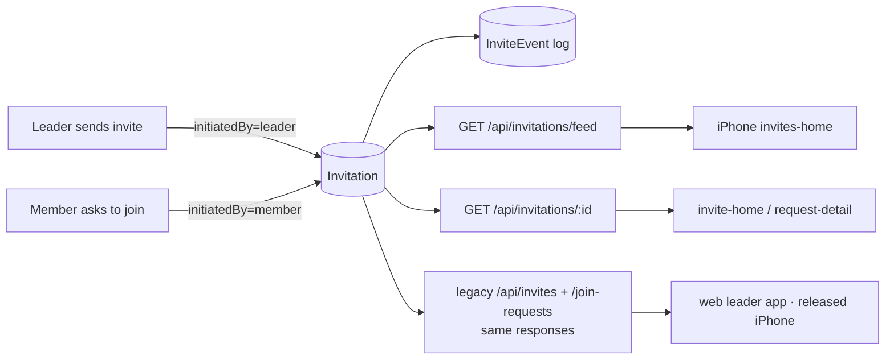

# invites — spec
> lg · ticket none · prototype mode (`ui2: invites-home, invite-home, request-detail`; Figma section 4773:11377)

## Completion and acceptance

**Completion class: integration.** Delivery requires the shared server schema, all legacy compatibility routes, the iPhone tab and both destinations, and the assembled cross-app risky-path walk. Landing target is `feature/invites`; no deployment, production/dev DB migration, human stack restart, or human simulator operation. Test profile is `walk=risk review=slice` under the already authorized agent build `--auto`.

| ID | Acceptance |
|---|---|
| A1 | Full legacy response baselines captured against old tables remain unchanged after cutover, apart from the expressly intentional D14 new-row outcome; released iPhone and actual web leader payloads keep their fields, nullability, envelopes, auth and error codes. |
| A2 | One transaction preserves every source row, ID, token, timestamp and log reference; historical events are backfilled; old tables are removed; edge cases abort safely instead of dropping data. |
| A3 | Request/create/accept/reject transitions are atomic with invitation events, create one active membership, preserve MembershipEvent/push behavior, and support D12–D14 without concurrent duplicate pending requests. |
| A4 | Feed/detail expose only manageable organizations; filters, five statuses, deterministic dates, 200-row window, identity-scoped null-phone rows, member linking and history are correct. |
| A5 | Resend/withdraw obey D15–D17, campaign consent/rate limits, phone-wide permitted scope, failure semantics, and race protection; withdrawn links are invalid and clicks throttle to one per ten minutes. |
| A6 | iPhone DTOs decode frozen nullable contracts; ordered windows, caches, session lifecycle and mutation reconciliation stay correct through cancellation, 401 and follow-up refresh failures. |
| A7 | Home → Invites displays the five statuses with 300 ms local search and four single-select draft filters, correct empty states, pull refresh and by-kind navigation. |
| A8 | Both detail pages render linked/unlinked/historical states, typed links, busy states, confirmations, success feedback and errors; successful accept/reject pops; cancel makes no mutation. |
| A9 | Existing client and released iPhone paths remain compatible in tests, and a builder-owned simulator/browser walk proves acceptance membership, resend, withdraw and invalidated public links against one assembled scratch system. |


## Idea

**Why.** A leader has no single place to see who has been invited and who has asked to join. The
UI 2.0 top nav already has an **Invites** tab, but it renders an empty page. Join requests can only be
answered group by group, and a leader sees only the invites they sent themselves. This feature makes
the Invites tab the org-wide place where a leader monitors invitations and acts on them: resend or
withdraw an invite, accept or reject a request.

**What success looks like.** A leader opens Home → Invites on the iPhone and sees, newest first, every
invite and join request across the orgs they manage. They search by phone or group and filter by
org, group, leader and status, using the same search field and filter rail as Members, Groups and
Enrollments. Tapping a Sent invite opens its detail page: who it went to, the linked member, every
group invitation to that phone, and a timeline. From there the leader can resend it or withdraw it.
Tapping a Requested row opens the join request, where Accept or Reject returns them to the list.
Every web screen and every released iPhone build that calls today's invite or join-request
endpoints keeps working unchanged.

**In your words.**
- "the topnav pattern with search + filter rail should all be the same pattern we use everywhere else" → D11
- "They are technically the same thing, the only difference is who initiated" → D1
- "Hide it from the list, but keep the record, We can add a filter for showing active and/or withdrawn invites." → D5, §Out of scope

**The concept.** One `Invitation` row is the relationship between a person and a group, and it
records who started it. A **leader-initiated** invitation is an invite: it has a link token, an
expiry and a sender. A **member-initiated** invitation is a join request: it has the requester's
message. Both move through the same statuses, `pending → accepted · rejected · expired · withdrawn`.
Lifecycle changes write `InviteEvent` entries for the closed D6 taxonomy; legacy reset-to-pending retains compatibility without inventing a sent/resent event. Those events form both detail timelines.



**How it fits today.**
- The UI2 shell has `UI2Section.invites`, but `sectionContent` falls through to `EmptyPage`¹.
- All three screens are d2m-built preview views (InvitesHomeScreen, InviteHomeScreen,
  RequestDetailScreen), updated to the Figma section on 2026-11-02 (`9da5d240`). No container wires
  them.
- **Invites** live in `invites` (`schema.yaml:455`):
  - SMS invites are phone-keyed, with a token, a 7-day expiry and a sender; generic legacy invites may omit phone, group and expiry;
  - status is a free string, and PATCH allows `pending|accepted|expired`²;
  - `GET /api/invites` lists only the caller's own invites³.
- **Join requests** live in `group_join_requests` (`schema.yaml:3259`):
  - member-keyed, unique per (group, member);
  - a request again resets the same row;
  - list, approve and reject work per group⁴.
- The two already overlap: a member who asks to join while holding a pending invite is joined at
  once, and the invite is marked accepted⁵.
- No invite event history exists. `MembershipEvent` records `INVITED` only for phones that already
  belong to a member.

**Approaches considered.**
- **Chosen:** one table plus compatibility endpoints (D1). It gives one copy of the data, and released
  clients see no change.
- **Rejected: one table with the old tables dual-written.** The two copies can drift, and nothing
  reads the old tables except code this feature rewrites anyway.
- **Rejected: two tables unified only at the read layer.** The owner asked for a shared schema, and
  the invite and request for the same person and group would stay two rows.

¹ `iphone/MakeReady/UI2/Shell/UI2Shell.swift:215-225` · ² `server/src/routes/invites.ts:669` · ³ `invites.ts:65` · ⁴ `server/src/routes/group-join-requests.ts:699,868,1095` · ⁵ `group-join-requests.ts:270-316`

## Apps

| App | In scope | What changes | Section |
|---|---|---|---|
| server | ✅ | The `invitations` + `invite_events` tables; one migration moves `invites` + `group_join_requests` into them and drops them. Feed, detail, resend and withdraw endpoints. Every legacy invite and join-request route reimplemented on the new table with identical responses. Event writes everywhere a status changes and on join-link clicks. Fixtures for 3 screens. | §server |
| iphone | ✅ | Wire Home → Invites (`InvitesHomeContainer`); an invitations store in AppState; `UI2Destination` cases for invite detail and request detail; Actions for feed, detail, resend, withdraw, accept and reject | §iphone |
| client | ⬜ | No screen changes. Its leader-app and admin stores call `/admin/api/invites` and `/admin/api/groups/:id/join-requests[/…]` (`leader-groups.store.ts:168,282,291`, `leader-group-home.store.ts:301,328`, `leader-library.store.ts:415`, `members.domain.ts:70,83`), and D2 keeps every one of those responses byte-identical | — |

**Sequencing:**
1. Owner product decisions are settled; the audited wire contract remains open until the server phase checks pass.
2. Server: response-snapshot tests of every legacy route (on the old tables), then the schema and
   migration, then the legacy routes rewritten onto the new table (the snapshots stay green), then
   the new endpoints, events and fixtures. The contract **freezes** when the server phase verifies.
3. The iphone consumer builds against the frozen contract.
4. The cross-app E2E walk.

**Backward compatibility:**
- **Released iPhone builds** call:
  - `POST /api/invites` and `POST /api/invites/send` (`InviteActions.swift:60,86`);
  - `GET`, `POST …/approve` and `POST …/reject` on `/api/groups/:id/join-requests` (`GroupActions.swift:703,725,745`);
  - the `makeready://join-requests/{groupId}` push deep link (`MakeReadyApp.swift:115`).

  Every one of these keeps its path, request and response shape (D2). A released build never sees
  `withdrawn`, because legacy list responses exclude withdrawn rows (D2). It never sees `rejected` on
  an invite either, because invites can't be declined (D4).
- **Old join links** (`/join/{token}`, `/api/invites/{token}`) keep working, because tokens are copied
  unchanged (D3).

**Blast radius:**
- `ActivityLog.inviteId` (`schema.yaml:4291`) is a nullable scalar, not an FK. Preserve its values, including historical orphan references; no new FK is added.
- `MembershipEvent` writes (INVITED, REQUESTED, APPROVED, REJECTED) stay exactly where they are today.
- `groups.ts` reads requests; `members.ts` reads and writes requests during phone confirmation. Both are repointed with explicit legacy serializers. `verification.ts` token reads and acceptance also move to the new service.
- The `/api/admin/join-requests` route (`server/src/index.ts:373`) is repointed.
- Fixtures `groups-detail.ts`, `invite-member.ts`, their DB tests and `prisma/seed-dev.ts` cleanup are repointed. The audit code map inventories all direct Prisma accesses and existing test mocks.

## Decisions

<!-- The one place rulings live. Record the DECISION — and, in one line, why, and why the rejected option lost. A stated preference
     is the INPUT to a row, not the row. Write each Ruling as something later code can be checked
     against without re-interpretation:
       · positive and specific — "store the full number, mask at render", not "don't truncate"
       · scope named — which apps, screens or endpoints it binds
       · "etc." / "and so on" expanded into the list, or the test for membership stated
       · the rejected alternative named, with the reason it lost (check-obligations warns on a bare one)
       · the enforcement hook, where one exists (lint rule, script, test)
     🔴 NEVER quote the user's prompt as the ruling. Operationalize it: a closed list, a measured
     value, an enumerated set of deviations. A ruling a stranger could implement two ways is not
     written yet.
     Who/date carries the provenance, so the Ruling itself needs no quote marks.
     The owner's own words go in §Idea "In your words", linked to this row — never in the Ruling.
     OPEN rows block the build go-ahead. Never delete a ruling; supersede it in place with a date. -->

| # | Decision | Ruling | Who / date |
|---|---|---|---|
| D1 | One schema for invites and join requests | One `Invitation` model (table `invitations`), `initiatedBy ∈ {leader, member}`. Leader rows carry `inviterId`, `token` and nullable `expiresAt` (generic legacy invites may never expire). Member rows carry `memberId` and `message`. Both carry `groupId?`, `organizationId?`, `recipientPhone?`, `recipientName?`, `status`, `respondedById?`, `respondedAt?`, `acceptedAt?`, `createdAt` and `updatedAt`. Nullability preserves valid legacy rows; see D24. Not two tables with a shared read layer (not a shared schema), and not dual-writing the old tables (drift). | owner 2026-11-02 |
| D2 | Legacy endpoints | Every route in §Contract C7 keeps its path, auth, request and response JSON byte-identical, now read from `invitations`. Enforced by snapshot tests captured on the old tables before the migration (§Testing S1). Join-request responses render `accepted` as `approved`, so the existing `pending/approved/rejected` vocabulary holds. Legacy list responses exclude `withdrawn` rows. Not reshaping `GET /api/invites`, which released iPhone builds read. | owner 2026-11-02 |
| D3 | Migration | One Atlas migration creates `invitations` + `invite_events`. It copies every `invites` row (same `id`, `token`, `status`, dates; `initiatedBy=leader`; `organizationId` from the group, or from the inviter's org when `groupId` is null) and every `group_join_requests` row (same `id`; `initiatedBy=member`; `recipientPhone` from `Member.phoneNumber`; `approved→accepted`; `reviewedById/At→respondedById/At`). It backfills `invite_events` from stored dates. It preserves the scalar `ActivityLog.inviteId` values, then drops both old tables. D24 governs unresolved organization/timestamps/collision/recovery cases; the earlier FK assumption is superseded by source evidence. Run on a scratch DB in tests, never `makeready_dev`. Not keeping the old tables (D1). | (assumed at spec) 2026-11-02 |
| D4 | Rejected | `rejected` is set only when a leader rejects a member-initiated invitation (a join request). Nothing lets a person decline an invite, and no client change is made. Not a Decline button on the web join page, which is undesigned and would bring in the client app. | owner 2026-11-02 |
| D5 | Withdrawn | Withdraw sets `status=withdrawn` and keeps the row. The feed and legacy lists exclude withdrawn rows. Detail still returns them, and its chips read Withdrawn. `/join/{token}` and `GET /api/invites/{token}` for a withdrawn invite show the same no-longer-valid response an expired invite shows today. Not a hard delete (it loses the record), and not a Withdrawn list row (hidden instead). | owner 2026-11-02 |
| D6 | Event log | New `InviteEvent` (table `invite_events`): `invitationId`, `type ∈ {sent, resent, link_clicked, accepted, withdrawn, expired, requested, approved, rejected}`, `at`, `actorId?`, `groupId?`, `metadata?`. Written in the same transaction as each transition represented by the taxonomy; D24 defines legacy PATCH reset exceptions. `link_clicked` is written on `GET /join/:token` and `GET /api/invites/:token` for a known token, at most once per invitation per 10 minutes. Historical expiry is backfilled; computed expiry reads never mutate status or write events, and nothing sweeps it live. An explicit legacy PATCH to expired records the actual expired transition (auto implementation clarification). Past link clicks are not reconstructed. Not derived from stored dates (no clicks or resends), and not `MembershipEvent` (keyed by member, so it can't hold non-member invitees). | owner 2026-11-02 |
| D7 | Display status | The feed maps each row to one of `sent · requested · accepted · rejected · expired` (C-089's states): leader+pending+not expired → sent; member+pending → requested; pending with `expiresAt < now` → expired (computed at query time; `status` is never rewritten); accepted → accepted; rejected → rejected; stored expired → expired. A pending leader without expiry is sent. | (assumed at spec) 2026-11-02 |
| D8 | Leaders filter | `leaderId` matches leader rows whose `inviterId = leaderId`, and member rows whose group `leaderId` leads (the group's creator, or a holder of an org role over it that grants `canManageOrgContent`). Not the reviewer (pending requests would disappear), and not hiding requests under a leader filter. | owner 2026-11-02 |
| D9 | Feed scope and auth | The feed returns rows whose `organizationId` is one where `canManageOrgContent(user, org)` holds. A super admin sees all orgs. Null-org legacy rows are excluded from new managed-org APIs (D24). Newest first by display date (D10), descending id breaks ties, at most 200 rows per call; total counts matches before the cap. Search runs on the device over that window (invites-home D40). No server `q` param. Not creator-only auth (the `canManageOrgContent` house rule). | (assumed at intake) 2026-11-02 |
| D10 | Row date | sent/requested → `createdAt`; accepted → `acceptedAt ?? respondedAt`; rejected → `respondedAt`; expired → `expiresAt`. A missing historical decision/expiry timestamp falls back to `createdAt` for display only. The iPhone formats it "Just now" under 1 minute, otherwise "MMM d, yyyy" (OQ-invites-home-005). | (assumed at spec) 2026-11-02 |
| D11 | Invites tab pattern | `InvitesHomeContainer` + `InvitesHomeMapper` follow `MembersHomeContainer`: 300 ms debounced search; one C-036 overlay per chip with draft Clear/Save; a cancellable load task; `.pageRefresh`; TopNav hidden while searching (`UI2HidesTopNavKey`); row tap → `navigator.push`. The chip row is C-130 FilterRail. Chips are single-select with "All …" first (OQ-invites-home-004). | owner 2026-11-01 |
| D12 | Invite + pending request | When a leader sends an invite (`POST /api/invites/send` or `POST /api/invites`) to a phone with a pending member-initiated invitation for the same group, that row becomes `accepted` (respondedBy = the leader), the member joins exactly as the approve route adds them, and no second row is created. Events `approved`. D24 supplies the compatibility adapter: generic POST has no phone input, so matching applies when existing inputs identify the recipient; /send returns the same envelope with the request ID and group-code URL. Not a separate invite row, which would put two rows on one relationship. | owner 2026-11-02 |
| D13 | Request + pending invite | Today's auto-join stays (`group-join-requests.ts:270-316`). The pending leader row becomes `accepted` (event `accepted`), and the request call returns its current response. No member row is created. | (assumed at spec) 2026-11-02 |
| D14 | Asking again | A member asking again after a rejected or accepted invitation creates a NEW member row. Both direct request submission and member-confirmation submission use this rule when no active membership prevents requesting. Legacy `GET …/join-requests/me` and group-code lookup return that member's latest row for the group (createdAt then id). Not resetting the old row, which loses the history the timeline shows. | (assumed at spec) 2026-11-02 |
| D15 | Resend | `POST /api/invitations/:id/resend` re-sends the SMS for every pending, non-expired leader invitation to the same `recipientPhone` in the caller's permitted orgs, reusing each token. It sets `expiresAt = now + 7 days` and writes `resent`. A row that is no longer pending is skipped. D24 defines campaign batch admission and partial-delivery failure semantics without bypassing consent/rate limits. Not keeping the original expiry, which could leave the person a day. | owner 2026-11-02 |
| D16 | Withdraw | `POST /api/invitations/:id/withdraw` sets `withdrawn` on every pending leader invitation to the same `recipientPhone` in the caller's permitted orgs and writes `withdrawn`. Accepted rows are untouched. | (assumed at spec) 2026-11-02 |
| D17 | Resend/withdraw auth | Allowed for any user for whom `canManageOrgContent` holds over the row's org; refused with 403 otherwise. Not sender-only, because co-leaders see the same list. | owner 2026-11-02 |
| D18 | Linked member | Detail links a member by `memberId` if set, otherwise by an exact match of the E.164-normalised `recipientPhone` to `Member.phoneNumber` within the row's org. No match → the `unlinked` state. | (assumed at intake) 2026-11-02 |
| D19 | Design source | The three d2m screens were updated to Figma section 4773:11377 before this spec: Requested rows (C-089 `requested`) open request-detail; invite-home gains Resend and Withdraw (C-048 accent + send glyph, C-048 secondary); request-detail reads Accept. Committed `9da5d240`. | owner 2026-11-01 |
| D20 | Request accept/reject endpoints | iPhone UI2 calls the existing `POST /api/groups/:groupId/join-requests/:id/approve|reject`, now on `invitations` (they write `approved`/`rejected` events). There is no new accept or reject endpoint. | (assumed at spec) 2026-11-02 |
| D21 | Leader named on timeline events | Every C2 event whose `actorId` is a User carries `actorName` (that user's name; member and system events carry null). invite-home and request-detail append " by «actorName»" to the event text when it is non-blank, e.g. "Request rejected for Young Adults by John Smith". This covers sent, resent, withdrawn, approved and rejected, and leader PATCHes on legacy invites. Additive: released iPhone builds never call C2. Not a name only on rejected/approved events, because every leader action is attributable. | owner 2026-11-02 |
| D22 | Resend and the SMS rate limit | Resend (C3) sends with a 1-minute interval in place of the `group-invite-v1` template's `minIntervalMinutes` (1200), so an invite texted earlier the same day can be resent. A second Resend inside that minute returns 409 `{ error: "Invitation was just resent" }` and sends nothing. Other group-invite texts keep the template limit. Not keeping the 20-hour limit with a disabled button, which would block nearly every real resend; and not lowering the limit for every group-invite text. | owner 2026-11-02 |
| D23 | Ids in raw SQL | Invitation raw SQL compares ids as text (`id::text = $1`), never `$1::uuid`: dev and prod ids are text (Prisma-era schema), and migration-built ones are uuid. Enforced by running the invitation suites against a migrated restore of makeready_dev as well as a migrations-only DB. Not keeping the uuid casts, which failed every action on dev with 42883. | (assumed at fix) 2026-11-02 |

| D21 | Request confirmations | Accept and Reject each open a confirmation before any mutation; cancel sends no request. Only pending requests show actions. C-066 ActionMenuOverlay hosts the confirmations; exact default copy is in D24. This preserves the closed owner OQ rather than stale immediate-action prose. | owner OQ-request-detail-006, 2026-10-18; reconciled 2026-11-02 |
| D22 | Session state and reconciliation | Ordered feed window/query identity controls visible IDs separately from EntityStore retention. Clear invitation state with session; reject stale/cancelled completions. Committed mutations remain successful if subsequent refresh fails, while invalidating stale actionable detail. Existing send/create and request decisions reconcile feed/detail, pending badges and affected membership projections. No new persistence. | auto implementation assumption 2026-11-02 |
| D23 | Design integration ownership | Check required additive inputs and layout behavior with d2m, follow its handover, and consume delivered props; no direct MakeReadyUI edits. One TopNav/header owner, capabilities/busy props, externally controlled search and missing metadata rendering are required. Cold detail loads retain PageHeader/back without invented skeletons; cached data stays during refresh; errors use the existing top error surface. | auto integration assumption 2026-11-02 |
| D24 | Audited compatibility defaults | The closed implementation rulings below preserve legacy data/wire shapes and make the new API/render/mutation behavior total. They supersede only the specifically identified earlier schema/FK/rollback/nullable/capability assumptions, not the owner product scope. | auto implementation assumptions 2026-11-02 |

### D24 audited implementation rulings

- **D1/D3/SC1 — legacy storage:** `organizationId`, `recipientPhone`, `groupId`, `token`, `inviterId`, `expiresAt`, `memberId`, `message`, `respondedById`, `respondedAt`, `acceptedAt`, `recipientName` are nullable where source rows permit absence. `initiatedBy` is required. Retain `updatedAt` (old request value exactly; old invite uses `createdAt` because it has no updatedAt). Keep no full unique constraint on group/member; prevent concurrent pending duplicates in lifecycle transitions. Legacy generic invites may lack group, phone and expiry. Group organization wins; if absent, use the inviter's valid deprecated org association, otherwise only a single unambiguous owned/role org; unresolved org stays null. Never invent orgs or grant new access. **Auto assumption.**
- **D2 — compatibility:** preserve explicit legacy serializers, including raw-request-equivalent `memberId`, `reviewedById`, `reviewedAt`, `updatedAt`. C5/C7 snapshot bodies are immutable during implementation except a separately named D14 rerequest assertion; do not regenerate baselines after schema changes. Include `/api/members/confirm-verification`, `/api/groups/code/:code`, `/api/verification/verify`, and public token/landing cases in compatibility proof because they embed/read the migrated records. Client's existing `joinRequests`/DELETE mismatches stay out of scope.
- **D3/SC3 — log references:** no ActivityLog invite FK exists. Preserve its nullable string values unchanged; do not add a new FK. Replace SC3's FK edit with scalar-reference preservation. Abort migration on cross-source ID collision before copy. Keep all IDs; UUID probability is not an integrity guarantee. No historical timestamp/status normalization. Backfill only events supported by stored values; stored expired rows without a usable expiry keep their row and do not get an invented expiry event.
- **D3 — recovery:** remove the claim that reverse migration is lossy only for withdrawn. D14 creates request histories the old unique key cannot represent. Require a pre-cutover backup/recovery procedure for any future deployment; this build operates only on scratch databases. No truncation, destructive deduplication or lossy reverse migration is authorized.
- **D6 — events:** every actual transition to a represented terminal state writes its corresponding event transactionally; leader creation writes sent, member creation requested. Legacy PATCH reset-to-pending remains accepted but has no fabricated `sent`/`resent` event; no event taxonomy extension. Expiry-only PATCH has no status event. Existing event rows are preserved. Known-token link-click throttling is shared by both public routes and serialized per invitation so two simultaneous clicks do not defeat the ten-minute cap. **Auto assumption for legacy PATCH semantics:** accepted/expired PATCH transitions record the actual accepted/expired event; reset-to-pending and expiry-only changes add none.
- **D7/D10 — total mapping:** stored `expired` maps to expired as well as pending rows with expiry in the past. Dates follow D10 and fall back to `createdAt` when the historical decision/expiry timestamp is absent. These are display fallbacks only. A pending leader with no expiry is sent; a member pending row is requested. The existing service mutates expiry status today; correct F3 and replace that read mutation under D7.
- **D9/D17 — scope:** use owned/role org IDs and super-admin bypass, without passing a resource creator into an organization-wide check. A creator-only association must not widen access to every invitation in that org. Rows with null organizationId are excluded from all new managed-org APIs even for super admins; legacy sender/token access retains original rules. C1 filters are scoped independently of the current chip selections; total is the matching count before the 200-row cap. Same-date order is descending id for deterministic windows. **Auto assumption.**
- **D9/D17 — group transfer scope:** the existing group update API can move a group between organizations without rewriting invitation history. For a grouped invitation, effective organization is the current group organization; for a generic group-null invitation it is the stored organization. Apply that rule to authorization, org filters, returned feed organization, related history/events, filter options, member linking and mutations. A former organization cannot retain private invitation data after transfer, and the destination organization gains its normal managed access. Do not rely on a denormalized organization cache to authorize grouped records. Generic unresolved null-org rows remain excluded. **Auto correctness ruling from reachable group-transfer API, 2026-11-02.**
- **D12 — existing inputs:** generic `POST /api/invites` has no phone field; it preserves generic creation. `/send` resolves the existing pending request by normalized phone/group, approves that row, sends the established group campaign using its group-code join URL without an invite token, and returns the existing request ID plus that URL in the legacy send envelope. Ensure the existing group-code mechanism supplies a code. Do not create a second invitation or fake a pending token. SMS failure leaves the pending request and memberships unchanged. **Auto implementation adapter adopted 2026-11-02; baseline envelope and mocked SMS URL assertions enforce it.**
- **D14 — all request paths:** direct request submission and member confirmation create a new row after the last accepted/rejected request where no active membership prevents requesting. `/me` and group-code lookup select latest member-initiated request by createdAt then id. Existing already-member/duplicate-pending response bodies remain unchanged. New request `createdAt` is now unless the latest history clock is tied/future, then latest+1 ms; requested event uses that row clock. Existing timestamps never change. This monotonic implementation detail (auto) preserves the defined latest-row selection, including inherited future legacy clocks.
- **D12 — current legacy send authority:** preparation and post-SMS cross-request approval reauthorize the actor against the current group under a shared group lock in the DB-only transaction. Preserve the legacy creator OR super-admin OR current-org owner/role rule; a former-org noncreator cannot approve after transfer, while creator authority remains. External delivery stays outside bounded retries. **Auto security correctness ruling, 2026-11-02.**
- **D15 — batch delivery:** check/reserve normal campaign rate admission once per recipient/template batch, including consent, active campaign/template and per-message rendering/length checks. All concurrent singleton and batch calls share admission; no public bypass or globally disabled rate limit. Each invitation keeps its token. On partial delivery failure return 502 without invitation expiry/status/event changes; delivery attempts and SmsLog rows remain factual because external delivery cannot roll back. Recheck row state before domain commit so withdrawal/acceptance wins over stale resend. **Auto assumption defining “no state change” as invitation domain state.**
- **D16/C2 — capabilities:** canResend is any pending nonexpired leader row with a phone. canWithdraw is any pending leader row with a phone, including expired-but-pending rows. Null-phone detail remains identity-scoped and both mutations return 409; no new generic-token withdrawal flow is introduced. All related rows stay within caller-permitted orgs. **Auto assumption for null-phone action guard.**
- **D18 — nullable render:** group-less rows display `No group`; absent phone displays `No phone number`; absent inviter name displays `—`. Missing age/role/birthday/joined date displays `—`, never age zero. Exact copy is an **auto assumption**. Optional metadata presentation changes require the d2m handover, not a direct app edit to preview source.
- **D21 — request confirmations:** OQ-request-detail-006 is closed owner input (2026-10-18): both Accept and Reject confirm before mutation. Use existing C-066 ActionMenuOverlay confirmation host. Default copy (**auto assumption**): `Accept join request?` / `«phone» will be added to «group».` / `Cancel` / `Accept`; `Reject join request?` / `«phone» will not be added to «group».` / `Cancel` / `Reject` (destructive). Only pending requests offer actions; cancel sends no API request. Existing withdrawal copy remains unchanged.
- **D22 — state lifecycle:** EntityStore holds entities; a distinct ordered feed window plus filter identity controls visible membership. Detail mutations merge selected response and invalidate other affected detail caches. Existing invite creation/send marks invitation feed/detail stale. Request decisions remove pending badges immediately and refresh/invalidate group/member projections, then feed/detail. A committed mutation remains successful if refresh subsequently fails; stale controls must not enable a second decision. Cancellation and retired sessions cannot merge data; 401 follows the existing sign-out policy. New state is in-memory only and clears with session. **Auto assumption using existing action patterns.**
- **D23 — d2m integration:** request/check additive inputs for single TopNav, search-focus reporting, disabling duplicate local filtering, pinned external headers, explicit capabilities/busy flags and missing-age display. Do not directly edit MakeReadyUI design-owned files. Record returned handover outcome and consume only actual delivered props. Container cold detail load shows the existing PageHeader/back with no invented skeleton; existing cached data remains during refresh. Failures use the specified top error surface and retain cached content. **Auto assumption for undefined cold-load geometry; d2m owns any required view change.**


- **D5/C6 — readable withdrawn landing (auto, final runtime walk):** a normal browser immediately leaves the legacy invalid/expired HTML because its meta refresh and inline script redirect to the client; the null-code fixture then shows generic code entry rather than a readable invalid result. For the new `withdrawn` status only, keep the same invalid/expired content and public API 404 envelope but omit automatic navigation so “Invite Not Found” stays visible. This is a narrow browser behavior exception to literal expired-HTML equivalence, required by A5/A9; every pre-existing status keeps its byte-identical HTML, JSON, auth and redirect behavior. No frozen legacy snapshot may be updated. The producer’s JSON contracts remain frozen; this public-HTML exception receives scoped tests/review, real browser re-walk and fresh phase/merge verification.

## Contract

| Contract | Producer | Consumers | Auth | Request | Response | Errors |
|---|---|---|---|---|---|---|
| C1 `GET /api/invitations/feed` | server | iphone | requireAuth; D9 | query `orgId?`, `groupId?`, `leaderId?`, `status?` (`sent\|requested\|accepted\|rejected\|expired`), `limit?` (≤200, default 200) | `{ items: [{ id, kind: "invite"\|"request", status, recipientPhone, recipientName?, memberId?, groupId?, groupName?, organizationId, inviterId?, inviterName?, date (ISO, D10), createdAt }], total, filters: { orgs: [{id,name}], groups: [{id,name,organizationId}], leaders: [{id,name}] } }`. `status` is the D7 display status; withdrawn is excluded. | 400 bad filter value · 401 |
| C2 `GET /api/invitations/:id` | server | iphone | requireAuth; `canManageOrgContent` over the row's org | — | `{ id, kind, status, recipientPhone, recipientName?, inviterName?, message?, createdAt, member?: { id, name, picture?, age?, role?, birthday?, joinedAt? }, invitations: [{ id, kind, groupId, groupName, groupPicture?, status (D7 + "withdrawn"), date }], events: [{ id, type, at, groupId?, groupName?, actorName?, invitationId }], canResend, canWithdraw }`. `invitations` = every row to the same phone in permitted orgs, newest first. `events` covers those rows, newest first; `actorName` is the User behind `actorId` (null for member or system events — amended 2026-11-02, additive). `canResend` = a pending non-expired leader row with phone; `canWithdraw` = a pending leader row with phone, including expired pending (D15/D16). Null phone is identity-scoped and both capabilities false; exact nullability is below. | 401 · 403 · 404 |
| C3 `POST /api/invitations/:id/resend` | server | iphone | requireAuth; D17 | — | the C2 payload, refreshed | 401 · 403 · 404 · 409 nothing pending · 502 campaign/SMS failed (no invitation/event change; factual delivery logs remain) |
| C4 `POST /api/invitations/:id/withdraw` | server | iphone | requireAuth; D17 | — | the C2 payload, refreshed | 401 · 403 · 404 · 409 nothing pending |
| C5 `POST /api/groups/:groupId/join-requests/:id/approve` · `…/reject` | server | iphone, client | unchanged (`groupManageFilter`) | unchanged | unchanged (D2) | unchanged |
| C6 `GET /join/:token` · `GET /api/invites/:token` | server | client (the recipient's browser, server-rendered landing) | public | unchanged | legacy responses unchanged; withdrawn keeps expired invalid content/API response and stays on the invalid HTML page without auto-navigation (D5/C6 final-walk clarification); writes `link_clicked` (D6) | unchanged |
| C7 Legacy, byte-identical (D2): `GET/POST /api/invites`, `POST /api/invites/send`, `PATCH/DELETE /api/invites/:id`, `POST /api/groups/:groupId/join-requests`, `GET …/join-requests/me`, `GET …/join-requests`, `GET /api/admin/join-requests` | server | iphone, client | unchanged | unchanged | unchanged; lists exclude withdrawn; D12/D13 side effects | unchanged |

### Wire nullability and exact new payloads

All listed keys are emitted. Nullable fields use JSON null (not fabricated strings/IDs). Dates are ISO strings. New managed-org responses always contain a non-null organizationId even though storage is nullable. C2 has `inviterName: string | null` for its selected row. C2 selected group/status-date is the unique nested invitations entry whose id equals the top-level id; it always exists. `member` is null when unlinked. `member.age` is integer or null; birthday/date properties are ISO strings or null. No public legacy response gains recipientName or management-only fields.

```ts
type InvitationKind = 'invite' | 'request';
type InvitationDisplayStatus = 'sent' | 'requested' | 'accepted' | 'rejected' | 'expired';
type InvitationEventType = 'sent' | 'resent' | 'link_clicked' | 'accepted' | 'withdrawn' | 'expired' | 'requested' | 'approved' | 'rejected';
interface InvitationFeedItem {
  id: string; kind: InvitationKind; status: InvitationDisplayStatus;
  recipientPhone: string | null; recipientName: string | null; memberId: string | null;
  groupId: string | null; groupName: string | null; organizationId: string;
  inviterId: string | null; inviterName: string | null; date: string; createdAt: string;
}
interface InvitationFeed {
  items: InvitationFeedItem[]; total: number;
  filters: { orgs: {id: string; name: string}[]; groups: {id: string; name: string; organizationId: string}[]; leaders: {id: string; name: string}[] };
}
interface InvitationDetail {
  id: string; kind: InvitationKind; status: InvitationDisplayStatus | 'withdrawn';
  recipientPhone: string | null; recipientName: string | null; inviterName: string | null;
  message: string | null; createdAt: string;
  member: {id: string; name: string; picture: string | null; age: number | null; role: string | null; birthday: string | null; joinedAt: string | null} | null;
  invitations: {id: string; kind: InvitationKind; groupId: string | null; groupName: string | null; groupPicture: string | null; status: InvitationDisplayStatus | 'withdrawn'; date: string}[];
  events: {id: string; type: InvitationEventType; at: string; groupId: string | null; groupName: string | null; invitationId: string}[];
  canResend: boolean; canWithdraw: boolean;
}
```

C1 query remains orgId/groupId/leaderId/status/limit only; each ID filter validates UUID; limit is an integer 1–200, default 200. Invalid filter returns 400. C2 existing unauthorized row returns 403; missing returns 404. C3/C4 return refreshed C2, 409 for no eligible phone rows, C3 502 for any campaign send/admission failure; auth errors remain 401/403/404. Preserve legacy error envelopes in C5–C7; new handler errors use `{ error: string }`. Existing `requireAuth` failures retain `{ success: false, error: string }` (401 unauthenticated or 403 inactive account); clients read `error`. Reuse that middleware rather than introducing another authentication path. These validation details are **auto assumptions**.


## Schema & API changes

| # | Change | Model.field | Wire | Reason | Status |
|---|---|---|---|---|---|
| SC1 | ADD | `Invitation` (table `invitations`), fields per D1; indexes `(organizationId, createdAt)`, `(recipientPhone)`, `(groupId, memberId)`, unique nullable `token`; additionally `(groupId,status)`, `(memberId)` for legacy lookups | C1–C7 | one schema (D1) | planned |
| SC2 | ADD | `InviteEvent` (table `invite_events`): `id`, `invitationId` → Invitation (cascade), `type`, `at`, `actorId?`, `groupId?`, `metadata Json?`; index `(invitationId, at)` | C2 `events` | timelines (D6) | planned |
| SC3 | PRESERVE | `ActivityLog.inviteId` nullable scalar values; no FK exists or is added | — | ids/references preserved (D3,D24) | planned |
| SC4 | REMOVE | `Invite` (table `invites`) | C7 unchanged | moved into SC1 (D3) | planned |
| SC5 | REMOVE | `GroupJoinRequest` (table `group_join_requests`) | C5/C7 unchanged | moved into SC1 (D3) | planned |
| SC6 | ADD | routes C1–C4 (`server/src/routes/invitations.ts`, service `services/invitation.ts`) | C1–C4 | the Invites tab | planned |

**Data plan:**
1. The migration is one transaction.
2. It creates SC1 and SC2.
3. It aborts on any cross-source ID collision, then copies every row with `INSERT … SELECT` from both sources (D3/D24). Preserve request updatedAt; old invites use createdAt as their new updatedAt. Nullable unresolved organization is retained, never fabricated.
4. It backfills events:
   - a `sent` event at `createdAt` for every leader row;
   - an `accepted` event at `acceptedAt` where set;
   - a `requested` event at `createdAt` for every member row;
   - an `approved` or `rejected` event at `reviewedAt` where set;
   - an `expired` event at `expiresAt` where it is in the past and the row is still pending.
5. It checks copied row counts and preserves SC3 scalar values unchanged, including orphan historical references.
6. It drops SC4 and SC5.

**Existing data:** every invite and request survives with the same id. Past link clicks and resends
are not reconstructed.

**Recovery:** a future deployment requires a pre-cutover backup. After D14 creates multiple historical requests, the old unique key cannot represent all rows; no automatic lossy reverse migration, truncation or deduplication is authorized. This build validates scratch databases only.

The migration is generated from `server/schema/*.yaml` through the Atlas workflow using an explicit owned scratch dev URL; do not use the shared default `atlas_dev_template` or application DB for diffing. The data
statements are added by hand in the same new migration before it is committed, and no committed
migration is ever edited.

## server

- **Schema:** SC1–SC5 in `server/schema/schema.yaml`, plus the D3 migration.
- **Service `services/invitation.ts`:** owns all reads and writes. It has:
  - the status mapping (D7) and the date rule (D10);
  - feed, detail, resend and withdraw (D15, D16);
  - `recordEvent(tx, …)`;
  - the D12/D13 cross-acceptance;
  - the org-scope check: `canManageOrgContent`, never `creatorId`.
- **Routes:** `routes/invitations.ts` (C1–C4) stays thin.
- **Legacy routes on the new service** (D2), each response kept identical:
  - `routes/invites.ts`;
  - `routes/group-join-requests.ts`;
  - `routes/join.ts` (withdrawn → expired invalid content with the D5/C6 browser exception, plus `link_clicked`);
  - the `index.ts:373` admin route;
  - the request reads in `routes/groups.ts`, reads/writes in `routes/members.ts`, and token reads/acceptance in `routes/verification.ts`;
  - explicit serializers preserve embedded raw-request-equivalent responses and all old fields.
- **`services/invite.ts` `sendGroupInvite`:** creates a leader `Invitation` and writes `sent`, and
  applies D12.
- **Unchanged:** every `MembershipEvent` write stays as it is, and so does the push notification sent
  when a request arrives.
- **Fixtures:**
  - `server/fixtures/screens/invites-home.ts`: the `full` scenario has rows in all five display
    statuses across 2 groups and 2 leaders.
  - `invite-home.ts`: one phone with a Sent and an Accepted invitation, a linked member, and ≥5
    events.
  - `request-detail.ts`: one pending request with ≥2 events.
  - Repoint `groups-detail.ts`, `invite-member.ts`, their DB tests and seed-dev cleanup to `invitations`.
- Use isolated verifier/walk processes; no human stack or Docker server restart is part of this build.

## iphone

- **AppState:**
  - an `invitations` `EntityStore` keyed by id, holding the feed rows (C1) and the
    `invitationDetails[id]` payloads (C2);
  - `invitationFilters` (the C1 `filters` block), ordered feed IDs/query identity and cache staleness (D22);
  - the existing `pendingJoinRequestsByGroupId` is refreshed after accept or reject, so legacy and
    groups-detail stay correct.
- **Actions, new `InvitationActions.swift`:**
  - `loadInvitationFeed(filters)` (C1) and `loadInvitation(id)` (C2);
  - `resendInvitation(id)` (C3) and `withdrawInvitation(id)` (C4). Each merges the returned payload
    and refreshes the feed in the same call.
  - Accept and reject reuse `GroupActions.approveJoinRequest`/`rejectJoinRequest` (C5), then merge
    the refreshed detail and the feed.
- **Containers, under `MakeReady/UI2/Containers/Invites/`:**
  - `InvitesHomeContainer` + `InvitesHomeMapper` (D11). `UI2Shell.sectionContent` gets
    `case .invites`. The TopNav "+" for `.invites` stays a no-op.
  - `InviteDetailContainer` (invite-home): resend; withdraw through the confirm dialog
    ("Withdraw invitation?" / "«phone» will no longer be able to join with this invitation." /
    Cancel · Withdraw, destructive); the success toast "Invitation resent"; failures go to the top
    error banner (`/ios-error-surface`).
  - `RequestDetailContainer` (request-detail): Accept or Reject confirms first (D21/D24), then pops on committed success; refresh failure does not offer a second decision.
- **Navigation:**
  - `UI2Destination.inviteDetail(id)` and `.requestDetail(id)`, pushed from row taps by `kind`.
  - The linked-member block pushes the existing members-profile destination.
  - The group row on request-detail pushes groups-detail.
  - Typed `UI2Destination` through the existing UI2 navigator (`/push-page`, `/nav-route` constraints). No `.sheet`, `.fullScreenCover` or `asyncAfter`.
- **d2m views:** the views in `MakeReadyUI/` are not edited. Containers feed their existing props and
  callbacks: `onOpenInvite`, `onOpenRequest`, `onResendInvitation`, `onWithdrawInvitation`,
  `onApprove`, `onReject`, plus d2m-delivered integration inputs (D23). Check missing props/layout through `check_project_change` and follow its handover; request changes where directed. Both row callbacks dispatch by data kind, including reviewed requests.
- `swiftlint` runs from `iphone/`.

## Testing

**server** (configured Builder verifier: Vitest excluding production HTTP smoke, both TypeScript checks and schema validation; leased scratch DB only, never `makeready_dev`; SMS/push mocked before imports):
- **S1 legacy snapshots.** Written FIRST, on the old tables, and they must stay green after the
  migration. Each C5/C7 route captures the exact JSON for a seeded state: an invite pending, accepted
  and expired; a request pending, approved and rejected; null group/phone/expiry/org; full updated/reviewer fields. Also characterize member confirmation, group-code lookup and verification acceptance. Snapshot bodies are immutable after capture; intentional D14 outcomes have separate assertions. The existing service integration assertion at invite-member-integration.test.ts:330 deliberately changes expired to pending under D7; its HTTP response remains unchanged.
- **S2 migration.** On seeded old tables: row counts, ids, tokens and status mapping are preserved;
  backfilled events are date-supported; ActivityLog scalar values stay unchanged including orphan references; both old tables are gone. Collisions abort the entire transaction without data loss.
- **S3 feed.**
  - Every D7 status.
  - The D8 leader rule.
  - Withdrawn excluded.
  - The D9 org scoping: a user without org access sees nothing; a super admin sees all.
  - The D10 dates.
  - The limit.
- **S4 detail.**
  - Aggregation by phone.
  - D18 member linking, linked and unlinked.
  - Events newest first.
  - `canResend`/`canWithdraw`.
  - 403 and 404.
- **S5 resend and withdraw.**
  - The D15/D16 effects and events.
  - Expiry reset.
  - Non-pending rows skipped.
  - 409 when nothing is pending.
  - 403 for a non-org user.
  - Campaign rate admission/consent and partial-send failure give 502 without invitation/event changes (Twilio mocked); factual SMS logs remain. Concurrent withdraw/accept is not overwritten; null-phone mutations return 409.
- **S6 cross-acceptance.** D12 and D13 produce one row and one membership. D14 asking again creates a
  new row, and `/me` returns the latest.
- **S7 join links.** `link_clicked` is written and throttled. Withdrawn shows the expired response.

**iphone** (configured XCTest/build on a verifier-owned simulator, SwiftLint finding comparison):
- `InvitesHomeMapper` tests: the status → C-089 state mapping, the debounce-free filter application,
  chip labels via `FilterMenuOverlay.chipLabel`, and the empty vs no-results states.
- `InvitationActions` tests: nullable decoding, ordered window replacement, sibling cache invalidation, 401/cancellation/retired-session safety, committed mutation with refresh failure, merge after resend/withdraw, pending/membership projection reconciliation. Detail tests cover selected nested row, missing metadata, confirmations/cancel and busy double taps.

**client:** `./vendor/bin/phpunit` and `npm test` unchanged-green (D2 guard). Reviewing
`leader-groups.store.ts` approve/reject against S1 snapshots is enough; there is no new test.

**Cross-app E2E walk (once, at verify):** fixtures reset, then the iPhone runs as the Fixtures identity:
1. Home → Invites shows 5 statuses.
2. Filter Status = Requested.
3. Open a request → Accept → cancel (no mutation), then Accept → confirm → back to the list.
4. The row now reads Accepted.
5. The web leader app (`/admin/groups`) shows that member in the group.
6. Open a Sent invite → Resend → toast.
7. Withdraw → cancel (no mutation), then Withdraw → confirm → chips read Withdrawn → back to the list, where the row is gone.
8. Open its `/join/{token}` link in a browser → the expired/invalid page.
9. Confirm rejection on a second request; reopen it as Rejected without pending actions. Check linked/unlinked detail rendering.

**Human walk script:**
1. Search by phone.
2. Each filter chip, including Clear inside the overlay.
3. Pull to refresh.
4. Invite detail, unlinked and linked.
5. Resend.
6. Withdraw, confirm and cancel.
7. Request detail Accept.
8. Request detail Reject.
9. The legacy iPhone Members → requests page still lists and answers requests.

## Out of scope

- A filter to show active and/or withdrawn invites (owner 2026-11-02, "We can add a filter…").
- A recipient-side Decline on the web join page (D4, owner 2026-11-02).
- The Invites TopNav "+" action (no design; owner 2026-11-01 scope).
- The Sent group-invitation row chevron destination (OQ-invite-home-2, deferred in the d2m spec).
- Any web leader-app UI for the feed or detail. The web app only keeps working on the legacy
  endpoints (D2).
- Server-side search and pagination beyond the newest 200 rows (D9).
- Fixing `.claude/scripts/list-ui2-refs.mjs` (crashes: `fixtureDir is not defined`) — a separate fix.

## Findings & risks

| # | Finding | Resolution |
|---|---|---|
| F1 | d2m invite-home §5 says `Invite.status` already has a revoked-class value. It does not (`pending\|accepted\|expired`, `invites.ts:669`) | SC1 adds `withdrawn`. The d2m wording is corrected on its next update. |
| F2 | client `members.domain.ts:96` calls `DELETE /admin/api/groups/:id/join-requests/:id`, which has no server route today | Pre-existing; unchanged by D2. Not fixed here. |
| F3 | `getInviteByToken` currently persists expired status (`services/invite.ts:144`), while join.ts only reads it | Preserve stored expired rows; D7 stops read mutation and D10 handles missing historical dates. Explicit PATCH transitions are distinct from computed expiry. |
| F4 | The table merge is the largest risk: a silent shape change in a legacy response breaks a released iPhone build | S1 snapshots first; the migration is tested on a scratch DB (S2). |

## Prototype

- **Ref:** `ui2: invites-home, invite-home, request-detail`, resolved through d2m `get_screen`. The
  config resolver crashes; see §Out of scope.
- **Figma:** section 4773:11377 "Invitations" = frames 3830:6919, 3832:30788, 3832:31138 and
  4634:41206. Read 2026-11-01 via the Figma desktop MCP.
- **invites-home:** specced and built (C-019, C-034, C-035, C-089, C-130). It has 5 previews.
  Updated 2026-11-02: the Requested row and `onOpenRequest`.
- **invite-home:** specced and built (C-020, C-022, C-037, C-038, C-040, C-043, C-048, C-065). It has
  2 previews. Updated 2026-11-02: Resend and Withdraw (C-048 accent + secondary). The
  resending/withdrawing disabled state is contracted but not previewed.
- **request-detail:** specced and built (C-040, C-022, C-088, C-020, C-037, C-065, C-048). It has 7
  previews. Updated 2026-11-02: the Accept label and the invites-home entry.
- **Gaps:**
  - fixed in the design: 3 (G1–G3, d2m `9da5d240`);
  - written into the SPEC: 9 (D4–D18, SC1–SC6);
  - out of scope: 6.
- **Integration gaps requiring d2m handover:** search/header composition, capability/busy props and missing-age rendering (D23). Existing previews do not prove these app integration inputs exist.
- **Seams:**
  - the feed C1 → C-089 props;
  - the detail C2 → invite-home + request-detail props;
  - `events` → C-065 rows.

## Replaced surfaces

| # | Surface (file:line) | Relation | Fingerprint | App |
|---|---|---|---|---|
| R1 | `iphone/MakeReady/UI2/Shell/UI2Shell.swift:215-225` Invites → `EmptyPage` | REPLACES | 2226978d | iphone |
| R2 | `iphone/MakeReady/Pages/Manage/Member/MemberRequestsPage.swift` (legacy, all-groups pending requests + respond modal) | ABSORBS — UI2 lists and answers requests; the legacy page stays until the UI2 hard cutover | 7b7dbead | iphone |
| R3 | `server/src/routes/invites.ts` | REUSES — paths kept, reimplemented (D2) | 86b24fbe | server |
| R4 | `server/src/routes/group-join-requests.ts` | REUSES — paths kept, reimplemented (D2) | 3afaa008 | server |
| R5 | `server/src/routes/join.ts` | REUSES — adds `link_clicked` and the withdrawn response | fc69ddb6 | server |

| # | Gap / add | Disposition | App |
|---|---|---|---|
| S1 | legacy respond modal (R2) has Cancel; UI2 request-detail uses back | COVERED — back = cancel | iphone |
| S2 | legacy page lists ALL groups' pending requests in one place (R2) | COVERED — feed with Status = Requested | iphone |
| N1 | org-wide feed across invites and requests | C1, SC1 | server |
| N2 | invite events and link clicks | SC2, D6 | server |
| N3 | resend and withdraw | C3, C4, D15–D17 | server |
| N4 | `withdrawn` status (record kept, link stops working) | D5, SC1 | server |
| N5 | iPhone Invites tab + 2 detail destinations | §iphone, D11 | iphone |
