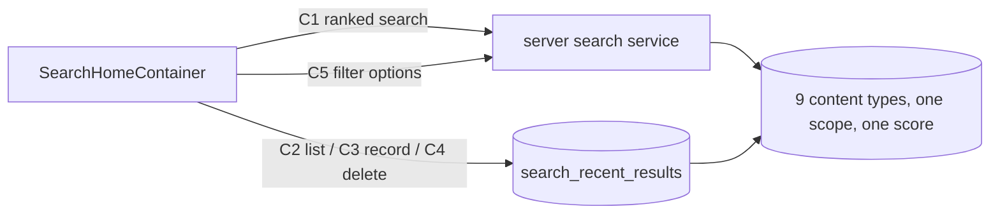

# master-search — spec
> ✅ SIGNED OFF 2026-11-04 — bcf10ae2 · by Luke Keith: "Tested on my phone, it seems to work well"
> ✅ SIGNED OFF 2026-11-05 — 93df3843 · by Luke Keith: "works very well"
> lg · ticket none · prototype mode (`ui2: search-home`; Figma 4536:8480)

## Idea

**Why.** Leaders have no way to find something when they don't know where it lives. The 2.0 Search tab is a blank page, and the server's search only works for someone who owns an org, returns results grouped by type, and has no way to compare a program with a member. This feature makes the Search tab the place a leader finds anything across every org they belong to.

**What success looks like.** A leader taps Search, types "romans" and sees one list with the best match first, whatever its type. They narrow it with Type, Orgs, Groups, Leaders and Tags. With an empty field they see what they recently opened, and can remove any of it.

**In your words.** "it shows recent searches and can search all object types. The search needs to be good enough to rank results across all content types so we can determine relevancy." → D1, D2, D10

**The concept.**



**How it fits today.** `GET /api/search` resolves the org the caller owns and answers 400 for anyone else, runs one searcher per type and groups the answer; every searcher but LESSON is a case-insensitive word match in recency order, and none returns a score.[^1] No content table has a search index; `verses.searchVector` is the only one.[^2] pgvector and embeddings exist for Bible tables only.[^3] `SearchHistory` holds Bible query strings and its DELETE clears everything.[^4] Tags exist only on Media and StudyProgram; Video has no org, and a Media row points to it.[^5] On iPhone `.search` renders `EmptyPage`, and `AppState` has no search domain.[^6] The old search page and its result card are no longer compiled into the app, so there is nothing to remove.[^7]

**Approaches considered.** Chosen: keyword tiers behind one scoring function, in a new endpoint beside the existing one. Rejected: keywords plus embeddings (every type embedded on every save plus a backfill, loose matches can outrank intent, hard to explain); keywords plus typo tolerance (an extension and more indexes, weak matches). Both can be added later inside the scoring function without an app change.

[^1]: server/src/routes/search.ts:214, :253-258, :270-282, :651
[^2]: server/schema/schema.yaml:1482
[^3]: server/src/services/embeddings.ts:24, server/src/services/semantic-search.ts
[^4]: server/schema/schema.yaml:1921, server/src/routes/search.ts:995, :1394
[^5]: server/schema/schema.yaml:1016, :1147, :1296, :2253
[^6]: iphone/MakeReady/UI2/Shell/UI2Shell.swift:183, iphone/MakeReady/State/AppState.swift
[^7]: iphone/MakeReady.xcodeproj/project.pbxproj — GlobalSearchPage, CardSearchResult, EventDetailPage, LessonDetailPage, PostDetailPage have no Sources entry

## Apps

| App | In scope | What changes | Section |
|---|---|---|---|
| server | ✅ | Ranked search, recents table and endpoints, filter options, search indexes, screen fixture | §server |
| client | ⬜ | The web search view keeps calling `GET /api/search`, which does not change; search-home's platform is iphone | — |
| iphone | ✅ | Search tab root: container, mapper, `AppState` search domain, result-tap routing | §iphone |

**Sequencing:** contract settled → server implements and verifies (contract FREEZES) → iphone builds against the frozen contract → the cross-app walk.

**Backward compatibility:** released iPhone builds call `GET /api/search`, `/api/search/smart`, `/api/search/suggestions` and `GET /api/search/recent?type=bible`; none of them change. Everything here is additive: a new table, new indexes, new routes.

**Blast radius:** `GET /api/search`'s live consumer (`client/.../leader-search.store.ts`) is untouched; iPhone's `GlobalSearchEngine` still compiles but has no caller, and its removal is a follow-up because `UserActivity` lives in that file. New indexes add a small write cost on the content tables. Deleting a user cascades to their recents.

## Decisions

<!-- The one place rulings live. Record the DECISION — and, in one line, why, and why the rejected option lost. A stated preference
     is the INPUT to a row, not the row. Write each Ruling as something later code can be checked
     against without re-interpretation:
       · positive and specific — "store the full number, mask at render", not "don't truncate"
       · scope named — which apps, screens or endpoints it binds
       · "etc." / "and so on" expanded into the list, or the test for membership stated
       · the rejected alternative named, with the reason it lost (check-obligations warns on a bare one)
       · the enforcement hook, where one exists (lint rule, script, test)
     🔴 NEVER quote the user's prompt as the ruling. Operationalize it: a closed list, a measured
     value, an enumerated set of deviations. A ruling a stranger could implement two ways is not
     written yet.
     Who/date carries the provenance, so the Ruling itself needs no quote marks.
     The owner's own words go in §Idea "In your words", linked to this row — never in the Ruling.
     OPEN rows block the build go-ahead. Never delete a ruling; supersede it in place with a date. -->

| # | Decision | Ruling | Who / date |
|---|---|---|---|
| D1 | Ranking | One scoring function ranks every type. Score = tier + rank, where tier is 4 exact title, 3 title starts with the query, 2 every query word found in the title, 1 match only in other searched fields, and rank is `ts_rank` normalized to 0–1 (`ts_rank(…, 32)`). The last query word matches as a prefix. Ties break on `createdAt` desc, then `id`. Rejected: embeddings (per-save embedding and backfill on every type, loose matches outrank intent); typo tolerance (extension and indexes, weak matches). | owner 2026-11-03 |
| D2 | Result shape | C1 returns one list across types, never grouped. Rejected: extending the grouped shape (no cross-type order). | design ref search-home 2026-11-03 |
| D3 | New endpoint | `GET /api/search` stays byte-for-byte as it is and C1 is new. Rejected: changing its shape (released iPhone builds and web decode it). | (assumed at brainstorm) 2026-11-03 |
| D4 | Visibility | A caller sees all content of every org from `getUserOrganizations`, whatever their role (Owner, Admin, Group Leader). Members match on name, email or phone. Rejected: Group Leaders limited to their groups (stricter than other screens, new scope rule); contact matching limited to Owners and Admins (extra rule, small gain). The audit found the stricter-than-other-screens premise false for members and private programs: D30 and D33 narrow those two, and supersede this row where they differ. | owner 2026-11-03 |
| D5 | Searchable types | Closed list: PROGRAM, TEMPLATE, MEMBER, GROUP, LESSON, EVENT, POST, VIDEO, PHOTO. The Type chip's Programs sends PROGRAM and TEMPLATE. Rejected: the Video table for VIDEO (no org or tags; D15 uses Media). | design ref search-home 2026-11-03 |
| D6 | Filters | Picks OR within a filter, filters AND together, and an object with no value for a set filter drops out. Filters apply identically to C1 and C2. Rejected: filters ignoring types without that dimension (the list would not really narrow). | design ref search-home 2026-11-03 |
| D7 | Inherited values | Org: PROGRAM, TEMPLATE, GROUP, PHOTO, VIDEO own column; EVENT, POST via group; LESSON via program; MEMBER via membership. Group: GROUP itself; EVENT, POST, PHOTO, VIDEO own column; MEMBER active memberships; PROGRAM via Enrollment; LESSON via its program's Enrollments. Leader (every column is a `User.id`): GROUP `creatorId`; PROGRAM `leaderId` or `creatorId` (D37); TEMPLATE `creatorId`; EVENT `createdById` (name corrected at align; the app wins); POST `authorId`; PHOTO, VIDEO `uploadedBy`; LESSON its program's leader or creator (D37); MEMBER none. Tags: PROGRAM, PHOTO, VIDEO own; LESSON its program's; others none. Rejected: own values only (a Group filter removes all programs and lessons, a Tag filter removes all lessons). | owner 2026-11-03 |
| D8 | MakeReady content | Results include the caller's orgs plus system templates (`isSystem`). MakeReady library Media is excluded. A set Orgs filter drops system templates. Rejected: orgs only (loses what search finds today); library included (stock images compete in the ranking). | owner 2026-11-03 |
| D9 | Tapping a type with no screen | LESSON opens its program, EVENT and POST open their group, VIDEO pushes the Media page. Every C1 and C2 item carries `parent` for this. PROGRAM opens study-program-home (TEMPLATE pushes the Programs list, D27, because that page cannot load a template id), MEMBER members-profile, GROUP groups-detail, PHOTO the ImageViewer. Rejected: no tap action (looks broken, can't become a recent); leaving the types out (drops lesson content). | owner 2026-11-03 |
| D10 | Recents | Recents are recently opened results, per user, one entry per resource, in a new table; re-opening moves an entry to the top. Rejected: extending `SearchHistory` (holds query strings). | design ref search-home 2026-11-03 |
| D11 | Recents read rules | C2 returns newest first and drops rows the caller can no longer see or whose resource is deleted or inactive. | design ref search-home 2026-11-03 |
| D12 | Recents retention | Keep a user's newest 100 entries: C3 deletes older ones in the same transaction. C2 returns at most 50. Rejected: unbounded (a table that only grows). | (assumed at spec) 2026-11-03 |
| D13 | Filter options | C5 is the one source for all five chips' options except Type, which is the closed list in D5. Rejected: changing `/api/group-leaders` and `/api/media/tags` (other screens read their one-org answer). | (assumed at brainstorm) 2026-11-03 |
| D14 | Tags | A tag is a lowercase string matched against `MediaTag.tag` and `StudyProgramTag.tag`. C5 merges both into one list, with `category` from `TagCategoryTag` where one exists. The Tags chip opens C-036's tag flow with one section per category and an untitled section for the rest. | design ref search-home 2026-11-03 |
| D15 | Video and photo source | VIDEO is `Media` with `type = 'video'`, PHOTO is `Media` with `type = 'photo'`, both `isActive` and `uploadStatus = 'ready'`, because a pending row has no usable image, and neither `source = 'auto_capture'` (D34). No `GET /api/media` exists; the list route is `GET /api/organizations/:organizationId/media`, which applies `Media.visibility` only when asked, so D4's whole-org rule applies and `visibility` is not filtered. Rejected: the `Video` table (no org, group or tags). | (assumed at brainstorm) 2026-11-03; route, `uploadStatus` corrected at align |
| D16 | Searched fields | Title: GROUP, PROGRAM, TEMPLATE `name`; LESSON, EVENT, POST, PHOTO, VIDEO `title`; MEMBER first + last name. Other: GROUP description, code; PROGRAM, TEMPLATE description; LESSON `LessonActivity` title, `readContent`, `helpTitle`, `helpDescription`, and `ActivityReadBlock` title and content where `lessonActivityId` is set (scheduled copies are out); EVENT description, `locationName`; POST content; PHOTO, VIDEO none beyond `MediaTag.tag`; MEMBER email, `phoneNumber`. An exact email or phone match scores tier 4, with phones as D35 rules. Member names and contact fields use the `simple` text config; everything else, including GROUP, PROGRAM and TEMPLATE `name`, uses `english`, so "romans" still finds "Roman". | (assumed at spec) 2026-11-03; names corrected at align |
| D17 | Paging | C1 pages by an opaque cursor over (score, createdAt, id), built as D39 says. `limit` 1–50, default 20. | (assumed at spec) 2026-11-03 |
| D18 | Query length | `q` is trimmed, then C1 answers 400 below 2 characters; the screen never sends one. Above 200 characters, or containing NUL, is also a 400. | (assumed at spec) 2026-11-03 |
| D19 | Caller with no orgs | C1, C2 and C5 answer 200 with their normal shape. C1 can still return system templates. Rejected: today's 400 (the screen has no error UI). | (assumed at spec) 2026-11-03 |
| D20 | Screen rules | Query at 2 or more characters after 300 ms; next page near the list's end; prior results stay until the next response; a stale response is dropped; a failed request keeps the last rendered state with no error UI, except a failed recent removal (D36); query and picks live in screen `@State`, recents and results in `AppState`. D41 holds the rules for an unanswered query. | design ref search-home 2026-11-03 |
| D21 | Result rows | C-085 `trailing=none` for results, `trailing=remove` for recents. Kind map: PROGRAM, TEMPLATE → program; MEMBER → member; GROUP → group; LESSON → lesson; EVENT → event; POST → post; VIDEO → media; PHOTO → photo. Description is `Created <date>`. | design ref search-home 2026-11-03 |
| D22 | Recent removal | Tapping ✕ removes the row at once and restores it in place if C4 fails, surfacing it per D36. | design ref search-home 2026-11-03 |
| D23 | Search indexes | One GIN index per searched table over its D16 text, plus a lower-case title index for tiers 3 and 4. Rejected: on-the-fly `to_tsvector` as LESSON does today (no index, slow as content grows). | (assumed at spec) 2026-11-03 |
| D24 | Recording failure | A failed C3 never blocks opening the item; it logs and moves on, and the next open records it. | (assumed at spec) 2026-11-03 |
| D25 | Screen fixture | `server/fixtures/screens/search-home.ts` `full` seeds every D5 type sharing a word, tags on both stores, and recents for the Fixtures identity. Rejected: no fixture (house rule, and the walk needs mixed types). | (assumed at spec) 2026-11-03 |
| D26 | iPhone wiring | `SearchHomeContainer` + `SearchHomeMapper` under `UI2/Containers/Search/`, `SearchActions` + an `AppState` search domain; recents and filter options survive leaving the tab in memory and refresh from C2 on open, with no disk cache of their own; results clear, because the tab unmounts and the query goes with it. Recents and results are ordered `[SearchItem]` arrays de-duplicated by type + id, because `EntityStore.all` is unordered and a ranked list has no key to re-sort by; all of it is cleared in `AppState.clearInMemory()`. Rejected: wiring inside the d2m screen (overwritten on rebuild, ui2-shell D2). | (assumed at spec) 2026-11-03 |
| D27 | Tapping a template | Tapping a TEMPLATE row records its recent through C3 and pushes the Programs list (`.programsHome`), the same exit-to-the-nearest-page D9 gives VIDEO. This is because the design's edge to study-program-home loads `GET /api/programs/:id`, which answers 404 for a `LessonTemplate` id, and no UI 2.0 surface shows templates. Rejected: study-program-home (a failed page on every tap); leaving templates out (reverses D8); a new template page (no design for it; `/d2m:screen:update search-home` owns that edge if the owner wants it). | auto (recommended) 2026-11-03 |
| D28 | Results with no stored title | `title` is never null on C1 or C2, because C-085 requires one while `Post.title`, `Lesson.title` and `Member.firstName`/`lastName` are nullable. POST uses title, else the first line of content cut to 80 characters; LESSON uses title, else `Day <dayNumber>`; MEMBER uses first + last name trimmed, else email, else `phoneNumber`. Tiers 2–4 score stored title text only, so a fallback title scores tier 1 at most. Rejected: a nullable wire `title` (each consumer invents its own fallback). | auto (recommended) 2026-11-03 |
| D29 | Repeated and generated events | The EVENT arm excludes `type = 'LESSON'` (enrollment-generated `Day <n>: <program>` rows, `services/enrollment-edit.ts:533`) and returns one row per `recurrenceGroupId`, the earliest active row by (date, id), because a recurring event stores one row per occurrence with the same title (`services/recurrence.ts`). An event with a null `recurrenceGroupId` is its own row. Rejected: every row (a 30-day enrollment puts 30 near-identical rows above the program); parent rows only (deleting the parent occurrence loses the whole series, `services/recurrence.ts:271-294`). | auto (recommended) 2026-11-03 |
| D30 | Which members a leader finds | Reverses part of owner ruling D4. The MEMBER arm applies `memberAccessScope` (`services/member-access.ts:27`, ui2-members-browse D7) per org on C1, C2 and C3: Owners and Admins get every `MemberOrganization` row, group-less members included; anyone else gets active members of active groups they created. D4's premise was false for members: the Members screens already apply this limit, and `.memberDetail`'s `GET /api/members/:memberId` answers 404 outside it. Rejected: D4 as written (a Group Leader can turn any phone number in the org into a name, then the tap fails with no error UI); widening `GET /api/members/:memberId` (contradicts ui2-members-browse D7). | auto (recommended) 2026-11-03 |
| D33 | Private programs | Narrows D4. PROGRAM and LESSON arms apply `privateProgramVisibility` (`services/study-program.service.ts:64`, ui2-programs D13) on C1, C2 and C3, so a private program and its lessons reach only its creator, its leader, its org's owner, Owners and Admins, and super admins. Rejected: D4 as written (search reveals what the Programs list hides from a Group Leader, reversing ui2-programs D13). | auto (recommended) 2026-11-03 |
| D34 | Cover images in results | D15 also excludes `source = 'auto_capture'`, on C1, C2 and C3, because a group or program cover is copied into `Media` as `<name> - Cover Image` with that source (`routes/programs.ts:3963`, `routes/groups.ts:1316`) and would score tier 3 beside its own program. Rejected: keeping them to match the Media page (each program then appears twice for its own name). | auto (recommended) 2026-11-03 |
| D35 | Finding a member by phone | Tier 4 compares `normalizePhone(q)` to `phoneNumber`; a digits-only `q` of at least 4 digits, after stripping formatting, also runs `LIKE '%digits%'` on in-scope member rows at tier 1; email compares with `lower()`. Phones are stored E.164 only (`services/member-fields.ts:6`), and today's `GET /api/search` substring-matches them. Rejected: exact only (a typed `555-0100` finds nothing, a regression). **Extended 2026-11-04 (final review):** email follows the same rule, because `simple` keeps an address as one lexeme, so `john.smith`, `john@gma` and `gmail` would otherwise find nothing, and today's `GET /api/search` matches them. Every `q` also runs `lower(email) LIKE '%q%'`, LIKE-escaped, on in-scope member rows at tier 1; an exact email stays tier 4. | auto (recommended) 2026-11-03; email auto (recommended) 2026-11-04 |
| D36 | A failed recent removal | When C4 fails, the row is restored in place (D22) and the shell's banner (`UI2Shell.swift:104`) surfaces `Couldn't remove that search` with a retry that re-sends C4, as `/ios-error-surface` requires of a user-initiated delete. This is the one exception to D20's no-error-UI rule. Rejected: silent restore (a row returning unexplained reads as a bug; it would need a written `// Silent:` ruling against the skill). | auto (recommended) 2026-11-03 |
| D37 | Who counts as a program's leader | Edits D7. The Leaders filter matches `leaderId` or `creatorId` for PROGRAM and LESSON (through the lesson's program), the match the Programs filter uses (`services/study-program.service.ts:117`), because `leaderId` is nullable; MEMBER stays without a leader. Rejected: `leaderId` alone (null-leader programs vanish here while the Programs list shows them under the same pick). | auto (recommended) 2026-11-03 |
| D38 | Scope edges | Scope is `getUserOrganizations` for every caller and any `UserRole`: no Super Admin bypass, and a caller's own org-less program is out. A set `orgIds` with no overlap answers an empty list on C1 and C2, never a wider one. Foreign or malformed ids in `orgIds`, `groupIds` or `leaderIds` never 400 and only narrow; a list above 50 ids is a 400. EVENT, POST, group-bound media and D7 memberships need an active group, and LESSON an active program. Members are one row across orgs, and ids are compared as text. A phone-only session gets 401; an API key acts as its owner. C5's orgs, groups and leaders sort by name, then id; leaders are active group creators plus Owner, Admin and Group Leader role holders (`routes/programs.ts:648`). Rejected: dropping a filter whose ids are all foreign (widens results and brings system templates back against D8). | audit 2026-11-03 |
| D39 | Query mechanics | Tokens are `[\p{L}\p{N}]+`, each quoted, joined with `&`, the last with `:*`, bound as one parameter to `to_tsquery`. No tokens skips the text predicates and tiers 3 and 4 still run, so punctuation answers 200. `%`, `_` and `\` are escaped in the prefix pattern. A row matches on lower-case title exact or prefix, or title tsquery, or other-text tsquery, or D35's contact rule. Filter joins are `EXISTS`, so a many-activity lesson or many-enrollment program is one row; LESSON's rank is `GREATEST` over its texts via `LATERAL`, as `routes/search.ts` does. The cursor holds raw float8 score, `"createdAt"::text` and id, all descending, because `timestamp` keeps microseconds and a JS `Date` doesn't; wire `score` may round, and wire dates stay `.SSSZ` ISO 8601. Rejected: `plainto_tsquery` and `websearch_to_tsquery` (no prefix). | audit 2026-11-03 |
| D40 | How the search indexes are managed | SC2 is a hand-managed Atlas migration (`atlas migrate new`, then hash), the repo's existing form for indexes the desired state can't express (`20260614223043.sql`), kept from `migrate diff` by `drop_index` skip in `atlas/atlas.hcl:33`, with a `schema.yaml` comment naming it on each table. Each arm's text is one TS constant equal to its index expression, proved by an `EXPLAIN` test; titles use `text_pattern_ops`; the member expression is `coalesce("firstName",'') \|\| ' ' \|\| coalesce("lastName",'')` plus contact fields. Rejected: teaching `yaml-to-hcl.ts`, `yaml-to-prisma.ts` and `validate-schema.ts` GIN and expression indexes (three generators and CI's `prisma db push` path for indexes nothing else reads, with Atlas's diff stability unproven). | audit 2026-11-03 |
| D41 | An unanswered query | `SearchHomeScreen` prints `No results` whenever its own query has 2+ characters and no rows (`SearchHomeScreen.swift:125,195`), so it lies during the debounce, the network wait and a failure. The screen gains `State.queryAnswered: Bool = true`, through `check_project_change` as `input-added-with-default`, or `request_project_change` if that answers handover. No-results needs `queryAnswered`; with no rows and no answer the screen keeps the last render. The container sets it only on a response for the current trimmed query, and a failure leaves it false. Below 2 trimmed characters, including the field's ✕, the container cancels the debounce, invalidates the in-flight request, clears results and refetches C2 if picks changed. Rejected: accepting the flash (contradicts design §3 states 5 and 6). **Refined 2026-11-04 (final review):** one boolean cannot keep a last render the screen does not remember. The screen also gains `State.heldNoResultsQuery: String? = nil` (`input-added-with-default`). With no rows, no answer and a held query, it prints the no-results line for the held query. The mapper sets it to the last answered query when that answer had no rows, it differs from the current trimmed query, and that query has 2+ characters; otherwise nil. No held query keeps today's fall-through to recents. A failure leaves the held line standing. Rejected: holding `queryAnswered` true (it would print "No results" for a query nobody has answered). | auto (recommended) 2026-11-03: bounded design fix; refined auto (recommended) 2026-11-04 |
| D42 | Keeping recents true | C3's Action moves the item to the top locally, and C2 refreshes when the root reappears; C1 waits for the next query. A pending-removal set filters C2 merges until C4 settles. `forgetGroup`, `forgetProgram` and `deleteMedia` drop matching rows. After every await a load checks its request token, `Task.isCancelled` and `initialLoad.isCurrent(generation)`, because a superseded GET still returns success through the coalescer and a late one could refill the next user's state. Rejected: relying on task cancellation (`APIClient.swift:149`, `:467`). | audit 2026-11-03 |
| D31 | Tag identity | A tag is compared by its `normalizeTag` form (lowercase, all whitespace removed; `services/tag-categories.ts`), because stored tags keep their spaces (`1 samuel`), `TagCategoryTag.tag` is normalized (`1samuel`), and one category member can have several spellings sharing a `position`. C5 returns one option per category member (its first spelling, its `label`, `category` = `TagCategory.name`) and one per remaining normalized tag (`label` title-cased, `category` null), in display order: categories by `position`, members by `position`, then the uncategorized by label. C1 and C2 expand a picked category member to all its spellings and match the normalized stored tag. Rejected: D14's plain string match (a pick misses every other spelling, unlike the Media page's `wantedSpellings`). | align, the app wins, 2026-11-03 |
| D32 | Response form | C1–C5 answer `{ success: true, … }` and errors `{ success: false, error }`, and C3 and C4 answer 200 `{ success: true }`, the form `/api/search` and the iPhone `APISuccessResponse` decoding already use. Rejected: bare objects and 204s (a new form for one feature; `api.delete` decodes a body). | align, the app wins, 2026-11-03 |
| D43 | ~~Photo preview in rows~~ | ~~A PHOTO row in results and recents shows its image as a 42 pt rounded square in place of the 24 pt badge, and the row stays 74 tall. The image is `thumbnailUrl`, falling back to `imageUrl`; the photo glyph shows while loading or on failure. Other types, videos included, keep their glyph. Rejected: keeping the 24 pt disc (too small to recognise a photo, though titles stay aligned); full-size `imageUrl` only (heavy downloads in a long list).~~ Superseded by D44, 2026-11-05. | owner 2026-11-05 |
| D44 | Image in rows | Every result and recent row with a cover or avatar shows it at 42 pt, in results and recents. MEMBER (`profilePicture`, then `googlePicture`) and GROUP (`coverImageUrl`) are circles. PROGRAM (`coverImageUrl`), LESSON (its program's `coverImageUrl`), PHOTO (`thumbnailUrl`, then `imageUrl`), VIDEO (`thumbnailUrl`), EVENT (`coverImageUrl`) and POST (`imageUrl`) are squares with `radius-card-sm` (4). TEMPLATE has no image and keeps its glyph. Every row has the 42 pt leading slot so titles line up; a row with no image, or one loading or failed, shows its glyph badge in that slot. Rows stay 74. Rejected: photos only (D43); a 24 pt slot on rows with no image (uneven titles, though closer to the frame). | owner 2026-11-05 |
| D45 | Lessons roll up to their program | LESSON is no longer a result type or a Type chip option: it leaves D5's list, and this edits D1, D7, D9, D16, D21, D28, D33 and D37 where they name it. A program with lessons matching the query is one PROGRAM row whose `matchingLessons` counts them; the row's second line reads `N matching lessons` (`1 matching lesson`) when N > 0, else `Created <date>`. A program that matches itself keeps its own tier and shows the count. Found only through lessons, it ranks below every other match, score under 1: a lesson title match in 0.5–1, lesson text alone in 0–0.5, and more matching lessons rank higher within either band. Lessons searched are the program's own; scheduled copies in enrollments stay out (D16). C2 carries no count, and a stored LESSON recent drops out. Rejected: lesson rows (`Day 27` does not say which program); searching enrollment copies (a row opens the program, where that text may not exist). | owner 2026-11-05 |

## Contract

| Contract | Producer | Consumers | Auth | Request | Response | Errors |
|---|---|---|---|---|---|---|
| C1 `GET /api/search/ranked` | server | iphone | `requireAuth` | `q`, optional comma lists `types`, `orgIds`, `groupIds`, `leaderIds`, `tags`, `limit`, `cursor` | `{ success: true, items: [SearchItem], nextCursor: string \| null }` | 400 bad `q`, `types`, `limit` or `cursor`, or a filter list above 50; 401 |
| C2 `GET /api/search/recent-results` | server | iphone | `requireAuth` | optional `types`, `orgIds`, `groupIds`, `leaderIds`, `tags`, `limit` (default and max 50) | `{ success: true, items: [SearchItem & { openedAt: ISO8601 }] }`; `score` is `null` | 400 bad `types` or `limit`, or a filter list above 50; 401 |
| C3 `PUT /api/search/recent-results` | server | iphone | `requireAuth` | `{ type: SearchType, id: string }` | 200 `{ success: true }` | 400 bad body; 401; 404 not found, or not visible by the same per-type rules as C1 (a PHOTO id sent as VIDEO is a 404) |
| C4 `DELETE /api/search/recent-results/:type/:id` | server | iphone | `requireAuth` | path only | 200 `{ success: true }`, including when no entry exists | 400 bad type; 401 |
| C5 `GET /api/search/filter-options` | server | iphone | `requireAuth` | none | `{ success: true, organizations: [{ id, name }], groups: [{ id, name, organizationId }], leaders: [{ id, name }], tags: [{ tag, label, category: string \| null }] }`; `tags` in D31's display order | 401 |

`SearchType` is D5's closed list. `SearchItem` is:

```json
{ "type": "EVENT", "id": "…", "title": "Grace Night", "createdAt": "2026-10-03T…Z",
  "score": 2.41, "imageUrl": null, "thumbnailUrl": null, "matchingLessons": null,
  "parent": { "type": "GROUP", "id": "…", "name": "Women's Bible Study" } }
```

`imageUrl` is `Media.url` for PHOTO and `null` for every other type. `thumbnailUrl` is the row's image per D44, `null` when it has none (additive, so released builds ignore it). `parent` is set for EVENT and POST (GROUP), and `null` otherwise. `matchingLessons` on C1 is the PROGRAM row's count of matching lessons (D45), and `null` on other types and on C2. `score` is a number on C1 and is comparable only within one response's query. `title` is never null (D28). `id` is always the row's own table id: MEMBER is `Member.id`, which `.memberDetail` loads. Ids are serialized as text whatever the column's type.

## Schema & API changes

| # | ADD/EDIT/RENAME/REMOVE | Model.field | Wire | Reason | Status |
|---|---|---|---|---|---|
| SC1 | ADD | `SearchRecentResult` (`id`, `userId` FK cascade + `User` relation, `resourceType` string validated as `SearchType` like `SearchHistory.searchType`, `resourceId` text, `openedAt`; unique `userId, resourceType, resourceId`; index `userId, openedAt`) | C2, C3, C4 | D10: the design's record of an opened result (T1) | landed 20261103120000_master_search_recents |
| SC2 | ADD | GIN and lower-case title indexes behind D16: `Group`, `StudyProgram`, `LessonTemplate`, `Lesson`, `LessonActivity`, `ActivityReadBlock`, `Event`, `Post`, `Member`, `Media`, plus a GIN on `MediaTag.tag` | C1 | D23: the design's one ranked list (T2) | landed 20261104000602_master_search_indexes |
| SC3 | ADD | Routes C1–C5 | C1–C5 | §Contract: the design's §5 API gaps (T3, T4, T5) | landed e11c6103 (routes C1-C5) |

**Data plan:** both migrations are additive, with no backfill: recents start empty for everyone, and indexes build over existing rows. Undone by dropping the table and the indexes. `resourceId` has no FK because it spans tables, which is why D11 filters at read time. **Generate** with `npm run schema:generate`, then `cd atlas && ../scripts/atlas.sh migrate diff --env local --var database_url=…`: `npm run schema:diff` goes through `dotenv`, which reads the 1Password pipe, and a fleet worktree has no `server/.env`. **SC1's `userId` takes the type `users.id` actually has**: dev and prod ids are text and a migrations-only database has uuid, so the migration uses the `DO $$ … format_type` block of `20261102071026_invitations.sql`, and it is tested on a migrations-only database and on a restore of a dev dump. SC2 follows D40; plain `CREATE INDEX` locks writes while it runs (F15). **Ordering:** SC1 and SC2 are independent.

## server

- **`src/services/master-search.ts` (new)** owns scope, filters, scoring and hydration. `src/routes/search.ts` stays thin and adds C1–C5, with zod on the C3 body and all query parameters. The existing handlers are not edited.
- **Scope:** `getUserOrganizations` (`src/services/organization.ts:144`) gives the org list; requested `orgIds` intersect it, so an org outside it is ignored rather than refused. Org scoping lives in the service.
- **Query:** one raw SQL `UNION ALL` over the requested types, each arm applying D7's filters and computing D1's score, ordered and limited once. Member rows are one per member across orgs. Every arm casts ids to text (`"id"::text`) and compares them as text, because the column is text on dev and prod and uuid on a migrations-only database. Rows carry `isActive` except `Lesson`, which takes its program's.
- **C3 write:** visibility check, then raw `INSERT … ON CONFLICT DO UPDATE SET "openedAt" = now()` and a delete by `ORDER BY "openedAt" DESC, id DESC OFFSET 100`, in one transaction, so a double tap can't surface P2002.
- **Docs:** C1–C5 carry `@openapi` blocks, as `routes/search.ts` does.
- **C5 leaders:** the `/api/group-leaders` definition (group creators and role holders) across the caller's orgs, one row per user.
- **Fixture:** `server/fixtures/screens/search-home.ts`, whose `full` scenario adds rows of every D5 type sharing a word so one query returns mixed types, tags on both stores, and recents for the Fixtures identity; a test beside the others in `fixtures/__tests__/`.

## iphone

- **`UI2/Containers/Search/SearchHomeContainer.swift` (new)** renders the d2m `SearchHomeScreen`, debounces 300 ms (the screen doesn't), holds query and picks in `@State`, and presents `.filterMenuPresentation` and `.imageViewerPresentation` as `MediaHomeContainer.swift:167,179` do.
- **`SearchHomeMapper.swift` (new)** is pure: items to `State`, `chipLabel` via `FilterMenuOverlay.chipLabel`, D14's tag sections, D9's routing target per item. Unit-tested.
- **`State/Actions/SearchActions.swift` (new) + `AppState` search domain:** recents and results keyed by type + id, filter options; no `APIClient` from the container.
- **`UI2Shell.swift`:** `.search` renders `SearchHomeContainer()`; `page(for:)` and `UI2Destination` gain `.mediaHome` for D9's video exit and `.programsHome` for D27's exit. Both reuse their section containers, which draw no back button when pushed (`MediaHomeContainer` draws `PageHeader` only in `.pick`), so each gains the pushed `PageHeader`.
- **Photo row:** `ImageViewer(url: imageUrl, sourceFrame: nil, …)`, the one-image init; it grows in place because a row has no tile frame.
- **Errors:** D20 and D24 are deliberate, per `/ios-error-surface`: `recordError(…, surface: false)`, no banner, because none is designed. D36's failed removal is the one that surfaces, through the shell's banner with a retry. Every call routes a 401 through `onUnauthorized`, and cancellation checks use `GroupActions.isCancellation`.
- **Root scroll:** the screen has no `ScrollView`, and off Home nothing supplies one. The container adds it with `.scrollDismissesKeyboard(.interactively)`, `.scrollBounceBehavior(.always, axes: .vertical)` and `HomeSectionLayout`'s status-bar strip, and no extra top padding (`.underScreenHeader` already gives safe area + 16). `.search` and `.calendar` split into their own cases, and `.calendar` stays `EmptyPage()`.
- **Pushed pages:** `.mediaHome` is a new `MediaHomeContainer.Mode.pushed` (header, viewer on, no upload, grid measured below the header). `.programsHome` is a small host: `PageHeader` + `ScrollView` + `.pullDownRefresh` + `.ui2PushedPageFill()`, because `StudyProgramsContainer` relies on the shell's scroll. Both keep the TabBar.
- **Row lookup:** index-to-item comes from the mapper's output in `body` (`GroupsHomeContainer`'s `atRow`), never a stored copy.
- **API:** C3 uses `api.request(endpoint:method:"PUT",body:responseType:)`, since there is no `api.put`. `q`, `cursor` and lists encode with `DashboardActions.queryValue`, because `urlQueryAllowed` keeps `+` and would break a phone or email match. `type` decodes as a string and the mapper drops unknown types, so a later type can't fail a page in a released build; `score` isn't decoded; `openedAt` is optional. New types avoid the names `SearchResult` and `RecentSearch`, already taken. C2 and C5 run in `.task` without `loadInitialData()`.
- **Member days:** `MemberActions.loadMemberDays` omits `organizationId` when the member isn't in the active org; otherwise a member from a second org opens with an empty rail (`MemberActions.swift:96`).
- **Project files:** new sources and tests need explicit `project.pbxproj` entries (no synchronized groups), then `ruby iphone/scripts/capture-targets.rb`, checked with `--check`. Tests live in `MakeReadyCaptureTests`.
- **d2m views are edited only through d2m's channel.** `iphone/MakeReadyUI/` belongs to d2m; D41's input goes through `check_project_change`, then `report_project_change`.

## Testing

**server (vitest, never `makeready_dev`):** every tier ordering in D1, across types; D6 and each D7 row, including drop-outs; D4 for an Owner, an Admin, a Group Leader and a caller outside the org; D8; cursor paging with no repeats or gaps; D11's three drop-outs; C3 upsert, D12's cap and its 404; C4 idempotence; D19; D28's fallbacks; D29's one row per series; D30's group-less member; D31 with two spellings of one category member; `uploadStatus` drop-out; every query on both id types (migrations-only and a text-id restore); each D38 rule; D30 for Owner, Admin and Group Leader; D33; D34; D35 with formatted and partial phones; D37 on a null `leaderId`; D39 with `'`, `:`, `&`, `!`, `%`, `_`, NUL, punctuation only, stop words (`the`, `gospel of j`), one row per many-activity lesson and many-enrollment program, and tied scores across pages; an `EXPLAIN` showing each arm uses its index; C3's 404 per type, a concurrent PUT; C4 on another user's entry; `createdAt` and `openedAt` as `.SSSZ`; `score` as a JSON number; a second `fixtures:reset`; a test proving `GET /api/search`'s response is unchanged.

**iphone (XCTest):** mapper kind map, labels, routing targets (TEMPLATE included) and tag sections in C5's order; decode C1–C5 with nulls; actions merge pages, drop stale responses through a coalescer-style barrier, restore a failed removal and surface it (D36), hold no-results until answered (D41), clear on ✕, move an opened item to the top, filter a C2 merge during a removal, ignore a response after sign-out, clear in `clearAllData`, send PUT with its body, encode `+ & =`, drop an unknown type, sign out on each 401, keep `.calendar` as `EmptyPage`.

**Cross-app walk (Fixtures identity, after `fixtures:`):**
1. Search tab with no filters: "Recent searches" lists the seeded items, newest first.
2. Type `grace`: one list with mixed type glyphs, no headings, an exact title first.
3. Set Type to Photos: only photos; tap one and the viewer opens (the image may be blank where the walk has no R2 images).
4. Clear it, set Tags: programs, lessons, photos and videos only.
5. Clear the picks and type `video study`: the seeded system template shows. Set Orgs: it is gone.
6. Search a word only a lesson contains: its program shows `N matching lessons`, below other matches. Tap it: the program opens. Go back, clear the query: that program is at the top of recents, showing its created date.
7. Tap ✕ on a recent: it goes, and stays gone after relaunch.
8. Type nonsense: `No results for "<query>"`.
9. Filter recents to nothing: the section is hidden, title included.

## Out of scope

- Web search changes (owner 2026-11-03: iPhone screen).
- Finding by meaning, typo tolerance (owner 2026-11-03, D1).
- Dedicated video, event, lesson and post screens (owner 2026-11-03, D9).
- MakeReady library images in results (owner 2026-11-03, D8).
- Bible search and `SearchHistory`.
- Re-tapping the Search tab to scroll and focus: `shell-tabs` owns it (design §3).

## Findings & risks

| # | Finding | Resolution |
|---|---|---|
| F1 | d2m's `SearchHomeScreen.swift` and `SearchResultRow.swift` are committed (a1237eba) and in the app target; their "PREVIEW ONLY" header comments are now stale. | Closed at align. The comments are d2m's to change, and nothing depends on them. |
| F2 | `docs/ui2/references/filter-rail.md` still says Search's chips are buttons (OQ-search-home-010). | Routed to d2m; builder doesn't write the design. |
| F3 | The schema YAML can't express D23's indexes: `yaml-to-hcl.ts` writes plain column indexes only. | Settled by D40. |
| F4 | Lesson text spans several tables, so a `UNION ALL` arm could be slow. | build-time risk — measure in the server phase against fixture data; store a search column on `lessons` if slow. |
| F5 | This branch is stacked on `feature/library-home`, which is not merged yet. | Merge Library first, or carry it with this branch. |
| F6 | The Media grid shows photos only (`MediaHomeMapper.output` filters `type == "photo"`), so D9's video exit opens a page that does not show the tapped video. | Owner's D9 stands, and the design calls the edge interim ("media detail when specced"). Named in the hand-off; a video page is out of scope. |
| F7 | `tags` is a comma list, as on `GET /api/programs`, and tags are free-form, so a tag containing a comma cannot be picked. | Accepted: same limit as the Programs filter. |
| T1 | server: `SearchRecentResult` model, `User` relation and migration with the id-type block (SC1) | blocking |
| T2 | server: hand-managed index migration per D40, `schema.yaml` comments, `EXPLAIN` test (SC2) | blocking |
| T3 | server: `master-search.ts` and C1 — scope, D7 filters, D1 score, D16 fields, D28–D31, D33–D35, D37–D39, text-cast ids, cursor, `@openapi` (SC3) | blocking |
| T4 | server: C2, C3, C4 — hydration through the same arms, D11 drop-outs, D12 cap (SC3) | blocking |
| T5 | server: C5 — orgs, groups, leaders across orgs, D31 tag options (SC3) | blocking |
| T6 | server: `fixtures/screens/search-home.ts` and its test, with shared word `Grace` (a base first name) and one exact-title row. New id kinds for post, template, program tag and recent. A non-system org template plus its wipe line and `wipe.test.ts` update, since a template survives reset otherwise. Unconditional `uploadStatus: 'ready'` photo and video rows, because `media-home`'s layer exits with images off. An untitled post, a recurring series, a generated lesson event. No new member, since `members.db.test` asserts 24: D30's group-less case is a vitest row | trailing |
| T7 | iphone: `AppState` search domain, `SearchActions`, C1–C5 models | trailing |
| T8 | iphone: `SearchHomeContainer` and `SearchHomeMapper` | trailing |
| T9 | iphone: `.search` root and scroll, `.mediaHome` and `.programsHome` per §iphone; `UI2Shell.swift:57`'s stale "none pushes yet" comment | trailing |
| T10 | iphone: D41's `queryAnswered` input through d2m's channel; `loadMemberDays` without a foreign org | trailing |
| F8 | No search-specific rate limit: the general 200/min per IP covers C1, and a 429 is silent per D20. A shared church IP could reach it. | Accepted. A per-user limiter on C1 wouldn't help, because the per-IP limiter runs first (`src/index.ts:153`). |
| F9 | `VERBOSE_LOGGING=true` writes `req.query`, so a searched phone or email reaches the logs (`middleware/request-logger.ts:154`). | Accepted: the flag is off by default and `GET /api/search` logs the same way. |
| F10 | `docs/ui2/README.md:80` and `screen-map.md:89` still say Search is not a tab; design §7 describes the older build; `updateNeeded` is true with nothing changed since spec. | Routed to d2m; builder doesn't write the design. |
| F11 | build-time risk: rows with `onAppear` sit in an eager `VStack` inside the screen's lazy stack, so every row may fire at once and page through everything (`SearchHomeScreen.swift:207-220`). | T8 logs `onResultAppear` with 40 rows; if it chains, rows move into the lazy stack through d2m's channel (T10). |
| F12 | build-time risk: `fetchPrograms` calls `replaceAll`, so a program opened by id but missing from the list could lose its store row while open (`ProgramActions.swift:95`). | T9 compares `GET /api/programs` scope with D38. Groups the same. |
| F13 | build-time risk: stop-word-only prefix queries may yield an empty tsquery, with a NOTICE. | T3's stop-word tests. |
| F14 | build-time risk: a prefix `LIKE $1` on a generic plan may skip `text_pattern_ops`; `concat` immutability in the member expression; how `simple` tokenizes `+1555…` and `a.b@c.org`. | T2's `EXPLAIN` after 6+ executions, else a range comparison. |
| F15 | build-time risk: plain `CREATE INDEX` blocks writes on `posts`, `lesson_activities` and others during deploy. | T2 weighs prod row counts and `-- atlas:txmode none` with `CONCURRENTLY`. |
| F16 | Design open questions: screen 0 open; C-085, C-034, C-035, C-020, C-036 0 open. OQ-C-131-001 (`initiallyFocused`), OQ-C-131-002 (enrollment pickers) and OQ-C-130-001 (chip overflow wording) are open, non-blocking. | Irrelevant here: search-home passes no `initiallyFocused`, isn't a picker, and the rail's geometry holds. |
| F17 | Render: `recents-populated` matches its frozen frame, by eye on d2m's latest render (the shell draws the TabBar, deviation 2). The other five states have no design snapshot. No pixel diff was run in this audit. | d2m's build recorded them; the walk sees them. |
| F18 | build-time risk: a new first page landing while the list is scrolled past it (a query edited, or a pick changed, at row 30) may stall paging until the list is scrolled up and back. The Search-key walk showed the stall, and the rows' `onAppear` not firing again is the likely reason, but neither trigger was walked. | The next walk checks it; a failure becomes a `## Fixes` row. |
| R1 | repoint (iphone): `case .calendar, .search: EmptyPage()` ← `iphone/MakeReady/UI2/Shell/UI2Shell.swift:183`, the only hit; no deep link or notification targets Search | builder:plan's repoint + retire phase |

## Prototype

Ref: `search-home` (d2m, era 2.0, namespace search, iphone). Six states: recents populated, recents empty, querying results, querying no results, loading, error. Ten screen questions closed. Built: C-131, C-034, C-130, C-035, C-020, C-085 (with `photo`), C-084, C-083, C-036. Frozen frame: `search-home`, sha `5746ec91…`. The d2m status line saying the build waits on OQ-C-085-005 is stale: C-085 has no open question.

**Seams:** the design persists one thing, per-user recents (D10). Query and picks don't survive leaving the screen.

**Alignment (2026-11-03).** Each row is traced from model through wire to the iPhone property. Consumer properties are all new except where named.

| Design field | Verdict | Producer → iPhone |
|---|---|---|
| `type` | ALIGNED | arm constant; `Media.type` → PHOTO, VIDEO → `kind` by D21 |
| `id` | ALIGNED | row id as text → `UI2Destination` ids |
| `title` | RESHAPE | nullable on Post, Lesson, Member → required C-085 `title` (D28) |
| `createdAt` → "Created <date>" | ALIGNED | present on all nine sources → `description` |
| `score` | MISSING | derived, D1 → list order only |
| `imageUrl` | ALIGNED | `Media.url` → `ImageViewer(url:)`, the field Media's `fullURL` reads |
| `parent` | ALIGNED | `StudyProgram.name`, `Group.name` → `.studyProgramHome`, `.groupDetail` |
| recent entry + `openedAt` | MISSING | SC1 → `AppState` search domain |
| Orgs filter | ALIGNED | D7 columns; nullable `StudyProgram.organizationId` falls out of scope |
| Groups filter | ALIGNED | D7 columns; `Enrollment` for PROGRAM and LESSON |
| Leaders filter | RENAME | `Event.createdById`, not `createdBy`; all targets are `User` |
| Tags filter | RESHAPE | normalized spellings (D31) |
| C5 organizations | ALIGNED | `getUserOrganizations` `id`, `name` |
| C5 groups | ALIGNED | `Group` `id`, `name`, `organizationId` |
| C5 leaders | ALIGNED | `User.id`, `User.name` (required), by the `/group-leaders` rule at `routes/programs.ts:638`, across orgs |
| C5 tags | RESHAPE | D31 order and category → `FilterMenuOverlay.Section` |
| Row exits | ALIGNED except TEMPLATE, MEMBER | program and group detail use `getManageableOrgIds`, a superset of D4's orgs; TEMPLATE MISSING (D27); MEMBER narrowed for non-admins (D30) |

Searched-field names corrected to the app: `phoneNumber`, `ActivityReadBlock`, `LessonTemplate`, `locationName` (D16, SC2). DESIGN-ONLY: none. Released builds cache nothing here, since every field is new and unread by them, so §Apps *Backward compatibility* stands.

## Replaced surfaces

| # | Surface (file:line) | REPLACES/ABSORBS/REUSES | Fingerprint | App |
|---|---|---|---|---|
| R1 | `iphone/MakeReady/UI2/Shell/UI2Shell.swift:183` | REPLACES | `case .calendar, .search: EmptyPage()` | iphone |
| R2 | `iphone/MakeReadyUI/FilterMenuOverlay.swift:91,117` | REUSES | list and tag-flow inits | iphone |
| R3 | `iphone/MakeReady/UI2/Containers/Media/MediaHomeContainer.swift:167,179` | REUSES | filter menu and image viewer presentation | iphone |
| R4 | `server/src/services/organization.ts:144` | REUSES | `getUserOrganizations` | server |
| R5 | `server/src/routes/search.ts:214` | REUSES unchanged | `router.get('/', requireAuth` | server |

**S# gaps**

| # | Gap | Disposition | App |
|---|---|---|---|
| S1 | Design says it replaces live legacy pages; they are already out of the target | No work; recorded in §Idea | iphone |
| S2 | No destination for video, event, lesson, post | Written into SPEC: D9 | iphone |

**N# adds**

| # | Add | Disposition | App |
|---|---|---|---|
| N1 | C1 ranked search + scoring | SPEC: D1, D2 | server |
| N2 | `SearchRecentResult` + C2, C3, C4 | SPEC: D10–D12 | server |
| N3 | C5 filter options | SPEC: D13, D14 | server |
| N4 | Search indexes | SPEC: D23 | server |
| N5 | `search-home` fixture | SPEC: D25 | server |
| N6 | Container, mapper, actions, `AppState` domain | SPEC: D26 | iphone |
| N7 | `.mediaHome` destination | SPEC: D9 | iphone |

## Fixes

- [x] iphone: E3, a photo whose image cannot load — expected the viewer opens (blank image allowed) and can be left, saw a spinner over the still-visible page with no backdrop, Close never hittable and the page blocked until the app was killed; applies to any photo that fails to load (agent walk round 1)
- [x] iphone: Search tab background below short content (E1, E2, E3, E9) — expected the page background fills down to the tab bar or keyboard, saw solid white from the end of the content, across the entire body in E9, while the Calendar tab fills dark in the same run (agent walk round 1)
- [x] iphone: photo viewer opened from results with the keyboard up — expected Close can be used after a tap, saw the keyboard stay up over the viewer and cover the Close disc and the lower edge of the image; a drag down closes it, and from recents with no keyboard Close works (agent walk round 1)
- [x] iphone: keyboard Search key after scrolling past page 1 — expected loaded rows and paging continue, saw the list drop from 34 titles to page 1's 20 and further drags load nothing until scrolling up and back down; reproduced twice (agent walk round 1). Cause, by elimination: only `search()` replaces the rows, and with no menu open only `queryChanged` reaches it, so the field reported its unchanged text on losing focus. An answered query no longer runs again.
- [x] iphone: Search list scrolled deep, then a filter pick changes (F18b: top row 46, keyboard down, Type = Photos) — expected a new first page and paging continues, saw the whole page blank to the tab bar from +0.44 s, with no field, chips or rows; five drags up and one down change nothing, and only Home and back recovers it, which drops the query. Lead, not proven: the content shrinks under a kept scroll position and the pinned header scrolls away with its section; debug with the next two rows (agent walk round 3) Cause: `search()` replaced the rows and nothing moved the scroll position; with no reset a test holds offset 2000 over the shrunk list. A replaced list now goes back to its first row (`searchResultsGeneration`, `SearchPageScroll.resetToken`).
- [x] iphone: Search list scrolled deep, then ✕ with the keyboard down (X4: top row 28; round 2 also saw it at about row 83, not repeated) — expected the query clears and recents show, saw the same blank page from +0.51 s through +15 s; one drag down brings the page back with `library photo` still in the field, so the query did not clear (agent walk round 3) Cause: the blank is the row above's, and the query stayed because of X5's below. Both fixed; `cancelQuery` moves the same generation.
- [x] iphone: Search list scrolled deep, then the query edited to one with no results (X4b: top row 29, keyboard up, type `zzq`) — expected the no-results line, saw the same blank page from +1.75 s with the keyboard gone; a drag does not recover it, Home and back does and drops the query. The same text from the top of the list shows the line, so depth is what breaks it (agent walk round 3) Cause: the row two above's, reached when the empty answer lands.
- [x] iphone: filter pick changed inside page 1, then keep scrolling (F18c: top row 13 of `library photo`, Type = Photos; seen twice) — expected a new first page and paging continues, saw the list end at row 20 of 360 and further drags load nothing; scrolling to the top and back restarts paging. A pick at top row 10 or at the top keeps paging. Lead, not proven: rows are keyed by index (`SearchHomeScreen.swift:234`, `:243`), so already-drawn rows do not fire `onAppear` again (agent walk round 3) Cause: index-keyed rows already drawn fire no `onAppear`, and a test proves the new page's rows stay silent. The results list is made anew on each generation, so they appear again.
- [x] iphone: ✕ on a query with the keyboard down, no scroll (X5: `grace`) — expected the query clears on the first tap, saw the keyboard come up with `grace` and its 10 rows still there through +6 s, so typing next appends to the old text; a second tap with the keyboard up clears it. Lead, not proven: the clear button writes `""` and unfocuses (`SearchField.swift:268`) while the whole-field gesture focuses (`:163`). `SearchField` is shared and other screens were not walked: check them when fixing (agent walk round 3) Fixed in C-034 by d2m: the focus tap sat on an ancestor of the clear button, so one tap ran both; the button is now its sibling, for every consumer. Cause supported by the row-6 evidence, not read directly, and no unit test can tap through gesture arbitration: the re-walk of X5 is its check, on Search and one other consumer.
- [x] iphone: background with the keyboard up (X1: recents and `grace`) — expected the page background fills to the keyboard, saw the page stop at y=560 pt and solid white from y=561 pt to the keyboard, clipping rows mid-list; without a keyboard it fills correctly, and round 2 saw the same band on the Media page's search. Lead, not proven: the 50 pt `pageBottomPadding` in `UI2Shell` is applied outside the page's own background, so the fix may belong in the shell (agent walk round 3) Cause: over a keyboard the stack insets by the keyboard's height and the shell still reserved the bar's other 50 pt. The reserve now ends at the higher of the bar and the keyboard, and the shell paints page background in what it leaves. Applies to every page in the shell.
- [x] iphone: Search list, a next page lands while scrolling (P1: unfiltered `library photo`, keyboard down, slow drags with no momentum) — expected the next drag continues from rows 43–50 to about 50–57, saw rows 25–33; the list stays there and later drags carry on from 25 with no repeats. Also 41→28, 41→19, 41→27, 81→49 backward, and 41→69, 41→71 forward, skipping rows; no jump in F18a's 5 drags to row 70. The rows stay correct and contiguous at 74 pt, so the position moved. Ruling: walk.md names only a jump "to the top"; the spec most plausibly means the position holds, so any jump fails. Cause not established. Lead, not proven: jumps start near the end of the loaded rows, and the outer and inner `LazyVStack`s may be re-estimating height. Round 3 at 599e3de1 already had forward jumps; backward ones first appear here (agent walk round 4) Fixed defect: each row and its zero-height hairline were two lazy children, so the stack's height estimate was wrong and shifted as rows were measured (a 40-row list read 3204 pt, not the 3142 that one child per row gives, and the list shrank 100 pt mid-paging). The hairline is now an overlay on its row, same pixels, and the height is exact at every step. Not proven to be the jump's whole cause: a unit host does not reproduce the jump itself, from rest or landing mid-drag, in the old or the new form, so the re-walk of P1 is its check.
- [x] iphone: Search list, a next page lands while scrolling, keyboard down (P1, the hairline-overlay fix did not hold: unfiltered `library photo`, 4, 7 or 10 rows per drag) — expected the position holds when a page lands, so the next drag continues from rows 43–50 to about 50–57, saw top row 42→25 and 42→69 on the same landing, also 83→47, 123→81, 87→55, 41→26, 105→49 and 44→24. At 42→25 `contentOffset` held at +508 per drag while `contentSize` went 4588→9329, not a whole row count (148 + 74 × n), so the lazy layout's height estimate is wrong and the rows are drawn about 1781 pt from where they belong. With the keyboard up, three runs (10–18 drags) had no jump and sizes stayed exact; the same-sized test in the host still passes, so it does not cover this (agent walk round 5)
- [x] iphone: Search list, a next page lands during a faster drag (P1, the known-heights fix cured slow drags only: unfiltered `library photo`, XCUITest `.fast` and `.default` drag speeds, keyboard up or down) — expected the position holds at any scrolling speed, so the next drag continues from top row 77 to about 88, saw top row 77→22 (three of three `.fast` runs), 79→25 (`.default`) and 83→25 (`.fast`, keyboard up), all at one landing near row 100. The rows stay contiguous at 74 pt with correct labels, so the block moved, not the rows. Debugger read at the landing: `contentSize` 13904 where 120 rows need 9028, and rows 4875 pt below their exact place; the two differ by the same height at every wrong read, so height belonging to no row sits above the rows. Slow drags (6 runs, 14–26 drags, to top row 180) hold exactly, and the keyboard no longer separates the runs. Cause not established. Lead, not proven: the outer pinned-header `LazyVStack` (`SearchHomeScreen.swift:152`) is the remaining lazy layout and now has the whole results block as its one row-bearing child (agent walk round 6) Cause, by elimination: `ResultRows` reports an exact height and every other layout up to the scroll view sums exact sizes, so the outer `LazyVStack` is the only one that can report 13904 pt. Why a faster drag sets it off is still not established. The screen now uses a plain `VStack`, its height exact by construction, and C-131 pins itself with a render-time offset, as `MediaBrowser`'s pills do; §2's pinned-section wording is superseded here, reported to d2m. A test proves the header stays in place at depth and that a tap there reaches the field in front of the rows. The test host does not reproduce the jump in either form (real touch is what it lacks), so the re-walk of P1 at `.fast` and `.default` speeds is its check, and P2 and the at-depth chip taps are the pin's.
- [x] server: C1 and C2 send `thumbnailUrl` on PHOTO (D43), with a test
- [x] iphone: C-085 and search-home take a preview image through d2m, and the mapper passes `thumbnailUrl ?? imageUrl` (D43), with a test
- [x] re-walk: Search photo rows (iphone), results and recents; the owner tests this on their phone, no agent walk
- [x] server: C1 and C2 send each type's image in `thumbnailUrl` (D44), with a test
- [x] iphone: C-085 draws images by shape with a 42 pt slot on every row, through d2m, and the mapper passes them for every type (D44), with a test
- [x] server: lessons roll up to their program with `matchingLessons` and D45's ranking, with tests
- [x] iphone: Lessons leaves the Type chip; a program row reads `N matching lessons` (D45), with a test
