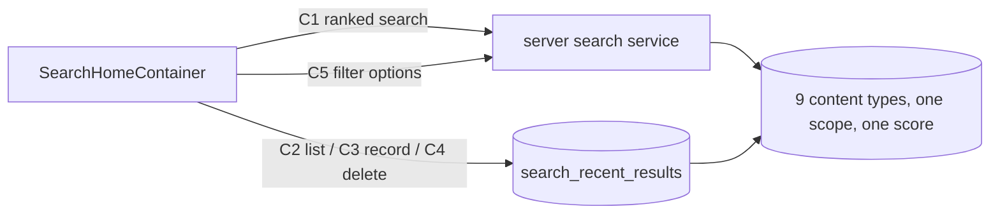

# master-search — spec
> lg · ticket none · prototype mode (`ui2: search-home`; Figma 4536:8480)

## Idea

**Why.** Leaders have no way to find something when they don't know where it lives. The 2.0 Search tab is a blank page, and the server's search only works for someone who owns an org, returns results grouped by type, and has no way to compare a program with a member. This feature makes the Search tab the place a leader finds anything across every org they belong to.

**What success looks like.** A leader taps Search, types "romans" and sees one list with the best match first, whatever its type. They narrow it with Type, Orgs, Groups, Leaders and Tags. With an empty field they see what they recently opened, and can remove any of it.

**In your words.** "it shows recent searches and can search all object types. The search needs to be good enough to rank results across all content types so we can determine relevancy." → D1, D2, D10

**The concept.**



**How it fits today.** `GET /api/search` resolves the org the caller owns and answers 400 for anyone else, runs one searcher per type and groups the answer; every searcher but LESSON is a case-insensitive word match in recency order, and none returns a score.[^1] No content table has a search index; `verses.searchVector` is the only one.[^2] pgvector and embeddings exist for Bible tables only.[^3] `SearchHistory` holds Bible query strings and its DELETE clears everything.[^4] Tags exist only on Media and StudyProgram; Video has no org, and a Media row points to it.[^5] On iPhone `.search` renders `EmptyPage`, and `AppState` has no search domain.[^6] The old search page and its result card are no longer compiled into the app, so there is nothing to remove.[^7]

**Approaches considered.** Chosen: keyword tiers behind one scoring function, in a new endpoint beside the existing one. Rejected: keywords plus embeddings (every type embedded on every save plus a backfill, loose matches can outrank intent, hard to explain); keywords plus typo tolerance (an extension and more indexes, weak matches). Both can be added later inside the scoring function without an app change.

[^1]: server/src/routes/search.ts:214, :253-258, :270-282, :651
[^2]: server/schema/schema.yaml:1482
[^3]: server/src/services/embeddings.ts:24, server/src/services/semantic-search.ts
[^4]: server/schema/schema.yaml:1921, server/src/routes/search.ts:995, :1394
[^5]: server/schema/schema.yaml:1016, :1147, :1296, :2253
[^6]: iphone/MakeReady/UI2/Shell/UI2Shell.swift:183, iphone/MakeReady/State/AppState.swift
[^7]: iphone/MakeReady.xcodeproj/project.pbxproj — GlobalSearchPage, CardSearchResult, EventDetailPage, LessonDetailPage, PostDetailPage have no Sources entry

## Apps

| App | In scope | What changes | Section |
|---|---|---|---|
| server | ✅ | Ranked search, recents table and endpoints, filter options, search indexes, screen fixture | §server |
| client | ⬜ | The web search view keeps calling `GET /api/search`, which does not change; search-home's platform is iphone | — |
| iphone | ✅ | Search tab root: container, mapper, `AppState` search domain, result-tap routing | §iphone |

**Sequencing:** contract settled → server implements and verifies (contract FREEZES) → iphone builds against the frozen contract → the cross-app walk.

**Backward compatibility:** released iPhone builds call `GET /api/search`, `/api/search/smart`, `/api/search/suggestions` and `GET /api/search/recent?type=bible`; none of them change. Everything here is additive: a new table, new indexes, new routes.

**Blast radius:** `GET /api/search` consumers (`client/.../leader-search.store.ts`, iPhone `GlobalSearchEngine`) are untouched. New indexes add a small write cost on the content tables. Deleting a user cascades to their recents.

## Decisions

<!-- The one place rulings live. Record the DECISION — and, in one line, why, and why the rejected option lost. A stated preference
     is the INPUT to a row, not the row. Write each Ruling as something later code can be checked
     against without re-interpretation:
       · positive and specific — "store the full number, mask at render", not "don't truncate"
       · scope named — which apps, screens or endpoints it binds
       · "etc." / "and so on" expanded into the list, or the test for membership stated
       · the rejected alternative named, with the reason it lost (check-obligations warns on a bare one)
       · the enforcement hook, where one exists (lint rule, script, test)
     🔴 NEVER quote the user's prompt as the ruling. Operationalize it: a closed list, a measured
     value, an enumerated set of deviations. A ruling a stranger could implement two ways is not
     written yet.
     Who/date carries the provenance, so the Ruling itself needs no quote marks.
     The owner's own words go in §Idea "In your words", linked to this row — never in the Ruling.
     OPEN rows block the build go-ahead. Never delete a ruling; supersede it in place with a date. -->

| # | Decision | Ruling | Who / date |
|---|---|---|---|
| D1 | Ranking | One scoring function ranks every type. Score = tier + rank, where tier is 4 exact title, 3 title starts with the query, 2 every query word found in the title, 1 match only in other searched fields, and rank is `ts_rank` normalized to 0–1 (`ts_rank(…, 32)`). The last query word matches as a prefix. Ties break on `createdAt` desc, then `id`. Rejected: embeddings (per-save embedding and backfill on every type, loose matches outrank intent); typo tolerance (extension and indexes, weak matches). | owner 2026-11-03 |
| D2 | Result shape | C1 returns one list across types, never grouped. Rejected: extending the grouped shape (no cross-type order). | design ref search-home 2026-11-03 |
| D3 | New endpoint | `GET /api/search` stays byte-for-byte as it is and C1 is new. Rejected: changing its shape (released iPhone builds and web decode it). | (assumed at brainstorm) 2026-11-03 |
| D4 | Visibility | A caller sees all content of every org from `getUserOrganizations`, whatever their role (Owner, Admin, Group Leader). Members match on name, email or phone. Rejected: Group Leaders limited to their groups (stricter than other screens, new scope rule); contact matching limited to Owners and Admins (extra rule, small gain). | owner 2026-11-03 |
| D5 | Searchable types | Closed list: PROGRAM, TEMPLATE, MEMBER, GROUP, LESSON, EVENT, POST, VIDEO, PHOTO. The Type chip's Programs sends PROGRAM and TEMPLATE. Rejected: the Video table for VIDEO (no org or tags; D15 uses Media). | design ref search-home 2026-11-03 |
| D6 | Filters | Picks OR within a filter, filters AND together, and an object with no value for a set filter drops out. Filters apply identically to C1 and C2. Rejected: filters ignoring types without that dimension (the list would not really narrow). | design ref search-home 2026-11-03 |
| D7 | Inherited values | Org: PROGRAM, TEMPLATE, GROUP, PHOTO, VIDEO own column; EVENT, POST via group; LESSON via program; MEMBER via membership. Group: GROUP itself; EVENT, POST, PHOTO, VIDEO own column; MEMBER active memberships; PROGRAM via Enrollment; LESSON via its program's Enrollments. Leader: GROUP `creatorId`; PROGRAM `leaderId`; TEMPLATE `creatorId`; EVENT `createdBy`; POST `authorId`; PHOTO, VIDEO `uploadedBy`; LESSON its program's leader; MEMBER none. Tags: PROGRAM, PHOTO, VIDEO own; LESSON its program's; others none. Rejected: own values only (a Group filter removes all programs and lessons, a Tag filter removes all lessons). | owner 2026-11-03 |
| D8 | MakeReady content | Results include the caller's orgs plus system templates (`isSystem`). MakeReady library Media is excluded. A set Orgs filter drops system templates. Rejected: orgs only (loses what search finds today); library included (stock images compete in the ranking). | owner 2026-11-03 |
| D9 | Tapping a type with no screen | LESSON opens its program, EVENT and POST open their group, VIDEO pushes the Media page. Every C1 and C2 item carries `parent` for this. PROGRAM and TEMPLATE open study-program-home, MEMBER members-profile, GROUP groups-detail, PHOTO the ImageViewer. Rejected: no tap action (looks broken, can't become a recent); leaving the types out (drops lesson content). | owner 2026-11-03 |
| D10 | Recents | Recents are recently opened results, per user, one entry per resource, in a new table; re-opening moves an entry to the top. Rejected: extending `SearchHistory` (holds query strings). | design ref search-home 2026-11-03 |
| D11 | Recents read rules | C2 returns newest first and drops rows the caller can no longer see or whose resource is deleted or inactive. | design ref search-home 2026-11-03 |
| D12 | Recents retention | Keep a user's newest 100 entries: C3 deletes older ones in the same transaction. C2 returns at most 50. Rejected: unbounded (a table that only grows). | (assumed at spec) 2026-11-03 |
| D13 | Filter options | C5 is the one source for all five chips' options except Type, which is the closed list in D5. Rejected: changing `/api/group-leaders` and `/api/media/tags` (other screens read their one-org answer). | (assumed at brainstorm) 2026-11-03 |
| D14 | Tags | A tag is a lowercase string matched against `MediaTag.tag` and `StudyProgramTag.tag`. C5 merges both into one list, with `category` from `TagCategoryTag` where one exists. The Tags chip opens C-036's tag flow with one section per category and an untitled section for the rest. | design ref search-home 2026-11-03 |
| D15 | Video and photo source | VIDEO is `Media` with `type = video`, PHOTO is `Media` with `type = photo`, both `isActive` and following the same visibility rule as `GET /api/media`. Rejected: the `Video` table (no org, group or tags). | (assumed at brainstorm) 2026-11-03 |
| D16 | Searched fields | Title: GROUP, PROGRAM, TEMPLATE `name`; LESSON, EVENT, POST, PHOTO, VIDEO `title`; MEMBER first + last name. Other: GROUP description, code; PROGRAM, TEMPLATE description; LESSON activity title, read content, help title and description, read block title and content; EVENT description, location name; POST content; PHOTO, VIDEO none beyond tags; MEMBER email, phone. An exact email or phone match scores tier 4. Names use the `simple` text config, the rest `english`. | (assumed at spec) 2026-11-03 |
| D17 | Paging | C1 pages by an opaque cursor over (score, createdAt, id). `limit` 1–50, default 20. | (assumed at spec) 2026-11-03 |
| D18 | Query length | C1 answers 400 below 2 characters; the screen never sends one. Above 200 characters is also a 400. | (assumed at spec) 2026-11-03 |
| D19 | Caller with no orgs | C1, C2 and C5 answer 200 with their normal shape. C1 can still return system templates. Rejected: today's 400 (the screen has no error UI). | (assumed at spec) 2026-11-03 |
| D20 | Screen rules | Query at 2 or more characters after 300 ms; next page near the list's end; prior results stay until the next response; a stale response is dropped; a failed request keeps the last rendered state with no error UI; query and picks live in screen `@State`, recents and results in `AppState`. | design ref search-home 2026-11-03 |
| D21 | Result rows | C-085 `trailing=none` for results, `trailing=remove` for recents. Kind map: PROGRAM, TEMPLATE → program; MEMBER → member; GROUP → group; LESSON → lesson; EVENT → event; POST → post; VIDEO → media; PHOTO → photo. Description is `Created <date>`. | design ref search-home 2026-11-03 |
| D22 | Recent removal | Tapping ✕ removes the row at once and restores it in place if C4 fails. | design ref search-home 2026-11-03 |
| D23 | Search indexes | One GIN index per searched table over its D16 text, plus a lower-case title index for tiers 3 and 4. Rejected: on-the-fly `to_tsvector` as LESSON does today (no index, slow as content grows). | (assumed at spec) 2026-11-03 |
| D24 | Recording failure | A failed C3 never blocks opening the item; it logs and moves on, and the next open records it. | (assumed at spec) 2026-11-03 |
| D25 | Screen fixture | `server/fixtures/screens/search-home.ts` `full` seeds every D5 type sharing a word, tags on both stores, and recents for the Fixtures identity. Rejected: no fixture (house rule, and the walk needs mixed types). | (assumed at spec) 2026-11-03 |
| D26 | iPhone wiring | `SearchHomeContainer` + `SearchHomeMapper` under `UI2/Containers/Search/`, `SearchActions` + an `AppState` search domain; recents and results survive leaving the tab in memory and refresh from C2 on open, with no disk cache of their own. Rejected: wiring inside the d2m screen (overwritten on rebuild, ui2-shell D2). | (assumed at spec) 2026-11-03 |

## Contract

| Contract | Producer | Consumers | Auth | Request | Response | Errors |
|---|---|---|---|---|---|---|
| C1 `GET /api/search/ranked` | server | iphone | `requireAuth` | `q`, optional comma lists `types`, `orgIds`, `groupIds`, `leaderIds`, `tags`, `limit`, `cursor` | `{ items: [SearchItem], nextCursor: string \| null }` | 400 bad `q`, `types`, `limit` or `cursor`; 401 |
| C2 `GET /api/search/recent-results` | server | iphone | `requireAuth` | optional `types`, `orgIds`, `groupIds`, `leaderIds`, `tags`, `limit` (max 50) | `{ items: [SearchItem & { openedAt: ISO8601 }] }`; `score` is `null` | 400 bad filter; 401 |
| C3 `PUT /api/search/recent-results` | server | iphone | `requireAuth` | `{ type: SearchType, id: string }` | 204 | 400 bad body; 401; 404 not found or not visible to the caller |
| C4 `DELETE /api/search/recent-results/:type/:id` | server | iphone | `requireAuth` | path only | 204, including when no entry exists | 400 bad type; 401 |
| C5 `GET /api/search/filter-options` | server | iphone | `requireAuth` | none | `{ organizations: [{ id, name }], groups: [{ id, name, organizationId }], leaders: [{ id, name }], tags: [{ tag, label, category: string \| null }] }` | 401 |

`SearchType` is D5's closed list. `SearchItem` is:

```json
{ "type": "LESSON", "id": "…", "title": "Day 3: Grace", "createdAt": "2026-10-03T…Z",
  "score": 2.41, "imageUrl": null,
  "parent": { "type": "PROGRAM", "id": "…", "name": "Romans in 30 days" } }
```

`imageUrl` is the full image for PHOTO and `null` for every other type. `parent` is set for LESSON (PROGRAM), EVENT and POST (GROUP), and `null` otherwise. `score` is a number on C1 and is comparable only within one response's query.

## Schema & API changes

| # | ADD/EDIT/RENAME/REMOVE | Model.field | Wire | Reason | Status |
|---|---|---|---|---|---|
| 1 | ADD | `SearchRecentResult` (`id`, `userId` FK cascade, `resourceType`, `resourceId`, `openedAt`; unique `userId, resourceType, resourceId`; index `userId, openedAt desc`) | C2, C3, C4 | D10 | planned |
| 2 | ADD | GIN and title indexes on the tables behind D16: Group, StudyProgram, the TEMPLATE searcher's model, Lesson, LessonActivity, ReadBlock, Event, Post, Member, Media | C1 | D23 | planned |
| 3 | ADD | Routes C1–C5 | C1–C5 | §Contract | planned |

**Data plan:** both migrations are additive, with no backfill: recents start empty for everyone, and indexes build over existing rows. Undone by dropping the table and the indexes. Generated by `npm run schema:diff` from `server/schema/`; never hand-edited. `resourceId` has no FK because it spans tables, which is why D11 filters at read time.

## server

- **`src/services/master-search.ts` (new)** owns scope, filters, scoring and hydration. `src/routes/search.ts` stays thin and adds C1–C5, with zod on the C3 body and all query parameters. The existing handlers are not edited.
- **Scope:** `getUserOrganizations` (`src/services/organization.ts:144`) gives the org list; requested `orgIds` intersect it, so an org outside it is ignored rather than refused. Org scoping lives in the service.
- **Query:** one raw SQL `UNION ALL` over the requested types, each arm applying D7's filters and computing D1's score, ordered and limited once. Member rows are one per member across orgs.
- **C5 leaders:** the `/api/group-leaders` definition (group creators and role holders) across the caller's orgs, one row per user.
- **Fixture:** `server/fixtures/screens/search-home.ts`, whose `full` scenario adds rows of every D5 type sharing a word so one query returns mixed types, tags on both stores, and recents for the Fixtures identity; a test beside the others in `fixtures/__tests__/`.

## iphone

- **`UI2/Containers/Search/SearchHomeContainer.swift` (new)** renders the d2m `SearchHomeScreen`, debounces 300 ms (the screen doesn't), holds query and picks in `@State`, keeps the index-to-item array the screen's parallel `State` arrays need, and presents `.filterMenuPresentation` and `.imageViewerPresentation` as `MediaHomeContainer.swift:167,179` do.
- **`SearchHomeMapper.swift` (new)** is pure: items to `State`, `chipLabel` via `FilterMenuOverlay.chipLabel`, D14's tag sections, D9's routing target per item. Unit-tested.
- **`State/Actions/SearchActions.swift` (new) + `AppState` search domain:** recents and results keyed by type + id, filter options; no `APIClient` from the container.
- **`UI2Shell.swift`:** `.search` renders `SearchHomeContainer()`; `page(for:)` and `UI2Destination` gain `.mediaHome` for D9's video exit.
- **Errors:** D20 and D24 are deliberate, per `/ios-error-surface`: logged, no banner, because none is designed.
- **d2m views are not edited.** `iphone/MakeReadyUI/` belongs to d2m; a change there goes through `check_project_change`.

## Testing

**server (vitest, never `makeready_dev`):** every tier ordering in D1, across types; D6 and each D7 row, including drop-outs; D4 for an Owner, an Admin, a Group Leader and a caller outside the org; D8; cursor paging with no repeats or gaps; D11's three drop-outs; C3 upsert, D12's cap and its 404; C4 idempotence; D19; a test proving `GET /api/search`'s response is unchanged.

**iphone (XCTest):** mapper kind map, labels, routing targets and tag sections; decode C1–C5 with nulls; actions merge pages, drop stale responses, restore a failed removal.

**Cross-app walk (Fixtures identity, after `fixtures:`):**
1. Search tab with no filters: "Recent searches" lists the seeded items, newest first.
2. Type the shared word: one list with mixed type glyphs, no headings, an exact title first.
3. Set Type to Photos: only photos; tap one and the viewer opens.
4. Clear it, set Tags: programs, lessons, photos and videos only.
5. Set Orgs: system templates are gone.
6. Tap a lesson: its program opens. Go back, clear the query: that lesson is at the top of recents.
7. Tap ✕ on a recent: it goes, and stays gone after relaunch.
8. Type nonsense: `No results for "<query>"`.
9. Filter recents to nothing: the section is hidden, title included.

## Out of scope

- Web search changes (owner 2026-11-03: iPhone screen).
- Finding by meaning, typo tolerance (owner 2026-11-03, D1).
- Dedicated video, event, lesson and post screens (owner 2026-11-03, D9).
- MakeReady library images in results (owner 2026-11-03, D8).
- Bible search and `SearchHistory`.
- Re-tapping the Search tab to scroll and focus: `shell-tabs` owns it (design §3).

## Findings & risks

| # | Finding | Resolution |
|---|---|---|
| F1 | d2m's `SearchHomeScreen.swift`, `SearchResultRow.swift` and their capture changes are uncommitted in the working tree, and the view still reads "PREVIEW ONLY". | Commit them before the iPhone phase; `EnrollmentSelectProgramScreen` and other unrelated edits stay out. |
| F2 | `docs/ui2/references/filter-rail.md` still says Search's chips are buttons (OQ-search-home-010). | Routed to d2m; builder doesn't write the design. |
| F3 | Whether the schema YAML and Atlas can express D23's expression indexes is unchecked. | build-time risk — audit, then the migration task. |
| F4 | Lesson text spans several tables, so a `UNION ALL` arm could be slow. | build-time risk — measure in the server phase against fixture data; store a search column on `lessons` if slow. |
| F5 | This branch is stacked on `feature/library-home`, which is not merged yet. | Merge Library first, or carry it with this branch. |

## Prototype

Ref: `search-home` (d2m, era 2.0, namespace search, iphone). Six states: recents populated, recents empty, querying results, querying no results, loading, error. Ten screen questions closed. Built: C-131, C-034, C-130, C-035, C-020, C-085 (with `photo`), C-084, C-083, C-036. Frozen frame: `search-home`, sha `5746ec91…`. The d2m status line saying the build waits on OQ-C-085-005 is stale: C-085 has no open question.

**Seams:** the design persists one thing, per-user recents (D10). Query and picks don't survive leaving the screen.

## Replaced surfaces

| # | Surface (file:line) | REPLACES/ABSORBS/REUSES | Fingerprint | App |
|---|---|---|---|---|
| R1 | `iphone/MakeReady/UI2/Shell/UI2Shell.swift:183` | REPLACES | `case .calendar, .search: EmptyPage()` | iphone |
| R2 | `iphone/MakeReadyUI/FilterMenuOverlay.swift:91,117` | REUSES | list and tag-flow inits | iphone |
| R3 | `iphone/MakeReady/UI2/Containers/Media/MediaHomeContainer.swift:167,179` | REUSES | filter menu and image viewer presentation | iphone |
| R4 | `server/src/services/organization.ts:144` | REUSES | `getUserOrganizations` | server |
| R5 | `server/src/routes/search.ts:214` | REUSES unchanged | `router.get('/', requireAuth` | server |

**S# gaps**

| # | Gap | Disposition | App |
|---|---|---|---|
| S1 | Design says it replaces live legacy pages; they are already out of the target | No work; recorded in §Idea | iphone |
| S2 | No destination for video, event, lesson, post | Written into SPEC: D9 | iphone |

**N# adds**

| # | Add | Disposition | App |
|---|---|---|---|
| N1 | C1 ranked search + scoring | SPEC: D1, D2 | server |
| N2 | `SearchRecentResult` + C2, C3, C4 | SPEC: D10–D12 | server |
| N3 | C5 filter options | SPEC: D13, D14 | server |
| N4 | Search indexes | SPEC: D23 | server |
| N5 | `search-home` fixture | SPEC: D25 | server |
| N6 | Container, mapper, actions, `AppState` domain | SPEC: D26 | iphone |
| N7 | `.mediaHome` destination | SPEC: D9 | iphone |
