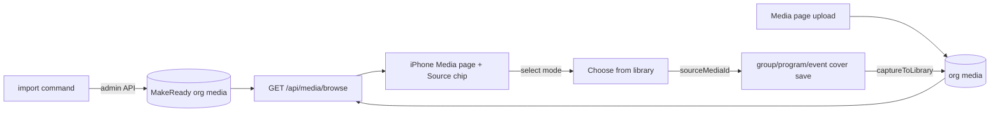

# media-library — spec
> lg · ticket none · child 3 of program media-home-remake · depends on viewer-paging-video (child 2)

## Idea

**Why.** The Media page (media-page, merged ff450795) shows one organization's photos and nothing
else. Leaders have no shared stock of good cover images, can't upload from the page, and can't put
an existing library image on their content. MakeReady wants to curate its own cover library that
every leader can use, while each org's own uploads stay shared inside that org.

**What success looks like.** A leader in any org opens Media and sees MakeReady's covers beside
every org they belong to, narrows it with a Source chip, finds a cover by title or tag, and uses it
as a group or program cover in a few taps. What they upload from Media, or set as a cover, shows up
for their whole org. No leader can change a MakeReady image; MakeReady owners can, through an API.

**In your words.**
- "MakeReady will maintain our own library of cover images that are searchable and can be used by
  any group leader for any content they create." → D1, D9
- "MakeReady media content cannot be edited by any group leader, it can only be done
  administratively by the MakeReady owners via a backend UI (that doesn't exist yet) or API." → D2, D15
- "Any media uploaded by a group leader directly from the media page or when setting an image for
  content they create (group cover, program cover, lesson images, etc.) will show up in their library
  and become available to the entire org." → D3, D8, D12, D13
- "The media page provides a way to browse all media including makeready and any orgs the group
  leader belongs to" → D4, D7
- "All the cover images from d2m I want as fixtures in the app with titles, descriptions, and tags." → D5

**The concept.** One media model. MakeReady's images are ordinary `Media` rows owned by one flagged
MakeReady organization, readable by every signed-in user and writable only by MakeReady (super
admin). A new cross-source listing returns MakeReady plus the caller's orgs; the iPhone Media page
reads it and filters by Source. Uploads land org-wide; a cover picked from the library links to its
original instead of copying it.

**How it fits today.** `Media.organizationId` is required and every list is one org[^1]; the
permission check resolves the org from the row and denies when the caller has no role there[^2];
super admins bypass it[^3]. Group cover, program cover and video saves already auto-capture into the
org library[^4]; event covers don't[^5]. The iPhone Media page reads the first org's photos[^6]; the
2.0 cover menus offer only the device Photos picker[^7]. The web reads one org through the same
list endpoint[^8] and is untouched here.

**Approaches considered.** Chosen: MakeReady as a flagged organization — every media path (tags,
usages, search, paging, capture) is reused, and the new rules are one read rule plus hiding the org
from org lists. Rejected: media with no organization (null handling across permission, cascade,
queries, capture and the web store); a separate stock-image table (tags, search, paging and usage
tracking built twice; pickers merge two shapes).

[^1]: server/prisma/schema.prisma:477-523; services/media-library.ts:328
[^2]: services/permission.ts:120-150, 208
[^3]: services/permission.ts:191
[^4]: routes/groups.ts:1316, routes/programs.ts:3956, routes/videos.ts:447-460
[^5]: routes/events.ts:1334
[^6]: iphone MediaActions.swift:190-233, AppState.swift:1121
[^7]: GroupDetailContainer.swift:164-176, StudyProgramHomeContainer.swift:207-219
[^8]: client leader-library.store.ts:213-400

## Apps

| App | In scope | What changes | Section |
|---|---|---|---|
| server | ✅ | MakeReady org flag + system owner; read rule for MakeReady media; `GET /api/media/sources` + `GET /api/media/browse`; MakeReady admin endpoints; import command; `sourceMediaId` on group/program cover saves; `organizationId` on video create; event-cover capture; fixtures | §server |
| client | ⬜ | Not in scope (D14): the web Media tab and picker keep calling the one-org `/media/library`, whose behaviour does not change; MakeReady rows never appear in it because its org filter excludes them | — |
| iphone | ✅ | Media page reads `/media/browse` with a Source chip; upload (images + videos) with Upload-to menu; MediaBrowser select mode; "Choose from library" on group and program cover menus | §iphone |

**Sequencing:** viewer-paging-video ships first (D11) → contract settled → server builds and
verifies (contract freezes) → d2m makes the media-home and MediaBrowser changes through the channel →
iPhone container work against the frozen contract → the walk.

**Backward compatibility:** every change a released iPhone build can meet is additive. The existing
`/organizations/:id/media/library`, cover-save and video-create endpoints keep their shapes; the new
`sourceMediaId` and `organizationId` request fields are optional and absent from old builds, which
behave as today. Old builds never call `/media/browse`, so they never see MakeReady rows. Org-list
endpoints dropping the MakeReady org is invisible to them (no user holds a role there).

**Blast radius:** everything that lists organizations (`getUserOrganizations`, admin org lists,
analytics) must exclude the MakeReady org (D6); `captureToLibrary` gains a skip path (D10).

## Decisions

<!-- The one place rulings live. Record the DECISION — and, in one line, why, and why the rejected option lost. A stated preference
     is the INPUT to a row, not the row. Write each Ruling as something later code can be checked
     against without re-interpretation:
       · positive and specific — "store the full number, mask at render", not "don't truncate"
       · scope named — which apps, screens or endpoints it binds
       · "etc." / "and so on" expanded into the list, or the test for membership stated
       · the rejected alternative named, with the reason it lost (check-obligations warns on a bare one)
       · the enforcement hook, where one exists (lint rule, script, test)
     🔴 NEVER quote the user's prompt as the ruling. Operationalize it: a closed list, a measured
     value, an enumerated set of deviations. A ruling a stranger could implement two ways is not
     written yet.
     Who/date carries the provenance, so the Ruling itself needs no quote marks.
     The owner's own words go in §Idea "In your words", linked to this row — never in the Ruling.
     OPEN rows block the build go-ahead. Never delete a ruling; supersede it in place with a date. -->

| # | Decision | Ruling | Who / date |
|---|---|---|---|
| D1 | MakeReady library | MakeReady-owned media exists; every signed-in user can list, view and use it; no leader, owner or admin of any org can create, edit, tag or delete it. Why: a curated stock every org shares. Rejected: per-org stock copies (curation would fork per org) | Luke 2026-11-01 |
| D2 | Who changes MakeReady media | Only a user with `isSuperAdmin`, by session or by an API key whose user is a super admin. An admin UI is out of scope. Why: owner's rule. Rejected: an org role (would hand curation to a customer org) | Luke 2026-11-01 |
| D3 | Leader uploads are org-wide | Every upload from the Media page is created with `groupId: null`, `visibility: 'members'` in the chosen org. Why: available to the whole org. Rejected: personal-only uploads (owner wants org sharing) | Luke 2026-11-01 |
| D4 | One browse across sources | The iPhone Media page lists MakeReady media plus media from every org the caller belongs to (`getUserOrganizations`), in one grid. Why: owner goal 3. Rejected: one org at a time (today's limit) | Luke 2026-11-01 |
| D5 | Fixtures | Every live d2m catalog image tagged `Use=cover` (223 today) is a MakeReady media row: `title` = d2m title, `description` and `altText` = d2m alt, tags = its `Subject` and `Book` terms lower-cased. Why: real searchable demo data. Rejected: the 12 cycled "Library photo N" images (no real titles or tags) | Luke 2026-11-01 |
| D6 | Where MakeReady media is stored | `Organization.isMakeReady Boolean default false`; exactly one row is true, name "MakeReady", owned by a dedicated system `User` (`email makeready-library@system.makeready.org`, no login identity, never a member). MakeReady media rows live in it with `uploadedBy` = that user. `getUserOrganizations`, org lists and the Upload-to menu exclude it; super admins are never given a role in it. Why: reuses all media machinery. Rejected: no-org media (null checks everywhere); a separate stock table (everything twice) | Luke 2026-11-01 (system owner: assumed at spec 2026-11-01) |
| D7 | Source chip | media-home gets a multi-select Source chip before Tags: options "MakeReady" then each caller org by name; all selected by default; selecting none = all. One mixed grid; an item with no `takenAt` sorts by `createdAt`, as today. Why: matches browse-all; reuses the chip + C-036 pattern. Rejected: MakeReady opt-in (one tap away); separate MakeReady section (most new design) | Luke 2026-11-01 |
| D8 | Upload org | Caller in one org: upload goes straight into it. Caller in 2+ orgs: an "Upload to" C-036 menu lists their orgs by name (never MakeReady); it is preselected when the Source chip is narrowed to exactly one org. Why: never ambiguous, no cost for one-org leaders. Rejected: always the first org (other orgs unreachable); follow the Source chip (disabled by default) | Luke 2026-11-01 |
| D9 | Where "Choose from library" appears | The iPhone 2.0 group-cover and program-cover menus offer "Choose from library" beside "Photos". It opens the Media grid in select mode (Source, Tags, search available); one tap picks a photo; the pick enters the existing cover framing editor. Not on web, not for lesson or event images. Why: the places 2.0 sets images. Rejected: + web picker (adds client); no picker (covers unusable) | Luke 2026-11-01 |
| D10 | A library pick links, never copies | `POST /api/groups/:id/cover-image` and `POST /api/programs/:id/cover-image` accept optional `sourceMediaId`. When present and readable by the caller: the cover saves as today, `captureToLibrary` is NOT called, and one `MediaUsage` (`GROUP_COVER`/`PROGRAM_COVER`, resourceId the group/program) is upserted on the source media. Why: no near-duplicates; MakeReady sees usage. Rejected: copy into org library (stock duplicated per org) | Luke 2026-11-01 |
| D11 | Videos in the grid | viewer-paging-video ships first and owns video tiles, playback and the Type chip; this feature requests `type` unfiltered from `/media/browse` and adds only video upload. Why: an upload is useful only once videos show. Rejected: fold it in (one huge spec); photos-only first (uploaded videos invisible) | Luke 2026-11-01 |
| D12 | Content-image capture | `POST /api/events/:id/cover-image` calls `captureToLibrary` with `usageType EVENT_COVER` exactly as the group route does (new image only). Lesson images keep reaching the library through `/media/upload`, unchanged. Why: closes the only gap. Rejected: leave events out (event covers would be the one content image missing from the library) | Luke 2026-11-01 |
| D13 | Upload from the Media page | media-home gets an upload control; it opens the system Photos picker (images and videos, multi-select up to 20). Photos upload through `/organizations/:id/media/upload`; videos through the existing Cloudflare flow with `organizationId` on `POST /api/videos`. Why: owner rule. Rejected: covers-only capture with no page upload (the owner named the Media page as an upload point) | Luke 2026-11-01 (picker + limit: assumed at spec 2026-11-01) |
| D14 | Web | Out of scope; `/organizations/:id/media/library` keeps its behaviour. Why: keeps server+iphone. Rejected: web too (third app, one-org store rework) | Luke 2026-11-01 |
| D15 | Production load | Both: admin endpoints (`/api/makeready/media` create, patch, delete; super admin only) and `npm run media:makeready:import`, which ensures the MakeReady org + system owner exist and imports every `Use=cover` d2m image through those endpoints, skipping any whose d2m slug is already imported (`source 'import'`, slug in `exifData.d2mSlug`). The owner runs it once against production with a super-admin API key. Why: prod filled now; the future admin UI has its API. Rejected: import only (the future admin UI would have no API); admin API only (production would stay empty) | Luke 2026-11-01 |
| D16 | Browse authorization | `/media/browse` and `/media/sources` include the MakeReady org plus exactly the orgs `getUserOrganizations(caller)` returns; a `sources` id outside that set is a 403. Rows obey the per-org rules of `/media/library` today (`isActive true`). Why: tenancy. Rejected: trusting client org ids (any leader could read another org's media) | assumed at spec 2026-11-01 |
| D17 | Item shape | Every browse item carries today's library item fields plus `organizationId` and `isMakeReady`; MakeReady items' `uploader` is the system user named "MakeReady", so the Leaders chip lists "MakeReady" once. Why: the client tells sources apart. Rejected: a second item type (the grid, chips and viewer would each handle two shapes) | assumed at spec 2026-11-01 |
| D18 | Deleting MakeReady media | Admin delete sets `isActive false`; covers made from it keep their own rendered copy (`coverImageUrl`), so nothing visible breaks. Why: reversible, safe. Rejected: hard delete (loses usage history) | assumed at spec 2026-11-01 |
| D19 | Upload titles | A Media-page upload's title is "Photo" / "Video" plus the capture date when known; AI alt text and tags are enriched as `captureToLibrary` does today. Why: no typing on upload. Rejected: a title prompt per item (slow for 20) | assumed at spec 2026-11-01 |
| D20 | Fixture images in the repo | The 223 covers are committed under `server/fixtures/images/makeready/` at 1200px longest side (~55 MB) by `fixtures:images:refresh`; resets read only the folder and call the import service directly (no d2m contact). Why: resets stay offline, matching today. Rejected: pull from d2m on every reset (resets need d2m running) | assumed at spec 2026-11-01 |

## Contract

| Contract | Producer | Consumers | Auth | Request | Response | Errors |
|---|---|---|---|---|---|---|
| `GET /api/media/sources` | server | iphone (`MediaActions.loadSources`) | session | — | `{ success, data: [{ id, name, isMakeReady }] }` — MakeReady first, then caller orgs by name | 401 |
| `GET /api/media/browse` | server | iphone (`MediaActions.loadAllMedia`) | session; D16 | `sources` (comma org ids, optional = all), `type`, `tags`, `q`, `cursor`, `limit` (≤200) — same semantics as `/media/library` | `/media/library`'s page shape; each item + `organizationId`, `isMakeReady` (D17) | 400 bad query · 401 · 403 source not the caller's |
| `POST /api/makeready/media` | server | server (import command) | super admin (session or API key) | `{ imageData (base64), title, description?, altText?, tags?: string[], d2mSlug? }` | `{ success, data: media }` | 400 · 401 · 403 · 409 d2mSlug already imported |
| `PATCH /api/makeready/media/:id` | server | server (import command) | super admin | `{ title?, description?, altText?, tags? }` (tags replace) | `{ success, data: media }` | 400 · 403 · 404 |
| `DELETE /api/makeready/media/:id` | server | server (import command) | super admin | — | `{ success }` (isActive false, D18) | 403 · 404 |
| `POST /api/groups/:id/cover-image` (EDIT) | server | iphone (`GroupActions.saveCover`) | unchanged | + optional `sourceMediaId` (D10) | unchanged | + 403 sourceMediaId not readable · 404 not found |
| `POST /api/programs/:id/cover-image` (EDIT) | server | iphone (`ProgramActions.saveCover`) | unchanged | + optional `sourceMediaId` (D10) | unchanged | + 403 · 404 as above |
| `POST /api/videos` (EDIT) | server | iphone (`VideoActions.create`) | unchanged | + optional `organizationId` — must be a caller org; capture goes there instead of `getUserOrgId` | unchanged | + 403 org not the caller's |
| `POST /api/organizations/:id/media/upload` | server | iphone (`MediaActions.uploadPhoto`) | unchanged (`media.create`) | unchanged; 403 when `:id` is the MakeReady org for a non-super-admin | unchanged | unchanged |

## Schema & API changes

| # | ADD/EDIT/RENAME/REMOVE | Model.field | Wire | Reason | Status |
|---|---|---|---|---|---|
| SC1 | ADD | Organization.isMakeReady Boolean default false, indexed | not on the wire | D6 | planned |
| SC2 | ADD | data: one MakeReady Organization + its system User (created by the import service, idempotent) | — | D6, D15 | planned |
| SC3 | EDIT | MediaUsage.usageType gains `EVENT_COVER` (free string column; no enum change) | — | D12 | planned |

**Data plan:** SC1 is additive with a default; every existing org stays `false`; the migration is
generated from `server/schema/schema.yaml` by `npm run schema:diff` and undone by dropping the
column. SC2 rows are written by the import service, not the migration, so production gets them when
the owner runs the import. No existing media row changes.

## server

- **Schema:** `isMakeReady` on Organization in `schema/schema.yaml` → `schema:generate` → `schema:diff`.
- **Service `services/makeready-library.ts`:** `ensureMakeReadyOrg()` (org + system user, idempotent),
  `createMakeReadyMedia`, `updateMakeReadyMedia`, `deleteMakeReadyMedia`, `importFromCatalog(items)`
  (skip by `exifData.d2mSlug`). Uploads reuse `uploadImageVariants` / R2 like `/media/upload`.
- **Permission:** `hasPermission('media.read', …)` on a media row in the MakeReady org returns true for
  any authenticated user; every write action on such a row returns false unless super admin. One
  helper `isMakeReadyOrg(orgId)` (cached), used by the media read/write checks and by `/media/upload`.
- **Browse:** `listBrowse({ userId, sources, … })` in `services/media-library.ts` builds on
  `listLibrary`'s filters with `organizationId IN (…)`; cursor unchanged (`createdAt|id`).
- **Org lists:** `getUserOrganizations` and every organization list filter `isMakeReady: false`.
- **Covers:** group and program cover routes accept `sourceMediaId` (zod, optional uuid); events cover
  route calls `captureToLibrary` (D12).
- **Videos:** `createVideoSchema` + optional `organizationId`, checked against `getUserOrganizations`.
- **Routes:** `routes/makeready-media.ts` (admin) and two GETs in `routes/media.ts`, thin, with OpenAPI blocks.
- **Command:** `npm run media:makeready:import [--api <url>] [--from d2m|fixtures]` — `d2m` reads
  `/api/projects/makeready/images` (Use=cover), downloads each original, posts to `--api` with
  `MAKEREADY_API_KEY`; `fixtures` imports the committed folder straight through the service.
- **Fixtures:** `refresh-images.ts` also writes `images/makeready/` + a `makeready` manifest key; the
  base layer calls `importFromCatalog` from the folder; `screens/media-home.ts` keeps its 360 org rows.

## iphone

- **State:** `AppState.mediaSources: [MediaSource]` (id, name, isMakeReady); `MediaLibraryItem` +
  `organizationId`, `isMakeReady` (optional decode). `MediaActions.loadSources()`; `loadAllPhotos`
  becomes `loadAllMedia(sources:)` against `/api/media/browse`, keeping D2/D17/D18 of media-page
  (paging to completion, load once per session, image budget).
- **Media page (d2m):** `request_project_change` on `media-home`: a Source chip (first chip, C-035 +
  C-036 `.multiple`) and an upload control in the header; on `MediaBrowser` (C-129): a select mode —
  tap returns the item, the viewer is not opened. Never hand-edited (d2m-built files).
- **Upload:** `MediaHomeContainer` presents the system `PhotosPicker` (images + videos, max 20); with
  2+ orgs it first presents the Upload-to C-036 menu (D8) through the `Route` system. Photos →
  `MediaActions.uploadPhoto(orgId:)`; videos → `VideoActions` with `organizationId`. Each finished
  upload is inserted into `AppState.mediaLibrary`; failures route through `/ios-error-surface`.
- **Choose from library:** group and program cover menus (`GroupDetailContainer`,
  `StudyProgramHomeContainer`, `CoverOwner`) add "Choose from library", pushing a picker container
  that hosts `MediaHomeScreen` in select mode (photos only); the picked item's full image is loaded,
  handed to `.editGroupCover` / program equivalent as `.newPick(image, takenAt:)`, and the save sends
  `sourceMediaId`.
- **Fixtures layer:** `server/fixtures/screens/media-home.ts` already exists; it gains nothing beyond
  the base layer's MakeReady import (the Source chip needs the fixture user in one org plus MakeReady).

## Testing

- **server:** service tests — `ensureMakeReadyOrg` idempotent; import skips existing slugs; browse
  returns MakeReady + caller orgs only and 403s a foreign org id; MakeReady rows readable by a leader,
  not writable (PATCH/DELETE/tags/upload 403); super admin can; org lists exclude MakeReady; cover
  save with `sourceMediaId` creates a usage and no new media row; events cover captures; video create
  with `organizationId` captures there and 403s a foreign org. Route tests for every §Contract row.
  🔴 Run against the scratch DB, never makeready_dev.
- **iphone:** mapper tests — Source chip options/defaults, item filtering by source, Upload-to
  preselection; decoding of the new item fields (present and absent); `loadAllMedia` paging.
- **Cross-app E2E walk:** sign in as the fixtures leader → Media shows MakeReady covers and org photos →
  Source chip narrows to MakeReady → search "revelation" finds a cover → upload a photo, it appears →
  open a group → cover menu → Choose from library → pick a MakeReady cover → frame → save → cover shows,
  org library gained no new item.
- **Human walk script:** the E2E walk above, plus: a MakeReady cover in the viewer offers no
  edit/delete; a program cover from library; an event cover appears in the org library.

## Out of scope

- Web: Media tab, picker and store (D14).
- The MakeReady admin UI (D2) — only its API.
- Lesson-image and event-image pickers on iPhone (D9).
- Editing or deleting media from the Media page (any source).
- Video tiles, playback, the Type chip and viewer paging — viewer-paging-video (D11).
- Moving or copying media between orgs.

## Findings & risks

| # | Finding | Resolution |
|---|---|---|
| F1 | Depends on viewer-paging-video, which is not specced yet | build-time risk: the plan's first task checks it has shipped; otherwise the feature parks |
| F2 | Tenancy: `/media/browse` must never return an org the caller doesn't belong to | D16 + route tests for a foreign `sources` id |
| F3 | ~55 MB of fixture JPEGs added to the repo (pack is ~700 MB) | D20; accepted unless the owner prefers pulling at reset |
| F4 | MakeReady covers cluster at their import date in the timeline | accepted at D7 |
| F5 | Org lists are read in many places (analytics, admin, invites) | audit to enumerate every `organization.findMany` that must exclude MakeReady |
