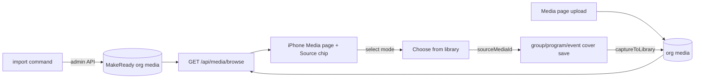

# media-library — spec
> lg · ticket none · child 3 of program media-home-remake · built before viewer-paging-video (D21)

## Idea

**Why.** The Media page (media-page, merged ff450795) shows one organization's photos and nothing
else. Leaders have no shared stock of good cover images, can't upload from the page, and can't put
an existing library image on their content. MakeReady wants to curate its own cover library that
every leader can use, while each org's own uploads stay shared inside that org.

**What success looks like.** A leader in any org opens Media and sees MakeReady's covers beside
every org they belong to, narrows it with a Source chip, finds a cover by title or tag, and uses it
as a group or program cover in a few taps. What they upload from Media, or set as a cover, shows up
for their whole org. No leader can change a MakeReady image; MakeReady owners can, through an API.

**In your words.**
- "MakeReady will maintain our own library of cover images that are searchable and can be used by
  any group leader for any content they create." → D1, D9
- "MakeReady media content cannot be edited by any group leader, it can only be done
  administratively by the MakeReady owners via a backend UI (that doesn't exist yet) or API." → D2, D15
- "Any media uploaded by a group leader directly from the media page or when setting an image for
  content they create (group cover, program cover, lesson images, etc.) will show up in their library
  and become available to the entire org." → D3, D8, D12, D13
- "The media page provides a way to browse all media including makeready and any orgs the group
  leader belongs to" → D4, D7
- "All the cover images from d2m I want as fixtures in the app with titles, descriptions, and tags." → D5

**The concept.** One media model. MakeReady's images are ordinary `Media` rows owned by one flagged
MakeReady organization, readable by every signed-in user and writable only by MakeReady (super
admin). A new cross-source listing returns MakeReady plus the caller's orgs; the iPhone Media page
reads it and filters by Source. Uploads land org-wide; a cover picked from the library links to its
original instead of copying it.

**How it fits today.** `Media.organizationId` is required and every list is one org[^1]; the
permission check resolves the org from the row and denies when the caller has no role there[^2];
super admins bypass it[^3]. Group cover, program cover and video saves already auto-capture into the
org library[^4]; event covers don't[^5]. The iPhone Media page reads the first org's photos[^6]; the
2.0 cover menus offer only the device Photos picker[^7]. The web reads one org through the same
list endpoint[^8] and is untouched here.

**Approaches considered.** Chosen: MakeReady as a flagged organization — every media path (tags,
usages, search, paging, capture) is reused, and the new rules are one read rule plus hiding the org
from org lists. Rejected: media with no organization (null handling across permission, cascade,
queries, capture and the web store); a separate stock-image table (tags, search, paging and usage
tracking built twice; pickers merge two shapes).

[^1]: server/prisma/schema.prisma:477-523; services/media-library.ts:328
[^2]: services/permission.ts:120-150, 208
[^3]: services/permission.ts:191
[^4]: routes/groups.ts:1316, routes/programs.ts:3956, routes/videos.ts:447-460
[^5]: routes/events.ts:1334
[^6]: iphone MediaActions.swift:190-233, AppState.swift:1121
[^7]: GroupDetailContainer.swift:164-176, StudyProgramHomeContainer.swift:207-219
[^8]: client leader-library.store.ts:213-400

## Apps

| App | In scope | What changes | Section |
|---|---|---|---|
| server | ✅ | MakeReady org flag + system owner; read rule for MakeReady media (usages scoped); `GET /api/media/sources` + `GET /api/media/browse`; MakeReady admin endpoints; import command; `sourceMediaId` on group/program cover saves; MakeReady org closed to the generic upload/delete; event-cover capture; fixtures | §server |
| client | ⬜ | Not in scope (D14): the web calls only `/organizations/:org/media/library` and `/media/tags` (leader-library.store.ts:249,278,304,382), resolving its org from its groups — MakeReady has none; neither endpoint's behaviour changes; no client code calls `/media/:id` | — |
| iphone | ✅ | Media page reads `/media/browse` with a Source chip; upload (images + videos) from the Media tab's TopNav add slot with an Upload-to menu; a library picker page (new d2m screen); "Choose from library" on group and program cover menus | §iphone |

**Sequencing:** built now, without viewer-paging-video (D21) → contract settled → server
builds and verifies (contract freezes; it deploys before any iPhone build that sends `sourceMediaId`,
F-S12) → d2m makes the media-home Source chip and the media-picker screen through the channel →
iPhone container work against the frozen contract → the walk.

**Backward compatibility:** every change a released iPhone build can meet is additive. The existing
`/organizations/:id/media/library`, `/media/upload` and cover-save endpoints keep their shapes; the new
`sourceMediaId` request field is optional and absent from old builds, which behave as today (the
server's zod would strip it on an old server, so the server ships first). Old builds never call `/media/browse`, so they never see MakeReady rows. Org-list
endpoints dropping the MakeReady org is invisible to them (no user holds a role there).

**Blast radius:** no endpoint lists all organizations — `getUserOrganizations`, `getManageableOrgIds`
and study-program.service.ts:71 return only orgs the caller owns or holds a role in, and only the
MakeReady system user does for MakeReady. The one unfiltered enumerator is
`scripts/schema/run-seeds.ts:295` (`migrateOrganizationOwners`), which must skip it. The cover routes
gain a skip path around `captureToLibrary` (D10); the media read check gains one rule (D1).

## Decisions

<!-- The one place rulings live. Record the DECISION — and, in one line, why, and why the rejected option lost. A stated preference
     is the INPUT to a row, not the row. Write each Ruling as something later code can be checked
     against without re-interpretation:
       · positive and specific — "store the full number, mask at render", not "don't truncate"
       · scope named — which apps, screens or endpoints it binds
       · "etc." / "and so on" expanded into the list, or the test for membership stated
       · the rejected alternative named, with the reason it lost (check-obligations warns on a bare one)
       · the enforcement hook, where one exists (lint rule, script, test)
     🔴 NEVER quote the user's prompt as the ruling. Operationalize it: a closed list, a measured
     value, an enumerated set of deviations. A ruling a stranger could implement two ways is not
     written yet.
     Who/date carries the provenance, so the Ruling itself needs no quote marks.
     The owner's own words go in §Idea "In your words", linked to this row — never in the Ruling.
     OPEN rows block the build go-ahead. Never delete a ruling; supersede it in place with a date. -->

| # | Decision | Ruling | Who / date |
|---|---|---|---|
| D1 | MakeReady library | MakeReady-owned media exists; every signed-in user can list, view and use it; no leader, owner or admin of any org can create, edit, tag or delete it. Why: a curated stock every org shares. Rejected: per-org stock copies (curation would fork per org) | Luke 2026-11-01 |
| D2 | Who changes MakeReady media | Only a user with `isSuperAdmin`, by session or by an API key whose user is a super admin. An admin UI is out of scope. Why: owner's rule. Rejected: an org role (would hand curation to a customer org) | Luke 2026-11-01 |
| D3 | Leader uploads are org-wide | Every upload from the Media page is created with `groupId: null`, `visibility: 'members'` in the chosen org. Why: available to the whole org. Rejected: personal-only uploads (owner wants org sharing) | Luke 2026-11-01 |
| D4 | One browse across sources | The iPhone Media page lists MakeReady media plus media from every org the caller belongs to (`getUserOrganizations`), in one grid. Why: owner goal 3. Rejected: one org at a time (today's limit) | Luke 2026-11-01 |
| D5 | Fixtures | Every live d2m catalog image tagged `Use=cover` (223 today) is a MakeReady media row: `title` = d2m title, `description` and `altText` = d2m alt, tags = its `Subject` and `Book` terms lower-cased. Why: real searchable demo data. Rejected: the 12 cycled "Library photo N" images (no real titles or tags) | Luke 2026-11-01 |
| D6 | Where MakeReady media is stored | `Organization.isMakeReady Boolean default false`; exactly one row is true, name "MakeReady", owned by a dedicated system `User` (`email makeready-library@system.makeready.org`, `isActive false` so auth refuses it, never given a UserRole). Both have fixed, well-known UUID constants and `ensureMakeReadyOrg()` upserts them by id (the schema cannot enforce "exactly one"; deleting the system user would cascade the whole library). MakeReady media rows live in it with `uploadedBy` = that user. `getUserOrganizations` filters `isMakeReady: false` as a guard and `run-seeds.ts` `migrateOrganizationOwners` skips it; super admins are never given a role in it. Why: reuses all media machinery. Rejected: no-org media (null checks everywhere); a separate stock table (everything twice) | Luke 2026-11-01 (system owner: assumed at spec 2026-11-01) |
| D7 | Source chip | media-home gets a multi-select Source chip before Tags: options "MakeReady" then each caller org by name; the default selection is empty, which shows every source (the chip's label rule: none → resting "Source", one → its name, more → "first +n", as Tags and Leaders). Filtering is on-device in `MediaHomeMapper` by `organizationId`/`isMakeReady`. One mixed grid; where MakeReady items sit in the timeline is D22. Why: matches browse-all; reuses the chip + C-036 pattern. Rejected: MakeReady opt-in (one tap away); separate MakeReady section (most new design) | Luke 2026-11-01 |
| D8 | Upload org | Caller in one org: upload goes straight into it. Caller in 2+ orgs: an "Upload to" C-036 `.single` menu (`.filterMenuPresentation`) lists the `/media/sources` entries with `canUpload: true` (never MakeReady) by name; it is preselected when the Source chip is narrowed to exactly one such org. Sources not loaded → upload goes to `state.organizationId`; no org with `canUpload` → the add slot shows a banner "You can't upload media in this organization" and does nothing. Why: never ambiguous, no cost for one-org leaders. Rejected: always the first org (other orgs unreachable); follow the Source chip (disabled by default) | Luke 2026-11-01 |
| D9 | Where "Choose from library" appears | On the iPhone 2.0 group and program covers: with a cover, the cover ActionMenuOverlay (Edit image · Change image · View image) gains "Choose from library" after "Change image" (glyph `image`); with no cover, the tap that today opens Photos directly opens a two-row menu "Photos · Choose from library". "Choose from library" pushes `UI2Destination.chooseCoverFromLibrary(owner: CoverOwner)`, the media-picker screen (media-home's body under a C-040 header with back + "Choose image"; Source, Tags, search available, photos only); one tap loads the full image and `replaceTop`s the picker with the existing cover framing editor as `.newPick(image, takenAt:, sourceMediaId:)`; a load failure shows the banner "Couldn't open that photo" and stays on the picker. Not on web, not for lesson or event images. Why: the places 2.0 sets images. Rejected: + web picker (adds client); no picker (covers unusable) | Luke 2026-11-01 |
| D10 | A library pick links, never copies | `POST /api/groups/:id/cover-image` and `POST /api/programs/:id/cover-image` accept optional `sourceMediaId`. `sourceMediaId` must name MakeReady media or media in the group's/program's own org, active, else 403 (stops a cross-org usage leaking the resource name). When valid: the cover saves as today — rendered cover and original still written to R2, the app still sends `originalData` + framing so re-edit works — no new Media row is created (`captureToLibrary` is not called), and one `MediaUsage` (`GROUP_COVER`/`PROGRAM_COVER`, resourceId the group/program, resourceName its name) is upserted on the source media. Why: no near-duplicates; MakeReady sees usage. Rejected: copy into org library (stock duplicated per org) | Luke 2026-11-01 |
| D11 | Videos in the grid | viewer-paging-video owns video tiles, playback and the Type chip (ordering superseded by D21); this feature requests `type` unfiltered from `/media/browse` and adds only video upload. Why: an upload is useful only once videos show. Rejected: fold it in (one huge spec); photos-only first (uploaded videos invisible) | Luke 2026-11-01 |
| D12 | Content-image capture | `POST /api/events/:id/cover-image` calls `captureToLibrary` with `usageType EVENT_COVER`, `organizationId` = `event.group.organizationId` (skipped when the event has no group), on every save (event covers have no re-edit path; captureToLibrary's url+org dedupe prevents doubles). Lesson images keep reaching the library through `/media/upload`, unchanged. Why: closes the only gap. Rejected: leave events out (event covers would be the one content image missing from the library) | Luke 2026-11-01 |
| D13 | Upload from the Media page | The Media tab's existing TopNav add slot (`onAdd .media`, TopNavHost.swift:100-108) is the upload control (no d2m change); it opens the system Photos picker (images and videos, multi-select up to 20). Uploads run in an AppState-owned queue (not view Tasks, so leaving Media doesn't cancel them); each failure surfaces a banner through `/ios-error-surface`; no progress UI in v1. Photos post to `/organizations/:org/media/upload` (`MediaActions.uploadPhoto(image:orgId:sourceData:)`) and are inserted into `AppState.mediaLibrary` as a `MediaLibraryItem` built locally (tags [], usageCount 0, uploader = self, organizationId, isMakeReady false). Videos post to the same endpoint with `type: 'video'`, which already creates a pending Media row with `videoId` in that org and returns the Cloudflare `uploadUrl` (media.ts:1258-1311); they are not inserted locally and appear on the next load. Why: owner rule. Rejected: covers-only capture with no page upload (the owner named the Media page as an upload point) | Luke 2026-11-01 (picker + limit: assumed at spec 2026-11-01) |
| D14 | Web | Out of scope; `/organizations/:id/media/library` keeps its behaviour. Why: keeps server+iphone. Rejected: web too (third app, one-org store rework) | Luke 2026-11-01 |
| D15 | Production load | Both: admin endpoints (`/api/makeready/media` create, patch, delete; super admin only) and `npm run media:makeready:import`, which ensures the MakeReady org + system owner exist and imports every `Use=cover` d2m image through those endpoints, skipping any whose d2m slug is already imported (`source 'import'`, slug in `exifData.d2mSlug`). The owner runs it once against production with a super-admin API key. The server ensures the org and system user inside `createMakeReadyMedia` (the command never touches a DB). R2 keys are stable `makeready/<slug>-<stamp>` variants written through `uploadImageVariants` with a `.jpeg` extension (tiles derive `-md.jpeg`); a re-import re-uploads any row whose object is missing (`objectExists`, as `placeLadder`). The command resizes to 1200px before posting (10 MB body limit) and backs off on 429 (API keys: 120 req/min). Admin routes reuse `requireSuperAdmin` (sms-campaigns.ts:23). Why: prod filled now; the future admin UI has its API. Rejected: import only (the future admin UI would have no API); admin API only (production would stay empty) | Luke 2026-11-01 |
| D16 | Browse authorization | `/media/browse` and `/media/sources` include the MakeReady org plus exactly the orgs `getUserOrganizations(caller)` returns; a `sources` id outside that set is a 403. Rows obey the per-org rules of `/media/library` today (`isActive true`). For MakeReady media, `GET /media/:id/usages` and `/media/:id/detail` return only usages whose resource is in one of the caller's orgs (super admins see all). The MakeReady org is closed to `POST /organizations/:id/media/upload`(/batch) and `DELETE /media/:id` for everyone, super admins included — only `/api/makeready/media` writes MakeReady media. Why: tenancy. Rejected: trusting client org ids (any leader could read another org's media) | assumed at spec 2026-11-01 |
| D17 | Item shape | Every browse item carries today's library item fields plus `organizationId` and `isMakeReady`; MakeReady items' `uploader` is the system user named "MakeReady", so the Leaders chip lists "MakeReady" once. Why: the client tells sources apart. Rejected: a second item type (the grid, chips and viewer would each handle two shapes) | assumed at spec 2026-11-01 |
| D18 | Deleting MakeReady media | Admin delete sets `isActive false`; covers made from it keep their own rendered copy (`coverImageUrl`), so nothing visible breaks. Why: reversible, safe. Rejected: hard delete (loses usage history) | assumed at spec 2026-11-01 |
| D19 | Upload titles | A Media-page upload's title is "Photo" / "Video" plus the capture date when known; AI alt text and tags are enriched as `captureToLibrary` does today. Why: no typing on upload. Rejected: a title prompt per item (slow for 20) | assumed at spec 2026-11-01 |
| D20 | Fixture images in the repo | The 223 covers are committed flat in `server/fixtures/images/` (slugs already there are reused) at 1200px longest side (~45 MB new) by `fixtures:images:refresh`, which adds a `makeready` slug list and each image's `tags` to `manifest.json`; resets read only the folder and call the import service directly (no d2m contact), inside the same storage gate as `seedImages` (off under vitest). The MakeReady org and its rows are not wiped by fixture resets (wipe.ts deletes fixture users only); the import is idempotent. The fixture base layer also adds a second org ("Northside Fellowship") where `FIXTURE_USER_ID` holds Admin, so the Source chip and Upload-to menu can be walked; base.db.test counts update. Why: resets stay offline, matching today. Rejected: pull from d2m on every reset (resets need d2m running) | assumed at spec 2026-11-01 |

| D21 | viewer-paging-video ordering vs building now | Build media-library now, in session; viewer-paging-video is NOT a prerequisite. Video uploads create pending video Media rows that the Media mapper skips (MediaHomeMapper.swift:65) until viewer-paging-video adds video tiles. Supersedes D11's "ships first" (2026-11-01); D11's ownership of video tiles, playback and the Type chip stands. Why: nothing breaks and the owner wants it now. Rejected: viewer-paging-video first (delays uploads and MakeReady for a video view nothing here depends on) | Luke 2026-11-01 |
| D22 | Where MakeReady covers sit in the timeline | In `MediaHomeMapper` (Media page and media-picker), MakeReady items sort before every org item — the oldest end of the grid — ordered among themselves by title A–Z; org items keep today's order (takenAt, else createdAt). The grid still opens at the newest end on the org's own photos. Why: 223 covers imported at once would otherwise fill the end the grid opens on. Rejected: by import date (buries recent photos); Media defaulting to the caller's orgs (contradicts D7's show-everything default) | Luke 2026-11-01 |

## Contract

| Contract | Producer | Consumers | Auth | Request | Response | Errors |
|---|---|---|---|---|---|---|
| `GET /api/media/sources` | server | iphone (`MediaActions.loadSources`) | session | — | `{ success, data: [{ id, name, isMakeReady, canUpload }] }` — MakeReady first (`canUpload false`), then caller orgs by name; `canUpload` = caller has `media.create` there | 401 |
| `GET /api/media/browse` | server | iphone (`MediaActions.loadAllMedia`, no `sources`) | session; D16 | `sources` (comma org ids, optional = all), `type`, `tags`, `q`, `cursor`, `limit` (1–200, default 200; the cap is browse-only) — filters as `/media/library` | cursor mode only: `{ success, data: [item], limit, hasMore, nextCursor }`; item = `/media/library`'s item + `organizationId`, `isMakeReady` (D17). Registered before `GET /media/:mediaId` | 400 bad query · 401 · 403 source not the caller's |
| `POST /api/makeready/media` | server | server (import command) | super admin (session or API key) | `{ imageData (base64), title, description?, altText?, tags?: string[], d2mSlug? }` | `{ success, data: media }` | 400 · 401 · 403 · 409 d2mSlug already imported |
| `PATCH /api/makeready/media/:id` | server | none yet — the future admin UI (D2); tested by route tests | super admin | `{ title?, description?, altText?, tags? }` (tags replace) | `{ success, data: media }` | 400 · 403 · 404 |
| `DELETE /api/makeready/media/:id` | server | none yet — the future admin UI (D2); tested by route tests | super admin | — | `{ success }` (isActive false, D18) | 403 · 404 |
| `POST /api/groups/:id/cover-image` (EDIT) | server | iphone (`GroupActions.saveCover`) | unchanged | + optional `sourceMediaId` (D10) | unchanged | + 403 source not MakeReady or the group's org · 404 not found |
| `POST /api/programs/:id/cover-image` (EDIT) | server | iphone (`ProgramActions.saveCover`) | unchanged | + optional `sourceMediaId` (D10) | unchanged | + 403 · 404 as above |
| `POST /api/organizations/:id/media/upload` | server | iphone (`MediaActions.uploadPhoto`, `MediaActions.uploadVideo`) | unchanged (`media.create`) | unchanged (`type: 'photo'` with `imageData`, or `type: 'video'`) | unchanged (video: pending row + `uploadUrl`) | + 403 for everyone when `:id` is the MakeReady org (also `/upload/batch`) |
| `DELETE /api/media/:id` (EDIT) | server | none in this feature (web/legacy callers unchanged) | unchanged | unchanged | unchanged | + 403 for everyone on MakeReady media |
| `GET /api/media/:id/usages`, `/detail` (EDIT) | server | iphone (none today; legacy) | unchanged | unchanged | MakeReady media: only usages in the caller's orgs (D16) | unchanged |

## Schema & API changes

| # | ADD/EDIT/RENAME/REMOVE | Model.field | Wire | Reason | Status |
|---|---|---|---|---|---|
| SC1 | ADD | Organization.isMakeReady Boolean default false, indexed | not on the wire | D6 | planned |
| SC2 | ADD | data: one MakeReady Organization + its system User (created by the import service, idempotent) | — | D6, D15 | planned |
| SC3 | EDIT | MediaUsage.usageType gains `EVENT_COVER` (free string column; only GROUP_COVER/PROGRAM_COVER written today; no enum change) | — | D12 | planned |

**Data plan:** SC1 is additive with a default; every existing org stays `false`; the migration is
generated from `server/schema/schema.yaml` (schema:generate, then the atlas `migrate diff --env local --var database_url=…makeready_dev` form — never `npm run schema:diff`, which reads the 1Password `.env`) and undone by dropping the
column. SC2 rows are written by the import service, not the migration, so production gets them when
the owner runs the import. No existing media row changes.

## server

- **Schema:** `isMakeReady` on Organization in `schema/schema.yaml` → `schema:generate` → `schema:diff`.
- **Service `services/makeready-library.ts`:** `ensureMakeReadyOrg()` (org + system user, idempotent),
  `createMakeReadyMedia`, `updateMakeReadyMedia`, `deleteMakeReadyMedia`, `importFromCatalog(items)`
  (skip by `exifData.d2mSlug`). Uploads reuse `uploadImageVariants` / R2 like `/media/upload`.
- **Permission:** add one read rule — `hasPermission('media.read', …)` on a media row in the MakeReady
  org is true for any authenticated user. Writes are already denied: no user but the system user holds
  a role there (permission.ts:228-235) and the creator fallback matches only the system user
  (:587-598). Close the super-admin paths (D16): `/media/upload`(/batch) and `DELETE /media/:id`
  refuse the MakeReady org. Helper `isMakeReadyOrg(orgId)` (cached). Usages/detail scoping per D16.
- **Browse:** `listBrowse({ userId, sources, … })` in `services/media-library.ts` builds on
  `listLibrary`'s filters with `organizationId IN (…)`; cursor unchanged (`createdAt|id`); the
  `(organizationId, createdAt, id)` index can't serve one ordered scan across orgs — accepted below ~10k rows.
  The two GETs register above `GET /media/:mediaId` (media.ts:394).
- **Org lists:** `getUserOrganizations` filters `isMakeReady: false` (guard); `run-seeds.ts:295` skips it.
- **Covers:** group and program cover routes accept `sourceMediaId` (zod, optional uuid; group-cover.ts
  `saveCover` path unchanged, only the capture is skipped); events cover route captures (D12).
- **Videos:** no change — Media-page videos use `/media/upload` `type: 'video'` (D13), which creates one
  pending row per video (the `POST /api/videos` capture dedupes on `url+org` and pending videos share
  `url ''`, so it would collapse a 20-video upload to one row).
- **Routes:** `routes/makeready-media.ts` (admin) and two GETs in `routes/media.ts`, thin, with OpenAPI blocks.
- **Command:** `npm run media:makeready:import [--api <url>] [--from d2m|fixtures]` — `d2m` reads
  `/api/projects/makeready/images` (Use=cover), downloads each original, posts to `--api` with
  `MAKEREADY_API_KEY`; `fixtures` imports the committed folder straight through the service.
- **Fixtures:** per D20 — `refresh-images.ts` writes the covers flat with `tags` in the manifest; the
  base layer imports them through `importFromCatalog` inside the storage gate and adds the second org;
  `screens/media-home.ts` keeps its 360 org rows.

## iphone

- **State:** `AppState.mediaSources: [MediaSource]` (id, name, isMakeReady, canUpload);
  `MediaLibraryItem` + `organizationId: String?`, `isMakeReady: Bool?` (optional — persisted caches
  from older builds decode, PersistedState.swift:296). `MediaActions.loadSources()`; `loadAllPhotos`
  becomes `loadAllMedia()` against `/api/media/browse` with no `sources`, keeping media-page D2/D17/D18
  (page to completion, load once per session, image budget); the load-once gate keys on a sorted
  source-id signature (`mediaSourcesKey`) instead of `mediaPhotosLoadedOrgId == organizationId`.
- **Media page (d2m):** `request_project_change` on `media-home`: a Source chip as the first chip
  (C-035 + C-036 `.multiple`, D7). And a new d2m screen `media-picker` (C-040 header with back +
  "Choose image", then media-home's body), built by d2m. MediaBrowser (C-129) needs no change — tile
  taps already reach the container (`onTap(id, frame)`). d2m-built files are never hand-edited.
- **Mapper:** `MediaHomeMapper` gains the Source filter and D22's ordering.
- **Upload:** D13 — the TopNav add slot on Media; Upload-to via `.filterMenuPresentation` (D8); the
  system `PhotosPicker` (images + videos, max 20); an AppState upload queue.
- **Choose from library:** D9 — `UI2Destination.chooseCoverFromLibrary(owner:)` hosts a
  `MediaPickerContainer` (copies MediaHomeContainer's load/filters, not its shell-coupled parts
  `scrollReport`/`UI2HidesTopNavKey`); `ImageEditSource.newPick(UIImage, takenAt:, sourceMediaId: String? = nil)`
  is threaded through EditGroupCoverContainer's Opening → `CoverOwner.save` → `GroupActions.saveCover` /
  `ProgramActions.saveCover`, which send `sourceMediaId`; `EditMemberAvatarContainer.swift:73` pattern updated.

## Testing

- **server:** service tests — `ensureMakeReadyOrg` idempotent; import skips existing slugs; browse
  returns MakeReady + caller orgs only and 403s a foreign org id; MakeReady rows readable by a leader,
  not writable (PATCH/DELETE/tags/upload 403); super admin can; org lists exclude MakeReady; cover
  save with `sourceMediaId` creates a usage and no new media row; events cover captures; video create
  through `/media/upload` `type: 'video'` ×20 creates 20 pending rows; `/media/upload` and `DELETE /media/:id` refuse the MakeReady org even for a super admin; usages/detail of a MakeReady cover show only the caller's orgs' usages; `sourceMediaId` from another org → 403; import re-uploads a row whose R2 object is missing. Route tests for every §Contract row.
  🔴 Run against the scratch DB, never makeready_dev.
- **iphone:** mapper tests — Source chip options/empty default/label, filtering by source, D22
  ordering, Upload-to options (`canUpload`) and preselection; decoding of the new item fields (present
  and absent, and an old persisted cache); `loadAllMedia` paging and the sources-key gate; the
  upload queue inserting a photo item; `newPick` carrying `sourceMediaId` into both save bodies.
- **Cross-app E2E walk:** sign in as the fixtures leader → Media shows MakeReady covers and org photos →
  Source chip narrows to MakeReady → search "revelation" finds a cover → upload a photo, it appears →
  open a group → cover menu → Choose from library → pick a MakeReady cover → frame → save → cover shows,
  org library gained no new item.
- **Human walk script:** the E2E walk above, plus: Source chip lists MakeReady + both fixture orgs;
  upload asks Upload to; a cover-less program → Photos · Choose from library → pick → save; tapping a
  tile in the picker frames it (never opens the viewer); an event cover appears in the org library.

## Out of scope

- Web: Media tab, picker and store (D14).
- The MakeReady admin UI (D2) — only its API.
- Lesson-image and event-image pickers on iPhone (D9).
- Editing or deleting media from the Media page (any source).
- Video tiles, playback, the Type chip and viewer paging — viewer-paging-video (D11).
- Moving or copying media between orgs.

## Findings & risks

| # | Finding | Resolution |
|---|---|---|
| F1 | Depended on viewer-paging-video, which is not specced yet | D21: not a prerequisite; the mapper drops non-photos |
| F2 | Tenancy: `/media/browse` must never return an org the caller doesn't belong to | D16 + route tests for a foreign `sources` id |
| F3 | ~45 MB of new fixture JPEGs in the repo (pack ~700 MB) | D20; accepted unless the owner prefers pulling at reset |
| F4 | MakeReady covers cluster at their import date in the timeline | accepted at D7 |
| F5 | Org lists are read in many places | audited: none lists all orgs; only run-seeds.ts:295 must skip MakeReady (§Apps blast radius) |
| F6 | Making MakeReady media readable opened `/media/:id/usages` + `/detail`, leaking other orgs' group/program names | D16 scoping + test |
| F7 | Multi-video upload via `POST /api/videos` would collapse to one Media row (url+org dedupe on `url ''`) | D13 uses `/media/upload` `type:'video'`; `POST /api/videos` unchanged |
| F8 | Super admins could write MakeReady media through the generic upload (wrong uploader) and hard-delete it | D16 closes both |
| F9 | s3mock is emptied on walk reset while MakeReady rows survive | D15 `objectExists` re-upload |
| F10 | Import command vs limits (10 MB body, 120 req/min per key) | build-time risk — import command task: resize to 1200px, back off on 429 |
| F11 | New GETs could be shadowed by `GET /media/:mediaId` | build-time risk — routes task: register above media.ts:394 |
| F12 | Cover menus: with no cover a tap opens Photos directly, so no menu existed to add to | D9 two-row menu |
| F13 | Picker needs a page header media-home lacks | D9/§iphone: new d2m `media-picker` screen — build-time risk on the d2m request task |
| F14 | Upload tasks tied to the view would cancel on leaving Media | D13 AppState queue |
| F15 | Fixtures had one org, so Upload-to and a multi-org Source chip couldn't be walked | D20 second fixture org |
| F16 | MakeReady covers sort by import time = the newest end, where the grid opens | D22: oldest end |

## Plan

The plan, with its code: `docs/features/media-library/PLAN.md` (§PLAN.md).

- Phase 1 · Task 1 · MakeReady org flag, system owner and `ensureMakeReadyOrg`
- Phase 1 · Task 2 · Read rule, usages scoping and the closed write paths
- Phase 1 · Task 3 · MakeReady admin endpoints
- Phase 2 · Task 4 · `/api/media/sources` and `/api/media/browse`
- Phase 2 · Task 5 · Library-pick covers and event-cover capture
- Phase 2 · Task 6 · Import command
- Phase 2 · Task 7 · Fixtures — 223 MakeReady covers and a second org; freeze the contract
- Phase 3 · Task 8 · d2m — Source chip on media-home and the media-picker screen
- Phase 4 · Task 9 · State — sources, browse items and the load gate
- Phase 4 · Task 10 · Upload queue (photos and videos)
- Phase 4 · Task 11 · Mapper — Source filter and MakeReady ordering
- Phase 4 · Task 12 · Media page — browse, Source chip, upload with Upload-to
- Phase 4 · Task 13 · Choose from library on group and program covers
