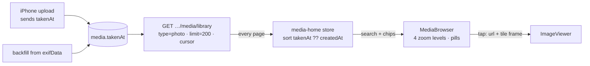

# media-page — spec
> lg · child 1 of media-home-remake (`docs/features/media-home-remake/PROGRAM.md`) · ticket none

## Idea

**Why.** In the UI 2.0 iPhone shell, tapping **Media** in Home's TopNav opens an empty page
(`UI2Shell.swift:222`, "SPEC D10: Library…Media are unwired"). Leaders have no way to browse their
organization's photos in the new app. This child gives them the Media page: the shell's TopNav and
TabBar around a search field, filter chips and **MediaBrowser**, a Photos-style zoomable grid.
Tapping a photo opens it in **ImageViewer**.

**What success looks like.** A leader opens Media and lands at the newest photos at 5 columns. They
pinch out through ~8, ~13–15 and 30+ columns: month labels appear, then year labels, and the
photo under their fingers stays put. Flicks and drags feel instant. They search, narrow by tags,
leaders and time, tap a photo, view it, and drag it back into its tile. A photo they took in June
and uploaded from the iPhone today sits in June.

**In your words.**
- "Now let's remake the Media page so that it has: topnav, search + filters, ImageViewer, bottom nav" → D1, D11.
- "It responded well to flicks and dragging, very responsive" → D15.
- "for the previews of the component, use all the images I uploaded as examples. I would like at least one preview per major zoom level" → D11.

**The concept.** The page loads the whole photo library from the paged library endpoint, pages
fetched one after another until none remain. It sorts and filters on the phone and hands the
result to MediaBrowser.

**How it fits today.** Photos upload through `POST …/media/upload`, which re-encodes them to a
1200 px original, a 400 px `-md` copy and a 150 px `-thumb` copy (`media.ts:1207`), and reads EXIF
from the posted bytes (`media-metadata.ts:79` → `exifData.dateTaken`). The iPhone strips EXIF before
it posts (`MediaActions.swift:344`), so no iPhone upload has ever carried a date taken: dev has 30
photos, and 2 of them have `exifData`. The paged library endpoint (`media.ts:1091`,
`media-library.ts:320+`) already returns tags and the uploader for each item, and pages by a keyset
cursor on `createdAt|id`. The old app's Media tab uses it. The shell already draws the TopNav and
TabBar, and the Home section switch only needs a `.media` case. Search, chips and filter menus are
built components (C-034, C-035, C-036), as on members-home and enrollments-home. ImageViewer
(`UI2/Containers/Shared/ImageViewer.swift`) already opens from a source frame and flies back into
it.

**Approaches considered.** Chosen: load every page and filter on the phone, so chip taps are
instant and nothing new is needed on the server beyond one field. Rejected: filtering on the server,
where every chip tap waits on a round trip and a reload; and the unpaged
`GET /organizations/:id/media`, which would need tags and sorting added to an endpoint the iPhone
doesn't use and returns one large response.

## Apps

| App | In scope | What changes | Section |
|---|---|---|---|
| server | ✅ | `Media.takenAt` + backfill; upload accepts and stores it; the library list returns it; fixtures layer | §server |
| client | ⬜ | The web app has no UI 2.0 Media page. Its uploads gain `takenAt` server-side from the EXIF it already sends, with no client change | — |
| iphone | ✅ | Upload sends the capture date; the media-home container, store and Home `.media` section; ImageViewer opened from a tile | §iphone |

**Sequencing:** contract settled → server builds and verifies (the contract freezes) → the d2m
design exists (D11) → the iPhone builds against the frozen contract → the walk.

**Backward compatibility:** every change is additive. A released iPhone build doesn't send
`takenAt`, so its uploads fall back to EXIF (none), then upload date. It ignores the new `takenAt`
on library items. The library's order, cursor and filters are unchanged (D2).

**Blast radius:** `media.takenAt` is read only by the new page. The library endpoint's other
consumers (the old Media tab, web Library) receive one extra field. Every route that writes
`exifData` (`media.ts:1239`, `media-library.ts:171`, `groups.ts:1334`, `programs.ts:3972`) also
writes `takenAt` from it.

## Decisions

<!-- The one place rulings live. Record the DECISION — and, in one line, why, and why the rejected option lost. A stated preference
     is the INPUT to a row, not the row. Write each Ruling as something later code can be checked
     against without re-interpretation:
       · positive and specific — "store the full number, mask at render", not "don't truncate"
       · scope named — which apps, screens or endpoints it binds
       · "etc." / "and so on" expanded into the list, or the test for membership stated
       · the rejected alternative named, with the reason it lost (check-obligations warns on a bare one)
       · the enforcement hook, where one exists (lint rule, script, test)
     🔴 NEVER quote the user's prompt as the ruling. Operationalize it: a closed list, a measured
     value, an enumerated set of deviations. A ruling a stranger could implement two ways is not
     written yet.
     Who/date carries the provenance, so the Ruling itself needs no quote marks.
     The owner's own words go in §Idea "In your words", linked to this row — never in the Ruling.
     OPEN rows block the build go-ahead. Never delete a ruling; supersede it in place with a date. -->

| # | Decision | Ruling | Who / date |
|---|---|---|---|
| D1 | Page composition | Home's `.media` section renders `MediaHomeContainer`: C-034 SearchField, a row of C-035 FilterChip (Tags, Leaders, Time; menus in C-036 FilterMenuOverlay) and MediaBrowser, inside the shell's existing TopNav and TabBar. The page draws no nav of its own. Rejected: ImageViewer alone as the body (nothing to browse) | Luke 2026-10-30 (program P1) |
| D2 | Loading | The container fetches `GET /api/organizations/:orgId/media/library?type=photo&limit=200`, then follows `nextCursor` until `hasMore` is false. Each page is shown as it arrives (newest first). Sorting, search and chips run on the phone over the loaded list. The server's order and cursor are unchanged, and the phone sorts by `takenAt ?? createdAt` ascending (ties by `id`). Rejected: a reload with server filters on every chip tap (a round trip per tap); the unpaged `GET /organizations/:id/media` (no tags, one large response). *The phone sorting rather than a server `sort=taken` param is (assumed at spec) 2026-10-31: the whole list is loaded either way, and it leaves the released contract untouched.* Supersedes program P10's endpoint | Luke 2026-10-31 · (assumed at spec) 2026-10-31 |
| D3 | Date taken from the iPhone | `MediaActions.uploadPhoto` takes the picked file's bytes, reads `DateTimeOriginal` (with `OffsetTimeOriginal` when present, else the device's time zone) through ImageIO before stripping, and sends it as optional `takenAt` (ISO 8601 with offset). Everything else is still stripped, as today. When the file has no `DateTimeOriginal`, `takenAt` is omitted. Rejected: stopping the stripping (location and device details would reach the server); upload date for iPhone uploads (the grid would track uploads) | Luke 2026-10-31 |
| D4 | Storing date taken | New nullable `Media.takenAt` (datetime). On every create that writes media: the request's `takenAt` when it is valid, else `exifData.dateTaken`, else null. Valid = parses as ISO 8601, is no more than 24 h after the server's now, and is not before 1990-01-01; an invalid value is ignored, not rejected. Backfill: `takenAt = exifData.dateTaken` where present and valid. Rejected: NOT NULL defaulting to `createdAt` (it would lose whether the date is known) | (assumed at spec) 2026-10-31 · program P5 |
| D5 | Ordering and labels | The grid runs oldest→newest by `takenAt ?? createdAt`. Month and year pills and the published date range use the same date, in the device's time zone | Luke 2026-10-30 (program P5) |
| D6 | Search | Case-insensitive substring match on title, description, each tag and the uploader's name, over the loaded list. It updates as the leader types, with no server call | (assumed at brainstorm) (program P6) |
| D7 | Chips | **Tags**: multi-select; options from `GET /api/media/tags`; an item matches when it carries any selected tag (case-insensitive). **Leaders**: multi-select; options are the distinct uploaders in the loaded list, by name; an item matches when its uploader is selected. **Time**: single-select, All time · Last 7 days · Last 30 days · Last 90 days, applied to `takenAt ?? createdAt`. Chips combine with AND; a chip with nothing selected filters nothing. No Type chip | Luke 2026-10-30 (program P6, P8) · (assumed at spec) 2026-10-31 (Leaders options, AND) |
| D8 | Photos only | The page requests `type=photo`, so no video or audio item reaches the grid | Luke 2026-10-30 (program P7, P8) |
| D9 | Zoom levels and grid behaviour | MediaBrowser per program P3 and `docs/ui2/references/media-browser.md` §2: four levels (5 · ~8 · ~13–15 · 30+ columns), crossfade anchored on the pinch, sticky month and year pills with push-off. The page opens at 5 columns at the newest end. A search or chip change keeps the level and scrolls to the newest end of the result | Luke 2026-10-30 (program P3) · (assumed at spec) 2026-10-31 (opening, filter change) |
| D10 | Tile images | At 5 columns a tile loads the `-md` copy (the `url` with `.jpeg` → `-md.jpeg`); at ~8 columns and denser it loads `thumbnailUrl` (`-thumb`, 150 px). A tile that isn't loaded shows the dark placeholder | (assumed at spec) 2026-10-31 |
| D11 | Design comes from d2m first | Before the iPhone phase: MediaBrowser is created and built as a d2m component from the reference doc. Its previews (at least one per level) use only the 13 owner-uploaded portraits in d2m's image catalog (`barry-allen` … `wade-wilson`). media-home is specced by `/d2m:screen:create media-home` from the requirements "topnav, search + filters, MediaBrowser, bottom nav" and built by `/d2m:screen:build`. The build wires the built screen; it does not invent a layout. Rejected: building the UI without a d2m design (bypasses the design system) | Luke 2026-10-30 (program P2, P4) |
| D12 | Viewer | Tapping a tile opens `ImageViewer(url: item.url, sourceFrame: <the tile's global frame>, …)`, hosted directly by the media-home container (not the cover overlay modifier). The tile draws blank while the viewer is open. The grid does not scroll or change level until it closes. One item at a time; paging is child 2 | Luke 2026-10-30 (program P1, P9) |
| D13 | States | Loading, empty (no photos), no results (filters exclude all) and load-error states follow the media-home spec d2m writes (D11). Until it names them: loading = MediaBrowser placeholders; no results = a one-line message with a clear-filters action; error = the shell's error banner (`recordError(surface: true)`) with the loaded pages kept | (assumed at spec) 2026-10-31 |
| D14 | Fixtures | A new `server/fixtures/screens/media-home.ts` layer adds 360 photo rows to the fixture org, reusing the library images already in `fixtures/images/`. Their `takenAt` spreads over the last 3 calendar years, with month-to-month gaps, and 20 rows have no `takenAt` (they sort by `createdAt`). Tags and two uploaders (Fixture Leader, Nathan Hughes) vary, so every chip has results | (assumed at spec) 2026-10-31 |
| D15 | Responsiveness | At every level: drags track the finger, a flick moves on its first frame, and no frames drop while tiles load. Decoding and network stay off the main thread. Checked on a physical device at each level before the walk, with the fixtures loaded | Luke 2026-10-30 (program P11) |

## Contract

| Contract | Producer | Consumers | Auth | Request | Response | Errors |
|---|---|---|---|---|---|---|
| `POST /api/organizations/:organizationId/media/upload` | server | iphone (`MediaActions.uploadPhoto`) | session; `media.create` | + optional `takenAt` (ISO 8601 string) beside `type`, `title`, `imageData` | unchanged; the created media now carries `takenAt` | unchanged; an invalid `takenAt` is ignored (D4), never a 400 |
| `GET /api/organizations/:organizationId/media/library` | server | iphone (media-home container) | session; `media.read` | unchanged; the page uses `type=photo`, `limit=200`, `cursor` | each item + `takenAt` (ISO 8601 or null); `hasMore`, `nextCursor` unchanged | unchanged |
| `GET /api/media/tags` | server | iphone (Tags chip) | session | unchanged | unchanged | unchanged |

## Schema & API changes

| # | Change | Model.field | Wire | Reason | Status |
|---|---|---|---|---|---|
| SC1 | ADD | `Media.takenAt` (datetime, nullable) | library items `takenAt` | the date the photo was taken (D4) | planned |
| SC2 | EDIT | upload body | `takenAt?` | the iPhone sends the capture date (D3) | planned |

**Data plan:** SC1 is a nullable column added by an Atlas migration generated from
`server/schema/schema.yaml`. The same migration backfills
`"takenAt" = ("exifData"->>'dateTaken')::timestamptz` where that key exists and passes D4's
validity bounds. Existing rows are otherwise untouched; it's undone by dropping the column.

## server

- `schema.yaml`: add `takenAt` to `Media`, then `npm run schema:diff`. Append the backfill
  statement to the generated migration.
- `parseTakenAt(input, exifData, now)` in `services/media-metadata.ts`: the D4 rule, pure and unit-tested.
- Upload (`media.ts` photo branch) and every other route that writes `exifData` (`media-library.ts`
  `captureToLibrary`, the group and program cover routes) set `takenAt` through it. The upload
  schema (`uploadMediaSchema`) gains optional `takenAt: z.string()`.
- The library list maps `takenAt` onto each item (`media-library.ts` result mapping).
- Fixtures: the `media-home` layer (D14), registered like the other screen layers.

## iphone

- **Upload (D3):** `MediaActions.uploadPhoto` gains the source bytes, so the date is read before
  re-encoding. A pure `CaptureDate.read(from: Data) -> String?` is unit-tested with sample JPEG and
  HEIC data, and callers pass the picked item's data.
- **Model:** `MediaLibraryItem` decodes optional `takenAt`. `sortDate = takenAt ?? createdAt`.
- **Store:** a media-home store (UI 2.0 store pattern) owns the loaded items, the paging loop (D2),
  search text, chip selections and the derived, sorted and filtered list. Filtering is pure and
  unit-tested: search fields, tag OR within the chip, AND across chips, Time cutoffs.
- **Container:** `MediaHomeContainer` maps the store onto the d2m-built media-home screen (D11) and
  hosts ImageViewer (D12). `UI2Shell.sectionContent` gains `case .media: MediaHomeContainer()`.
- **MediaBrowser** is the d2m-built component (D11). The container supplies items (id, tile URLs
  per D10, sort date), receives taps with the tile's global frame, and hides the open item's tile.

## Testing

- **server (vitest):** `parseTakenAt` — a valid body value, an invalid value ignored, the
  out-of-bounds dates, EXIF fallback, null. Upload request test: `takenAt` stored from the body and
  from EXIF. The library list returns `takenAt`. A migration test runs the backfill against seeded
  `exifData`.
- **iphone (XCTest):** `CaptureDate.read`, covering a dated JPEG, a dated HEIC, no date and an offset
  present. Store filtering and sorting (D5–D8). The paging loop follows `nextCursor` until
  `hasMore` is false and keeps loaded pages on an error.
- **Cross-app E2E (verify, once):** the fixtures reset, sign in as Fixtures, open Media. Every photo
  loads, ordered by date taken. Pinch through the four levels. Each chip and search narrows the
  grid. Tap a photo, then dismiss it into its tile. Upload a dated photo from the simulator and it
  appears under its taken month.
- **Human walk (iPhone, dev env, Fixtures identity):**
  1. Media opens at 5 columns on the newest photos, and the header shows their date range.
  2. Pinch out to ~8, ~13–15 and 30+ columns: month pills, then year pills, stick and push. The photo under your fingers stays put.
  3. Flick and drag at each level. It should feel instant (D15, on a device).
  4. Search a tag word. Pick Tags, Leaders and Time chips: each narrows; clearing restores.
  5. Tap a photo: it grows from the tile; drag down and it flies back into the same tile.
  6. Upload a photo taken in another month: it lands in that month, not this one.

## Out of scope

- Videos, the Type chip and sideways swiping in the viewer (child 2, viewer-paging-video).
- Audio on this page (program P7).
- A server-side sort or search for the page (D2), and server paging changes.
- Select mode, uploading from this page, remembering the zoom level between launches.
- The web client's UI.
