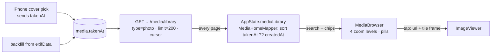

# media-page — spec
> lg · child 1 of media-home-remake (`docs/features/media-home-remake/PROGRAM.md`) · ticket none

## Idea

**Why.** In the UI 2.0 iPhone shell, tapping **Media** in Home's TopNav opens an empty page
(`UI2Shell.swift:222`, "SPEC D10: Library…Media are unwired"). Leaders have no way to browse their
organization's photos in the new app. This child gives them the Media page: the shell's TopNav and
TabBar around a search field, filter chips and **MediaBrowser**, a Photos-style zoomable grid.
Tapping a photo opens it in **ImageViewer**.

**What success looks like.** A leader opens Media and lands at the newest photos at 5 columns. They
pinch out through ~8, ~13–15 and 30+ columns: month labels appear, then year labels, and the
photo under their fingers stays put. Flicks and drags feel instant. They search, narrow by tags,
leaders and time, tap a photo, view it, and drag it back into its tile. A photo they took in June
and picked on the iPhone today sits in June.

**In your words.**
- "Now let's remake the Media page so that it has: topnav, search + filters, ImageViewer, bottom nav" → D1, D11.
- "It responded well to flicks and dragging, very responsive" → D15.
- "for the previews of the component, use all the images I uploaded as examples. I would like at least one preview per major zoom level" → D11.

**The concept.** The page loads the whole photo library from the paged library endpoint, pages
fetched one after another until none remain. It sorts and filters on the phone and hands the
result to MediaBrowser.

**How it fits today.** Photos upload through `POST …/media/upload`, which re-encodes them to a
1200 px original, a 400 px `-md` copy and a 150 px `-thumb` copy (`media.ts:1207`). It reads EXIF
from the posted bytes (`media-metadata.ts:105` → `exifData.dateTaken`). exif-reader drops the
offset, so the camera's wall-clock time is stored labelled as UTC. Every iPhone path re-encodes a
`UIImage` before posting, so no iPhone upload has ever carried a date taken. That covers
`MediaActions.swift:340`, `APIClient.uploadImage` and `saveCover`. The web re-encodes through a
canvas too (`image-upload.ts:13`). Dev has 30 photos, and 2 of them have `exifData`. In the 2.0
app, photos reach the library only as **covers**: the group and program `cover-image` routes call
`captureToLibrary` (`groups.ts:1316`, `programs.ts:3954`). `uploadPhoto` has no compiled caller.
The paged library endpoint (`media.ts:1091`, `media-library.ts:320+`) already returns
`tags: string[]` and `uploader {id,name,email}`, and pages by a keyset cursor on `createdAt|id`.
AppState already holds the library (`mediaLibrary` EntityStore, cursor, total), and `MediaActions`
pages it 100 at a time. The shell draws the TopNav and TabBar, and `UI2Section.media` exists. The
section switch's `default:` needs a `case .media:`, and the shell must let this one section own
its scroll (D16). Search, chips and filter menus are built components (C-034, C-035, C-036),
composed inside d2m screens as on members-home and enrollments-home. ImageViewer
(`UI2/Containers/Shared/ImageViewer.swift`) already opens from a source frame and flies back into
it.

**Approaches considered.** Chosen: load every page and filter on the phone. Chip taps are
instant, and the server needs nothing new beyond one field. Rejected: filtering on the server,
where every chip tap waits on a round trip and a reload. Also rejected: the unpaged
`GET /organizations/:id/media`, which would need tags and sorting added to an endpoint the iPhone
doesn't use, and which returns one large response.

## Apps

| App | In scope | What changes | Section |
|---|---|---|---|
| server | ✅ | `Media.takenAt` + backfill; upload and both cover routes accept `takenAt`; `captureToLibrary` stores it; the library list returns it; fixtures layer | §server |
| client | ⬜ | The web app has no UI 2.0 Media page. Its photo uploads re-encode through a canvas (`utils/image-upload.ts:13`), which strips EXIF, so they store `takenAt = null` and sort by upload date. Its library store (`leader-library.store.ts:223` `mapMedia`) copies named fields only, so the new item field is ignored. No client change | — |
| iphone | ✅ | Group and program cover picks send the capture date; `MediaActions.loadAllPhotos`; the media-home container + mapper; the Home `.media` section with its own scroll; ImageViewer opened from a tile | §iphone |

**Sequencing:** contract settled → server builds and verifies (the contract freezes) → the owner
commits `docs/ui2/references/media-browser.md` (B1) → the d2m design exists (D11: the MediaBrowser
row specced and built, then media-home specced and built as `MediaHomeScreen.swift`) → the iPhone
builds against the frozen contract → the walk.

**Backward compatibility:** every change is additive. A released iPhone build doesn't send
`takenAt`, so its uploads fall back to EXIF (none), then to the upload date. It ignores the new
`takenAt` on library items. The library's order, cursor and filters are unchanged (D2). The cover
routes' bodies are plain `z.object`, so an absent `takenAt` changes nothing.

**Blast radius:** `media.takenAt` is read only by the new page. The library endpoint's other
consumers (the 1.0 Media tab, web Library) receive one extra field. Every Media create that writes
`exifData` also writes `takenAt` through `parseTakenAt`: the upload photo branch (`media.ts:1239`)
and `captureToLibrary` (`media-library.ts:171`, called by the group and program cover routes). The
offline `scripts/backfill-media-ai-enrichment.ts:79` also writes `exifData`. It is out of scope:
the migration's backfill covers its rows.

## Decisions

<!-- The one place rulings live. Record the DECISION — and, in one line, why, and why the rejected option lost. A stated preference
     is the INPUT to a row, not the row. Write each Ruling as something later code can be checked
     against without re-interpretation:
       · positive and specific — "store the full number, mask at render", not "don't truncate"
       · scope named — which apps, screens or endpoints it binds
       · "etc." / "and so on" expanded into the list, or the test for membership stated
       · the rejected alternative named, with the reason it lost (check-obligations warns on a bare one)
       · the enforcement hook, where one exists (lint rule, script, test)
     🔴 NEVER quote the user's prompt as the ruling. Operationalize it: a closed list, a measured
     value, an enumerated set of deviations. A ruling a stranger could implement two ways is not
     written yet.
     Who/date carries the provenance, so the Ruling itself needs no quote marks.
     The owner's own words go in §Idea "In your words", linked to this row — never in the Ruling.
     OPEN rows block the build go-ahead. Never delete a ruling; supersede it in place with a date. -->

| # | Decision | Ruling | Who / date |
|---|---|---|---|
| D1 | Page composition | Home's `.media` section renders `MediaHomeContainer`, which feeds the d2m-built `MediaHomeScreen`. That screen composes C-034 SearchField, a row of C-035 FilterChip (Tags, Leaders, Time; menus in C-036 FilterMenuOverlay) and MediaBrowser, inside the shell's existing TopNav and TabBar. The page draws no nav of its own. The container supplies options and `onSave*` callbacks only. Rejected: ImageViewer alone as the body (nothing to browse) | Luke 2026-10-30 (program P1) · auto (recommended) 2026-10-31 (composed in the d2m screen) |
| D2 | Loading | `MediaActions.loadAllPhotos(pageSize: 200)` fetches `GET /api/organizations/:orgId/media/library?type=photo&limit=200`. It then follows `nextCursor` until `hasMore` is false, writing each page into `AppState.mediaLibrary` as it arrives: page 1 replaces, later pages append. The first request runs the server's page mode (adds `total`), and the later ones are cursor pages. Before each write it checks `Task.isCancelled` and that the org and session generation are unchanged. It takes `onUnauthorized`. Sorting, search and chips run on the phone over the loaded list, in a pure `MediaHomeMapper`. The server's order and cursor are unchanged, and the phone sorts by `takenAt ?? createdAt` ascending (ties by `id`). Rejected: a reload with server filters on every chip tap (a round trip per tap); the unpaged `GET /organizations/:id/media` (no tags, one large response). *The phone sorting rather than a server `sort=taken` param is (assumed at spec) 2026-10-31: the whole list is loaded either way, and it leaves the released contract untouched.* Supersedes program P10's endpoint | Luke 2026-10-31 · (assumed at spec) 2026-10-31 · auto (recommended) 2026-10-31 (AppState + loadAllPhotos, audit F-I8/F-I9) |
| D3 | Date taken from the iPhone | **Superseded 2026-10-31 (audit F-I3):** the function the original ruling named (`MediaActions.uploadPhoto`) has no caller in the 2.0 app. In the 2.0 app, photos reach the library only as group and program covers. So: in each cover `openPicked` (`GroupDetailContainer`, `StudyProgramHomeContainer`), while the picked `Data` still exists, a pure `CaptureDate.read(from: Data) -> String?` reads `DateTimeOriginal` through ImageIO (with `OffsetTimeOriginal` when present, else the device's time zone). It formats the result as ISO 8601 with an offset. The value is carried through `ImageEditSource.newPick` into `saveCover(…, takenAt:)`, which sends optional `takenAt` in the cover-image body. A re-edit of an existing cover sends none. Everything else is still stripped, as today. When the file has no `DateTimeOriginal`, `takenAt` is omitted. `uploadPhoto` gains `sourceData: Data?` for parity, and omits `takenAt` when it is nil. The avatar route doesn't add to the library and is untouched. Rejected: stopping the stripping (location and device details would reach the server); upload date for iPhone uploads (the grid would track uploads); dropping D3 from child 1 (success criterion "taken in June sits in June" would fail for every iPhone photo) | Luke 2026-10-31 · auto (recommended) 2026-10-31 (cover path) |
| D4 | Storing date taken | New nullable `Media.takenAt` (datetime). On every create that writes media: the request's `takenAt` when it is valid, else `exifData.dateTaken`, else null. Valid = a full ISO 8601 date-time with `Z` or a numeric offset, matching `^\d{4}-\d{2}-\d{2}T\d{2}:\d{2}(:\d{2}(\.\d+)?)?(Z\|[+-]\d{2}:?\d{2})$`, that parses to a finite date no more than 24 h after the server's now and not before 1990-01-01. A date-only or offset-less string is invalid. An invalid value is ignored, never rejected. The EXIF fallback is taken as stored: exif-reader labels the camera's wall-clock time as UTC, so it can sit up to ±14 h off. Accepted because only EXIF-carrying uploads use it, and no current client sends EXIF. Backfill: `takenAt = exifData.dateTaken` where present and valid. Rejected: NOT NULL defaulting to `createdAt` (it would lose whether the date is known); re-reading EXIF as floating local time (the server has no device time zone) | (assumed at spec) 2026-10-31 · program P5 · auto (recommended) 2026-10-31 (validity regex, EXIF skew) |
| D5 | Ordering and labels | The grid runs oldest→newest by `takenAt ?? createdAt`. Month and year pills and the published date range use the same date, in the device's time zone | Luke 2026-10-30 (program P5) |
| D6 | Search | Case-insensitive substring match on title, description, each tag and the uploader's name, over the loaded list. It updates as the leader types, with no server call | (assumed at brainstorm) (program P6) |
| D7 | Chips | **Tags**: multi-select (C-036 `.multiple` with Save/Clear). Options are the distinct tags in the loaded photo list, sorted alphabetically. An item matches when it carries any selected tag (case-insensitive). **Leaders**: multi-select (C-036 `.multiple`). Options are the distinct `uploader.id`s in the loaded list, labelled and sorted by name. An item matches when its uploader is selected, and an item with no uploader matches only when this chip is empty. **Time**: single-select (C-036 `.single`): All time · Last 7 days · Last 30 days · Last 90 days. Each is applied to `takenAt ?? createdAt` with cutoff = start of today in the device time zone minus (N−1) days, re-evaluated on each render (`today`/`timeZone` passed into the mapper). Chips combine with AND, and a chip with nothing selected filters nothing. No Type chip. Rejected for Tags: options from `GET /api/media/tags`, which resolves the org from the user rather than the page's `:organizationId` (another org's tags) and counts every media type (options with no photo) | Luke 2026-10-30 (program P6, P8) · (assumed at spec) 2026-10-31 (Leaders options, AND) · auto (recommended) 2026-10-31 (Tags options from the list, Leaders by id, Time cutoff — audit F-S7/F-I17/F-I18) |
| D8 | Photos only | The page requests `type=photo`, so no video or audio item reaches the grid. Group and program covers (`source: auto_capture`) are photos in the org library and are included | Luke 2026-10-30 (program P7, P8) · auto (recommended) 2026-10-31 (covers included, audit F-S10) |
| D9 | Zoom levels and grid behaviour | MediaBrowser per program P3 and `docs/ui2/references/media-browser.md` §2: four levels (5 · ~8 · ~13–15 · 30+ columns), crossfade anchored on the pinch, sticky month and year pills with push-off. The page opens at 5 columns at the newest end. A search or chip change keeps the level and scrolls to the newest end of the result. Pages arrive newest-first while the grid runs oldest-first, so the grid is **bottom-anchored**: items inserted above the viewport leave the visible tiles where they are | Luke 2026-10-30 (program P3) · (assumed at spec) 2026-10-31 (opening, filter change) · auto (recommended) 2026-10-31 (bottom anchoring, audit F-I11) |
| D10 | Tile images | At 5 columns a tile loads the `-md` copy, but only when `url` ends in `.jpeg` (`.jpeg` → `-md.jpeg`). At ~8 columns and denser it loads `thumbnailUrl` (`-thumb`, 150 px). A `url` without `.jpeg`, a null `thumbnailUrl` or a failed `-md` load falls back to `thumbnailUrl ?? url`. A tile that isn't loaded shows the dark placeholder | (assumed at spec) 2026-10-31 · auto (recommended) 2026-10-31 (fallbacks, audit F-S9/F-I19) |
| D11 | Design comes from d2m first | Before the iPhone phase: MediaBrowser is created and built as a d2m component from the reference doc. Its previews (at least one per level) use only the 13 owner-uploaded portraits in d2m's image catalog (`barry-allen` … `wade-wilson`). media-home is specced by `/d2m:screen:spec media-home` from the requirements "topnav, search + filters, MediaBrowser, bottom nav" and built by `/d2m:screen:build`. The build wires the built screen; it does not invent a layout. The iPhone phase gets these through the d2m channel (`request_project_change` → `wait_project_change`), never by writing under `iphone/MakeReadyUI/`. The MediaBrowser brief carries D10, D18 and D9's bottom anchoring. Rejected: building the UI without a d2m design (bypasses the design system) | Luke 2026-10-30 (program P2, P4) · auto (recommended) 2026-10-31 (command name, channel route) |
| D12 | Viewer | Tapping a tile opens `ImageViewer(url: item.url, sourceFrame: <the tile's global frame>, accessibilityLabel: item.displayTitle, onClose:)`. **Hosting superseded 2026-10-31 (audit F-I12):** it is presented through the shell's `.ui2OverlayHost()`, generalising `coverViewerPresentation`, so it draws above the TopNav and TabBar. It opens only after any C-036 menu has finished dismissing. The open flight starts from the tile's already-loaded `-md`/thumb image, not a spinner, and swaps to `url` when that has loaded. The tile draws blank while the viewer is open. The grid doesn't scroll or change level until it closes, and pages that arrive meanwhile are buffered and applied on close. One item at a time; paging is child 2. Rejected: hosting inside the section (it renders under the floating TopNav and the TabBar layer) | Luke 2026-10-30 (program P1, P9) · auto (recommended) 2026-10-31 (hosting, seeded flight, buffering) |
| D13 | States | Loading, empty (no photos), no results (filters exclude all) and load-error states follow the media-home spec d2m writes (D11). Until it names them: loading = MediaBrowser placeholders; no results = a one-line message with a clear-filters action. A failed page load goes to `recordError(surface: false)` plus the screen's error state, with the loaded pages kept and an inline retry that resumes from the cursor. A failed pull-to-refresh (the leader's own action) goes to `recordError(surface: true)`. Rejected: the banner for a background load (house rule: surface only the user's own action) | (assumed at spec) 2026-10-31 · auto (recommended) 2026-10-31 (error routing, audit F-I15) |
| D14 | Fixtures | A new `server/fixtures/screens/media-home.ts` layer adds 360 photo rows to the fixture org. They reuse the `url`/`thumbnailUrl` of the base layer's `source: 'direct'` library rows, cycled. Their `takenAt` spreads over the last 3 calendar years from `ctx.now`, with month-to-month gaps, and 20 rows have no `takenAt` (they sort by `createdAt`). Tags and two uploaders (Fixture Leader `FIXTURE_USER_ID`, Nathan Hughes `FIXTURE_LEADER_USER_ID`) vary, so every chip has results. Rows take `fixtureId('media', 1000 + i)`. Tags take a new fixture kind `mediaTag: '001c'`, listed in the README's §Fixed IDs. The layer is skipped under the same image switches as `placeProgramCovers` (vitest, no storage configured) | (assumed at spec) 2026-10-31 · auto (recommended) 2026-10-31 (ids, URL reuse, skip rule) |
| D15 | Responsiveness | At every level: drags track the finger, a flick moves on its first frame, and no frames drop while tiles load. Decoding and network stay off the main thread. Checked on a physical device at each level, with the fixtures loaded. That check is the owner's: an agent walk on a simulator records it as **device check pending**, never as a pass | Luke 2026-10-30 (program P11) · auto (recommended) 2026-10-31 (owner step, audit F-I20) |
| D16 | Media owns its scroll | `HomeSectionLayout` lets a section opt out of `SectionPageScroll` (a per-section flag), and `.media` takes it. MediaBrowser's scroll then drives the TopNav morph as the page scroll does for other sections. Pull-to-refresh at the newest end calls `loadAllPhotos` (D2). Every other section is unchanged. Rejected: nesting the grid inside the shell's ScrollView (a bottom-anchored, pinch-zoomed grid with pinned pills can't nest in a vertical page scroll) | auto (recommended) 2026-10-31 (audit F-I6) |
| D17 | Load once per session | On open, the container shows what `AppState.mediaLibrary` already holds at once. It runs `loadAllPhotos` only when this session has not completed one for the current org, or on pull-to-refresh. The task is cancelled on `onDisappear`, and an org switch clears the store (`clearInMemory`). Rejected: re-paging the whole library on every open (the section view is re-created on each switch, `.id(model.section)`) | auto (recommended) 2026-10-31 (audit F-I10) |
| D18 | Image loading budget | MediaBrowser reports its visible plus prefetch range (a callback in its d2m contract). The container loads only that range, concurrently and off the main thread, downsampled to tile pixel size, into a bounded cache with eviction. Rejected: seeding every tile through `UI2ImageLoader` into the unbounded main-actor `Ui2ImageCache` (memory grows without limit, and D15 fails) | auto (recommended) 2026-10-31 (audit F-I14) |

## Contract

| Contract | Producer | Consumers | Auth | Request | Response | Errors |
|---|---|---|---|---|---|---|
| `GET /api/organizations/:organizationId/media/library` | server | iphone (`MediaActions.loadAllPhotos`) | session; `requirePermission('media.read','organization',:organizationId)` | unchanged; the page uses `type=photo`, `limit=200` (uncapped server-side), `cursor` | each item + `takenAt` (ISO 8601 string or null), alongside the existing `url`, `thumbnailUrl`, `title`, `description`, `tags: string[]`, `uploader {id,name,email}?`, `createdAt`; `hasMore`, `nextCursor` unchanged; the first, cursor-less page also carries `total/page/totalPages` | unchanged |
| `POST /api/groups/:id/cover-image` | server | iphone (`GroupActions.saveCover`) | session; group manage filter (unchanged) | + optional `takenAt` (ISO 8601 string) beside `imageData`, `contentType`, `framing`, `originalData` | unchanged; the library row `captureToLibrary` creates carries `takenAt` (D4) | unchanged; an invalid `takenAt` is ignored (D4), never a 400 |
| `POST /api/programs/:id/cover-image` | server | iphone (`ProgramActions.saveCover`) | session; program mutation filter (unchanged) | + optional `takenAt`, as above | unchanged; the library row carries `takenAt` | unchanged; an invalid `takenAt` is ignored |
| `POST /api/organizations/:organizationId/media/upload` | server | iphone (`MediaActions.uploadPhoto`, parity; no 2.0 caller) | session; `media.create` | + optional `takenAt` (ISO 8601 string) beside `type`, `title`, `imageData` | unchanged; the created media now carries `takenAt` | unchanged; an invalid `takenAt` is ignored (D4), never a 400 |

## Schema & API changes

| # | Change | Model.field | Wire | Reason | Status |
|---|---|---|---|---|---|
| SC1 | ADD | `Media.takenAt` (datetime, nullable) | library items `takenAt` | the date the photo was taken (D4) | landed — migration 20261031055111_media_taken_at (a6bd6398) |
| SC2 | EDIT | upload body (`uploadMediaSchema`) | `takenAt?` | parity with the cover routes (D3) | landed — ffe36c8e |
| SC3 | EDIT | group and program `cover-image` bodies | `takenAt?` | the 2.0 iPhone sends the capture date of a picked cover (D3) | landed — d404184e |

**Data plan:** SC1 is a nullable column added by an Atlas migration generated from
`server/schema/schema.yaml`. The same new, uncommitted migration backfills it with a guarded cast,
so a malformed value can't fail the migration:
`UPDATE "media" SET "takenAt" = CASE WHEN "exifData"->>'dateTaken' ~ '^\d{4}-\d{2}-\d{2}T\d{2}:\d{2}:\d{2}' THEN ("exifData"->>'dateTaken')::timestamptz END WHERE "takenAt" IS NULL AND "exifData" ? 'dateTaken'`.
A second statement then nulls values outside 1990-01-01 … now() + 24 h. Existing rows are
otherwise untouched; it's undone by dropping the column. SC2 and SC3 are body-only and independent.

## server

- `schema.yaml`: add `takenAt: {type: datetime, nullable: true}` to `Media` beside `exifData`.
  Generate the migration without dotenv: `npm run schema:generate`, then
  `cd atlas && ../scripts/atlas.sh migrate diff --env local --var database_url=…makeready_dev`.
  Don't use `npm run schema:diff`: it reads server/.env, the 1Password pipe. Append the backfill
  (§Data plan) to the new, uncommitted migration, run `atlas migrate hash`, and commit both. The
  precedent is `20261027064150.sql`.
- `parseTakenAt(input, exifData, now)` in `services/media-metadata.ts`: the D4 rule, pure and unit-tested.
- `captureToLibrary` (`media-library.ts:136`) takes optional `takenAt` and sets the row's
  `takenAt` through `parseTakenAt(params.takenAt, params.exifData, now)`. The group and program
  cover routes add `takenAt: z.string().optional()` to their body schemas and pass it through. The
  upload photo branch (`media.ts:1220`) sets `takenAt` the same way: `uploadMediaSchema` (`:1171`)
  gains optional `takenAt: z.string()`, and the route destructures it (`:1194`).
- The library list returns `takenAt` with no mapping change (`mapRow` spreads the row,
  `media-library.ts:399`); a test asserts it.
- Fixtures: the `media-home` layer (D14), registered like the other screen layers.

## iphone

- **Cover capture date (D3):** `CaptureDate.read(from: Data) -> String?` (pure, unit-tested) is
  called in each cover `openPicked` while the `Data` exists. It is carried via
  `ImageEditSource.newPick` into `GroupActions.saveCover` / `ProgramActions.saveCover`
  (`takenAt:`), which add it to the body. `uploadPhoto` gains `sourceData: Data?`.
- **Model:** `MediaLibraryItem` gains `var takenAt: Date?`, decoded if present (`.iso8601`, the
  same as `createdAt`). `sortDate` is computed: `takenAt ?? createdAt`. `PersistedState` round-trips it additively.
- **State (house rule):** `AppState.mediaLibrary` (EntityStore) holds the items, written by
  `MediaActions.loadAllPhotos(pageSize: 200)` (D2). It adds no new store type. A pure
  `MediaHomeMapper.output(items:selection:today:timeZone:)` derives the sorted, filtered list,
  the Tags and Leaders options (D7), tile URLs (D10) and pill data. `@State Selection` holds the
  search text and chip picks. The container pattern is `MembersHomeContainer` (Mapper, Selection,
  `.pageRefresh`, `onDisappear` cancel, `onUnauthorized`), and the loading/failed state is
  `EnrollmentsHomeContainer`.
- **Shell:** `UI2Shell.sectionContent` replaces the `default:` fall-through for media with
  `case .media: MediaHomeContainer()`. `HomeSectionLayout` gains the per-section scroll opt-out
  (D16). No deep link targets Media, and the TopNav `+` for Media stays a no-op.
- **Container:** `MediaHomeContainer` maps AppState onto the d2m-built `MediaHomeScreen` (D11). It
  presents ImageViewer through the overlay host (D12) and drives the image loading budget (D18).
- **MediaBrowser** is the d2m-built component (D11). The container supplies items (id, tile URLs
  per D10, sort date) and receives taps with the tile's global frame plus the visible range. It
  hides the open item's tile.

## Testing

- **server (vitest):** `parseTakenAt` — a valid body value with `Z` and with an offset; invalid
  values ignored (date-only, offset-less, garbage); the out-of-bounds dates; EXIF fallback; null.
  Request tests: upload stores `takenAt` from the body and from EXIF. A group cover and a program
  cover with `takenAt` store it on the captured library row. The library list returns `takenAt`.
  A migration test (pattern `test/directory-access-migration.test.ts`) asserts the ADD COLUMN, the
  guarded backfill after it, and the atlas.sum hash.
- **iphone (XCTest):** `CaptureDate.read`, covering a dated JPEG, a dated HEIC, no date and an
  offset present. `MediaLibraryItem` decodes `takenAt` as `.000Z`, as `null` and absent. Mapper
  sorting and filtering (D5–D8, including Leaders by id, the no-uploader rule, Time cutoffs across
  a time zone, and the D10 URL fallbacks). The paging loop follows `nextCursor` until `hasMore` is
  false, keeps loaded pages on an error, and stops writing after cancellation or an org change.
- **Cross-app E2E (verify, once):** the fixtures reset, sign in as Fixtures, open Media. Every photo
  loads, ordered by date taken. Pinch through the four levels. Each chip and search narrows the
  grid. Tap a photo, then dismiss it into its tile. Pick a dated photo as a group cover, and its
  library copy appears under its taken month.
- **Human walk (iPhone, dev env, Fixtures identity):**
  1. Media opens at 5 columns on the newest photos, and the header shows their date range.
  2. Pinch out to ~8, ~13–15 and 30+ columns: month pills, then year pills, stick and push. The photo under your fingers stays put.
  3. Flick and drag at each level. It should feel instant (D15, on a device — the owner's check).
  4. Search a tag word. Pick Tags, Leaders and Time chips: each narrows; clearing restores.
  5. Tap a photo: it grows from the tile; drag down and it flies back into the same tile.
  6. Pick a photo taken in another month as a group's cover, then open Media. Its library copy lands in that month, not this one.

## Out of scope

- Videos, the Type chip and sideways swiping in the viewer (child 2, viewer-paging-video).
- Audio on this page (program P7).
- A server-side sort or search for the page (D2), and server paging changes.
- Select mode, uploading from this page, remembering the zoom level between launches.
- The web client's UI.
- **What this replaces:** in the 2.0 build, this page replaces the 1.0 Library → Media tab
  (`MainLibrary.swift`, `MediaDetailOverlay.swift`, not compiled into the 2.0 app). The following
  are dropped on purpose for child 1: sort options (newest, most used, title), delete, editing a
  photo's title, description or tags, the usages list, saved filter preferences, server-side
  search. Each is a later child or a stated loss (decider: auto (recommended) 2026-10-31, for the
  owner to confirm at the walk).
- `scripts/backfill-media-ai-enrichment.ts` (offline; the migration backfill covers its rows).
- `GET /api/media/tags` — no longer used by this page (D7).

## Findings & risks

| # | Finding | Resolution |
|---|---|---|
| B1 | ~~blocked~~ resolved: `docs/ui2/references/media-browser.md` — the doc D9, D11 and program P2/P3 spec MediaBrowser from — was only an uncommitted file in the owner's main checkout at audit time | resolved 2026-10-31: committed to `main` in 2c807640 and merged into this branch (60f2d5eb); byte-identical to the owner's file, §2 (the rules D9 cites) present |
| F1 | contract: the 2.0 iPhone app's only path into the media library is cover upload; `uploadPhoto` has no compiled caller (`BlockStyleEditor.swift:291` is in the pbxproj but not Sources). D3 as first written changed no reachable upload | D3 superseded (cover path); §Contract + SC3 gain the two cover-image rows; pass 2 confirmed both bodies are plain `z.object` (`groups.ts:1272`, `programs.ts:3912`), so the field is additive |
| F2 | contract (tenancy): `GET /api/media/tags` has no permission check, resolves the org from the user (`getUserOrgId`, `media-library.ts:107`) not `:organizationId`, and counts every media type; its shape is `{tags:[{tag,count}]}` | D7: Tags options from the loaded list; row removed from §Contract |
| F3 | schema: `exifData.dateTaken` is a JS `Date` from exif-reader, the camera wall-clock labelled UTC (`node_modules/exif-reader/index.js:195`), stored as an ISO string; the backfill cast works but a malformed value in WHERE could fail the migration | D4 accepts the skew; §Data plan uses the guarded `CASE` |
| F4 | house-rule: `npm run schema:diff` / `migrate:apply` read server/.env through dotenv (`package.json:33`) | §server names the atlas `--var database_url` route; the precedent for appending to a fresh migration + `atlas migrate hash` is `20261027064150.sql` |
| F5 | house-rule: the spec's "media-home store" duplicated `AppState.mediaLibrary` (`AppState.swift:122`), which already holds the library | §iphone corrected: AppState + pure mapper + `@State Selection` |
| F6 | gap: `MediaActions` pages 100 at a time with no loop, no 401 hook and no stale-session guard (`MediaActions.swift:42-170`); a sign-out mid-loop would write into the cleared AppState | D2: `loadAllPhotos` with the guards; tested |
| F7 | gap: every Home section renders inside the shell's ScrollView (`HomeSectionLayout.swift:44`); the grid can't nest in it | D16 |
| F8 | gap: no load-once rule, and the section view is re-created on every switch (`HomeSectionLayout.swift:45`) | D17 |
| F9 | gap: newest-first pages into an oldest-first grid shift the viewport, and pages arrive while the viewer is open | D9 bottom anchoring + D12 buffering; mapper/scroll test "insert above → visible offsets unchanged" |
| F10 | gap: hosting ImageViewer inside the section puts it under the TopNav and TabBar (`CoverViewerOverlay.swift:14`), and the open flight waits on the 1200 px download (`ImageViewer.swift:81`) | D12 superseded (overlay host, seeded flight) |
| F11 | gap: `Ui2ImageCache` is unbounded and main-actor, and `UI2ImageLoader.seed` is sequential (`Ui2ImageCache.swift:28`, `UI2ImageLoader.swift:21`) | D18; carried into the MediaBrowser d2m brief |
| F12 | gap: D10's `-md` derivation fails for URL-registered rows (`media.ts:1399`, `content.ts:48`), whose `url` may not end in `.jpeg` and whose `thumbnailUrl` may be null | D10 fallbacks |
| F13 | gap: D7 left Leaders' same-name and no-uploader cases, and Time's cutoff and time zone, open | D7 refined |
| F14 | gap: covers (`source: auto_capture`) are `type=photo` and reach the grid | D8: included |
| F15 | gap: D13 routed a background load to the surfaced banner (iphone CLAUDE.md §Error Handling) | D13 corrected |
| F16 | stale-spec: the d2m command is `/d2m:screen:spec`, not `:create`; d2m's media-home row note scopes it to "curriculum assets … (legacy MainLibrary Media)", which this page is | D11 corrected; the row note is compatible |
| F17 | stale-spec: the replaced 1.0 Media tab's capabilities were not enumerated | §Out of scope lists them as dropped on purpose |
| F18 | stale-spec: `mapRow` spreads every column (`media-library.ts:399`), so the list returns `takenAt` with no code; `captureToLibrary` is the single writer behind both cover routes | §server corrected |
| R1 | build-time risk: d2m has no MediaBrowser row, and media-home is `queued, specced: false` (d2m `get_screen media-home` → `buildBlockedReason: no spec`; it has a design-4 PNG and `buildPath Screens/Media/MediaHomeScreen.swift`) | settled by the iPhone phase's first task: request MediaBrowser, then media-home, through the d2m channel (D11) and wait; after B1 |
| R2 | build-time risk: D15's physical-device check can't run on an agent walk's headless simulator | settled by the owner's device check after merge; the agent walk records it as pending (D15) |
| R3 | build-time risk: the fixtures layer depends on the base layer's library images; under vitest or with no storage it is skipped and Media is empty. The walk env has storage (s3mock) | settled by the fixtures task: assert the `full` scenario yields 360 rows in the walk env |
| R4 | build-time risk: `PersistedState` caps persisted media at the 100 newest by `createdAt` (`PersistedState.swift:205`), so a cold launch shows a partial grid until `loadAllPhotos` finishes | settled by the container task: the first paint after a cold launch shows the loading state until page 1 lands, or the partial set bottom-anchored |

## Plan

The plan, with its code: `docs/features/media-page/PLAN.md` (§PLAN.md).

- Phase 1 · Task 1 · `Media.takenAt` column + guarded backfill
- Phase 1 · Task 2 · `parseTakenAt` + the upload route and `captureToLibrary` store it
- Phase 2 · Task 3 · Cover routes accept `takenAt`; the library list returns it
- Phase 2 · Task 4 · `media-home` fixtures layer — and the contract freeze
- Phase 3 · Task 5 · Cover picks send their capture date
- Phase 3 · Task 6 · `MediaLibraryItem.takenAt` + `MediaActions.loadAllPhotos`
- Phase 3 · Task 7 · `MediaHomeMapper` — order, search, chips, tile URLs
- Phase 4 · Task 8 · d2m designs and builds MediaBrowser and media-home
- Phase 5 · Task 9 · Media owns its scroll — the section opt-out and a shared morph rule
- Phase 5 · Task 10 · Tile image budget + ImageViewer seeded flight
- Phase 5 · Task 11 · `MediaHomeContainer` — Home's Media section

## Fixes

- [x] iphone: walk 3 — pull past the newest end to refresh, switch section and back — expected Media reloads and the oldest photos are still there, saw the app crash ~0.1s after release: `MediaBrowserLevelGrid.tileRow` (iphone/MakeReadyUI/MediaBrowser.swift:328) builds `first..<last` with first > last when `items` shrinks (388 → 200 on refresh page 1) while the mounted row `window` still points near row 77 (agent walk round 1)
- [x] iphone: walk 1 — Tags baptism → Save, then outreach → Save — expected the grid shows outreach's photos and month pills, saw the app crash on the first Save, the same `tileRow` range assertion (388 → 60 items under a stale window) (agent walk round 1)
- [x] iphone: walk 9 — Media opens at 5 columns on the newest photos with their date range in the header — expected the header range of the photos on screen (~Oct 7 – Nov 1, 2026), saw `Jul 24 – Nov 1, 2026` (and `Dec 8, 2023 – Oct 7, 2024` at the top while only Dec 2023 – ~Mar 2024 shows): the header is fed `onVisibleRangeChange`, which carries a one-viewport prefetch margin each way (MediaBrowser.swift:304-309) (agent walk round 1)
