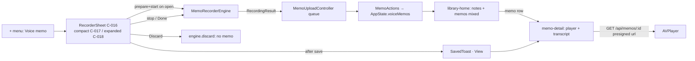

# memo-screens — spec
> md · ticket: none · the voice-memo screens on the memo engine: + menu recorder sheet, memos in Library, memo page

## Idea

**Why.** A leader's thinking happens out loud, in the car or after a meeting, and MakeReady has
nowhere to catch it. The memo engine (`feature/memo`) records, transcribes and stores memos, but no
screen uses it: the TabBar Add (+) menu's "Voice memo" item does nothing.[^1] This spec adds the
screens. Tap + → Voice memo anywhere and the recorder is already running. Finish, and the memo is
in your Library with its transcript, private to you.

**What success looks like.**
- A leader taps + → Voice memo from any tab, talks, taps Done, and stays where they were. A toast confirms the memo is saved.
- The memo appears in Library among their notes, newest first, showing its duration and the first words of its transcript.
- Tapping the memo opens a page with a player and the full timestamped transcript.
- Nobody else in the org can see it.

**In your words.**
- "we don't have a dedicated memo section of the app, the user will tap "voice memo" from the add button on the bottom nav and it will open a modal that starts the recording" (owner 2026-11-21) → D2, D3
- "The recordings will transcribe and save the audio into the group leader's library" (owner 2026-11-21) → D5
- "it's only available to the group leader, nobody else in the org" (owner 2026-11-21) → D9

**The concept.** d2m builds every view from the Voice Memos reference video, as translated by
`analysis/screens-brief.md`. This spec wires those views to the engine already on `feature/memo`:

**How it fits today.**
- **The engine** is merged on `feature/memo`:[^2]
  - `MemoRecorderEngine` exposes `prepare(title:)/start/pause/resume/stop`, publishes `samples`, `elapsed` and `state`, and has no discard.
  - `MemoTranscriber` transcribes live on device.
  - `MemoUploadController` is the offline queue.
  - `MemoActions` has `loadMemos(q:)`, `loadMemo(id:)`, `rename`, `softDelete` and `memoCompleted`, and keeps `AppState.voiceMemos` up to date.
- **The server** scopes `/api/memos` to `userId`, and another user's id gets 404. It falls back to Groq for transcription.
- **The + menu** wires "Write a note" through `NoteEntry`; "Voice memo" only closes the menu.[^1]
- **Library** (`library-home`) is the notes list in date sections, built as an ordered list of sections so other content can join it.[^3]
- **The registry** holds the memo rows C-004, C-006, C-007, C-011–C-014 and C-016–C-018, all `no-figma`, unbuilt and sourced from the old DECISIONS §4b.[^4]
- **What's missing:** there is no toast component in UI 2.0.
- **Info.plist** has only the `remote-notification` background mode. Engine D27 left `audio` to this spec.[^5]

**Approaches considered.** Chosen: the video's two-detent recorder, memos mixed into Library, and a
pushed memo page. Rejected:
- a full-screen-only recorder, because it covers the screen you were on;
- a compact-only recorder, because it's cramped for pause and long memos;
- a Notes | Memos switch, because it's an extra control and you have to know which side to look on;
- a separate memos block, because its "See all" brings back a memo section;
- the video's player inside the row, because it's odd in a mixed list and puts the transcript a step away;
- a row player plus a page, because it's two surfaces to build.

[^1]: iphone/MakeReady/UI2/Shell/UI2Shell.swift:27-32,96-104
[^2]: feature/memo: iphone/MakeReady/Services/Audio/MemoRecorderEngine.swift:20-184 · State/Actions/MemoActions.swift:23-99 · docs/features/_archive/memo/SPEC.md D8, D19
[^3]: iphone/MakeReadyUI/Screens/Library/LibraryHomeScreen.swift:13-16
[^4]: docs/ui2/design-system/registry.md:116,134,135,174,175,186,187,194-196
[^5]: iphone/MakeReady/Info.plist:119-122 · memo SPEC D27

Reference material: `analysis/screens-brief.md` (this spec's brief to d2m), and on `feature/memo`
`docs/features/_archive/memo/analysis/01-video-analysis.md` (measurements) and `SPEC.md` (the engine).

## Apps

| App | In scope | What changes | Section |
|---|---|---|---|
| server | ⬜ | No change. `/api/memos` (list with `q`, detail with a presigned audio `url`, rename, delete) already serves every screen here, scoped to `userId` (engine D8, D17, D31) | — |
| client | ⬜ | No web memo surface in v1 (engine D19). No web code calls `/api/memos` | — |
| iphone | ✅ | Wire d2m's recorder sheet, Library memo rows, memo-detail and SavedToast. `MemoRecorderEngine.discard()`, a memo player, Library's merged list and search, + menu entry, `audio` background mode | §iphone |
| capture | ⬜ | d2m writes its own preview fixtures. No capture-tool change | — |

**Sequencing:** d2m builds the views (D1). The owner approves the captures. Then the iPhone wiring
runs on `feature/memo` and is followed by the walk. There's no producer phase, so the contract stays `none`.

**Backward compatibility:** the released 2.0.0 build doesn't contain this code. It keeps the inert
menu item. The server is unchanged.

**Blast radius:**
- `library-home`'s list model gains memo rows, and the notes container's search now also queries memos.
- `UI2Shell`'s + menu handler gains one case.
- Info.plist gains `audio` in `UIBackgroundModes`.

## Decisions

<!-- The one place rulings live. Record the DECISION — and, in one line, why, and why the rejected option lost. A stated preference
     is the INPUT to a row, not the row. Write each Ruling as something later code can be checked
     against without re-interpretation:
       · positive and specific — "store the full number, mask at render", not "don't truncate"
       · scope named — which apps, screens or endpoints it binds
       · "etc." / "and so on" expanded into the list, or the test for membership stated
       · the rejected alternative named, with the reason it lost (check-obligations warns on a bare one)
       · the enforcement hook, where one exists (lint rule, script, test)
     🔴 NEVER quote the user's prompt as the ruling. Operationalize it: a closed list, a measured
     value, an enumerated set of deviations. A ruling a stranger could implement two ways is not
     written yet.
     Who/date carries the provenance, so the Ruling itself needs no quote marks.
     The owner's own words go in §Idea "In your words", linked to this row — never in the Ruling.
     OPEN rows block the build go-ahead. Never delete a ruling; supersede it in place with a date. -->

| # | Decision | Ruling | Who / date |
|---|---|---|---|
| D1 | Who builds the views | d2m specs and builds every view from `analysis/screens-brief.md` plus the memo video analysis, with no Figma ever (engine D2). The set: C-016 RecorderSheet, C-017 RecorderCompactView, C-018 RecorderExpandedView, C-011 LiveWaveformView, C-012 PlayheadWaveformView, C-004 ScrubTrack, C-014 TransportControls, C-006 MemoListRow, a new SavedToast component, `library-home`'s memo rows, and a new `memo-detail` screen. C-007 MemoInlineRowPlayer and C-013 RecordButton are not built (D4, D2), and d2m decides whether to retire them. The owner approves the captures before any wiring (owner's standing rule). This spec writes no view, contract, registry row or token. A view gap found while wiring goes back to d2m through `request_project_change`, never as an inline invention. Not hand-built: that bypasses UI 2.0 | user 2026-11-21 |
| D2 | Entry | The only way to start a memo is the TabBar Add (+) menu's **Voice memo** item, from any tab. There's no memo tab, section, list screen or floating record button (C-013 unused). Not a memo-list home like Voice Memos: MakeReady has no memo section | user 2026-11-21 |
| D3 | Recorder | Choosing Voice memo presents C-016 over the whole shell at the compact detent. It calls `engine.prepare(title:)` with `MemoActions.nextDefaultTitle` and then `start()` straight away, with no record tap. The sheet is finger-tracked between compact (C-017: title, timer, C-011, stop) and expanded (C-018: `⋯`, title + start time, C-012, big timer, pause/resume, Done). Dragging never changes the engine state, and there's no swipe-to-dismiss. Compact **stop** and expanded **Done** both call `engine.stop()`, hand the `RecordingResult` to `MemoUploadController` and dismiss. Not full-screen only (covers the screen you were on); not compact only (cramped) | user 2026-11-21 · stop = Done (assumed at brainstorm) 2026-11-21 |
| D4 | Opening a memo | Tapping a C-006 row in Library pushes `memo-detail` (new route `UI2Route.memoDetail(memoId:)`). It shows the title (tap to rename), date · duration, a C-004 scrub track, C-014 ±15 s and play/pause, and the full transcript in paragraphs led by `transcriptSegments` timestamps. Tapping a paragraph seeks there and plays, and the playing paragraph is highlighted. Not the video's in-row player: odd beside notes that push a page, and the transcript is a step away; not both: two surfaces | user 2026-11-21 |
| D5 | Memos in Library | `library-home` shows notes and memos in one list under its existing date sections. Memos sort by `recordedAt` and notes by `updatedAt`, merged newest first, using the same section rule as notes D3. A memo row (C-006) shows a mic glyph, title, duration, date label (the notes rule) and a preview slot: the transcript preview when `transcriptStatus: ready`; **Transcribing…** when `pending`; **Audio only** when `failed` or `none`; **Waiting to upload** for a memo still only in the local queue. The search box runs `GET /api/notes?q=` and `GET /api/memos?q=` in parallel and shows the merged result with the same ordering. Not a Notes / Memos switch (extra control); not a separate memos block (needs a memo list) | user 2026-11-21 |
| D6 | After finishing | On stop or Done the sheet dismisses and the user stays on the screen they recorded from. SavedToast ("Saved to Library · View") shows above the TabBar for 4 s, and **View** pushes `memo-detail` for that memo on the current tab. Not opening the memo page; not jumping to Library: both pull the user away from where they were | user 2026-11-21 |
| D7 | Discard | The expanded `⋯` menu holds **Discard recording**, which asks first ("Discard · Keep recording"). Confirming calls the new `MemoRecorderEngine.discard()`: it stops capture and the live transcriber, deletes the `.caf` and its draft manifest, enqueues nothing and dismisses with no toast. Not "always save, delete later": the recorder starts on open, so stray recordings are likely | user 2026-11-21 |
| D8 | Rename and delete | On `memo-detail`, tapping the title edits it in place: 1–120 chars after trim (engine D11). Commit on return or on leaving the field calls `MemoActions.rename`; an empty title reverts. `⋯ → Delete` asks first ("Delete · Cancel"), calls `MemoActions.softDelete`, then pops to the previous screen. The memo leaves Library in the same call (engine D39) | user 2026-11-21 |
| D9 | Who can see a memo | Only the leader who recorded it. That's already enforced: every `/api/memos` query is scoped to `userId`, and another user's id returns 404 whatever their org role (engine D8, D19). This spec adds no sharing, link or org-visible surface | user 2026-11-21 |
| D10 | Recording in the background | Add `audio` to `UIBackgroundModes` in `iphone/MakeReady/Info.plist`, so recording continues when the screen locks or the app backgrounds. This is the first build that records (engine D27). Not leaving it out: a memo would stop at lock | (assumed at brainstorm) 2026-11-21 |
| D11 | States | Microphone permission denied (engine `micPermissionDenied`): C-018's `mic-denied` state, with **Open Settings** opening `UIApplication.openSettingsURLString`, and no memo created. `speechUnavailable`: recording proceeds and the server transcribes (engine D5). The 3 h limit (`durationLimitReached`) stops and saves as Done does, with the toast. Offline: the memo is saved in the queue and shows **Waiting to upload** in Library, and `memo-detail` plays the local file. A `writeFailed` error routes through `/ios-error-surface` as a banner | (assumed at brainstorm) 2026-11-21 |
| D12 | Left out from the reference | Not built: the video's ⊕ layered take, transcript and EQ buttons on the expanded sheet; the Siri tip; Select mode; Edit Recording; folders; sharing; the memo player inside the row | (assumed at brainstorm) 2026-11-21 |
| D13 | Playback | `MemoPlayer` (new, `Services/Audio/`) wraps `AVPlayer`. It plays the presigned `url` from `GET /api/memos/:id` and re-fetches the detail when `urlExpiresAt` has passed or playback fails with HTTP 403. For a memo still in the queue it plays the local `.m4a`. It sets the audio session to `.playback` while playing and restores it on leaving `memo-detail`. It publishes `elapsed`, `duration` and `isPlaying`, and offers ±15 s seek clamped to [0, duration]. Playback stops when the memo page is popped | (assumed at spec) 2026-11-21 |
| D14 | One recording at a time | While the sheet is up, the + menu's Voice memo item is disabled. Starting a memo while a note editor is open is allowed: the sheet covers it and the editor keeps its text | (assumed at spec) 2026-11-21 |
| D16 | A memo whose `transcriptStatus` decodes as `unknown` (a status a later server adds) | OPEN — recommended: render it as `transcriptStatus: none` does — C-006 preview **Audio only**, memo-detail transcript `unavailable`, playback unaffected — because a released build must show something stable for a status it can't read; rejected: **Transcribing…**, which would promise a transcript that may never come | align 2026-11-21 |
| D15 | Where it lands | The build branches from and merges into `feature/memo`, where the engine lives. d2m's views are committed to `main` first, as notes did, then merged into `feature/memo` before the wiring | (assumed at spec) 2026-11-21 |

## Contract

No producer change. The screens consume the memo engine's existing, unchanged endpoints.

| Contract | Producer | Consumers | Auth | Request | Response | Errors |
|---|---|---|---|---|---|---|
| `GET /api/memos?q=&limit=&offset=` (existing, unchanged; `limit` 1–100, default 50; `offset` default 0) | server | iphone (library-home memo rows, merged search) | requireAuth, userId-scoped | `q` optional | `{ memos: VoiceMemoSummary[], total: number }` (iphone `MemoListResponse`) | 400 bad query, 401 |
| `GET /api/memos/:id` (existing, unchanged) | server | iphone (memo-detail, MemoPlayer) | requireAuth, userId-scoped | — | `{ memo: VoiceMemo }` with presigned `url`, `urlExpiresAt`, `transcriptSegments` | 404 not owned/absent |
| `PATCH /api/memos/:id` · `DELETE /api/memos/:id` (existing, unchanged) | server | iphone (memo-detail rename/delete) | requireAuth, userId-scoped | `{ title }` | `{ memo }` · 204 | 400 title, 404 |

## Schema & API changes

No schema change (established 2026-11-21).

**Alignment (2026-11-21).** Every field the d2m views take traced from `voice_memos` → `memos.service.ts`
(`toVoiceMemo`/`toVoiceMemoSummary`) → the wire → `MemoModels.swift` → the view input. 16 of 16 persisted
fields ALIGNED; the one wire mismatch was this spec's own §Contract row (it said `page`/`pagination`; the
server and the iPhone use `limit`/`offset` and `total`), corrected above — the app wins. The rest are
consumer-side transforms, owed as T1–T6 below:

| View input | Source | Verdict |
|---|---|---|
| C-006 `title` · memo-detail `title` | `VoiceMemoSummary.title` / `VoiceMemo.title` | ALIGNED |
| C-006 `durationLabel` · memo-detail `duration` (s) | `durationMs: Int?` ÷ 1000, formatted; queued memo: `MemoQueueItem.durationMs` | ALIGNED (transform, T2) |
| C-006 `dateLabel` · `MemoRowInput.section`/`recordedAt` | `recordedAt: Date`; queued: `MemoQueueItem.recordedAt` (ISO-8601 string, parsed) | ALIGNED (transform, T2) |
| C-006 `preview` (`transcript`/`transcribing`/`audioOnly`/`waitingToUpload`) | `transcriptPreview` + `transcriptStatus` (`none·pending·ready·failed·unknown`); queued → `waitingToUpload` | ALIGNED; `unknown` has no D5 mapping → D16 |
| memo-detail `transcript` (`paragraphs`/`transcribing`/`unavailable`), `paragraphStarts`, `paragraphTexts` | `transcriptStatus`; `transcriptSegments[].startMs` ÷ 1000, `.text`; fallback one paragraph from `transcript` | ALIGNED (transform, T3) |
| memo-detail `elapsed`, `playing`, `playerReady` | `MemoPlayer` (D13) from `url`/`urlExpiresAt`, or the queued `.m4a` | ALIGNED (new service, T4) |
| C-016/017/018 `title`, `elapsed`, `samples`, `phase` | `MemoRecorderEngine.title` (prepare), `elapsed`, `samples: [Float]`, `state` (`recording·paused`) + `micPermissionDenied` → `micDenied` | ALIGNED |
| C-018 `startTime` | not published by the engine (`Session.recordedAt` is private) | ALIGNED via container (T1): the container stamps the start instant when `start()` returns |
| SavedToast `message`, `actionLabel` | literals from D6 | DESIGN-ONLY (copy, no data) |

Where each lives when the app is closed: server memos in `voice_memos` + `AppState.voiceMemos` (disk-cached);
unsent memos as `MemoUploadController` manifests + `.m4a`; an in-progress recording as the engine's draft
manifest + `.caf` (engine D16 salvage). Playback position, the sheet's detent and the toast are session-only
by design — nothing persists without being a field (no N1 miss).

## iphone

All wiring lives under `MakeReady/UI2/` and `MakeReady/Services/Audio/`. d2m's views (D1) are used
as given.
- **+ menu:** `UI2Shell`'s add-menu handler gains `case MemoEntry.rowLabel: MemoEntry.start(...)`, which presents `RecorderSheetContainer` over the shell (D2, D3, D14). Follow the `/present-overlay` recipe; no `.sheet` or `.fullScreenCover`.
- **`UI2/Containers/Memo/RecorderSheetContainer.swift`:**
  - **It** owns the `MemoRecorderEngine` for one recording and maps `state`, `elapsed` and `samples` to C-016/017/018.
  - **Stop, Done and Discard:** stop and Done follow D3, Discard follows D7.
  - **Error states:** mic-denied and the limit stop follow D11.
  - **Toast:** it triggers SavedToast (D6).
- **`MemoRecorderEngine.discard()`** (new, D7) has its own XCTest. Everything else in the engine is unchanged.
- **`UI2/Containers/Library/LibraryHomeContainer.swift`:** merges `AppState.voiceMemos` with the notes, along with queued memos from `MemoUploadController`'s manifests (shown Waiting to upload), into library-home's sections (D5). It runs both searches and merges them. A memo row pushes `UI2Route.memoDetail(memoId:)`.
- **`UI2/Containers/Memo/MemoDetailContainer.swift`:**
  - **Loading:** `MemoActions.loadMemo(id:)`, then `MemoPlayer` (D13).
  - **Paragraphs:** built from `transcriptSegments`, or a single paragraph from `transcript` when segments are empty.
  - **Rename and delete:** D8.
- **`Services/Audio/MemoPlayer.swift`** (new, D13).
- **SavedToast** is hosted by `UI2Shell` above the TabBar (D6).
- **`Info.plist`:** add `audio` to `UIBackgroundModes` (D10).
- **Project files:** new files get explicit `pbxproj` references, then `ruby iphone/scripts/capture-targets.rb`.
- **Recipes:** `/present-overlay` (the sheet, menus and confirms), `/push-page`/`/nav-route` (memoDetail), `/ios-error-surface` (D11), `/transition-review` (the sheet's drag and the toast).

## Testing

**iphone (XCTest, `MakeReadyCaptureTests`):**
- **The engine's `discard()`:** fed an injected PCM file, it leaves no `.caf`, no draft manifest and no queue item.
- **The Library merge:** notes and memos interleave correctly across Today, Previous 7 Days and earlier months, using `recordedAt` and `updatedAt`. A queued memo shows Waiting to upload. The four preview-slot states map from `transcriptStatus`.
- **The merged search:** both results show in one ordered list, and one source failing still shows the other.
- **`MemoPlayer`:**
  - ±15 s clamps to the memo's bounds;
  - an expired `urlExpiresAt` triggers a re-fetch;
  - a queued memo plays from the local file;
  - the audio session is restored on stop.
- **The recorder container:**
  - **Stop and Done** both enqueue one result and raise the toast.
  - **Discard** enqueues nothing.
  - **Mic denied** creates no memo.
  - **Voice memo** is disabled while the sheet is up.
- **Rename and delete:** an empty title reverts, and delete removes the memo from Library.

**Walk (the dev or agent-walk env, Fixtures identity):**
1. **The engine D4 checks, on a real device** (human walk only):
   - recording has started within 200 ms of tapping Voice memo;
   - recording survives a screen lock and a 30 s background;
   - an incoming call auto-pauses it and it resumes;
   - the live transcript is final ≤ 5 s after Done;
   - the speech assets install on first use.
2. **The recorder:** + → Voice memo from the Groups tab starts the compact sheet with the timer running. Drag it up and down: the timer never resets. Pause, then resume. Done returns you to Groups, and the toast's View opens the memo.
3. **Library:** the new memo sits at the top of Today among notes. It shows Transcribing… and then the preview. Search for a word from the transcript and it's found.
4. **The memo page:** play, ±15 s, scrub, and tap a paragraph to seek. Rename the memo and Library shows the new name. Delete it and it's gone.
5. **Discard:** start a memo, `⋯ → Discard → Discard`. No toast, and nothing appears in Library.
6. **Offline:** in airplane mode, record a memo. It shows Waiting to upload and plays locally. Back online, it uploads and transcribes.
7. **Privacy:** sign in as a second leader in the same org. Library shows none of the first leader's memos, and `GET /api/memos/<first's id>` returns 404.

## Out of scope

- Linking a memo from a note and showing it in the note's context line (notes D2: no iPhone link UI in v1).
- Sharing, trimming, EQ, layered takes, folders, favourites, a dedicated memo list or tab (D2, D12).
- A web (client) memo surface (engine D19).
- Showing salvaged drafts to the user before they upload: engine D16 recovers them automatically and they appear in Library.

## Findings & risks

| # | Finding | Resolution |
|---|---|---|
| F1 | The engine's on-device behaviour (latency, interruptions, `SpeechTranscriber` assets) has never run on a device (engine F1) | build-time risk: the first walk item (Testing walk 1); human walk only |
| F2 | No toast component exists in UI 2.0 | d2m builds SavedToast (D1); approving this spec approves building it (new) |
| F3 | `memo-detail` is a new screen and `discard()` is a new engine method | (new) both; approving this spec approves building them |
| T1 | iphone: `RecorderSheetContainer` maps engine `state`/`elapsed`/`samples`/`micPermissionDenied` to C-016's `phase` and stamps C-018 `startTime` itself (the engine doesn't publish it) | trailing |
| T2 | iphone: Library merge — generalise `NotesSectioning` (today `StudyNote`-only, `LibraryHomeMapper.swift:15-46`) to sort and section by a date key, so memos (`recordedAt`) and notes (`updatedAt`) share one rule; map `VoiceMemoSummary` and `MemoQueueItem` to `MemoRowInput` (duration and date labels, preview per D5/D16) | trailing |
| T3 | iphone: `MemoDetailContainer` maps `VoiceMemo` to memo-detail's `State` — `transcriptSegments` → `paragraphStarts` (s) + `paragraphTexts`, a single paragraph from `transcript` when segments are empty, `transcriptStatus` → `paragraphs`/`transcribing`/`unavailable` | trailing |
| T4 | iphone: `MemoPlayer` (D13) and a local-file accessor on `MemoUploadController` for a queued memo's `.m4a` (`MemoQueueItem.fileName` in the queue directory) | trailing |
| T5 | iphone: merged search — `NoteActions.load(q:)` ∥ `MemoActions.loadMemos(q:)`, one failing still shows the other (D5) | trailing |
| T6 | iphone: `MemoRecorderEngine.discard()` (D7) | trailing |
