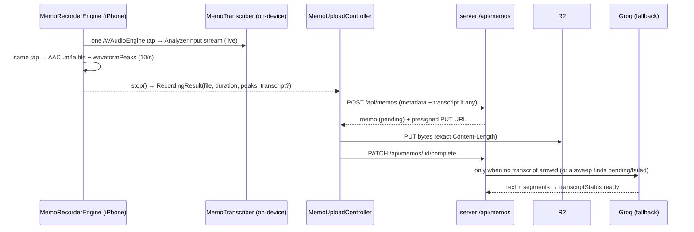

# memo — spec
> lg · ticket: none · the voice-memo **engine** (server + iPhone services/state); the screens are a later spec

## Idea

**Why.** Leaders get ideas away from a keyboard and lose them. They need to speak a thought into the
iPhone app and end up with readable text, kept privately and safe across a call, a lock or a crash.
The UI 2.0 shell already shows "Voice memo" in the TabBar Add (+) menu, but it does nothing yet.[^1]
This spec builds everything under that button except the screens: the stored memo, its endpoints,
server-side backup transcription, and the iPhone recording/transcription/upload engine plus its state.
The screens (recorder sheet, memo list/Library placement, inline player, transcript view, the
permission and empty states) are a separate spec. Their visual gaps are filled from reference videos
the owner supplies, never from Figma (D2).

**What success looks like.** In automated tests: a recording made by the engine becomes one mono AAC
`.m4a`, uploads through the create → presigned PUT → complete lifecycle, and arrives with a
transcript. That transcript comes from on-device transcription, or from the Groq fallback when
on-device can't produce one. A memo recorded offline uploads on reconnect, and a recording interrupted
by an app kill is recovered on the next launch. The owner checks all of this on a real device during
the screens spec's walk (D4).

**In your words.**
- "I think note and voice memo can be combined. Make it automatically go to voice to text. I make voice notes all the time and never go back to listen, but I will read text" (V2.0.0 board, 2026-11-16) → D1, D5
- "There will be no Figma, if there are gaps then I will provide them to you with another video. Proceed with the engine now." → D2, D3
- "replicating the iPhone Voice Memos app's recorder and list" (DECISIONS.md §1) → D2
- "Claude is never a transcription candidate" (DECISIONS.md M4) → D10
- "No location-derived naming, ever" (DECISIONS.md M5) → D11

**The concept.**

**How it fits today.** No memo model, route or audio-only capture exists. `Media` can't hold personal
memos because it requires `organizationId` and `uploadedBy`.[^2] `StudyNote` already uses the nullable
`userId`/`memberId` dual-owner pattern D8 mirrors.[^3] The server has an R2 `S3Client` in
`storage.ts` but no presigner,[^4] and periodic jobs follow the `setInterval` pattern in
`jobs/cache-eviction.ts`.[^5] On the iPhone, the deployment target is iOS 26.0 (so
`SpeechAnalyzer`/`SpeechTranscriber` are available).[^6] The mic usage string talks only about video,
there is no speech-recognition string, and `UIBackgroundModes` has only `remote-notification`.[^7] The
only compiled AV code is the UI2 viewer's `AVPlayer`; no compiled file sets an `AVAudioSession` category,[^8] and `MediaUploadQueue` is the precedent
for an AppState-owned serial upload queue, though it is in-memory only.[^9]

**Approaches considered.** Chosen: transcript-first memos on the documented Voice-Memos engine, with
the engine built and tested before any screen. Rejected:
- dictating straight into a note: it merges the memo and notes suites, a much larger redesign;
- a faithful playback-first Voice Memos copy: it ignores the owner's "I will read text";
- Figma-first design: the owner rules out Figma;
- a throwaway device harness, or a tiny real recorder now: both are code built only to be discarded
  or reworked once the owner's video arrives.

[^1]: iphone/MakeReady/UI2/Shell/UI2Shell.swift:24-32
[^2]: server/prisma/schema.prisma:504-516
[^3]: server/prisma/schema.prisma:1334-1345 · server/schema/schema.yaml:3374-3394
[^4]: server/src/services/storage.ts:17-117 · server/package.json:47 (only `@aws-sdk/client-s3`)
[^5]: server/src/jobs/cache-eviction.ts · server/src/index.ts:615
[^6]: iphone/MakeReady.xcodeproj/project.pbxproj (project-level `IPHONEOS_DEPLOYMENT_TARGET = 26.0`; every target inherits it)
[^7]: iphone/MakeReady/Info.plist:104-119
[^8]: iphone/MakeReady/UI2/Viewer/ViewerVideoHost.swift:18-35 (the only compiled AV code: an `AVPlayer`; `Pages/Video/VideoActivityManager.swift` is legacy 1.0, outside the app target)
[^9]: iphone/MakeReady/State/Actions/MediaUploadQueue.swift:11-40

Reference material (analysis, not normative, superseded by this SPEC where they differ):
`DECISIONS.md` (the pre-builder contract) and `analysis/01–05`.

## Apps

| App | In scope | What changes | Section |
|---|---|---|---|
| server | ✅ | `VoiceMemo` model + migration; `/api/memos` (7 endpoints); presigned R2 PUT and GET; Groq fallback transcription with ffmpeg chunking; maintenance job (pending sweep, transcript retry, 30-day purge); `MEMO` link type | §server |
| client | ⬜ | Web playback and capture are out of v1 (DECISIONS §1). No web code reads `/api/memos`, and no web code reads note links (`refType`) at all (audit 2026-11-20: no hit under `client/` outside vendor), so the new `MEMO` value reaches nothing on the web | — |
| iphone | ✅ | Recorder engine, on-device transcriber, persistent per-user upload queue, draft salvage, `MemoActions`, `AppState.voiceMemos` + `voiceMemoDetails`, Info.plist strings (D27). **No UI**: the Add-menu "Voice memo" item stays inert | §iphone |

**Sequencing:** contract settled → server implements and verifies (contract FREEZES) → iphone builds
against the frozen contract → the cross-app API walk.

**Backward compatibility:** every change is additive: a new table, new routes, a new link-type value.
A released iPhone 2.0.0 build reads none of it and sees no change. `LINK_TYPES` gains `MEMO`; the
audit found that no iPhone code decodes notes or links at all and no web code reads `refType`, so the
new value cannot reach a released reader. (`GET /notes/types` is shadowed by `GET /notes/:noteId`,
`routes/notes.ts:1448` before `:1907`, so nothing lists link types today either.) D27 deliberately
holds the `audio` background mode back so the next App Store build from main carries no unused mode.

**Blast radius:** `notes.service.ts` link validation (a `MEMO` link must resolve to a memo the note's
owner owns); `routes/users.ts` user hard-delete (purges memo objects first, D35); the server images
(`server/Dockerfile` production stage and `Dockerfile.dev` add ffmpeg); R2 storage (new private
`memos/` prefix); env (`GROQ_API_KEY`, `GROQ_MAX_UPLOAD_BYTES`, `R2_PRESIGN_ENDPOINT`).

## Decisions

<!-- The one place rulings live. Record the DECISION — and, in one line, why, and why the rejected option lost. A stated preference
     is the INPUT to a row, not the row. Write each Ruling as something later code can be checked
     against without re-interpretation:
       · positive and specific — "store the full number, mask at render", not "don't truncate"
       · scope named — which apps, screens or endpoints it binds
       · "etc." / "and so on" expanded into the list, or the test for membership stated
       · the rejected alternative named, with the reason it lost (check-obligations warns on a bare one)
       · the enforcement hook, where one exists (lint rule, script, test)
     🔴 NEVER quote the user's prompt as the ruling. Operationalize it: a closed list, a measured
     value, an enumerated set of deviations. A ruling a stranger could implement two ways is not
     written yet.
     Who/date carries the provenance, so the Ruling itself needs no quote marks.
     The owner's own words go in §Idea "In your words", linked to this row — never in the Ruling.
     OPEN rows block the build go-ahead. Never delete a ruling; supersede it in place with a date. -->

| # | Decision | Ruling | Who / date |
|---|---|---|---|
| D1 | Memo shape | Transcript-first. The engine must always aim to deliver text: on-device live transcription, a file-based on-device re-run for salvaged drafts, then the Groq fallback (D5). The contract exposes the transcript on list (`transcriptPreview`) and detail (`transcript`, `transcriptSegments`), so the later screens can lead with text. Not "dictate into a note" (merges two suites); not playback-first (ignores the owner's reading habit) | user 2026-11-19 |
| D2 | Visual design source | Memo screens never get Figma. Visual gaps in the later screens spec are filled from owner-supplied reference videos, measured like `analysis/01-video-analysis.md`. This spec writes no UI and changes no UI 2.0 registry row (C-004, C-006, C-007, C-011–C-014, C-016–C-018 stay `no-figma`). Not Figma-first: owner ruled it out | user 2026-11-19 |
| D3 | Scope of this spec | Engine only: server (§server) + iPhone services/state (§iphone). The Add-menu "Voice memo" item stays inert until the screens spec. The screens spec inherits: entry from the + menu, not a memo list (`UI2Shell.swift:29`); views built under `iphone/MakeReadyUI` and wired from `MakeReady/UI2` rather than DECISIONS §4b's legacy `Components/` paths; colours mapped to UI 2.0 tokens rather than Voice Memos' sampled palette. Not a tiny recorder now: it would be reworked once the video arrives | user 2026-11-19 |
| D4 | Verification without a screen | Server vitest (service + request tests) and iPhone XCTests (`MakeReadyCaptureTests`) driving the engine from injected PCM buffers/files on the simulator. The on-device checks move to the first items of the screens spec's walk: record-start latency < 200 ms, survives background/lock, auto-pause/resume on a call, live `SpeechTranscriber` finishes ≤ 5 s after stop, speech-asset install, whether `SFSpeechRecognizer.requestAuthorization` is required. Not a throwaway device harness (a device session for discarded code) | user 2026-11-19 |
| D5 | Server transcription fallback | Included. Groq `whisper-large-v3-turbo` via `transcription.service.ts`, behind `GROQ_API_KEY`. It is triggered when a memo is completed with no transcript, or when the maintenance job finds `transcriptStatus` `pending` or `failed` with `transcriptAttempts < 3`. Files over Groq's per-request cap (read from config, default 25 MB) are split with ffmpeg at silence boundaries and segment timestamps offset. Missing key → `transcriptStatus: failed`, logged once per memo, no retry. Not on-device-only: transcript-first makes a text-less memo a broken memo. **Superseded in part 2026-11-20 by D33** (missing key: no attempt counted, retried once the key exists; when the call runs) | user 2026-11-19 · amended 2026-11-20 |
| D6 | Audio retention | Audio is kept until the owner deletes the memo. `DELETE` sets `isActive: false`. The maintenance job hard-deletes the row and its R2 object 30 days after `deletedAt`. No auto-expiry of active memos. Not "expire audio, keep text" (owner wants re-listen), not a per-memo keep flag (extra control) | user 2026-11-19 |
| D7 | Data model | New `VoiceMemo` model (§Schema & API changes), not `Media`: `Media` requires `organizationId` + `uploadedBy`, the wrong shape for personal data | DECISIONS.md M1 · confirmed 2026-11-19 |
| D8 | Ownership | v1 owner is `userId` (the signed-in User). The `memberId` column is created nullable and never written in v1. Every query is scoped `userId = req.user.id AND isActive`; another user's id returns 404, never 403 | DECISIONS.md M2 · confirmed 2026-11-19 |
| D9 | Upload transport | Server mints a presigned R2 `PutObject` URL (`@aws-sdk/s3-request-presigner` on the existing client config), signed with the declared `ContentLength` and `ContentType: audio/mp4`, expiring in 15 min. Bytes never pass through the server | DECISIONS.md M3 · confirmed 2026-11-19 |
| D10 | Primary transcription | On-device `SpeechTranscriber` (iOS 26) fed live from the capture tap. Claude is never used for transcription. `transcriptSource` (`on_device` / `server`) is diagnostics only; no consumer branches on it | DECISIONS.md M4 · confirmed 2026-11-19 |
| D11 | Title | Required, 1–120 chars after trim. The engine pre-fills `Memo {n}`, where n = 1 + the highest n among the owner's titles matching `^Memo (\d+)$` in `AppState.voiceMemos` plus unsent queue items. Server rejects empty or overlong titles with 400. No location-derived naming | DECISIONS.md M5 · stated 2026-11-19 |
| D12 | Limits | Engine hard-stops at 3 h with the memo intact. `POST /api/memos` rejects `fileSize` > 100 MB (104 857 600 bytes) or `durationMs` > 10 800 000 with 400 | DECISIONS.md M6 · stated 2026-11-19 |
| D13 | Upload lifecycle | Create-first: `POST` (row `uploadStatus: pending`) → presigned PUT → `PATCH …/complete`, which HEAD-checks the object exists and matches `fileSize`. The maintenance job deletes `pending` rows older than 24 h and their keys | DECISIONS.md M9 · stated 2026-11-19 |
| D14 | Capture engine | `AVAudioEngine`, one input tap fanning out to: an AAC `AVAudioFile` (mono, 44.1 kHz, ~64 kbps; **container superseded 2026-11-20 by D38**: `.caf` while recording, `.m4a` on export); a format-converted `AnalyzerInput` stream; and peak reduction. Never `AVAudioRecorder` (no PCM access). Route-change buffers go through the same converter (analysis F8) | DECISIONS.md M10 · stated 2026-11-19 |
| D15 | Waveform data | `waveformPeaks`: floats 0–1, one per 100 ms, computed on device during capture and sent on `POST`. The engine also publishes a live `samples` ring buffer at ~20 Hz for the future screens. Clients never decode audio to draw | DECISIONS.md M11 · stated 2026-11-19 |
| D16 | Interruptions & salvage | On `AVAudioSession.interruptionNotification` `.began` → pause; `.ended` + `.shouldResume` → resume. Route changes are handled the same way. At capture start a draft manifest (file URL, startedAt, title draft) is written to Application Support. On launch, any manifest whose file is non-empty is recovered: transcribed with the file path (`MemoTranscriber.transcribeFile`), then enqueued for upload. With no UI yet, recovery is automatic, and the screens spec may add an offer step | DECISIONS.md M12 · stated 2026-11-19 · automatic recovery (assumed at spec) 2026-11-19 |
| D17 | Search | `GET /api/memos?q=` matches `title` OR `transcript`, case-insensitive substring (`ILIKE`) | DECISIONS.md M13 · stated 2026-11-19 |
| D18 | Links | `MEMO` is added to `LINK_TYPES`; a note link of that type must resolve to an active memo owned by the note's `userId`, else 400. No memo→lesson/group links in v1 | DECISIONS.md M14 · confirmed 2026-11-19 |
| D19 | Audience | Any signed-in User (Group Leader, Admin, Owner, Super Admin alike), `requireAuth` only, with no org permission check: memos are owner-private, not org content. Members can't reach `/api/memos`. Not member-facing in v1 | (assumed at brainstorm) 2026-11-19 |
| D20 | Audio-session coexistence | The engine sets `.playAndRecord`/`.spokenAudio` on `prepare()`, activates the session on `start()`, and on `stop()` restores the category it found (the app default `soloAmbient` today), so the UI2 viewer's `AVPlayer` playback (`ViewerVideoHost.swift`) is unaffected. Corrected 2026-11-20: the app target has no video recorder (`VideoActivityManager` is legacy, not compiled) | (assumed at brainstorm) 2026-11-19 · corrected by audit 2026-11-20 |
| D21 | Engine errors | Typed `MemoEngineError`: `micPermissionDenied`, `speechUnavailable` (→ no live transcript; the server fallback covers it), `durationLimitReached`, `writeFailed`. Upload failures stay queued with backoff (D22). Each one routes through `/ios-error-surface` as console-only in this spec, since no surface exists yet | (assumed at brainstorm) 2026-11-19 |
| D22 | Offline queue | `MemoUploadController` persists each unsent `RecordingResult` as a JSON manifest beside its `.m4a` in Application Support/memos. It flushes serially on launch, on `NWPathMonitor` becoming satisfied, and after each new memo. Retry backoff is 5 s → 30 s → 2 min → 10 min, capped at 10 min. A server row already created (`POST` succeeded) is resumed at PUT/complete, never re-created. The local file is deleted only after `complete` returns 200. Not `MediaUploadQueue` (in-memory, so a kill would lose the memo) | (assumed at spec) 2026-11-19 |
| D23 | ffmpeg | The server images install `ffmpeg` with apt: the production stage of `server/Dockerfile` (the `node:20-slim` stage, `:35`; the builder stage doesn't run code) and `server/Dockerfile.dev` (its apt line, `:13-16`, used by the local container). Staging and production deploy the GHCR image built from `server/Dockerfile`, so nothing else changes (`railway.toml`'s nixpacks line is vestigial). It is used only by the Groq chunking path, behind an injectable `splitAudio` runner so tests never need the binary | (assumed at spec) 2026-11-19 · stages corrected by audit 2026-11-20 |
| D24 | List payload | `GET /api/memos` returns `transcriptPreview` (first 280 chars of `transcript`) and no `transcriptSegments` or `waveformPeaks`; `GET /api/memos/:id` returns everything | (assumed at spec) 2026-11-19 |
| D25 | Storage key | `memos/{userId}/{memoId}.m4a` in the existing R2 bucket. ~~`url` = `getPublicUrl(key)`, set at complete~~ **Superseded 2026-11-20 by D31**: the public bucket domain would make private audio world-readable | (assumed at spec) 2026-11-19 · amended 2026-11-20 |
| D26 | Maintenance job | `jobs/memo-maintenance.ts`, started from `index.ts` like the cache-eviction job, runs every 15 min, in this order: (1) expire `pending` uploads > 24 h; (2) retry Groq for `transcriptStatus` pending/failed with `transcriptAttempts < 3` and `uploadStatus: ready`; (3) purge soft-deleted > 30 days. Each step catches its own errors | (assumed at spec) 2026-11-19 |
| D27 | Info.plist | `NSMicrophoneUsageDescription` → "MakeReady uses the microphone to record videos and voice memos."; add `NSSpeechRecognitionUsageDescription` → "MakeReady turns your voice memos into text on your iPhone.". ~~add `audio` to `UIBackgroundModes`~~ **Superseded 2026-11-20**: `audio` is added by the screens spec, the first build that records; declaring a background mode nothing uses risks App Review 2.5.4 on the next submission from main. Not "add it now and promise no submission": nothing enforces the promise | DECISIONS.md §7 · confirmed 2026-11-19 · copy (assumed at spec) 2026-11-19 · `audio` deferred auto (recommended) 2026-11-20 |
| D28 | Rollout | The Add-menu "Voice memo" item stays inert; nothing in the app calls the engine yet. Released 2.0.0 unaffected | (assumed at brainstorm) 2026-11-19 |
| D29 | Re-minting an upload URL | New `POST /api/memos/:id/upload` returns `200 { upload }` (same shape as `POST /api/memos`'s `upload`, a fresh 15-min URL) for a `pending` memo the caller owns; `409` when it is already `ready`; `404` when absent, not owned or swept. The iPhone re-mints before a PUT whose `expiresAt` has passed, and after a PUT answered `403`. A `404` from re-mint or from complete makes it re-`POST` the memo as new (the old row, if any, is swept by D26). Not "always re-POST after expiry": it leaves a pending row and a duplicate key per retry | auto (recommended) 2026-11-20 |
| D30 | Complete is idempotent | `PATCH /api/memos/:id/complete` on a memo already `uploadStatus: ready` returns `200 { memo }` unchanged: no second HEAD, no second transcription. A lost response retried by D22 therefore succeeds. Not 409: the client could not tell a finished memo from a broken one | auto (recommended) 2026-11-20 |
| D31 | Audio URL privacy | Memo audio is never served from the public bucket domain. There is no `url` column. `GET /api/memos/:id` returns `url` = a presigned R2 `GetObject` URL valid 60 min plus `urlExpiresAt`; `POST`, `PATCH` and complete responses return `url: null, urlExpiresAt: null`; `VoiceMemoSummary` has neither. Not public-by-obscurity: memos are owner-private (D19) and the key embeds the userId | auto (recommended) 2026-11-20 |
| D32 | Transcription single-flight | One transcription per memo at a time. `transcribeMemo` first claims the row with an atomic `updateMany` (`transcriptStatus in (pending, failed)` and `transcriptClaimedAt` null or older than 10 min → set `transcriptClaimedAt = now`), and returns if it claimed nothing; it clears `transcriptClaimedAt` when done. The maintenance job runs under `pg_try_advisory_lock` (as `analytics.service.ts` does) so only one server instance runs a pass. The wire enum stays `none/pending/ready/failed`. Not a `processing` status: it widens an enum consumers would have to handle | auto (recommended) 2026-11-20 |
| D33 | When Groq runs, and a missing key | Complete with no transcript sets `transcriptStatus: pending` and starts `transcribeMemo` without awaiting it, through an injectable runner that is a no-op under `NODE_ENV=test`. With `GROQ_API_KEY` unset, `transcribeMemo` sets `failed` without incrementing `transcriptAttempts`, and D26 step 2 is skipped entirely, so memos transcribe once the key is set (F3). A Groq error increments `transcriptAttempts` and sets `failed`. Not job-only: the transcript would take up to 15 min | auto (recommended) 2026-11-20 |
| D34 | Presign endpoint for local dev | Optional env `R2_PRESIGN_ENDPOINT`: when set, `presignPut`/`presignGet` sign with a second `S3Client` built from `r2ClientConfig` but this endpoint, so a host the phone or simulator can reach is signed. Unset (production, the walk env on `localhost:9010`) → the normal client. Not rewriting the URL host afterwards: SigV4 signs the host | auto (recommended) 2026-11-20 |
| D35 | User hard-delete | Before `prisma.user.delete` in `routes/users.ts` (~737), `memosService.purgeUserMemoObjects(userId)` deletes every R2 object under that user's memos (best effort, logged). The rows go by cascade (SC1). Not accepting orphans: the audio is personal data | auto (recommended) 2026-11-20 |
| D36 | Note links to a gone memo | A soft-deleted memo keeps its note links. D26 step 3 (purge) also deletes `NoteLink` rows with `refType: MEMO, refId: <memoId>` in the same transaction. Any future reader treats a `MEMO` link to an absent or inactive memo as no link | auto (recommended) 2026-11-20 |
| D37 | Queue tenancy on the iPhone | Each queue and draft manifest records `ownerUserId` and the API environment. Files live under `Application Support/memos/<environment>/<userId>/`, excluded from iCloud backup. A flush or a salvage only touches the signed-in user's folder for the current environment. Sign-out cancels an in-flight flush and keeps the files until that user signs in again. Tested: sign out, sign in as user B, nothing of A's uploads. Not a single shared folder: user B would upload A's private audio | auto (recommended) 2026-11-20 |
| D38 | Capture container | The engine writes AAC into a `.caf` file while recording (readable when cut off), and exports it to `.m4a` (`audio/mp4`) at `stop()` and when salvaging. The uploaded file is always the `.m4a`. Not `.m4a` during capture: an MPEG-4 file whose writer never closed has no `moov` atom and can't be salvaged | auto (recommended) 2026-11-20 |
| D39 | iPhone store shape | `AppState.voiceMemos = EntityStore<VoiceMemoSummary>`, disk-persisted (decoded with `decodeIfPresent … ?? []`, no `schemaVersion` bump, newest first, capped like `mediaLibrary`); `AppState.voiceMemoDetails = EntityStore<VoiceMemo>`, memory only, cleared in `clearInMemory`. Rename and delete update both in the same call; `memoCompleted` upserts the `VoiceMemo` into details and its summary into `voiceMemos`. Same pattern as `members`/`memberDetails`. Not one type with optional detail fields: a list refresh would wipe them | auto (recommended) 2026-11-20 |
| D40 | PUT transport | `MemoUploadController` does the presigned PUT with `URLSession.upload(for:fromFile:)` behind an injectable transport, never `APIClient` (which prefixes the base URL and adds the session cookie, breaking the signature and leaking the cookie to R2). A plain session wrapped in `beginBackgroundTask`; no background `URLSession` in v1 (D22's flushes cover the rest) | auto (recommended) 2026-11-20 |
| D41 | 401 during a flush | On `APIError.unauthorized` the queue pauses without backoff, keeps every file, and resumes after the next sign-in. The upload controller never signs anyone out | auto (recommended) 2026-11-20 |
| D42 | Duration and peaks | `durationMs` = audio frames written ÷ sample rate × 1000 (paused time excluded); `waveformPeaks` covers exactly the written frames, one per 100 ms, so the server's `ceil(durationMs/100) ± 1` check holds | auto (recommended) 2026-11-20 |
| D43 | Memo numbering scope | D11's `n` is computed from the cached `voiceMemos` plus every unsent queue manifest of the signed-in user. A duplicate `Memo n` after a cold cache is accepted: titles are not unique | auto (recommended) 2026-11-20 |
| D44 | Body caps | zod on `POST /api/memos`: `title` trimmed 1–120; `durationMs` int 1–10 800 000; `fileSize` int 1–104 857 600; `waveformPeaks` ≤ 108 001 finite numbers in 0–1; `transcript` ≤ 1 000 000 chars; `transcriptSegments` ≤ 50 000 items with `0 ≤ startMs ≤ endMs ≤ durationMs`; `recordedAt` ISO datetime; `.strict()`. The list query selects explicit columns and computes `transcriptPreview` in SQL (`left(transcript, 280)`), never loading full transcripts or peaks; it orders `recordedAt desc, id desc`; `q` matches `%` and `_` literally | auto (recommended) 2026-11-20 |

## Contract

| Contract | Producer | Consumers | Auth | Request | Response | Errors |
|---|---|---|---|---|---|---|
| `POST /api/memos` | server | iphone (`MemoUploadController`) | `requireAuth` | `{ title, durationMs, fileSize, recordedAt (ISO), waveformPeaks: number[], transcript?, transcriptSegments?: [{text,startMs,endMs}] }` | `201 { memo: VoiceMemo, upload: { url, method: "PUT", headers: { "Content-Type": "audio/mp4", "Content-Length": "<fileSize>" }, expiresAt } }` | 400 validation (D44 caps, title, limits D12, peaks length ≠ ceil(durationMs/100)±1) · 401 |
| `PATCH /api/memos/:id/complete` | server | iphone (`MemoUploadController`) | `requireAuth` | `{}` | `200 { memo }` with `uploadStatus: ready`; `transcriptStatus: ready` if a transcript arrived on POST, else `pending` and Groq started (D33). On a memo already `ready`: `200 { memo }` unchanged, no HEAD, no Groq (D30) | 404 not owner/absent/swept · 409 object missing or size ≠ `fileSize` · 401 |
| `POST /api/memos/:id/upload` | server | iphone (`MemoUploadController`) | `requireAuth` | `{}` | `200 { upload }` — same shape as `POST /api/memos`'s, a fresh 15-min URL (D29) | 404 not owner/absent/swept · 409 already `ready` · 401 |
| `GET /api/memos?q=&limit=&offset=` | server | iphone (`MemoActions.loadMemos`) | `requireAuth` | `limit` 1–100 (default 50), `offset` ≥ 0, `q` optional | `200 { memos: VoiceMemoSummary[], total }`, `recordedAt` desc, active + `uploadStatus: ready` only | 400 bad paging · 401 |
| `GET /api/memos/:id` | server | iphone (`MemoActions.loadMemo`) | `requireAuth` | — | `200 { memo: VoiceMemo }` with `url` = presigned GET (60 min) and `urlExpiresAt` (D31) | 404 · 401 |
| `PATCH /api/memos/:id` | server | iphone (`MemoActions.rename`) | `requireAuth` | `{ title }` (only field; unknown keys → 400, never silently stripped) | `200 { memo }` | 400 · 404 · 401 |
| `DELETE /api/memos/:id` | server | iphone (`MemoActions.softDelete`) | `requireAuth` | — | `204` | 404 · 401 |
| `LINK_TYPES.MEMO` (notes link type) | server | iphone — the memo screens spec (no v1 reader: no iPhone code decodes notes or links today, and no web code reads `refType`) | existing notes auth | `links: [{ refType: "MEMO", refId: <memoId> }]` on `createNote` (user and member routes) and `addNoteLink` | unchanged shapes | 400 `VALIDATION` when the memo is absent, inactive or not owned by the note's `userId`; always for a member-owned note (D18) |

**Shapes.** `VoiceMemo` = `{ id, title, url|null, urlExpiresAt|null, mimeType, fileSize|null, durationMs|null,
waveformPeaks: number[]|null, transcript|null, transcriptSegments|null, transcriptStatus:
"none"|"pending"|"ready"|"failed", transcriptSource: "on_device"|"server"|null, uploadStatus:
"pending"|"ready", recordedAt, createdAt, updatedAt }`. `url` is non-null only on `GET /api/memos/:id` (D31). `VoiceMemoSummary` = `VoiceMemo` minus
`url`, `urlExpiresAt`, `transcript`, `transcriptSegments` and `waveformPeaks`, plus `transcriptPreview: string|null`. JSON
keys are camelCase.

## Schema & API changes

| # | ADD/EDIT/RENAME/REMOVE | Model.field | Wire | Reason | Status |
|---|---|---|---|---|---|
| SC1 | ADD | `VoiceMemo` (table `voice_memos`): `id` uuid pk · `userId` string? · `memberId` string? · `title` string · `key` string · `mimeType` string default `audio/mp4` · `fileSize` int? · `durationMs` int? · `waveformPeaks` json? · `transcript` text? · `transcriptSegments` json? · `transcriptStatus` string default `none` · `transcriptSource` string? · `transcriptAttempts` int default 0 · `transcriptClaimedAt` datetime? (D32) · `uploadStatus` string default `pending` · `recordedAt` datetime · `isActive` bool default true · `deletedAt` datetime? · `createdAt` · `updatedAt`; indexes `(userId, recordedAt)`, `(memberId, recordedAt)`, `(uploadStatus, createdAt)`; `user` relation onDelete Cascade (copy StudyNote's YAML block, `schema.yaml:3374-3420`). Status columns are strings with TS/zod unions, like `Media.uploadStatus`. No `url` column (D31) | `VoiceMemo` / `VoiceMemoSummary` | D7, D8, D26, D31, D32 | planned |
| SC2 | ADD | `POST /api/memos` | §Contract | D9, D13 | planned |
| SC3 | ADD | `PATCH /api/memos/:id/complete` | §Contract | D13, D5, D30, D33 | planned |
| SC7 | ADD | `POST /api/memos/:id/upload` | §Contract | D29 | planned |
| SC4 | ADD | `GET /api/memos`, `GET /api/memos/:id` | §Contract | D17, D24 | planned |
| SC5 | ADD | `PATCH /api/memos/:id`, `DELETE /api/memos/:id` | §Contract | D6, D11 | planned |
| SC6 | EDIT | `LINK_TYPES` + `MEMO` (`notes.service.ts:46`); `NoteLink.refType` is a free string column, so no DDL | notes link endpoints validate `MEMO` | D18, D36 | planned |

**Data plan:** additive only. One new table, generated from `server/schema/schema.yaml` by
`npm run schema:diff` (never hand-edited). No existing rows are touched and no backfill is needed.
`deletedAt` exists so the 30-day purge measures from deletion, not creation. Undo = drop
`voice_memos` (and its R2 `memos/` prefix). Migrations are independent of each other: one migration
for SC1; SC2–SC7 are code only.

## server

- **Schema:** `VoiceMemo` in `server/schema/schema.yaml` (SC1) → migration via `schema:diff`.
- **`services/memos.service.ts`** owns all logic: create (validate D11/D12/D44, compute key D25,
  presign D9), re-mint (D29), complete (HEAD the object, D13, idempotent D30, start fallback D33),
  list/search (D17, D24, D44), get (presigned GET, D31), rename, softDelete (D6),
  `purgeUserMemoObjects` (D35), and the three maintenance functions D26 calls (purge also drops
  `MEMO` note links, D36). Ownership scoping per D8 lives here.
- **`services/transcription.service.ts`**: `transcribeMemo(memoId)` downloads the object, chunks with
  ffmpeg when it's over the cap, calls Groq, merges segments with offsets, and writes `transcript`,
  `transcriptSegments`, `transcriptStatus: ready`, `transcriptSource: server`. It claims the row first
  (D32). On a Groq failure it increments `transcriptAttempts` and sets `failed`; with no key it sets
  `failed` without counting (D33). Groq is behind this module only; ffmpeg behind an injectable
  `splitAudio` (D23).
- **`storage.ts`** gains `presignPut(key, contentType, contentLength, expiresIn)`,
  `presignGet(key, expiresIn)` (D31) and `headObject(key) → { contentLength } | null` (D13 needs the
  size; `objectExists` returns only a boolean, `storage.ts:67-76`). It reuses `deleteFromR2` and
  `r2ClientConfig`, with the optional `R2_PRESIGN_ENDPOINT` client (D34). Adds the
  `@aws-sdk/s3-request-presigner` dependency (absent today).
- **`routes/memos.ts`**: thin, zod `.strict()` on every mutating body (unknown keys → 400), mounted
  at `/api/memos` behind `requireAuth`.
- **`jobs/memo-maintenance.ts`** (D26) started from `index.ts` beside the cache-eviction job (only
  under `NODE_ENV !== 'test'`, `index.ts:604-616`), each pass under an advisory lock (D32).
- **`notes.service.ts`**: `MEMO` link type + `memoLinkRefusal(links, ownerUserId)` beside
  `removedLinkRefusal` (`:196`), called from `createNote` (`:208`) and `addNoteLink` (`:557`) (D18).
- **`routes/users.ts`**: call `purgeUserMemoObjects` before the user hard-delete (~`:737`, D35).
- **Env/infra:** `GROQ_API_KEY`, `GROQ_MAX_UPLOAD_BYTES` (default 26 214 400), `R2_PRESIGN_ENDPOINT`
  (optional, D34), read from `process.env` and added to `server/.env.example`; ffmpeg per D23.
- Recipe: `/api`.

## iphone

All new, none of it UI. It lives under the app's existing folders. No view, `Route` or registry row
is added.
- **`Services/Audio/MemoRecorderEngine.swift`**: `prepare() / start() / pause() / resume() / stop()
  -> RecordingResult`. It publishes `samples` (ring buffer, ~20 Hz), `elapsed`, and `state`
  (`idle/recording/paused/finishing`). It implements D14, D15, D16, D20, D21 and the 3 h stop (D12). The
  input is injectable (`AudioInputSource`: live engine tap, or a PCM buffer/file feeder for tests).
- **`Services/Audio/MemoTranscriber.swift`**: `startLive(stream:)`, `finish() -> Transcript?`,
  `transcribeFile(URL) -> Transcript?`. It wraps `SpeechAnalyzer`/`SpeechTranscriber`, including the
  `AssetInventory` ensure/reserve/release steps, and returns nil (not an error) when unavailable, so
  the upload omits the transcript and the server falls back (D5).
- **`Services/Audio/MemoUploadController.swift`**: D13 lifecycle + the D22 persistent queue +
  salvage hand-off (D16), with re-mint (D29), per-user folders (D37), its own PUT transport (D40) and
  the 401 pause (D41). Recording writes `.caf` and exports `.m4a` (D38).
- **`State/Actions/MemoActions.swift`**: `loadMemos(q:)`, `loadMemo(id:)`, `rename`, `softDelete`,
  plus `memoCompleted(_:)` (used by the upload controller), each refreshing `AppState.voiceMemos` in
  the same call. It is the only `APIClient` user for memos.
- **`State/AppState.swift`**: `voiceMemos = EntityStore<VoiceMemoSummary>()` (disk-persisted through
  `PersistedState`) and `voiceMemoDetails = EntityStore<VoiceMemo>()` (memory only), per D39;
  `AppState` owns the single `MemoUploadController`, cancelled on sign-out (D37).
- **`State/Models/MemoModels.swift`**: `VoiceMemo`, `VoiceMemoSummary`, `TranscriptSegment`,
  `RecordingResult`, `RecorderState`, `MemoEngineError`.
- **`Info.plist`**: D27 (the two strings; no `audio` background mode).
- New files are explicit `pbxproj` references (no synchronized groups); `Services/Audio/` is a new
  group. `ruby iphone/scripts/capture-targets.rb` re-syncs the MakeReadyCapture target after each.
- Recipes: `/ios-error-surface` (D21). `/present-overlay`, `/push-page` and `/transition-review` don't
  apply because there's no UI.

## Testing

**server (vitest, test DB):**
- service tests for every ruling: D8 scoping (another user → 404), D11/D12 validation, D13 complete
  (missing object → 409, size mismatch → 409), D17 search, D24 summary shape;
- each maintenance step of D26, with time from an injected clock;
- D18 link ownership (template: `src/routes/__tests__/notes-removed-link-types.request.test.ts`);
- D29 re-mint, D30 complete twice, D31 presigned GET on detail only, D32 a second claim is a no-op,
  D33 missing key leaves `transcriptAttempts` at 0, D35 user delete purges objects, D36 purge drops
  links, D44 caps and literal `%`/`_` search;
- the transcription service against a stubbed Groq client, covering chunk offsetting, a missing key →
  failed, and the attempts cap;
- request tests per §Contract row, including the strict-body 400 on an unknown key.

**iphone (XCTest, `MakeReadyCaptureTests`, simulator):**
- the engine fed a fixture PCM file writes a valid mono AAC `.m4a` whose duration matches;
- `waveformPeaks` count = ceil(duration/0.1);
- pause/resume produces one contiguous file;
- the 3 h limit is checked with an injected clock;
- an interruption-notification simulation pauses and resumes;
- a draft manifest left behind is recovered and enqueued on a simulated relaunch;
- the upload controller against a stubbed `APIClient`/URLSession covers create → PUT → complete, resume
  after a crash between POST and PUT (no duplicate create), an expired URL re-minted (D29), a 404 on
  complete re-POSTed, offline backoff then flush, a 401 pausing without backoff (D41), sign-out then
  user B signing in uploading none of A's memos (D37), and the local file deleted only after complete;
- a `.caf` abandoned without closing is salvaged and exported to a playable `.m4a` (D38);
- `durationMs` and peak count exclude paused time (D42); `VoiceMemo` decodes fractional-second dates;
- `MemoActions` refresh `AppState.voiceMemos`;
- `MemoTranscriber.transcribeFile` returns nil cleanly when assets are unavailable.

**Cross-app E2E walk (API-level, the dev or agent-walk env):**
1. `POST /api/memos` with a fixture `.m4a`'s metadata and no transcript → 201 with an upload URL.
2. PUT the file to that URL (s3mock in the walk env) → 200.
3. `PATCH …/complete` → `uploadStatus: ready`, `transcriptStatus: pending`.
4. With no `GROQ_API_KEY`, `GET /api/memos/:id` shortly after shows `transcriptStatus: failed` and
   `transcriptAttempts` unchanged; a maintenance pass leaves it so and throws nothing (D33). The
   detail's `url` is a presigned GET that downloads the file (D31).
4b. `PATCH …/complete` again → 200, same memo (D30); `POST /api/memos/:id/upload` → 409 (D29).
5. `GET /api/memos?q=<title word>` returns it with `transcriptPreview: null`.
6. `PATCH` the title → renamed; `DELETE` → 204, and it's gone from the list.
7. The iPhone XCTest suite above runs green against the frozen contract.

**Human verification (deferred, D4):** recorded here so the screens spec opens its walk with them.
On a physical iPhone, check:
- record start < 200 ms;
- recording survives lock and background;
- a call auto-pauses and auto-resumes recording;
- the live transcript is ready ≤ 5 s after stop;
- the first-run speech-asset download works;
- the mic + speech permission prompts appear with the D27 copy;
- the `audio` background mode is added by the screens spec (D27) before the lock/background check.

## Out of scope

- Every memo screen: recorder sheet (compact/expanded), memo list or its Library placement, inline player, transcript view, permission/empty/error states, wiring the Add-menu item (owner 2026-11-19: next spec, visuals from owner videos).
- Playback (`AVPlayer`), scrubbing and ±15 s transport (screens spec).
- Web playback and capture (DECISIONS §1).
- Member-owned memos (D8, D19).
- Memo → lesson/group links (D18).
- Combining memos into notes (D1 rejected option; a note may link a memo via D18).
- Audio auto-expiry (D6 rejected option).
- Editing a transcript (no endpoint in v1; adding `transcript` to the rename `PATCH` later is additive).

## Findings & risks

| # | Finding | Resolution |
|---|---|---|
| F1 | On-device behaviour (latency, interruptions, `SpeechTranscriber` assets) is unproven until a device walk that only the screens spec has (D4) | build-time risk: owner accepted 2026-11-19; first items of the screens spec's walk |
| F2 | Groq's current per-request upload cap is unverified (analysis F5) | build-time risk: confirmed by the transcription-service task; `GROQ_MAX_UPLOAD_BYTES` makes it config |
| F3 | `GROQ_API_KEY` must exist in 1Password/staging before the fallback can run outside tests | owner action before ship; without it memos degrade to `transcriptStatus: failed` (D5) |
| F4 | `AVAudioEngine` input may be unavailable in the headless verify simulator | build-time risk: D14's injectable `AudioInputSource` keeps every XCTest off the real mic |
| F5 | DECISIONS.md §4/§4b/§5 (memo list entry, legacy component paths, sampled palette) contradict UI 2.0 | carried to the screens spec (D3); not built here |
| F6 | contract: the presigned PUT URL expired after 15 min with no way to get another, so D22's resume could not succeed (audit 2026-11-20) | resolved: D29 + SC7 |
| F7 | contract: complete retried after a lost response was unspecified | resolved: D30 |
| F8 | contract: `url = getPublicUrl(key)` would serve private memo audio from the public bucket domain (`storage.ts:53-59`, `R2_PUBLIC_URL`) | resolved: D31 (D25 superseded) |
| F9 | contract: the notes row named `linkType`/`linkId`; writes take `links: [{ refType, refId }]` (`routes/notes.ts:216-220`) | corrected in §Contract |
| F10 | contract: §iphone claimed notes link decoding; no iPhone code decodes notes or links, and no web code reads `refType`, so `MEMO` has no v1 reader | §iphone bullet removed; §Contract row names the screens spec as its consumer; client ⬜ re-derived and holds |
| F11 | Complete and the job could transcribe the same memo twice, and several server instances would each run the job | resolved: D32 |
| F12 | D5 (missing key: no retry) contradicted D26 step 2 (retries `failed`) | resolved: D33 (D5 amended) |
| F13 | Tenancy: queue manifests survive sign-out (`AppState.clearAllData` clears only stores, `AppState.swift:901-907`) and `APIClient` sends whoever's cookie is current, so user B would upload user A's memos | resolved: D37 |
| F14 | An `.m4a` whose writer never closed has no `moov` atom, so D16's salvage would recover nothing | resolved: D38 (D14 container superseded) |
| F15 | `EntityStore<VoiceMemo>` can't hold list summaries and details | resolved: D39 |
| F16 | Release risk: declaring the `audio` background mode while nothing records invites App Review 2.5.4 rejection | resolved: D27 superseded in part — `audio` moves to the screens spec |
| F17 | User hard-delete (`routes/users.ts:737`) would orphan R2 memo objects; the purge would leave dangling `MEMO` note links (`NoteLink` has no FK) | resolved: D35, D36 |
| F18 | The local dev server's `R2_ENDPOINT` (`http://dev-images:9090`, `docker-compose.yml:72`) is Docker-internal; a URL signed for it is unreachable from a phone or simulator | resolved: D34 (the walk env on `localhost:9010` is unaffected) |
| F19 | A crash after `POST` but before the memo id is persisted leaves a duplicate `pending` row | accepted: D26 sweeps it within 24 h; no idempotency key in v1 |
| F20 | `npm run schema:diff` runs `dotenv --`, which reads the `server/.env` 1Password pipe (`package.json:33`) | build-time risk: the schema task runs `npm run schema:generate`, then `cd atlas && ../scripts/atlas.sh migrate diff --env local --var database_url=…` with an explicit URL |
| F21 | Whether the presigner signs `content-length` is unproven, and s3mock checks no signature, so the walk can't catch it | build-time risk: the storage task's unit test asserts `X-Amz-SignedHeaders` includes `content-length` (passing `signableHeaders` if needed); the complete HEAD size check stays the real guard |
| F22 | CI (`ci.yml`, `ubuntu-latest`) has no ffmpeg | build-time risk: the transcription-service task stubs `splitAudio` in tests (D23); no CI change |
| F23 | iPhone: new Swift files need explicit `pbxproj` refs; the MakeReadyCapture target compiles every app source and breaks until `capture-targets.rb` re-syncs | build-time risk: each iPhone file task adds its refs and runs `ruby iphone/scripts/capture-targets.rb` |
| F24 | iPhone tests run hosted in MakeReady.app (`TEST_HOST`), so app launch code runs in every test | build-time risk: salvage, flush and the path monitor take an injected folder; tests never use `AppState.shared`'s controller; the monitor starts only with a non-empty queue |
| F25 | iPhone lint: no `NSLog`/`print`/`asyncAfter`, static formatters; `Log` has no audio category; bodies built with `JSONSerialization` can't hold a `Date`; `DELETE` 204 fails the decoding path | build-time risk: the MemoActions and upload-controller tasks use `Task.sleep` backoff, `Log.media` (or a deliberate `Log.memo`), a static ISO8601 formatter for `recordedAt`, and `requestWithStatus` for `DELETE` (`EnrollmentDraftActions.swift:57`) |
| F26 | Stale citations: `VideoActivityManager` is not in the app target; `objectExists` returns no size; D23 named the wrong Dockerfile stages; "a client listing link types" — `GET /notes/types` is shadowed by `GET /notes/:noteId` | corrected in place (footnote 8, D20, §server, D23, §Apps) |
