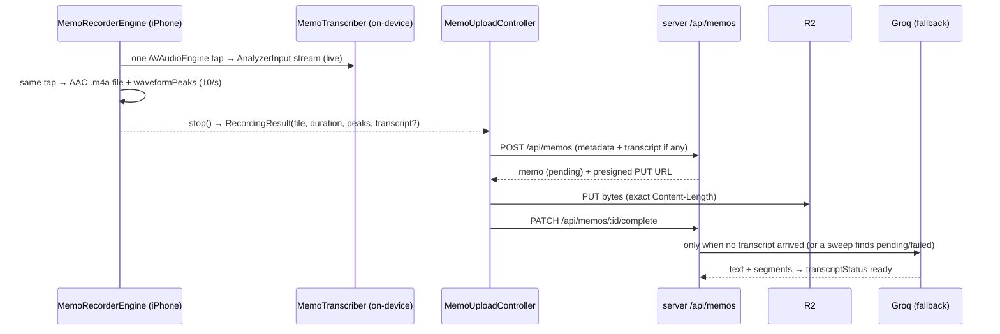

# memo — spec
> lg · ticket: none · the voice-memo **engine** (server + iPhone services/state); the screens are a later spec

## Idea

**Why.** Leaders get ideas away from a keyboard and lose them. They need to speak a thought into the
iPhone app and end up with readable text, kept privately and safe across a call, a lock or a crash.
The UI 2.0 shell already shows "Voice memo" in the TabBar Add (+) menu, but it does nothing yet.[^1]
This spec builds everything under that button except the screens: the stored memo, its endpoints,
server-side backup transcription, and the iPhone recording/transcription/upload engine plus its state.
The screens (recorder sheet, memo list/Library placement, inline player, transcript view, the
permission and empty states) are a separate spec. Their visual gaps are filled from reference videos
the owner supplies, never from Figma (D2).

**What success looks like.** In automated tests: a recording made by the engine becomes one mono AAC
`.m4a`, uploads through the create → presigned PUT → complete lifecycle, and arrives with a
transcript. That transcript comes from on-device transcription, or from the Groq fallback when
on-device can't produce one. A memo recorded offline uploads on reconnect, and a recording interrupted
by an app kill is recovered on the next launch. The owner checks all of this on a real device during
the screens spec's walk (D4).

**In your words.**
- "I think note and voice memo can be combined. Make it automatically go to voice to text. I make voice notes all the time and never go back to listen, but I will read text" (V2.0.0 board, 2026-11-16) → D1, D5
- "There will be no Figma, if there are gaps then I will provide them to you with another video. Proceed with the engine now." → D2, D3
- "replicating the iPhone Voice Memos app's recorder and list" (DECISIONS.md §1) → D2
- "Claude is never a transcription candidate" (DECISIONS.md M4) → D10
- "No location-derived naming, ever" (DECISIONS.md M5) → D11

**The concept.**

**How it fits today.** No memo model, route or audio-only capture exists. `Media` can't hold personal
memos because it requires `organizationId` and `uploadedBy`.[^2] `StudyNote` already uses the nullable
`userId`/`memberId` dual-owner pattern D8 mirrors.[^3] The server has an R2 `S3Client` in
`storage.ts` but no presigner,[^4] and periodic jobs follow the `setInterval` pattern in
`jobs/cache-eviction.ts`.[^5] On the iPhone, the deployment target is iOS 26.0 (so
`SpeechAnalyzer`/`SpeechTranscriber` are available).[^6] The mic usage string talks only about video,
there is no speech-recognition string, and `UIBackgroundModes` has only `remote-notification`.[^7] The
video recorder/player already configure `AVAudioSession`,[^8] and `MediaUploadQueue` is the precedent
for an AppState-owned serial upload queue, though it is in-memory only.[^9]

**Approaches considered.** Chosen: transcript-first memos on the documented Voice-Memos engine, with
the engine built and tested before any screen. Rejected:
- dictating straight into a note: it merges the memo and notes suites, a much larger redesign;
- a faithful playback-first Voice Memos copy: it ignores the owner's "I will read text";
- Figma-first design: the owner rules out Figma;
- a throwaway device harness, or a tiny real recorder now: both are code built only to be discarded
  or reworked once the owner's video arrives.

[^1]: iphone/MakeReady/UI2/Shell/UI2Shell.swift:24-32
[^2]: server/prisma/schema.prisma:504-516
[^3]: server/prisma/schema.prisma:1334-1345 · server/schema/schema.yaml:3374-3394
[^4]: server/src/services/storage.ts:1-60 · server/package.json:47
[^5]: server/src/jobs/cache-eviction.ts · server/src/index.ts:615
[^6]: iphone/MakeReady.xcodeproj/project.pbxproj:4849
[^7]: iphone/MakeReady/Info.plist:104-119
[^8]: iphone/MakeReady/Pages/Video/VideoActivityManager.swift
[^9]: iphone/MakeReady/State/Actions/MediaUploadQueue.swift:11-40

Reference material (analysis, not normative, superseded by this SPEC where they differ):
`DECISIONS.md` (the pre-builder contract) and `analysis/01–05`.

## Apps

| App | In scope | What changes | Section |
|---|---|---|---|
| server | ✅ | `VoiceMemo` model + migration; `/api/memos` (6 endpoints); presigned R2 PUT; Groq fallback transcription with ffmpeg chunking; maintenance job (pending sweep, transcript retry, 30-day purge); `MEMO` link type | §server |
| client | ⬜ | Web playback and capture are out of v1 (DECISIONS §1); no web surface reads `/api/memos`. The new `MEMO` link type is not rendered by the web notes UI in v1: a note can't reference a memo until a memo can be picked, which only the screens spec adds | — |
| iphone | ✅ | Recorder engine, on-device transcriber, persistent upload queue, draft salvage, `MemoActions`, `AppState.voiceMemos`, Info.plist keys. **No UI**: the Add-menu "Voice memo" item stays inert | §iphone |

**Sequencing:** contract settled → server implements and verifies (contract FREEZES) → iphone builds
against the frozen contract → the cross-app API walk.

**Backward compatibility:** every change is additive: a new table, new routes, a new link-type value.
A released iPhone 2.0.0 build reads none of it and sees no change. `LINK_TYPES` gains `MEMO`, so a
client listing link types gets one more value. The iPhone notes code doesn't switch exhaustively on
link types from the server, so an unknown value must render as no link (the audit re-checks this).

**Blast radius:** `notes.service.ts` link validation (a `MEMO` link must resolve to a memo the note's
owner owns); the server Docker image (adds ffmpeg); R2 storage (new `memos/` prefix); env (`GROQ_API_KEY`).

## Decisions

<!-- The one place rulings live. Record the DECISION — and, in one line, why, and why the rejected option lost. A stated preference
     is the INPUT to a row, not the row. Write each Ruling as something later code can be checked
     against without re-interpretation:
       · positive and specific — "store the full number, mask at render", not "don't truncate"
       · scope named — which apps, screens or endpoints it binds
       · "etc." / "and so on" expanded into the list, or the test for membership stated
       · the rejected alternative named, with the reason it lost (check-obligations warns on a bare one)
       · the enforcement hook, where one exists (lint rule, script, test)
     🔴 NEVER quote the user's prompt as the ruling. Operationalize it: a closed list, a measured
     value, an enumerated set of deviations. A ruling a stranger could implement two ways is not
     written yet.
     Who/date carries the provenance, so the Ruling itself needs no quote marks.
     The owner's own words go in §Idea "In your words", linked to this row — never in the Ruling.
     OPEN rows block the build go-ahead. Never delete a ruling; supersede it in place with a date. -->

| # | Decision | Ruling | Who / date |
|---|---|---|---|
| D1 | Memo shape | Transcript-first. The engine must always aim to deliver text: on-device live transcription, a file-based on-device re-run for salvaged drafts, then the Groq fallback (D5). The contract exposes the transcript on list (`transcriptPreview`) and detail (`transcript`, `transcriptSegments`), so the later screens can lead with text. Not "dictate into a note" (merges two suites); not playback-first (ignores the owner's reading habit) | user 2026-11-19 |
| D2 | Visual design source | Memo screens never get Figma. Visual gaps in the later screens spec are filled from owner-supplied reference videos, measured like `analysis/01-video-analysis.md`. This spec writes no UI and changes no UI 2.0 registry row (C-004, C-006, C-007, C-011–C-014, C-016–C-018 stay `no-figma`). Not Figma-first: owner ruled it out | user 2026-11-19 |
| D3 | Scope of this spec | Engine only: server (§server) + iPhone services/state (§iphone). The Add-menu "Voice memo" item stays inert until the screens spec. The screens spec inherits: entry from the + menu, not a memo list (`UI2Shell.swift:29`); views built under `iphone/MakeReadyUI` and wired from `MakeReady/UI2` rather than DECISIONS §4b's legacy `Components/` paths; colours mapped to UI 2.0 tokens rather than Voice Memos' sampled palette. Not a tiny recorder now: it would be reworked once the video arrives | user 2026-11-19 |
| D4 | Verification without a screen | Server vitest (service + request tests) and iPhone XCTests (`MakeReadyCaptureTests`) driving the engine from injected PCM buffers/files on the simulator. The on-device checks move to the first items of the screens spec's walk: record-start latency < 200 ms, survives background/lock, auto-pause/resume on a call, live `SpeechTranscriber` finishes ≤ 5 s after stop, speech-asset install, whether `SFSpeechRecognizer.requestAuthorization` is required. Not a throwaway device harness (a device session for discarded code) | user 2026-11-19 |
| D5 | Server transcription fallback | Included. Groq `whisper-large-v3-turbo` via `transcription.service.ts`, behind `GROQ_API_KEY`. It is triggered when a memo is completed with no transcript, or when the maintenance job finds `transcriptStatus` `pending` or `failed` with `transcriptAttempts < 3`. Files over Groq's per-request cap (read from config, default 25 MB) are split with ffmpeg at silence boundaries and segment timestamps offset. Missing key → `transcriptStatus: failed`, logged once per memo, no retry. Not on-device-only: transcript-first makes a text-less memo a broken memo | user 2026-11-19 |
| D6 | Audio retention | Audio is kept until the owner deletes the memo. `DELETE` sets `isActive: false`. The maintenance job hard-deletes the row and its R2 object 30 days after `deletedAt`. No auto-expiry of active memos. Not "expire audio, keep text" (owner wants re-listen), not a per-memo keep flag (extra control) | user 2026-11-19 |
| D7 | Data model | New `VoiceMemo` model (§Schema & API changes), not `Media`: `Media` requires `organizationId` + `uploadedBy`, the wrong shape for personal data | DECISIONS.md M1 · confirmed 2026-11-19 |
| D8 | Ownership | v1 owner is `userId` (the signed-in User). The `memberId` column is created nullable and never written in v1. Every query is scoped `userId = req.user.id AND isActive`; another user's id returns 404, never 403 | DECISIONS.md M2 · confirmed 2026-11-19 |
| D9 | Upload transport | Server mints a presigned R2 `PutObject` URL (`@aws-sdk/s3-request-presigner` on the existing client config), signed with the declared `ContentLength` and `ContentType: audio/mp4`, expiring in 15 min. Bytes never pass through the server | DECISIONS.md M3 · confirmed 2026-11-19 |
| D10 | Primary transcription | On-device `SpeechTranscriber` (iOS 26) fed live from the capture tap. Claude is never used for transcription. `transcriptSource` (`on_device` / `server`) is diagnostics only; no consumer branches on it | DECISIONS.md M4 · confirmed 2026-11-19 |
| D11 | Title | Required, 1–120 chars after trim. The engine pre-fills `Memo {n}`, where n = 1 + the highest n among the owner's titles matching `^Memo (\d+)$` in `AppState.voiceMemos` plus unsent queue items. Server rejects empty or overlong titles with 400. No location-derived naming | DECISIONS.md M5 · stated 2026-11-19 |
| D12 | Limits | Engine hard-stops at 3 h with the memo intact. `POST /api/memos` rejects `fileSize` > 100 MB (104 857 600 bytes) or `durationMs` > 10 800 000 with 400 | DECISIONS.md M6 · stated 2026-11-19 |
| D13 | Upload lifecycle | Create-first: `POST` (row `uploadStatus: pending`) → presigned PUT → `PATCH …/complete`, which HEAD-checks the object exists and matches `fileSize`. The maintenance job deletes `pending` rows older than 24 h and their keys | DECISIONS.md M9 · stated 2026-11-19 |
| D14 | Capture engine | `AVAudioEngine`, one input tap fanning out to: an AAC `AVAudioFile` (mono, 44.1 kHz, ~64 kbps); a format-converted `AnalyzerInput` stream; and peak reduction. Never `AVAudioRecorder` (no PCM access). Route-change buffers go through the same converter (analysis F8) | DECISIONS.md M10 · stated 2026-11-19 |
| D15 | Waveform data | `waveformPeaks`: floats 0–1, one per 100 ms, computed on device during capture and sent on `POST`. The engine also publishes a live `samples` ring buffer at ~20 Hz for the future screens. Clients never decode audio to draw | DECISIONS.md M11 · stated 2026-11-19 |
| D16 | Interruptions & salvage | On `AVAudioSession.interruptionNotification` `.began` → pause; `.ended` + `.shouldResume` → resume. Route changes are handled the same way. At capture start a draft manifest (file URL, startedAt, title draft) is written to Application Support. On launch, any manifest whose file is non-empty is recovered: transcribed with the file path (`MemoTranscriber.transcribeFile`), then enqueued for upload. With no UI yet, recovery is automatic, and the screens spec may add an offer step | DECISIONS.md M12 · stated 2026-11-19 · automatic recovery (assumed at spec) 2026-11-19 |
| D17 | Search | `GET /api/memos?q=` matches `title` OR `transcript`, case-insensitive substring (`ILIKE`) | DECISIONS.md M13 · stated 2026-11-19 |
| D18 | Links | `MEMO` is added to `LINK_TYPES`; a note link of that type must resolve to an active memo owned by the note's `userId`, else 400. No memo→lesson/group links in v1 | DECISIONS.md M14 · confirmed 2026-11-19 |
| D19 | Audience | Any signed-in User (Group Leader, Admin, Owner, Super Admin alike), `requireAuth` only, with no org permission check: memos are owner-private, not org content. Members can't reach `/api/memos`. Not member-facing in v1 | (assumed at brainstorm) 2026-11-19 |
| D20 | Audio-session coexistence | The engine sets `.playAndRecord`/`.spokenAudio` on `prepare()`, activates the session on `start()`, and on `stop()` restores the category it found, so the video recorder's own configuration is unaffected | (assumed at brainstorm) 2026-11-19 |
| D21 | Engine errors | Typed `MemoEngineError`: `micPermissionDenied`, `speechUnavailable` (→ no live transcript; the server fallback covers it), `durationLimitReached`, `writeFailed`. Upload failures stay queued with backoff (D22). Each one routes through `/ios-error-surface` as console-only in this spec, since no surface exists yet | (assumed at brainstorm) 2026-11-19 |
| D22 | Offline queue | `MemoUploadController` persists each unsent `RecordingResult` as a JSON manifest beside its `.m4a` in Application Support/memos. It flushes serially on launch, on `NWPathMonitor` becoming satisfied, and after each new memo. Retry backoff is 5 s → 30 s → 2 min → 10 min, capped at 10 min. A server row already created (`POST` succeeded) is resumed at PUT/complete, never re-created. The local file is deleted only after `complete` returns 200. Not `MediaUploadQueue` (in-memory, so a kill would lose the memo) | (assumed at spec) 2026-11-19 |
| D23 | ffmpeg | The server image installs `ffmpeg` (apt, both `server/Dockerfile` stages that run code). It is used only by the Groq chunking path | (assumed at spec) 2026-11-19 |
| D24 | List payload | `GET /api/memos` returns `transcriptPreview` (first 280 chars of `transcript`) and no `transcriptSegments` or `waveformPeaks`; `GET /api/memos/:id` returns everything | (assumed at spec) 2026-11-19 |
| D25 | Storage key | `memos/{userId}/{memoId}.m4a` in the existing R2 bucket; `url` = `getPublicUrl(key)`, set at complete | (assumed at spec) 2026-11-19 |
| D26 | Maintenance job | `jobs/memo-maintenance.ts`, started from `index.ts` like the cache-eviction job, runs every 15 min, in this order: (1) expire `pending` uploads > 24 h; (2) retry Groq for `transcriptStatus` pending/failed with `transcriptAttempts < 3` and `uploadStatus: ready`; (3) purge soft-deleted > 30 days. Each step catches its own errors | (assumed at spec) 2026-11-19 |
| D27 | Info.plist | `NSMicrophoneUsageDescription` → "MakeReady uses the microphone to record videos and voice memos."; add `NSSpeechRecognitionUsageDescription` → "MakeReady turns your voice memos into text on your iPhone."; add `audio` to `UIBackgroundModes` | DECISIONS.md §7 · confirmed 2026-11-19 · copy (assumed at spec) 2026-11-19 |
| D28 | Rollout | The Add-menu "Voice memo" item stays inert; nothing in the app calls the engine yet. Released 2.0.0 unaffected | (assumed at brainstorm) 2026-11-19 |

## Contract

| Contract | Producer | Consumers | Auth | Request | Response | Errors |
|---|---|---|---|---|---|---|
| `POST /api/memos` | server | iphone (`MemoUploadController`) | `requireAuth` | `{ title, durationMs, fileSize, recordedAt (ISO), waveformPeaks: number[], transcript?, transcriptSegments?: [{text,startMs,endMs}] }` | `201 { memo: VoiceMemo, upload: { url, method: "PUT", headers: { "Content-Type": "audio/mp4", "Content-Length": "<fileSize>" }, expiresAt } }` | 400 validation (title, limits D12, peaks length ≠ ceil(durationMs/100)±1) · 401 |
| `PATCH /api/memos/:id/complete` | server | iphone (`MemoUploadController`) | `requireAuth` | `{}` | `200 { memo }` with `uploadStatus: ready`, `url` set; `transcriptStatus: ready` if a transcript arrived on POST, else `pending` and Groq queued | 404 not owner/absent · 409 object missing or size ≠ `fileSize` · 401 |
| `GET /api/memos?q=&limit=&offset=` | server | iphone (`MemoActions.loadMemos`) | `requireAuth` | `limit` 1–100 (default 50), `offset` ≥ 0, `q` optional | `200 { memos: VoiceMemoSummary[], total }`, `recordedAt` desc, active + `uploadStatus: ready` only | 400 bad paging · 401 |
| `GET /api/memos/:id` | server | iphone (`MemoActions.loadMemo`) | `requireAuth` | — | `200 { memo: VoiceMemo }` | 404 · 401 |
| `PATCH /api/memos/:id` | server | iphone (`MemoActions.rename`) | `requireAuth` | `{ title }` (only field; unknown keys → 400, never silently stripped) | `200 { memo }` | 400 · 404 · 401 |
| `DELETE /api/memos/:id` | server | iphone (`MemoActions.softDelete`) | `requireAuth` | — | `204` | 404 · 401 |
| `LINK_TYPES.MEMO` (notes link type) | server | iphone (notes link decoding — tolerates the new value) | — | `linkType: "MEMO"`, `linkId: <memoId>` on existing notes link endpoints | unchanged shapes | 400 when memo not active/owned (D18) |

**Shapes.** `VoiceMemo` = `{ id, title, url|null, mimeType, fileSize|null, durationMs|null,
waveformPeaks: number[]|null, transcript|null, transcriptSegments|null, transcriptStatus:
"none"|"pending"|"ready"|"failed", transcriptSource: "on_device"|"server"|null, uploadStatus:
"pending"|"ready", recordedAt, createdAt, updatedAt }`. `VoiceMemoSummary` = `VoiceMemo` minus
`transcript`, `transcriptSegments` and `waveformPeaks`, plus `transcriptPreview: string|null`. JSON
keys are camelCase.

## Schema & API changes

| # | ADD/EDIT/RENAME/REMOVE | Model.field | Wire | Reason | Status |
|---|---|---|---|---|---|
| SC1 | ADD | `VoiceMemo` (table `voice_memos`): `id` uuid pk · `userId` string? · `memberId` string? · `title` string · `key` string · `url` string? · `mimeType` string default `audio/mp4` · `fileSize` int? · `durationMs` int? · `waveformPeaks` json? · `transcript` text? · `transcriptSegments` json? · `transcriptStatus` string default `none` · `transcriptSource` string? · `transcriptAttempts` int default 0 · `uploadStatus` string default `pending` · `recordedAt` datetime · `isActive` bool default true · `deletedAt` datetime? · `createdAt` · `updatedAt`; indexes `(userId, recordedAt)`, `(memberId, recordedAt)`; `user` relation onDelete Cascade | `VoiceMemo` / `VoiceMemoSummary` | D7, D8, D26 | planned |
| SC2 | ADD | `POST /api/memos` | §Contract | D9, D13 | planned |
| SC3 | ADD | `PATCH /api/memos/:id/complete` | §Contract | D13, D5 | planned |
| SC4 | ADD | `GET /api/memos`, `GET /api/memos/:id` | §Contract | D17, D24 | planned |
| SC5 | ADD | `PATCH /api/memos/:id`, `DELETE /api/memos/:id` | §Contract | D6, D11 | planned |
| SC6 | EDIT | `LINK_TYPES` + `MEMO` (`notes.service.ts`) | notes link endpoints accept `MEMO` | D18 | planned |

**Data plan:** additive only. One new table, generated from `server/schema/schema.yaml` by
`npm run schema:diff` (never hand-edited). No existing rows are touched and no backfill is needed.
`deletedAt` exists so the 30-day purge measures from deletion, not creation. Undo = drop
`voice_memos` (and its R2 `memos/` prefix).

## server

- **Schema:** `VoiceMemo` in `server/schema/schema.yaml` (SC1) → migration via `schema:diff`.
- **`services/memos.service.ts`** owns all logic: create (validate D11/D12, compute key D25, presign
  D9), complete (HEAD the object, D13, queue fallback D5), list/search (D17, D24), get, rename,
  softDelete (D6), and the three maintenance functions D26 calls. Ownership scoping per D8 lives here.
- **`services/transcription.service.ts`**: `transcribeMemo(memoId)` downloads the object, chunks with
  ffmpeg when it's over the cap, calls Groq, merges segments with offsets, and writes `transcript`,
  `transcriptSegments`, `transcriptStatus: ready`, `transcriptSource: server`. On failure it
  increments `transcriptAttempts` and sets `failed`. Groq is behind this module only.
- **`storage.ts`** gains `presignPut(key, contentType, contentLength, expiresIn)`. It reuses
  `objectExists`/`deleteFromR2`.
- **`routes/memos.ts`**: thin, zod `.strict()` on every mutating body (unknown keys → 400), mounted
  at `/api/memos` behind `requireAuth`.
- **`jobs/memo-maintenance.ts`** (D26) started from `index.ts`.
- **`notes.service.ts`**: `MEMO` link type + ownership check (D18).
- **Env/infra:** `GROQ_API_KEY`, `GROQ_MAX_UPLOAD_BYTES` (default 26 214 400); ffmpeg in `server/Dockerfile` (D23).
- Recipe: `/api`.

## iphone

All new, none of it UI. It lives under the app's existing folders. No view, `Route` or registry row
is added.
- **`Services/Audio/MemoRecorderEngine.swift`**: `prepare() / start() / pause() / resume() / stop()
  -> RecordingResult`. It publishes `samples` (ring buffer, ~20 Hz), `elapsed`, and `state`
  (`idle/recording/paused/finishing`). It implements D14, D15, D16, D20, D21 and the 3 h stop (D12). The
  input is injectable (`AudioInputSource`: live engine tap, or a PCM buffer/file feeder for tests).
- **`Services/Audio/MemoTranscriber.swift`**: `startLive(stream:)`, `finish() -> Transcript?`,
  `transcribeFile(URL) -> Transcript?`. It wraps `SpeechAnalyzer`/`SpeechTranscriber`, including the
  `AssetInventory` ensure/reserve/release steps, and returns nil (not an error) when unavailable, so
  the upload omits the transcript and the server falls back (D5).
- **`Services/Audio/MemoUploadController.swift`**: D13 lifecycle + the D22 persistent queue +
  salvage hand-off (D16).
- **`State/Actions/MemoActions.swift`**: `loadMemos(q:)`, `loadMemo(id:)`, `rename`, `softDelete`,
  plus `memoCompleted(_:)` (used by the upload controller), each refreshing `AppState.voiceMemos` in
  the same call. It is the only `APIClient` user for memos.
- **`State/AppState.swift`**: `let voiceMemos = EntityStore<VoiceMemo>()`, disk-persisted with the
  other stores; `AppState` owns the single `MemoUploadController`.
- **`State/Models/MemoModels.swift`**: `VoiceMemo`, `VoiceMemoSummary`, `TranscriptSegment`,
  `RecordingResult`, `RecorderState`, `MemoEngineError`.
- **Notes link decoding** tolerates `MEMO` (renders no link) if it decodes link types strictly today.
- **`Info.plist`**: D27.
- Recipes: `/ios-error-surface` (D21). `/present-overlay`, `/push-page` and `/transition-review` don't
  apply because there's no UI.

## Testing

**server (vitest, test DB):**
- service tests for every ruling: D8 scoping (another user → 404), D11/D12 validation, D13 complete
  (missing object → 409, size mismatch → 409), D17 search, D24 summary shape;
- each maintenance step of D26, with time from an injected clock;
- D18 link ownership;
- the transcription service against a stubbed Groq client, covering chunk offsetting, a missing key →
  failed, and the attempts cap;
- request tests per §Contract row, including the strict-body 400 on an unknown key.

**iphone (XCTest, `MakeReadyCaptureTests`, simulator):**
- the engine fed a fixture PCM file writes a valid mono AAC `.m4a` whose duration matches;
- `waveformPeaks` count = ceil(duration/0.1);
- pause/resume produces one contiguous file;
- the 3 h limit is checked with an injected clock;
- an interruption-notification simulation pauses and resumes;
- a draft manifest left behind is recovered and enqueued on a simulated relaunch;
- the upload controller against a stubbed `APIClient`/URLSession covers create → PUT → complete, resume
  after a crash between POST and PUT (no duplicate create), offline backoff then flush, and the local
  file deleted only after complete;
- `MemoActions` refresh `AppState.voiceMemos`;
- `MemoTranscriber.transcribeFile` returns nil cleanly when assets are unavailable.

**Cross-app E2E walk (API-level, the dev or agent-walk env):**
1. `POST /api/memos` with a fixture `.m4a`'s metadata and no transcript → 201 with an upload URL.
2. PUT the file to that URL (s3mock in the walk env) → 200.
3. `PATCH …/complete` → `uploadStatus: ready`, `transcriptStatus: pending`.
4. Run one maintenance pass with no `GROQ_API_KEY` → `transcriptStatus: failed`, nothing thrown.
5. `GET /api/memos?q=<title word>` returns it with `transcriptPreview: null`.
6. `PATCH` the title → renamed; `DELETE` → 204, and it's gone from the list.
7. The iPhone XCTest suite above runs green against the frozen contract.

**Human verification (deferred, D4):** recorded here so the screens spec opens its walk with them.
On a physical iPhone, check:
- record start < 200 ms;
- recording survives lock and background;
- a call auto-pauses and auto-resumes recording;
- the live transcript is ready ≤ 5 s after stop;
- the first-run speech-asset download works;
- the mic + speech permission prompts appear with the D27 copy.

## Out of scope

- Every memo screen: recorder sheet (compact/expanded), memo list or its Library placement, inline player, transcript view, permission/empty/error states, wiring the Add-menu item (owner 2026-11-19: next spec, visuals from owner videos).
- Playback (`AVPlayer`), scrubbing and ±15 s transport (screens spec).
- Web playback and capture (DECISIONS §1).
- Member-owned memos (D8, D19).
- Memo → lesson/group links (D18).
- Combining memos into notes (D1 rejected option; a note may link a memo via D18).
- Audio auto-expiry (D6 rejected option).
- Editing a transcript (no endpoint in v1; adding `transcript` to the rename `PATCH` later is additive).

## Findings & risks

| # | Finding | Resolution |
|---|---|---|
| F1 | On-device behaviour (latency, interruptions, `SpeechTranscriber` assets) is unproven until a device walk that only the screens spec has (D4) | build-time risk: owner accepted 2026-11-19; first items of the screens spec's walk |
| F2 | Groq's current per-request upload cap is unverified (analysis F5) | build-time risk: confirmed by the transcription-service task; `GROQ_MAX_UPLOAD_BYTES` makes it config |
| F3 | `GROQ_API_KEY` must exist in 1Password/staging before the fallback can run outside tests | owner action before ship; without it memos degrade to `transcriptStatus: failed` (D5) |
| F4 | `AVAudioEngine` input may be unavailable in the headless verify simulator | build-time risk: D14's injectable `AudioInputSource` keeps every XCTest off the real mic |
| F5 | DECISIONS.md §4/§4b/§5 (memo list entry, legacy component paths, sampled palette) contradict UI 2.0 | carried to the screens spec (D3); not built here |
