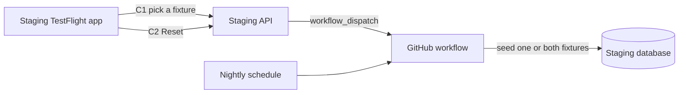

# staging-fixtures — spec
> md · ticket none

## Idea

**Why.** The owner and the QA team need to feel what the app is like for a brand new group leader and for one with a lot of content. Today fixtures exist only on the owner's Mac: they seed locally and sign in through a Local-only login, and TestFlight builds can only reach production.

**What success looks like.** A tester installs the staging TestFlight app, picks Fully populated or New group on Profile, and is in that world with no account of their own. When New group is no longer new, they tap Reset. The production app and API behave exactly as before, and at go-live nothing has to be removed from the store build, because it never had this.

**In your words.** "I would like two fixtures: 1. Fully populated 2. New group" → D1, D2. ""Local" is for me, but if myself or my QA team uses the testflight app, they can select "Staging" environment and then see the fixture options below to pick from for testing." → D3, D4. "Once we go live these options will be disabled of course on the profile" → D4, D9.

**The concept.**

**How it fits today.** `npm run fixtures:reset` wipes and seeds fixed ids under one org; its guard refuses anything but a local database. Profile's Local identity signs in through `POST /auth/dev-login`, which takes any email with no password and answers 404 unless `NODE_ENV=development`. The switcher needs `DEV_MODE=YES`, which only Debug has. The Xcode project has only Debug and Release configurations: `Staging.xcconfig` exists, with its own bundle id `com.makeready.app.staging`, but nothing uses it. The API image contains no `fixtures/`, and the same image is promoted to production.

**Approaches considered.** Chosen: a separate staging app, a key-gated login limited to fixture accounts, and seeding from a GitHub workflow. Rejected: `DEV_MODE=YES` in Release (one flag from store users); enabling dev-login on staging (any user's account, no password); the seeder inside the API image (data-deleting code and 84 MB of images in the production image); one copy per tester (fixed ids make that a rebuild).

## Apps

| App | In scope | What changes | Section |
|---|---|---|---|
| server | ✅ | Fixture login and reset endpoints, New group scenario, guard, GitHub workflow | §server |
| client | ⬜ | No web surface: fixtures are picked in the iPhone app only | — |
| iphone | ✅ | Staging build configuration and scheme, Profile fixture picker and Reset | §iphone |

**Sequencing:** contract settled → server implements and verifies (contract FREEZES) → iphone builds against it → the owner's staging walk.

**Backward compatibility:** additive. A released iPhone build never calls C1 or C2, and both answer 404 wherever the flag is unset, production included.

**Blast radius:** `server/fixtures/guard.ts` protects every database from a wipe, and `wipe.ts` runs against a shared staging database that may hold real data (D7, D8). `AuthManager.signIn` is shared by every build; only the staging build takes the new path.

**Prerequisite (owner):** staging must deploy again. `build-api-image.yml` fails with Railway `Not Authorized` until `RAILWAY_API_TOKEN` is replaced, so nothing here reaches QA before that (F1).

## Decisions

<!-- The one place rulings live. Record the DECISION — and, in one line, why, and why the rejected option lost. A stated preference
     is the INPUT to a row, not the row. Write each Ruling as something later code can be checked
     against without re-interpretation:
       · positive and specific — "store the full number, mask at render", not "don't truncate"
       · scope named — which apps, screens or endpoints it binds
       · "etc." / "and so on" expanded into the list, or the test for membership stated
       · the rejected alternative named, with the reason it lost (check-obligations warns on a bare one)
       · the enforcement hook, where one exists (lint rule, script, test)
     🔴 NEVER quote the user's prompt as the ruling. Operationalize it: a closed list, a measured
     value, an enumerated set of deviations. A ruling a stranger could implement two ways is not
     written yet.
     Who/date carries the provenance, so the Ruling itself needs no quote marks.
     The owner's own words go in §Idea "In your words", linked to this row — never in the Ruling.
     OPEN rows block the build go-ahead. Never delete a ruling; supersede it in place with a date. -->

| # | Decision | Ruling | Who / date |
|---|---|---|---|
| D1 | The two fixtures | Closed list, in this order: `full` shown as "Fully populated", the existing `full` scenario and `fixtures@makeready.local`; `new-group` shown as "New group", a new scenario with its own user and org ids. Both exist at once on staging, and resetting one never touches the other. Rejected: one scenario at a time (a reset for one tester would replace everyone's world). | owner 2026-11-05 |
| D2 | What New group contains | A new user `fixtures-new@makeready.local`, Owner of a new org `New Group Fixtures`, with one active group `My First Group`, and no members, programs, enrollments, events, posts or media of its own. Rejected: the existing `empty` scenario (its base world has 24 members and is not new). | (assumed at spec) 2026-11-05 |
| D3 | How TestFlight reaches staging | A new Xcode build configuration `Staging` over `Staging.xcconfig` and a shared scheme `MakeReady Staging` that archives with it, published as its own TestFlight app under the existing bundle id `com.makeready.app.staging`, named MakeReady-Staging. `MakeReady` and Release are unchanged. Rejected: `DEV_MODE=YES` in Release (one flag from store users). | owner 2026-11-05 |
| D4 | Where the picker shows | The Profile stopgap (`ProfileStopgapContainer`), only when the build has a fixture key and the selected environment is Staging: a group titled "Test data" with one `RadioOptionRow` per D1 fixture and a Reset action. A Release or Debug build has no key, so it never shows. Rejected: showing in Debug (Local keeps its own identity picker). | owner 2026-11-05 |
| D5 | Environments in the staging build | `Staging.xcconfig` sets `DEV_MODE = YES`. The switcher lists Staging and Production only, because Local cannot be reached from a tester's phone, and the first launch selects Staging. | (assumed at spec) 2026-11-05 |
| D6 | Signing in | C1, on the staging API only. It answers only for D1's two accounts, takes no email, and requires the `FIXTURE_LOGIN_ENABLED=true` server setting plus a matching `X-Fixture-Key`, compared in constant time. Anything else is the same 404 as an unknown route. `/auth/dev-login` stays Local-only. On Staging in the staging build, `AuthManager.signIn` uses C1 with the selected fixture, default `full`, and never opens Google. Rejected: dev-login on staging (signs in as any user with no password). | owner 2026-11-05 |
| D7 | Shared accounts | Every tester on a fixture signs in to the same account and sees the same data. Rejected: one copy per tester (fixed ids make that a rebuild; the team is small). | owner 2026-11-05 |
| D8 | Guard | `checkGuard` keeps its local rule and adds exactly one more way through: `FIXTURES_TARGET=staging`, and `DATABASE_URL` and `DIRECT_URL` hosts both equal to `FIXTURES_STAGING_DB_HOST`. Nothing is removed, and `reset` deletes only rows under fixed fixture ids, because staging's contents are unknown and may be real. Rejected: removing the guard (it is what stops a production wipe). | owner 2026-11-05 |
| D9 | Going live | Stop publishing the staging app and unset `FIXTURE_LOGIN_ENABLED`. No store build ever contains a fixture key, and production never sets the flag. | owner 2026-11-05 |
| D10 | Reset | GitHub workflow `reset-staging-fixtures.yml` runs nightly at 08:00 UTC for both fixtures and on `workflow_dispatch` with input `fixture` = `full`, `new-group` or `all`, with one concurrency group so runs queue. Seeding never runs inside the API image. Rejected: seeder in the image (data-deleting code and 84 MB of images promoted to production). | owner 2026-11-05 |
| D11 | Reset button | C2 lets a tester start a reset of the fixture they are on, and the staging server dispatches D10's workflow with `FIXTURE_RESET_GITHUB_TOKEN`, scoped to Actions on this repo. The app shows "Reset started. This takes a few minutes and affects everyone on this fixture." after a confirm, with no progress tracking. Rejected: nightly only (QA would wait a day or ask the owner). | owner 2026-11-05 |
| D12 | During a reset | The fixture's rows are briefly gone, so a tester on it may see empty lists, or be signed out and able to sign in again once it finishes. C1 answers `fixtures_not_seeded` until the user exists, and the app shows "This test data is being reset. Try again in a few minutes." Accepted over locking testers out: a small team, a short window. | (assumed at spec) 2026-11-05 |
| D13 | Secrets | `X-Fixture-Key` comes from a git-ignored `Staging.local.xcconfig` that `Staging.xcconfig` optionally includes, and reaches the app through `Info.plist`. It ships inside the staging binary, so it is a gate, not a secret: it opens only the fixture accounts on staging, and rotating the server setting and rebuilding revokes it. | (assumed at spec) 2026-11-05 |

## Contract

| Contract | Producer | Consumers | Auth | Request | Response | Errors |
|---|---|---|---|---|---|---|
| C1 `POST /auth/fixture-login` | server | iphone | `X-Fixture-Key` + `FIXTURE_LOGIN_ENABLED=true` | `{ fixture: "full" \| "new-group" }` | 200, same body as `/auth/dev-login`: `{ success: true, user: { id, email, name, avatarURL }, sessionCookie }` | 404 flag unset or wrong key; 400 unknown fixture; 404 `{ success: false, error: "fixtures_not_seeded" }` when its user is missing; rate-limited as other auth routes |
| C2 `POST /auth/fixture-reset` | server | iphone | as C1 | `{ fixture: "full" \| "new-group" }` | 202 `{ success: true }` once GitHub accepts the dispatch | 404 flag unset or wrong key; 400 unknown fixture; 502 `{ success: false, error: "reset_unavailable" }` when GitHub refuses or no token is set; rate-limited as other auth routes |

## Schema & API changes

No schema change (established 2026-11-05).

**Data plan:** no migration. The workflow writes rows only under fixed fixture ids on staging; `new-group`'s ids are new `fixtureId` values. Nothing existing is backfilled.

## server

- **Routes:** C1 and C2 sit in `routes/auth.ts` beside dev-login, behind the existing `authLimiter`, and look identical to an unknown route until both gates pass. C1 maps the fixture to a fixed email and creates a session as dev-login does.
- **Runner:** `fixtures:reset -- new-group` seeds D2 and wipes only its own user and org. `full`'s wipe never touches those ids (D1).
- **Guard:** D8, in `guard.ts`, unit-tested with a production-looking URL refused.
- **Workflow:** checks out the repo, installs `server/`, generates Prisma, sets `NODE_ENV=development`, `FIXTURES_TARGET=staging` and staging secrets, and runs the reset. Images use `FIXTURE_IMAGES=off` unless staging's own R2 settings are present (F2).
- **Server settings (staging only):** `FIXTURE_LOGIN_ENABLED`, `FIXTURE_ACCESS_KEY`, `FIXTURE_RESET_GITHUB_TOKEN`. GitHub secrets: `STAGING_DATABASE_URL`, `STAGING_DIRECT_URL`, `FIXTURES_STAGING_DB_HOST`.

## iphone

- **Build:** the `Staging` configuration and `MakeReady Staging` scheme of D3. `FIXTURE_ACCESS_KEY` joins `Info.plist` and is empty in Debug and Release. Staging's `SWIFT_ACTIVE_COMPILATION_CONDITIONS = STAGING` replaces, not joins, `DEBUG`; any `#if DEBUG` the build relies on is re-checked at plan.
- **Config:** `AppConfiguration.fixtureAccessKey`, and a persisted `StagingFixture` beside `DevLoginIdentity` (`full`, `new-group`, title, default `full`).
- **Auth:** `AuthManager.fixtureLogin(_:)` stores the session as `devLogin` does; `signIn` routes by D6.
- **Profile:** the stopgap's Test data group reuses `RadioOptionRow`, as `identityPicker` does, and `PageActionButton` for Reset with a confirm. Picking a fixture signs out and in as it, through `EnvironmentActions`. The stopgap is not a d2m file, so no d2m change. No `.sheet`, `.fullScreenCover` or `asyncAfter`.

## Testing

**server (vitest, never `makeready_dev`):** C1 and C2 both answer 404 with the flag unset, with no key and with a wrong key; C1 signs in only the two accounts and ignores an email in the body; 400 on an unknown fixture; `fixtures_not_seeded`; C2 dispatches the right input and answers 502 when GitHub refuses, with `fetch` stubbed. Guard: staging rule passes only with all three settings and matching hosts, and a production-looking host is refused. `reset -- new-group` then `reset -- full` leaves both worlds intact, and D2's world has no programs, enrollments, events, posts or media.

**iphone (XCTest):** the picker shows only with a key on Staging; the switcher omits Local in the staging build; `signIn` routes to C1 on Staging with a key, and to the existing paths otherwise; decode of C1; D12's message on `fixtures_not_seeded`.

**Cross-app walk (the staging TestFlight app against staging, by the owner):**
1. Fresh install: the app opens on Staging, and sign-in lands in Fully populated with no Google screen.
2. Profile shows Test data with both fixtures. Pick New group: an empty world with one group.
3. Create something in New group, tap Reset and confirm: the message shows, and after a few minutes the world is new again, with Fully populated unchanged.
4. Switch to Production: Test data disappears and sign-in is Google.
5. The production TestFlight app: no switcher, and C1 against production is a 404.

## Out of scope

- A New group option on Local: the owner keeps the Local identity picker (owner 2026-11-05).
- Per-tester copies (D7).
- Reset progress or completion in the app (D11).
- Web fixtures.
- Fixing the failing `invitations` and `enrollment-create` CI tests, which fail on `main` already.

## Findings & risks

| # | Finding | Resolution |
|---|---|---|
| F1 | Staging deploys fail with Railway `Not Authorized`, on 2026-11-02 and 2026-11-05. | Owner replaces `RAILWAY_API_TOKEN`. Blocks the walk, not the build. |
| F2 | Staging's R2 bucket is not known to be separate from production's. Fixture images must not land in a production bucket. | `build-time risk`: settled at the workflow task. Images stay off until the owner confirms a separate bucket, so fixtures may show no pictures. |
| F3 | Staging's database contents are unknown (asked, not yet answered) and it needs to be reachable from GitHub Actions. | D8 keeps writes to fixed ids. `build-time risk`: the workflow task confirms a public staging connection exists. |
| F4 | The staging app needs an App Store Connect record, an App ID and any push capability for `com.makeready.app.staging`. | Owner step before the first TestFlight upload. |
| F5 | The workflow seeds from the checked-out branch, so it needs staging's schema to match. A stale staging deploy would fail the seed. | Follows F1. The workflow fails visibly rather than half-seeding. |
