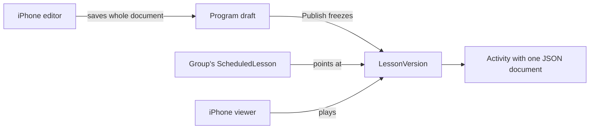

# text-activity — spec
> lg · no ticket

## Idea

**Why.** MakeReady's activities were built for the 1.0 app: separate program and group table sets, one
fixed shape per type, and text that only worked at one size. The new app has zero users, so it can be
rebuilt properly. Leaders need to compose a text activity once and have it look the same on every
phone, then play the whole lesson as a full-screen stack, moving freely up and down.

**What success looks like.** A leader taps Text in a lesson, composes on the canvas, saves and reopens
it unchanged. They tap Play and swipe through that lesson's activities with the snap behavior measured
in `docs/features/activity-viewer/01-experience.md`. Existing production content is there, converted.
One data model remains: the old tables, routes and services are gone.

**In your words.**
"the current activity structure is irrelevant in the old 1.0 app" → D1, D2
"The most important thing is that I can freely navigate up and down." → D9, D10
"do not touch the member experience yet" → D6, D7

**The concept.**



Lesson content is a sequence of frozen versions, and only a draft can be edited. A group points at a
version, so syncing moves a pointer and copies nothing. Each activity keeps a permanent `activityKey`.
An activity's content is one document with separate background, content and actions layers, in width
units, so it renders identically at any width.

**How it fits today.** The components are already rebuilt and captured: `ActivitiesEditorScreen`,
C-091, C-092, C-094 and the bundled fonts (commit 75947100 on `docs/activity-viewer`). They're
preview-only, so nothing opens them.[^1] `ActivityNewScreen` is routed on
`feature/program-lesson-add-activity` with inert tiles.[^2] The server keeps program and group content
in parallel tables with 17 mirrored endpoint pairs.[^3] 36 server files read those models.

**Normative sources, read before any task.** `docs/features/activity-viewer/`: `01-experience.md`
(viewer behavior), `02-content-schema.md` (the document), `05-data-model.md` (tables and operations),
`04-recording-analysis.md` (evidence). Where this spec differs from them, this spec wins.

**Approaches considered.** Chosen: frozen versions plus pointers, because it removes the parallel
tables and needs no progress copy-forward. Rejected: a `document` column on `LessonActivity` (keeps the
1.0 structure for no reason now), separate group copies (two code paths), and three value-sized specs
(recommended, but the owner chose one spec and accepted one long build and walk).

[^1]: `iphone/MakeReadyUI/Screens/Activities/ActivitiesEditorScreen.swift`
[^2]: `iphone/MakeReadyUI/Screens/Activities/ActivityNewScreen.swift`, `docs/features/program-lesson-add-activity/SPEC.md`
[^3]: `server/src/routes/programs.ts:2168-3802`, `server/src/routes/enrollments.ts:3163-4709`

## Apps

| App | In scope | What changes | Section |
|---|---|---|---|
| server | ✅ | New data model and endpoints, 36 files moved or removed, export and import scripts, old tables dropped | §server |
| client | ⬜ | No code changes, by owner ruling (D6). Its member lesson pages and `/admin` activity pages call removed endpoints and stop working at cutover, which D7 accepts | — |
| iphone | ✅ | Models and Actions on the new endpoints, editor wired, leader viewer built and wired | §iphone |

**Sequencing:** contract settled → server implements and verifies (contract FREEZES) → iphone builds
against it → d2m builds the viewer views iphone wires → dry-run export, owner reads the report →
cutover. Client has no phase.

**Backward compatibility:** none needed (D1). There are no users. An installed TestFlight build's
program and lesson screens fail after cutover, so install a new build. For future kinds, the new client
decodes the envelope first and shows the fallback page for an unknown kind (D11).

**Blast radius:** every reader of the old models: 36 server files (table under §server), 16 iPhone
Actions, Models and UI2 files, and client's member and admin lesson pages (D7). Fixtures and server
tests that seed these models move with them.

## Decisions

<!-- The one place rulings live. Record the DECISION — and, in one line, why, and why the rejected option lost. A stated preference
     is the INPUT to a row, not the row. Write each Ruling as something later code can be checked
     against without re-interpretation:
       · positive and specific — "store the full number, mask at render", not "don't truncate"
       · scope named — which apps, screens or endpoints it binds
       · "etc." / "and so on" expanded into the list, or the test for membership stated
       · the rejected alternative named, with the reason it lost (check-obligations warns on a bare one)
       · the enforcement hook, where one exists (lint rule, script, test)
     🔴 NEVER quote the user's prompt as the ruling. Operationalize it: a closed list, a measured
     value, an enumerated set of deviations. A ruling a stranger could implement two ways is not
     written yet.
     Who/date carries the provenance, so the Ruling itself needs no quote marks.
     The owner's own words go in §Idea "In your words", linked to this row — never in the Ruling.
     OPEN rows block the build go-ahead. Never delete a ruling; supersede it in place with a date. -->

| # | Decision | Ruling | Who / date |
|---|---|---|---|
| D1 | Legacy | No compatibility work for 1.0 clients, data or structures: no version headers, dual reads or transition states. Why: zero users. Rejected: staged migration with old clients served (protects nobody) | owner 2026-11-06 |
| D2 | Data model | The tables and operations in `05-data-model.md` §2–§5 as written, except where D7, D8 and D13 narrow them. Why: one code path for program and group content. Rejected: separate group copies (two code paths, needs progress copy-forward) | owner 2026-11-06 |
| D3 | Document | Every activity's content is one document per `02-content-schema.md`, saved whole on Done, validated by zod on write, max 256 KB. Why: portable, and matches saved-whole. Rejected: normalized text-object tables (nothing queries inside them) | owner 2026-11-06 |
| D4 | Group edits | When group customization ships, Done publishes to that group at once. No fork endpoint or UI in this spec, since nothing consumes it. Why: same mechanism as programs, without a forgotten-publish step. Rejected: separate publish step for groups (extra step for small fixes) | owner 2026-11-06 |
| D5 | Sync on a customized lesson | Sync skips a lesson whose current version has `enrollmentId` set, and reports it. Why: never overwrite a group's edits. Rejected: overwrite on sync (loses leader work) | (assumed at spec) 2026-11-06 |
| D6 | Member experience | This spec makes no change to `client/`, and builds no member app, member endpoint, `viewer-core` TypeScript or React. The owner's plan is React + MobX later, and `01` §12 documents it. Rejected: viewer-only React app, viewer plus lesson list, full member rebuild (all offered; owner declined) | owner 2026-11-06 |
| D7 | Cutover | This spec runs the export and drops the old tables and routes. Client's member lesson pages and `/admin` activity pages then fail until a member rebuild. Why: one model and no users. Rejected: keep the old tables until the rebuild (Vue would run on stale content while two models are carried) | owner 2026-11-06 |
| D8 | Member data at cutover | `LessonProgress` and `ActivityProgress` are created empty, because analytics and dashboards read them, and nothing writes them until a member rebuild. `Prayer`, `ActivityResponse` and member progress endpoints are not built, since no consumer exists. Rejected: build them now (unused and untested) | (assumed at spec) 2026-11-06 |
| D9 | Viewer platform | The native iPhone viewer is for leaders. It writes no progress, and action sheets open with Save disabled and a "Preview" label. Built to `01` in full. Rejected: members on iOS now (needs member login and progress); leaders only permanently (closes a future option for nothing) | owner 2026-11-06 |
| D10 | Viewer engine | A pure Swift state machine implementing `01` §4–§8, with no UI imports, driven by one `UIPanGestureRecognizer` and `CADisplayLink`, rendering with layer transforms. Test vectors live in a JSON file the future TypeScript engine loads too. Rejected: `UIScrollView` paging or `ScrollTargetBehavior` (curve can't be set; can't hold ownership across a reversal) | Claude, delegated 2026-11-06 |
| D11 | Unknown kinds | A client decodes the envelope first. An unknown kind, higher `schemaVersion` or malformed document takes a rail slot and shows `fallback`, per `02` §9. Why: installed builds lag the server. Rejected: failing the lesson decode (today's behavior; one activity breaks a lesson) | owner 2026-11-06 |
| D12 | Rail | Bottom right, indicator only, touches pass through, geometry per `01` §8. Rejected: bottom left; tap to jump (5–7 pt targets); drag to scrub (not in the recording) | owner 2026-11-06 |
| D13 | Export scope | Carries programs, lessons, activities, templates and media. Organizations, leader accounts and groups stay in place. Members' enrollments, progress, notes on lessons and analytics rows are dropped. Rejected: carrying enrollments (complexity for test data); fresh accounts (setup cost) | owner 2026-11-06 |
| D14 | Editors | The Text tile creates a `text` activity. The Text editor also opens imported `bible` activities. `video`, `youtube` and `write` play in the viewer and can be reordered and deleted, and tapping one to edit shows "This activity can't be edited yet." Rejected: adding Bible verse creation (needs a new passage picker); all five editors (four undesigned screens) | owner 2026-11-06 |
| D15 | Other tiles | Bible verse, Video, YouTube, Write and Poll tiles stay visible, dimmed and inert, using a new C-086 disabled state from d2m. Rejected: hiding them (C-086 shows every tile always) | Claude, delegated 2026-11-06 |
| D16 | Tile tap | Tapping Text creates the activity at once, titled "Text", and swaps to the editor in place. Backing out of an activity with no objects, default background and no actions deletes it. Rejected: creating on first Done (contradicts the in-place swap) | Claude, delegated 2026-11-06 |
| D17 | First-version editor tools | Tools shown: color, background, alignment, font, actions. `showsHighlightTool`, `showsEffectsTool` and `showsEyedropper` stay false in the container. Rejected: disabled tools (a dead control invites taps) | Claude, delegated 2026-11-06 |
| D18 | Fonts | Document keys `display`, `sans`, `serif`, `mono` → Poppins, Inter, Source Serif 4, Courier Prime. Rejected: SF Pro, Georgia, American Typewriter (not portable) | Claude, delegated 2026-11-06 |
| D19 | Actions | Per-page list. Kinds `addToPrayerList`, `write`, `openUrl`, `nextLesson`, placements `inline` and `pinned`, at most one pinned per page. Authored and stored now; no member data written (D8, D9). Rejected: attaching actions only to `write` activities (a video needs them too) | owner intent, Claude's shape 2026-11-06 |
| D20 | Publish | Publish freezes each changed lesson's draft and writes one `ProgramVersion`; a lesson whose `contentHash` matches its latest version discards its draft. Rejected: stored full snapshots (diff by `activityKey` on demand instead) | owner 2026-11-06 |
| D21 | Viewer design source | Viewer views are built through d2m from `01`, with no Figma frames, using existing tokens. Rejected: waiting for Figma (blocks a behavior-driven screen on a skin; the owner can restyle afterward) | (assumed at spec) 2026-11-06 |
| D22 | Viewer entry | A play glyph in the editor's Idle header opens the viewer on the current activity, using the draft. The close button returns to the editor. Rejected: entry from program home too (more UI; can follow) | (assumed at spec) 2026-11-06 |
| D23 | Completion page | The viewer's last page shows the lesson title, "End of lesson" and Close. No streak or up-next card, since leaders have no streak. Rejected: the full recorded page (member-only content) | (assumed at spec) 2026-11-06 |
| D24 | YouTube playback | A `youtube` page uses a `WKWebView` limited to YouTube's IFrame player, paused at the midline, because YouTube's terms require its player. Controls are YouTube's. Rejected: thumbnail only (leaders couldn't check the clip) | (assumed at spec) 2026-11-06 |
| D25 | Write in the viewer | A `write` page shows its prompt and a disabled field labeled "Preview". Rejected: an enabled field (nothing can save it, D9) | (assumed at spec) 2026-11-06 |
| D26 | Rail slide | A lesson rail slide for a canvas kind renders the document with C-092 viewer mode at thumbnail scale. Rejected: stored screenshots (stale, needs image pipeline) | (assumed at brainstorm) |
| D27 | Destructive step | Dropping old tables is one final migration in its own task. Production cutover is run by the owner from a written runbook, after a verified `pg_dump`. Agents never run it. Rejected: dropping in the first migration (leaves no window to verify the import) | (assumed at spec) 2026-11-06 |
| D28 | Order against program-lesson-add-activity | That branch merges to main before iPhone wiring starts, because this spec's picker entry lives there. The d2m rebuild didn't wait for it. Rejected: stacking on the unmerged branch (memory rule, and merges into main always ask) | Claude, delegated 2026-11-06 |

## Contract

Producer: server. Consumer: iphone. Auth: session cookie plus `canManageOrgContent` on the owning
organization, checked in the service. Errors share `{ success: false, error, code }`.

| Contract | Producer | Consumers | Auth | Request | Response | Errors |
|---|---|---|---|---|---|---|
| `GET /api/lessons/:id/draft` | server | iphone (editor, picker, rail) | org content | — | `{ version: LessonVersion, activities: Activity[], media: MediaMap }`. Creates the draft from the latest published version if none exists, keeping keys | 403, 404 |
| `GET /api/lesson-versions/:id` | server | iphone (viewer) | org content | — | Same shape as above, read-only | 403, 404 |
| `POST /api/lesson-versions/:id/activities` | server | iphone (Text tile) | org content | `{ kind, title, document }` | `{ activity }`, new `activityKey`, appended | 400 `VALIDATION`, 403, 404, 409 `NOT_DRAFT` |
| `PUT /api/activities/:id` | server | iphone (editor Done) | org content | `{ title?, document }`, whole document | `{ activity, media }` | 400 `VALIDATION`, 403, 404, 409 `NOT_DRAFT`, 413 `TOO_LARGE` |
| `DELETE /api/activities/:id` | server | iphone (empty back-out, rail delete) | org content | — | `{ success: true }`, positions closed up | 403, 404, 409 `NOT_DRAFT` |
| `PATCH /api/lesson-versions/:id/activities/order` | server | iphone (rail reorder) | org content | `{ activityIds: string[] }`, exact set | `{ activities }` | 400 `VALIDATION`, 403, 404, 409 `NOT_DRAFT` |
| `POST /api/programs/:id/publish` | server | iphone (publish) | org content | `{ changeSummary? }` | `{ programVersion, changedLessonIds }` | 400 `VALIDATION`, 403, 404 |
| `GET /api/programs/:id` (changed) | server | iphone (program home) | org content | — | Lessons each carry `draftVersionId`, `publishedVersionId`, and `activities: ActivitySummary[]` | 403, 404 |
| `GET /api/scheduled-lessons/:id` | server | iphone (enrollment home) | org content | — | `{ scheduledLesson, version, activities, media }` from `currentVersionId` | 403, 404 |
| `GET /api/enrollments/:id/sync`, `/sync/changes`, `POST /sync/apply` (changed) | server | iphone (enrollment sync) | org content | As today | Same fields, computed from pointers; adds `skippedCustomizedLessonIds` (D5) | 403, 404 |

**Shapes.**

```ts
Activity        { id, lessonVersionId, activityKey, position, kind, title, document, estimatedSeconds }
ActivitySummary { id, activityKey, position, kind, title, thumbnailMediaId? }
LessonVersion   { id, lessonId, enrollmentId, number, status: 'DRAFT'|'PUBLISHED', title, estimatedSeconds, publishedAt }
MediaMap        { [mediaId]: { url, width?, height?, kind: 'image'|'video', playbackUrl? } }
```

`document` is `02-content-schema.md` §2. Server writes validate strictly; unknown fields are preserved,
never stripped. iPhone reads are lenient (D11).

## Schema & API changes

| # | ADD/EDIT/RENAME/REMOVE | Model.field | Wire | Reason | Status |
|---|---|---|---|---|---|
| 1 | ADD | `LessonVersion`, `Activity`, `ProgramVersion`, `ProgramVersionLesson`, `ScheduledLesson`, `LessonProgress`, `ActivityProgress` | §Contract | `05` §2 | todo |
| 2 | EDIT | `Lesson`: `studyProgramId` → `programId`, `dayNumber` → `position`, drop `title`, `estimatedMinutes` | `GET /api/programs/:id` | Content moves to versions | todo |
| 3 | EDIT | `Enrollment.syncedProgramVersionNumber` → `programVersionId` | sync endpoints | Pointer | todo |
| 4 | EDIT | `StudyProgram.currentVersionNumber` → `currentVersionId` | `GET /api/programs/:id` | Pointer | todo |
| 5 | EDIT | `Event`, `AiLessonSummary`: FK to `ScheduledLesson` | none | Renamed parent | todo |
| 6 | EDIT | `LessonTemplateActivity`: add `kind`, `document` | templates routes | Starter documents | todo |
| 7 | EDIT | `MediaUsage.usageType` gains `ACTIVITY`, derived on save | none | JSON can't hold an FK; protects media from delete | todo |
| 8 | REMOVE | `LessonActivity`, `ScheduledLessonActivity`, `ActivityReadBlock`, `ContentHighlight`, `ActivitySourceReference`, `TextTheme`, `LessonSchedule`, `LessonScheduleVersion`, `MemberActivityProgress`, `MemberVideoProgress`, `MemberLessonProgress`, `StudyProgramVersion`, `EnrollmentSyncRun` | The 34 mirrored endpoints, theme routes, member-lesson routes | Replaced | todo |
| 9 | REMOVE | `TemplateActivityType` | `kind` is validated text | A new kind needs no migration | todo |

**Data plan:** Old rows are read once by the export (§server) and imported into the new tables. New
tables use TEXT ids and FKs on the id-type pattern that dev and production need. REMOVE rows run as one
final migration after import verification (D27), with a `pg_dump` taken first, which is the only undo.
Rows in 2–5 are created by new tables, with old columns dropped in that same final migration. Dropped
without carry-over: enrollment and member rows (D13), `StudyNote` links to removed activities stay as
inert text references.

## server

**New.** Thin routes in `routes/lesson-versions.ts` and `routes/scheduled-lessons.ts`. Logic in
`services/lesson-version.service.ts`, `services/activity-document.ts` (zod per `02`, derived media and
passage extraction) and `services/program-publish.service.ts`, authorizing with `canManageOrgContent`
in the service.

**The 36 files that read old models:**

| Disposition | Files |
|---|---|
| Rewrite on the new model | `routes/programs.ts`, `routes/enrollments.ts`, `routes/search.ts`, `routes/notes.ts`, `routes/analytics.ts`, `routes/engagement.ts`, `routes/status.ts`, `lib/og-meta.ts`, `lib/study-code.ts`, `middleware/request-logger.ts` |
| Rewrite on the new model | `services/`: `analytics`, `enrollment-analytics`, `enrollment-directory`, `enrollment-edit`, `enrollment-sync`, `enrollment-sync-changes`, `home-dashboard`, `home-following`, `home-sessions`, `lesson-copy`, `lesson-estimate`, `lesson-summary`, `master-search`, `member-engagement`, `notes`, `program-export`, `study-program-publish` |
| Delete | `routes/activity-progress.ts`, `routes/member-lessons.ts`, `routes/study-preview.ts`, `services/member-progress.service.ts`, `services/lesson-content-hash.ts` (replaced by a document hash), `services/lesson-version-resolution.ts`, `scripts/backfill-highlights.ts`, `scripts/backfill-lesson-estimates.ts`, `scripts/backfill-study-sync.ts` |

Search and AI summaries read text from `role` and `text` in documents, and scripture from `passages`.
Analytics stays compiled and reports empty member activity until a member rebuild writes it. The
analytics materialized view is redefined on `ScheduledLesson` and `activityKey`.

**Export and import.** `scripts/content-export.ts` reads a dump restored to a scratch database and
writes a JSON bundle plus a report. `scripts/content-import.ts` loads the bundle and is safe to re-run,
keyed by `activityKey` = the old `LessonActivity.id`. Mapping is `05` §6, in full. The report lists
counts by program, old type and new kind, plus everything converted with loss. Neither script accepts a
production `DATABASE_URL` unless passed `--confirm-production`.

## iphone

**State.** `Activity` and `LessonVersion` models replace `StudyActivity`, `LessonModels` and scheduled
activity models. `ActivityDocument` decodes the envelope first and keeps unknown fields for re-saving
(D11). `AppState` gains `activities: EntityStore<Activity>` keyed by id and `lessonVersions`, cleared in
`clearInMemory()`. New `ActivityActions` replaces the read-block, highlight, theme and source-reference
methods in `ProgramActions+Activities.swift`. Actions write state and return `Void`. Remove
`ThemeActions`. `EnrollmentActions`, `HomeActions` and `DashboardActions` move to the new shapes.

**Editor wiring.** New in `MakeReady/UI2/Containers/Programs/`:

- `ActivityNewContainer` (exists on the D28 branch): the Text tile runs D16, and other tiles are inert (D15).
- `ActivitiesEditorContainer`: maps store → `ActivitiesEditorScreen.State`, sets D17's flags, owns the
  edit buffer, and saves on Done per the screen's optimistic rule. A failed save shows "Couldn't save
  activity" with Retry and Discard changes (`/ios-error-surface`). Background and Actions sheets present
  through typed `Route`s (`/present-overlay`). Background images come from the media library flow.
- `StudyProgramHomeMapper`: rail slides per D26.

**Viewer.**

- `MakeReady/UI2/Viewer/ViewerEngine.swift` (D10) and `viewer-engine-vectors.json`: `01` §4–§8 and
  every vector in `01` §13, loaded by `ViewerEngineTests`.
- Views through d2m (D21): the existing `activities-player` queue row retargeted to iOS, and new rows for
  **(new)** the rail, **(new)** viewer chrome, **(new)** the video page with scrubber and presenter row,
  **(new)** the end page (D23), **(new)** the action sheet in preview (D9). Approving this spec approves
  building them. `CanvasTextObject` viewer mode, C-091 and C-094 exist and fit.
- `ActivityViewerContainer`: full-screen route per `/present-overlay`, loads through `GET
  /api/lesson-versions/:id`, keeps the active page and one neighbor each side mounted, and `AVPlayer` for
  the active ±1.
- Video follows `01` §9 (autoplay, pause at the midline, position kept). The presenter row shows the
  uploader's name and the activity's reference line, with no Follow button.

**Fixtures.** `server/fixtures/screens/activities-editor.ts` and `activities-player.ts`, whose `full`
scenarios hold each kind, a long page, a background image and both action placements.

**Project.** `makereadyui-sync.rb` already adds fonts as resources. `Info.plist` isn't touched.

## Testing

**server.** Service tests per operation in `05` §3: draft creation keeps keys; publish freezes and skips
unchanged lessons; a frozen version refuses writes (409); sync moves pointers and removes lessons per the
progress rule; sync skips customized lessons; `document` validation accepts every example in `02` and
preserves unknown fields; 256 KB limit; media usage derived on save and blocking delete. Import tests
on a fixture dump covering every row of `05` §6's table, and idempotence. Tests never touch
`makeready_dev`.

**iphone.** `ViewerEngineTests` runs the shared vectors. Decoder tests: unknown kind, higher
`schemaVersion`, malformed document, and unknown fields surviving a save. Action tests for store updates.
UTF-16 offsets with emoji through `C-092`.

**E2E walk (one).** Leader signs in on a fixture program → opens a lesson → adds Text → composes two
objects with a font, weight, color and alignment → sets background color and image with a focal point →
adds an inline action → Done → relaunch, reopen, unchanged → tap Play → swipe through all kinds → Close
→ publish → enrolls a group → edits the lesson, publishes, sync moves the group.

**Human verification script.** Stills can't prove these, so the walk does them on a device:

1. **Hold:** drag a page 70 % across and hold. Nothing commits. Lift to settle.
2. **Reversal:** at a long article's end, pull up, reverse without lifting. The page slides to the
   previous one with its text frozen.
3. **Retained position:** leave a long page mid-scroll, come back, it's where it was.
4. **Video:** pauses and resumes exactly at the midline; position kept; scrubbing doesn't move the page.
5. **Rail:** capsule moves at the midline, thumb tracks a long page, rail fades on a playing video.
6. **Feel:** record at 60 fps. Each settle lasts 0.3–0.45 s with no overshoot (`04` method).
7. **Editor:** scroll past the bars, autoscroll while dragging, no jump at drag start, keyboard carries the
   bottom bar, Done then reopen unchanged.
8. **Every phone:** compose a multi-line page on the largest phone, open on a 375 pt simulator. Same line
   breaks, with a portrait background image covering the page.
9. **Export:** read the dry-run report before cutover, and spot-check three converted programs in the viewer.

## Out of scope

- Everything member-facing: React or MobX code, `viewer-core` TypeScript, member login, member endpoints,
  `Prayer`, `ActivityResponse`, streaks (D6, D8). `client/` isn't edited, including its broken lesson pages.
- Group customization's fork endpoint and UI (D4).
- Editors for Bible verse creation, video, YouTube, write, and poll entirely (D14).
- Text highlights and notes, animations, effects, eyedropper, parallax controls (D17). The document
  already stores them.
- Narration, word-by-word reveal, comments, reactions, landscape, tablet layouts.
- Deciding the member app's hosting and login, left for the member rebuild.

## Findings & risks

| # | Finding | Resolution |
|---|---|---|
| F1 | Web lessons and `/admin` activity pages stop at cutover with no replacement date | Accepted by the owner (D7) |
| F2 | The owner has uncommitted edits to `EnrollmentSelectProgramScreen.swift`, `EnrollSelectProgramContainer.swift` and `Info.plist`, and the main checkout holds uncommitted copies of commit 75947100's files | build-time risk: resolve before a merge into main; the first phase confirms the branch base |
| F3 | The export's single-column layout for imported `READ` text is a starting point, not a design | Accepted (`05` §6); the report lists affected activities |
| F4 | The viewer's velocity constant 0.25 and spring ω = 20 are measured brackets, not exact | build-time risk: the viewer engine task tunes them on a device against `01` §13's feel check, and records the values |
| F5 | This is one spec spanning a data model, 36 server files and a new viewer | Accepted by the owner; the plan's phases keep each gate separate |
| F6 | Highlight border comment on `activities-editor` conflicts with OQ-C-091-001 | Rides: highlights aren't in this spec; owner rules when they ship |
| F7 | Imported rows reference `Video` and `Media` as they stand; a missing row or dead URL would be silently bare | The report lists every unresolved reference |
