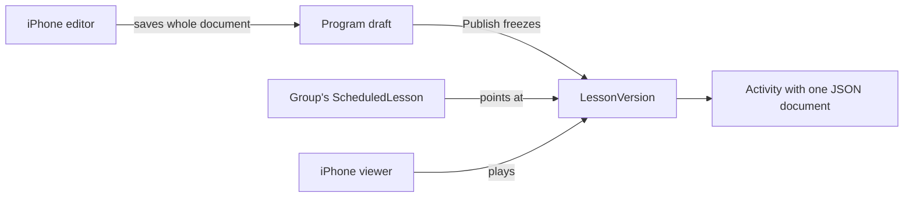

# text-activity — spec
> lg · no ticket

## Idea

**Why.** MakeReady's activities were built for the 1.0 app: separate program and group table sets, one
fixed shape per type, and text that only worked at one size. The new app has zero users, so it can be
rebuilt properly. Leaders need to compose a text activity once and have it look the same on every
phone, then play the whole lesson as a full-screen stack, moving freely up and down.

**What success looks like.** A leader taps Text in a lesson, composes on the canvas, saves and reopens
it unchanged. They tap Play and swipe through that lesson's activities with the snap behavior measured
in `docs/features/activity-viewer/01-experience.md`. Existing production content is there, converted.
One data model remains: the old tables, routes and services are gone.

**In your words.**
"the current activity structure is irrelevant in the old 1.0 app" → D1, D2
"The most important thing is that I can freely navigate up and down." → D9, D10
"do not touch the member experience yet" → D6, D7

**The concept.**



Lesson content is a sequence of frozen versions, and only a draft can be edited. A group points at a
version, so syncing moves a pointer and copies nothing. Each activity keeps a permanent `activityKey`.
An activity's content is one document with separate background, content and actions layers, in width
units, so it renders identically at any width.

**How it fits today.** The components are already rebuilt and captured: `ActivitiesEditorScreen`,
C-091, C-092, C-094 and the bundled fonts (commit 75947100). The viewer's views are built too:
`ActivitiesPlayerScreen` and C-133–C-139 (rail, chrome, video page, end page, action-sheet preview,
inline action row, pinned action pill), plus C-086's unavailable tiles (commit 19e03e26). They're
preview-only, so nothing opens them.[^1] `ActivityNewScreen` is routed on main (`.activityNew`) with
inert tiles.[^2] The server keeps program and group content in parallel tables with about 20 mirrored
endpoints per side.[^3] 45 server source files read those models (§server).

**Normative sources, read before any task.** `docs/features/activity-viewer/`: `01-experience.md`
(viewer behavior), `02-content-schema.md` (the document), `05-data-model.md` (tables and operations),
`04-recording-analysis.md` (evidence). Where this spec differs from them, this spec wins.

**Approaches considered.** Chosen: frozen versions plus pointers, because it removes the parallel
tables and needs no progress copy-forward. Rejected: a `document` column on `LessonActivity` (keeps the
1.0 structure for no reason now), separate group copies (two code paths), and three value-sized specs
(recommended, but the owner chose one spec and accepted one long build and walk).

[^1]: `iphone/MakeReadyUI/Screens/Activities/ActivitiesEditorScreen.swift`
[^2]: `iphone/MakeReadyUI/Screens/Activities/ActivityNewScreen.swift`, `docs/features/_archive/program-lesson-add-activity/SPEC.md`
[^3]: `server/src/routes/programs.ts:1656-3900`, `server/src/routes/enrollments.ts:3163-4800`

## Apps

| App | In scope | What changes | Section |
|---|---|---|---|
| server | ✅ | New data model and endpoints, 45 source files moved or removed, export and import scripts, old tables dropped by the owner's runbook | §server |
| client | ⬜ | No code changes, by owner ruling (D6). At cutover these surfaces call removed endpoints and stop working, which D7 accepts: member lesson pages, member study home, member group-home lesson cards, the `/join/study/{id}` flow (shared study links and QR codes), every `/preview/*` page, and in `/admin` the program home, enrollment schedule, sync and group-home next-lesson card, plus the legacy admin and the slides bench (F8). Client CI stays green because its tests fake HTTP | — |
| iphone | ✅ | Models, Actions and the disk cache on the new endpoints, editor wired, viewer engine and container built and wired onto the d2m views that already exist | §iphone |

**Sequencing:** contract settled → server implements and verifies (contract FREEZES) → iphone builds
against it, its first task filing the d2m editor changes (D33) → dry-run export, owner reads the
report → cutover by the owner's runbook (D27, D30). Client has no phase.

**Backward compatibility:** none needed (D1). There are no users. An installed TestFlight build's
program and lesson screens fail after cutover, so install a new build. For future kinds, the new client
decodes the envelope first and shows the fallback page for an unknown kind (D11).

**Blast radius:** every reader of the old models: 45 server source files plus scripts and fixtures
(table under §server), about 33 server test files, about 30 compiled iPhone files plus 13 test files
(§iphone), and the client surfaces in the row above (D7). The analytics materialized view, the search
GIN indexes and the server's boot command read them too.

## Decisions

<!-- The one place rulings live. Record the DECISION — and, in one line, why, and why the rejected option lost. A stated preference
     is the INPUT to a row, not the row. Write each Ruling as something later code can be checked
     against without re-interpretation:
       · positive and specific — "store the full number, mask at render", not "don't truncate"
       · scope named — which apps, screens or endpoints it binds
       · "etc." / "and so on" expanded into the list, or the test for membership stated
       · the rejected alternative named, with the reason it lost (check-obligations warns on a bare one)
       · the enforcement hook, where one exists (lint rule, script, test)
     🔴 NEVER quote the user's prompt as the ruling. Operationalize it: a closed list, a measured
     value, an enumerated set of deviations. A ruling a stranger could implement two ways is not
     written yet.
     Who/date carries the provenance, so the Ruling itself needs no quote marks.
     The owner's own words go in §Idea "In your words", linked to this row — never in the Ruling.
     OPEN rows block the build go-ahead. Never delete a ruling; supersede it in place with a date. -->

| # | Decision | Ruling | Who / date |
|---|---|---|---|
| D1 | Legacy | No compatibility work for 1.0 clients, data or structures: no version headers, dual reads or transition states. Why: zero users. Rejected: staged migration with old clients served (protects nobody) | owner 2026-11-06 |
| D2 | Data model | The tables and operations in `05-data-model.md` §2–§5 as written, except where D7, D8 and D13 narrow them. Why: one code path for program and group content. Rejected: separate group copies (two code paths, needs progress copy-forward) | owner 2026-11-06 |
| D3 | Document | Every activity's content is one document per `02-content-schema.md`, saved whole on Done, validated by zod on write, max 256 KB. Why: portable, and matches saved-whole. Rejected: normalized text-object tables (nothing queries inside them) | owner 2026-11-06 |
| D4 | Group edits | When group customization ships, Done publishes to that group at once. No fork endpoint or UI in this spec, since nothing consumes it. Why: same mechanism as programs, without a forgotten-publish step. Rejected: separate publish step for groups (extra step for small fixes) | owner 2026-11-06 |
| D5 | Sync on a customized lesson | Sync skips a lesson whose current version has `enrollmentId` set, and reports it. Why: never overwrite a group's edits. Rejected: overwrite on sync (loses leader work) | (assumed at spec) 2026-11-06 |
| D6 | Member experience | This spec makes no change to `client/`, and builds no member app, member endpoint, `viewer-core` TypeScript or React. The owner's plan is React + MobX later, and `01` §12 documents it. Rejected: viewer-only React app, viewer plus lesson list, full member rebuild (all offered; owner declined) | owner 2026-11-06 |
| D7 | Cutover | This spec runs the export and drops the old tables and routes. Client's member lesson pages and `/admin` activity pages then fail until a member rebuild. Why: one model and no users. Rejected: keep the old tables until the rebuild (Vue would run on stale content while two models are carried) | owner 2026-11-06 |
| D8 | Member data at cutover | `LessonProgress` and `ActivityProgress` are created empty, because analytics and dashboards read them, and nothing writes them until a member rebuild. `Prayer`, `ActivityResponse` and member progress endpoints are not built, since no consumer exists. Rejected: build them now (unused and untested) | (assumed at spec) 2026-11-06 |
| D9 | Viewer platform | The native iPhone viewer is for leaders. It writes no progress, and action sheets open with Save disabled and a "Preview" label. Built to `01` in full. Rejected: members on iOS now (needs member login and progress); leaders only permanently (closes a future option for nothing) | owner 2026-11-06 |
| D10 | Viewer engine | A pure Swift state machine implementing `01` §4–§8, with no UI imports, driven by one `UIPanGestureRecognizer` and `CADisplayLink`, rendering with layer transforms. Test vectors live in a JSON file the future TypeScript engine loads too. Rejected: `UIScrollView` paging or `ScrollTargetBehavior` (curve can't be set; can't hold ownership across a reversal) | Claude, delegated 2026-11-06 |
| D11 | Unknown kinds | A client decodes the envelope first. An unknown kind, higher `schemaVersion` or malformed document takes a rail slot and shows `fallback`, per `02` §9. Why: installed builds lag the server. Rejected: failing the lesson decode (today's behavior; one activity breaks a lesson) | owner 2026-11-06 |
| D12 | Rail | Bottom right, indicator only, touches pass through, geometry per `01` §8. Rejected: bottom left; tap to jump (5–7 pt targets); drag to scrub (not in the recording) | owner 2026-11-06 |
| D13 | Export scope | Carries programs, lessons, activities, templates and media. Organizations, leader accounts and groups stay in place. Members' enrollments, progress, notes on lessons and analytics rows are dropped. Rejected: carrying enrollments (complexity for test data); fresh accounts (setup cost) | owner 2026-11-06 |
| D14 | Editors | The Text tile creates a `text` activity. The Text editor also opens imported `bible` activities. `video`, `youtube` and `write` play in the viewer and can be reordered and deleted, and tapping one to edit shows "This activity can't be edited yet." Rejected: adding Bible verse creation (needs a new passage picker); all five editors (four undesigned screens) | owner 2026-11-06 |
| D15 | Other tiles | Bible verse, Video, YouTube, Write and Poll tiles stay visible, dimmed and inert, through C-086's `unavailableTypes` (built in 19e03e26; `ActivityNewContainer` sets it). Rejected: hiding them (C-086 shows every tile always) | Claude, delegated 2026-11-06 |
| D16 | Tile tap | Tapping Text creates the activity at once, titled "Text", and swaps to the editor in place. Backing out of an activity with no objects, default background and no actions deletes it. Rejected: creating on first Done (contradicts the in-place swap) | Claude, delegated 2026-11-06 |
| D17 | First-version editor tools | Tools shown: color, background, alignment, font, actions. `showsHighlightTool`, `showsEffectsTool` and `showsEyedropper` stay false in the container. Rejected: disabled tools (a dead control invites taps) | Claude, delegated 2026-11-06 |
| D18 | Fonts | Document keys `display`, `sans`, `serif`, `mono` → Poppins, Inter, Source Serif 4, Courier Prime. Rejected: SF Pro, Georgia, American Typewriter (not portable) | Claude, delegated 2026-11-06 |
| D19 | Actions | Per-page list. Kinds `addToPrayerList`, `write`, `openUrl`, `nextLesson`, placements `inline` and `pinned`, at most one pinned per page. Authored and stored now; no member data written (D8, D9). Rejected: attaching actions only to `write` activities (a video needs them too) | owner intent, Claude's shape 2026-11-06 |
| D20 | Publish | Publish freezes each changed lesson's draft and writes one `ProgramVersion`; a lesson whose `contentHash` matches its latest version discards its draft. Rejected: stored full snapshots (diff by `activityKey` on demand instead) | owner 2026-11-06 |
| D21 | Viewer design source | Viewer views are built through d2m from `01`, with no Figma frames, using existing tokens. Met: C-133–C-139 and `ActivitiesPlayerScreen` landed in 19e03e26; this build wires them and adds only the engine and hosts. Rejected: waiting for Figma (blocks a behavior-driven screen on a skin; the owner can restyle afterward) | (assumed at spec) 2026-11-06 |
| D22 | Viewer entry | A play glyph in the editor's Idle header opens the viewer on the current activity, using the draft. The close button returns to the editor. Rejected: entry from program home too (more UI; can follow) | (assumed at spec) 2026-11-06 |
| D23 | Completion page | The viewer's last page shows the lesson title, "End of lesson" and Close. No streak or up-next card, since leaders have no streak. Rejected: the full recorded page (member-only content) | (assumed at spec) 2026-11-06 |
| D24 | YouTube playback | A `youtube` page uses a `WKWebView` limited to YouTube's IFrame player, paused at the midline, because YouTube's terms require its player. Controls are YouTube's. Rejected: thumbnail only (leaders couldn't check the clip) | (assumed at spec) 2026-11-06 |
| D25 | Write in the viewer | A `write` page shows its prompt and a disabled field labeled "Preview". Rejected: an enabled field (nothing can save it, D9) | (assumed at spec) 2026-11-06 |
| D26 | Rail slide | A lesson rail slide for a canvas kind renders the document with C-092 viewer mode at thumbnail scale. Rejected: stored screenshots (stale, needs image pipeline) | (assumed at brainstorm) |
| D27 | Destructive step | Dropping old tables is one final migration in its own task. Production cutover is run by the owner from a written runbook, after a verified `pg_dump`. Agents never run it. Rejected: dropping in the first migration (leaves no window to verify the import) | (assumed at spec) 2026-11-06 |
| D28 | Order against program-lesson-add-activity | That branch merges to main before iPhone wiring starts, because this spec's picker entry lives there. The d2m rebuild didn't wait for it. Met: merged as f107c1ad. Rejected: stacking on the unmerged branch (memory rule, and merges into main always ask) | Claude, delegated 2026-11-06 |
| D29 | Model and route names | The new Prisma model is `ContentActivity` (table `content_activities`), and the iPhone type is `ContentActivity`. Single-activity routes live under `/api/content-activities/:id`. Why: `Activity` is already the feed model (`schema.prisma:1768`), and `/api/activities` is the feed router plus the old activity routes until the drop. Rejected: renaming the feed model (unrelated churn) | auto (recommended) 2026-11-07 |
| D30 | Drop migration gating | The table-drop migration is written and tested in the server phase, then committed under `server/atlas/cutover/`, outside `server/atlas/migrations/`. The owner's runbook moves it in at cutover. The server phase removes `load-themes` and the old backfill scripts from the boot command (`Dockerfile:76`, `package.json:11`). Why: boot runs `migrate apply`, so a drop in the migrations folder would run on the next deploy, not from the runbook. Rejected: a flag inside `migrate apply` (atlas has none per-file) | auto (recommended) 2026-11-07 |
| D31 | One draft per lesson | A hand-managed partial unique index allows one `DRAFT` per `(lessonId, enrollmentId)` with `NULLS NOT DISTINCT`, and the version-number key uses `NULLS NOT DISTINCT` too. It lives in a hand migration skipped in `atlas.hcl`, the `20261104000602` pattern. `GET /draft` inserts, catches P2002 and re-reads. Why: `enrollmentId` is null for program versions, so the plain unique key admits two drafts. Rejected: an app-level lock (doesn't survive two server processes) | auto (recommended) 2026-11-07 |
| D32 | Write atomicity | Every draft write (create, PUT, DELETE, reorder) runs in one transaction that locks the `LessonVersion` row `FOR UPDATE` and checks `status = DRAFT`, returning 409 `NOT_DRAFT` otherwise. Position changes are two-phase (offset, then final) inside it; a P2002 maps to 409 `CONFLICT`. Publish is one `$transaction`: freeze, `ProgramVersion`, `ProgramVersionLesson` rows and AUTO pointer moves. Pushes are sent after commit. Why: a PUT racing publish could otherwise change a frozen version. Rejected: optimistic `updatedAt` checks (still racy across the freeze) | auto (recommended) 2026-11-07 |
| D33 | Editor changes owned by d2m | The iPhone phase's first task files one d2m `request_project_change` on `ActivitiesEditorScreen` for: (1) a callback reporting each object edit (text, font, weight, size, color, alignment, width, transform) so the container builds the document; (2) colors as hex, with C-094 swatches as presets; (3) D22's play glyph in the Idle header; (4) a load-failed state (banner, then pop) for the editor and the player. The container carries every document field the screen doesn't edit through unchanged. Why: the screen keeps its draft in private `@State` (`ActivitiesEditorScreen.swift:161-176`) and holds swatch names, so Done can't build a document. Rejected: editing the d2m view in place (handover rule) | auto (recommended) 2026-11-07 |
| D34 | Media in documents | On save, every `mediaId` and `videoId` a document names must belong to an organization the leader can manage, or to the MakeReady library; otherwise 400 `VALIDATION`. `MediaUsage` rows use `usageType: 'ACTIVITY'` (a string) and `resourceId` = `activityKey`, recomputed on each save as the union over every version holding that key. A `videoId` maps to its `Media` row through `Media.videoId`. `deleteMedia` and video delete return 409 `IN_USE` while a usage row exists. Why: today nothing blocks a delete (`content.ts:170`, `videos.ts:1165`), and per-version activity ids would orphan usages. Rejected: per-version usage rows (cleanup on every draft discard) | auto (recommended) 2026-11-07 |
| D35 | Auth and errors | New and changed routes authorize in the service with `canManageOrgContent` on the program's organization. A version owned by an enrollment also passes for a leader who can manage that enrollment. No access returns 404, as the house filter forms do. Errors use `{ success: false, error, code }` on the new routes only. Why: matches `mutationFilter`/`enrollmentManageFilter` and leaks no existence. Rejected: 403 (differs from every existing route) | auto (recommended) 2026-11-07 |
| D36 | Lesson deletion | Deleting a lesson sets `Lesson.deletedAt` when any published version exists, and hard-deletes it otherwise. Deleted lessons drop out of drafts and the next publish; frozen `ProgramVersionLesson` rows and groups' versions keep a valid `lessonId`. Supersedes `05` §2's nullable `lessonId`. Rejected: nulling `lessonId` (orphans versions with no owner to authorize against) | auto (recommended) 2026-11-07 |
| D37 | Publish with no changes | Publish with no changed lesson writes nothing, sends no push and returns `{ programVersion: null, changedLessonIds: [] }`. AUTO enrollments move pointers synchronously inside the publish transaction, and `EnrollmentSyncRun` goes (SC8). Rejected: always writing a version (fires empty update pushes) | auto (recommended) 2026-11-07 |
| D38 | Cutover window | The runbook re-runs export and import immediately before the drop. A re-run upserts by `activityKey` and replaces a draft's content only when it still matches the hash recorded at the previous import; otherwise it keeps the new-model edit and lists the activity in the report as a conflict. Why: old routes stay writable until the drop. Rejected: freezing old routes (needs code in the old routes the drop deletes) | auto (recommended) 2026-11-07 |
| D39 | iPhone entry points | Tapping a canvas-kind slide on program home (`onOpenActivity`) or in the picker (`onSelectSlide`) opens the editor on that activity. Tapping any other kind shows "This activity can't be edited yet." (D14). The editor and viewer are new `UI2Destination` cases, `.activitiesEditor(activityId)` and `.activityViewer(lessonVersionId, activityId)`, the viewer with `isFullScreen`. Both draw their sheets in-screen. Rejected: the legacy `Route`/`OverlayManager` (not compiled in UI2) | auto (recommended) 2026-11-07 |
| D40 | Background image pick | `MediaHomeContainer` gains a pick mode that returns a `mediaId` to its caller, used by the editor's Background sheet. The editor renders it through the response's `MediaMap`. Rejected: reusing cover pick (it routes to Edit cover) | auto (recommended) 2026-11-07 |
| D41 | Publish and sync in the walk | No new iPhone publish or sync UI. Publish, enroll and sync in the E2E walk are driven through the API against the walk server; the iPhone then shows the group's enrollment home on the new version. `ProgramActions` publish methods move to `POST /publish`, `EnrollmentActions` keeps its sync decode on the changed shape. Rejected: designing publish and sync screens here (undesigned; scope) | auto (recommended) 2026-11-07 |
| D42 | Notes, previews and analytics rows at cutover | The final migration deletes `NoteLink` rows with refType `LESSON_ACTIVITY`, `SCHEDULED_ACTIVITY` or `LESSON_SCHEDULE`, `PreviewState` rows, and `ClientEvent` rows that name old lesson ids. `StudyNote` bodies stay. `ClientEvent.lessonScheduleId`, `scheduledActivityId` and `activityType` become `scheduledLessonId`, `activityKey` and `kind` (SC11). Supersedes the Data plan's "inert references". Why: D13 drops notes on lessons and analytics rows | auto (recommended) 2026-11-07 |
| D43 | Program export file | `program-export` writes and reads format `version: 2` on the new model. A `version: 1` file is rejected with 400 `VALIDATION` (D1). Rejected: converting v1 files (no users hold any) | auto (recommended) 2026-11-07 |
| D44 | iPhone disk cache | `PersistedState.schemaVersion` goes to 2, and a cache whose version differs is discarded at launch. Rejected: lenient decode of old keys (shows stale content) | auto (recommended) 2026-11-07 |
| D45 | Legacy iPhone files | The old-model files under `iphone/MakeReady/Pages/` and `Components/` that no target compiles stay untouched. Compiled files are retyped or deleted per §iphone. Rejected: deleting the uncompiled files (churn with no effect on the build) | auto (recommended) 2026-11-07 |
| D46 | Editor save conflict | When Done gets 409 `NOT_DRAFT` (another leader published), the container refetches `GET /draft`, maps the activity by `activityKey`, and re-PUTs once. A second failure shows "Couldn't save activity" with Retry and Discard changes | auto (recommended) 2026-11-07 |

## Contract

Producer: server. Consumer: iphone. Auth: session cookie plus D35 (`canManageOrgContent` on the
program's organization, or a manageable enrollment for its own versions), checked in the service. No
access is 404. Errors on new routes are `{ success: false, error, code }`. "Changed, same shape" rows
keep every JSON key the iPhone decodes today, filled from the new model.

| Contract | Producer | Consumers | Auth | Request | Response | Errors |
|---|---|---|---|---|---|---|
| `GET /api/lessons/:id/draft` | server | iphone (editor, picker) | org content | — | `{ version: LessonVersion, activities: ContentActivity[], media: MediaMap }`. Creates the draft from the latest published version if none exists, keeping keys (D31) | 404 |
| `GET /api/lesson-versions/:id` | server | iphone (viewer) | org content | — | Same shape as above, read-only | 404 |
| `POST /api/lesson-versions/:id/activities` | server | iphone (Text tile) | org content | `{ kind, title, document }` | `{ activity, media }`, new `activityKey`, appended | 400 `VALIDATION`, 404, 409 `NOT_DRAFT`/`CONFLICT`, 413 `TOO_LARGE` |
| `PUT /api/content-activities/:id` | server | iphone (editor Done) | org content | `{ title?, document }`, whole document | `{ activity, media }` | 400 `VALIDATION`, 404, 409 `NOT_DRAFT`, 413 `TOO_LARGE` |
| `DELETE /api/content-activities/:id` | server | iphone (empty back-out, rail delete) | org content | — | `{ success: true }`, positions closed up | 404, 409 `NOT_DRAFT` |
| `PATCH /api/lesson-versions/:id/activities/order` | server | iphone (rail reorder) | org content | `{ activityIds: string[] }`, exact set | `{ activities }` | 400 `VALIDATION`, 404, 409 `NOT_DRAFT`/`CONFLICT` |
| `POST /api/programs/:id/publish` | server | iphone (`ProgramActions` publish) | org content | `{ changeSummary? }` | `{ programVersion \| null, changedLessonIds }` (D37). Replaces `publish-updates`; `publish-preview` and `GET versions` are removed; the `isPublished` flip in `PATCH /programs/:id` calls the same service | 400 `VALIDATION`, 404 |
| `GET /api/programs/:id` (changed) | server | iphone (program home) | org content | — | Lessons each carry `id`, `position`, `title`, `estimatedSeconds` (from the draft, else the latest published version), `draftVersionId`, `publishedVersionId`, and `activities: ActivitySummary[]` of that same version; the response adds `media: MediaMap` | 404 |
| `POST /api/programs/:id/lessons`, `PATCH`/`DELETE /lessons/:id`, `reorder-lessons` (changed, same shape) | server | iphone (program home) | org content | As today | Create makes `Lesson` + a draft `LessonVersion`; a title edit writes the draft's `title`; delete per D36 | 400, 404 |
| `GET /api/enrollments/:id/home` (changed, same shape) | server | iphone (enrollment home) | enrollment | — | As today, from `ScheduledLesson.currentVersionId`; each activity's `type` is the new `kind` and `thumbnailUrl` comes from the document's background or poster | 404 |
| `POST /api/enrollments`, `GET /api/enrollments/:id`, `edit/preview`, schedule add/patch/delete (changed, same shape) | server | iphone (enroll flow, select schedule) | enrollment | As today | `lessonSchedules[]` keys kept, built from `ScheduledLesson` rows pointing at current versions; `smsSentAt` still locks edits | 400, 404 |
| `GET /api/groups/:id/next-study` (changed, same shape) | server | iphone (group page) | group | — | As today; thumbnail from the next lesson version's first activity document | 404 |
| `GET /api/enrollments/:id/sync`, `/sync/changes`, `POST /sync/apply` (changed) | server | iphone (`EnrollmentActions` sync) | enrollment | As today, `lessonKeys` kept | Same fields; `syncedProgramVersionNumber`, `currentVersionNumber` and `versionNumber` are `ProgramVersion.number`; adds `skippedCustomizedLessonIds` (D5) | 404 |

**Shapes.**

```ts
ContentActivity { id, lessonVersionId, activityKey, position, kind, title, document, estimatedSeconds }
ActivitySummary { id, activityKey, position, kind, title, document }   // document feeds D26's rail slides
LessonVersion   { id, lessonId, enrollmentId, number, status: 'DRAFT'|'PUBLISHED', title, estimatedSeconds, publishedAt }
MediaMap        { [mediaId]: { url, width?, height?, kind: 'image'|'video', playbackUrl?, posterUrl?, durationSeconds?, uploaderName? } }
```

`document` is `02-content-schema.md` §2. Server writes validate strictly; unknown fields are preserved,
never stripped; the 256 KB limit is measured in the service (`Buffer.byteLength` of the JSON), since
the app's body limit is 10 MB. iPhone reads are lenient (D11). The video page's presenter row uses the
document's `presenter` (`02` §8), falling back to the video's `uploaderName`.

Removed with no replacement row: `GET /api/scheduled-lessons/:id` from `05` §3 (no consumer here;
the member rebuild adds it), the themes routes, the member-lesson routes, study preview and
`preview-data` routes, and every old activity, read-block, highlight and source-reference route.

## Schema & API changes

| # | ADD/EDIT/RENAME/REMOVE | Model.field | Wire | Reason | Status |
|---|---|---|---|---|---|
| SC1 | ADD | `LessonVersion`, `ContentActivity` (D29), `ProgramVersion`, `ProgramVersionLesson`, `ScheduledLesson`, `LessonProgress`, `ActivityProgress` | §Contract | `05` §2 | landed 20261107175230 |
| SC2 | EDIT | `Lesson`: `studyProgramId` → `programId`, `dayNumber` → `position`, drop `title`, `estimatedMinutes` | `GET /api/programs/:id` | Content moves to versions | todo |
| SC3 | EDIT | `Enrollment.syncedProgramVersionNumber` → `programVersionId` | sync endpoints | Pointer | todo |
| SC4 | EDIT | `StudyProgram.currentVersionNumber` → `currentVersionId` | `GET /api/programs/:id` | Pointer | todo |
| SC5 | EDIT | `Event`, `AiLessonSummary`: FK to `ScheduledLesson` | none | Renamed parent | todo |
| SC6 | EDIT | `LessonTemplateActivity`: add `kind`, `document` | templates routes | Starter documents | todo |
| SC7 | EDIT | `MediaUsage`: rows with `usageType: 'ACTIVITY'` (a string, no migration), `resourceId` = `activityKey`, derived on save (D34) | media and video delete return 409 `IN_USE` | JSON can't hold an FK; protects media from delete | landed (Task 3, c817427e — no migration) |
| SC8 | REMOVE | `LessonActivity`, `ScheduledLessonActivity`, `ActivityReadBlock`, `ContentHighlight`, `ActivitySourceReference`, `TextTheme`, `LessonSchedule`, `LessonScheduleVersion`, `MemberActivityProgress`, `MemberVideoProgress`, `MemberLessonProgress`, `StudyProgramVersion`, `EnrollmentSyncRun` | The ~40 mirrored activity endpoints, theme routes, member-lesson routes, study preview | Replaced | todo |
| SC9 | REMOVE | `TemplateActivityType` | `kind` is validated text | A new kind needs no migration | todo |
| SC10 | ADD | `Lesson.deletedAt`; `ScheduledLesson.smsSentAt`, `templateId` | program and enrollment reads | D36; the SMS edit lock and template name survive | landed 20261107175230 |
| SC11 | EDIT | `ClientEvent.lessonScheduleId` → `scheduledLessonId`, `scheduledActivityId` → `activityKey`, `activityType` → `kind` | client event ingestion | D42 | todo |
| SC12 | EDIT | `analytics_events` materialized view (hand migration, copied from `20261025200000.sql` and its arms rewritten on `ScheduledLesson`, `activityKey` and the new progress tables); search GIN indexes from `20261104000602` rewritten on version titles and document text, with `master-search-text.ts` constants matched | none | The view and indexes aren't in the YAML | todo |
| SC13 | ADD | Partial unique index: one `DRAFT` `LessonVersion` per `(lessonId, enrollmentId)`, `NULLS NOT DISTINCT`; hand migration skipped in `atlas.hcl` | `GET /draft` | D31 | landed 20261107175258 |
| SC14 | EDIT | Back-relations on `Video`, `User`, `Organization` and `LessonTemplate` to removed models; `NoteLink`/`PreviewState` rows deleted (D42) | none | SC8 dependents | todo |

**Data plan:** Migrations are generated by atlas from `server/schema/schema.yaml`, then the new
tables' DDL is hand-wrapped in the TEXT `id_type` DO-block (`20261103120000_master_search_recents.sql:3-7`)
— the house exception for this database; SC12 and SC13 are hand migrations. Order: (1) add the new
tables and the new columns nullable; (2) import (§server), which backfills `Lesson.programId`/`position`,
`Enrollment.programVersionId` and `StudyProgram.currentVersionId`; (3) set those NOT NULL; (4) the
final drop of SC8 rows, old columns and D42's rows, held under `server/atlas/cutover/` until the
owner's runbook (D27, D30), with a verified `pg_dump` first, which is the only undo. Dropped without
carry-over: enrollment and member rows (D13), and D42's note links, preview state and client events.

## server

**New.** Thin routes in `routes/lesson-versions.ts` and `routes/content-activities.ts` (D29). Logic in
`services/lesson-version.service.ts` (D31, D32), `services/activity-document.ts` (zod per `02`, the
256 KB check, derived media per D34 and passage extraction) and `services/program-publish.service.ts`
(D32, D37), authorizing per D35 in the service.

**The 45 source files that read old models:**

| Disposition | Files |
|---|---|
| Rewrite on the new model | `routes/programs.ts`, `routes/enrollments.ts`, `routes/search.ts`, `routes/notes.ts`, `routes/analytics.ts`, `routes/engagement.ts`, `routes/status.ts`, `lib/og-meta.ts`, `lib/study-code.ts`, `middleware/request-logger.ts` |
| Rewrite on the new model | `services/`: `analytics`, `enrollment-analytics`, `enrollment-directory`, `enrollment-edit`, `enrollment-sync`, `enrollment-sync-changes`, `home-dashboard`, `home-following`, `home-sessions`, `lesson-copy`, `lesson-estimate`, `lesson-summary`, `master-search`, `member-engagement`, `notes`, `program-export`, `study-program-publish` |
| Rewrite on the new model | `routes/templates.ts` (zod enum, SC6/SC9), `routes/program-analytics.ts` (raw SQL), `routes/enrollment-directory.ts`, `services/analytics-metrics.ts`, `services/claude.ts`, `services/next-study-thumbnail.ts`, `services/master-search-text.ts` |
| Add the D34 usage check | `services/content.ts` (`deleteMedia`), `routes/media.ts`, `routes/videos.ts` (video delete) |
| Delete | `routes/activity-progress.ts`, `routes/member-lessons.ts`, `routes/study-preview.ts`, `routes/themes.ts`, `services/member-progress.service.ts`, `services/lesson-content-hash.ts` (replaced by a document hash), `services/lesson-version-resolution.ts`, `scripts/load-themes.ts`, `scripts/backfill-highlights.ts`, `scripts/backfill-lesson-estimates.ts`, `scripts/backfill-study-sync.ts` |
| Edit | `index.ts` mounts (`:329-331`, `:519-531`, `:580`); `Dockerfile:76` and `package.json:11` boot chain (D30) |

Outside `src/`: `prisma/seed-dev.ts`, `seed-lessons.ts`; `scripts/` import-templates,
backfill-media-library, seed-preview-smoke-test, repair-enrollment-date-ranges,
migrate-readblocks-to-markdown, test-enrollment.js (rewrite or delete each);
`.github/workflows/server-migrate-readblocks.yml` (delete); `fixtures/` base, context, counts,
new-group, wipe, ids and the screens activity-new, enrollment-home, enrollments-home, groups-detail,
groups-enroll-program, home-dashboard, search-home (move to the new model).

Search and AI summaries read text from `role` and `text` in documents, and scripture from `passages`.
Analytics stays compiled and reports empty member activity until a member rebuild writes it. The
analytics materialized view is redefined on `ScheduledLesson` and `activityKey`.

**Export and import.** `scripts/content-export.ts` reads a dump restored to a scratch database and
writes a JSON bundle plus a report. `scripts/content-import.ts` loads the bundle and is safe to re-run
with D38's upsert rule, keyed by `activityKey` = the old `LessonActivity.id`; `Lesson.id` is kept, so
program-level references still resolve. Mapping is `05` §6, in full. The report lists counts by program,
old type and new kind, everything converted with loss, every unresolved media reference (F7) and D38's
conflicts. Neither script accepts a production `DATABASE_URL` unless passed `--confirm-production`.
**Runbook:** `docs/features/text-activity/CUTOVER.md`, written in the server phase: `pg_dump` and its
verification, export, import, report review, re-export and re-import, move the drop migration in,
deploy.

## iphone

**State.** `ContentActivity` and `LessonVersion` models replace `StudyActivity`, `ActivityReadBlock`,
`ContentHighlight`, `ActivitySourceReference`, `ScheduledActivity`, `LessonWithActivities` and
`LessonSchedule` (`StudyModels.swift`, `LessonModels.swift`); `TextTheme` (`ThemeModels.swift`) goes.
`ActivityDocument` decodes the envelope first and keeps unknown fields for re-saving (D11). In
`AppState`, `activities` is retyped to `EntityStore<ContentActivity>`, `lessonVersions` is added, and
`scheduledLessons`, `contentHighlights`, `textThemes` and `lessonScheduleMap` are retyped or removed,
all cleared in `clearInMemory()`; the launch call to `/api/themes` (`AppState.swift:1213-1221`) goes.
`PersistedState` follows (D44). New `ActivityActions` replaces the 20 methods in
`ProgramActions+Activities.swift`; Actions write state and return `Void`. Delete `ThemeActions`,
`HomeActions` (its callers aren't compiled), `Services/Highlighting/*`, `Utilities/ActivityStyle.swift`
and `StripContent.swift`. `ProgramActions` (publish per D41), `ProgramActions+Lessons`,
`EnrollmentActions` and `GroupActions` (next-study) move to the new shapes. `DashboardActions` reads only
aggregates: no change. Uncompiled legacy files stay (D45).

**Editor wiring.** In `MakeReady/UI2/Containers/Programs/`:

- First, the d2m request of D33. The container work below codes against what it returns.
- `ActivityNewContainer`: the Text tile runs D16 (disabled while its request is in flight), the other
  tiles are set in `unavailableTypes` (D15), and slide taps follow D39.
- `ActivitiesEditorContainer`: maps store → `ActivitiesEditorScreen.State`, sets D17's flags, owns the
  edit buffer through D33's callback, and saves on Done per the screen's optimistic rule. A failed save
  follows D46 (`/ios-error-surface`). The Background and Actions sheets are drawn by the screen; the
  background image comes from D40's pick mode. Presented as `UI2Destination.activitiesEditor` (D39).
- `StudyProgramHomeContainer`/`StudyProgramHomeMapper`: lesson rows read the changed `GET
  /api/programs/:id` fields; rail slides per D26; `onOpenActivity` per D39.
- `EnrollmentHomeMapper`, `EnrollSelectScheduleContainer`, `EnrollChecklistContainer`: the changed,
  same-shape rows; `slideLabel` reads `kind`.

**Viewer.**

- `MakeReady/UI2/Viewer/ViewerEngine.swift` (D10) and `viewer-engine-vectors.json`: `01` §4–§8 and
  every vector in `01` §13, loaded by `ViewerEngineTests`.
- Views exist (19e03e26): `ActivitiesPlayerScreen` draws canvas, write, end and fallback pages and takes
  `videoSlot`/`youtubeSlot` from its host; C-133 rail, C-134 chrome, C-135 video page, C-136 end page
  (D23), C-137 action-sheet preview (D9), C-138/C-139 action row and pill. `CanvasTextObject` viewer
  mode, C-091 and C-094 exist and fit.
- `ActivityViewerContainer`: `UI2Destination.activityViewer` (D39), loads through `GET
  /api/lesson-versions/:id`, keeps the active page and one neighbor each side mounted, drives the
  player from `ViewerEngine`, and hosts `AVPlayer` for the active ±1 and D24's `WKWebView` in the slots.
- Video follows `01` §9 (autoplay, pause at the midline, position kept). The presenter row follows
  §Contract's presenter rule, with no Follow button.

**Fixtures.** `server/fixtures/screens/activities-editor.ts` and `activities-player.ts`, on the
`activity-new.ts` pattern, whose `full` scenarios hold each kind, a long page, a background image and
both action placements.

**Project.** `makereadyui-sync.rb` already adds the four font families to both targets. `Info.plist`
isn't touched. Tests are one `final class <FileName>` per file in `MakeReadyCaptureTests`.

## Testing

**server.** Service tests per operation in `05` §3: draft creation keeps keys; publish freezes and skips
unchanged lessons; a frozen version refuses writes (409); sync moves pointers and removes lessons per the
progress rule; sync skips customized lessons; `document` validation accepts every example in `02` and
preserves unknown fields; 256 KB + 1 byte is 413 on POST and PUT; media usage derived on save and
blocking media and video delete (D34), foreign-org `mediaId`/`videoId` rejected. Concurrency and
integrity: concurrent `GET /draft` yields one draft, run on an atlas-migrated database (CI's `prisma db
push` lacks SC13's index — F13); PUT racing publish leaves the frozen version unchanged; publish rolls
back whole on a mid-transaction failure; publish with no changes writes nothing and sends no push;
reorder, delete close-up and a double POST give no 500. Every `:id` route returns 404 cross-org,
including order with another version's ids. A lesson title edit lands in the draft; lesson delete per
D36; sync after the program is deleted. Server boots with the D30 chain. Import tests on a fixture dump
covering every row of `05` §6's table, idempotence, and D38's conflict path. Tests never touch
`makeready_dev`.

**iphone.** `ViewerEngineTests` runs the shared vectors. Decoder tests: unknown kind, higher
`schemaVersion`, malformed document, and unknown fields surviving a save. Action tests for store updates.
UTF-16 offsets with emoji through `C-092`. A version-1 disk cache is discarded (D44). The 409
refetch-and-remap path (D46).

**E2E walk (one).** Leader signs in on a fixture program → opens a lesson → adds Text → composes two
objects with a font, weight, color and alignment → sets background color and image with a focal point →
adds an inline action → Done → relaunch, reopen, unchanged → tap Play → swipe through all kinds → Close
→ publish, enroll a group, edit the lesson, publish again and sync, through the API (D41) → the
group's enrollment home on the iPhone shows the new version.

**Human verification script.** Stills can't prove these, so the walk does them on a device:

1. **Hold:** drag a page 70 % across and hold. Nothing commits. Lift to settle.
2. **Reversal:** at a long article's end, pull up, reverse without lifting. The page slides to the
   previous one with its text frozen.
3. **Retained position:** leave a long page mid-scroll, come back, it's where it was.
4. **Video:** pauses and resumes exactly at the midline; position kept; scrubbing doesn't move the page.
5. **Rail:** capsule moves at the midline, thumb tracks a long page, rail fades on a playing video.
6. **Feel:** record at 60 fps. Each settle lasts 0.3–0.45 s with no overshoot (`04` method).
7. **Editor:** scroll past the bars, autoscroll while dragging, no jump at drag start, keyboard carries the
   bottom bar, Done then reopen unchanged.
8. **Every phone:** compose a multi-line page on the largest phone, open on a 375 pt simulator. Same line
   breaks, with a portrait background image covering the page.
9. **Export:** read the dry-run report before cutover, and spot-check three converted programs in the viewer.

## Out of scope

- Everything member-facing: React or MobX code, `viewer-core` TypeScript, member login, member endpoints,
  `Prayer`, `ActivityResponse`, streaks (D6, D8). `client/` isn't edited, including its broken lesson pages.
- Group customization's fork endpoint and UI (D4).
- Editors for Bible verse creation, video, YouTube, write, and poll entirely (D14).
- Text highlights and notes, animations, effects, eyedropper, parallax controls (D17). The document
  already stores them.
- Narration, word-by-word reveal, comments, reactions, landscape, tablet layouts.
- Deciding the member app's hosting and login, left for the member rebuild.

## Findings & risks

| # | Finding | Resolution |
|---|---|---|
| F1 | Web lessons and `/admin` activity pages stop at cutover with no replacement date | Accepted by the owner (D7) |
| F2 | The owner has uncommitted edits to `EnrollmentSelectProgramScreen.swift`, `EnrollSelectProgramContainer.swift` and `Info.plist`, and the main checkout holds uncommitted copies of commit 75947100's files | build-time risk: resolve before a merge into main; the first phase confirms the branch base |
| F3 | The export's single-column layout for imported `READ` text is a starting point, not a design | Accepted (`05` §6); the report lists affected activities |
| F4 | The viewer's velocity constant 0.25 and spring ω = 20 are measured brackets, not exact | build-time risk: the viewer engine task tunes them on a device against `01` §13's feel check, and records the values |
| F5 | This is one spec spanning a data model, 36 server files and a new viewer | Accepted by the owner; the plan's phases keep each gate separate |
| F6 | Highlight border comment on `activities-editor` conflicts with OQ-C-091-001 | Rides: highlights aren't in this spec; owner rules when they ship |
| F7 | Imported rows reference `Video` and `Media` as they stand; a missing row or dead URL would be silently bare | The report lists every unresolved reference |
| F8 | contract: the client ⬜ row named only lesson and `/admin` activity pages; study home, group-home cards, `/join/study`, `/preview/*`, `/admin` program home, schedule, sync and next-lesson card also break (`StudyHomeController.php:27`, `GroupHomeController.php:34`, `StudyJoinController.php:47`, `PreviewController.php:21`, `leader-program.store.ts:414-993`) | §Apps row corrected; still accepted under D6/D7 |
| F9 | contract: `Activity` and `/api/activities` are taken by the feed (`schema.prisma:1768`, `index.ts:489`) | D29 |
| F10 | data: boot runs `migrate apply` and `load-themes` (`Dockerfile:76`), so the drop would run on deploy and boot would fail after it | D30 |
| F11 | data: plain unique key admits two program drafts (NULL `enrollmentId`); PUT could race publish | D31, D32, SC13 |
| F12 | data: media and video delete are unguarded today (`content.ts:170`, `videos.ts:1165`); documents could name another org's media | D34 |
| F13 | CI builds the server test database with `prisma db push` (`ci.yml:203`), so hand-managed indexes (SC12, SC13) are absent there | build-time risk: the server phase's draft-concurrency test task runs on an atlas-migrated scratch DB, or adds the index to the test harness |
| F14 | contract: the contract omitted endpoints the iPhone calls today (`/enrollments/:id/home`, lesson CRUD, enroll, schedule, next-study, publish-preview/updates) and fields program home reads (`title`, `estimatedMinutes`, `dayNumber`, slide images) | §Contract rows added; `GET /api/scheduled-lessons/:id` dropped (no consumer) |
| F15 | design: the editor keeps its draft in private `@State`, holds swatch names, has no play glyph and no load-failed state (`ActivitiesEditorScreen.swift:161-176,345-356,1030`) | D33 — build-time risk on the iPhone phase's first task: d2m returns the change before the container tasks start |
| F16 | design: the spec named the legacy `Route` system and a media-library pick that only serves covers | D39, D40 |
| F17 | stale: viewer views, C-086 unavailable tiles and the program-lesson-add-activity merge were described as future work | Corrected in place (§Idea, D15, D21, D28, §iphone) |
| F18 | The analytics view and search indexes are hand SQL outside the YAML; their rewrite is the largest unscoped server item | SC12; build-time risk: the server task that rewrites them diffs the old and new view column lists and runs `analytics-metrics` tests |
| F19 | Pass 2 (scoped to the contracts this pass changed) was not run | build-time risk: the server phase's contract tests and the iPhone phase's decoder tests settle the new rows |

## Plan

The plan, task by task: `docs/features/text-activity/PLAN.md` (§PLAN.md).

- Phase 1 · Task 1 · The new model's tables, columns and the one-draft index
- Phase 1 · Task 2 · The activity document — validation, size, refs, text and hash
- Phase 1 · Task 3 · Media in documents — access, usage rows, the media map and the delete guards
- Phase 1 · Task 4 · Reading a draft and a version — access, draft creation, routes
- Phase 1 · Task 5 · Writing a draft — create, replace, delete, reorder
- Phase 2 · Task 6 · Remove the old activity surface
- Phase 2 · Task 7 · The sync core — moving an enrollment onto a program version
- Phase 2 · Task 8 · Publish
- Phase 2 · Task 9 · The program read and lesson writes
- Phase 2 · Task 10 · Templates and the program export file
- Phase 3 · Task 11 · Enrollment create, home, schedule and next study
- Phase 3 · Task 12 · The sync routes
- Phase 3 · Task 13 · Search on versions and documents
- Phase 3 · Task 14 · The other readers — notes, home, status, share previews, logging
- Phase 3 · Task 15 · Analytics — the materialized view and its readers
- Phase 4 · Task 16 · Boot chain, scripts and seeds — and the residual sweep
- Phase 4 · Task 17 · Fixtures on the new model, and the editor and player screens
- Phase 4 · Task 18 · Content export and import
- Phase 4 · Task 19 · The cutover migration, the runbook — and the contract freeze
- Phase 5 · Task 20 · The d2m request for the editor and player changes
- Phase 5 · Task 21 · Models and the lenient document decoder
- Phase 5 · Task 22 · Program-side state and Actions on the new model
- Phase 5 · Task 23 · Enrollment-side state, Actions and the disk cache
- Phase 6 · Task 24 · Destinations, the Text tile, entry points and the background pick
- Phase 6 · Task 25 · The editor container — load, edit buffer, Done, conflicts, back-out
- Phase 7 · Task 26 · The viewer engine and the shared vectors
- Phase 7 · Task 27 · The viewer container — load, drive, video and YouTube slots
