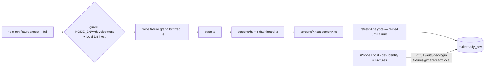

# ui2-fixtures — spec
> lg · ticket none

## Idea

**Why.** Every UI 2.0 screen gets walked locally before it ships, and an empty local database makes
that walk worthless: the new Home renders zeros in every section, so its charts, trends and day cards
are never seen with real numbers. The owner wants a local fixture world that each new UI 2.0 screen
adds to, with Home as the first layer, and a way to return it to a known state at any time.

**What success looks like.** On the Local environment, the owner picks "Fixtures" as the dev identity
on the Profile stopgap. Home's Overview then shows a 24-day completed-lessons sparkline with a non-zero
total and an upward trend, plus a non-zero total video time. Activity shows lesson counts on most past
days. Running `npm run fixtures:reset` in the server container at any time rebuilds that world, with
dates moved to stay relative to today. The owner's own local org and data are never touched. Every
later UI 2.0 screen feature ships its own fixture layer, so its walk starts with data too.

**In your words.**
- "I need a set of seeded fixtures locally to test so I can test the whole home page full with data" → D1, D6
- "Fixtures locally will also need a way to be reset at any time" → D4, D7
- "this is something I want to do with every new ui2.0 screen we implement so I can locally test" → D2, D5

**The concept.** One fixture org, owned by a dedicated fixture user, built in layers: a **base** layer
(org, owner, groups, members, programs, enrollments, lesson schedules) and one **screen layer** per
UI 2.0 screen, each adding only what its screen reads. Each layer takes a scenario name. Today only
`full` is filled in; `empty` runs the base layer alone. Reset deletes the whole fixture graph by its
fixed IDs, re-runs every layer with dates computed from "now", then refreshes the analytics
materialized view so Home reads the new rows straight away.

**How it fits today.** Home reads Overview and Activity from `POST /api/analytics/query` over the
`analytics_events` materialized view¹. Its `lc:` arm projects `member_lesson_progress.completedAt` and
its `vw:` arm projects `member_video_progress.watchedSeconds`, each joined through `lesson_schedules →
enrollments → groups → organizationId`². The view refreshes every 10 minutes³. Home filters every query
to `AppState.organizationId`, which is the org the signed-in user **owns**
(`/api/organizations/my/organization`)⁴. Local sign-in is a hard-wired dev-login as the owner's own
account⁵, which owns their real local "MakeReady" org. So fixtures seeded into any other org would be
invisible, and that is why a dedicated fixture identity is needed. Sessions, Engagement and Following
are rendered empty by design (ui2-shell D8) until their server endpoints exist. The existing
`prisma/seed-dev.ts` starts with `deleteMany({})` on every table, users and orgs included, and seeds no
progress rows. It is neither reused nor changed here.

**Approaches considered.** *Chosen:* one shared fixture world with a layer per screen, under a
dedicated fixture account. Reset is isolated by construction, and every screen sees the same groups,
members and enrollments. *Rejected:* independent per-screen packs (entities duplicated, screens
disagree on numbers); one growing seed file (no ownership per screen, unreadable over time); fixtures
inside the owner's own org (numbers blend with hand-made data, and reset needs row-level bookkeeping);
an app-side fixture mode (fills every section but tests none of the real data path).

¹ `server/src/services/analytics.service.ts` · ² `server/atlas/migrations/20260730040000.sql` (lc:, vw:, mj:, ce: arms) · ³ `analytics.service.ts:42` · ⁴ `iphone/MakeReady/State/AppState.swift:919`, ui2-shell D26 · ⁵ `iphone/MakeReady/AuthManager.swift:128`

## Apps

| App | In scope | What changes | Section |
|---|---|---|---|
| server | ✅ | New `server/fixtures/` (runner, base layer, `home-dashboard` layer, README), `fixtures:reset` / `fixtures:seed` npm scripts. No route, no schema, no service change | §server |
| client | ⬜ | Web renders no UI 2.0 screen, and the fixture user has no `googleId`, so it can't sign in to `/admin`. Nothing on web reads or changes | — |
| iphone | ✅ | Dev-only "Local identity" picker on the Profile stopgap (You / Fixtures). `AuthManager` dev-login uses the selected identity's email. Hidden when `DEV_MODE` ≠ YES | §iphone |
| capture | ⬜ | Capture uses its own `makeready_capture` database and JSON fixtures, not `makeready_dev`. The fixture world is never captured | — |

Repo config (no app): `.claude/builder.md` gains the house rule (D5).

**Sequencing:** server (the fixture world + the fixed identity; contract freezes when it verifies) →
iphone (picker against the frozen identity) → builder.md rule → the walk.

**Backward compatibility:** A released iPhone build has `DEV_MODE` off: no picker, and Local is
unreachable. It sees nothing. Older dev builds keep dev-logging in as the owner, as today.

**Blast radius:** Fixture rows live in `makeready_dev`, so every reader of that database sees them only
when scoped to the fixture org. The analytics view gains fixture rows, scoped by `organizationId`. A
Super Admin's unscoped analytics on Local will include them (D11).

## Decisions

<!-- The one place rulings live. Record the DECISION — and, in one line, why, and why the rejected option lost. A stated preference
     is the INPUT to a row, not the row. Write each Ruling as something later code can be checked
     against without re-interpretation:
       · positive and specific — "store the full number, mask at render", not "don't truncate"
       · scope named — which apps, screens or endpoints it binds
       · "etc." / "and so on" expanded into the list, or the test for membership stated
       · the rejected alternative named, with the reason it lost (check-obligations warns on a bare one)
       · the enforcement hook, where one exists (lint rule, script, test)
     🔴 NEVER quote the user's prompt as the ruling. Operationalize it: a closed list, a measured
     value, an enumerated set of deviations. A ruling a stranger could implement two ways is not
     written yet.
     Who/date carries the provenance, so the Ruling itself needs no quote marks.
     The owner's own words go in §Idea "In your words", linked to this row — never in the Ruling.
     OPEN rows block the build go-ahead. Never delete a ruling; supersede it in place with a date. -->

| # | Decision | Ruling | Who / date |
|---|---|---|---|
| D1 | What the Home fixtures fill | Real database rows read through the real API. Overview (both KPI cards) and Activity are non-empty after a `full` reset. The `home-dashboard` layer also seeds `membership_events` and `client_events`, so Sessions, Engagement and Following have data the day their endpoints land. No iPhone data-path change. Why: tests the real end-to-end path. Rejected: Overview + Activity rows only (must be extended later); build the three missing endpoints (large, blocked on OQ-home-dashboard-1/2/4); an app-side fixture mode (tests no real data path) | user 2026-10-25 |
| D2 | Layout of the fixture world | `server/fixtures/index.ts` (runner) → `base.ts` → every file in `server/fixtures/screens/`, run in filename order, all sharing one `FixtureContext` (fixed IDs, `now`, the created entities). A screen layer may read base entities and must not create orgs, users or groups of its own. Why: screens share entities, so one world keeps their numbers consistent. Rejected: independent per-screen packs (duplicated entities, screens disagree); one growing seed file (no per-screen ownership) | user 2026-10-25 |
| D3 | Fixture identity | User `fixtures@makeready.local`, name "Fixture Leader", owner of org "MakeReady Fixtures"; both have fixed IDs. iPhone dev builds pick the Local dev-login identity: **You** (`luke@lukekeith.com`, today's behaviour) or **Fixtures**. Why: Home scopes to the user's owned org, so only a separate owner sees the fixture org; an isolated graph makes reset unable to touch real data. Rejected: seed inside the owner's MakeReady org (numbers blend, row-level reset); wipe the owner's local org on reset (destroys hand-made data) | user 2026-10-25 |
| D4 | How seed and reset run | `server/package.json` scripts `fixtures:reset` (wipe + seed) and `fixtures:seed` (seed only; fails if the fixture user already exists), each taking an optional scenario argument (default `full`). Run as `docker exec makeready-server npm run fixtures:reset [-- <scenario>]`. No HTTP endpoint and no in-app button. Why: simplest surface. Rejected: an in-app reset button via a dev-only endpoint (more surface); a capture-tool button (needs capture running) | user 2026-10-25 |
| D5 | Pipeline enforcement | `.claude/builder.md` §House rules gains a **fixtures** line: a feature that wires a UI 2.0 screen into the iPhone app adds `server/fixtures/screens/<screen-id>.ts` (screen id as in `docs/ui2/screens/`), whose `full` scenario makes every section the feature wires non-empty. §Walk readiness gains `fixtures: docker exec makeready-server npm run fixtures:reset`, run before the walk. The audit flags a missing layer. Why: "every new screen" holds only if enforced. Rejected: a README convention (screens ship without fixtures) | user 2026-10-25 |
| D6 | Scenarios | Each layer exports `{ full?: (ctx) => Promise<void>, sparse?, extreme? }`. The runner accepts `full` (default) and `empty`; `empty` runs base only. Naming an unknown scenario, or one no layer implements beyond base, exits non-zero and lists the available scenarios. A screen adds `sparse`/`extreme` when its spec lists those states. Why: specs list empty/overflow states, and the slot avoids boxing in later screens. Rejected: one full world only (no empty-state testing); all four for Home now (3× the first layer, sets that bar for every screen) | user 2026-10-25 |
| D7 | What reset deletes | Exactly: the fixture user (cascades the owned org, its groups, programs, lessons, enrollments, schedules and progress), the fixture members by fixed ID (cascades their memberships, progress and membership events), and `client_events` whose `organizationId` is the fixture org or whose `memberId` is a fixture member. Nothing else. Reset is idempotent: running it twice leaves the same row counts. Why: isolation by construction. Rejected: reusing `seed-dev.ts` (wipes every table) | (assumed at brainstorm) |
| D8 | Safety guard | The runner refuses (exit 1, message names the reason) unless `NODE_ENV === 'development'` **and** the `DATABASE_URL` host is one of `postgres`, `localhost`, `127.0.0.1`. Why: it deletes rows and must never reach staging or production. Rejected: no guard (one mistyped env deletes a real account's graph) | (assumed at spec) 2026-10-25 |
| D9 | Dates move with the reset | Every timestamp is computed from `now` at run time in UTC; nothing is a literal date. After any reset, Home's 24-day window and its previous-24-day comparison window are both populated. Why: literal dates age out of the window. Rejected: frozen dates (Home empties within weeks) | (assumed at brainstorm) |
| D10 | Analytics refresh | After seeding, the runner calls `refreshAnalytics()` and, when it returns `locked` (another refresh holds the advisory lock), retries every 2 s for up to 30 s. It then exits non-zero if no refresh completed. Why: without it Home shows nothing for up to 10 min. Rejected: waiting for the scheduled refresh (walk starts on stale data) | (assumed at brainstorm) |
| D11 | Home `full` scenario content | Base: 3 groups ("Tuesday Men's Group", "Young Adults", "Women's Bible Study"), 24 members (8 per group, fake numbers `+1555010xxxx`, `phoneVerified` true), 2 published programs (21 and 30 days, 3 activities per lesson incl. one VIDEO), 4 active enrollments whose lesson schedules run from now−48 d to now+7 d. Home layer: `member_lesson_progress.completedAt` on past schedules for 48 days, with a weekday rhythm (Sat/Sun ≈ 40% of weekdays) and volume rising so the last 24 days total 15% (±3%) more than the 24 before; `member_video_progress` totalling 40 h (±2 h) `watchedSeconds`; one `membership_events` ADDED per member; `client_events` `LESSON_OPENED` spread across 06:00–22:00 local. Super Admin unscoped analytics on Local include these rows; accepted. Why: fills every number Home reads with realistic shape. Rejected: uniform random data (no trend, no rhythm to eyeball) | (assumed at brainstorm) · numbers fixed at spec 2026-10-25 |
| D12 | Leader gate | The fixture user passes `GET /auth/leader-access` because it owns the fixture org (`canAccessIosApp`). No role rows are required for that; the base layer also gives it the org's Owner `UserRole` so RBAC-checked endpoints behave as they do for a real owner. Why: ui2-shell D7 signs out a denied account | (assumed at spec) 2026-10-25 |
| D13 | iPhone identity picker | Below the environment radios on `ProfileStopgapContainer`, shown only when `DEV_MODE` is YES **and** the selected environment is Local: a "Local identity" group of two existing `RadioOptionRow`s (You · Fixtures, the description showing the email). The selection persists in `UserDefaults` (`devLoginIdentity`, default You). Picking the other identity runs `AuthManager.signOut()` (which clears `AppState`), then `signIn()`, which dev-logs in with the selected email. Failures show inline exactly as environment-switch errors do. Why: the existing switcher is the dev-tools home, and clearing state stops one identity's cached Home bleeding into the other. Rejected: a picker on Login (Login has no dev controls in 2.0); identity without sign-out (stale `AppState.dashboard` from the other org) | (assumed at spec) 2026-10-25 |
| D14 | Fixture user not found | When the Fixtures identity is selected and `/auth/dev-login` returns 404 (fixtures never seeded), the inline error reads "Fixtures not seeded — run npm run fixtures:reset in the server container." and the identity reverts to You. Why: the likeliest first-run failure gets an actionable message | (assumed at spec) 2026-10-25 |
| D15 | Layer authoring guide | `server/fixtures/README.md` documents: the run command, scenarios, the `FixtureContext` API, the fixed-ID scheme (valid UUIDs prefixed `f1f1f1f1-` with a per-kind second group, e.g. `f1f1f1f1-0003-…` for groups), the rule that dates come from `ctx.now`, and a 20-line template for a new `screens/<screen-id>.ts`. Why: D5 makes every UI 2.0 feature write a layer | (assumed at spec) 2026-10-25 |

## Contract

| Contract | Producer | Consumers | Auth | Request | Response | Errors |
|---|---|---|---|---|---|---|
| Fixture identity — `POST /auth/dev-login` (existing, unchanged) with `email: fixtures@makeready.local` | server (fixtures base layer seeds the user) | iphone (D13 picker) | none; dev only (`NODE_ENV=development`) | `{ email }` | 200 `{ success, user, sessionCookie }` as today | 404 `User not found` when not seeded (→ D14) |
| Fixture world — the fixture org's rows are readable through existing endpoints (`/api/analytics/query`, `/api/organizations/my/organization`, `/auth/leader-access`) as for any owner | server | iphone (Home via `DashboardActions`, unchanged) | session | unchanged | unchanged; non-empty for the fixture org after a `full` reset | unchanged |
| `npm run fixtures:reset [-- full\|empty]` / `fixtures:seed` | server | the owner (terminal); the builder walk (D5) | container shell | scenario name | exit 0 + a summary table of row counts per model | exit 1: guard refused (D8), unknown scenario (D6), refresh never ran (D10); `fixtures:seed` with an existing fixture user |

## Schema & API changes

No schema change (established 2026-10-25). No API change: `/auth/dev-login` and every read endpoint are
used as they are.

**Data plan:** Only rows under the fixture IDs are created or deleted (D7). Existing local rows are
never read or modified.

## server

- `server/fixtures/index.ts`: CLI entry. Parses the scenario and runs the guard (D8). On `reset` it
  runs the wipe (D7), then base plus each screen layer's scenario function in filename order (D2, D6),
  then the refresh (D10), and prints row counts per model. Uses the generated Prisma client.
- `server/fixtures/context.ts`: `FixtureContext { now: Date, ids, prisma, created: { user, org, groups[], members[], programs[], enrollments[], schedules[] } }`, plus helpers `daysAgo(n)`, `atLocalHour(date, h)`, and a deterministic seeded PRNG (fixed seed, so two resets produce identical relative data).
- `server/fixtures/ids.ts`: every fixed UUID (user, org, groups, members, programs, enrollments) in one place.
- `server/fixtures/base.ts`: the D3/D11/D12 base world.
- `server/fixtures/screens/home-dashboard.ts`: the D11 Home layer (`full` only).
- `server/fixtures/README.md`: D15.
- `server/package.json`: `fixtures:reset`, `fixtures:seed` (via `tsx`).
- Not touched: `server/src/**` (so no container restart is needed), `prisma/seed-dev.ts`, the seeds manifest.

## iphone

- `AuthManager.swift`: replace the `devLoginEmail` constant with `devLoginEmail(for: DevLoginIdentity)`; `signIn()` reads `DevLoginIdentity.current` (UserDefaults `devLoginIdentity`, default `.you`). Map a dev-login 404 for `.fixtures` to a typed `AuthError.fixturesNotSeeded` (D14).
- New `DevLoginIdentity` enum (`you`, `fixtures`; `email`, `title`) beside `Configuration.swift`'s `SelectedEnvironment`.
- `ProfileStopgapContainer.swift`: the D13 identity group, and a `switchIdentity(_:)` that signs out and back in; inline error per D14.
- `EnvironmentActions` is untouched. Switching environment away from Local hides the group and leaves the stored identity.
- 🔴 Commit is the owner's (`commit: manual`): the task stages and stops.

## Testing

**server** — vitest under `server/fixtures/__tests__/` against the local test DB:
(a) the guard refuses for `NODE_ENV=production` and for a non-local host; (b) `reset full` twice gives
identical row counts per model (idempotence); (c) after `reset full`, a row-count snapshot of rows not
under fixture IDs is unchanged (isolation); (d) after `reset full`, `analytics.service` query for
`lesson_completions` × `day` scoped to the fixture org over the last 24 days is non-zero on ≥ 18 days,
its total is 115% (±3%) of the previous 24 days, and `watch_seconds` is 144 000 (±7 200); (e) `reset
empty` leaves the base entities and zero progress rows; (f) an unknown scenario exits 1. Plus
`npx tsc --noEmit`.

**iphone** — XCTest: `DevLoginIdentity` default is `.you` and persists; `AuthManager` chooses the email
by identity; a 404 for `.fixtures` maps to `fixturesNotSeeded`; `showsIdentityPicker(devMode:env:)` is
true only for `(true, .local)`. Plus `npm run ios:build-check -- --test` and swiftlint from `iphone/`.

**Cross-app E2E walk (verify):** `fixtures:reset` → simulator dev build on Local → Profile → identity
Fixtures → Home shows non-zero Overview + Activity → identity You → Home shows the owner's own numbers.

**Human verification script:**
1. `docker exec makeready-server npm run fixtures:reset`: exits 0 and prints counts (3 groups, 24 members, 4 enrollments).
2. In the simulator (dev build, Local), open Profile: a "Local identity" group shows You (selected) and Fixtures.
3. Pick Fixtures: the app signs out and back in, landing on Home.
4. Overview: "Completed lessons" has a filled sparkline, a non-zero total and an up trend near +15%. "Total video time" reads about 40.0hrs.
5. Activity: most past days show "N lessons" with bars, weekends visibly lower, and future days empty.
6. Sessions, Engagement, Following still show their empty states (ui2-shell D8).
7. Run `fixtures:reset` again, then relaunch the app: the same shape, with no duplicated totals.
8. `fixtures:reset -- empty`, then relaunch: Home is zeroed but signs in fine.
9. Pick You: Home shows your own org's numbers, unchanged by any of the above.
10. Switch environment to Production: the identity group disappears.

## Out of scope

- Sessions, Engagement and Following endpoints and wiring (the home-dashboard API-GAPs).
- Fixture layers for any screen other than `home-dashboard`. Each later UI 2.0 feature adds its own (D5).
- `sparse` and `extreme` scenarios for Home.
- Changing or retiring `prisma/seed-dev.ts`, `seed-lessons.ts`, `seed-e2e.mjs` or the versioned seeds.
- Fixtures in the capture database, on web, or in any deployed environment.
- An HTTP reset endpoint or an in-app reset button (D4).

## Findings & risks

| # | Finding | Resolution |
|---|---|---|
