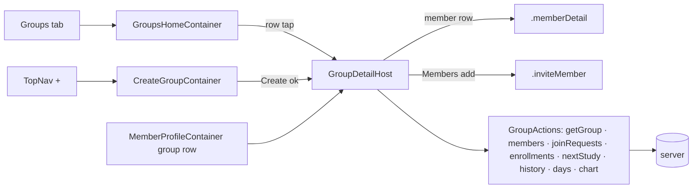

# ui2-groups-browse — spec
> lg · child 1 of program `ui2-groups` (docs/features/ui2-groups/PROGRAM.md)

## Idea

**Why.** The iPhone app's root is the UI 2.0 shell (`MakeReadyApp.swift:28`), and its Groups tab is a
blank `EmptyPage` (`UI2Shell.swift:165-170`). Leaders — org owners, admins and group leaders — have
nowhere in 2.0 to see their groups, open one, or start one. Every screen they need is already built
as a MakeReadyUI preview from d2m (`groups-home`, `groups-detail`, `create-group`); this child wires
them to live data and adds the server data the group page reads that does not exist yet.

**What success looks like.** On the walk env as the fixtures owner: Groups lists every fixture group
alphabetically, search and both chips narrow it, the TopNav `+` creates a group and lands on its page;
tapping a group pushes its page with every section showing real data — cover, the four stats, the six
setting values, the next lesson with activity thumbnails, the activity rail and chart, pending join
requests above the members, enrollments, the latest 5 history events — and each section shows its
designed one-line empty state on a group with no data. Member rows open the member page, Members `add`
opens invite, and a member page's group row opens the group page.

**In your words.** "build the groups experience, which is the home groups page, group detail page, and
edit screens for group data" → D0 (this child is the browse half; edits are `ui2-groups-edit`) ·
"that's right. proceed" (2026-10-27, confirming this child's scope) → D0.

**The concept.** App-side containers per screen read `AppState`, build the MakeReadyUI screen's
`State`, and map its callbacks to Actions or shell routes — the ui2-members pattern.

**How it fits today.** The push stack (`UI2Destination` + per-tab `NavigationStack`, `UI2Shell.swift:112-155`),
the invite flow (`.inviteMember`), the member page (`.memberDetail`) and `GroupActions`
(groups, members, join requests, create) exist. The server already scopes every group route by
`groupManageFilter` (`permission.ts:322`); intake (`.builder/ui2-groups/brainstorm.md`) recorded what
each endpoint returns and the 7 places the design's data claims disagreed with the code.

**Approaches considered.** Chosen: containers in `iphone/MakeReady/UI2/Containers/Groups/`, as for
Members. Rejected: wiring inside the MakeReadyUI screens (d2m regenerates them, ui2-shell D2).

## Apps

| App | In scope | What changes | Section |
|---|---|---|---|
| server | ✅ | groups list + detail additive fields; new group history endpoint; `/api/home/days` `groupId`; next-study title + thumbnails; cover upload tracked; access checks on group members + membership history; `Group.memberDirectoryAccess` column + backfill; fixture layers | §server |
| client | ⬜ | UI 2.0 leader screens are iPhone-only; web reads `memberDirectory` (Boolean), which stays and is unchanged (P8). The two new access checks (D9) are audited for web callers (F2) | — |
| iphone | ✅ | Groups tab wired (groups-home), group page (groups-detail), create-group, routes, new Actions, members-profile group row, GroupsHomeScreen nav row removed | §iphone |
| capture | ⬜ | screens capture from fixture JSON via ViewRegistry, not the live API; no capture case changes | — |

**Sequencing:** contract settled → server (schema, endpoints, checks, fixtures) verifies → contract
FREEZES → iphone builds against it → the walk on Fixtures.

**Backward compatibility:** every field and endpoint is additive; released 1.0 builds decode the
groups payloads with optional fields and ignore the new keys. The non-additive change is D9 (404 on
the group member list and membership history for callers outside the group's manage scope); F2 lists
the released callers. `memberDirectory` keeps its meaning on every read and write.

**Blast radius:** every caller of `GET /api/groups`, `GET /api/groups/:id`, `/next-study`,
`/api/home/days`, `/groups/:id/members`, `/membership-history`; `Group` reads (new column).

## Decisions

<!-- The one place rulings live. Record the DECISION — and, in one line, why, and why the rejected option lost. A stated preference
     is the INPUT to a row, not the row. Write each Ruling as something later code can be checked
     against without re-interpretation:
       · positive and specific — "store the full number, mask at render", not "don't truncate"
       · scope named — which apps, screens or endpoints it binds
       · "etc." / "and so on" expanded into the list, or the test for membership stated
       · the rejected alternative named, with the reason it lost (check-obligations warns on a bare one)
       · the enforcement hook, where one exists (lint rule, script, test)
     🔴 NEVER quote the user's prompt as the ruling. Operationalize it: a closed list, a measured
     value, an enumerated set of deviations. A ruling a stranger could implement two ways is not
     written yet.
     Who/date carries the provenance, so the Ruling itself needs no quote marks.
     The owner's own words go in §Idea "In your words", linked to this row — never in the Ruling.
     OPEN rows block the build go-ahead. Never delete a ruling; supersede it in place with a date. -->

| # | Decision | Ruling | Who / date |
|---|---|---|---|
| D0 | Program decisions | PROGRAM.md §Shared decisions P1–P15 bind this spec; the rows below apply them to this child or add to them. This child: groups-home, groups-detail (read), create-group and their server data; field edits, the directory-access write and Delete Group are `ui2-groups-edit`. Rejected: one spec for both halves (owner chose the split) | Luke 2026-10-27 |
| D1 | Routes | New `UI2Destination` cases `.groupDetail(id: String, name: String)` and `.createGroup`; `UI2Shell.page(for:)` maps them to `GroupDetailHost` and `CreateGroupContainer`. Groups section root = `GroupsHomeContainer` in `sectionContent`. Rejected: a modal for create-group (the design pushes it) | (assumed at spec) 2026-10-27 |
| D2 | Groups-home nav row (P2) | `GroupsHomeScreen` no longer draws its C-019 row or takes `onSelectTab`/`onToggleNav`, exactly as ui2-members-browse D4 did for MembersHomeScreen; the build makes that edit under this ruling and routes it to `/ui2-resolve` so d2m's source matches (F3). Rejected: waiting for the design owner before the iPhone phase (blocks the build on a mechanical edit the members precedent already made) | Luke 2026-10-27 (supersedes P2's prerequisite) |
| D3 | Groups-home list (P4) | Rows = `AppState.groups` (every group `GET /api/groups` returns), sorted by name, case- and diacritic-insensitive. Search: 300 ms debounce, case-insensitive substring of the group name, AND-combined with both chips. Leaders chip options: `GET /api/group-leaders` full names (sorted as returned); a group matches when its `creatorId` is one of the selected leaders' `id`. Orgs chip: `GET /api/organizations/my/organizations` names; visible (`orgFilterVisible`) only when that list has ≥2 orgs; a group matches when its `organizationId` is selected. Empty selection = all. Row: cover (`coverImageUrl`, else C-038 initials), name, `creatorName`, member count. Pull-to-refresh reloads groups. Rejected: server-side filter params (unneeded at this list size) | (assumed at brainstorm) |
| D4 | Group page load (B3) | Push renders at once from `AppState.groups[id]` with the header name from the pushing row; `.task` loads in parallel: `GET /api/groups/:id`, members, pending join requests, enrollments, next-study, history (`limit=5`), days, chart. Each section shows its empty line (copy below) until its data lands; a failed load keeps what is shown and records the error (`recordError`, 401 → sign-out — ui2-shell D28). Section-empty copy, closed: "No lessons scheduled" · "No members yet" · "No enrollments yet" · "No history yet"; Activity renders its C-071 `Nothing` cards and C-026 empty state, no line. Rejected: skeletons (not designed) | (assumed at brainstorm) |
| D5 | Stats + settings display | Stats: Group Leader = `creatorName`; Members = active member count; Created = `createdAt` as `MMM d, yyyy`; Enrollments = enrollment count. Settings values: Group name; Description (wraps, two lines in the frame); Visibility = "Private" when `isPrivate` else "Public"; Age = both null → "Any age", both set → "«min» - «max»", min only → "«min»+", max only → "Up to «max»"; Maximum members = number or "Unlimited" when null; Member directory access = "Allowed" / "Names only" / "Not allowed" from `memberDirectoryAccess` (D11). Rejected: system locale formats (diverge from the frame) | (assumed at spec) 2026-10-27 |
| D6 | Inert in this child (P1, B1) | The six C-042 rows render with values and chevrons; tapping does nothing until `ui2-groups-edit`. No-ops: Delete Group, join-request rows, enrollment rows, the LessonCard, Enrollments `add`, Timeline "All history", chart pan. Rejected: hiding them (loses the designed layout) | (assumed at brainstorm) |
| D7 | Wired exits | Member row → `.memberDetail(id, name)`; Members `add` → `.inviteMember(groupId, returnDepth)`; members-profile group row (today a no-op, `MemberProfileContainer.swift:49`) → `.groupDetail`; TopNav `+` on the Groups tab → `.createGroup` (P3, beside the Members `+` in `TopNavHost.swift:96`); "Jump to today" scrolls the rail to today's card | Luke 2026-10-27 (P1) · (assumed at brainstorm) (P3) |
| D8 | Create group (P3) | `CreateGroupContainer` sends `POST /api/groups {name: trimmed}` (1–200 chars) via `GroupActions.createGroup`; success merges the group into `AppState.groups` and replaces the form with `.groupDetail` of the new group (pop, then push, one transaction — back returns to Groups); creating = Create disabled + field read-only; failure keeps the name, re-enables Create and surfaces "Couldn't create the group" through the shell error banner. Rejected: staying on the form after create (the next thing a new group needs — settings, members — lives on its page) | (assumed at brainstorm) |
| D9 | Access checks (P12) | `GET /api/groups/:groupId/members` and `GET /api/groups/:groupId/membership-history` resolve the group through `groupManageFilter(userId)` + `isActive`; otherwise 404, as every other group route. Rejected: leaving them open (any signed-in user reads any group's members) | (assumed at brainstorm) |
| D10 | Leader name + org fields (P4, P13) | `GET /api/groups` adds `organizationId` and `organizationName` per group; `GET /api/groups/:id` and the PATCH response add `creatorName` (the creator's `User.name`). Rejected: phone-side lookups (an extra request per group, and the org list doesn't map groups to orgs) | (assumed at brainstorm) |
| D11 | Directory access column (P8) | New enum `DirectoryAccess { ALLOWED, NAMES_ONLY, NOT_ALLOWED }`, column `Group.memberDirectoryAccess` NOT NULL default `ALLOWED`; the migration backfills `NOT_ALLOWED` where `memberDirectoryEnabled = false`. Every group payload (list, detail, PATCH, create) adds `memberDirectoryAccess`. Writes in this child: `POST /api/groups` and PATCH with only the Boolean `memberDirectory` set the enum to `ALLOWED`/`NOT_ALLOWED` to match; child 2 adds the enum write and the reverse sync. Rejected: deriving the enum on read only (two sources of truth once child 2 writes it) | Luke 2026-10-27 (column) · (assumed at spec) 2026-10-27 (shape) |
| D12 | Activity rail (P5, refined) | 30 local days today−29 … today, today trailing, opened scrolled to today. Per card: line 1 = "«N» lessons" (`scheduled_lessons` that day); line 2 = "«C» complete" (`lesson_completions`), today = "«N−C» left" when N > C else "«C» complete", empty when N = 0; `dayDetailsStates` = `nothing` when N = 0 and no sessions, else `default`; series = `/api/home/days?groupId=` `blocks` (12 two-hour blocks, seconds → minutes, as Home — `HomeDashboardMapper.blockMinutes`). Rejected: minutes on the lines (the built view and frame show lesson counts) | Luke 2026-10-27 (sources) · (assumed at spec) 2026-10-27 (mapping) |
| D13 | Activity chart (P5) | `POST /api/analytics/query` `{metrics:["scheduled_lessons","lesson_completions"], dimensions:["day"], filters:{groupId}, timeRange: today−23 … today+3}` → `chartDates`/`chartScheduled`/`chartCompleted` zero-filled per day; `chartToday` = today; window = the range (the frame's 27-day window with today 4th from the end) | (assumed at spec) 2026-10-27 |
| D14 | `groupId` on `/api/home/days` | New optional `groupId`; the group must pass `groupManageFilter` for the caller, else 404; filters sessions to members with an active `GroupMember` row in that group (a member in two groups counts in both); `memberId` + `groupId` together → 400. Rejected: enrollment-tied moments only (the rail shows the group's members' activity, not one program's) | (assumed at spec) 2026-10-27 |
| D15 | History endpoint (P6, refined) | `GET /api/groups/:id/history?limit=1..50` (default 20), `groupManageFilter`; merges newest-first: `MembershipEvent` rows of the group (APPROVED/ADDED/REJOINED → "«name» joined the group"; REMOVED_GROUP/REMOVED_ORG → "«name» left the group"; REQUESTED → "«name» requested to join"; INVITED/REJECTED omitted), the group's `Activity` rows (`resourceType GROUP`: UPDATED with `metadata.field = "cover"` → "Updated cover photo", any other UPDATED → "Updated group settings", CREATED → "Created the group"), and the group's `Event` rows dated in the past, `isActive` ("Held event at «locationName ?? title»"). Each: `{id, occurredAt, kind: member_joined|member_left|join_requested|settings_updated|cover_updated|group_created|event_held, text, highlight|null}`; `highlight` = the member's name (joined/left/requested) or "event at «…»" (event_held), else null. `POST /groups/:id/cover-image` calls `trackActivity` (resourceType GROUP, action UPDATED, metadata `{field:"cover"}`) and history maps it to cover_updated. Rejected: phone-side merge | Luke 2026-10-27 (endpoint) · (assumed at spec) 2026-10-27 (kinds + copy) |
| D16 | Timeline display | `eventTexts` = `text`; `eventHighlights` = `highlight ?? ""`; `eventTones` = `accent` when `highlight` non-null else `neutral`; `eventDates`: < 60 min "Just now", today "Today", yesterday "Yesterday", this year "MMM d", else "MMM d, yyyy" | (assumed at spec) 2026-10-27 |
| D17 | Next lesson (P7) | `GET /api/groups/:id/next-study` adds `study.title` (`LessonSchedule.title`, null-safe) and per activity `thumbnailUrl` (YouTube/video thumbnail when the activity has one, else the first image of a READ activity, else null). Card: title = `title ?? "Day «dayNumber»"`; program line = program name; meta = "Today" / "Tomorrow" / weekday within 6 days / "MMM d"; slides = first 3 activities, image = `thumbnailUrl` (downloaded through `Ui2ImageCache`), label = activity title; 204 → section empty | Luke 2026-10-27 (fields) · (assumed at spec) 2026-10-27 (fallbacks) |
| D18 | Members + requests display | Requests (C-089 `requested`): `GET /groups/:id/join-requests` pending, `recipient` = first + last name, `date` = `createdAt` per D16's date rule; above the members; not counted in "«N» members". Members: `GET /groups/:id/members` order (joinedAt desc), "Joined «label»" with ui2-members-browse D6's day-age labels. Enrollments: `GET /groups/:id/enrollments` order, title = `studyProgram.name`, description, cover, "enrolled «MMM d, yyyy»" of `createdAt`; header "«N» programs" | (assumed at spec) 2026-10-27 |
| D19 | Fixtures (P15) | `server/fixtures/screens/groups-home.ts` and `groups-detail.ts` (+ `create-group.ts` empty layer if the registry requires one per screen): one fixture group gets 2 pending join requests, a next lesson tomorrow with 3 activities carrying thumbnails, ≥6 history items across all kinds, 30 days of scheduled lessons with partial completions and member sessions; one fixture group stays empty for the section-empty states | (assumed at spec) 2026-10-27 |

## Contract

| Contract | Producer | Consumers | Auth | Request | Response | Errors |
|---|---|---|---|---|---|---|
| `GET /api/groups` (extended) | server | iphone | `requireAuth` + `groupManageFilter` | — | existing per group + `organizationId`, `organizationName`, `memberDirectoryAccess` | 401 |
| `GET /api/groups/:id` (extended) | server | iphone | as today | — | existing + `creatorName` (string\|null), `memberDirectoryAccess` | 401 · 404 |
| `POST /api/groups`, `PATCH /api/groups/:id` (response extended) | server | iphone | as today | unchanged | existing + `creatorName`, `memberDirectoryAccess` (D11 sync on write) | as today |
| `GET /api/groups/:id/history` (new) | server | iphone | `requireAuth` + `groupManageFilter` | `limit?` 1–50 | `{events:[{id, occurredAt (ISO), kind, text, highlight\|null}]}` (D15) | 400 · 401 · 404 |
| `GET /api/groups/:id/next-study` (extended) | server | iphone | as today | — | existing + `study.title` (string\|null), `activities[].thumbnailUrl` (string\|null); 204 unchanged | 401 · 404 |
| `GET /api/home/days` (+ `groupId`) | server | iphone | `requireAuth` + D14 | existing + `groupId?` | existing `{days:[…]}`, filtered per D14 | 400 · 401 · 404 |
| `GET /api/groups/:groupId/members`, `/membership-history` (scoped) | server | iphone | `requireAuth` + `groupManageFilter` (D9) | unchanged | unchanged | 401 · 404 (new) |
| `POST /api/analytics/query`, `GET /groups/:id/join-requests`, `GET /groups/:id/enrollments`, `GET /api/group-leaders`, `GET /api/organizations/my/organizations` (unchanged) | server | iphone | existing | D13 / — | existing | existing |

## Schema & API changes

| # | Kind | Model.field | Wire | Reason | Status |
|---|---|---|---|---|---|
| SC1 | ADD | `Group.memberDirectoryAccess` (enum `DirectoryAccess`, NOT NULL, default `ALLOWED`) | `memberDirectoryAccess` on every group payload | groups-detail settings row "Member directory access" (three options, shared-edit-field §2b); P8 · D11 | planned |
| SC2 | EDIT | groups list response | + `organizationId`, `organizationName` | groups-home Orgs chip; D10 | planned |
| SC3 | EDIT | group detail / PATCH / create response | + `creatorName` | groups-detail "Group Leader" stat; D10 | planned |
| SC4 | ADD | `GET /api/groups/:id/history` | §Contract | groups-detail Timeline; D15 | planned |
| SC5 | EDIT | next-study response | + `study.title`, `activities[].thumbnailUrl` | groups-detail Lessons up next; D17 | planned |
| SC6 | EDIT | `/api/home/days` `groupId` param | §Contract | groups-detail day rail series; D14 | planned |
| SC7 | EDIT | cover-image upload | + `trackActivity` row | groups-detail Timeline "Updated cover photo"; D15 | planned |

**Data plan:** SC1 goes through `server/schema/*.yaml` → `schema:diff` → one Atlas migration (house
rules): add the enum + column with default `ALLOWED`, then `UPDATE groups SET member_directory_access =
'NOT_ALLOWED' WHERE member_directory_enabled = false` in the same migration. Undo = drop the column and
the enum; the Boolean is untouched throughout. SC2–SC7 are additive wire changes. Independent ordering.

## server

- Schema SC1 via the YAML source and an Atlas migration; Prisma client regenerated in the container.
- `groups.ts`: list adds org id/name (include `organization {name}`) and `memberDirectoryAccess`;
  detail/PATCH/create add `creatorName` + `memberDirectoryAccess`; create and PATCH keep the enum in
  sync with a Boolean-only write (D11); cover upload calls `trackActivity` (SC7).
- New `services/group-history.ts` + route `GET /api/groups/:id/history` (D15).
- `enrollments.ts` next-study: select `title`; compute `thumbnailUrl` per activity (D17).
- `home.ts` `/days`: `groupId` in `daysQuery`, the D14 check, member filter passed to `getHomeDays`.
- `group-members.ts`: D9 checks on the member list and membership history.
- Fixtures D19.

## iphone

- **Shell:** `UI2Destination` `.groupDetail`, `.createGroup` (D1); `sectionContent` `.groups` →
  `GroupsHomeContainer`; `TopNavHost` `onAdd` for the Groups tab → `.createGroup` (D7).
- **Groups home:** `GroupsHomeContainer` + `GroupsHomeMapper` (D3); `GroupsHomeScreen` drops its
  C-019 row (D2).
- **Group page:** `GroupDetailHost` (pushed; wraps `GroupsDetailScreen` in its ScrollView with C-040
  pinned, as `MemberDetailHost`) + `GroupDetailContainer` + `GroupDetailMapper` (D4–D7, D12, D13,
  D16–D18).
- **Create:** `CreateGroupContainer` (D8).
- **Members page:** group row → `.groupDetail` (D7).
- **State:** `UserGroup` gains `organizationId?`, `organizationName?`, `memberDirectoryAccess?`
  (optional decode); new `GroupActions.loadNextStudy`, `loadHistory`, `loadGroupDays`,
  `loadGroupChart`; stores keyed by group id in `AppState`, in memory only, cleared in
  `clearInMemory()`.

## Testing

- **server:** route tests — list org fields; detail/PATCH `creatorName`; D11 enum backfill + sync on
  create/PATCH; history (each kind, ordering, limit, highlight, cover upload row, 404 outside scope);
  next-study `title` + `thumbnailUrl` (each source, null); days `groupId` (member filter, two-group
  member, 404 out of scope, 400 with `memberId`); D9 404s for a non-manager; fixtures DB tests (D19);
  `migrate:status` clean on a fresh DB.
- **iphone:** mapper tests (D3 sort/search/chips; D5 values incl. every Age form; D12 lines incl. today
  "left"; D13 zero-fill; D16 date labels; D17 fallbacks; D18 order + counts), decode tests for the
  extended payloads, shell route tests (`.groupDetail`, `.createGroup` replace), `ios:build-check
  --test`, swiftlint baseline.
- **Cross-app E2E (Fixtures, walk env):** Groups lists every fixture group A→Z; search + chips filter;
  `+` creates "Walk Test Group" and lands on its empty page (every empty line shows); the rich fixture
  group shows every section populated; member row → member page; Members `add` → invite; member page
  group row → group page.
- **Human walk (on device):** scroll feel of the long group page, rail "Jump to today", pinned header.

## Out of scope

- Field edits, the directory-access write and Delete Group — `ui2-groups-edit` (D0).
- invite-home, enrollment-home, groups-enroll-program, groups-history destinations (P1; owner 2026-10-27).
- Cover upload, directory enforcement, restore, AI suggestions; the web client (P8, P11, PROGRAM §Out of scope).

## Findings & risks

| # | Finding | Resolution |
|---|---|---|
| F1 | d2m marks groups-detail `updateNeeded` (Figma ref re-added after the spec, 2026-10-27) | build-time risk — a d2m drift check before the iPhone phase (design owner); a drifted section goes through `/builder:revise` |
| F2 | D9 adds 404s to two endpoints released 1.0 builds and the web may call without manage rights | audit lists every caller (`GroupActions.loadMembers`, web stores) and rules each |
| F3 | D2 edits a MakeReadyUI screen (ui2-members-browse precedent) | route the change to `/ui2-resolve` after the build so d2m regenerates the same view |
| F4 | `/api/analytics/query` future-day buckets for `scheduled_lessons` (D13 window ends today+3) are unverified | audit confirms; else the window ends today |

## Prototype

Ref (via program `ui2-groups`): `groups-home`, `groups-detail`, `create-group` — d2m era 2.0
(`localhost:5961`), every screen and component **built** in `iphone/MakeReadyUI/` (d2m dots green);
`GroupsHomeScreen.swift`, `GroupsDetailScreen.swift`, `CreateGroupScreen.swift`. The repo's
`docs/ui2/` copy predates groups-detail; d2m is the source read.

## Replaced surfaces

| # | Surface (file:line) | REPLACES/ABSORBS/REUSES | Fingerprint | App |
|---|---|---|---|---|
| R1 | `iphone/MakeReady/Pages/Main/MainGroups.swift` | REPLACES (1.0 Groups tab; unreachable from `UI2Root`, left in place) | legacy groups list | iphone |
| R2 | `iphone/MakeReady/Pages/Manage/Group/GroupHomePage.swift` + `Member/GroupMembersPage.swift` | REPLACES (group home + members/requests) | legacy group home | iphone |
| R3 | `iphone/MakeReady/Pages/Manage/Group/CreateGroupPage.swift` | REPLACES (create) | legacy create form | iphone |
| R4 | `iphone/MakeReady/UI2/Containers/Groups/InviteMemberContainer.swift` | REUSES (Members `add`) | `.inviteMember` | iphone |
| R5 | `iphone/MakeReady/UI2/Containers/Members/MemberDetailHost.swift` | REUSES (member row) | `.memberDetail` | iphone |

**N# — what the design adds that the app lacks (written into this SPEC):**

| # | Add | Disposition | App |
|---|---|---|---|
| N1 | merged group history feed (Timeline) | written into the SPEC — D15, SC4 | server |
| N2 | group-scoped day activity (rail series) | written into the SPEC — D14, SC6 | server |
| N3 | lesson title + activity thumbnails (Lessons up next) | written into the SPEC — D17, SC5 | server |
| N4 | three-state member directory access | written into the SPEC — D11, SC1 (read here; written by `ui2-groups-edit`) | server |
| N5 | org per group (Orgs chip) and leader name on the group | written into the SPEC — D10, SC2, SC3 | server |
| N6 | Groups tab, group page, create-group wiring | written into the SPEC — D1–D8, D12, D13, D16, D18 | iphone |
