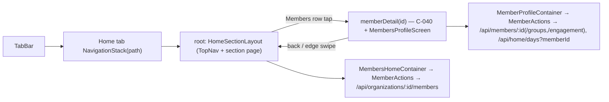

# ui2-members-browse — spec
> lg · child 1 of program `ui2-members` (docs/features/ui2-members/PROGRAM.md)

## Idea

**Why.** Leaders on the iPhone UI 2.0 app have an empty Members section (ui2-shell D10). They need the
org's member directory and each member's page — who they are, how to reach them, which groups they
are in, how they are doing — without falling back to the 1.0 app. This child also gives the UI2
shell its push navigation, which ~20 already-built pushed pages will reuse.

**What success looks like.** A leader opens Home → Members, searches and filters the list, taps a
member and the member page slides in the way the owner's Robinhood reference does (the system push:
the new page arrives fast from the right on one spring, the page under it shifts left ~30% and dims),
swipes back from the left edge, and every number on the page is live: fields, the activity day rail,
groups, program progress. A Group Leader sees only members of the groups they lead.

**In your words.** "notice how the current page moves a little to the left and the new page slides
faster from the right" → P1 (PROGRAM) · D1.

**The concept.** One `NavigationStack` per tab inside the shell's content area: the Home tab's stack
roots at the Home-tab sections; a Members row pushes `memberDetail(id)`. The system navigation bar is
hidden; each pushed page draws its own C-040 PageHeader. The shell hides its floating TopNav while
the Home stack is non-empty; the TabBar stays.

**How it fits today.** Screens and components are built MakeReadyUI previews (members-home,
members-profile; resolver 2026-10-25). The shell routes only `.tab`/`.section` and has no push (D5 took
the legacy OverlayManager out of the target). The members list endpoint returns raw member columns
only; `member.read` (held by Owner, Admin, Group Leader, Contributor) lets any leader list the whole
org.[^1] Member has no address/emergency columns.[^2] No per-member engagement endpoint exists; the
analytics layer supports a member filter.[^3]

**Approaches considered.** Chosen: iOS native push (P1). Rejected: a custom push container — rebuilds
the system push; interruptible swipe-back is the risky part.

[^1]: `server/src/routes/organizations.ts:834`, `server/prisma/seed.ts:88,123,148,167`
[^2]: `server/prisma/schema.prisma:327-367`
[^3]: `server/src/services/analytics.service.ts:387`

## Apps

| App | In scope | What changes | Section |
|---|---|---|---|
| server | ✅ | Member columns (address, emergency name/phone); members list extension (groupCount, joinedAt, groupId/leaderId filters); role scoping on the list and member reads; new engagement endpoint; `memberId` on `/api/home/days`; fixtures | §server |
| client | ⬜ | UI 2.0 leader screens are iPhone-only (docs/ui2/README.md); the web member pages read other endpoints the role scoping does not touch (audit re-derives) | — |
| iphone | ✅ | Shell push stack per tab; Members section + member page wired (containers, mappers, MemberActions, AppState stores); MembersHomeScreen drops its own nav; EditableFieldRow non-tappable form | §iphone |
| capture | ⬜ | Member screens capture from fixture JSON (ViewRegistry), not the live API; no capture case changes | — |

**Sequencing:** contract settled → server (schema, endpoints, scoping, fixtures) verifies → contract
FREEZES → iphone builds against it → the walk on Fixtures.

**Backward compatibility:** the new columns and fields are additive. The one non-additive change is
D7's role scoping on `GET /api/members/:id` and `/:id/groups`: a released 1.0 build must not call them
as a Group Leader for a member outside that leader's groups — the audit verifies (F1). Release builds
run 1.0 screens, not the UI2 shell.

**Blast radius:** `Member` reads anywhere (new nullable columns); every caller of the members list
endpoint and the two member read endpoints (F1).

## Decisions

<!-- The one place rulings live. Record the DECISION — and, in one line, why, and why the rejected option lost. A stated preference
     is the INPUT to a row, not the row. Write each Ruling as something later code can be checked
     against without re-interpretation:
       · positive and specific — "store the full number, mask at render", not "don't truncate"
       · scope named — which apps, screens or endpoints it binds
       · "etc." / "and so on" expanded into the list, or the test for membership stated
       · the rejected alternative named, with the reason it lost (check-obligations warns on a bare one)
       · the enforcement hook, where one exists (lint rule, script, test)
     🔴 NEVER quote the user's prompt as the ruling. Operationalize it: a closed list, a measured
     value, an enumerated set of deviations. A ruling a stranger could implement two ways is not
     written yet.
     Who/date carries the provenance, so the Ruling itself needs no quote marks.
     The owner's own words go in §Idea "In your words", linked to this row — never in the Ruling.
     OPEN rows block the build go-ahead. Never delete a ruling; supersede it in place with a date. -->

| # | Decision | Ruling | Who / date |
|---|---|---|---|
| D0 | Program decisions | PROGRAM.md §Shared decisions P1–P14 bind this spec; the rows below apply them to this child or add to them | Luke 2026-10-25 |
| D1 | Push (P1) | Each tab owns a `NavigationStack(path:)` held in `UI2ShellModel`; the system nav bar is hidden (`.toolbar(.hidden, for: .navigationBar)`) on every page; pushed pages draw C-040 with back = pop; the interactive left-edge pop gesture stays enabled despite the hidden bar. Motion is the system push — no custom curve, duration or scrim. The shell hides TopNav (and its 16pt gap) while the Home stack is non-empty; TabBar stays. Rejected: custom push container (rebuilds the system push) | Luke 2026-10-25 |
| D2 | Tab switch while pushed | iOS standard: each tab keeps its own path; leaving and returning restores it; tapping the selected tab pops that tab's path to empty, animated. Rejected: reset on leave (loses your place) | Luke 2026-10-25 |
| D3 | Field-row taps in this child | Every C-042 row on the member page renders non-tappable with its chevron hidden; child 2 enables them. Rejected: a placeholder page (throwaway); shipping with child 2 (undoes the split) | Luke 2026-10-25 |
| D4 | Members screen chrome (P2) | `MembersHomeScreen` no longer draws C-019 or takes `onSelectTab`/`onToggleNav`; the shell's TopNav is the only one, as on Home. Rejected: two nav rows (duplicate chrome) | (assumed at brainstorm) |
| D5 | Rows with no destination yet | Membership group rows, Engagement program rows, both section `add` buttons, and the Activity rail's day cards render normally and do nothing on tap (OQ-members-profile-2 deferred). Rejected: hiding them (loses the designed layout) | (assumed at brainstorm) |
| D6 | List presentation | Sort: most recent `joinedAt` first. "Joined" label: relative under 30 days ("Today", "Yesterday", "3 days ago", "2 weeks ago"), absolute after ("Jan 5, 2025"). Search: debounced 300ms, server `search` param, AND-combined with both chips. Rejected: alphabetical (the design leads with recency) | (assumed at brainstorm) |
| D7 | Who sees which members (B3) | Owner (org owner), Admin and Super Admin: every member of the org. Any other leader role: only members with an active GroupMember row in a group the caller created (`Group.creatorId` = caller) — on `GET /api/organizations/:id/members`, `GET /api/members/:id`, `/:id/groups` and `/:id/engagement`; a member outside that set is 404 to them. The Leaders chip is hidden for them. Member sessions reading themselves are unchanged. Rejected: everyone in the org (today) — personal details belong with the responsible leaders | Luke 2026-10-25 |
| D8 | Role and Organization rows (P4) | Organization = the names of the member's orgs within the caller's scope, comma-joined. Role = "Group leader" when the member's linked user (`Member.userId`) created any group in the org, else "Member"; the quick-stat grid's Role shows the same value. Both rows are display-only | Luke 2026-10-25 (rows) · (assumed at spec) 2026-10-25 (derivation) |
| D9 | Email row (P5) | Email shows its value with no indicator; Phone shows "Verified" (positive) when `phoneVerified`, else "Unverified" (negative) | Luke 2026-10-25 |
| D10 | Empty values | An absent field renders the row with an empty value line (label kept); absent photo → C-038 initials; zero groups/programs → section header with count 0 and no rows (members-profile §3 `partial`) | (assumed at spec) 2026-10-25 |
| D11 | Engagement payload (P13) | `GET /api/members/:id/engagement` → `{programs:[{enrollmentId, programId, title, coverImageUrl|null, completedCount, hoursLabel, percent}]}` for every non-removed enrollment of a group the member is active in; `completedCount` = the member's completed lessons in that enrollment; hours = Σ the member's sessions (D2 of home-dashboard-data) on those lessons, rounded to whole hours; `percent` = round(completed ÷ the enrollment's lessons scheduled to date × 100), capped at 100 | (assumed at spec) 2026-10-25 |
| D12 | Activity rail (P14) | The member page's day rail calls `GET /api/home/days` with `memberId`, last 30 days to today; card line 1 = minutes, line 2 = last activity time that day (C-071 `Muted`) or the `Nothing` state on zero days | (assumed at spec) 2026-10-25 |
| D13 | Fixtures (P8) | Every fixture member gets email (`first.last@example.org`), birthday (ages 19–67), gender, a city address, emergency name/phone; 13 of 24 members get photos from the d2m `avatar`-tagged images through the D22 image path, the rest fall back to initials | Luke 2026-10-25 (fill) · (assumed at spec) 2026-10-25 (values) |

## Contract

| Contract | Producer | Consumers | Auth | Request | Response | Errors |
|---|---|---|---|---|---|---|
| `GET /api/organizations/:organizationId/members` (extended) | server | iphone | `requireAuth` + `member.read`; D7 scoping | `search?`, `groupId?`, `leaderId?`, `includeInactive?` | `{success, data:[{id, firstName, lastName, profilePicture|null, googlePicture|null, joinedAt (ISO), groupCount:int}], count}` — existing fields kept | 403 · 404 org |
| `GET /api/members/:memberId` (scoped) | server | iphone | `requireMemberOrOrgOwner` + D7 | — | existing payload + `address`, `emergencyContactName`, `emergencyContactPhone` (string|null) | 401 · 403 · 404 (incl. outside D7 scope) |
| `GET /api/members/:memberId/groups` (scoped) | server | iphone | as above + D7 | — | existing payload | 401 · 403 · 404 |
| `GET /api/members/:memberId/engagement` (new) | server | iphone | as above + D7 | — | D11 | 401 · 403 · 404 |
| `GET /api/home/days` (+ `memberId`) | server | iphone | `requireAuth` + D9 scope of home-dashboard-data + D7 | existing + `memberId?` | existing `{days:[…]}`, filtered to that member's sessions | 400 · 401 · 404 |
| `GET /api/groups`, `GET /api/group-leaders` (unchanged) | server | iphone | `requireAuth` | — | existing (chip options) | existing |

## Schema & API changes

| # | Kind | Model.field | Wire | Reason | Status |
|---|---|---|---|---|---|
| SC1 | ADD | `Member.address` (text, null) | member payload | P7 | open |
| SC2 | ADD | `Member.emergencyContactName` (text, null) | member payload | P6 | open |
| SC3 | ADD | `Member.emergencyContactPhone` (text, null) | member payload | P6 | open |
| SC4 | EDIT | members list response | `groupCount`, `joinedAt`, filters | P12 | open |
| SC5 | ADD | `GET /api/members/:id/engagement` | §Contract | P13 | open |
| SC6 | EDIT | `/api/home/days` `memberId` param | §Contract | P14 | open |

**Data plan:** SC1–SC3 are nullable adds through `server/schema/*.yaml` → `schema:diff` → one Atlas
migration; no backfill, existing rows read null. SC4–SC6 are additive API changes. Independent ordering.

## server

- Schema: SC1–SC3 via the YAML source of truth and an Atlas migration (house rules).
- `getOrganizationMembers` gains `groupId`/`leaderId` filters, per-member `groupCount` (active
  GroupMember rows in groups of this org) and `joinedAt` (MemberOrganization.joinedAt), and D7 scoping.
- D7 scoping as one service (`memberAccessScope(userId, orgId)` → all | groupIds), used by the list,
  the member reads and engagement, and by `/api/home/days` when `memberId` is present.
- `GET /api/members/:id/engagement` per D11.
- Fixtures: D13 on the base members; photos through `fixtures/images.ts` (D22 path).

## iphone

- **Shell:** `UI2ShellModel` gains `paths: [UI2Tab: [UI2Destination]]` with `UI2Destination.memberDetail(id)`;
  `UI2Shell` wraps each tab's content in `NavigationStack(path:)` with `.navigationDestination`;
  `HomeSectionLayout` hides TopNav + gap while the Home path is non-empty; re-selecting the current tab
  pops it (D2); the hidden-bar edge-swipe pop stays enabled (D1).
- **Members:** `MembersHomeContainer` + `MembersHomeMapper` (P12, D6, D7 chip); `MembersHomeScreen`
  drops its C-019 row (D4) — MakeReadyUI edit under this spec's ruling.
- **Member page:** `MemberProfileContainer` + `MemberProfileMapper` (D8–D12), pushed with the
  member's name known for the header (loading state); C-042 gains a non-tappable form (chevron hidden,
  no action) for D3 — **(new)** prop on a built component.
- **State:** `MemberActions` (loadDirectory, loadMember, loadMemberGroups, loadEngagement,
  loadMemberDays) writing `AppState` (`memberDirectory`, `memberDetails[id]`), cleared in
  `clearInMemory()`; 401 → sign-out, other failures `recordError` (D28 of ui2-shell).

## Testing

- **server:** route tests for the list (filters, groupCount, joinedAt, D7 for Group Leader vs Owner),
  member reads (D7 404 outside scope), engagement (D11 math), days `memberId`; fixtures DB tests for D13;
  `migrate:status` clean on a fresh DB.
- **iphone:** mapper tests (D6 labels incl. the 30-day cut, D8 role/org, D9 indicators, D10 empties,
  D12 rail), decode tests for the new payloads, shell model tests (per-tab paths, pop on re-select),
  `ios:build-check --test`, swiftlint baseline.
- **Cross-app E2E:** as Fixtures on the walk env — Members lists 24, search and both chips filter;
  tap → member page live (fields, rail, groups, programs); a Group-Leader-role session sees only its
  groups' members and gets 404 for another.
- **Human walk (on device):** the push and swipe-back feel against the reference; tab switch keeps
  the page, re-tap pops; TopNav hides while pushed.

## Out of scope

- Field edits and the date arrangement (child 2, `ui2-members-edit`).
- Membership add, enroll, group-row and program-row destinations (OQ-members-profile-2).
- Email verification; AI suggestions; the web client.

## Findings & risks

| # | Finding | Resolution |
|---|---|---|
| F1 | D7 narrows `GET /api/members/:id` and `/:id/groups` for non-owner/admin leaders — a released 1.0 build calling them as a Group Leader for a member outside their groups would now get 404 | audit: list every 1.0 caller of both; if any is a leader-side read, scope only the list + engagement and record the transition |
| F2 | Hiding the system nav bar disables the interactive pop gesture by default | build-time risk on the shell task: re-enable it and verify on device |
| F3 | `MakeReadyUI/` is d2m-owned; D4 and D3 change two built components/screens | route both to `/ui2-resolve` after the build so the design records them |
