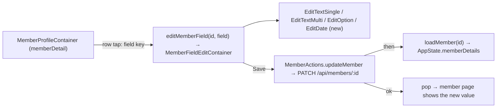

# ui2-members-edit — spec
> lg · child 2 of program `ui2-members` (docs/features/ui2-members/PROGRAM.md) · no ticket

## Idea

**Why.** Child 1 (`ui2-members-browse`, shipped 2026-10-26) gave leaders the UI 2.0 member page with
every field row read-only (its D3). Leaders need to correct and complete a member's details — a new
phone, an address, an emergency contact — without falling back to the 1.0 app.

**What success looks like.** On a member's page a leader taps Email, Phone, Birthday, Gender, Address,
Emergency contact or Emergency phone; that field's edit page pushes in from the right; they change the
value and tap Save; the page pops back and the member page shows the new value with no reload. A phone
edit shows the red "Unverified" indicator until the member signs in with the new number. Organization
and Role stay read-only.

**In your words.** "The editablefieldrow should also open the edit view for that type of data to edit
in a modal that opens from the right" (program intake) → D1, D2.

**The concept.** The member page is already a pushed page in the Home tab's `NavigationStack`
(browse D1). A field-row tap appends `UI2Destination.editMemberField(memberId, field)`; the destination
renders the field's built shared-edit-field screen through one container that owns the value, the
save and the error. Save calls `MemberActions.updateMember`, which PATCHes the one field, re-reads the
member into `AppState.memberDetails`, and the container pops.

**How it fits today.** The four edit screens are built MakeReadyUI previews wired to nothing.[^1] The
member PATCH validates with a plain `z.object` that silently strips `phoneNumber`, `address`,
`emergencyContactName` and `emergencyContactPhone` (browse F11) and already applies browse D7's
visibility 404.[^2] `Member.phoneNumber` is required and unique; sign-in accepts only
`^\+[1-9]\d{1,14}$`.[^3] C-042 already has a non-tappable form (`isTappable`), added by browse D3.[^4]

**Approaches considered.** No fork: the push (browse D1) and the edit screens exist; this child wires
them. Rejected inside the design: a multi-field edit form (the shared-edit-field pattern forbids it).

[^1]: `iphone/MakeReadyUI/Screens/Fields/*.swift` ("PREVIEW ONLY" headers)
[^2]: `server/src/routes/members.ts` (`updateMemberSchema`, `router.patch('/:memberId'`)
[^3]: `server/prisma/schema.prisma:329`, `server/src/routes/verification.ts:52`
[^4]: `iphone/MakeReadyUI/EditableFieldRow.swift:77`

## Apps

| App | In scope | What changes | Section |
|---|---|---|---|
| server | ✅ | PATCH `/api/members/:id` accepts phone, address and both emergency fields; phone normalized, uniqueness → 409, `phoneVerified` reset; birthday bounds; member-session phone change refused | §server |
| client | ⬜ | UI 2.0 leader screens are iPhone-only (docs/ui2/README.md); the web's one PATCH caller (`profile.ui.ts:49,73`) sends none of the new keys and its fields keep their rules | — |
| iphone | ✅ | Field rows tappable; `editMemberField` destination; one edit container; new `EditDateFieldScreen`; `MemberActions.updateMember` | §iphone |
| capture | ⬜ | Edit screens capture from ViewRegistry fixtures, not the live API; the new date screen gets its preview through the d2m harness (`/ui2-resolve`), not a capture case | — |

**Sequencing:** contract settled → server PATCH changes verify → contract FREEZES → iphone builds
against it → the walk on Fixtures.

**Backward compatibility:** every PATCH change is additive — new optional keys; existing keys keep
their rules except `birthday`, which now rejects a date after today or before 1900-01-01 (a released
1.0 build never sends either; the web form's date input is a past date). Released 1.0 iPhone builds
send none of the new keys. Response shape unchanged.

**Blast radius:** every caller of `PATCH /api/members/:id` (web `profile.ui.ts`, 1.0 iPhone); every
reader of `Member.phoneNumber` / `phoneVerified` (sign-in, SMS, member lists).

## Decisions

<!-- The one place rulings live. Record the DECISION — and, in one line, why, and why the rejected option lost. A stated preference
     is the INPUT to a row, not the row. Write each Ruling as something later code can be checked
     against without re-interpretation:
       · positive and specific — "store the full number, mask at render", not "don't truncate"
       · scope named — which apps, screens or endpoints it binds
       · "etc." / "and so on" expanded into the list, or the test for membership stated
       · the rejected alternative named, with the reason it lost (check-obligations warns on a bare one)
       · the enforcement hook, where one exists (lint rule, script, test)
     🔴 NEVER quote the user's prompt as the ruling. Operationalize it: a closed list, a measured
     value, an enumerated set of deviations. A ruling a stranger could implement two ways is not
     written yet.
     Who/date carries the provenance, so the Ruling itself needs no quote marks.
     The owner's own words go in §Idea "In your words", linked to this row — never in the Ruling.
     OPEN rows block the build go-ahead. Never delete a ruling; supersede it in place with a date. -->

| # | Decision | Ruling | Who / date |
|---|---|---|---|
| D0 | Program decisions | PROGRAM.md §Shared decisions P1–P14 and ui2-members-browse D1–D23 bind this spec; the rows below apply or add to them | Luke 2026-10-25 |
| D1 | Which rows edit | Exactly 7 C-042 rows on the member page become tappable with chevron: Email, Phone, Birthday, Gender, Address, Emergency contact, Emergency phone. Organization and Role stay non-tappable (P4). Supersedes browse D3 for those 7. Rejected: editing name/photo here (not designed as C-042 rows) | Luke 2026-10-25 (P4 + program children row) |
| D2 | Field identity and push | `MembersProfileScreen.onEditField` reports a field key — one of `email`, `phone`, `birthday`, `gender`, `address`, `emergencyName`, `emergencyPhone` (P3) — never the label; the container appends `UI2Destination.editMemberField(memberId:, field:)` to the Home tab path. System push/pop (P1); left-edge swipe pops. Rejected: label strings (break on copy changes) | (assumed at brainstorm) P3 |
| D3 | Arrangement per field | text-single (`EditTextSingleFieldScreen`): email, phone, emergencyName, emergencyPhone · text-multi (`EditTextMultiFieldScreen`): address · option (`EditOptionFieldScreen`): gender · date (new `EditDateFieldScreen`, native `.wheel` `DatePicker` + a "Clear" link button): birthday. No AI Suggestions block on any member field. Rejected: birthday as text with a date mask (clumsy) | Luke 2026-10-25 (P10) |
| D4 | Phone input | Server and iPhone normalize the same way: strip spaces, `-`, `.`, `(`, `)`; exactly 10 digits → prefix `+1`; starts with `+` → kept; the result must match `^\+[1-9]\d{1,14}$`, else 400 "Enter a valid phone number". Stored normalized. Rejected: always US (locks out non-US members); must type +country (awkward) | Luke 2026-10-26 |
| D5 | Phone uniqueness and verification | A normalized number held by another member → 409 `{success:false, error:"That number belongs to another member", code:"PHONE_TAKEN"}`. A changed number sets `phoneVerified=false` and `lastVerifiedAt=null`; an unchanged number (same normalized value) changes nothing. Rejected: read-only phone for leaders (a leader can't receive the member's code) | Luke 2026-10-25 (P9) |
| D6 | Phone change and sign-in | Existing member sessions are untouched; the next SMS sign-in uses the new number and flips `phoneVerified` true on success (existing flow, unchanged). Rejected: sign the member out everywhere (needs new session-revocation code) | Luke 2026-10-26 |
| D7 | Emergency phone | Stored as typed (trimmed); valid iff it holds ≥7 digits and only digits, spaces, `-`, `.`, `(`, `)`, `+`, and `ext`/`x`; else 400 "Enter a valid phone number". Not unique, not verified. Display: 10 digits, or 11 starting `1`, with nothing else but separators → `+1 (AAA) BBB-CCCC` (browse D23); otherwise as typed. Rejected: Phone's rules (rejects extensions and landlines); free text (no typo catch) | Luke 2026-10-26 |
| D8 | Clearing | Phone: empty → Save disabled on the iPhone and 400 on the server. Email, Birthday, Gender, Address, Emergency contact, Emergency phone: empty (or "Not set") saves `null`; Save is enabled whenever the value differs from the loaded one, including to empty. Rejected: all required once set (wrong data can't be removed) | Luke 2026-10-26 |
| D9 | Birthday | Wheel range 1900-01-01 … today (device local); the iPhone sends `YYYY-MM-DD`; the server stores midnight UTC and returns 400 "Birthday must be between 1900 and today" for a date before 1900-01-01 or after today+1 day UTC (tolerates UTC+14); `null` clears. Display and Age stay UTC-calendar (browse mapper). Rejected: ages 5–110 only (blocks edge cases) | Luke 2026-10-26 |
| D10 | Gender | Options top → bottom: Male · Female · Not set, title-only rows (54pt); stored `male` / `female` / `null`; "Not set" pre-selected when gender is null. Rejected: Male/Female only (gender could never be cleared) | Luke 2026-10-26 |
| D11 | Email | Trimmed; a non-empty value must pass `z.string().email()` else 400 "Enter a valid email"; not unique; empty → null | (assumed at brainstorm) |
| D12 | Who can edit | Exactly the callers PATCH admits today and who can see the member (browse D7): super admin, org owner, a role-holder of one of the member's orgs who passes `canViewMember`; outside that → 404/403 as today. A **member** session may PATCH itself as today but sending `phoneNumber` → 403 "Phone changes go through sign-in". Rejected: owner/admin-only edits (Group Leaders could see but not fix their own members) | (assumed at brainstorm) · member-phone guard (assumed at spec) 2026-10-26 |
| D13 | Edit-page states | `clean` → Save disabled; `dirty` → Save enabled green; `saving` → Save disabled + spinner, input locked; `save-failed` → inline error line above Save (400/409 → the server's `error` text; any other failure → "Couldn't save. Try again."), value kept, Save re-enabled; Back at any time discards silently (P11). On success: `loadMember` refresh, then pop | Luke 2026-10-25 (P11) |
| D14 | Page copy | Title = the row label; description: Email "The email address used to contact this member." · Phone "The number this member signs in with. Changing it marks it unverified until they sign in with the new number." · Birthday "Used to show this member's age to group leaders." · Gender "Helps leaders place this member in the right groups." · Address "This member's mailing address." · Emergency contact "The person to contact if there is an emergency." · Emergency phone "The number to call for this member's emergency contact." Field label (C-046) = the title; placeholder "". Routed to `/ui2-resolve` (F2). Rejected: one shared line (loses Phone's warning); none (design deviation) | Luke 2026-10-26 |
| D15 | One field per request | The iPhone PATCHes only the edited key (`email`, `phoneNumber`, `birthday`, `gender`, `address`, `emergencyContactName`, `emergencyContactPhone`), `null` to clear; it reads the result back with `GET /api/members/:id` (`loadMember`), not from the PATCH response. Why: one decoder for the member payload (`isGroupLeader`, scoped orgs are GET-only). Rejected: decoding the PATCH response (a second, thinner member shape) | (assumed at spec) 2026-10-26 |
| D16 | Client-side validation | The iPhone runs D4, D7, D9, D11 before sending and shows the same messages inline without a request; the server checks again. Rejected: server-only checks (a round-trip per typo) | (assumed at spec) 2026-10-26 |

## Contract

| Contract | Producer | Consumers | Auth | Request | Response | Errors |
|---|---|---|---|---|---|---|
| `PATCH /api/members/:memberId` (extended) | server | iphone | `requireMemberOrOrgOwner` + browse D7 404 (unchanged); D12 member-session phone guard | existing keys + `phoneNumber?: string` (D4, non-empty), `address?: string\|null`, `emergencyContactName?: string\|null`, `emergencyContactPhone?: string\|null` (D7); `email?: string\|null` (D11 — `null` newly allowed); `birthday?: "YYYY-MM-DD"\|ISO\|null` (D9 bounds); `gender?: "male"\|"female"\|null`. Strings trimmed; `""` on a clearable key = `null`. Unknown keys rejected (`.strict()`) | unchanged `{success, data: Member}` | 400 `{success:false, error}` (D4/D7/D9/D11 messages, empty phone) · 401 · 403 (incl. D12 member phone) · 404 (D7) · 409 `PHONE_TAKEN` (D5) |
| `GET /api/members/:memberId` (unchanged) | server | iphone | as today | — | browse contract (incl. `phoneVerified`, `address`, emergency fields) | as today |

## Schema & API changes

| # | Kind | Model.field | Wire | Reason | Status |
|---|---|---|---|---|---|
| SC1 | EDIT | `updateMemberSchema` — `phoneNumber`, `address`, `emergencyContactName`, `emergencyContactPhone` added; `email` nullable; `.strict()` | PATCH body | D3–D11; browse F11 | planned |
| SC2 | EDIT | `Member.phoneVerified`, `Member.lastVerifiedAt` written on phone change | PATCH effect | D5 | planned |

No schema (database) change — the columns exist since browse SC1–SC3 (established 2026-10-26).

**Data plan:** no migration. Existing rows unchanged until edited. A phone edit overwrites the
previous number (no history kept — the member's `updatedAt` moves).

## server

- `updateMemberSchema` per SC1, `.strict()` so an unknown key is a 400, never silently dropped (house
  rule). Normalization + validation helpers in a service module (`services/member-fields.ts`):
  `normalizePhone` (D4), `isValidContactPhone` (D7), `birthdayInRange` (D9).
- `updateMember` (`services/member.ts`): on `phoneNumber`, compare normalized values; changed →
  `phoneVerified=false`, `lastVerifiedAt=null`; Prisma `P2002` on `phoneNumber` → 409 `PHONE_TAKEN`.
- Route: D12 member-session guard before validation; `""` → `null` for clearable keys.

## iphone

- **Shell:** `UI2Destination.editMemberField(memberId: String, field: MemberField)` with
  `enum MemberField: String { email, phone, birthday, gender, address, emergencyName, emergencyPhone }`;
  `.navigationDestination` renders `MemberFieldEditContainer`.
- **Member page:** `MembersProfileScreen` passes `isTappable: true` on the 7 D1 rows and reports
  `onEditField(MemberField)` (D2) — MakeReadyUI edit under this spec, routed to `/ui2-resolve` (F2).
  `MemberProfileContainer` appends the destination.
- **Edit container** (`UI2/Containers/Members/MemberFieldEditContainer.swift`): builds the field's
  screen State from `AppState.memberDetails[id]` (D3, D10, D14), runs D16 checks, owns
  `saving`/`errorText` (D13), calls `MemberActions.updateMember`, pops on success.
- **New screen** `MakeReadyUI/Screens/Fields/EditDateFieldScreen.swift` (**(new)**): C-040 + page
  description + `DatePicker(.wheel)` bounded 1900-01-01…today + C-049 "Clear" link + C-048 Save; states
  clean/dirty/saving/save-failed as the other three. Routed to `/ui2-resolve` to be drawn (P10).
- **Action:** `MemberActions.updateMember(_ id:, _ patch: MemberPatch) async -> Result<Void, MemberSaveError>`
  — PATCH one key (D15), then `loadMember(id)`; 401 → sign-out, other errors returned to the
  container (never swallowed; `/ios-error-surface`).
- **Display:** the member page's Emergency phone uses D7's display rule; Phone keeps browse D23.

## Testing

- **server:** route tests — each new key saves and clears (D8); phone normalization table (10 digits,
  `+44…`, punctuation, invalid → 400, empty → 400); 409 on another member's number; `phoneVerified`
  reset on change and untouched on same-number save; emergency-phone validity table; birthday bounds
  (1899-12-31 → 400, today → 200, tomorrow+1 → 400, null → 200); email null/invalid; `.strict()`
  unknown key → 400; D12 member-session phone → 403; D7 out-of-scope leader → 404.
- **iphone:** container/mapper tests — State per field (D3, D10, D14), dirty/clean rule incl. clear
  (D8), D16 validators share the server's tables, error text mapping (D13); `MemberField` ↔ PATCH key;
  shell test: `editMemberField` appends and pops; `ios:build-check --test`; swiftlint baseline.
- **Cross-app E2E (Fixtures walk env):** open a member → tap each of the 7 rows → edit → Save → the
  member page shows the value; phone edit → "Unverified"; another member's number → inline 409 text;
  Gender → Not set clears; Birthday Clear clears; Back on a dirty page leaves the value unchanged.
- **Human walk (on device):** push/pop and swipe-back from an edit page; the date wheel feel; keyboard
  on text pages.

## Out of scope

- Editing name, photo, groups, programs or age-range fields; member self-editing in UI 2.0.
- AI suggestions on any field; email verification; session revocation on a phone change.
- Field-change history/audit log.
- The web client.

## Findings & risks

| # | Finding | Resolution |
|---|---|---|
| F1 | A wrongly entered phone locks the member out of SMS sign-in until a leader corrects it | accepted with D5/D6 (P9); the Phone page copy warns (D14) |
| F2 | `MakeReadyUI/` is d2m-owned: D1 (rows tappable), D2 (field-key callback), D10 ("Not set" option), D14 (copy) and the new `EditDateFieldScreen` change or add design items | build-time risk: route all to `/ui2-resolve` after the build; never write a contract or registry row here |
| F3 | `.strict()` turns any unknown key a current caller sends into a 400 | build-time risk on the server task: list every key the web `profile.ui.ts` and the 1.0 iPhone send and confirm each is in the schema before enabling `.strict()` |
