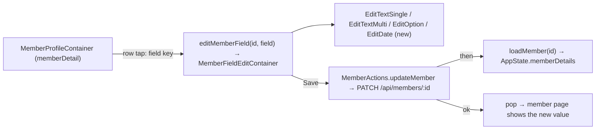

# ui2-members-edit — spec
> lg · child 2 of program `ui2-members` (docs/features/ui2-members/PROGRAM.md) · no ticket

## Idea

**Why.** Child 1 (`ui2-members-browse`, shipped 2026-10-26) gave leaders the UI 2.0 member page with
every field row read-only (its D3). Leaders need to correct and complete a member's details — a new
phone, an address, an emergency contact — without falling back to the 1.0 app.

**What success looks like.** On a member's page a leader taps Email, Phone, Birthday, Gender, Address,
Emergency contact or Emergency phone; that field's edit page pushes in from the right; they change the
value and tap Save; the page pops back and the member page shows the new value with no reload. A phone
edit shows the red "Unverified" indicator until the member signs in with the new number. Organization
and Role stay read-only.

**In your words.** "The editablefieldrow should also open the edit view for that type of data to edit
in a modal that opens from the right" (program intake) → D1, D2.

**The concept.** The member page is already a pushed page in the Home tab's `NavigationStack`
(browse D1). A field-row tap appends `UI2Destination.editMemberField(memberId, field)`; the destination
renders the field's built shared-edit-field screen through one container that owns the value, the
save and the error. Save calls `MemberActions.updateMember`, which PATCHes the one field, re-reads the
member into `AppState.memberDetails`, and the container pops.

**How it fits today.** The four edit screens are built MakeReadyUI previews wired to nothing.[^1] The
member PATCH validates with a plain `z.object` that silently strips `phoneNumber`, `address`,
`emergencyContactName` and `emergencyContactPhone` (browse F11) and already applies browse D7's
visibility 404.[^2] `Member.phoneNumber` is required and unique; sign-in accepts only
`^\+[1-9]\d{1,14}$`.[^3] C-042 already has a non-tappable form (`isTappable`), added by browse D3.[^4]

**Approaches considered.** No fork: the push (browse D1) and the edit screens exist; this child wires
them. Rejected inside the design: a multi-field edit form (the shared-edit-field pattern forbids it).

[^1]: `iphone/MakeReadyUI/Screens/Fields/*.swift` ("PREVIEW ONLY" headers)
[^2]: `server/src/routes/members.ts` (`updateMemberSchema`, `router.patch('/:memberId'`)
[^3]: `server/prisma/schema.prisma:329`, `server/src/routes/verification.ts:52`
[^4]: `iphone/MakeReadyUI/EditableFieldRow.swift:77`

## Apps

| App | In scope | What changes | Section |
|---|---|---|---|
| server | ✅ | PATCH `/api/members/:id` accepts phone, address and both emergency fields; phone normalized, uniqueness → 409, `phoneVerified` reset; birthday bounds; member-session phone change refused | §server |
| client | ⬜ | UI 2.0 leader screens are iPhone-only (docs/ui2/README.md). The web has TWO PATCH callers, neither sending a new key: admin `profile.ui.ts:49,73` (`firstName`/`lastName`, `smsConsent`) and the member's own `/profile` form, `ProfileController.php:47` (`firstName`, `lastName`, `gender`, `birthday` — `""` arrives as `null` via Laravel's `ConvertEmptyStringsToNull`). Every key they send stays in the `.strict()` schema; the only rule that tightens is D9's birthday bounds. The member form's date input has no `max` and `ProfileController.php:44` checks only `date`, so a future birthday typed on the web now gets a 400 — shown as the generic "Failed to update profile." (the controller reads `body.message`; the server sends `error`). Accepted: no web change in this child | — |
| iphone | ✅ | Field rows tappable; `editMemberField` destination; one edit container; new `EditDateFieldScreen`; `MemberActions.updateMember` | §iphone |
| capture | ⬜ | Edit screens capture from ViewRegistry fixtures, not the live API; the new date screen gets its preview through the d2m harness (`/ui2-resolve`), not a capture case | — |

**Sequencing:** contract settled → server PATCH changes verify → contract FREEZES → iphone builds
against it → the walk on Fixtures.

**Backward compatibility:** every PATCH change is additive — new optional keys; existing keys keep
their rules except `birthday`, which now rejects a date after today or before 1900-01-01 (a released
1.0 build never sends either; the web member form can, and gets the generic error — §Apps client row). Released 1.0 iPhone builds
send none of the new keys. Response shape unchanged.

**Blast radius:** every caller of `PATCH /api/members/:id` (web `profile.ui.ts`, web `ProfileController.php`; the 1.0 iPhone has no caller — it reads `/api/members/:id/profile` only); every
reader of `Member.phoneNumber` / `phoneVerified` / `smsConsent` (sign-in, `confirm-verification`, SMS
send-time consent and STOP/START lookups by number — `routes/sms.ts:79`, `services/sms-campaign.ts:61` —,
invites matched by number — `services/invite.ts:203`, member lists).

## Decisions

<!-- The one place rulings live. Record the DECISION — and, in one line, why, and why the rejected option lost. A stated preference
     is the INPUT to a row, not the row. Write each Ruling as something later code can be checked
     against without re-interpretation:
       · positive and specific — "store the full number, mask at render", not "don't truncate"
       · scope named — which apps, screens or endpoints it binds
       · "etc." / "and so on" expanded into the list, or the test for membership stated
       · the rejected alternative named, with the reason it lost (check-obligations warns on a bare one)
       · the enforcement hook, where one exists (lint rule, script, test)
     🔴 NEVER quote the user's prompt as the ruling. Operationalize it: a closed list, a measured
     value, an enumerated set of deviations. A ruling a stranger could implement two ways is not
     written yet.
     Who/date carries the provenance, so the Ruling itself needs no quote marks.
     The owner's own words go in §Idea "In your words", linked to this row — never in the Ruling.
     OPEN rows block the build go-ahead. Never delete a ruling; supersede it in place with a date. -->

| # | Decision | Ruling | Who / date |
|---|---|---|---|
| D0 | Program decisions | PROGRAM.md §Shared decisions P1–P14 and ui2-members-browse D1–D23 bind this spec; the rows below apply or add to them | Luke 2026-10-25 |
| D1 | Which rows edit | Exactly 7 C-042 rows on the member page become tappable with chevron: Email, Phone, Birthday, Gender, Address, Emergency contact, Emergency phone. Organization and Role stay non-tappable (P4). Supersedes browse D3 for those 7. Rejected: editing name/photo here (not designed as C-042 rows) | Luke 2026-10-25 (P4 + program children row) |
| D2 | Field identity and push | `MembersProfileScreen.onEditField` reports a field key — one of `email`, `phone`, `birthday`, `gender`, `address`, `emergencyName`, `emergencyPhone` (P3) — never the label; the container appends `UI2Destination.editMemberField(memberId:, field:)` to the Home tab path. System push/pop (P1); left-edge swipe pops. Rejected: label strings (break on copy changes) | (assumed at brainstorm) P3 |
| D3 | Arrangement per field | text-single (`EditTextSingleFieldScreen`): email, phone, emergencyName, emergencyPhone · text-multi (`EditTextMultiFieldScreen`): address · option (`EditOptionFieldScreen`): gender · date (new `EditDateFieldScreen`, native `.wheel` `DatePicker` + a "Clear" link button): birthday. No AI Suggestions block on any member field. Rejected: birthday as text with a date mask (clumsy) | Luke 2026-10-25 (P10) |
| D4 | Phone input | Server and iPhone normalize the same way: strip spaces, `-`, `.`, `(`, `)`; exactly 10 digits → prefix `+1`; exactly 11 digits starting `1` → prefix `+` (D18); starts with `+` → kept; the result must match `^\+[1-9]\d{1,14}$`, else 400 "Enter a valid phone number". Stored normalized. The iPhone Phone page pre-fills the stored number in its browse D23 label form, and its dirty check compares normalized values, so re-typing the same number in another format is `clean` (D24). Rejected: always US (locks out non-US members); must type +country (awkward) | Luke 2026-10-26 |
| D5 | Phone uniqueness and verification | A normalized number held by another member → 409 `{success:false, error:"That number belongs to another member", code:"PHONE_TAKEN"}`. A changed number sets `phoneVerified=false`, `lastVerifiedAt=null`, `smsConsent=false` and `smsConsentAt=now` (D17); an unchanged number (same normalized value) changes nothing. Rejected: read-only phone for leaders (a leader can't receive the member's code) | Luke 2026-10-25 (P9) |
| D6 | Phone change and sign-in | Existing member sessions are untouched; the next SMS sign-in uses the new number and flips `phoneVerified` true on success (existing flow, unchanged). Rejected: sign the member out everywhere (needs new session-revocation code) | Luke 2026-10-26 |
| D7 | Emergency phone | Stored as typed (trimmed); valid iff it matches `/^[\d\s().+-]+(?:\s*(?:ext\.?|x)\s*\d+)?$/i` and the part before any extension holds ≥7 digits; else 400 "Enter a valid phone number". Not unique, not verified. Display: 10 digits with no `+`, or 11 starting `1` (optionally written `+1…`), with nothing else but spaces, `-`, `.`, `(`, `)` → `+1 (AAA) BBB-CCCC` (browse D23); any other `+`-led value (e.g. `+65 6123 4567`) and anything else → as typed. Superseded 2026-10-26 at final review: the audit's "`+` counts as a separator" formatted 10-digit international numbers as US Rejected: Phone's rules (rejects extensions and landlines); free text (no typo catch) | Luke 2026-10-26 |
| D8 | Clearing | Phone: empty → Save disabled on the iPhone and 400 on the server. Email, Birthday, Gender, Address, Emergency contact, Emergency phone: empty (or "Not set") saves `null`; Save is enabled whenever the value differs from the loaded one, including to empty. Rejected: all required once set (wrong data can't be removed) | Luke 2026-10-26 |
| D9 | Birthday | Wheel range 1900-01-01 … today (device local). The wheel shows the stored UTC calendar date rebuilt as LOCAL date components (never the UTC instant, which lands a day early west of UTC); the iPhone sends that local `YYYY-MM-DD`. Stored null → the page shows "Not set" above the wheel, the wheel starts at 2000-01-01, any wheel change is dirty, and "Clear" is disabled; Clear on a set value shows "Not set" and is dirty. Server: accepts `YYYY-MM-DD` or an ISO string, takes its UTC calendar date and stores that date at 00:00Z (time and offset dropped); unparseable → 400 with the message below (D19); rejects a date before 1900-01-01 or a date > (UTC today + 1 day) — so UTC tomorrow is accepted for UTC+14 — with 400 "Birthday must be between 1900 and today"; `null` or `""` clears. Display and Age stay UTC-calendar (browse mapper). Rejected: ages 5–110 only (blocks edge cases) | Luke 2026-10-26 |
| D10 | Gender | Options top → bottom: Male · Female · Not set, title-only rows (54pt); stored `male` / `female` / `null`; "Not set" pre-selected when gender is null or any stored value other than `male`/`female` (the page starts `clean`). Rejected: Male/Female only (gender could never be cleared) | Luke 2026-10-26 |
| D11 | Email | Trimmed, then `""` → null, then a non-empty value must pass `z.string().email()` else 400 "Enter a valid email" (trim runs before the check: `" a@b.com "` saves); not unique. The Email page loads the raw `email` (empty when null) — never the `googleEmail` fallback the profile row shows (browse T13), so clearing email on a Google-linked member leaves the row showing the Google address (D25) | (assumed at brainstorm) · load rule auto (recommended) 2026-10-26 |
| D12 | Who can edit | Exactly the callers PATCH admits today and who can see the member (browse D7): super admin (member must belong to ≥1 org — today's middleware, `middleware/auth.ts:301`), org owner, a role-holder of one of the member's orgs who passes `canViewMember`; outside that → 404/403 as today. `canViewMember`'s creator-scoped visibility for Group Leaders (browse's recorded read exception, `services/member-access.ts:9`) now also bounds writes — a recorded exception to the org-level-check house rule, carried from browse. A leader of any one of a multi-org member's orgs edits the member's single global record, visible in every org (D20). A **member** session (`viewerOf(...).kind === 'self'`) may PATCH itself as today, but a `phoneNumber` whose normalized value differs from the stored one → 403 "Phone changes go through sign-in"; an unchanged number passes (D23). The check runs in `updateMember` (the service receives the viewer kind), not the route. Rejected: owner/admin-only edits (Group Leaders could see but not fix their own members) | (assumed at brainstorm) · member-phone guard (assumed at spec) 2026-10-26 |
| D13 | Edit-page states | `clean` → Save disabled; `dirty` → Save enabled green; `saving` → Save disabled + spinner, input locked; `save-failed` → inline error line above Save (400/409 → the server's `error` text; any other failure → "Couldn't save. Try again."), value kept, Save re-enabled; Back at any time discards silently (P11). Superseded in part auto (recommended) 2026-10-26: `saving` shows NO spinner — C-048 has no busy state (`PageActionButton.swift:54`) and adding one is a design change (D26). On success: write the sent key into `memberDetails[id]` (plus `phoneVerified=false` on a changed phone) so the page shows the new value even if the reload fails (D21), then `loadMember`, then pop ONLY if the Home path's last entry is still this `editMemberField(id, field)` — a swipe-back or Home re-tap during the save leaves the stack alone. The save runs in an unstructured `Task` started from `onSave`, with `saving=true` set synchronously first (a second tap is a no-op). The inline line is the only user surface (UI 2.0 mounts no `ErrorBannerHost`); a generic failure also calls `recordError(surface:false)` | Luke 2026-10-25 (P11) |
| D14 | Page copy | Title = the row label exactly: "Email address", "Phone number", "Birthday", "Gender", "Address", "Emergency contact", "Emergency phone" (`MembersProfileScreen.swift:130-135`); description: Email "The email address used to contact this member." · Phone "The number this member signs in with. Changing it marks it unverified until they sign in with the new number." · Birthday "Used to show this member's age to group leaders." · Gender "Helps leaders place this member in the right groups." · Address "This member's mailing address." · Emergency contact "The person to contact if there is an emergency." · Emergency phone "The number to call for this member's emergency contact." On the text pages only, the C-046 field label = the title; placeholder "". The option and date pages have no C-046. Routed to `/ui2-resolve` (F2). Rejected: one shared line (loses Phone's warning); none (design deviation) | Luke 2026-10-26 |
| D15 | One field per request | The iPhone PATCHes only the edited key (`email`, `phoneNumber`, `birthday`, `gender`, `address`, `emergencyContactName`, `emergencyContactPhone`), `null` to clear; it reads the result back with `GET /api/members/:id` (`loadMember`), not from the PATCH response. Why: one decoder for the member payload (`isGroupLeader`, scoped orgs are GET-only). Rejected: decoding the PATCH response (a second, thinner member shape) | (assumed at spec) 2026-10-26 |
| D16 | Client-side validation | The iPhone runs D4, D7, D9, D11 before sending and shows the same messages inline without a request; the server checks again. Rejected: server-only checks (a round-trip per typo) | (assumed at spec) 2026-10-26 |
| D17 | SMS consent on a phone change | A changed (normalized) phone sets `smsConsent=false`, `smsConsentAt=now` in the same update as D5; the member is asked again at their next SMS sign-in (existing flow). Why: consent is looked up by number at send time and STOP/START (`routes/sms.ts:79`), so carrying it over would mark a number that never agreed as consented. Rejected: keep consent (sends to an unconsented number) | auto (recommended) 2026-10-26 (audit S5) |
| D18 | 11-digit US numbers | D4 also maps exactly 11 digits starting `1` (no `+`) to `+` + the digits — "1-555-123-4567" → `+15551234567`. NANP-invalid `+1` numbers that pass `^\+[1-9]\d{1,14}$` are accepted. Rejected: 400 on them (numbers pasted from Contacts often carry the leading 1) | auto (recommended) 2026-10-26 (audit S7) |
| D19 | Birthday parsing | Folded into D9: only `YYYY-MM-DD` or an ISO string; its UTC calendar date is stored at 00:00Z; unparseable → 400; `""` → null. Rejected: today's `new Date(birthday)` (an offset becomes a stored instant; an invalid string reaches Prisma as a 500) | auto (recommended) 2026-10-26 (audit S9) |
| D20 | Multi-org members | A leader authorized through any one of the member's orgs may change the member's phone and email, which are one global value seen in every org. Accepted (F1). Rejected: requiring every org (no UI to ask the other org) | auto (recommended) 2026-10-26 (audit S3) |
| D21 | Value after a save | After a 2xx the container writes the sent key into `AppState.memberDetails[id]` (and `phoneVerified=false` on a changed phone, D5) before `loadMember`, so a failed reload still shows the new value. Rejected: reload-only (a failed GET leaves the old value showing after a successful save) | auto (recommended) 2026-10-26 (audit I4) |
| D22 | Keyboard | Each text page focuses its field on appear. Single-line pages: return key does nothing (Save stays a tap). Address: return inserts a newline. Keyboard types: Email `.emailAddress`, no autocapitalize/autocorrect; Phone `.phonePad` and Emergency phone `.numbersAndPunctuation` (its ABC key reaches D7's "x"/"ext"; superseded at plan 2026-10-26 from `.phonePad`, which has no letters), both with C-046 `field: .text` (the `.phone` variant's fixed "+1" prefix contradicts D4); Emergency contact `.default` with words capitalized. Length caps (enforced on the iPhone; the server columns are Text, and the server additionally rejects an Emergency phone over 40 — the same cap, so the two never diverge): Email 254, Phone 20, Emergency phone 40, Emergency contact 200, Address 2000 | auto (recommended) 2026-10-26 (audit I11, I12, I18) |
| D23 | Member-session phone guard | Folded into D12: the 403 fires only when the normalized number differs from the stored one. Rejected: 403 on any `phoneNumber` key (a form echoing the current number would fail every save) | auto (recommended) 2026-10-26 (audit S4) |
| D24 | Phone pre-fill and dirty rule | Folded into D4: pre-fill the D23 label; dirty = normalized(typed) ≠ stored. The text template takes a container-supplied `canSave` for this (T9). Rejected: trimmed string equality (shows dirty for a reformatted same number) | auto (recommended) 2026-10-26 (audit I10) |
| D25 | Email vs Google email | Folded into D11. Rejected: hiding the googleEmail fallback after a clear (re-opens browse T13) | auto (recommended) 2026-10-26 (audit I14) |
| D26 | Saving indicator | Folded into D13: `saving` = Save disabled and input locked, no spinner. A busy state on C-048 is design work for `/ui2-component-update` later. Rejected: adding the spinner here (this pipeline never writes the design) | auto (recommended) 2026-10-26 (audit I9) |
| D27 | Rows before the member loads | The 7 D1 rows are tappable only when `AppState.memberDetails[id]` is non-nil; the edit container reads only that entry. Rejected: tappable during partial load (opens an edit page with an empty loaded value) | auto (recommended) 2026-10-26 (audit I13) |
| D28 | Design OQs this child disposes | OQ-C-045-2 (red border on an invalid input): no — the inline error line only. OQ-C-046-3 (required marker): none on Phone. OQ-shared-edit-field-4: the date page's "Clear" uses C-049 as built (accent). OQ-C-042-3: Organization and Role keep `isTappable: false` (F2) | auto (recommended) 2026-10-26 (audit item 7) |

## Contract

| Contract | Producer | Consumers | Auth | Request | Response | Errors |
|---|---|---|---|---|---|---|
| `PATCH /api/members/:memberId` (extended) | server | iphone | `requireMemberOrOrgOwner` + browse D7 404 (unchanged); D12 member-session phone guard | existing keys + `phoneNumber?: string` (D4/D18, non-empty), `address?: string\|null`, `emergencyContactName?: string\|null`, `emergencyContactPhone?: string\|null` (D7); `email?: string\|null` (D11 — `null` newly allowed); `birthday?: "YYYY-MM-DD"\|ISO\|null` (D9/D19: UTC date kept, bounds, unparseable → 400); `gender?: "male"\|"female"\|null`. Strings trimmed; `""` on a clearable key = `null`. Unknown keys rejected (`.strict()`) | unchanged `{success, data: Member}` | 400 `{success:false, error}` (D4/D7/D9/D11 messages, empty phone) · 401 · 403 (incl. D12/D23 member phone change) · 404 (D7) · 409 `PHONE_TAKEN` (D5) · 500 `{success:false, error:"Failed to update member"}` (anything else — the iPhone shows D13's generic line for it, never the text) |
| `GET /api/members/:memberId` (unchanged) | server | iphone | as today | — | browse contract (incl. `phoneVerified`, `address`, emergency fields) | as today |

## Schema & API changes

| # | Kind | Model.field | Wire | Reason | Status |
|---|---|---|---|---|---|
| SC1 | EDIT | `updateMemberSchema` — `phoneNumber`, `address`, `emergencyContactName`, `emergencyContactPhone` added; `email` nullable; `.strict()` | PATCH body | D3–D11; browse F11 | planned |
| SC2 | EDIT | `Member.phoneVerified`, `Member.lastVerifiedAt` written on phone change | PATCH effect | D5 | planned |
| SC3 | ADD | PATCH error status 409 `{success:false, error, code:"PHONE_TAKEN"}` — today a `P2002` on `phoneNumber` surfaces as 500 "Failed to update member" (`services/member.ts:270`) | PATCH response | D5 | planned |
| SC4 | EDIT | `UpdateMemberData` (`services/member.ts:60`) gains `phoneNumber`, `address`, `emergencyContactName`, `emergencyContactPhone`; `email` becomes `string \| null`; `lastVerifiedAt` becomes `Date \| null` | service type (no wire change) | D5, D8, SC1 | planned |

**Field alignment (2026-10-26)** — each persisted field the edit pages write, traced Prisma → zod →
wire → write path → the iPhone property (`MemberDetail`, `State/Models/MemberModels.swift:109`):

| Field | Prisma | PATCH zod today | iPhone `MemberDetail` | Verdict |
|---|---|---|---|---|
| `email` | `String?` | `z.string().email().optional()` — `null` rejected | `email: String?` (displayed `email ?? googleEmail`) | RESHAPE (SC1: nullable) |
| `phoneNumber` | `String @unique`, required | absent — silently stripped | `phoneNumber: String` | MISSING (SC1, SC3) |
| `birthday` | `DateTime?` | `z.string().nullable()`, no bounds | `birthday: String?` (ISO, UTC date) | RESHAPE (SC1: D9 bounds) |
| `gender` | `String?` | `enum(male,female).nullable()` | `gender: String?` | ALIGNED |
| `address` | `String? @db.Text` | absent — stripped | `address: String?` | MISSING (SC1) |
| `emergencyContactName` | `String? @db.Text` | absent — stripped | `emergencyContactName: String?` | MISSING (SC1) |
| `emergencyContactPhone` | `String? @db.Text` | absent — stripped | `emergencyContactPhone: String?` | MISSING (SC1) |
| `phoneVerified` | `Boolean @default(false)` | not a request key (written by D5) | `phoneVerified: Bool` | ALIGNED (SC2 write) |
| `lastVerifiedAt` | `DateTime?` | not a request key (written by D5) | not held — not rendered | ALIGNED (SC2 write) |

Every wire key matches its Prisma and Swift name (camelCase on both sides; no transform). The only
consumer is the iPhone; it decodes every field already (browse), so nothing changes in the decoder.
No state persists without being a field: an edit page's draft is discarded on Back (P11, D13) and
lives only in the container's `@State`; the member directory rows render none of these fields, so
`AppState.members` needs no refresh after a save (`MembersHomeMapper.swift`).

No schema (database) change — the columns exist since browse SC1–SC3 (established 2026-10-26).

**Data plan:** no migration. Existing rows unchanged until edited. A phone edit overwrites the
previous number (no history kept — the member's `updatedAt` moves).

## server

- `updateMemberSchema` per SC1, `.strict()` so an unknown key is a 400, never silently dropped (house
  rule). Normalization + validation helpers in a service module (`services/member-fields.ts`):
  `normalizePhone` (D4), `isValidContactPhone` (D7), `birthdayInRange` (D9).
- `updateMember` (`services/member.ts`): on `phoneNumber`, compare normalized values; changed →
  `phoneVerified=false`, `lastVerifiedAt=null`; Prisma `P2002` on `phoneNumber` → 409 `PHONE_TAKEN`.
- `updateMember(memberId, data, viewerKind)`: the D12/D23 member-session phone guard runs here (service layer, house rule), after normalization; D17's consent reset rides the same update.
- Route: `""` → `null` for clearable keys via `z.preprocess` before each validator (D11); stays thin.
- `member-fields.ts` exports the E.164 regex; `routes/verification.ts:52` imports it rather than keeping a second copy.

## iphone

- **Shell:** `UI2Destination.editMemberField(memberId: String, field: MemberField)` with
  `enum MemberField: String { email, phone, birthday, gender, address, emergencyName, emergencyPhone }`;
  `.navigationDestination` renders `MemberFieldEditContainer`.
- **Member page:** `MembersProfileScreen` passes `isTappable: true` on the 7 D1 rows and reports
  `onEditField(MemberField)` (D2) — MakeReadyUI edit under this spec, routed to `/ui2-resolve` (F2).
  `MemberProfileContainer` appends the destination.
- **Edit container** (`UI2/Containers/Members/MemberFieldEditContainer.swift`): builds the field's
  screen State from `AppState.memberDetails[id]` (D3, D10, D14), runs D16 checks, owns
  `saving`/`errorText` (D13), calls `MemberActions.updateMember`, pops on success.
- **New screen** `MakeReadyUI/Screens/Fields/EditDateFieldScreen.swift` (**(new)**): C-040 + page
  description + `DatePicker(.wheel)` bounded 1900-01-01…today + C-049 "Clear" link + C-048 Save; states
  clean/dirty/saving/save-failed as the other three. Routed to `/ui2-resolve` to be drawn (P10).
- **Action:** `MemberActions.updateMember(_ id:, _ patch: MemberPatch) async -> Result<Void, MemberSaveError>`
  — PATCH one key (D15), then `loadMember(id)`; 401 → sign-out, other errors returned to the
  container (never swallowed; `/ios-error-surface`).
- **Display:** the member page's Emergency phone uses D7's display rule; Phone keeps browse D23.
- **Text input (MakeReadyUI, T9e):** C-045 `TextInput` only draws `Text` and never calls its `onChange` (`MakeReadyUI/TextInput.swift:48,120`); `FieldGroup` forwards no callbacks. The text pages need a live `TextField`/`TextEditor` bound through C-045 → C-046 → the template, focus driven by the caller (D22). Routed to `/ui2-resolve` (F2).

## Testing

- **server:** route tests — each new key saves and clears (D8); phone normalization table (10 digits,
  `+44…`, punctuation, invalid → 400, empty → 400); 409 on another member's number; `phoneVerified`
  reset on change and untouched on same-number save; emergency-phone validity table; birthday bounds
  (1899-12-31 → 400, today → 200, tomorrow+1 → 400, null → 200); email null/invalid; `.strict()`
  unknown key → 400; D12 member-session phone → 403; D7 out-of-scope leader → 404.
- **server (audit adds):** D18 `15551234567` → `+15551234567`; D19 ISO-with-offset stores its UTC date, garbage → 400, `""` → null; UTC tomorrow → 200; `" a@b.com "` → 200; D23 member sends an unchanged phone → 200, a changed one → 403; D17 consent reset; each clearable key `""` → null; F3's three web bodies → 200. The 409 and D5/D17 effects are SERVICE tests with Prisma mocked (the route tests stub `updateMember` — `routes/__tests__/members-scope.request.test.ts:18`).
- **iphone:** container/mapper tests — State per field (D3, D10, D14), dirty/clean rule incl. clear
  (D8), D16 validators share the server's tables, error text mapping (D13); `MemberField` ↔ PATCH key;
  shell test: `editMemberField` appends and pops; `ios:build-check --test`; swiftlint baseline. Tests live in `iphone/MakeReadyCaptureTests/` — extend `MemberActionsTests` (PATCH body via `StubAPIClient`, `NSNull` for a clear, `errorFor` for 400/409/500, sign-out mid-save drops the result as `testSignOutMidLoadDropsTheResult` does, D21 write-before-reload), `MemberProfileMapperTests` (D7 display) and `UI2ShellModelTests` (append; D13 pop only when the last entry still matches). The D4/D7 cases are duplicated from the server tables into the Swift tests, listed side by side in the task.
- **Cross-app E2E (Fixtures walk env):** open a member → tap each of the 7 rows → edit → Save → the
  member page shows the value; phone edit → "Unverified"; another member's number → inline 409 text;
  Gender → Not set clears; Birthday Clear clears; Back on a dirty page leaves the value unchanged. The 409 case types base fixture number `+15550100001` (every fixture member holds `+1555010NNNN`, `fixtures/base.ts:179`); a phone edit is undone by `fixtures_agent_walk` before the next walk.
- **Human walk (on device):** push/pop and swipe-back from an edit page; the date wheel feel; keyboard
  on text pages.

**server** — what a person checks by hand

- Nothing beyond the iPhone walk below: every PATCH rule is pinned by route and service tests, and the cross-app walk exercises the endpoint end to end.

**iphone** — the feel only a device shows (Fixtures leader, `fixtures:reset`, then a Prayer Team member other than Sarah Griffin)

- On the Phone page, type past 20 characters — the field stops at 20 and Save sends the 20.
- On a single-line page press return — nothing happens, the keyboard stays up without flicker.
- Open any text page — its field is focused and the keyboard is up when the push finishes.
- Make a page dirty, then swipe back from the left edge — the member page shows the old value.
- After a failed save (the 409 below), tap the field again — typing resumes in place.
- On Birthday, scroll the wheel to a date and Save — the member page shows that date and the Age row updates.

**Cross-app walk (Fixtures walk env, leader signed in as the Fixtures identity)**

1. Home → Members → a Prayer Team member other than Sarah Griffin: Email address, Phone number, Birthday, Gender, Address, Emergency contact and Emergency phone show a chevron; Organization and Role do not.
2. Tap Email address → the page pushes from the right titled "Email address"; type `abc` → Save → inline "Enter a valid email", no navigation.
3. Change the email to `walk@example.com` → Save → the page pops and the row shows `walk@example.com`.
4. Tap Phone number → type `+15550100001` (another member's number) → Save → inline "That number belongs to another member"; the typed value stays.
5. Type `555 010 9999` → Save → the page pops; the row shows `+1 (555) 010-9999` with the red "Unverified" indicator.
6. Tap Gender → choose Not set → Save → the Gender row is empty.
7. Tap Birthday → Clear → Save → the Birthday and Age rows are empty.
8. Tap Address → type two lines (return inserts a newline) → Save → the row shows both lines.
9. Tap Emergency contact → `Pat Doe` → Save; tap Emergency phone → `+65 6123 4567` → Save → the row shows `+65 6123 4567` as typed.
10. Tap Emergency phone → `5551234567` → Save → the row shows `+1 (555) 123-4567`.
11. Run `fixtures:reset -- sparse` and reopen Sarah Griffin: the Gender page preselects Not set; the Birthday page shows "Not set" with Clear disabled.

## Out of scope

- Editing name, photo, groups, programs or age-range fields; member self-editing in UI 2.0.
- AI suggestions on any field; email verification; session revocation on a phone change.
- Field-change history/audit log.
- The web client.

## Findings & risks

| # | Finding | Resolution |
|---|---|---|
| F1 | A wrongly entered phone locks the member out of SMS sign-in until a leader corrects it. Also accepted: a code already sent to the OLD number stays redeemable at Twilio and `confirm-verification` then creates a new empty member for it (`getMemberByPhone`, `services/member.ts:76`); invites addressed to the old number stop matching (`services/invite.ts:203`); a number held by a soft-deleted member returns 409 the leader cannot clear; the change applies in every org of a multi-org member (D20) | accepted with D5/D6/D17/D20 (P9); the Phone page copy warns (D14) |
| F2 | `MakeReadyUI/` is d2m-owned: D1 (rows tappable), D2 (field-key callback), D10 ("Not set" option), D14 (copy) and the new `EditDateFieldScreen` change or add design items; align and audit found more template gaps (T9 a–e) — the build lands T9–T11 in `MakeReadyUI/` | build-time risk: route all to `/ui2-resolve` after the build; never write a contract or registry row here |
| F3 | `.strict()` turns any unknown key a current caller sends into a 400 | settled at align 2026-10-26: the callers send `firstName`, `lastName`, `smsConsent` (`profile.ui.ts`) and `firstName`, `lastName`, `gender`, `birthday` (`ProfileController.php`) — all in today's schema; the 1.0 iPhone sends no PATCH here. The server task's test pins each of those bodies as 200 |
| T1 | server: `updateMemberSchema` per SC1, `.strict()`; `""` → `null` on the clearable keys (`email`, `birthday`, `gender`, `address`, `emergencyContactName`, `emergencyContactPhone`); empty `phoneNumber` → 400 | blocking |
| T2 | server: `services/member-fields.ts` — `normalizePhone` (D4, D18), `isValidContactPhone` (D7's literal regex), `parseBirthday` + `birthdayInRange` (D9, D19), the exported E.164 regex reused by `routes/verification.ts`, each with a unit table — service-only, no DDL | blocking |
| T3 | server: `updateMember` — `UpdateMemberData` per SC4; changed normalized phone → `phoneVerified=false`, `lastVerifiedAt=null` (SC2); any `P2002` from this update → 409 `PHONE_TAKEN` (SC3) instead of today's 500 — `phoneNumber` is the only writable unique key here, and `meta.target` naming varies by Prisma version; D17 consent reset; the D12/D23 guard (viewer kind passed in) | blocking |
| T4 | server: route — pass `viewerOf(...).kind` to `updateMember`; `z.preprocess` trim + `""` → null on clearable keys (D11); the route stays thin — the guard itself is T3's | blocking |
| T5 | server: fixtures — `server/fixtures/screens/shared-edit-field.ts` (house rule: a wired UI 2.0 screen adds its layer), in a `sparse` scenario (the `full` scenario must keep all 24 members fully populated — `fixtures/__tests__/members.db.test.ts:31`), nulling `gender`/`birthday`/`address`/emergency fields on one of the 3 Prayer Team members the Fixtures leader sees (`fixtures/README.md:69`). The 409 case needs no new member: base numbers `+1555010NNNN` are global — seed data, no DDL | trailing |
| T6 | iphone: `APIClient` drops the HTTP status — every non-2xx with an `error` field becomes `APIError.serverError(String)` (the JSON path, `State/API/APIClient.swift:163-186`), and a 500 carries `error` too, so D13's 400/409-vs-other split cannot be made from it. `MemberActions.updateMember` needs the status: an opt-in status-bearing error thrown ONLY by the new call — existing throws stay `.serverError(msg)`, which `EnrollmentActions.swift:454` and `UserFacingErrorFormatter.swift:117,137,160` match on — consumer-side, no wire change | trailing |
| T7 | iphone: `MemberActions.updateMember(_:_:)` + `MemberPatch` (one key; `null` sent as `NSNull()`) through `api.request(endpoint:method:"PATCH",body:)` (raw `Data`, body ignored — `APIClient.patch` must decode, `APIClient.swift:228`), D21 write, then `loadMember(id)`; captures `initialLoad.generation` and writes nothing once it is stale (sign-out mid-save); consumer-side, no wire change; 401 via `AuthStatusPolicy.shouldSignOut` as the other member actions do | trailing |
| T8 | iphone: shell — `UI2Destination.editMemberField(memberId:field:)` + `MemberField` (`UI2/Shell/UI2ShellModel.swift:17`), its `.navigationDestination`, and `MemberFieldEditContainer` (D3, D13–D16) — consumer-side, no wire change | trailing |
| T9 | iphone (MakeReadyUI, F2): `SharedEditFieldTemplate` / text screens lack what D3, D8, D13 and D16 need — (a) C-051 has no hidden state (`prompt, generating, list, regenerating`) but D3 says no AI block; (b) `EditTextSingleFieldScreen` hard-codes `allowsEmpty: false` while D8 clears Email, Emergency contact and Emergency phone; (c) only `EditOptionFieldScreen` has an `errorMessage` line — the two text screens have none for D13/D16; (d) no keyboard type, focus or per-field cap (D22 — text-single hard-codes 200, `:86`); (e) C-045 `TextInput` cannot be typed into (iPhone §Text input) — blocks T8; (f) a container-supplied `canSave` for D24 — consumer-side, no wire change | trailing |
| T10 | iphone (MakeReadyUI, F2): `MembersProfileScreen.onEditField` reports the row LABEL (`MembersProfileScreen.swift:91,302`) and one `fieldsTappable` flag for every row — D2 needs a `MemberField` key and D1 per-row tappability (Organization/Role stay off), gated by D27 | trailing |
| T11 | iphone (MakeReadyUI, F2): new `EditDateFieldScreen` (D3, D9) | trailing |
| T12 | iphone: `MemberProfileMapper` — Emergency phone through D7's display rule (today both phones go through the same `phoneLabel`, `MemberProfileMapper.swift:41,46`) | trailing |
| R1 | repoint: none — this child replaces no surface; it enables rows on the shipped members-profile page and adds one destination. The 1.0 member screens (`GroupActions.swift:456`, `/profile`) are untouched and keep their own reads | audit item 9, 2026-10-26 |
| F4 | Render diff (audit item 8) not run: the capture server was down (`:5951` refused) and this step never starts one. The three edit screens and members-profile are BUILT; `EditDateFieldScreen` is UNBUILT, its states never seen. T9–T11 change or add MakeReadyUI views | build-time risk on T9–T11: each re-renders through the d2m harness and is diffed against its frozen snapshot via `/ui2-resolve` after the build; the agent walk exercises every edit page live |
| F5 | The post-save `loadMember` overlaps the member page's `.task` reload on reappear (`MemberProfileContainer.swift:54`); the GET coalescer (`APIClient.swift:137`) dedupes them | no change; noted on T8 |
| F6 | Audit pass 2 (scoped to D18, D19, D23 — the contract rows pass 1 moved): D18 only widens accepted input; D19 accepts every body today's callers send (web `YYYY-MM-DD`/null via `ProfileController.php`, iPhone local `YYYY-MM-DD`); D23 narrows a 403 no current caller can reach. No consumer re-check owed | settled 2026-10-26 |

## Plan

The plan, with its code: `docs/features/ui2-members-edit/PLAN.md` (§PLAN.md).

- Phase 1 · Task 1 · Member field helpers — phone normalization, contact-phone, birthday (member-fields.ts)
- Phase 1 · Task 2 · updateMember — phone change effects, member-session guard, 409 PHONE_TAKEN
- Phase 1 · Task 3 · PATCH /api/members/:memberId — strict schema, new keys, viewer kind, status mapping
- Phase 1 · Task 4 · Fixtures — `sparse` scenario for the edit pages' "Not set" states, then freeze the contract
- Phase 2 · Task 5 · Live text editing through C-045 → C-046 → SharedEditFieldTemplate (T9 a–f)
- Phase 2 · Task 6 · MembersProfileScreen reports a MemberField key, per-row tappability (T10)
- Phase 2 · Task 7 · New EditDateFieldScreen (T11 — D3, D9, D13, D26, D28)
- Phase 3 · Task 8 · Status-bearing PATCH + MemberActions.updateMember (T6, T7 — D13, D15, D21)
- Phase 3 · Task 9 · MemberFieldEditor — field rules, page states, validation and the patch (D3, D4, D7, D9–D11, D14, D16, D18, D22, D24)
- Phase 4 · Task 10 · The editMemberField push, the edit container and popIfTop (T8 — D2, D13, D27)
- Phase 4 · Task 11 · Emergency phone display per D7 (T12)
