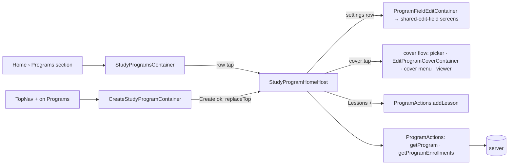

# ui2-programs — spec
> lg · no ticket

## Idea

**Why.** The iPhone app's root is the UI 2.0 shell, and its Programs section (a TopNav section of the
Home tab, `UI2ShellModel.swift:5-8`) is a blank `EmptyPage` (`UI2Shell.swift` `sectionContent`
default). Leaders — org owners, admins and group leaders — have nowhere in 2.0 to see their study
programs, open one, or start one. All three screens they need are specced and built in d2m as
MakeReadyUI views (`study-programs`, `create-study-program`, `study-program-home`). This feature wires
them to live data and adds the server data the program page reads that does not exist yet.

**What success looks like.** On the walk env as the Fixtures identity: Programs lists every fixture
program newest-updated first, search and both chips narrow it. The TopNav `+` on Programs creates a
program from a title alone and lands on its (empty) page. Tapping a program pushes its page with the
cover, the details grid, seven editable settings, the enrolled groups and the lessons by day. Each
setting row opens the same shared edit page groups use and saves back. The cover runs the group cover
flow. The Lessons `+` appends a day.

**In your words.** "these screens cover the programs page from the topnav, then clicking a program to
go to it's detail page, or adding a new study program" → D1, D7 · "The edit views will be the same as
editing values for group and member" → D10 · "Saem with the cover image" → D11 · Q1 "Blank program"
→ D8 · Q2 "Mirror Group" → D12.

**The concept.** App-side containers per screen read `AppState`, build the MakeReadyUI screen's
`State`, and map its callbacks to Actions or shell routes — the ui2-groups pattern, copied.

**How it fits today.** The push stack (`UI2Destination` + per-tab `NavigationStack`, `\.ui2Navigator`
with `replaceTop`), the shared-edit-field screens (`MakeReadyUI/Screens/Fields/`), the group cover
flow (`Containers/Groups/EditGroupCoverContainer`, `ImageFramingModel`, `CoverViewerOverlay`,
`services/group-cover.ts`) and `ProgramActions` (list, get, create, update, cover upload, program
enrollments, add lesson) exist. The server's `GET /api/programs` and `GET /api/programs/:id` already
serve most of what the screens render. Intake (`.builder/ui2-programs/brainstorm.md`) recorded what
each endpoint returns and the places the design disagrees with the code: create requires a template,
the program settings have no columns, and there is no author or leader name.

**Approaches considered.** Chosen: containers in `iphone/MakeReady/UI2/Containers/Programs/`, as for
Groups and Members. Rejected: wiring inside the MakeReadyUI screens (d2m regenerates them, ui2-shell
D2).

## Apps

| App | In scope | What changes | Section |
|---|---|---|---|
| server | ✅ | `StudyProgram` settings + leader + cover-framing columns; create without a template; detail/PATCH/list fields; `orgId` list filter; private programs hidden from others' lists; program cover framing; fixture layers | §server |
| client | ⬜ | UI 2.0 leader screens are iPhone-only. The web reads programs through the same endpoints; every change is additive, and `templateId` stays accepted with today's behaviour (D8). The visibility filter (D13) is audited for web callers (F3) | — |
| iphone | ✅ | Programs section wired (study-programs), program page (study-program-home), create-study-program, field edits, cover flow, routes, `StudyProgram` model fields | §iphone |
| capture | ⬜ | screens capture from fixture JSON via ViewRegistry, not the live API; d2m re-captures the screens it edits (D2) | — |

**Sequencing:** contract settled → server (schema, endpoints, fixtures) verifies → contract FREEZES →
iphone builds against it (after d2m lands D2's screen edits) → the walk on Fixtures.

**Backward compatibility:** every column and response field is additive and nullable or defaulted.
Released 1.0 builds decode `StudyProgram` with optional fields and ignore the new keys. 1.0's create
always sends `templateId` and keeps today's behaviour (D8). Behaviour changes that reach released
builds: a 1.0 Group Leader no longer sees another leader's private program in `GET /api/programs`
(D13 — no program is private until someone sets it, so nothing changes on day one); a leader in
several orgs sees MORE programs (D14 widens the list to every managed org — rows added, never removed);
PATCH `organizationId` now refuses an org the caller doesn't belong to (D18 — closes a hole); and a
program created in 2.0 can have zero lessons, which 1.0's program page renders as "No lessons yet"
(F2, verified) and enrollment refuses with today's 400 (F9).

**Blast radius:** every caller of `GET /api/programs`, `GET /api/programs/:id`, `POST /api/programs`,
`PATCH /api/programs/:id`, `POST /api/programs/:id/cover-image`; `StudyProgram` reads (new columns).

## Decisions

<!-- The one place rulings live. Record the DECISION — and, in one line, why, and why the rejected option lost. A stated preference
     is the INPUT to a row, not the row. Write each Ruling as something later code can be checked
     against without re-interpretation:
       · positive and specific — "store the full number, mask at render", not "don't truncate"
       · scope named — which apps, screens or endpoints it binds
       · "etc." / "and so on" expanded into the list, or the test for membership stated
       · the rejected alternative named, with the reason it lost (check-obligations warns on a bare one)
       · the enforcement hook, where one exists (lint rule, script, test)
     🔴 NEVER quote the user's prompt as the ruling. Operationalize it: a closed list, a measured
     value, an enumerated set of deviations. A ruling a stranger could implement two ways is not
     written yet.
     Who/date carries the provenance, so the Ruling itself needs no quote marks.
     The owner's own words go in §Idea "In your words", linked to this row — never in the Ruling.
     OPEN rows block the build go-ahead. Never delete a ruling; supersede it in place with a date. -->

| # | Decision | Ruling | Who / date |
|---|---|---|---|
| D1 | Routes | New `UI2Destination` cases `.studyProgramHome(id: String, name: String)`, `.createStudyProgram`, `.editProgramField(programId: String, field: ProgramField)`, `.editProgramCover(programId: String, source: ImageEditSource)` (the last in `isFullScreen`, as `.editGroupCover`); `UI2Shell.page(for:)` maps them to `StudyProgramHomeHost`, `CreateStudyProgramContainer`, `ProgramFieldEditContainer`, `EditProgramCoverContainer`. Programs section root = `StudyProgramsContainer` in `sectionContent`; every program push goes on the `.home` stack. `TopNavHost.onAdd` for `.programs` → push `.createStudyProgram`. `refreshableSection` (`UI2ShellModel.swift:77-80`) adds `.programs`. The pinned C-040 title is the screen's fixed "Study program"; `name` is carried for parity with `.groupDetail` only. Rejected: a modal for create (the design pushes it, as create-group) | Luke 2026-10-28 (journey) · (assumed at spec) 2026-10-28 (route names) |
| D2 | MakeReadyUI screen edits (d2m) | d2m makes every one; the build never edits `iphone/MakeReadyUI/`. Filed 2026-10-28: `study-programs` — drop C-019 + `onRetry` (`cmvrt1gql000av0apcp9jchn4`); GroupsHomeScreen's filter API (multi-select, in-screen C-036, `orgFilterVisible`, save callbacks — fixes the F5 chip), loading skeletons, diacritic-insensitive in-screen search (`cmvrtiigb001av0ap04h1mk4u`). `study-program-home` — `showsHeader`, `State.loading`/`failed`, `onRetry`, `onCoverTap` (`cmvrt1jl5000jv0apjy6tlfk0`); a scroll id per C-063 card (`cmvrtikv0001jv0apwciaj98o`). `create-study-program` — hosted full-screen like create-group (`cmvrt1l5o000sv0ap2t1j755c`, answered: no change); title field `editing:` + `onChange` + 200 cap (`cmvrtieot0011v0apd8m6x90w`). The iPhone task that consumes a screen starts only once its changes are `done` (F1). Rejected: the build editing them under a ruling (ui2-groups D2/D27 did; the d2m channel now owns every MakeReadyUI edit) | Luke 2026-10-28 (route the screen gaps to d2m) |
| D3 | Programs list | Rows = `AppState.orderedPrograms` (`updatedAt` desc; `EntityStore.all` is unordered) from `ProgramActions.loadPrograms(forceRefresh: true)` (`GET /api/programs`). The list response carries the D12 fields and both names (D15), so a list refresh never blanks the program page's cached values (audit: `fetchPrograms` `replaceAll`s). Search is the screen's own (instant, min 2 characters, diacritic-insensitive over title + description, D2) — the container passes `searchText` through. Chips: GroupsHomeScreen's API (D2), multi-select, AND-combined across chips; Leaders options = `AppState.groupLeaders` full names, a program matches when its `leaderId` or `creatorId` is the id of a selected leader (labels → ids; two same-named leaders select together, as groups D3); Orgs options = `AppState.myOrganizations` names (`GroupActions.loadMyOrganizations`), `orgFilterVisible` with ≥2 orgs, a program matches when its `organizationId` is selected; filtering is phone-side over the full list (no `orgId` sent). Row: cover (`coverImageUrl`, else the C-059 placeholder), name, description, "«n» enrolled" = `_count.enrollments` (OQ-006, every status). Pull-to-refresh reloads. Rejected: single-select (OQ-study-programs-003, superseded 2026-10-28 by the owner: match Groups); server-side search (unneeded at this list size; groups precedent) | Luke 2026-10-28 (multi-select like Groups) · (assumed at brainstorm) |
| D4 | Programs list states | loading (no cache) = the screen's skeleton rows (D2); cache present = render at once, refresh in `.task`; no programs = "No programs yet"; no match = "No programs match"; first-load failure with no cache = the inline retry (`onRetry` → reload); failure with a cache = keep the list, `recordError` (console only — a deliberate divergence from GroupsHomeContainer's banner, house rule: refreshes stay console-only). 401 → sign-out. Rejected: a banner on background refresh failure (a refresh the user didn't start would interrupt them over data they already see) | d2m study-programs §3 (OQ-003/004) · (assumed at spec) 2026-10-28 |
| D5 | Program page load | Push renders at once from `AppState.programs[id]` under the pushed name; `.task` loads in parallel `getProgram(id, lessonLimit: 60)` (then further pages while `hasMore`; after the last page the program's lesson index is replaced, not appended — `getProgram` today only adds to `programLessonIndex`) and `getProgramEnrollments(programId, forceRefresh: true)` (a warm-cache call detaches and loses 401 routing). The mapper reads lessons through `lessonsFor(programId:)`. No cached program = `loading` (skeletons). Program load fails with nothing cached = `failed` + `onRetry`; with a cache = keep it, `recordError`. 404 = `ProgramActions.forgetProgram(id)` (extracted from `deleteProgram`'s cleanup) and `popTo(0)` once the push has settled, with a surfaced "This program is no longer available". Enrollments failing keeps the rest and records the error. Rejected: a blank page on failure (§3 specifies the retry) | d2m study-program-home §3 (OQ-7) · (assumed at spec) 2026-10-28 |
| D6 | Program page display | Details grid: Created = `createdAt` "MMM d, yyyy"; Author = `creatorName` ("" when null); Group leader = `leaderName` (falls back to `creatorName`); Lessons = lesson count. Settings values (the screen's seven rows, `StudyProgramHomeScreen.swift:220-226`): Study name; Description; Visibility = "Private" when `isPrivate` else "Public"; Age = Group's four forms ("Any age" · "«min» - «max»" · "«min»+" · "Up to «max»"); Maximum members = number or "Unlimited"; Member directory access = "Allowed" / "Names only" / "Not allowed"; Lessons = "«n» lessons" (reusing `GroupDetailMapper`'s age / max / directory label helpers). Enrollments: every enrollment the endpoint returns (D16), name = `group.name`, photo = `group.coverImageUrl`, leader = `group.creator.name` short form (`MemberProfileMapper.leaderShortName`), "«n» members"; header "«N» groups". Lessons: `dayCount` = number of lessons, one card per lesson ordered by `dayNumber`, number = `dayNumber`, title = lesson title, duration = "«estimatedMinutes» min" or "" when null, slides = activities in order with `youtubeThumbnailUrl` ?? `video.thumbnailUrl` ?? nil (nil = the themed placeholder, OQ-8), label = activity title. The container seeds `Ui2ImageCache` with the cover, slide images and enrollment photos, as `GroupDetailContainer`. Empty states per §3: no enrollments = list omitted, "0 groups"; no lessons = rail and list omitted. Rejected: system locale formats (diverge from the frame) | (assumed at spec) 2026-10-28 |
| D7 | Wired exits | Back → pop; settings row → `.editProgramField` (D10); cover tap → the cover flow (D11); Lessons `+` → `ProgramActions.addLesson(programId:)` appends a day, then reloads the program (OQ-1); DayChip → sets `activeDay` and the container's `ScrollViewReader` scrolls to that card's id (D2), list stays complete (OQ-11). Inert in this feature (no-op closures): the Lessons settings row (`onEditField("Lessons")` maps to no field), enrollment row (enrollment-home not wired in 2.0), Enrollments `+` (groups-enroll-program not wired), lesson title tap, activity slide tap. Rejected: hiding the inert ones (loses the designed layout) | Luke 2026-10-28 (journey) · (assumed at brainstorm) — precedent ui2-groups-browse D6 |
| D8 | Create without a template | `POST /api/programs`: `templateId` becomes optional. Without it the server creates the program with `name` (1–200 chars, trimmed), `days` = 0 explicitly (the body's `days` and its zod default 30 are ignored on this path), `isPublished` false whatever is sent (an empty program can't be enrolled), no lessons and no activities, `creatorId` and `leaderId` = the caller, `isPrivate` false, `memberDirectoryAccess` `ALLOWED`, organization resolved as today (`getUserOrgId`, the primary org — F10). Logic lives in `services/study-program.service.ts` (C2). With `templateId` behaviour is unchanged (lessons materialised from the template; 404 on a missing template). `CreateStudyProgramContainer` sends the trimmed title only; success merges the program into `AppState.programs` and `replaceTop`s the form with `.studyProgramHome` (back returns to Programs); creating = Create disabled with its indicator; failure keeps the title and shows the inline error "Couldn't create the program" (`errorMessage`); 401 → sign-out. Rejected: a default system template (30 unchosen days); a template step 2 (undesigned screen blocks Create) | Luke 2026-10-28 |
| D9 | Lessons + on an empty program | `addLesson` on a program with zero lessons creates day 1; the route already sets `dayNumber = max+1` and `days` = lesson count in one transaction (verified at audit, `programs.ts:3944-3996`). The phone's `addLesson` doesn't touch `days`/`_count`, so the page reloads the program after it. A double tap is guarded on the phone (one add in flight); the route's 500 on a duplicate `dayNumber` is left (F4). Rejected: requiring a template first (contradicts D8) | (assumed at spec) 2026-10-28 |
| D10 | Field edits | Six editable settings rows (`onEditField` labels exactly as the screen passes them) → `ProgramFieldEditContainer` + `ProgramFieldEditor`, mirroring `GroupFieldEditContainer`/`GroupFieldEditor` over the same shared-edit-field screens and lifting Group's pure helpers (`nameCanSave`, `maxMembersCanSave`, `ageSelection`, `wholeNumber`, `failure`) into a shared file rather than copying them: Study name → text-single (1–200, required); Description → text-multi (optional, empty clears → `null`); Visibility → option-field Public / Private; Age → `EditOptionsCustomFieldScreen` with Group's presets + Custom range, sent as Group's nested `ageRange: {min, max}` (0–120, min ≤ max); Maximum members → text-single numeric (positive whole number, no upper bound — as Group; empty = Unlimited → `null`); Member directory access → option-field Allowed / Names only / Not allowed. Page titles and descriptions are program wording (Group's copy with "group" → "program"/"study"). Save → `ProgramActions.updateProgram(id:patch:)` with a `ProgramPatch` carrying only the changed key (explicit null clears), then `popIfTop`; failure keeps the typed value with the page's inline error (Age, which has no error slot, surfaces the banner, as Group); 404 → `forgetProgram` and `popTo(0)`; 401 signs out. Group leader is display-only in this feature (D19). Rejected: bespoke program editors (one edit experience app-wide) | Luke 2026-10-28 · (assumed at spec) 2026-10-28 (limits, copy) |
| D11 | Program cover | The group cover flow, program-keyed: no cover → photo picker → framing editor (16:9) → save; with a cover → C-066 menu Edit image · Change image · View image → framing editor reopened on `coverOriginalUrl` + `coverFraming` / picker / `CoverViewerOverlay`. `POST /api/programs/:id/cover-image` accepts the group route's body (`imageData`, `contentType`, optional `originalData`, optional `framing` — `coverFramingSchema`; `originalData` without `framing` → 400) and stores `coverOriginalUrl` + `coverFraming`; the legacy body still works; the response adds top-level `coverOriginalUrl` + `coverFraming` beside today's `{success, coverImageUrl, program}`. A cover set through PATCH `coverImageUrl` clears both (as group-cover-image D9). The save logic is `services/group-cover.ts` generalised by owner (`{kind: 'group' | 'program', id, coverOriginalUrl}`, keeping the `programs/program-` R2 keys; `saveGroupCover` stays as a wrapper), media-library capture under `program.organizationId`. Phone: `EditGroupCoverContainer`, `CoverViewerOverlay.viewerURL` and the cover-tap helper are generalised to take (original, cover, framing) rather than a third copy; `ProgramActions.saveCover(programId:rendered:framing:original:)` mirrors `GroupActions.saveCover` (`requestWithStatus`, 120 s). Rejected: a program-only flow (two cover UXs) | Luke 2026-10-28 |
| D12 | Settings columns | `StudyProgram` gains, mirroring `Group`: `isPrivate Boolean NOT NULL default false`, `ageRangeMin Int?`, `ageRangeMax Int?`, `maxMembers Int?`, `memberDirectoryAccess DirectoryAccess NOT NULL default ALLOWED` (the existing enum), `leaderId String?` → `User` (relation `StudyProgramLeader`, User back-relation `ledStudyPrograms`; on delete set null; indexed), `coverOriginalUrl text?`, `coverFraming Json?`. Migration backfills `leaderId = creatorId`. Semantics: Visibility gates discovery only (D13); Age and Max members are advisory, nothing enforced; Member directory access is stored and returned, nothing enforced yet; leader is one user defaulting to the creator. Rejected: wiring name + description only (page half-works); hiding the five rows (changes an approved design) | Luke 2026-10-28 · d2m OQ-study-program-home-15/16/17/18 |
| D13 | Visibility | `GET /api/programs` lists a program with `isPrivate = true` only to: its creator, its leader, the owner of its org, a holder of the `Admin` role in its org, and super admins. Every other caller (a Group Leader or Member role-holder who neither created nor leads it) does not see it in the list. `GET /api/programs/:id` and enrollment are unchanged (a leader can still open and enrol a private program directly). The privacy clause composes with the access scope as `AND: [access, privacy]` (the scope is already an `OR`). Implemented as a service helper with a role-name check — a visibility rule, not mutation auth, so `canManageOrgContent` (true for every role-holder) is not used. Rejected: `canManageOrgContent` (hides it from nobody); creator + leader only (hides it from the org owner); no filter yet | Luke 2026-10-28 · d2m OQ-study-program-home-15 |
| D14 | List scope + org fields | `GET /api/programs` scopes to every org the caller manages — `getManageableOrgIds` ∪ `user.organizationId` (as `GET /api/groups` with `groupManageFilter`) — plus the caller's own programs, replacing today's single-org `accessFilter(getUserOrgId)` for this route only; returns `organizationId` + `organizationName` per program (batched `organization.findMany`). Optional `orgId` narrows to one org of that set, else 400. The phone filters by org itself (D3). `?leaders=` matches `leaderId` or `creatorId`. Rejected: primary org only + hide the Orgs chip (a multi-org leader can't see their other orgs' programs) | Luke 2026-10-28 |
| D15 | Names on the wire | `GET /api/programs/:id`, PATCH, POST and `GET /api/programs` add `creatorName` and `leaderName` (each `User.name`, null when missing) and the eight D12 fields (the list too, so a list refresh can't blank the page — D3); the list also adds `organizationId`, `organizationName`. POST/PATCH/cover responses already `include` every column; only list and detail `select`s change. A payload mapper `toProgramPayload` lives in the program service (as `group-payload.ts`). PATCH zod accepts `isPrivate`, nested `ageRange: {min, max}` (nullable, 0–120, `isAgeRangeInverted` against the stored values — as Group), `maxMembers` (nullable positive int), `memberDirectoryAccess`, `leaderId` (nullable; must be the org owner or a role-holder in `program.organizationId`, checked after any org move; null org → only the creator; else 400) and `description` becomes nullable — and never silently strips a key the phone sends. Rejected: flat `ageRangeMin`/`ageRangeMax` keys (diverges from Group's editor and inversion check); phone-side user lookups (an extra request per program) | (assumed at audit) 2026-10-28 |
| D16 | Enrollments list | Show every enrollment `GET /api/programs/:programId/enrollments` returns (the endpoint has no status; "Active" is the design's label), ordered as returned (`startDate` desc). Rejected: filtering by date window on the phone (no ruling defines "active") | (assumed at brainstorm) |
| D17 | Fixtures | `server/fixtures/screens/study-programs.ts`, `create-study-program.ts` (empty layer, registers the screen) and `study-program-home.ts`: "Foundations of Faith" gets a description, a cover with framing, a leader other than its creator, every D12 setting set, ≥3 enrollments, and lesson activities with YouTube and video thumbnails; one program is private and created by another user (D13 walk); one program "Empty Program" has no cover, no lessons and no enrollments (empty states). Layers create programs, never orgs, users or groups: the private program is created by `FIXTURE_LEADER_USER_ID` (Nathan, a Group Leader) with `fixtureId('program', 3)`, "Empty Program" `fixtureId('program', 4)`, both in `FIXTURE_ORG_ID`; "Foundations of Faith"'s ≥3 enrollments already exist in base. The walk's Fixtures identity is the org Owner, so D13's hidden case is walked as Nathan (or asserted in a server test) — see §Testing. Cover images fall back as the walk env's s3mock allows. Rejected: relying on base data (no description, settings or empty program) | (assumed at spec) 2026-10-28 |
| D18 | PATCH org move | PATCH `organizationId` (accepted today with no membership check, `programs.ts:857`) gets Group's check (`groups.ts:1019-1040`): the target org exists and the caller owns it or holds a role there, else 403; super admins exempt. Rejected: leaving it (any manager can move a program into a foreign org, breaking D14 scoping) | (assumed at audit) 2026-10-28 |
| D19 | Group leader editing | The program page has no Group leader settings row; the leader is display-only (details grid) in this feature, `leaderId` = creator at create and by backfill, editable only through PATCH. Rejected: asking d2m to add a row (owner chose display-only) | Luke 2026-10-28 |
| D20 | Program manage scope | Today's `mutationFilter` (creator · org owner/role-holder · super admin, the filter form of `canManageOrgContent`) moves to `permission.ts` as `programManageFilter` beside `groupManageFilter`, unchanged in effect, and every program route touched here uses it. Rejected: leaving the route-local copy (house rule: RBAC in the service layer) | (assumed at audit) 2026-10-28 |

## Contract

| Contract | Producer | Consumers | Auth | Request | Response | Errors |
|---|---|---|---|---|---|---|
| `GET /api/programs` (extended) | server | iphone | `requireAuth` + D14 scope (every managed org ∪ own programs) + D13 privacy | existing (`tag`, `leaders` now leader-or-creator, …) + `orgId?` (D14) | existing per program + `organizationId`, `organizationName`, `creatorName`, `leaderName`, `leaderId`, `isPrivate`, `ageRangeMin`, `ageRangeMax`, `maxMembers`, `memberDirectoryAccess`, `coverOriginalUrl`, `coverFraming` | 400 (orgId outside the scope) · 401 |
| `GET /api/programs/:id` (extended) | server | iphone | as today | as today (`lessonPage`, `lessonLimit` ≤ 60; page by `hasMore`) | existing + `creatorName`, `leaderName`, `leaderId`, `isPrivate`, `ageRangeMin`, `ageRangeMax`, `maxMembers`, `memberDirectoryAccess`, `coverOriginalUrl`, `coverFraming` | 401 · 404 |
| `POST /api/programs` (templateId optional) | server | iphone | as today | `{name, templateId?, description?, days?, coverImageUrl?, isPublished?}`; without `templateId`, `days` → 0 and `isPublished` → false (D8) | `{success, program}` + `creatorName`, `leaderName` (columns already included) | 400 · 401 · 404 (templateId given and missing) |
| `PATCH /api/programs/:id` (extended) | server | iphone | `programManageFilter` (D20) | existing + `isPrivate`, `ageRange: {min, max}`, `maxMembers`, `memberDirectoryAccess`, `leaderId` (all nullable but `isPrivate`/`memberDirectoryAccess`); `description` nullable; `organizationId` checked (D18) | `{success, program}` + `creatorName`, `leaderName` | 400 (validation, inverted age, leader outside org) · 401 · 403 (org move, D18) · 404 |
| `POST /api/programs/:id/cover-image` (extended) | server | iphone | `programManageFilter` | legacy `{imageData, contentType}` or + `originalData?`, `framing?` (D11) | existing `{success, coverImageUrl, program}` + top-level `coverOriginalUrl`, `coverFraming` | 400 (`originalData` without `framing`) · 401 · 404 |
| `GET /api/programs/:programId/enrollments`, `POST /api/programs/:id/lessons`, `GET /api/group-leaders`, `GET /api/organizations/my/organizations` (unchanged) | server | iphone | existing | — | existing | existing |

## Schema & API changes

| # | Kind | Model.field | Wire | Reason | Status |
|---|---|---|---|---|---|
| SC1 | ADD | `StudyProgram.isPrivate`, `ageRangeMin`, `ageRangeMax`, `maxMembers`, `memberDirectoryAccess` | every program payload; PATCH takes `ageRange: {min, max}` | study-program-home settings rows; D12, D15 | planned · T1 |
| SC2 | ADD | `StudyProgram.leaderId` → `User` (relation `StudyProgramLeader`, back-relation `User.ledStudyPrograms`, nullable, indexed, backfilled `creatorId`) | `leaderId` + `leaderName` on every program payload | details grid Group leader; D12, D15, D19 | planned · T1 |
| SC3 | ADD | `StudyProgram.coverOriginalUrl` (text), `coverFraming` (Json) | every program payload, cover-image response | cover Edit reopens the framing; D11 | planned · T1, T5 |
| SC4 | EDIT | `POST /api/programs` | `templateId` optional; template-less → `days` 0, unpublished | create from a title alone; D8 | planned · T2 |
| SC5 | EDIT | `GET /api/programs` | scope widened to every managed org; `orgId` param; + org id/name, names, D12 fields; private filter; `leaders` matches leader or creator | Orgs/Leaders chips, discovery, cache safety; D3, D13, D14, D15 | planned · T3 |
| SC6 | EDIT | detail / PATCH / POST responses; PATCH body | + `creatorName`, `leaderName` + SC1–SC3 fields; PATCH keys (D15), org-move check (D18) | Author + leader display, field edits; D15, D18 | planned · T2, T4 |
| SC7 | EDIT | `POST /api/programs/:id/cover-image` | + `originalData?`, `framing?`; response + top-level `coverOriginalUrl`, `coverFraming` | cover flow; D11 | planned · T5 |

**Data plan:** SC1–SC3 go through `server/schema/*.yaml` → `schema:diff` → one Atlas migration (house
rules; diff/apply through `scripts/atlas.sh --var database_url=…`, never `npm run schema:diff`, which
reads the 1Password `.env` through dotenv). Every new column is nullable or defaulted, so no row is
rewritten except the backfill `UPDATE "study_programs" SET "leaderId" = "creatorId" WHERE "leaderId" IS
NULL`, appended to the generated migration before it is committed (precedent
`atlas/migrations/20261027064150.sql:8`), then `atlas migrate hash`. Undo = drop the columns and the
index; nothing existing changes. SC4–SC7 are wire changes, additive for every existing caller except
D13/D14/D18's stated behaviour changes (§Apps). Independent ordering.

## server

- Schema SC1–SC3 via the YAML source and an Atlas migration; Prisma client regenerated in the container.
- New `services/study-program.service.ts`: template-less create (D8), the list query (D14 scope, D13
  privacy composed as `AND`, `orgId`), `toProgramPayload` (names + D12 fields, D15) — `programs.ts`
  stays the route layer (C2; it is 4733 lines of inline logic today and this feature adds none there).
- `permission.ts`: `programManageFilter` (D20) and the D13 visibility helper (role-name check).
- `programs.ts`: create zod `templateId` optional; list/detail `select`s add the D15 fields; PATCH zod
  (D15) with the `ageRange` inversion check, `leaderId` org check, D18 org-move check, nullable
  `description`, `coverImageUrl` clears original + framing (D11).
- `services/group-cover.ts` generalised by owner (D11); `POST /api/programs/:id/cover-image` takes the
  group route's body.
- Fixtures D17.

## iphone

- **Shell:** `UI2Destination` cases (D1, `.editProgramCover` in `isFullScreen`); `sectionContent`
  `.programs` → `StudyProgramsContainer`; `TopNavHost.onAdd` `.programs` → `.createStudyProgram`;
  `refreshableSection` (`UI2ShellModel.swift:77-80`) + `refreshAction` for `.programs`.
- **List:** `StudyProgramsContainer` + `StudyProgramsMapper` (D3, D4), returning `programIds` beside
  the screen `State` so a row index maps to an id (screens are index-based); search and the chip menus
  are the screen's (D2).
- **Program page:** `StudyProgramHomeHost` + `StudyProgramHomeContainer` + `StudyProgramHomeMapper`
  (D5–D7, D9); the container pins C-040 ("Study program") with the screen's `showsHeader: false` and
  wraps it in a `ScrollViewReader` for the day scroll (D2).
- **Create:** `CreateStudyProgramContainer` hosting the full screen + a testable
  `CreateProgramSubmit.run` with `guard !creating` (D8), as `CreateGroupContainer`.
- **Field edits:** `ProgramFieldEditContainer` + `ProgramFieldEditor` (`ProgramField` of six, D10); Group's
  pure helpers lifted into a shared file used by both editors.
- **Cover:** `EditGroupCoverContainer`, `CoverViewerOverlay.viewerURL` and the cover-tap helper
  generalised over (original, cover, framing) and reused for programs, with the C-066 menu (D11);
  `.photosPicker` modifier, never `.sheet`/`.fullScreenCover`.
- **State:** `StudyProgram` gains optional `creatorName`, `leaderName`, `leaderId`, `isPrivate`,
  `ageRangeMin`, `ageRangeMax`, `maxMembers`, `memberDirectoryAccess`, `organizationId`,
  `organizationName`, `coverOriginalUrl`, `coverFraming` — `coverFraming` and `memberDirectoryAccess`
  decode with `(try? decodeIfPresent) ?? nil` (a wrong type must not throw: `PersistedState` decodes
  programs strictly and one failure drops the whole cache, F6), every key written by the custom
  `encode(to:)`. `ProgramActions`: `createProgram(name:)` without a template; `updateProgram(id:patch:)`
  with a `ProgramPatch` encoding explicit nulls; `saveCover(programId:rendered:framing:original:)` →
  `CoverSaveResult`; `forgetProgram(id)` extracted from `deleteProgram`; `getProgram` replaces the lesson
  index after the last page. New files get app-target and `MakeReadyCaptureTests` pbxproj entries (the
  project isn't folder-synced).

## Testing

**server**
- create without `templateId` (0 lessons, `days` 0 even when sent, unpublished even when sent, leader = caller) and with one (unchanged); 400 on a bad name
- list: D14 scope (a two-org leader sees both orgs' programs), `orgId` narrowing + 400 outside the scope, org fields, D15 fields present, `leaders` matches leader or creator; D13 — a private program hidden from a Group Leader who neither created nor leads it, shown to creator, leader, org owner, an Admin and a super admin; the access scope still holds with the privacy clause; detail of a private program still 200
- detail/PATCH/POST: names + D12 fields; PATCH each key incl. explicit null and nested `ageRange` (inverted → 400, checked against the stored value when one bound is sent); `leaderId` outside the org → 400; D18 org move into a foreign org → 403; `description: null` clears; PATCH `coverImageUrl` clears framing
- cover-image: legacy body; `originalData` + `framing` stored and returned top-level; `originalData` alone → 400; `saveGroupCover` tests stay green
- add-lesson on an empty program → day 1, `days` 1; migration applies clean with the backfill; fixtures DB tests (D17, base counts unchanged under `empty`)

**iphone**
- mapper tests: D3 order + chips (multi, AND, leader-or-creator, org); D4 lines; D6 every value incl. each Age form, Unlimited, durations, slide fallbacks, "0 groups"; D7 the Lessons row maps to no field and a day select targets that card
- decode tests: `StudyProgram` with every new key absent, present and wrong-typed (`coverFraming`, `memberDirectoryAccess` → nil, no throw); encode → decode round trip of all 12 keys in `StatePersistenceRoundTripTests`; `ProgramPatch` null encoding and nested `ageRange`
- submit/editor tests: `CreateProgramSubmit` trim, double-submit guard, error routing; `ProgramFieldEditModel` per field (validation, page kind, copy); generalised cover tests stay green for groups
- shell route tests (`.studyProgramHome`, `.createStudyProgram` replaceTop, `.editProgramField`, `.editProgramCover` full-screen, `refreshableSection` set); `ios:build-check --test`; swiftlint baseline
- on device (human): scroll feel of the long program page, day chip scroll, pinned header, cover framing

**Cross-app verification script (Fixtures identity = org Owner, walk env)**
1. Open Home → Programs — the fixture programs are listed newest-updated first, each with cover or placeholder, description and "n enrolled"; Nathan's private program IS listed (the Owner sees private programs, D13). The hidden case (a Group Leader not seeing it) is asserted by the server test above
2. Type "found" in search — only "Foundations of Faith" remains; "zzzz" shows "No programs match"
3. Open the Leaders chip, pick Nathan, Save — only programs he leads or created remain; clear it — all return
4. Tap the TopNav `+` on Programs → Create study program; Create is disabled until a title is typed; type "Walk Test Program", tap Create — lands on its page with no lessons, "0 groups", the empty cover with its image icon; back returns to Programs and it is listed first
5. On "Walk Test Program" tap the Lessons `+` — Day 1 appears in the rail and list
6. Open "Foundations of Faith" — cover, Created/Author/Group leader/Lessons, the six setting values plus "«n» lessons", ≥3 enrolled groups with leaders and member counts, lesson cards with thumbnails all show real data; tap a later day chip — the list scrolls to that day
7. Tap Description, change it, Save — back on the page with the new text; tap Visibility, pick Private, Save — the row reads Private; tap Age, pick a range, Save — the row shows it
8. Pull to refresh on Programs, reopen "Foundations of Faith" — every setting still shows its saved value (no blanking after a list refresh)
9. Tap the cover — the menu shows Edit image · Change image · View image; Edit image reopens the framing editor; Save keeps the cover
10. Open "Empty Program" — no cover (image icon), "0 groups", no rail or lesson list

## Out of scope

- Enrollment page, enroll-a-group (Enrollments `+`), activities editor, lesson editing and the lesson title tap (D7).
- Editing the Group leader (D19) and the Lessons settings row.
- Program analytics, publish and export — no 2.0 home yet (OQ-study-program-home-14 deferred).
- Enforcing Age, Max members or Member directory access (advisory, D12); program deep links.
- Choosing an org at create for multi-org leaders (F10); the web client; the legacy Library tab and import.

## Findings & risks

| # | Finding | Resolution |
|---|---|---|
| F1 | The iPhone tasks depend on six d2m changes (D2); two are `applying`, three `requested`, one answered | build-time risk — each iPhone task that consumes a screen checks `get_project_change` for that screen's changes is `done` first (T11 list, T12 home, T13 create); T8–T10 and T14–T15 don't wait |
| F2 | A 2.0-created program can have zero lessons | closed at audit: 1.0's `ProgramHomePage.swift:1113-1125` renders "No lessons yet", nothing indexes `lessons[0]` or divides by `days`; detail returns `lessons: []`, `hasMore: false` |
| F3 | D13/D14 change what `GET /api/programs` returns to every caller, web included | audited: web callers `leader-library.store.ts:174`, `leader-enrollment-flow.store.ts:88`, `leader-dashboard.store.ts:51-67`, `programs.domain.ts:153`; 1.0 `ProgramActions.fetchPrograms`. None needs another leader's private program except the enrollment picker, which D13 makes discovery-only by ruling; the dashboard's program-days KPI undercounts a hidden enrolled program — accepted. D14 only adds rows. client ⬜ stands |
| F4 | add-lesson: a zod error returns 500 (no ZodError branch, `programs.ts:4027`) and a double tap hits the (`studyProgramId`, `dayNumber`) unique key → 500 | accepted; the phone guards one add in flight (D9) |
| F5 | `StudyProgramsScreen`'s FilterChip binds its trailing closure to `onSelect`, so `.menu` never fires `onTap` — inside the d2m screen | routed to d2m with the filter API (D2, `cmvrtiigb001av0ap04h1mk4u`) |
| F6 | `StudyProgram` is disk-cached and `PersistedState` decodes programs strictly — one undecodable program drops the whole persisted state | T8: tolerant decode for `coverFraming`/`memberDirectoryAccess`, round-trip test |
| F7 | `GET /api/group-leaders` lists group creators and role-holders, not strictly program creators | D3 matches `leaderId` or `creatorId`; a leader with no programs filters to "No programs match" |
| F8 | Design OQs: study-programs 001–006 → D3/D4 (003 superseded by the owner, multi-select) · create-study-program 1 → D8, 2 → D8, 3 → D1 · study-program-home 1 → D7/D9, 7 → D4/D5, 8 → D6, 10 → D7 inert, 11 → D7/D2, 14 → §Out of scope, 15 → D13, 16/17 → D12, 18 → D12/D19. No owner notes | disposed |
| F9 | An empty program exports but can't import (import zod `days >= 1`, `program-export.ts:94`); enrollment refuses 0 lessons with a 400 (`enrollments.ts:181-194`) | accepted — export/import is out of scope; the enrollment 400 is the right behaviour |
| F10 | Create picks the primary org (`getUserOrgId`), so a multi-org leader's 2.0 programs always land there | §Out of scope; visible under the Orgs chip |
| F11 | `GET /api/programs` returning the D12 fields + names makes the list payload heavier | accepted (lists are tens of rows); it is what keeps a list refresh from blanking the page cache (D3) |
| T1 | server: `server/schema/*.yaml` `StudyProgram` gains the D12 columns (enum `DirectoryAccess`), relation `StudyProgramLeader` + `User.ledStudyPrograms`, `[leaderId]` index → atlas migration with the `leaderId = creatorId` backfill (SC1–SC3) | blocking |
| T2 | server: `services/study-program.service.ts` template-less create + `toProgramPayload`; `POST /api/programs` `templateId` optional, `days` 0 + unpublished on that path (D8, SC4, SC6) | blocking |
| T3 | server: `GET /api/programs` through the service — D14 scope (`getManageableOrgIds` ∪ `user.organizationId` ∪ own), `orgId` + 400, batched org names, D15 fields, `leaders` leader-or-creator, D13 privacy helper composed with `AND` (SC5) | blocking |
| T4 | server: `programManageFilter` in `permission.ts` (D20); detail `select` + PATCH — D15 keys (nested `ageRange` + inversion, `leaderId` org check, nullable `description`), D18 org-move check, `coverImageUrl` clears original + framing (SC6) | blocking |
| T5 | server: `services/group-cover.ts` generalised by owner; `POST /api/programs/:id/cover-image` takes `originalData?` + `framing?`, returns top-level `coverOriginalUrl` + `coverFraming` (D11, SC3, SC7) | blocking |
| T6 | server: add-lesson on a zero-lesson program — a request test only (behaviour verified at audit, D9) | blocking |
| T7 | server: fixture layers `study-programs.ts`, `create-study-program.ts`, `study-program-home.ts` + `ids.ts` kinds (D17) | blocking |
| T8 | iphone: `StudyProgram` + 12 optional fields, tolerant decode, custom `encode(to:)`, round-trip test (F6) | trailing |
| T9 | iphone: `ProgramActions.createProgram(name:)`, `updateProgram(id:patch:)` + `ProgramPatch`, `saveCover(programId:…)` → `CoverSaveResult`, `forgetProgram`, `getProgram` lesson-index replace | trailing |
| T10 | iphone: shell routes (D1), `sectionContent` `.programs`, `TopNavHost.onAdd` `.programs`, `refreshableSection` + `refreshAction` | trailing |
| T11 | iphone: `StudyProgramsContainer` + `StudyProgramsMapper` (D3, D4; waits on F1 study-programs) | trailing |
| T12 | iphone: `StudyProgramHomeHost` + `StudyProgramHomeContainer` + `StudyProgramHomeMapper` (D5–D7, D9; waits on F1 study-program-home) | trailing |
| T13 | iphone: `CreateStudyProgramContainer` + `CreateProgramSubmit` (D8; waits on F1 create-study-program) | trailing |
| T14 | iphone: program edit pages — `ProgramFieldEditContainer`, `ProgramFieldEditor`, and the validation helpers lifted out of `GroupFieldEditor` into a shared file (D10) | trailing |
| T15 | iphone: cover flow generalised (`EditGroupCoverContainer`, `CoverViewerOverlay`, cover-tap helper) and wired for programs (D11) | trailing |
| R1 | repoint (iphone): `Pages/Main/StudyProgramHome.swift` (`MainPrograms`) ← no compiled caller (Pages/ is out of the app target since ui2-shell) | builder:plan's repoint + retire phase — nothing to repoint |
| R2 | repoint (iphone): `Pages/Manage/Program/ProgramHomePage.swift` (`.programHome`) ← no compiled caller (`Route.swift:51` and its presenters are out of target); no UI2 surface links to a program today | builder:plan's repoint + retire phase — nothing to repoint |
| R3 | repoint (iphone): `Pages/Manage/Program/CreateProgramPage.swift` (`.createProgram`) ← no compiled caller (`Route.swift:46` out of target) | builder:plan's repoint + retire phase — nothing to repoint |

**Field alignment (2026-10-28).** 33 rendered fields traced model → zod → wire → `StudyProgram` /
`ProgramEnrollment` / `Lesson` / `StudyActivity` → screen `State`: **21 ALIGNED** (list: name,
description, cover, enrolled count `_count.enrollments`; create: name; home: cover, created
`createdAt`, lesson count, study name, description, enrollment name / photo / leader `group.creator.name`
/ member count `group._count.members`, lesson number `dayNumber`, title, duration `estimatedMinutes`,
slide image `youtubeThumbnailUrl` ?? `video.thumbnailUrl`, slide label `title`) · **1 RESHAPE**
(enrollment leader → short form at render, D6) · **11 MISSING** (author SC6; leader SC2; visibility,
age, max members, directory SC1; cover original + framing SC3; list org id/name + leader id + D12 fields SC5) ·
0 RENAME · 0 DESIGN-ONLY. State that outlives the app: none new — search and chip picks are screen
`@State` (as Groups), program enrollments live in `AppState.programEnrollments` (exists). No owner
notes on the three screens (`ui2-notes.mjs read`, 2026-10-28).

## Plan

The plan, with its code: `docs/features/ui2-programs/PLAN.md` (§PLAN.md).

- Phase 1 · Task 1 · StudyProgram settings, leader and cover-framing columns
- Phase 1 · Task 2 · Template-less create + the program payload mapper
- Phase 1 · Task 3 · Program list — every managed org, private filter, full fields
- Phase 2 · Task 4 · Detail + PATCH — names, settings, org-move check, program manage filter
- Phase 2 · Task 5 · Program cover with original + framing
- Phase 2 · Task 6 · Add-lesson on an empty program
- Phase 2 · Task 7 · Fixture layers for the three screens — and the contract freeze
- Phase 3 · Task 8 · StudyProgram decodes the new fields without risking the cache
- Phase 3 · Task 9 · ProgramActions — create, patch, cover, forget, lesson paging
- Phase 3 · Task 10 · Shell routes for programs
- Phase 4 · Task 11 · Programs list container
- Phase 4 · Task 12 · Program page container
- Phase 4 · Task 13 · Create study program container
- Phase 5 · Task 14 · Program field edit pages
- Phase 5 · Task 15 · Program cover flow
- Phase 5 · Task 16 · Repoint + retire sweep (R1–R3)

## Prototype

Ref: `study-programs`, `create-study-program`, `study-program-home` — d2m era 2.0, every screen and
component **built** in `iphone/MakeReadyUI/Screens/Programs/` (`StudyProgramsScreen.swift`,
`CreateStudyProgramScreen.swift`, `StudyProgramHomeScreen.swift`; d2m dots green). d2m is the source
read; `docs/ui2/screens/` copies predate the study-programs screen. `programs-home` is superseded and
not in scope.

## Replaced surfaces

| # | Surface (file:line) | REPLACES/ABSORBS/REUSES | Fingerprint | App |
|---|---|---|---|---|
| R1 | `iphone/MakeReady/Pages/Main/StudyProgramHome.swift` (`MainPrograms`) | REPLACES (1.0 Programs tab; out of the app target since ui2-shell, left in place) | legacy programs list | iphone |
| R2 | `iphone/MakeReady/Pages/Manage/Program/ProgramHomePage.swift` (`.programHome`) | REPLACES (program home; analytics/publish/export dropped, OQ-14) | legacy program home | iphone |
| R3 | `iphone/MakeReady/Pages/Manage/Program/CreateProgramPage.swift` (`.createProgram`) | REPLACES (create; template/days/cover fields dropped, D8) | legacy create form | iphone |
| R4 | `iphone/MakeReady/UI2/Containers/Groups/GroupFieldEditor.swift` + `EditGroupCoverContainer.swift` | REUSES (pattern + shared pieces for D10/D11) | group edit + cover flow | iphone |
| R5 | `server/src/services/group-cover.ts` | REUSES (generalised for programs, D11) | group cover save | server |

**N# — what the design adds that the app lacks (written into this SPEC):**

| # | Add | Disposition | App |
|---|---|---|---|
| N1 | program settings + leader storage | written into the SPEC — D12, SC1, SC2 | server |
| N2 | template-less create | written into the SPEC — D8, SC4 | server |
| N3 | author/leader names, org filter, private-program discovery | written into the SPEC — D13–D15, SC5, SC6 | server |
| N4 | program cover framing | written into the SPEC — D11, SC3, SC7 | server |
| N5 | Programs section, program page, create, field edits, cover flow wiring | written into the SPEC — D1, D3–D11 | iphone |
| N6 | duplicate header / missing state inputs on the three screens | fixed in the design — D2 (three d2m changes) | iphone |
