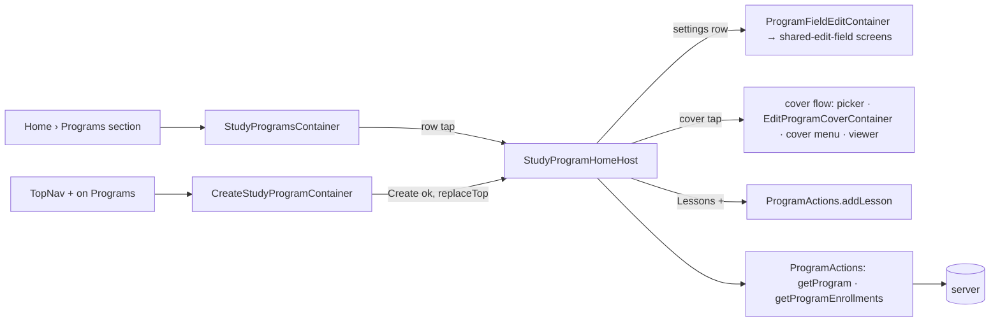

# ui2-programs — spec
> lg · no ticket

## Idea

**Why.** The iPhone app's root is the UI 2.0 shell, and its Programs section (a TopNav section of the
Home tab, `UI2ShellModel.swift:5-8`) is a blank `EmptyPage` (`UI2Shell.swift` `sectionContent`
default). Leaders — org owners, admins and group leaders — have nowhere in 2.0 to see their study
programs, open one, or start one. All three screens they need are specced and built in d2m as
MakeReadyUI views (`study-programs`, `create-study-program`, `study-program-home`). This feature wires
them to live data and adds the server data the program page reads that does not exist yet.

**What success looks like.** On the walk env as the Fixtures identity: Programs lists every fixture
program newest-updated first, search and both chips narrow it. The TopNav `+` on Programs creates a
program from a title alone and lands on its (empty) page. Tapping a program pushes its page with the
cover, the details grid, seven editable settings, the enrolled groups and the lessons by day. Each
setting row opens the same shared edit page groups use and saves back. The cover runs the group cover
flow. The Lessons `+` appends a day.

**In your words.** "these screens cover the programs page from the topnav, then clicking a program to
go to it's detail page, or adding a new study program" → D1, D7 · "The edit views will be the same as
editing values for group and member" → D10 · "Saem with the cover image" → D11 · Q1 "Blank program"
→ D8 · Q2 "Mirror Group" → D12.

**The concept.** App-side containers per screen read `AppState`, build the MakeReadyUI screen's
`State`, and map its callbacks to Actions or shell routes — the ui2-groups pattern, copied.

**How it fits today.** The push stack (`UI2Destination` + per-tab `NavigationStack`, `\.ui2Navigator`
with `replaceTop`), the shared-edit-field screens (`MakeReadyUI/Screens/Fields/`), the group cover
flow (`Containers/Groups/EditGroupCoverContainer`, `ImageFramingModel`, `CoverViewerOverlay`,
`services/group-cover.ts`) and `ProgramActions` (list, get, create, update, cover upload, program
enrollments, add lesson) exist. The server's `GET /api/programs` and `GET /api/programs/:id` already
serve most of what the screens render. Intake (`.builder/ui2-programs/brainstorm.md`) recorded what
each endpoint returns and the places the design disagrees with the code: create requires a template,
the program settings have no columns, and there is no author or leader name.

**Approaches considered.** Chosen: containers in `iphone/MakeReady/UI2/Containers/Programs/`, as for
Groups and Members. Rejected: wiring inside the MakeReadyUI screens (d2m regenerates them, ui2-shell
D2).

## Apps

| App | In scope | What changes | Section |
|---|---|---|---|
| server | ✅ | `StudyProgram` settings + leader + cover-framing columns; create without a template; detail/PATCH/list fields; `orgId` list filter; private programs hidden from others' lists; program cover framing; fixture layers | §server |
| client | ⬜ | UI 2.0 leader screens are iPhone-only. The web reads programs through the same endpoints; every change is additive, and `templateId` stays accepted with today's behaviour (D8). The visibility filter (D13) is audited for web callers (F3) | — |
| iphone | ✅ | Programs section wired (study-programs), program page (study-program-home), create-study-program, field edits, cover flow, routes, `StudyProgram` model fields | §iphone |
| capture | ⬜ | screens capture from fixture JSON via ViewRegistry, not the live API; d2m re-captures the screens it edits (D2) | — |

**Sequencing:** contract settled → server (schema, endpoints, fixtures) verifies → contract FREEZES →
iphone builds against it (after d2m lands D2's screen edits) → the walk on Fixtures.

**Backward compatibility:** every column and response field is additive and nullable or defaulted.
Released 1.0 builds decode `StudyProgram` with optional fields and ignore the new keys. 1.0's create
always sends `templateId` and keeps today's behaviour (D8). Two behaviour changes reach released builds:
a 1.0 leader no longer sees another leader's private program in `GET /api/programs` (D13 — no program
is private until someone sets it, so nothing changes on day one), and a program created in 2.0 can
have zero lessons, which 1.0's program page must survive (F2).

**Blast radius:** every caller of `GET /api/programs`, `GET /api/programs/:id`, `POST /api/programs`,
`PATCH /api/programs/:id`, `POST /api/programs/:id/cover-image`; `StudyProgram` reads (new columns).

## Decisions

<!-- The one place rulings live. Record the DECISION — and, in one line, why, and why the rejected option lost. A stated preference
     is the INPUT to a row, not the row. Write each Ruling as something later code can be checked
     against without re-interpretation:
       · positive and specific — "store the full number, mask at render", not "don't truncate"
       · scope named — which apps, screens or endpoints it binds
       · "etc." / "and so on" expanded into the list, or the test for membership stated
       · the rejected alternative named, with the reason it lost (check-obligations warns on a bare one)
       · the enforcement hook, where one exists (lint rule, script, test)
     🔴 NEVER quote the user's prompt as the ruling. Operationalize it: a closed list, a measured
     value, an enumerated set of deviations. A ruling a stranger could implement two ways is not
     written yet.
     Who/date carries the provenance, so the Ruling itself needs no quote marks.
     The owner's own words go in §Idea "In your words", linked to this row — never in the Ruling.
     OPEN rows block the build go-ahead. Never delete a ruling; supersede it in place with a date. -->

| # | Decision | Ruling | Who / date |
|---|---|---|---|
| D1 | Routes | New `UI2Destination` cases `.studyProgramHome(id: String, name: String)`, `.createStudyProgram`, `.editProgramField(programId: String, field: ProgramField)`, `.editProgramCover(programId: String)`; `UI2Shell.page(for:)` maps them to `StudyProgramHomeHost`, `CreateStudyProgramContainer`, `ProgramFieldEditContainer`, `EditProgramCoverContainer`. Programs section root = `StudyProgramsContainer` in `sectionContent`; every program push goes on the `.home` stack. `TopNavHost.onAdd` for `.programs` → push `.createStudyProgram`. Rejected: a modal for create (the design pushes it, as create-group) | Luke 2026-10-28 (journey) · (assumed at spec) 2026-10-28 (route names) |
| D2 | MakeReadyUI screen edits (d2m) | d2m makes these, filed 2026-10-28: `study-programs` drops its C-019 row and gains `onRetry` (`cmvrt1gql000av0apcp9jchn4`); `study-program-home` gains `showsHeader: Bool = true`, `State.loading`, `State.failed`, `onRetry`, `onCoverTap` (`cmvrt1jl5000jv0apjy6tlfk0`); `create-study-program` gains `showsHeader` or is hosted like create-group (`cmvrt1l5o000sv0ap2t1j755c`). The iPhone phase starts only once all three are `done`; the build never edits `iphone/MakeReadyUI/`. Rejected: the build editing them under a ruling (ui2-groups D2/D27 did; the d2m channel now owns every MakeReadyUI edit) | (assumed at brainstorm) — precedent ui2-groups-browse D2/D27 |
| D3 | Programs list | Rows = `AppState.programs` from `ProgramActions.loadPrograms(forceRefresh: true)` (`GET /api/programs`), ordered `updatedAt` desc as returned. Search: 300 ms debounce, minimum 2 characters, case- and diacritic-insensitive substring of name or description, AND-combined with both chips. Leaders chip: `AppState.groupLeaders` (`GET /api/group-leaders`) full names; a program matches when its `leaderId` or `creatorId` is the id of a selected leader. Orgs chip: `AppState.myOrganizations` names, visible only with ≥2 orgs; a program matches when its `organizationId` is selected (D14). Single-select each (OQ-study-programs-003); empty = all. Row: cover (`coverImageUrl`, else the C-059 placeholder), name, description, "«n» enrolled" = `_count.enrollments` (OQ-006, every status). Pull-to-refresh reloads. Rejected: server-side search (unneeded at this list size; groups precedent) | (assumed at brainstorm) |
| D4 | Programs list states | loading (no cache) = skeleton rows under the header; cache present = render at once, refresh in `.task`; no programs = "No programs yet"; no match = "No programs match"; first-load failure with no cache = the inline retry (`onRetry` → reload); failure with a cache = keep the list, `recordError` (console). 401 → sign-out. Rejected: a banner on background refresh failure (house rule: refreshes stay console-only) | d2m study-programs §3 (OQ-003/004) · (assumed at spec) 2026-10-28 |
| D5 | Program page load | Push renders at once from `AppState.programs[id]` under the pushed name; `.task` loads in parallel `getProgram(id, lessonLimit: 60)` (then further lesson pages until every lesson is loaded) and `getProgramEnrollments(programId)`. No cached program = `loading` (skeletons). Program load fails with nothing cached = `failed` + `onRetry`; with a cache = keep it, `recordError`. 404 = forget the program, `popTo(0)` with a surfaced "This program is no longer available". Enrollments failing keeps the rest and records the error. Rejected: a blank page on failure (§3 specifies the retry) | d2m study-program-home §3 (OQ-7) · (assumed at spec) 2026-10-28 |
| D6 | Program page display | Details grid: Created = `createdAt` "MMM d, yyyy"; Author = `creatorName` ("" when null); Group leader = `leaderName` (falls back to `creatorName`); Lessons = lesson count. Settings values: Study name; Description; Group leader = `leaderName`; Visibility = "Private" when `isPrivate` else "Public"; Age = Group's four forms ("Any age" · "«min» - «max»" · "«min»+" · "Up to «max»"); Maximum members = number or "Unlimited"; Member directory access = "Allowed" / "Names only" / "Not allowed". Enrollments: every enrollment the endpoint returns (D16), name = `group.name`, photo = `group.coverImageUrl`, leader = `group.creator.name` short form (`MemberProfileMapper.leaderShortName`), "«n» members"; header "«N» groups". Lessons: `dayCount` = number of lessons, one card per lesson ordered by `dayNumber`, number = `dayNumber`, title = lesson title, duration = "«estimatedMinutes» min" or "" when null, slides = activities in order with `youtubeThumbnailUrl` ?? `video.thumbnailUrl` ?? nil (nil = the themed placeholder, OQ-8), label = activity title. The container seeds `Ui2ImageCache` with the cover, slide images and enrollment photos, as `GroupDetailContainer`. Empty states per §3: no enrollments = list omitted, "0 groups"; no lessons = rail and list omitted. Rejected: system locale formats (diverge from the frame) | (assumed at spec) 2026-10-28 |
| D7 | Wired exits | Back → pop; settings row → `.editProgramField` (D10); cover tap → the cover flow (D11); Lessons `+` → `ProgramActions.addLesson(programId:)` appends a day, then reloads the program (OQ-1); DayChip → selects it and scrolls the list to that day's card, list stays complete (OQ-11). Inert in this feature (no-op closures): enrollment row (enrollment-home not wired in 2.0), Enrollments `+` (groups-enroll-program not wired), lesson title tap, activity slide tap. Rejected: hiding the inert ones (loses the designed layout) | Luke 2026-10-28 (journey) · (assumed at brainstorm) — precedent ui2-groups-browse D6 |
| D8 | Create without a template | `POST /api/programs`: `templateId` becomes optional. Without it the server creates the program with `name` (1–200 chars, trimmed), `days` = 0, no lessons and no activities, `creatorId` and `leaderId` = the caller, `isPrivate` false, `memberDirectoryAccess` `ALLOWED`, organization resolved as today. With `templateId` behaviour is unchanged (lessons materialised from the template; 404 on a missing template). `CreateStudyProgramContainer` sends the trimmed title only; success merges the program into `AppState.programs` and `replaceTop`s the form with `.studyProgramHome` (back returns to Programs); creating = Create disabled with its indicator; failure keeps the title and shows the inline error "Couldn't create the program" (`errorMessage`); 401 → sign-out. Rejected: a default system template (30 unchosen days); a template step 2 (undesigned screen blocks Create) | Luke 2026-10-28 |
| D9 | Lessons + on an empty program | `addLesson` on a program with zero lessons creates day 1; `days` follows the lesson count as the existing add-lesson route maintains it (verified at audit, F4). Rejected: requiring a template first (contradicts D8) | (assumed at spec) 2026-10-28 |
| D10 | Field edits | Seven settings rows → `ProgramFieldEditContainer` + `ProgramFieldEditor`, mirroring `GroupFieldEditContainer`/`GroupFieldEditor` over the same shared-edit-field screens: Study name → text-single (1–200, required); Description → text-multi (optional, empty clears); Group leader → option-field over `AppState.groupLeaders` (current selected); Visibility → option-field Public / Private; Age → the age-range screen (min ≤ max, 0–120, either optional); Maximum members → text-single numeric (1–100000, empty = Unlimited); Member directory access → option-field Allowed / Names only / Not allowed. Save → `ProgramActions.updateProgram(id:patch:)` with only the changed key (explicit null clears), then `popIfTop`; failure keeps the typed value with an inline error; 404 forgets the program and `popTo(0)`; 401 signs out. Rejected: bespoke program editors (one edit experience app-wide) | Luke 2026-10-28 · (assumed at spec) 2026-10-28 (limits) |
| D11 | Program cover | The group cover flow, program-keyed: no cover → photo picker → framing editor (16:9) → save; with a cover → C-066 menu Edit image · Change image · View image → framing editor reopened on `coverOriginalUrl` + `coverFraming` / picker / `CoverViewerOverlay`. `POST /api/programs/:id/cover-image` accepts the group route's body (`imageData`, `contentType`, optional `original`, optional `framing` — `coverFramingSchema`) and stores `coverOriginalUrl` + `coverFraming`; the legacy body still works. A cover set through PATCH `coverImageUrl` clears both (as group-cover-image D9). The save logic is shared with `services/group-cover.ts` (generalised by owner type), not copied. Rejected: a program-only flow (two cover UXs) | Luke 2026-10-28 |
| D12 | Settings columns | `StudyProgram` gains, mirroring `Group`: `isPrivate Boolean NOT NULL default false`, `ageRangeMin Int?`, `ageRangeMax Int?`, `maxMembers Int?`, `memberDirectoryAccess DirectoryAccess NOT NULL default ALLOWED` (the existing enum), `leaderId String?` → `User` (on delete set null), `coverOriginalUrl String?`, `coverFraming Json?`. Migration backfills `leaderId = creatorId`. Semantics: Visibility gates discovery only (D13); Age and Max members are advisory, nothing enforced; Member directory access is stored and returned, nothing enforced yet; leader is one user defaulting to the creator. Rejected: wiring name + description only (page half-works); hiding the five rows (changes an approved design) | Luke 2026-10-28 · d2m OQ-study-program-home-15/16/17/18 |
| D13 | Visibility | `GET /api/programs` omits a program with `isPrivate = true` unless the caller is its creator, its leader, or holds an org role that manages org content (`canManageOrgContent`) in the program's org; `GET /api/programs/:id` and enrollment are unchanged (a leader can still open and enrol a private program directly). Rejected: hiding it from detail too (OQ-15 rules discovery only) | d2m OQ-study-program-home-15 · (assumed at spec) 2026-10-28 (who sees it) |
| D14 | Org filter + org fields | `GET /api/programs` accepts `orgId` (must be one of the caller's orgs, else 400) and returns `organizationId` + `organizationName` per program; orgs chip options from `GET /api/organizations/my/organizations` via `loadMyOrganizations` (exists from ui2-groups). Rejected: phone-side mapping (the list doesn't carry the org today) | (assumed at brainstorm) |
| D15 | Names on the wire | `GET /api/programs/:id`, PATCH and POST responses add `creatorName` and `leaderName` (each `User.name`, null when missing) and the eight D12 fields; `GET /api/programs` adds `leaderId`, `isPrivate`, `organizationId`, `organizationName`. PATCH zod accepts `isPrivate`, `ageRangeMin`, `ageRangeMax`, `maxMembers`, `memberDirectoryAccess`, `leaderId` (must be a member of the program's org, else 400) — each nullable where the column is — and never silently strips a key the phone sends. Rejected: phone-side user lookups (an extra request per program) | (assumed at spec) 2026-10-28 |
| D16 | Enrollments list | Show every enrollment `GET /api/programs/:programId/enrollments` returns (the endpoint has no status; "Active" is the design's label), ordered as returned (`startDate` desc). Rejected: filtering by date window on the phone (no ruling defines "active") | (assumed at brainstorm) |
| D17 | Fixtures | `server/fixtures/screens/study-programs.ts`, `create-study-program.ts` (empty layer, registers the screen) and `study-program-home.ts`: "Foundations of Faith" gets a description, a cover with framing, a leader other than its creator, every D12 setting set, ≥3 enrollments, and lesson activities with YouTube and video thumbnails; one program is private and created by another user (D13 walk); one program "Empty Program" has no cover, no lessons and no enrollments (empty states). Layers create programs, never orgs, users or groups. Rejected: relying on base data (no description, settings or empty program) | (assumed at spec) 2026-10-28 |

## Contract

| Contract | Producer | Consumers | Auth | Request | Response | Errors |
|---|---|---|---|---|---|---|
| `GET /api/programs` (extended) | server | iphone | `requireAuth` + `accessFilter` + D13 | existing + `orgId?` (D14) | existing per program + `leaderId`, `isPrivate`, `organizationId`, `organizationName` | 400 (orgId not the caller's) · 401 |
| `GET /api/programs/:id` (extended) | server | iphone | as today | as today (`lessonPage`, `lessonLimit` ≤ 60) | existing + `creatorName`, `leaderName`, `isPrivate`, `ageRangeMin`, `ageRangeMax`, `maxMembers`, `memberDirectoryAccess`, `leaderId`, `coverOriginalUrl`, `coverFraming` | 401 · 404 |
| `POST /api/programs` (templateId optional) | server | iphone | as today | `{name, templateId?, description?, days?, coverImageUrl?, isPublished?}` — D8 | `{success, program}` with the D15 fields | 400 · 401 · 404 (templateId given and missing) |
| `PATCH /api/programs/:id` (extended) | server | iphone | as today | existing + the six D15 keys | `{success, program}` with the D15 fields | 400 · 401 · 404 |
| `POST /api/programs/:id/cover-image` (extended) | server | iphone | as today | legacy `{imageData, contentType}` or + `original?`, `framing?` (D11) | existing + `coverOriginalUrl`, `coverFraming` | 400 · 401 · 404 |
| `GET /api/programs/:programId/enrollments`, `POST /api/programs/:id/lessons`, `GET /api/group-leaders`, `GET /api/organizations/my/organizations` (unchanged) | server | iphone | existing | — | existing | existing |

## Schema & API changes

| # | Kind | Model.field | Wire | Reason | Status |
|---|---|---|---|---|---|
| SC1 | ADD | `StudyProgram.isPrivate`, `ageRangeMin`, `ageRangeMax`, `maxMembers`, `memberDirectoryAccess` | detail, PATCH, POST; `isPrivate` on list | study-program-home settings rows; D12 | planned · T1 |
| SC2 | ADD | `StudyProgram.leaderId` → `User` (nullable, backfilled `creatorId`) | `leaderId` everywhere, `leaderName` on detail/PATCH/POST | Group leader cell + row; D12, D15 | planned · T1 |
| SC3 | ADD | `StudyProgram.coverOriginalUrl`, `coverFraming` | detail, cover-image response | cover Edit reopens the framing; D11 | planned · T1, T5 |
| SC4 | EDIT | `POST /api/programs` | `templateId` optional | create from a title alone; D8 | planned · T2 |
| SC5 | EDIT | `GET /api/programs` | `orgId` param; + `organizationId`, `organizationName`, `leaderId`, `isPrivate`; private filter | Orgs chip, Leaders chip, discovery; D3, D13, D14 | planned · T3 |
| SC6 | EDIT | detail / PATCH / POST responses | + `creatorName`, `leaderName` + SC1–SC3 fields | Author + leader display; D15 | planned · T2, T4 |
| SC7 | EDIT | `POST /api/programs/:id/cover-image` | + `original?`, `framing?`; response + `coverOriginalUrl`, `coverFraming` | cover flow; D11 | planned · T5 |

**Data plan:** SC1–SC3 go through `server/schema/*.yaml` → `schema:diff` → one Atlas migration (house
rules; diff/apply through `scripts/atlas.sh --var database_url=…`, never the 1Password `.env`). Every
new column is nullable or defaulted, so no row is rewritten except the backfill `UPDATE
"study_programs" SET "leaderId" = "creatorId" WHERE "leaderId" IS NULL`, appended to the generated
migration before it is committed, then `atlas migrate hash`. Undo = drop the columns; nothing existing
changes. SC4–SC7 are wire changes, additive for every existing caller. Independent ordering.

## server

- Schema SC1–SC3 via the YAML source and an Atlas migration; Prisma client regenerated in the container.
- `programs.ts`: create zod `templateId` optional and the template-less branch (D8); list `orgId`,
  org fields (batched `organization.findMany`, as groups D10), `leaderId`, `isPrivate`, the D13 filter;
  detail / PATCH / POST add `creator`/`leader` names and the D12 fields; PATCH zod accepts the six keys
  with the `leaderId` org check (D15); PATCH `coverImageUrl` clears original + framing (D11).
- `services/group-cover.ts` generalised to save a program cover (owner type param), used by
  `POST /api/programs/:id/cover-image` with the group route's body (D11).
- Authorisation stays at today's checks for every program route; D13's manage check uses
  `canManageOrgContent` (house rule), never `creatorId` alone.
- Fixtures D17.

## iphone

- **Shell:** `UI2Destination` cases (D1); `sectionContent` `.programs` → `StudyProgramsContainer`;
  `TopNavHost.onAdd` `.programs` → `.createStudyProgram`; `refreshAction`/`refreshableSection` for
  `.programs`.
- **List:** `StudyProgramsContainer` + `StudyProgramsMapper` (D3, D4), returning `programIds` beside
  the screen `State` so a row index maps to an id (screens are index-based). Pass `onTap:` by label to
  the chip (L1 trap, F5).
- **Program page:** `StudyProgramHomeHost` + `StudyProgramHomeContainer` + `StudyProgramHomeMapper`
  (D5–D7, D9); the container pins C-040 with the screen's `showsHeader: false` (D2), as `GroupDetailHost`.
- **Create:** `CreateStudyProgramContainer` + a testable `CreateProgramSubmit.run` (D8), as
  `CreateGroupContainer`.
- **Field edits:** `ProgramFieldEditContainer` + `ProgramFieldEditor` (`ProgramField` enum of seven, D10).
- **Cover:** `EditProgramCoverContainer` + the C-066 cover menu + `CoverViewerOverlay`, reusing
  `ImageFramingModel`/`ImageFramingCanvas`/`CoverImageRendering` (D11); no `.sheet`/`.fullScreenCover`
  (`.photosPicker` modifier, as groups).
- **State:** `StudyProgram` gains optional `creatorName`, `leaderName`, `leaderId`, `isPrivate`,
  `ageRangeMin`, `ageRangeMax`, `maxMembers`, `memberDirectoryAccess`, `organizationId`,
  `organizationName`, `coverOriginalUrl`, `coverFraming` (`decodeIfPresent`, F6);
  `ProgramActions.createProgram(name:)` overload without a template; `updateProgram(id:patch:)` taking
  a `ProgramPatch` that can send explicit nulls; `uploadCoverImage` with original + framing returning a
  `CoverSaveResult`. Enrollments by program stay in `AppState.programEnrollments` (exists) and are
  cleared in `clearInMemory()` with the rest.

## Testing

**server**
- route tests: create without `templateId` (0 lessons, leader = caller, defaults) and with one (unchanged); 400 on a bad name
- list: `orgId` filter + 400; org fields; D13 — a private program hidden from another leader, shown to creator, leader and an org admin; detail of a private program still 200
- detail/PATCH/POST: names + D12 fields; PATCH each key incl. explicit null; `leaderId` outside the org → 400; PATCH `coverImageUrl` clears framing
- cover-image: legacy body, + original + framing stored; migration applies clean with the backfill; fixtures DB tests (D17)

**iphone**
- mapper tests: D3 order/search (min 2, diacritics)/chips; D4 lines; D6 every value incl. each Age form, Unlimited, durations, slide fallbacks, "0 groups"; D7 day select scroll target
- decode tests: `StudyProgram` with every new key absent and present; `ProgramPatch` null encoding
- submit/editor tests: `CreateProgramSubmit` trim + error routing; `ProgramFieldEditModel` per field (validation, page kind)
- shell route tests (`.studyProgramHome`, `.createStudyProgram` replaceTop, `.editProgramField`); `ios:build-check --test`; swiftlint baseline
- on device (human): scroll feel of the long program page, day chip scroll, pinned header, cover framing

**Cross-app verification script (Fixtures identity, walk env)**
1. Open Home → Programs — the fixture programs are listed newest-updated first, each with cover or placeholder, description and "n enrolled"; the other user's private program is NOT listed
2. Type "found" in search — only "Foundations of Faith" remains; "zzzz" shows "No programs match"
3. Open the Leaders chip, pick a leader — only programs they lead or created remain; clear it — all return
4. Tap the TopNav `+` on Programs → Create study program; Create is disabled until a title is typed; type "Walk Test Program", tap Create — lands on its page with no lessons, "0 groups", the empty cover with its image icon; back returns to Programs and it is listed first
5. On "Walk Test Program" tap the Lessons `+` — Day 1 appears in the rail and list
6. Open "Foundations of Faith" — cover, Created/Author/Group leader/Lessons, seven setting values, ≥3 enrolled groups with leaders and member counts, lesson cards with thumbnails all show real data; tap a later day chip — the list scrolls to that day
7. Tap Description, change it, Save — back on the page with the new text; tap Visibility, pick Private, Save — the row reads Private
8. Tap Group leader, pick another leader, Save — the row and the details cell show that name
9. Tap the cover — the menu shows Edit image · Change image · View image; Edit image reopens the framing editor; Save keeps the cover
10. Open "Empty Program" — no cover (image icon), "0 groups", no rail or lesson list

## Out of scope

- Enrollment page, enroll-a-group (Enrollments `+`), activities editor, lesson editing and the lesson title tap (D7).
- Program analytics, publish and export — no 2.0 home yet (OQ-study-program-home-14 deferred).
- Enforcing Age, Max members or Member directory access (advisory, D12); program deep links.
- The web client; the legacy Library tab and import (OQ-study-programs §7).

## Findings & risks

| # | Finding | Resolution |
|---|---|---|
| F1 | The iPhone phase depends on three d2m changes (D2) | build-time risk — the first iPhone task checks `get_project_change` for all three is `done` before wiring; until then the server phase proceeds |
| F2 | A 2.0-created program can have zero lessons; 1.0's `ProgramHomePage` has never seen one | build-time risk — the audit reads 1.0's program page for index/empty assumptions; a crash is a server-side fix-up (none expected: 1.0 already renders a program before its lessons load) |
| F3 | D13 hides private programs from `GET /api/programs` for every caller, web included | audit: list the web callers (`client/…/library` stores) and confirm none needs another leader's private program |
| F4 | D9 assumes `POST /api/programs/:id/lessons` sets `days` on an empty program | build-time risk — the server task reads the route (`programs.ts:3910`) and fixes it there if it doesn't |
| F5 | L1 trap: `StudyProgramsScreen`'s FilterChip with an unlabelled trailing closure binds to `onSelect`, so the menu never opens | the list container passes `onTap:` by label; if the screen itself does it, raise it with d2m beside D2 |
| F6 | `StudyProgram` is disk-cached in the released app; every new field decodes optional, so an old cache and an old server both load | iphone decode test with each key absent |
| F7 | `GET /api/group-leaders` lists group creators and role holders, not strictly program creators (OQ-study-programs-003 said creators) | D3 matches `leaderId` or `creatorId` against it; a leader with no programs filters to an empty list ("No programs match") |
| F8 | Design OQs: study-programs 001–006 → D3/D4 · create-study-program 1 → D8, 2 → D8 (owner chose blank), 3 → D1 (TopNav `+`) · study-program-home 1 → D7, 7 → D4/D5, 8 → D6, 10 → D7 inert, 11 → D7, 14 → §Out of scope, 15–18 → D12/D13 | disposed |
| T1 | server: `server/schema/*.yaml` `StudyProgram` gains the eight D12 columns (reusing enum `DirectoryAccess`) + `leader` relation → `schema:diff` migration with the `leaderId = creatorId` backfill (SC1–SC3) | blocking |
| T2 | server: `POST /api/programs` — `templateId` optional, template-less branch (D8); response adds the D15 fields (SC4, SC6) | blocking |
| T3 | server: `GET /api/programs` — `orgId` param + 400, `organizationId`/`organizationName` (batched `organization.findMany`), `leaderId`, `isPrivate`, the D13 filter with `canManageOrgContent` (SC5) | blocking |
| T4 | server: `GET /api/programs/:id` + PATCH — `creatorName`, `leaderName`, D12 fields; PATCH zod accepts the six keys (nullable), `leaderId` org-member check, `coverImageUrl` clears original + framing (SC6) | blocking |
| T5 | server: `services/group-cover.ts` generalised by owner type; `POST /api/programs/:id/cover-image` takes `original?` + `framing?`, stores and returns `coverOriginalUrl` + `coverFraming` (D11, SC3, SC7) | blocking |
| T6 | server: `POST /api/programs/:id/lessons` on a zero-lesson program creates day 1 and keeps `days` = lesson count (D9, F4) | blocking |
| T7 | server: fixture layers `study-programs.ts`, `create-study-program.ts`, `study-program-home.ts` + `ids.ts` kinds (D17) | blocking |
| T8 | iphone: `StudyProgram` + 12 optional fields (`decodeIfPresent`, encoded in the custom `encode(to:)`), F6 | trailing |
| T9 | iphone: `ProgramActions.createProgram(name:)` without a template; `updateProgram(id:patch:)` with a `ProgramPatch` that encodes explicit nulls; `uploadCoverImage(programId:image:original:framing:)` → `CoverSaveResult` | trailing |
| T10 | iphone: shell routes (D1), `sectionContent` `.programs`, `TopNavHost.onAdd` `.programs`, refresh for `.programs` | trailing |
| T11 | iphone: `StudyProgramsContainer` + `StudyProgramsMapper` (D3, D4, F5) | trailing |
| T12 | iphone: `StudyProgramHomeHost` + `StudyProgramHomeContainer` + `StudyProgramHomeMapper` (D5–D7, D9; waits on D2/F1) | trailing |
| T13 | iphone: `CreateStudyProgramContainer` + `CreateProgramSubmit` (D8) | trailing |
| T14 | iphone: `ProgramFieldEditContainer` + `ProgramFieldEditor` (D10) | trailing |
| T15 | iphone: `EditProgramCoverContainer` + cover menu + viewer wiring (D11) | trailing |

**Field alignment (2026-10-28).** 33 rendered fields traced model → zod → wire → `StudyProgram` /
`ProgramEnrollment` / `Lesson` / `StudyActivity` → screen `State`: **21 ALIGNED** (list: name,
description, cover, enrolled count `_count.enrollments`; create: name; home: cover, created
`createdAt`, lesson count, study name, description, enrollment name / photo / leader `group.creator.name`
/ member count `group._count.members`, lesson number `dayNumber`, title, duration `estimatedMinutes`,
slide image `youtubeThumbnailUrl` ?? `video.thumbnailUrl`, slide label `title`) · **1 RESHAPE**
(enrollment leader → short form at render, D6) · **11 MISSING** (author SC6; leader SC2; visibility,
age, max members, directory SC1; cover original + framing SC3; list org id/name + leader id SC5) ·
0 RENAME · 0 DESIGN-ONLY. State that outlives the app: none new — search and chip picks are screen
`@State` (as Groups), program enrollments live in `AppState.programEnrollments` (exists). No owner
notes on the three screens (`ui2-notes.mjs read`, 2026-10-28).

## Prototype

Ref: `study-programs`, `create-study-program`, `study-program-home` — d2m era 2.0, every screen and
component **built** in `iphone/MakeReadyUI/Screens/Programs/` (`StudyProgramsScreen.swift`,
`CreateStudyProgramScreen.swift`, `StudyProgramHomeScreen.swift`; d2m dots green). d2m is the source
read; `docs/ui2/screens/` copies predate the study-programs screen. `programs-home` is superseded and
not in scope.

## Replaced surfaces

| # | Surface (file:line) | REPLACES/ABSORBS/REUSES | Fingerprint | App |
|---|---|---|---|---|
| R1 | `iphone/MakeReady/Pages/Main/StudyProgramHome.swift` (`MainPrograms`) | REPLACES (1.0 Programs tab; out of the app target since ui2-shell, left in place) | legacy programs list | iphone |
| R2 | `iphone/MakeReady/Pages/Manage/Program/ProgramHomePage.swift` (`.programHome`) | REPLACES (program home; analytics/publish/export dropped, OQ-14) | legacy program home | iphone |
| R3 | `iphone/MakeReady/Pages/Manage/Program/CreateProgramPage.swift` (`.createProgram`) | REPLACES (create; template/days/cover fields dropped, D8) | legacy create form | iphone |
| R4 | `iphone/MakeReady/UI2/Containers/Groups/GroupFieldEditor.swift` + `EditGroupCoverContainer.swift` | REUSES (pattern + shared pieces for D10/D11) | group edit + cover flow | iphone |
| R5 | `server/src/services/group-cover.ts` | REUSES (generalised for programs, D11) | group cover save | server |

**N# — what the design adds that the app lacks (written into this SPEC):**

| # | Add | Disposition | App |
|---|---|---|---|
| N1 | program settings + leader storage | written into the SPEC — D12, SC1, SC2 | server |
| N2 | template-less create | written into the SPEC — D8, SC4 | server |
| N3 | author/leader names, org filter, private-program discovery | written into the SPEC — D13–D15, SC5, SC6 | server |
| N4 | program cover framing | written into the SPEC — D11, SC3, SC7 | server |
| N5 | Programs section, program page, create, field edits, cover flow wiring | written into the SPEC — D1, D3–D11 | iphone |
| N6 | duplicate header / missing state inputs on the three screens | fixed in the design — D2 (three d2m changes) | iphone |
