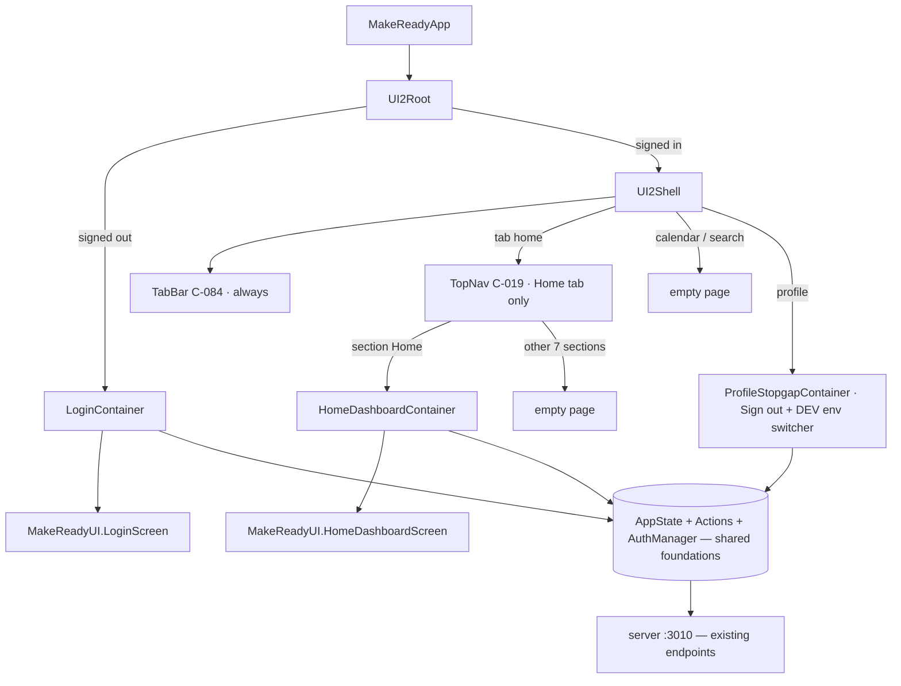

# ui2-shell — spec
> lg · ticket none

## Idea

**Why.** MakeReady 2.0 replaces the iPhone app's entire UI. The design program (d2m, era 2.0) has
specced and built ~100 components and 33 screens as previews, but none of it runs in the app. This
feature makes 2.0 *the* app: from the next TestFlight build on, a leader opens MakeReady and gets the
2.0 Login, then the 2.0 Home dashboard inside the 2.0 navigation — and nothing of the legacy UI.

**What success looks like.** A TestFlight build (same bundle id, no new Apple approval) boots into
the 2.0 Login screen; Google sign-in lands on Home (TabBar MakeReady tab → TopNav "Home" section)
with live Overview and Activity data; the TopNav swipes and morphs across its 8 sections; the TabBar
switches between Home, Calendar, Search and Profile; Profile signs out. The legacy UI is not in the
binary, and every d2m component still captures pixel-identical after the module rename.

**In your words.**
- "treat it like a new 2.0 app, but without changing the bundle id … a clean break … We will never
  use the legacy app ever again, the only reason I'm not deleting it is so we can use it as a
  functional reference. So there's no need to toggle anything" → D3, D5
- "start releasing the new app as quickly as possible, even if all we have is a login screen" → D4
- "the new makeready app will have zero components from the current app" → D1, D2
- "this nav is only available on the main MakeReady page (first bottom left tab on the bottom nav).
  calendar, search, and profile do not use the topnav." → D12
- "The home dashboard screen is the 'Home' link on the top nav. This is the first page a user will
  see if they tap the MakeReady tab on the bottom nav." → D13

**The concept.** The d2m-owned module (today `UI2Preview`) is renamed `MakeReadyUI`, d2m is
repointed at it, and the app links it. A thin hand-written wiring layer in the app target turns it
into an app: a root that gates on auth, a shell that draws the two navigation levels once, and one
*container* per screen that reads `AppState`, builds the d2m screen's props, and maps its `on…`
callbacks to Actions or shell routes. d2m keeps rebuilding the pure views; containers are never
touched by a rebuild.

**How it fits today.** The app root (`MakeReadyApp.swift:28`) shows legacy `MainView` or `LoginView`
on `AuthManager.isAuthenticated`¹. `AuthManager` already does Google OAuth via
`ASWebAuthenticationSession` → `/auth/exchange` → `/auth/me`, keeps `connect.sid` in the Keychain per
environment, and has a Local `/auth/dev-login` path²; `signOut()` posts `/auth/logout` and clears
`AppState`³. `AppState.loadInitialData()` loads programs, templates, unread count, the one org, Bible
translations and themes⁴. There is no feature-flag mechanism and no multi-org. The `UI2Preview`
framework target is linked only by the capture app and capture tests⁵; its screens draw their own
navigation (six render `TopNav`, Calendar and Search render `TabBar`)⁶. The dev environment switcher
lives on legacy `ProfilePage`⁷. `/auth/leader-access` and `/api/analytics/*` exist on the server but
the iPhone has never called them⁸.

**Approaches considered.** Chosen: rename the module, repoint d2m, wire through app-side containers
(one source of truth; Figma diffs keep verifying what ships). Rejected: building from `UI2Preview`
under its preview name (every rule and doc would describe a fiction); copying components into a new
app folder (forks the code — d2m rebuilds land in the copy nobody ships); wiring inside the d2m
screen files (a rebuild overwrites the wiring).

¹ `iphone/MakeReady/MakeReadyApp.swift:28-35` · ² `AuthManager.swift:101,137,249,287,406` ·
³ `AuthManager.swift:362` · ⁴ `State/AppState.swift:847` · ⁵ `project.pbxproj:1314,1346` ·
⁶ `UI2Preview/Screens/**` grep `TopNav(`/`TabBar(` · ⁷ `Pages/Profile/ProfilePage.swift:13` ·
⁸ `server/src/routes/auth.ts:571`, `server/src/routes/analytics.ts:188`

## Apps

| App | In scope | What changes | Section |
|---|---|---|---|
| server | ⬜ | Nothing. Every endpoint 2.0 release 1 calls already exists (§Contract); no route, schema or zod change | — |
| client | ⬜ | Nothing. The web app shares no code with the iPhone app; members stay on web (UI 2.0 D1) | — |
| iphone | ✅ | Module rename + link, legacy UI out of the target, new root/shell/containers, Home + Login + Profile wiring | §iphone |
| capture | ✅ | Path/import references follow the rename; re-capture proves the rename is pixel-neutral; Home/Login screen captures | §capture |

**Sequencing:** no producer change, so no freeze. Phase 1 (rename) touches iphone + capture
references in ONE mechanical commit set and is verified by capture before anything else moves; every
later phase is iphone-only. d2m prerequisites (F1–F5) gate Phase 3 only.

**Backward compatibility:** the iPhone app is a released artifact. Builds already installed keep the
legacy UI until updated — they call the same unchanged endpoints, so nothing they read moves. This
feature ships a binary in which the legacy UI no longer exists: a legacy fix after this lands ships
only from the `legacy-final` tag (D5).

**Blast radius:** d2m's project settings (`previewDir`, `tokensOutPath`, `targetSyncCmd`), every
`/ui2-*` and `/d2m-*` command and doc that names `UI2Preview`, the capture app/tests, SwiftLint
`included:` paths, and push-notification deep links (D17).

## Decisions

<!-- The one place rulings live. Record the DECISION — and, in one line, why, and why the rejected option lost. A stated preference
     is the INPUT to a row, not the row. Write each Ruling as something later code can be checked
     against without re-interpretation:
       · positive and specific — "store the full number, mask at render", not "don't truncate"
       · scope named — which apps, screens or endpoints it binds
       · "etc." / "and so on" expanded into the list, or the test for membership stated
       · the rejected alternative named, with the reason it lost (check-obligations warns on a bare one)
       · the enforcement hook, where one exists (lint rule, script, test)
     🔴 NEVER quote the user's prompt as the ruling. Operationalize it: a closed list, a measured
     value, an enumerated set of deviations. A ruling a stranger could implement two ways is not
     written yet.
     Who/date carries the provenance, so the Ruling itself needs no quote marks.
     The owner's own words go in §Idea "In your words", linked to this row — never in the Ruling.
     OPEN rows block the build go-ahead. Never delete a ruling; supersede it in place with a date. -->

| # | Decision | Ruling | Who / date |
|---|---|---|---|
| D1 | Where 2.0 code lives | Rename `iphone/MakeReady/UI2Preview/` → `iphone/MakeReadyUI/` and the framework target `UI2Preview` → `MakeReadyUI`; no type is renamed. Repoint d2m settings `previewDir` → `iphone/MakeReadyUI`, `tokensOutPath` → `iphone/MakeReadyUI/Tokens.swift`, `targetSyncCmd` → the renamed sync script. Link + embed `MakeReadyUI.framework` in the `MakeReady` app target. The module stays d2m-owned and imports SwiftUI only. Why: one source of truth — d2m rebuilds and Figma diffs reach what ships, and the module boundary makes legacy UI unreferenceable. Rejected: keep the `UI2Preview` name (preview-only framing contradicts its use); copy into a new component tree (forks the code, diffs verify a copy that doesn't ship) | user 2026-10-24 |
| D2 | Where wiring lives | Hand-written code in the app target under `iphone/MakeReady/UI2/`: `UI2Root.swift`, `Shell/` (shell view, `UI2Tab`/`UI2Section` enums, `UI2Route`), `Containers/<Namespace>/<Id>Container.swift`. A container reads `AppState`/`AuthManager`, builds the screen's `State`, maps each `on…` callback to an Action, a shell route or a no-op, and renders the `MakeReadyUI` screen. No file under `iphone/MakeReadyUI/` is hand-edited for wiring. Why: d2m regenerates screen files; views stay pure (UI 2.0 D12–D15, D30, D37). Rejected: wiring inside d2m screen files (overwritten on rebuild) | user 2026-10-24 |
| D3 | No flag | `MakeReadyApp` mounts `UI2Root` unconditionally; no build setting, UserDefaults key or server flag selects a shell. Supersedes UI 2.0 D2 and `docs/ui2/migration.md` isolation rule 1 + the `ui2-cutover` suite (recorded in d2m by F5). Why: clean break, same bundle id, no new App Store approval. Rejected: TestFlight-only runtime toggle, separate Release-UI2 config, new bundle id, server per-user flag — the owner wants no toggling | user 2026-10-24 |
| D4 | Release cadence | Every TestFlight build archived after Phase 2 is 2.0, even with Login as its only working screen; App Store timing is not decided here. Archiving stays the owner's call (builder.md). Why: ship the new app early. Rejected: wait for parity before TestFlight (delays real-device feedback on the new app for months; the owner accepts a near-empty build) | user 2026-10-24 |
| D5 | Legacy disposition | Tag the last commit before legacy leaves the target `legacy-final`. Remove from the `MakeReady` target (files stay on disk): `MainView.swift`, `LoginView.swift`, `Pages/**`, `Components/**`, `Services/NavigationCoordinator.swift`, `Services/Route.swift`, `Services/OverlayManager.swift`, and any file only they reference. Keep compiled: `State/**`, Actions, `Services/APIClient*`, `AuthManager.swift`, `Utilities/SessionCredentialStore.swift`, `State/Persistence/**`, `Configuration.swift`, `AppDelegate.swift`, `PushNotificationManager.swift`, `LocalPortHealer.swift`. Why: legacy is read on disk or run from the tag; no dead UI in the binary. Rejected: keep compiled but unreferenced (dead code compiles and lints); a separate legacy scheme (upkeep as foundations change) | user 2026-10-24 |
| D6 | Shared foundations | 2.0 reuses `AppState`, Actions, `APIClient`, `AuthManager`, the Keychain session and `StatePersistence` as they are. `UI2Root` injects `AppState.shared` and the app's `AuthManager` via `.environment`; only containers read them (UI 2.0 D33, D37). Why: zero components from legacy is a UI rule; state and services are not components. Rejected: a new 2.0 store (rewrite with no gain) | (assumed at brainstorm) |
| D7 | Login wiring | `LoginContainer` renders `LoginScreen`; `onSignIn` → `AuthManager.signIn()` (Local env keeps `/auth/dev-login`). While signing in, `authenticating: true`. After `/auth/me` succeeds, call `GET /auth/leader-access`: `canAccess: false` → `AuthManager.signOut()` and `errorMessage` = "This account doesn't have leader access."; any other failure (cancelled excluded) → "Authentication failed". A cancelled web session returns to idle with no message. Why: login spec §3 (OQ-login-003, -005). Rejected: skipping the leader-access gate (members could enter the leader app) | (assumed at brainstorm) |
| D8 | Home data | `HomeDashboardContainer` fills Overview (KPI rail) and Activity (day rail + scheduled/completed chart) from `POST /api/analytics/query` with `GET /api/analytics/meta`; Sessions, Engagement and Following render their §3 `empty` state (zeroed arrays, "0 enrollments"). No server change. Why: three home-dashboard §5 API-GAPs need server work that would delay release 1. Rejected: close all gaps now (large server phase); no data at all (Home looks dead) | user 2026-10-24 |
| D9 | Home not-yet-wired actions | `onPickMetrics`, `onOpenEngagement`, `onFollowEnrollment`, `onProgramMenu`, `onOpenGroup` are no-ops; the controls render as designed. `onJumpToToday` and `onSelectSessionRange` work (the range re-scopes an empty section, so it only changes the dropdown label). Why: faithful to Figma and its diff; each target lands later. Rejected: hide them (a spec deviation per control; Following empty would lose its only affordance) | user 2026-10-25 |
| D10 | Unwired sections and tabs | All 8 TopNav sections (Home · Library · Groups · Members · Enrollments · Invites · Programs · Media) and all 5 TabBar cells are present and selectable. Library…Media, Calendar and Search show an empty page: full-bleed `color-layout-background`, no component. TabBar Add and every TopNav expanded-card add slot are no-ops. Why: keeps C-019/C-084's closed sets; nothing off-registry (UI 2.0 D6). Rejected: wire the built list roots now (much larger feature); hide unwired items (contract deviation) | user 2026-10-24 |
| D11 | Who draws navigation | The shell draws `TopNav` once, pinned under the status bar, and `TabBar` once, pinned above the home indicator; root screens render content only. The shell spec in d2m (F2) owns the exact placement, safe area and scroll interaction. Why: TopNav keeps its selection, scroll offset and morph across sections; one owner. Rejected: screens own their navigation (TopNav resets per section, two owners); a `showsNav` prop (dead code path, undesigned prop) | user 2026-10-24 |
| D12 | TopNav scope | TopNav exists only while TabBar `home` is selected. Calendar, Search and Profile never show it, and switching back to Home restores the last TopNav section and scroll offset for the life of the process | user 2026-10-24 |
| D13 | Entry point | After sign-in and on every cold launch with a valid session: TabBar `home` (MakeReady logo, cell 1) + TopNav section `Home` → `home-dashboard`. Re-tapping TabBar `home` returns to section Home. Why: Home is the first page. Rejected: restoring the last tab across launches (no designed need; D43 makes it ephemeral) | user 2026-10-25 |
| D14 | TopNav morph | Release 1 ships the full expand/collapse, finger-tracked morph of C-019 (collapsed tab row ⇄ expanded card row) to the choreography the `shell-topnav` d2m spec rules (OQ-C-019-5/6 defaults unless the owner rules otherwise). Selecting a card collapses the row. Why: the owner wants the real nav from release 1. Rejected: collapsed-only first (recommended, declined) | user 2026-10-24 |
| D15 | Sign out | Profile = empty page + one C-048 `PageActionButton` "Sign out", `role: secondary` (UI 2.0 D57) → `AuthManager.signOut()` → `UI2Root` shows Login. Marked a stopgap until `profile-home` is designed. Why: testers must switch accounts. Rejected: wait for the design (reinstall to switch); hidden long-press (undiscoverable) | user 2026-10-24 |
| D16 | Dev environment switcher | Only when `Configuration.devMode` is true: below Sign out on Profile, one C-047 `RadioOptionRow` per `Configuration.SelectedEnvironment` case, subtitle = its health ("Reachable"/"Unreachable"/"Checking…"); selecting one performs what legacy `ProfilePage` does on switch (persist, sign out, return to Login). Never rendered in Release. Why: the legacy switcher leaves the target. Rejected: on Login (undesigned UI there); no switcher (rebuild to switch) | user 2026-10-25 |
| D17 | Push notifications | `PushNotificationManager` keeps registering and keeps the APNs token flow; a notification tap opens the app to D13's entry point and routes nowhere else in release 1. Any dependency on `NavigationCoordinator`/`Route` is cut in the push path. Why: legacy routing leaves the target; 2.0 routes arrive with their screens | (assumed at brainstorm) |
| D18 | Rename is pixel-neutral | Phase 1 changes paths, target names, imports and settings only. Its gate is a capture of every built component and screen whose PNG matches the pre-rename render (diff 0%). Why: proves the move changed nothing | (assumed at brainstorm) |
| D19 | Shell state | Selected tab, selected section, TopNav `expansion` and `scrollOffset` are `@State` on the shell (UI 2.0 D43) — not persisted, not in `AppState` | (assumed at spec) 2026-10-25 |
| D20 | Home data storage | A new `DashboardActions` (in the Actions layer) loads Overview/Activity data into a new `AppState.dashboard` domain (KPI series, day buckets) keyed by metric id + date; cache-first, refreshed in the container's `.task` (UI 2.0 D39), included in the disk snapshot (D41). The container maps it to `HomeDashboardScreen.State` in a pure function | (assumed at spec) 2026-10-25 |
| D21 | KPI selection | Read `GET /api/preferences/dashboard.kpis` (list of metric ids). Absent → the metrics the Figma frame draws that `/api/analytics/meta` lists, in frame order; a designed metric missing from the catalog is omitted. `metricCount` = "N metrics" for the shown list. Series = 24 points per KPI | (assumed at spec) 2026-10-25 |
| D22 | Activity window | Day buckets in the device's time zone: the 28 days before today, today, and the 7 days after (scheduled side only). `chartToday` = today; the visible window opens centred on today | (assumed at spec) 2026-10-25 |
| D23 | Folder on disk | `iphone/MakeReadyUI/` sits beside `iphone/MakeReady/`; `.swiftlint.yml` `included:` gains `MakeReadyUI`, and `.swiftlint-baseline.json` paths are rewritten to match | (assumed at spec) 2026-10-25 |

## Contract

No producer change. These are the existing server endpoints the 2.0 iPhone shell consumes; every
one is unchanged by this feature.

| Contract | Producer | Consumers | Auth | Request | Response | Errors |
|---|---|---|---|---|---|---|
| `GET /auth/google?platform=ios` | server | iphone (unchanged use) | none | web session | redirect to `makeready://…?code=` | — |
| `POST /auth/exchange` | server | iphone (unchanged use) | none | `{code}` | `{sessionId, userId}` | 400/401 |
| `POST /auth/dev-login` | server | iphone (Local env only, unchanged) | none | `{email}` | session | 4xx |
| `GET /auth/me` | server | iphone (unchanged use) | session | — | user | 401 |
| `GET /auth/leader-access` | server | iphone (**new consumer**) | session | — | `{canAccess: boolean}` | 401 |
| `POST /auth/logout` | server | iphone (unchanged use) | session | — | 200 | — |
| `GET /api/analytics/meta` | server | iphone (**new consumer**) | session | — | metric catalog | 401 |
| `POST /api/analytics/query` | server | iphone (**new consumer**) | session, org-scoped via `canManageOrgContent` family | `{metrics[], dimensions?, filters{from,to}?, orderBy?}` (zod `querySchema`) | keyed metric rows | 400 (unknown metric / snapshot-class window), 401, 429 |
| `GET /api/preferences/:key` | server | iphone (**new consumer**) | session | key `dashboard.kpis` | `{value}` or 404 | 401 |

**Module interface (iphone-internal):** `MakeReadyUI.LoginScreen(state:onSignIn:)`,
`MakeReadyUI.HomeDashboardScreen(state:…callbacks)` as rebuilt by F3, `TopNav`, `TabBar`,
`PageActionButton`, `RadioOptionRow`. Consumers: the iphone containers. d2m owns their shape; a
mismatch is routed back to d2m, never patched in `MakeReadyUI/`.

## Schema & API changes

No schema change (established 2026-10-25).

**Data plan:** none — no rows are written or migrated. The only new persisted data is the on-device
`AppState.dashboard` snapshot (D20), cleared by `AppState.clearAllData()` on sign-out.

## iphone

**Phase 1 — rename + link.** Move the folder; rename the target, the scheme references,
`@testable import UI2Preview` → `MakeReadyUI` in `MakeReadyCaptureTests/ViewRegistry.swift`,
`CaptureRunner.swift` and `MakeReadyCapture/MakeReadyCaptureApp.swift`; rename
`iphone/scripts/ui2-preview-sync.rb` and its target constant; SwiftLint paths (D23); link + embed in
`MakeReady`. Update the module `README.md` to drop "preview only". d2m settings change (D1) is
applied with d2m's own tooling by the owner (F5).

**Phase 2 — clean break + Login.** Tag `legacy-final`. Remove legacy UI from the target (D5) and
resolve whatever the compiler then reports in kept foundations (F6). `MakeReadyApp` mounts
`UI2Root` (D3); `UI2Root` switches on `AuthManager.isAuthenticated` between `LoginContainer` and a
placeholder shell (an empty page until Phase 3). An archive here is a valid login-only TestFlight
build (D4).

**Phase 3 — shell.** `UI2Shell`: `TabBar` (selected = `UI2Tab`), the TopNav host on `home` only
(D11, D12, D14), section switching, empty pages (D10), `UI2Route` with tab/section cases only.
Gated on F2.

**Phase 4 — Home.** `DashboardActions`, `AppState.dashboard`, `HomeDashboardContainer` (D8, D9,
D20–D22). Gated on F3.

**Phase 5 — Profile + push.** `ProfileStopgapContainer` (D15, D16); push tap → entry point (D17).

House rules that bind every phase: no `APIClient` calls from containers or views; overlays only via
a typed route (none in release 1); never `.sheet`/`.fullScreenCover`/`asyncAfter`; errors routed per
`/ios-error-surface`; `swiftlint` from `iphone/`; iPhone commits are staged for the owner.

## capture

Update the references that follow the rename: `capture/server.mjs`, `capture/lib/*`, `capture/src/*`
paths that name `UI2Preview`; `.claude/commands/*`, `.claude/scripts/*` and `.claude/builder.md`
mentions; `docs/ui2/preview-build.md` + module README paths. Fixture keys (`component.ui2.C-###`,
screen keys) do not change. Re-capture every built component and screen and diff against the
pre-rename renders (D18).

## Testing

**iphone.** `npm run ios:build-check` every phase; `cd iphone && swiftlint` every phase; XCTest
(`--test`): (a) `HomeDashboardContainer` mapping — analytics rows + preference → `State` (KPI order,
"N metrics", day buckets across the 28/1/7 window, empty Sessions/Engagement/Following);
(b) `LoginContainer` state mapping — success, `canAccess:false` → leader-access message + sign-out,
failure → "Authentication failed", cancel → idle; (c) shell — Home re-tap returns to section Home;
TopNav absent on calendar/search/profile; section restore after a tab round-trip.

**capture.** Pre/post-rename capture of all built rows, diff 0% (D18). Post-Phase 4: capture of
`HomeDashboardContainer` fed a fixture `AppState` vs the d2m `home-dashboard` frame (advisory %).

**Cross-app E2E walk (verify, once).** `/dev-start` → simulator on Local → DEV_MODE build → Sign in
(dev-login) → Home with live Overview/Activity → swipe and morph the TopNav through all 8 sections →
each TabBar tab → Profile → switch environment → sign back in → Sign out → Login.

**Human-verification script.**
1. Cold launch signed out → 2.0 Login (logo, "Welcome to MakeReady", Google button). No legacy UI anywhere.
2. Sign in with a leader account → Home tab, Home section, dashboard visible between TopNav and TabBar.
3. Overview KPI cards show real numbers; Activity day cards and chart show real days, Jump to today recenters both.
4. Sessions, Engagement, Following show their empty state; their + / → / ⋯ do nothing.
5. Swipe the TopNav; drag it open and closed; pick each of the 8 sections — all but Home are empty pages.
6. TabBar: Calendar, Search empty, no TopNav; Add does nothing; Home brings back the section you left.
7. Profile → Sign out → Login. Sign in with a non-leader account → "This account doesn't have leader access."
8. Kill and relaunch signed in → straight to Home, no Login flash.

## Out of scope

- Server work of any kind, including the three home-dashboard API-GAPs (sessions, engagement aggregate, followed enrollments) — a later feature.
- Wiring any screen other than Login, Home and the Profile stopgap (groups-home, members-home, enrollments-home, invites-home, study-programs, calendar-home, search-home, every detail/flow screen) — later per-area features.
- The KPI picker, follow picker, and every Home action in D9.
- `profile-home`, `library-home`, `media-home` (undesigned).
- Multi-org / account switching.
- The web client and members' experience.
- App Store submission.
- Writing any d2m spec, contract, decision, note or build — F1–F5 belong to `/d2m-*` and `/ui2-*`.

## Findings & risks

| # | Finding | Resolution |
|---|---|---|
| F1 | d2m's `get_screen`/`get_component` fail: table `public.Note` missing in d2m's database | Owner runs d2m's migration before Phase 3; Phases 1–2 do not need d2m reads |
| F2 | `shell-topnav` and `shell-tabs` are queued with no spec; D11/D14 need their placement, safe-area and morph rules | Owner specs both in d2m (no-figma; sources C-019, C-084, `docs/features/navigation/01-account-switcher-analysis.md`), including "root screens draw no app chrome". **Gates Phase 3** |
| F3 | `HomeDashboardScreen` draws its own `TopNav` (and `onSelectTab`/`onToggleNav` props); six other roots draw TopNav, two draw TabBar | Owner rebuilds `home-dashboard` in d2m without app chrome before Phase 4; the other eight before each is wired. **Gates Phase 4** |
| F4 | The built `HomeDashboardScreen.State` has no per-section `loading`/`error` inputs though home-dashboard §3 lists them | Release 1 is cache-first (D20): first load renders `empty`, a failed refresh keeps the last data. Owner adds the states via d2m when convenient — build-time risk, Phase 4 |
| F5 | UI 2.0 D2 + `migration.md` + `preview-build.md` rule 1 now contradict D3/D1; d2m settings name `UI2Preview` | Owner records the supersession as a d2m decision and updates the settings + docs through d2m; builder does not write them |
| F6 | Kept foundations may reference removed legacy types (`Log.swift` mentions NavigationCoordinator; `PushNotificationManager`, `AppDelegate`, `MakeReadyApp` handle deep links via it) | Phase 2 resolves every compile error by cutting the reference, never by keeping a legacy UI file — build-time risk, Phase 2 |
| F7 | home-dashboard frame shows 3 KPI cards while its header reads "5 metrics" | D21 renders the count of what is shown; flagged to the owner at the walk |
