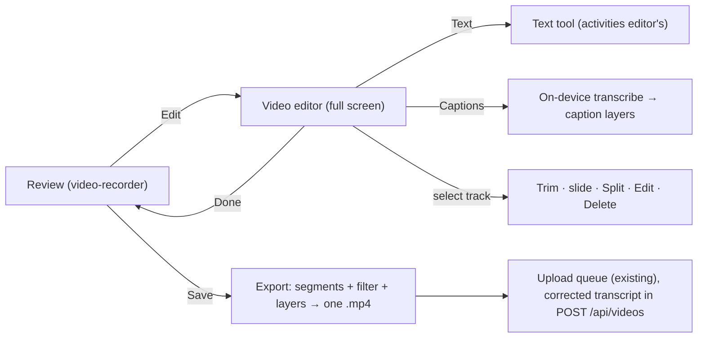

# video-editor — spec
> lg · no ticket · child 2 of the video-recording program (`docs/features/video-recording/PROGRAM.md`)

## Idea

**Why.** Leaders record and import short videos in the iPhone app (video-recorder, shipped
2026-11-23). Before saving, they want to put text over the video the way the YouTube Shorts editor
lets them: a title, a point, a verse reference, captions of what they said. Without it a leader
has to edit elsewhere and import, which loses the on-device transcript and the Library flow.

**What success looks like.** On Review, a leader taps **Edit**, adds two styled text layers and
captions to a 1:00 clip in about a minute, sets when each layer shows on a timeline, fixes a
misheard caption, and taps **Done** then **Save**. The video in their Library, and in the lesson it
was recorded for, plays the text at the right moments on iPhone and on any Stream player, and its
transcript carries the corrected wording. Nothing new is stored on the server.

**In your words.** "I love the edit mode that let's the user add text and style the text over the
video in layers, manipulate the layers, that way they can overlay things on the video, primarily
text" → D1, D2, D3, D8.

**The concept.** One editor, opened from Review, full screen from both entry points. It holds a
list of layers (text and captions). Each layer has its text, style, placement (position, scale,
rotation) and a time window. The preview draws the layers live over the filtered video. The
timeline shows one track per layer. At Save, the existing export pass draws the layers into the
pixels with the filter.

**How it fits today.** Review offers Filters, Retake and Save, and reserves **Edit** for this child
(video-recorder D9)¹. Export joins the segments and draws the filter through one
`AVVideoComposition` drawing pass². The transcript is made at Save from the exported file³, so it
does not exist while Review is open. The activities editor already has a d2m-built,
owner-approved text tool: C-091 ActivityCanvas (centre and snap guides, delete target)⁴, C-092
CanvasTextObject (drag, pinch, rotate), C-093 TextSizeSlider, C-094 TextColorPalette, C-095
ColorPickerWell, and its font, align and background panels. Recorded segments already survive a
crash in `VideoDraftStore`⁵.

**Approaches considered.** Chosen: layers as data on the device, drawn into the file at export
(P5), with the activities editor's text tool reused. Rejected: an overlay layer stored on the
server and drawn at playback (two renderers to keep identical, P5); a new YouTube-style text
toolbar (a second text tool in one app); the editor inside the lesson's camera area (no room for
the timeline, two layouts).

¹ `iphone/MakeReadyUI/Screens/Library/VideoRecorderScreen.swift:172,474` · ² `iphone/MakeReady/Services/Video/VideoExporter.swift:30,129-166` · ³ `iphone/MakeReady/Services/Video/VideoSaver.swift:222` · ⁴ `iphone/MakeReadyUI/ActivityCanvas.swift:102-115` · ⁵ `iphone/MakeReady/Services/Video/VideoDraftStore.swift:28-47`

## Apps

| App | In scope | What changes | Section |
|---|---|---|---|
| server | ⬜ | No change. The corrected transcript travels in `POST /api/videos`'s existing optional `transcript` and `transcriptSegments` (video-recorder §Contract), within its existing limits (≤ 20 000 chars, ≤ 2 000 segments). Text and captions are pixels in the uploaded file (P5) | — |
| client | ⬜ | No change. The web plays the file as any Stream video; overlays are already in the pixels (P5, P9) | — |
| iphone | ✅ | The editor screen and its parts (d2m first, P2), Edit on Review, the layer model and its undo history, captions from an on-device transcript, the draft carrying layers, and the export drawing layers with the filter | §iphone |

**Sequencing:** d2m specs and builds the editor screen and its new parts, and updates
video-recorder's Review state with **Edit** (phase 1, P2); the owner approves them. Then the iPhone
wiring. No producer phase: the contract is unchanged.

**Backward compatibility:** a released iPhone build never opens the editor and is unaffected. The
server sees the same create body it accepts today; a corrected transcript is only different text in
the same fields. A draft written by this build and opened by an older one is out of reach: drafts
are per-install and an older build cannot be installed over a newer one.

**Blast radius:** video-recorder's Review state and Save path (`VideoSaver`), `VideoExporter`'s
drawing pass, and `VideoDraftStore`'s manifest. The activities editor's text parts are reused, not
changed; a change d2m needs in them goes through d2m (P2).

## Decisions

<!-- The one place rulings live. Record the DECISION — and, in one line, why, and why the rejected option lost. A stated preference
     is the INPUT to a row, not the row. Write each Ruling as something later code can be checked
     against without re-interpretation:
       · positive and specific — "store the full number, mask at render", not "don't truncate"
       · scope named — which apps, screens or endpoints it binds
       · "etc." / "and so on" expanded into the list, or the test for membership stated
       · the rejected alternative named, with the reason it lost (check-obligations warns on a bare one)
       · the enforcement hook, where one exists (lint rule, script, test)
     🔴 NEVER quote the user's prompt as the ruling. Operationalize it: a closed list, a measured
     value, an enumerated set of deviations. A ruling a stranger could implement two ways is not
     written yet.
     Who/date carries the provenance, so the Ruling itself needs no quote marks.
     The owner's own words go in §Idea "In your words", linked to this row — never in the Ruling.
     OPEN rows block the build go-ahead. Never delete a ruling; supersede it in place with a date. -->

| # | Decision | Ruling | Who / date |
|---|---|---|---|
| D1 | Text layers | A leader adds any number of text layers up to D15's limit. Each layer has: text, font, size, colour, background style, alignment, position, scale, rotation, and a time window (D3). On the preview a layer is dragged to move, pinched to scale, twisted to rotate, and dragged to the delete target to delete. Rejected: a single caption-style text field (not layers, no placement) | Luke 2026-11-22 (B3) |
| D2 | Drawn into the file | At Save the export draws every layer visible at each frame into the pixels, above the filter, in the same `AVVideoComposition` drawing pass as the filter (video-recorder D6). The uploaded file is the only record of the layers; nothing about them is sent to the server. Rejected: layers stored and drawn at playback (two renderers to keep identical; the server stores them) | Luke 2026-11-22 (P5/B8) |
| D3 | Timeline | The editor shows a play/pause button, a ruler in seconds, one 44 pt track per layer (newest on top) above a filmstrip of the video, and a fixed centre playhead; dragging the timeline scrubs. A new text layer's window is the whole clip. Selecting a track shows end handles: dragging one trims that end (minimum window 0.5 s), dragging the bar slides the window keeping its length, clamped to the clip. A layer is drawn on the preview only while the playhead is inside its window. Rejected: every layer always visible for the whole clip (no way to time a title or a point to what is said) | Luke 2026-11-22 (B12) |
| D4 | Captions | A **Captions** tool, off until tapped. Tapping it adds one caption layer per transcript segment, its window the segment's `startMs`–`endMs`, all in one house style d2m designs (one font, size, colour, background, placement in the lower third). Each caption's wording is editable and each caption deletable; window trim and slide work as D3. Tapping Captions again while captions exist offers **Remove captions** (deletes every caption layer, undoable). Caption layers are not restyled one by one. Rejected: captions on by default (not every video wants them; the owner chose opt-in); captions that cannot be edited (transcription mishears names and verses) | Luke 2026-11-22 (B20) |
| D5 | Design source | d2m specs and builds the editor screen and every new part from this SPEC and `01-youtube-1-analysis.md` §6–§7 (doc source), in UI 2.0 tokens, and adds **Edit** to video-recorder's Review state. The owner approves them before any app wiring. Rejected: designing in Figma first (everything waits on Figma) | Luke 2026-11-22 (P2) |
| D6 | What is not built | No music, sound, stickers, effects, speed, voiceover, text-to-speech, or adding a second clip. Rejected: background music (needs a licensed music source) | Luke 2026-11-22 (P1) |
| D7 | Entry and exit | Review shows **Edit** beside Filters, Retake and Save for every clip, recorded or imported (after its ≤ 2:00 trim). Edit opens the editor; **Done** returns to Review with the layers kept, and Review's playback then shows them. Opening Edit again resumes the same layers. **Retake** on Review discards the layers with the segments (its existing confirm). Rejected: editing after Save (P5: the text is in the pixels) | (assumed at spec) 2026-11-22, video-recorder D9 · PROGRAM child 2 |
| D8 | Text tool | The editor's **Text** tool and a layer's **Edit** open the activities editor's text tool: a dimmed backdrop over the paused frame, the keyboard, C-093 TextSizeSlider, C-094 TextColorPalette with C-095 ColorPickerWell, and its font, align and background panels, editing a C-092 CanvasTextObject. Done commits the text; empty text deletes the layer. d2m adapts these parts for the video canvas through its own requests. Rejected: a new YouTube-style toolbar (a second text tool in one app) | (assumed at brainstorm) 2026-11-23 |
| D9 | Guides | While a layer is moved, the canvas shows C-091's centre guide and snap guides, a hatched unsafe band at the frame edges (the area players and system UI may cover), and the delete target; a layer may extend past the frame and is clipped. Rejected: free placement with no guides (text lands off-centre or under player chrome with no way to tell) | (assumed at brainstorm) 2026-11-23 |
| D10 | Full screen from a lesson | From both entry points the editor fills the screen, presented as a hosted overlay like the full-screen recorder (video-recorder D25). From a lesson, Done or Cancel returns to Review inside the lesson's inline recorder. Rejected: the editor inside the lesson's camera area (the timeline is cramped; two layouts) | Luke 2026-11-23 |
| D11 | Transcript for captions | Tapping Captions with no transcript yet transcribes the unfiltered review composition on the device with `VideoTranscriber`, showing "Transcribing…" in the toolbar; the segments are timed from the start of the clip being edited. The result is kept with the draft. If the device cannot transcribe (unsupported locale, model unavailable, failure or 60 s timeout), Captions shows a one-line reason and adds nothing; Save then transcribes as today. Save reuses a transcript made here instead of transcribing again. Rejected: waiting for the server fallback (needs the upload first; minutes) | (assumed at brainstorm) 2026-11-23 |
| D12 | Corrected transcript | At Save, when captions were added, the transcript sent with `POST /api/videos` is the transcript from D11 with each segment whose caption was reworded taking the caption's new wording, and `transcript` rebuilt as those segments' texts joined by spaces. A caption deleted from the picture keeps its original segment in the transcript. A caption whose window was trimmed or slid keeps the segment's original times. Rejected: mirroring the captions exactly (deletions drop words that were said); keeping the original (fixed mistakes stay stored) | Luke 2026-11-23 |
| D13 | Split | A selected layer's toolbar is **Deselect · Split · Edit · Delete**. Split cuts the layer at the playhead into two layers with the same text, style and placement, windows meeting at the playhead; it is disabled (40 % opacity) when the playhead is outside the layer or within 0.5 s of either end. Rejected: no Split (repeating text means restyling a second layer) | Luke 2026-11-23 |
| D14 | Undo and Cancel | The editor's top bar has **Cancel**, **Undo** and **Done**. Undo steps back one change at a time through the session's changes: add layer, text or style edit, move/scale/rotate (one gesture = one change), trim, slide, split, delete, captions added, captions removed. Undo is dimmed with nothing to undo. Cancel, when anything changed, confirms (C-066) and returns to Review with the layers as they were when Edit was opened. The history is not kept after Done. Rejected: Cancel only (one slip means starting over) | Luke 2026-11-23 |
| D15 | Limits | At most 20 text layers plus the caption layers. Layer text 1–200 characters; a caption 1–200. The 21st text layer's Text tool shows "Up to 20 text layers". Rejected: no limit (an unreadable timeline and a slow export) | (assumed at brainstorm) 2026-11-23 |
| D16 | Drafts keep the edit | Every change writes the layers (and a D11 transcript) to the draft in `VideoDraftStore`, so a crash or kill during editing or before upload restores Review with the layers. The draft manifest gains an optional `layers` and `transcript`; a manifest without them decodes as no edit. Rejected: layers in memory only (a kill loses a captioned edit) | (assumed at brainstorm) 2026-11-23 |
| D17 | Layer model | `VideoLayer { id, kind: text|caption, text, style (font, size, colour hex, background, alignment), centre (unit point on the 1080×1920 frame), scale, rotation (radians), startMs, endMs, sourceSegment?: Int }`, Codable, in the iPhone app. The preview and the export both draw from this model through one renderer function that turns a layer into an image for a given frame size, so the two cannot drift. Rejected: separate preview and export drawing code | (assumed at spec) 2026-11-23 |
| D18 | Export drawing | The export composites each frame's visible layers over the filtered frame with Core Image (`CIImage` from the D17 renderer, cached per layer and redrawn only when the layer changes), at the 1080×1920 render size. Export time with 20 layers plus captions on a 2:00 clip stays within 1.5× the export time without layers, measured on device (F2). Rejected: `AVVideoCompositionCoreAnimationTool` (cannot share the filter pass's `CIImage` pipeline used by preview and export) | (assumed at spec) 2026-11-23 |

## Contract

No contract change. The iPhone app consumes `POST /api/videos` exactly as video-recorder froze it
(`docs/features/_archive/video-recorder/SPEC.md` §Contract); D12 changes only the text it sends in
`transcript` and `transcriptSegments`.

## Schema & API changes

No schema change (established 2026-11-23).

## iphone

- **Phase 1 is d2m (P2, D5): no app code until the owner approves the screens.** Request, with this
  SPEC and `01-youtube-1-analysis.md` as references:
  - **screen `video-editor`** (new): full screen (D10). States: empty (no layers), layers with one
    selected, layer selected with Split disabled, text tool open (from Text and from Edit),
    manipulating (guides, unsafe band, delete target), Transcribing…, captions added, captions
    unavailable (reason), Remove captions offer, the 20-layer limit, Cancel confirm, playing.
  - **new parts** (d2m mints and names them): the editor timeline (ruler, playhead, filmstrip,
    play/pause), the layer track (text and caption looks, selected with end handles), the editor
    toolbar (Text · Captions) and the selected-layer toolbar (Deselect · Split · Edit · Delete), the
    editor top bar (Cancel · Undo · Done), the unsafe-band overlay, and the caption house style.
  - **change `video-recorder`**: the Review state gains **Edit**, and Review's playback shows the
    layers.
  - **reuse** C-091, C-092, C-093, C-094, C-095 and the activities editor's font, align and
    background panels (D8); any change they need is d2m's.
- **State:** `VideoEditSession` (`@Observable`) owns the layers, selection, playhead and the undo
  history (D14); its actions are the D14 list, each pushing one history entry. Pure functions for
  trim, slide, split and the D12 transcript merge, so they unit-test without a UI.
- **Renderer:** one function, layer → `CIImage` at a frame size (D17), used by the preview overlay
  and by `VideoExporter`'s drawing pass (D18).
- **Export:** `VideoExporter.export` gains `layers: [VideoLayer]` (default empty, so video-recorder's
  callers are unchanged) and draws them per D2/D18. `playerItem` draws them for Review's playback.
- **Save:** `VideoSaver` takes the draft's D11 transcript when present (skipping its own
  transcription) and applies D12 before the create.
- **Drafts:** `VideoDraftStore`'s manifest gains optional `layers` and `transcript` (D16); a decode
  test of a manifest written before this feature.
- **Wiring:** `VideoRecorderContainer` presents the editor as a hosted overlay (D10) from Review's
  Edit, in both entry points; the house rules for overlays (`present-overlay` skill) apply.
- **Accessibility:** each track and toolbar control has a label naming the layer's text and its
  window ("Title, 0:00 to 0:12").

## Testing

- **iphone (XCTest, MakeReadyCaptureTests):**
  - trim (both ends, the 0.5 s minimum, clamped to the clip), slide (length kept, clamped), split
    (windows meet at the playhead; disabled outside the layer and within 0.5 s of an end);
  - the undo history for every D14 action, and Cancel restoring the layers at Edit;
  - captions from segments (one layer per segment, windows equal to the segment times) and Remove
    captions;
  - the D12 merge: a reworded caption replaces its segment's text, a deleted caption keeps its
    segment, a trimmed caption keeps the original times, `transcript` rebuilt from the segments;
  - D15 limits; D16 draft round-trip with layers and transcript, and an old manifest decoding as no
    edit;
  - the export with layers: a synthetic clip (`TestMovie`) with a red text layer from 1 s to 2 s
    shows red in the layer's area at 1.5 s and not at 0.5 s; with no layers the output equals
    today's;
  - the renderer returns the same image for the preview and the export at the same size;
  - d2m captures cover every state above (phase 1).
- **Cross-app E2E walk (one, on a real iPhone; the simulator has no camera):** + → Record a video
  → record 0:30 → Review → Edit → add a title, change its font, colour and background, rotate and
  move it to the top with the guides → trim it to the first 5 s → add a second text, Split it at
  0:15, delete the second half → Undo the delete → Captions → fix one misheard word, delete one
  caption → Done → Review plays the text → Save. The Library video plays the title for 5 s and the
  captions at the right times; its detail transcript shows the fixed word and still contains the
  deleted caption's words. In a lesson, record 0:10, Edit, add a caption, Done → back in the lesson's
  Review → Save; the activity plays it with the caption. Import a clip, Edit, add text, Save.
- **Human verification:** the walk above, plus killing the app mid-edit (Review returns with the
  layers), a device locale the speech model doesn't support (Captions shows its reason and Save
  still uploads), and 20 layers on a 2:00 clip (export finishes within F2's budget).

## Out of scope

- Editing a video's text after it is saved, and re-exporting a saved video (P5).
- Restyling captions one by one, caption languages or translations.
- Music, sound, stickers, effects, speed, voiceover, text-to-speech, adding or joining clips (P1, D6).
- Web editing, server-stored layers, and searching videos by transcript.

## Findings & risks

| # | Finding | Resolution |
|---|---|---|
| F1 | The text drawn into the file, and its look against the preview, can only be proven on a device; the simulator walk has no camera and encodes in software | build-time risk — the export task carries the TestMovie pixel test and the human walk checks the look on device |
| F2 | Drawing up to 20 layers plus captions per frame could slow export of a 2:00 clip | build-time risk — D18's per-layer image cache and the 1.5× budget, measured in the human walk |
| F3 | Captions depend on the device's speech model; a locale it doesn't support gets no captions in the editor (the server transcript arrives only after upload) | accepted (D11): the reason is shown and Save is unaffected |
| F4 | The activities editor's text parts were built for an activity page, not a 9:16 video frame; d2m may need variants | phase 1 — d2m settles them before owner approval (D5, D8) |
