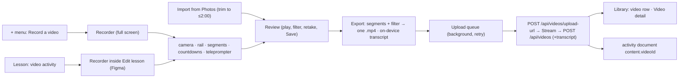

# video-recorder — spec
> lg · ticket: none · program: [video-recording](../video-recording/PROGRAM.md) child 1 of 2

## Idea

**Why.** Leaders want to record short teaching videos in the app: a video activity in a lesson, or
one for their Library. The + menu's "Record a video" does nothing today, and a lesson's video
activity can only show a poster for a video someone already uploaded. The owner recorded YouTube's
Shorts camera as the experience they want, and gave a list of what to keep, drop and add. This child
delivers recording, and video-editor (child 2) adds text layers and captions.

**What success looks like.** From the + menu or from a lesson's video activity, a leader can do all
of this:
- set a length (up to 2:00), count down and record in segments, reading a teleprompter;
- flip the camera, pick a filter, or import a clip instead;
- review the video and save it.

The video then appears in their Library within seconds, with a transcript of what they said. From a
lesson it is already attached to the activity, and members watch it in the lesson as they would any
video. Nothing waits on the network while recording or saving.

**In your words.**
- "the other recording AI overlays and stuff that appear to the right of the record button should not be included" → P1
- "allowing users to specify the video length … a countdown when it's reaching the end … a slider that snaps to 10 second increments up to a max of 2 minutes" → P4, D3, D4
- "I like filters, we can keep that" → D6
- "We must have a teleprompter, which I think should be on the right side controls" → D7
- "I also want videos recorded on device to transcribe what the user says and save it with the video" → P6, D10, D11

**The concept.**

**How it fits today.**
- The + menu already lists "Record a video", with no destination yet¹.
- Memos already record, transcribe on device with SpeechAnalyzer / SpeechTranscriber², queue their
  uploads³, and fall back to the server's Groq transcription⁴. This child reuses that shape for video.
- Videos upload to Cloudflare Stream through a direct-upload URL⁵. `POST /api/videos` already
  creates the org Media row a lesson activity needs⁶.
- An activity document refers to the video by `content.videoId`⁷, and the server refuses to delete a
  video an activity uses⁸.
- The old 1.0 recorder and teleprompter⁹ are out of the app target but hold the orientation lessons¹⁰.

**Approaches considered.**
- **Chosen:** one shared recorder view with two layouts (P3), segments exported to one file on
  device, the transcript sent with the create call.
- **Rejected:**
  - one full-screen recorder for both entry points, because it reinterprets the Figma;
  - transcribing on the server only, because it is slower and costs money per minute when the device
    can do it for free;
  - storing segments on the server, because Stream stores single files.

¹ `iphone/MakeReady/UI2/Shell/UI2Shell.swift:30-39,104` (`default: break`) · ² `iphone/MakeReady/Services/Audio/MemoTranscriber.swift` ·
³ `MemoUploadController.swift` · ⁴ `server/src/services/transcription.service.ts` · ⁵ `server/src/routes/videos.ts:210,367` ·
⁶ `videos.ts:445-462` (`captureToLibrary`, fire-and-forget — D21 replaces it) · ⁷ `server/src/services/activity-document.ts:173,287` · ⁸ `videos.ts:1167-1197` (text-activity D34) ·
⁹ `iphone/MakeReady/Pages/Video/CustomVideoRecorder.swift`, `TeleprompterOverlay.swift` · ¹⁰ `iphone/.claude/VIDEO_RECORDING.md`

## Apps

| App | In scope | What changes | Section |
|---|---|---|---|
| server | ✅ | The `Video` transcript fields and `libraryRemovedAt`. `POST /api/videos` accepts a transcript, is idempotent for its owner and creates the org Media row before it returns. A paged Library video list. Remove-from-Library. A Stream status sync in the maintenance job. Server fallback transcription. `GET /api/videos/me` excludes removed videos | §server |
| client | ⬜ | No code change (re-derived at audit: the only web video caller is `GET /admin/api/videos/me` in `leader-program.store.ts:672-686`, reading id, title, thumbnailUrl, playbackUrl, duration and status, none of which change; nothing on the web calls `/api/videos/:id` or POSTs a video). The web lesson player plays these videos through the MediaMap as any Stream video, with no overlays to draw (P5). The web video picker simply stops listing videos the leader removed from their Library | — |
| iphone | ✅ | The recorder (two layouts), rail tools, teleprompter, filters, import, review, export, transcription, upload queue, Library video rows and Type filter, Video detail, + menu wiring, enabling the Video tile in New activity and the video-activity wiring. The d2m screens and components come first (P2) | §iphone |

**Sequencing:** d2m specs and builds the screens and components, and the owner approves them
(phase 1, P2). Then the server implements and verifies, and the contract freezes. Then the iPhone
wiring builds against the frozen contract. Then the device walk.

**Backward compatibility:** every server change is additive. A released iPhone build creates videos
only through the Media tab (`MediaActions.uploadVideo` → `VideoActions.createVideoRecord`, sending
`cloudflareUid`/`title`/`description`), so the server sets `transcriptStatus: none`, and it never
calls the new endpoints. Its `Video` Codable ignores unknown keys (`JSONDecoder.apiDecoder`), so the
added fields and `lessonUseCount` decode safely. The `.strict()` create body (D22) rejects only keys
no released caller sends. A same-owner duplicate create now answers 200 with the row instead of 409
(D22), which the released build treats as success. No in-target iPhone code calls `GET /api/videos/me`.

**Blast radius:** `Video` rows are read by `GET /api/videos/me` (web picker, iPhone legacy), the
activity document validation (`content-media.service.ts:56-80`), the Media library rows linked by
`Media.videoId`, and the lesson players (via `playbackUrl`). None of their existing fields change.

## Decisions

<!-- The one place rulings live. Record the DECISION — and, in one line, why, and why the rejected option lost. A stated preference
     is the INPUT to a row, not the row. Write each Ruling as something later code can be checked
     against without re-interpretation:
       · positive and specific — "store the full number, mask at render", not "don't truncate"
       · scope named — which apps, screens or endpoints it binds
       · "etc." / "and so on" expanded into the list, or the test for membership stated
       · the rejected alternative named, with the reason it lost (check-obligations warns on a bare one)
       · the enforcement hook, where one exists (lint rule, script, test)
     🔴 NEVER quote the user's prompt as the ruling. Operationalize it: a closed list, a measured
     value, an enumerated set of deviations. A ruling a stranger could implement two ways is not
     written yet.
     Who/date carries the provenance, so the Ruling itself needs no quote marks.
     The owner's own words go in §Idea "In your words", linked to this row — never in the Ruling.
     OPEN rows block the build go-ahead. Never delete a ruling; supersede it in place with a date. -->

Program rulings P1–P10 bind this child (`../video-recording/PROGRAM.md` §Shared decisions).

| # | Decision | Ruling | Who / date |
|---|---|---|---|
| D1 | The right rail | The camera's right rail holds exactly these tools, top to bottom: **Flip**, **Countdown**, **Length**, **Filters**, **Teleprompter**. There is no expand/collapse chevron, because five slots fit (02 §rail). Each tool is a glyph with a label in the house style. d2m picks the teleprompter glyph, and the owner approves it at screen approval. Rejected: YouTube's 10-slot expandable rail (P1 drops five of its tools) | Luke 2026-11-22 (P1, P5 asks) · layout (assumed at spec) 2026-11-22 |
| D2 | Pre-roll countdown | The Countdown tool picks **Off**, **3 s** or **10 s** (default Off). When it is on, tapping record shows centred numerals counting down once per second over the preview, with a beep per second (≈1.1 kHz, the last one higher, ≈1.66 kHz, 01 §3), then recording starts. Tapping record again during the countdown cancels it. Rejected: YouTube's 20 s option (no use for a 2:00 video) | Luke 2026-11-22 (keep) · values (assumed at spec) 2026-11-22 |
| D3 | Length slider | The Length tool opens a sheet with one slider from 0:10 to 2:00, snapping to 10 s steps (12 stops) with a selection haptic per stop. It starts at 1:00 and shows the value as `m:ss`. The value applies to the next recording and persists per device (`UserDefaults`). It cannot change once the first segment is recorded. The segmented progress bar's full width is the chosen length | Luke 2026-11-22 |
| D4 | End countdown + auto-stop | When the total recorded time reaches length − 10 s, a 10…1 countdown (one numeral per second, the same style as D2, without beeps so they are not recorded) shows over the preview. At the chosen length recording stops by itself and the Review step opens. Rejected: a 5 s countdown (too short to wrap up a sentence) | Luke 2026-11-22 |
| D5 | Segments | Tapping record starts a segment, and tapping stop or pause ends it. Record again appends a segment. The progress bar shows the segments with gaps between them. **Delete last segment** (an undo glyph left of the record button, visible only when there is at least one segment and nothing is recording) asks for confirmation through the house C-066 sheet ("Delete the last clip?"), then removes it. A checkmark (right of the record button) opens Review once there is at least one segment. Rejected: pause only (a fluffed line can't be undone); single take (any mistake means starting over) | Luke 2026-11-22 |
| D6 | Filters | The Filters tool opens a strip of **8** named filters (Normal plus 7 Core Image looks d2m names and styles) with a 0–100 strength slider (default 100, which resets on each new pick). The filter shows live on the camera preview and on Review, and is drawn into the exported file at export. It never touches the camera pipeline's recording, so a dropped preview frame cannot reach the file. Rejected: YouTube's 20 filters (more to design than this needs) | Luke 2026-11-22 (keep) · set and mechanism (assumed at spec) 2026-11-22 |
| D7 | Teleprompter | The Teleprompter tool opens a panel. The leader types or pastes a script, or taps **Use a note** to pick one of their Library notes (its body becomes the script). Scripts are kept per device as a draft until replaced. While the teleprompter is on, the script scrolls in a translucent band in the top third of the preview, near the lens. Scrolling starts when a segment starts, pauses when it pauses, and continues from the same line on the next segment. The panel has speed (5 steps) and text size (3 steps). Rejected: lesson text as a source; typed only | Luke 2026-11-22 (source) · layout and controls (assumed at spec) 2026-11-22 |
| D8 | Import from Photos | A gallery button left of the record row (pre-record only) opens the system Photos picker for one video. A clip of 2:00 or less goes straight to Review. A longer clip opens a trim step to choose a window of 2:00 or less, then Review. An imported clip can be filtered and is transcribed like a recording. Rejected: refusing clips over 2:00 | Luke 2026-11-22 |
| D9 | Review and save | Review plays the result in a loop, with the chosen filter. It offers **Filters** (as D6), **Retake** (discard everything after a C-066 confirm and return to the camera) and **Save**. Save exports and hands the video to the upload queue, then closes the recorder at once. From the + menu it lands on the Library. From a lesson it returns to Edit lesson with the activity showing the new video. Video-editor (child 2) adds **Edit** to this screen | Luke 2026-11-22 (flow) · controls (assumed at spec) 2026-11-22 |
| D10 | On-device transcript | During export, the app runs `SpeechTranscriber` over the exported audio (the memo stack, P6), with the device locale. On success, `POST /api/videos` carries `transcript` and `transcriptSegments` (`{text, startMs, endMs}`, ms from the start of the exported file) and the server stores `transcriptStatus: ready, transcriptSource: on_device`. If the device cannot transcribe (unsupported locale, model unavailable, failure), the create omits them and the server sets `pending` for D11. Transcription never blocks Save: the queue waits up to the export's own duration for it, then uploads without it | (assumed at spec) 2026-11-22 |
| D11 | Server fallback transcript | **Superseded 2026-11-22 (audit, F1 settled):** a video with `transcriptStatus: pending` is transcribed by the server once `Video.status` is `ready` (moved by D23's sync). Audio source: Stream's MP4 download (`POST /stream/{uid}/downloads` via `cloudflare.ts`, skipped while it is in progress, deleted after use) → ffmpeg `-vn -c:a copy` to `.m4a` → the existing `GroqClient` / `ffmpegSplitAudio`, from a row-agnostic core extracted from `transcribeMemo`. The claim is `status = ready AND isActive AND transcriptStatus IN (pending, failed) AND transcriptAttempts < 3`, with `failed` after the third attempt, stored as `transcriptSource: server`; `libraryRemovedAt` rows are **not** skipped (child 2's captions need them). It runs as a step of `jobs/memo-maintenance.ts` under its advisory lock. Rejected: Stream caption generation (VTT only, a limited language list, a second transcript engine to parse) | (assumed at spec) 2026-11-22 · auto (recommended) 2026-11-22 (audit) |
| D12 | Upload queue | **Superseded 2026-11-22 (audit):** saved videos are written to the app's container and uploaded by a `VideoUploadController` built like `MemoUploadController`: a manifest per item persisted before any network call, an ephemeral `URLSession` upload **streamed from the file** (never loaded into `Data`) inside `beginBackgroundTask`, then `POST /api/videos`, flushed on enqueue, on launch and on reconnect (`NWPathMonitor`), backing off 5 s · 30 s · 2 min · 10 min and never giving up. The item persists the Stream `uid` before the upload; a retry whose upload URL is spent mints a fresh URL and uid. Each pending video shows in the Library at once with "Uploading…", then "Processing…" until `status: ready`. After 3 consecutive failures of one item the error banner shows with Retry (`/ios-error-surface`, surface: true), and backoff continues. Rejected: a background `URLSession` (needs a multipart body file and an AppDelegate relaunch path; memos ship without one) | (assumed at spec) 2026-11-22 · auto (recommended) 2026-11-22 (audit) |
| D13 | Export format | One `.mp4`, H.264/HEVC as `AVAssetExportSession` presets allow, 1080×1920 portrait (smaller if the source is), orientation applied per `VIDEO_RECORDING.md` (P10). Segments are concatenated in order. Audio is AAC | (assumed at spec) 2026-11-22 |
| D14 | Titles | A new video is titled `Video n` (n = 1 + the highest existing `Video n`, as `MemoActions.nextDefaultTitle` does for memos). It is renamable on the Video detail screen through the existing `PATCH /api/videos/:id` title field | Luke 2026-11-22 |
| D15 | Library rows | The Library shows videos as a third row kind, interleaved newest first by `createdAt`, with notes and memos. A video row has the C-038 avatar with a video glyph, the title, the date and duration on line 1 (`9:38 PM · 0:45`, the memo rule), and the transcript's first line, `Transcribing…`, `Uploading…` or `Processing…` on line 2. The Type menu gains **Videos** (`LibraryItemType.video`). Search matches title and transcript, server-side. Swipe-to-delete (C-142) and tap → Video detail work as memo rows do. The library-home screen change is a d2m handover in phase 1 | Luke 2026-11-22 (third kind) · row anatomy (assumed at spec) 2026-11-22 |
| D16 | Video detail | Tapping a video row opens a Video detail screen built like memo-detail. It has the player (HLS `playbackUrl`, poster `thumbnailUrl`), the title (tap to rename), the date and duration, the transcript (or its state), and Delete in the overflow. d2m specs it from memo-detail (phase 1) | Luke 2026-11-22 |
| D17 | Delete | **Superseded 2026-11-22 (audit):** deleting from the Library (swipe or detail) reads `lessonUseCount` from `GET /api/videos/:id`. **0** → a C-066 confirm "Delete this video?", then `DELETE /api/videos/:id` (unchanged; deletes from Stream). **N > 0** → a confirm "This video is used in N lesson activities. It will stay in them and leave your Library.", then `POST /api/videos/:id/remove-from-library`. The video row's C-142 swipe uses `removesRow: false`: the row stays until the call succeeds and springs back on cancel; a failed `GET` (offline) shows the error banner and leaves the row. The existing refusal of `DELETE` for an in-use video (text-activity D34) stays, and `lessonUseCount` uses the same predicate, so the 0 branch cannot meet a 409. Rejected: blocking the delete while in use (the leader must hunt down every lesson first); deleting everywhere (members find empty activities) | Luke 2026-11-22 · audit 2026-11-22 (copy: "lesson activities") |
| D18 | Video activity wiring | **Superseded 2026-11-22 (audit):** New activity's **Video** tile is enabled (it is in `ActivityNewContainer.unavailableTypes` today). Choosing it, or **Replace video** in an existing video activity's menu, shows the inline recorder (P3). On Save the queue item carries `attach: {versionId, activityId?, title}`. Once `POST /api/videos` returns the `Video.id`, the upload controller — not the editor — creates the activity (`ActivityActions.create`, document `content.videoId`) or saves the replaced document (`ActivityActions.save`), so it completes after the editor closes or the app relaunches. Until then the editor lists a local pending video activity with the poster frame and "Uploading…". A failed attach (the version was published or deleted meanwhile) keeps the video in the Library and shows the error banner. Choosing an existing Library video for an activity is out of scope here. Rejected: creating the activity before the video exists (the server requires `content.videoId`); attaching from the editor (lost when it closes) | (assumed at spec) 2026-11-22 · auto (recommended) 2026-11-22 (audit) |
| D19 | Permissions | **Superseded 2026-11-22 (audit):** camera and microphone permissions are asked in context on first use, with copy in `Info.plist`. `SpeechTranscriber` needs no speech-recognition authorization, so none is asked. A denied permission shows a C-132 EmptyState in the camera area with **Open Settings** (C-132 gains an action prop through d2m, phase 1). Recording works when the speech model is unavailable (no transcript, so the server fallback runs) | (assumed at spec) 2026-11-22 · auto (recommended) 2026-11-22 (audit) |
| D20 | Library paging | **Superseded 2026-11-22 (audit):** the Library's video list is fetched one page at a time (`limit` 50, cursor) from `GET /api/videos/library`, with more pages as the list nears its end, on d2m rule R-28's window shape (an ordered id list plus a loaded window), following `InvitationFeedWindow` and the media cursor. A page-1 fetch replaces the window, so videos removed or deleted elsewhere drop out. While `hasMore` is true, notes and memos older than the oldest loaded video are held back, so rows never jump when a page lands. Notes and memos are otherwise unchanged (the large-lists program will move them) | (assumed at spec) 2026-11-22 · auto (recommended) 2026-11-22 (audit) |
| D21 | Media row on create | `createVideo` **awaits** a `Media` row for the caller's org (`getUserOrgId`) keyed on `videoId` (the `media.ts:1384` pattern) inside the request, so the returned `Video.id` is immediately valid as an activity's `content.videoId`. It replaces the fire-and-forget `captureToLibrary` call for this route, whose `{url, organizationId}` dedupe matches any other pending (`url: ''`) video in the org and skips the row. A caller with no org gets the Video without a Media row (it can be in the Library, not in an activity). Rejected: keeping `captureToLibrary` and retrying the activity save, because the dedupe can skip the row forever, not just late | auto (recommended) 2026-11-22 (audit) |
| D22 | Idempotent create | `POST /api/videos` with a `cloudflareUid` that already exists answers **200** `{success, data: <existing Video>}` when the row's `userId` is the caller, and 409 only for another user's uid. A concurrent duplicate's Prisma P2002 is caught and answered the same way. When Stream's `meta.userId` is present and is not the caller, 403. Rejected: 409 with no body (a retry after a lost response can never learn `Video.id`) | auto (recommended) 2026-11-22 (audit) |
| D23 | Stream status sync | The `/refresh` body moves into `videos.service.refreshFromStream(video)`. A new step in `jobs/memo-maintenance.ts` refreshes every `status = pending` video created in the last 24 h, and marks those older than 24 h `status: error` (with `transcriptStatus: failed` when it was `pending`). The iPhone upload controller also polls `POST /api/videos/:id/refresh` after create (the existing `waitForVideoReady`, 15 × 2 s), so a foreground save turns ready in seconds and the job is the backstop. Rejected: a Stream webhook (needs a public endpoint and signature secret per environment) | auto (recommended) 2026-11-22 (audit) |
| D24 | Body limits | `transcript` ≤ 20 000 characters, `transcriptSegments` ≤ 2 000 items, each segment `text` ≤ 1 000 characters, so a body always fits `express.json`'s 10 MB. `source` is accepted and not persisted. Rejected: the 200 000 / 20 000 limits written at spec (an unbounded segment text can exceed the body limit and return a non-`{success}` 413) | auto (recommended) 2026-11-22 (audit) |
| D25 | Recorder presentation | The full-screen recorder is presented like the memo recorder, `.hostedOverlay(UI2HostedOverlay(…))` (`UI2Shell.swift:121-124`), so P10's `.fullScreenCover` exception is not used. Rejected: `.fullScreenCover` (house rule; the hosted overlay already gives the camera the full screen) | auto (recommended) 2026-11-22 (audit) |
| D26 | Interruptions and space | A phone call, backgrounding or an `AVCaptureSession` interruption ends the current segment and leaves the recorder paused; it never resumes by itself. Recording refuses to start with less than 500 MB free (the error banner says so). `VideoDraftStore` finalizes each segment file and salvages only finished segments after a crash (the `MemoDraftStore` manifest pattern) | auto (recommended) 2026-11-22 (audit) |
| D27 | iPhone stores | Library rows read `libraryVideos: EntityStore<VideoSummary>` (the window), and Video detail reads the existing `videos: EntityStore<Video>`, as memos keep `voiceMemos` + `voiceMemoDetails`. Rename, remove and delete upsert or drop both in the same Action. Every new `Video` property is Optional; the persisted snapshot decodes new keys with `decodeIfPresent` and drops `transcriptSegments` from disk. Pending queue items merge into the rows as `local:<localId>`, dropped once their `serverId` is in `libraryVideos` (the `visibleMemos` rule) | auto (recommended) 2026-11-22 (audit) |
| D28 | What remove-from-Library leaves | Remove-from-Library leaves the org `Media` row in place, because lessons play through it; master search's VIDEO results (which route to Media) may still list it. Videos uploaded from the Media tab (`/media/upload`) stay separate: they are not Library videos and get no transcript | auto (recommended) 2026-11-22 (audit) |
| D29 | Phase 1 screen approval (P2 gate) | The owner approved the d2m screens: video-recorder (12 states), video-detail, library-home, activity-new and activities-editor, with the teleprompter rail glyph `file-text` (D1), C-143 merged into C-013 RecordButton, and the countdown (SF Pro Light 180/180) and teleprompter sizes shipped as flagged literals. Phase 1 is closed; phase 4 (iPhone) may start. The d2m output is committed on main at c8c76e77. Rejected: holding phase 4 for token promotion — the literals are flagged and can be promoted later | Luke 2026-11-23 ("the screens look fantastic") |

## Contract

| Contract | Producer | Consumers | Auth | Request | Response | Errors |
|---|---|---|---|---|---|---|
| `POST /api/videos` (EDIT) | server | iphone | session; uploader | existing `{cloudflareUid, title?, description?}` plus optional `transcript` (string ≤ 20 000), `transcriptSegments` (`[{text ≤ 1 000, startMs, endMs}]` ≤ 2 000 items, each `0 ≤ startMs ≤ endMs`), `source` (`recording` \| `import`; accepted, not persisted) (D24) | **201** `{success, data: Video}` (existing), where `data` adds `transcript`, `transcriptSegments`, `transcriptStatus` (`none`\|`pending`\|`ready`\|`failed`), `transcriptSource` (`on_device`\|`server`\|null), `libraryRemovedAt` (null). The org Media row exists when it returns (D21). A same-owner duplicate uid → **200** with the existing row (D22) | 400 invalid body (`createVideoSchema.extend({…}).strict()` — never stripping), 401, 403 Stream `meta.userId` is another user, 409 uid owned by another user |
| `GET /api/videos/library` (NEW) | server | iphone | session; own videos | `?limit=1..100 (default 50)&cursor=<opaque>&q=<text>` | `{success, data: VideoSummary[], nextCursor: string\|null, hasMore: boolean}`. `VideoSummary` = `id, title, thumbnailUrl, playbackUrl, duration, status, transcriptStatus, transcriptPreview (≤ 160 chars), createdAt`. Ordered `createdAt desc, id desc` (keyset). Only `isActive`, `libraryRemovedAt IS NULL`, `userId = caller`. `q` matches title or transcript (case-insensitive substring) | 400 bad cursor or limit, 401 |
| `GET /api/videos/:videoId` (EDIT) | server | iphone | session; owner or org content manager (unchanged) | — | existing `{success, data: Video}`, where `data` adds the transcript fields, `libraryRemovedAt` and `lessonUseCount` — distinct `MediaUsage.resourceId` with `usageType: ACTIVITY` over the Media rows whose `videoId` is this video, the predicate `isUsedByActivity` uses (it counts activities, any version) | 401, 403, 404 |
| `POST /api/videos/:videoId/remove-from-library` (NEW) | server | iphone | session; owner | — | `{success, data: {id, libraryRemovedAt}}`. Idempotent: a second call returns the same timestamp | 401, 403 not the owner, 404 |
| `GET /api/videos/me` (EDIT) | server | client (iphone: no in-target caller; the released decoder ignores the change) | session (unchanged) | unchanged | unchanged shape, now excluding rows with `libraryRemovedAt` set | unchanged |
| `POST /api/videos/:videoId/refresh` (EXISTING, body moved to `refreshFromStream`) | server | iphone (upload controller poll, D23) | session; owner or org content manager (unchanged) | — | unchanged `{success, data: Video}` with the added fields | unchanged |

## Schema & API changes

| # | ADD/EDIT/RENAME/REMOVE | Model.field | Wire | Reason | Status |
|---|---|---|---|---|---|
| SC1 | ADD | Video.transcript (text, nullable) | `transcript` | the on-device or server transcript (P6) | landed — 20261122200800_video_transcript_library |
| SC2 | ADD | Video.transcriptSegments (json, nullable) | `transcriptSegments` | timed segments, for child 2's captions | landed — 20261122200800_video_transcript_library |
| SC3 | ADD | Video.transcriptStatus (string, default `none`) | `transcriptStatus` | `none`/`pending`/`ready`/`failed`, mirroring VoiceMemo | landed — 20261122200800_video_transcript_library |
| SC4 | ADD | Video.transcriptSource (string, nullable) | `transcriptSource` | `on_device`/`server` | landed — 20261122200800_video_transcript_library |
| SC5 | ADD | Video.transcriptAttempts (int, default 0), Video.transcriptClaimedAt (datetime, nullable) | — (server only) | the fallback runner's lock and retry, as memos have (D11) | landed — 20261122200800_video_transcript_library |
| SC6 | ADD | Video.libraryRemovedAt (datetime, nullable) | `libraryRemovedAt` | remove-from-Library that keeps lessons playing (D17) | landed — 20261122200800_video_transcript_library |
| SC7 | ADD | index Video(userId, createdAt, id) | — | keyset paging for `GET /api/videos/library` | landed — 20261122200800_video_transcript_library |
| SC8 | ADD | `GET /api/videos/library`, `POST /api/videos/:id/remove-from-library` | see §Contract | D15–D17, D20 | landed — 970c6171, 64fe5f59 (no migration) |
| SC9 | EDIT | `POST /api/videos`, `GET /api/videos/:id`, `GET /api/videos/me` | see §Contract | additive fields, the removed-video filter, idempotent create (D22) | landed — 970c6171, 64fe5f59 (no migration) |
| SC10 | ADD | index Video(status, createdAt) | — | the stream-sync and fallback-transcription claims (D11, D23), as VoiceMemo indexes `(uploadStatus, createdAt)` | landed — 20261122200800_video_transcript_library |

**Data plan:** every addition is nullable or defaulted, so no backfill is needed. Existing videos get
`transcriptStatus: none` and are never queued for the fallback, because only a create without a
transcript, from a client sending `source`, sets `pending`. `transcriptStatus` and `transcriptSource` are plain strings, as VoiceMemo's are (no Prisma enum). One Atlas migration (SC1–SC7, SC10), generated from
`server/schema/schema.yaml` with `npm run schema:diff`. It is undone by dropping the columns and the
index.

## server

- **Schema:** SC1–SC7 in `server/schema/schema.yaml` → `npm run schema:diff`. Never hand-edit the migration.
- **Service:** create `server/src/services/videos.service.ts` (it does not exist; all video logic is inline in `routes/videos.ts` today) and move the create, list, refresh and new logic into it, so routes stay thin.
  - `createVideo` validates with `createVideoSchema.extend({…}).strict()` (`.merge` would not carry the strict policy; the segment schema is `memos.service.ts:12`), applies D22's idempotence and D21's awaited Media row. It sets `transcriptStatus` to `ready` (with `transcriptSource: on_device`) when a transcript is sent, `pending` when `source` is sent without one, and `none` otherwise (legacy callers).
  - `listLibraryVideos(userId, {limit, cursor, q})` does keyset paging on `(createdAt, id)` with an opaque base64url cursor, fetching `limit+1` for `hasMore`. Its shape matches media's keyset (`media-library.ts:395-444`, cursor codec `:78-94`). `transcriptPreview` is `left(transcript, 160)` in SQL — never the full transcript per row — with `q` ILIKE-escaped, copying `memos.service.ts:172-191`.
  - `removeFromLibrary(userId, id)` is owner only. It sets `libraryRemovedAt` if null and returns the row.
  - `lessonUseCount(id)` counts distinct `MediaUsage.resourceId` (`usageType: ACTIVITY`) over the Media rows with this `videoId` — the same predicate as `isUsedByActivity` (`content-media.service.ts:131-139`), extracted so both share it (F2).
  - `refreshFromStream(video)` is the `/refresh` body (`videos.ts:995-1080`) moved here, called by the route and by D23's job step.
- **Maintenance job (`jobs/memo-maintenance.ts`, same advisory lock):** add the stream-sync step (D23) and the video fallback-transcription step (D11). Add the Stream downloads calls (create, get, delete) to `services/cloudflare.ts`. Generalize `transcribeMemo` (`transcription.service.ts:93-145`) into a row-agnostic core.
- **Routes:** `GET /api/videos/library` must be registered **before** `GET /:videoId` in `routes/videos.ts`. Add `POST /:videoId/remove-from-library`. Add the `libraryRemovedAt: null` filter to `GET /me`. Catch P2002 on create (D22). Add OpenAPI blocks for all of them.
- **Authorization:** owner checks in the service. Remove-from-Library is the owner's only; `GET /:id` keeps its existing org check.
- `docker restart makeready-server` after server edits (§Environment landmines).

## iphone

**Phase 1 is d2m (P2): no app code until the owner approves the screens.** Request, through
`request_project_change` with this folder's `01`–`03` docs as references (committed on the
branch):

- **screen `video-recorder`** (new): both layouts (lesson-inline from Figma `3567:34892`/`3567:34787`; full screen with close) and every state:
  - camera ready, countdown, recording, paused with segments, end countdown, permission denied;
  - the Length sheet, the Filters strip and the Teleprompter panel (with Use a note), the trim step;
  - Review;
  - new components: the record/stop/pause button set (reconcile with C-013 RecordButton), the timer pill, the segmented progress bar, the rail and rail tool, the countdown numerals, the length slider, the filter strip, and the teleprompter band.
- **screen `video-detail`** (new, from memo-detail — whose d2m screen is still a draft with no frozen snapshot, F9).
- **library-home** (change): the video row kind (D15) with its `Uploading…`/`Processing…` local-row states, the **Videos** type option (`LibraryItemType` is d2m-owned, `LibraryHomeScreen.swift:637`; the "nothing or all checked = all" rule covers three kinds), and the screen's owner description, which still reads "Temporary placeholder… Library coming soon".
- **activity-new** (change): the Video tile enabled (D18).
- **activities-editor** (change): the inline recorder in the video canvas, the local pending video activity, and **Replace video** in a video activity's menu (D18).
- **components** (change): C-132 EmptyState gains an action button (D19); C-142's video row uses `removesRow: false` (D17); C-013 RecordButton (an element inside `RecorderCompactView.swift:145`, 56 pt) reconciled with Figma's 80 pt disc.
- **Token gaps** go through d2m: the recording red #ff022d and the timer type (`03` §tokens).

**App code (phase 3, against the frozen contract):**
- **State** (`MakeReady/State`):
  - `libraryVideos: EntityStore<VideoSummary>` plus an ordered id window and cursor (D20, D27), cleared in `clearInMemory()`. Persisted capped at 100, like media (`MediaActions.libraryPageSize`). New `Video` fields Optional; `videos` snapshot drops `transcriptSegments` (D27).
  - `VideoActions` (exists: `loadVideos`, `getVideo`, `getUploadUrl`, `createVideoRecord`, `updateVideo`, `refreshVideoStatus`, `deleteVideo`, `waitForVideoReady`) gains `loadLibrary(cursor:q:)`, `loadDetail(id:)`, `rename` (over `updateVideo`), `removeFromLibrary`. Each upserts both stores and refreshes the Library window it changes. `MemoActions.nextDefaultTitle` gains a prefix parameter and counts queued items, as `AppState.nextMemoTitle` does (D14).
- **Services** (`MakeReady/Services/Video/`):
  - `VideoCaptureEngine` (AVCaptureSession; segments to files; flip; live filter on the preview layer only);
  - `VideoExporter` (concatenate segments, apply the filter through `AVVideoComposition` with a Core Image handler, orientation per P10);
  - `VideoTranscriber` (thin over `MemoTranscriber.transcribeFile`, fed an `.m4a` extracted with `MemoAudioExporter`'s passthrough export, since its `AVAudioFile` reader may refuse an `.mp4` with a video track);
  - `TeleprompterScroller`;
  - `VideoDraftStore` (segments and settings survive a crash until Save or Retake);
  - `VideoUploadController` (D12: ephemeral session streamed from the file, `beginBackgroundTask`; launched beside `AppState.launchMemoUploads`; owns D18's attach jobs and D23's refresh poll).
- **Containers** (`MakeReady/UI2/Containers/Video/`):
  - `VideoRecorderContainer` (one model, two layout hosts);
  - `VideoDetailContainer`;
  - `LibraryHomeContainer` and mapper changes for the video rows and the Type option.
- **Entry points:**
  - UI2Shell's "Record a video" (the `default: break` at `UI2Shell.swift:104`) presents the full-screen recorder as a hosted overlay (D25). Every sheet inside it (Length, Filters, Teleprompter, confirms) goes through `/present-overlay`.
  - New activity's Video tile (remove `"video"` from `ActivityNewContainer.unavailableTypes`, `:26`) and the activities editor's video canvas (read-only today, `ActivitiesEditorContainer.swift:190-195,913-924`) host the inline recorder (D18).
- **Recipe skills:** `/present-overlay`, `/push-page` (detail), `/ios-error-surface`, `/transition-review` on every diff with motion.
- **Fixtures:** `server/fixtures/screens/video-recorder.ts` is not needed (no server data on the camera). Add `server/fixtures/screens/video-detail.ts` and extend the library-home layer (`server/fixtures/screens/library-home.ts`) with videos in every state: `ready` with a transcript, `pending`, `failed`, and one used in a lesson (a Media row with its `videoId` plus a MediaUsage). Use `fixtureId('video', n)` values distinct from `groups-detail.ts`'s.

## Testing

- **server (vitest, the test DB):**
  - `createVideo`: each `transcriptStatus` branch, a `.strict()` rejection of an unknown field, the D24 limits, D22 (same-owner duplicate → 200 with the row, another user's → 409, a concurrent P2002 → 200), and D21 (two pending videos in one org each get their own Media row, and an activity can name the second at once).
  - `listLibraryVideos`: keyset order, no duplicates or skips across pages with equal `createdAt`, the `q` match on title and transcript, removed and inactive rows excluded, and another user's rows never returned.
  - `removeFromLibrary`: owner only, idempotent, and `GET /me` excludes the row afterwards.
  - `lessonUseCount`: 0 and N, and it agrees with the DELETE guard.
  - The stream-sync step (D23): pending → ready via a mocked `getVideo`, and > 24 h → `error`.
  - The fallback runner (D11): claims `pending`, sets `ready` or `failed` after 3 attempts, skips videos not `status: ready`, handles a download still in progress (Stream and Groq mocked).
  - Request tests for each new or edited route, including the `/library`-before-`/:videoId` route order.
- **iphone (XCTest, MakeReadyCaptureTests):**
  - mapper tests for video rows (every line-2 state) and the Type filter;
  - length slider snapping (0:10…2:00, 12 stops) and end-countdown timing (fires at length − 10 s of recorded time, across segments);
  - segment model (append, delete last, total);
  - `nextDefaultTitle` for videos;
  - the D17 branch (0 vs N);
  - the upload controller state machine (queued → uploading → processing → ready, with retry, a 200 duplicate on retry, the banner after 3 failures, and the D18 attach job surviving a relaunch);
  - the Library interleave hold-back while `hasMore` (D20) and the local-row merge (D27);
  - the persisted snapshot decoding an old cache without the new keys (D27);
  - teleprompter scroll position across a pause.
  - d2m captures cover every screen state (phase 1).
- **Cross-app E2E walk (one, on a real iPhone; the simulator has no camera):** + → Record a video → set 0:30 → countdown 3 s → record 2 segments with the teleprompter on a picked note → watch the end countdown and the auto-stop → filter → Save. The Library shows "Uploading…", then the transcript line. Open detail, rename, play. In a lesson, add a video activity and record 0:10; the activity plays it. Delete that video from the Library: the confirm names 1 lesson, the video leaves the Library, and the lesson still plays it on the web lesson page. Import a 3:00 clip, trim it to 2:00 and save.
- **Human verification:** the walk above, plus airplane mode during Save (the upload resumes later), killing the app after Save from a lesson (the activity still gets its video on relaunch), and a device locale the speech model doesn't support (the transcript arrives later from the server).

## Out of scope

- Text layers, the timeline and captions (video-editor, child 2), and everything in PROGRAM §Out of scope.
- Choosing an existing Library video for an activity (only recording and importing a new one).
- A videos section in the Media tab (it shows photos only, per media-page D21).
- Moving notes and memos onto paged loading (large-lists).
- Cleaning up removed-from-Library videos whose last lesson use later goes away (they stay in Stream): an automatic Stream delete is irreversible, and usage rarely drops because MediaUsage unions every lesson version (audit 2026-11-22, auto (recommended)).
- A deep link or push target for a video (none exists today).

## Findings & risks

| # | Finding | Resolution |
|---|---|---|
| F1 | Server fallback transcription needs the video's audio. Memos send their R2 file to Groq, but videos live in Cloudflare Stream; `cloudflare.ts` has no downloads or captions call | settled at audit: Stream MP4 download → ffmpeg → Groq (D11). The download API call shape is a build-time risk for the server fallback task |
| F2 | `lessonUseCount` needs `MediaUsage` rows for a video activity's media. `syncActivityMediaUsage` writes them on save (`content-media.service.ts:67-96`), but only through a Media row with `videoId`, which `captureToLibrary`'s url dedupe can skip for a pending video (`media-library.ts:143-152`) | settled: D21 (awaited Media row keyed on `videoId`), count shared with `isUsedByActivity` |
| F3 | The live filter on the preview, and the export composition, can only be proven on a device | build-time risk — the export task carries a device check before the iPhone phase closes |
| F4 | `GET /api/videos/me` filtering removed videos changes what the web video picker lists | intended (P9); no web code change |
| F5 | contract: nothing on the server moves a video out of `pending` — `/refresh` is the only sync (`videos.ts:995-1080`) and there is no webhook — so a suspended upload leaves `playbackUrl ''` and members' MediaMap has nothing to play (`content-media.service.ts:117-125`) | D23 |
| F6 | contract: a lost create response retried gets 409 with no body (`videos.ts:396-406`), and a concurrent duplicate is a P2002 → 500 | D22 |
| F7 | contract: the spec's transcript limits overflow `express.json({limit:'10mb'})` (`index.ts:226`) | D24 |
| F8 | stale-spec: `MemoUploadController` has no background `URLSession` (`MemoPutTransport.swift:17-18`), never gives up, and `VideoActions.uploadVideo` loads the whole file into memory (`:256-334`); `SpeechTranscriber` needs no speech permission; the memo recorder is a hosted overlay, not `.fullScreenCover` (`UI2Shell.swift:121-124`); `videos.service.ts` does not exist; R-28 already has `InvitationFeedWindow` and the media cursor as precedents | corrected in D12, D19, D25, D20 and §server |
| F9 | design: memo-detail's d2m screen is a draft with no frozen snapshot, so video-detail "from memo-detail" starts from unseen states; activity-new and activities-editor were missing from phase 1's d2m list | phase 1 list corrected; build-time risk — the d2m phase settles video-detail's states before owner approval |
| F10 | design: D18 had no starting point — the Video tile is disabled (`ActivityNewContainer.swift:26`) and the server requires `content.videoId` (`activity-document.ts:173`) | D18 superseded (attach job owned by the upload controller) |
| F11 | `checkedDocument` takes `estimatedSeconds` from `Media.duration`, null while pending (`lesson-version.service.ts:193-196`), so a just-attached video activity has no duration | build-time risk — the iPhone attach task passes the export's duration in the document, or accepts none; the server task confirms which the document schema allows |
| F12 | the persisted `videos` decode is strict (`PersistedState.swift:289`); a non-optional new key would drop every cached store | D27; build-time risk on the iPhone state task (a decode test of an old snapshot) |
| F13 | P8 holds only because members cannot sign in to the iPhone app (Google only, `UI2Root.swift:10`); the video endpoints are `requireAuth` only | accepted: unchanged by this feature (videos are owner-scoped) |
| F14 | a spent Stream direct-upload URL on retry orphans its uid on Stream (`cloudflare.ts:117-123` mints without `expiry`) | accepted; D12 mints a fresh URL. Orphan uids are bounded by retries |

## Plan

The plan, task by task: `docs/features/video-recorder/PLAN.md` (§PLAN.md).

- Phase 1 · Task 1 · File the d2m handover requests and wait for the builds
- Phase 2 · Task 2 · `Video` transcript and Library columns
- Phase 2 · Task 3 · `videos.service.createVideo` — strict, idempotent, Media row awaited
- Phase 2 · Task 4 · Library list, remove-from-Library, `lessonUseCount`, `/me` filter
- Phase 3 · Task 5 · `refreshFromStream` and the Stream status sync step
- Phase 3 · Task 6 · Server fallback transcription from Stream downloads
- Phase 3 · Task 7 · Fixtures for Library videos and Video detail, and the contract freeze
- Phase 4 · Task 8 · `Video` fields, `VideoSummary` and the `libraryVideos` window
- Phase 4 · Task 9 · `VideoActions` for the Library, detail and delete-or-remove
- Phase 4 · Task 10 · The recorder timeline — length, segments, countdowns, teleprompter scroll
- Phase 4 · Task 11 · `VideoCaptureEngine` and `VideoDraftStore`
- Phase 4 · Task 12 · `VideoExporter` and `VideoTranscriber`
- Phase 4 · Task 13 · `VideoUploadController` — queue, attach jobs, refresh poll
- Phase 5 · Task 14 · Library video rows, Type filter, paging hold-back and delete
- Phase 5 · Task 15 · Video detail
- Phase 5 · Task 16 · The recorder model and the full-screen recorder from +
- Phase 5 · Task 17 · Review, import, trim and Save
- Phase 5 · Task 18 · The lesson video activity — tile, inline recorder, Replace video

## Fixes

- [ ] server: E3 — a Library-removed video stays in its lesson — expected the lesson to list and play it on the web lesson page, saw 404 for every lesson there (a lesson whose video was not removed 404s too) because `GET /api/member/lessons/:id` was deleted on main in 540e13ef (agent walk round 1). Ruling: no product fix — the owner accepted the dead web lesson pages (text-activity D6/D7). The spec's "the lesson still plays it on the web lesson page" and the §Apps client row's "web lesson player" claim are stale: correct both here, and reword walk.md E3's "See" to "the lesson version the server serves still has the `video` activity with that `videoId`, its media entry still resolves to a playable url, and the iPhone lesson still shows it"; then re-walk E3 — cost if wrong: the web lesson page goes unchecked until member web is rebuilt. Never restore the removed routes
