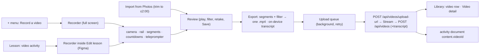

# video-recorder — spec
> lg · ticket: none · program: [video-recording](../video-recording/PROGRAM.md) child 1 of 2

## Idea

**Why.** Leaders want to record short teaching videos in the app: a video activity in a lesson, or
one for their Library. The + menu's "Record a video" does nothing today, and a lesson's video
activity can only show a poster for a video someone already uploaded. The owner recorded YouTube's
Shorts camera as the experience they want, and gave a list of what to keep, drop and add. This child
delivers recording, and video-editor (child 2) adds text layers and captions.

**What success looks like.** From the + menu or from a lesson's video activity, a leader can do all
of this:
- set a length (up to 2:00), count down and record in segments, reading a teleprompter;
- flip the camera, pick a filter, or import a clip instead;
- review the video and save it.

The video then appears in their Library within seconds, with a transcript of what they said. From a
lesson it is already attached to the activity, and members watch it in the lesson as they would any
video. Nothing waits on the network while recording or saving.

**In your words.**
- "the other recording AI overlays and stuff that appear to the right of the record button should not be included" → P1
- "allowing users to specify the video length … a countdown when it's reaching the end … a slider that snaps to 10 second increments up to a max of 2 minutes" → P4, D3, D4
- "I like filters, we can keep that" → D6
- "We must have a teleprompter, which I think should be on the right side controls" → D7
- "I also want videos recorded on device to transcribe what the user says and save it with the video" → P6, D10, D11

**The concept.**

**How it fits today.**
- The + menu already lists "Record a video", with no destination yet¹.
- Memos already record, transcribe on device with SpeechAnalyzer / SpeechTranscriber², queue their
  uploads³, and fall back to the server's Groq transcription⁴. This child reuses that shape for video.
- Videos upload to Cloudflare Stream through a direct-upload URL⁵. `POST /api/videos` already
  creates the org Media row a lesson activity needs⁶.
- An activity document refers to the video by `content.videoId`⁷, and the server refuses to delete a
  video an activity uses⁸.
- The old 1.0 recorder and teleprompter⁹ are out of the app target but hold the orientation lessons¹⁰.

**Approaches considered.**
- **Chosen:** one shared recorder view with two layouts (P3), segments exported to one file on
  device, the transcript sent with the create call.
- **Rejected:**
  - one full-screen recorder for both entry points, because it reinterprets the Figma;
  - transcribing on the server only, because it is slower and costs money per minute when the device
    can do it for free;
  - storing segments on the server, because Stream stores single files.

¹ `iphone/MakeReady/UI2/Shell/UI2Shell.swift:30-39,110` · ² `iphone/MakeReady/Services/Audio/MemoTranscriber.swift` ·
³ `MemoUploadController.swift` · ⁴ `server/src/services/transcription.service.ts` · ⁵ `server/src/routes/videos.ts:210,367` ·
⁶ `videos.ts:448-466` (`captureToLibrary`) · ⁷ `server/src/services/activity-document.ts:173,287` · ⁸ `videos.ts:1167-1197` (text-activity D34) ·
⁹ `iphone/MakeReady/Pages/Video/CustomVideoRecorder.swift`, `TeleprompterOverlay.swift` · ¹⁰ `iphone/.claude/VIDEO_RECORDING.md`

## Apps

| App | In scope | What changes | Section |
|---|---|---|---|
| server | ✅ | The `Video` transcript fields and `libraryRemovedAt`. `POST /api/videos` accepts a transcript. A paged Library video list. Remove-from-Library. Server fallback transcription. `GET /api/videos/me` excludes removed videos | §server |
| client | ⬜ | No code change. The web lesson player plays these videos as any Stream video, with no overlays to draw (P5). The web video picker's `GET /api/videos/me` simply stops listing videos the leader removed from their Library | — |
| iphone | ✅ | The recorder (two layouts), rail tools, teleprompter, filters, import, review, export, transcription, upload queue, Library video rows and Type filter, Video detail, + menu and video-activity wiring. The d2m screens and components come first (P2) | §iphone |

**Sequencing:** d2m specs and builds the screens and components, and the owner approves them
(phase 1, P2). Then the server implements and verifies, and the contract freezes. Then the iPhone
wiring builds against the frozen contract. Then the device walk.

**Backward compatibility:** every server change is additive. A released iPhone build creates videos
without a transcript (the server sets `transcriptStatus: none`) and never calls the new endpoints. It
reads `GET /api/videos/me` and `GET /api/videos/:id` with the same fields plus new ones it ignores.
Videos removed from the Library vanish from its legacy video picker, which is the intended meaning.

**Blast radius:** `Video` rows are read by `GET /api/videos/me` (web picker, iPhone legacy), the
activity document validation (`content-media.service.ts:56-80`), the Media library rows linked by
`Media.videoId`, and the lesson players (via `playbackUrl`). None of their existing fields change.

## Decisions

<!-- The one place rulings live. Record the DECISION — and, in one line, why, and why the rejected option lost. A stated preference
     is the INPUT to a row, not the row. Write each Ruling as something later code can be checked
     against without re-interpretation:
       · positive and specific — "store the full number, mask at render", not "don't truncate"
       · scope named — which apps, screens or endpoints it binds
       · "etc." / "and so on" expanded into the list, or the test for membership stated
       · the rejected alternative named, with the reason it lost (check-obligations warns on a bare one)
       · the enforcement hook, where one exists (lint rule, script, test)
     🔴 NEVER quote the user's prompt as the ruling. Operationalize it: a closed list, a measured
     value, an enumerated set of deviations. A ruling a stranger could implement two ways is not
     written yet.
     Who/date carries the provenance, so the Ruling itself needs no quote marks.
     The owner's own words go in §Idea "In your words", linked to this row — never in the Ruling.
     OPEN rows block the build go-ahead. Never delete a ruling; supersede it in place with a date. -->

Program rulings P1–P10 bind this child (`../video-recording/PROGRAM.md` §Shared decisions).

| # | Decision | Ruling | Who / date |
|---|---|---|---|
| D1 | The right rail | The camera's right rail holds exactly these tools, top to bottom: **Flip**, **Countdown**, **Length**, **Filters**, **Teleprompter**. There is no expand/collapse chevron, because five slots fit (02 §rail). Each tool is a glyph with a label in the house style. d2m picks the teleprompter glyph, and the owner approves it at screen approval. Rejected: YouTube's 10-slot expandable rail (P1 drops five of its tools) | Luke 2026-11-22 (P1, P5 asks) · layout (assumed at spec) 2026-11-22 |
| D2 | Pre-roll countdown | The Countdown tool picks **Off**, **3 s** or **10 s** (default Off). When it is on, tapping record shows centred numerals counting down once per second over the preview, with a beep per second (≈1.1 kHz, the last one higher, ≈1.66 kHz, 01 §3), then recording starts. Tapping record again during the countdown cancels it. Rejected: YouTube's 20 s option (no use for a 2:00 video) | Luke 2026-11-22 (keep) · values (assumed at spec) 2026-11-22 |
| D3 | Length slider | The Length tool opens a sheet with one slider from 0:10 to 2:00, snapping to 10 s steps (12 stops) with a selection haptic per stop. It starts at 1:00 and shows the value as `m:ss`. The value applies to the next recording and persists per device (`UserDefaults`). It cannot change once the first segment is recorded. The segmented progress bar's full width is the chosen length | Luke 2026-11-22 |
| D4 | End countdown + auto-stop | When the total recorded time reaches length − 10 s, a 10…1 countdown (one numeral per second, the same style as D2, without beeps so they are not recorded) shows over the preview. At the chosen length recording stops by itself and the Review step opens. Rejected: a 5 s countdown (too short to wrap up a sentence) | Luke 2026-11-22 |
| D5 | Segments | Tapping record starts a segment, and tapping stop or pause ends it. Record again appends a segment. The progress bar shows the segments with gaps between them. **Delete last segment** (an undo glyph left of the record button, visible only when there is at least one segment and nothing is recording) asks for confirmation through the house C-066 sheet ("Delete the last clip?"), then removes it. A checkmark (right of the record button) opens Review once there is at least one segment. Rejected: pause only (a fluffed line can't be undone); single take (any mistake means starting over) | Luke 2026-11-22 |
| D6 | Filters | The Filters tool opens a strip of **8** named filters (Normal plus 7 Core Image looks d2m names and styles) with a 0–100 strength slider (default 100, which resets on each new pick). The filter shows live on the camera preview and on Review, and is drawn into the exported file at export. It never touches the camera pipeline's recording, so a dropped preview frame cannot reach the file. Rejected: YouTube's 20 filters (more to design than this needs) | Luke 2026-11-22 (keep) · set and mechanism (assumed at spec) 2026-11-22 |
| D7 | Teleprompter | The Teleprompter tool opens a panel. The leader types or pastes a script, or taps **Use a note** to pick one of their Library notes (its body becomes the script). Scripts are kept per device as a draft until replaced. While the teleprompter is on, the script scrolls in a translucent band in the top third of the preview, near the lens. Scrolling starts when a segment starts, pauses when it pauses, and continues from the same line on the next segment. The panel has speed (5 steps) and text size (3 steps). Rejected: lesson text as a source; typed only | Luke 2026-11-22 (source) · layout and controls (assumed at spec) 2026-11-22 |
| D8 | Import from Photos | A gallery button left of the record row (pre-record only) opens the system Photos picker for one video. A clip of 2:00 or less goes straight to Review. A longer clip opens a trim step to choose a window of 2:00 or less, then Review. An imported clip can be filtered and is transcribed like a recording. Rejected: refusing clips over 2:00 | Luke 2026-11-22 |
| D9 | Review and save | Review plays the result in a loop, with the chosen filter. It offers **Filters** (as D6), **Retake** (discard everything after a C-066 confirm and return to the camera) and **Save**. Save exports and hands the video to the upload queue, then closes the recorder at once. From the + menu it lands on the Library. From a lesson it returns to Edit lesson with the activity showing the new video. Video-editor (child 2) adds **Edit** to this screen | Luke 2026-11-22 (flow) · controls (assumed at spec) 2026-11-22 |
| D10 | On-device transcript | During export, the app runs `SpeechTranscriber` over the exported audio (the memo stack, P6), with the device locale. On success, `POST /api/videos` carries `transcript` and `transcriptSegments` (`{text, startMs, endMs}`, ms from the start of the exported file) and the server stores `transcriptStatus: ready, transcriptSource: on_device`. If the device cannot transcribe (unsupported locale, model unavailable, failure), the create omits them and the server sets `pending` for D11. Transcription never blocks Save: the queue waits up to the export's own duration for it, then uploads without it | (assumed at spec) 2026-11-22 |
| D11 | Server fallback transcript | A video created with `transcriptStatus: pending` is transcribed by the server once Stream reports it ready. The job is the same lock-and-retry runner memos use (3 attempts, then `failed`), with the result stored as `transcriptSource: server`. Where the audio comes from (Stream's caption generation, or Stream's MP4 download fed to the existing Groq client) is a **build-time risk** the audit settles (F1) | (assumed at spec) 2026-11-22 |
| D12 | Upload queue | Saved videos are written to the app's container and uploaded by a `VideoUploadController` built like `MemoUploadController`: background `URLSession` upload to the Stream direct-upload URL, then `POST /api/videos`, with retry on relaunch and on reconnect. Each pending video shows in the Library at once as a row with an "Uploading…" state, and moves to "Processing…" until Stream is ready. A failure after 3 attempts surfaces the error banner with Retry (`/ios-error-surface`, surface: true) | (assumed at spec) 2026-11-22 |
| D13 | Export format | One `.mp4`, H.264/HEVC as `AVAssetExportSession` presets allow, 1080×1920 portrait (smaller if the source is), orientation applied per `VIDEO_RECORDING.md` (P10). Segments are concatenated in order. Audio is AAC | (assumed at spec) 2026-11-22 |
| D14 | Titles | A new video is titled `Video n` (n = 1 + the highest existing `Video n`, as `MemoActions.nextDefaultTitle` does for memos). It is renamable on the Video detail screen through the existing `PATCH /api/videos/:id` title field | Luke 2026-11-22 |
| D15 | Library rows | The Library shows videos as a third row kind, interleaved newest first by `createdAt`, with notes and memos. A video row has the C-038 avatar with a video glyph, the title, the date and duration on line 1 (`9:38 PM · 0:45`, the memo rule), and the transcript's first line, `Transcribing…`, `Uploading…` or `Processing…` on line 2. The Type menu gains **Videos** (`LibraryItemType.video`). Search matches title and transcript, server-side. Swipe-to-delete (C-142) and tap → Video detail work as memo rows do. The library-home screen change is a d2m handover in phase 1 | Luke 2026-11-22 (third kind) · row anatomy (assumed at spec) 2026-11-22 |
| D16 | Video detail | Tapping a video row opens a Video detail screen built like memo-detail. It has the player (HLS `playbackUrl`, poster `thumbnailUrl`), the title (tap to rename), the date and duration, the transcript (or its state), and Delete in the overflow. d2m specs it from memo-detail (phase 1) | Luke 2026-11-22 |
| D17 | Delete | Deleting from the Library (swipe or detail) reads `lessonUseCount` from `GET /api/videos/:id`. **0** → a C-066 confirm "Delete this video?", then `DELETE /api/videos/:id` (unchanged; deletes from Stream). **N > 0** → a confirm "This video is used in N lessons. It will stay in those lessons and leave your Library.", then `POST /api/videos/:id/remove-from-library`. The existing refusal of `DELETE` for an in-use video (text-activity D34) stays. Rejected: blocking the delete while in use (the leader must hunt down every lesson first); deleting everywhere (members find empty activities) | Luke 2026-11-22 |
| D18 | Video activity wiring | In the activities editor, a video activity with no video (and **Replace video** in an existing one's menu) shows the inline recorder (P3). The leader records or imports and saves, and the activity document's `content.videoId` is set to the new `Video.id` once `POST /api/videos` returns. Until then the activity shows the pending row's poster and "Uploading…". The activity saves through the existing `ActivityActions` document update. Choosing an existing Library video for an activity is out of scope here | (assumed at spec) 2026-11-22 |
| D19 | Permissions | Camera, microphone and speech-recognition permissions are asked in context on first use, with copy in `Info.plist`. A denied permission shows a C-132 EmptyState in the camera area with **Open Settings**. Recording works without speech permission (no transcript, so the server fallback runs) | (assumed at spec) 2026-11-22 |
| D20 | Library paging | The Library's video list is fetched one page at a time (`limit` 50, cursor) from `GET /api/videos/library`, with more pages as the list nears its end. This is the first list on d2m rule R-28's window shape (an ordered id list plus a loaded window). Notes and memos are unchanged here (the large-lists program will move them) | (assumed at spec) 2026-11-22 |

## Contract

| Contract | Producer | Consumers | Auth | Request | Response | Errors |
|---|---|---|---|---|---|---|
| `POST /api/videos` (EDIT) | server | iphone | session; uploader | existing `{cloudflareUid, title?, description?}` plus optional `transcript` (string ≤ 200 000), `transcriptSegments` (`[{text, startMs, endMs}]` ≤ 20 000 items, each `0 ≤ startMs ≤ endMs`), `source` (`recording` \| `import`) | existing `{success, data: Video}`, where `data` adds `transcript`, `transcriptSegments`, `transcriptStatus` (`none`\|`pending`\|`ready`\|`failed`), `transcriptSource` (`on_device`\|`server`\|null), `libraryRemovedAt` (null) | 400 invalid body (zod `.strict()` on the new fields, never stripping), 401, 409 duplicate uid |
| `GET /api/videos/library` (NEW) | server | iphone | session; own videos | `?limit=1..100 (default 50)&cursor=<opaque>&q=<text>` | `{success, data: VideoSummary[], nextCursor: string\|null, hasMore: boolean}`. `VideoSummary` = `id, title, thumbnailUrl, playbackUrl, duration, status, transcriptStatus, transcriptPreview (≤ 160 chars), createdAt`. Ordered `createdAt desc, id desc` (keyset). Only `isActive`, `libraryRemovedAt IS NULL`, `userId = caller`. `q` matches title or transcript (case-insensitive substring) | 400 bad cursor or limit, 401 |
| `GET /api/videos/:videoId` (EDIT) | server | iphone | session; owner or org content manager (unchanged) | — | existing `{success, data: Video}`, where `data` adds the transcript fields, `libraryRemovedAt` and `lessonUseCount` (activities whose document names this video) | 401, 403, 404 |
| `POST /api/videos/:videoId/remove-from-library` (NEW) | server | iphone | session; owner | — | `{success, data: {id, libraryRemovedAt}}`. Idempotent: a second call returns the same timestamp | 401, 403 not the owner, 404 |
| `GET /api/videos/me` (EDIT) | server | client, iphone | session (unchanged) | unchanged | unchanged shape, now excluding rows with `libraryRemovedAt` set | unchanged |

## Schema & API changes

| # | ADD/EDIT/RENAME/REMOVE | Model.field | Wire | Reason | Status |
|---|---|---|---|---|---|
| SC1 | ADD | Video.transcript (text, nullable) | `transcript` | the on-device or server transcript (P6) | planned |
| SC2 | ADD | Video.transcriptSegments (json, nullable) | `transcriptSegments` | timed segments, for child 2's captions | planned |
| SC3 | ADD | Video.transcriptStatus (string, default `none`) | `transcriptStatus` | `none`/`pending`/`ready`/`failed`, mirroring VoiceMemo | planned |
| SC4 | ADD | Video.transcriptSource (string, nullable) | `transcriptSource` | `on_device`/`server` | planned |
| SC5 | ADD | Video.transcriptAttempts (int, default 0), Video.transcriptClaimedAt (datetime, nullable) | — (server only) | the fallback runner's lock and retry, as memos have (D11) | planned |
| SC6 | ADD | Video.libraryRemovedAt (datetime, nullable) | `libraryRemovedAt` | remove-from-Library that keeps lessons playing (D17) | planned |
| SC7 | ADD | index Video(userId, createdAt, id) | — | keyset paging for `GET /api/videos/library` | planned |
| SC8 | ADD | `GET /api/videos/library`, `POST /api/videos/:id/remove-from-library` | see §Contract | D15–D17, D20 | planned |
| SC9 | EDIT | `POST /api/videos`, `GET /api/videos/:id`, `GET /api/videos/me` | see §Contract | additive fields and the removed-video filter | planned |

**Data plan:** every addition is nullable or defaulted, so no backfill is needed. Existing videos get
`transcriptStatus: none` and are never queued for the fallback, because only a create without a
transcript, from a client sending `source`, sets `pending`. One Atlas migration, generated from
`server/schema/schema.yaml` with `npm run schema:diff`. It is undone by dropping the columns and the
index.

## server

- **Schema:** SC1–SC7 in `server/schema/schema.yaml` → `npm run schema:diff`. Never hand-edit the migration.
- **Service:** move video list and create logic touched here into `server/src/services/videos.service.ts`, so routes stay thin.
  - `createVideo` validates the new fields (zod `.strict()` object merged into `createVideoSchema`, no silent strip). It sets `transcriptStatus` to `ready` (with `transcriptSource: on_device`) when a transcript is sent, `pending` when `source` is sent without one, and `none` otherwise (legacy callers).
  - `listLibraryVideos(userId, {limit, cursor, q})` does keyset paging on `(createdAt, id)` with an opaque base64url cursor, fetching `limit+1` for `hasMore`. Its shape matches media's keyset (`media-library.ts:430-443`). `transcriptPreview` is the first 160 characters of the transcript.
  - `removeFromLibrary(userId, id)` is owner only. It sets `libraryRemovedAt` if null and returns the row.
  - `lessonUseCount(id)` counts activities whose document's `content.videoId` equals the id. It reuses `documentMediaRefs` over the activities linked through `MediaUsage` for the video's media (`content-media.service.ts:71-80`).
- **Fallback transcription (D11):** add a `video` branch to the memo maintenance runner (or a sibling runner on the same lock). Its audio source is F1's choice. It skips videos not `ready` in Stream.
- **Routes:** `GET /api/videos/library` must be registered **before** `GET /:videoId` in `routes/videos.ts`. Add `POST /:videoId/remove-from-library`. Add the `libraryRemovedAt: null` filter to `GET /me`. Add OpenAPI blocks for all of them.
- **Authorization:** owner checks in the service. Remove-from-Library is the owner's only; `GET /:id` keeps its existing org check.
- `docker restart makeready-server` after server edits (§Environment landmines).

## iphone

**Phase 1 is d2m (P2): no app code until the owner approves the screens.** Request, through
`request_project_change` with this folder's `01`–`03` docs as references (committed on the
branch):

- **screen `video-recorder`** (new): both layouts (lesson-inline from Figma `3567:34892`/`3567:34787`; full screen with close) and every state:
  - camera ready, countdown, recording, paused with segments, end countdown, permission denied;
  - the Length sheet, the Filters strip and the Teleprompter panel (with Use a note), the trim step;
  - Review;
  - new components: the record/stop/pause button set (reconcile with C-013 RecordButton), the timer pill, the segmented progress bar, the rail and rail tool, the countdown numerals, the length slider, the filter strip, and the teleprompter band.
- **screen `video-detail`** (new, from memo-detail).
- **library-home** (change): the video row kind (D15) and the **Videos** type option.
- **Token gaps** go through d2m: the recording red #ff022d and the timer type (`03` §tokens).

**App code (phase 3, against the frozen contract):**
- **State** (`MakeReady/State`):
  - `libraryVideos: EntityStore<LibraryVideo>` plus an ordered id window and cursor (D20), cleared in `clearInMemory()`. Persisted capped at 100, like media.
  - `VideoActions` gains `loadLibrary(cursor:q:)`, `loadDetail(id:)`, `rename`, `removeFromLibrary`, and `delete` (existing). Each refreshes the Library window it changes.
- **Services** (`MakeReady/Services/Video/`):
  - `VideoCaptureEngine` (AVCaptureSession; segments to files; flip; live filter on the preview layer only);
  - `VideoExporter` (concatenate segments, apply the filter through `AVVideoComposition` with a Core Image handler, orientation per P10);
  - `VideoTranscriber` (thin over `MemoTranscriber`'s analyzer, on the exported file's audio);
  - `TeleprompterScroller`;
  - `VideoDraftStore` (segments and settings survive a crash until Save or Retake);
  - `VideoUploadController` (D12, background `URLSession`).
- **Containers** (`MakeReady/UI2/Containers/Video/`):
  - `VideoRecorderContainer` (one model, two layout hosts);
  - `VideoDetailContainer`;
  - `LibraryHomeContainer` and mapper changes for the video rows and the Type option.
- **Entry points:**
  - UI2Shell's "Record a video" (`UI2Shell.swift:110`) presents the full-screen recorder. The camera surface is the house exception for hardware access (P10). Every sheet inside it (Length, Filters, Teleprompter, confirms) goes through `/present-overlay`.
  - The activities editor's video activity hosts the inline recorder (D18).
- **Recipe skills:** `/present-overlay`, `/push-page` (detail), `/ios-error-surface`, `/transition-review` on every diff with motion.
- **Fixtures:** `server/fixtures/screens/video-recorder.ts` is not needed (no server data on the camera). Add `server/fixtures/screens/video-detail.ts` and extend the library-home layer with videos in every state: `ready` with a transcript, `pending`, `failed`, and one used in a lesson.

## Testing

- **server (vitest, the test DB):**
  - `createVideo`: each `transcriptStatus` branch, and a `.strict()` rejection of an unknown field.
  - `listLibraryVideos`: keyset order, no duplicates or skips across pages with equal `createdAt`, the `q` match on title and transcript, removed and inactive rows excluded, and another user's rows never returned.
  - `removeFromLibrary`: owner only, idempotent, and `GET /me` excludes the row afterwards.
  - `lessonUseCount`: 0 and N.
  - The fallback runner: claims `pending`, sets `ready` or `failed` after 3 attempts, skips videos not ready in Stream (transport mocked).
  - Request tests for each new or edited route, including the `/library`-before-`/:videoId` route order.
- **iphone (XCTest, MakeReadyCaptureTests):**
  - mapper tests for video rows (every line-2 state) and the Type filter;
  - length slider snapping (0:10…2:00, 12 stops) and end-countdown timing (fires at length − 10 s of recorded time, across segments);
  - segment model (append, delete last, total);
  - `nextDefaultTitle` for videos;
  - the D17 branch (0 vs N);
  - the upload controller state machine (queued → uploading → processing → ready, with retry);
  - teleprompter scroll position across a pause.
  - d2m captures cover every screen state (phase 1).
- **Cross-app E2E walk (one, on a real iPhone; the simulator has no camera):** + → Record a video → set 0:30 → countdown 3 s → record 2 segments with the teleprompter on a picked note → watch the end countdown and the auto-stop → filter → Save. The Library shows "Uploading…", then the transcript line. Open detail, rename, play. In a lesson, add a video activity and record 0:10; the activity plays it. Delete that video from the Library: the confirm names 1 lesson, the video leaves the Library, and the lesson still plays it on the web lesson page. Import a 3:00 clip, trim it to 2:00 and save.
- **Human verification:** the walk above, plus airplane mode during Save (the upload resumes later), and denying speech permission (the transcript arrives later from the server).

## Out of scope

- Text layers, the timeline and captions (video-editor, child 2), and everything in PROGRAM §Out of scope.
- Choosing an existing Library video for an activity (only recording and importing a new one).
- A videos section in the Media tab (it shows photos only, per media-page D21).
- Moving notes and memos onto paged loading (large-lists).

## Findings & risks

| # | Finding | Resolution |
|---|---|---|
| F1 | Server fallback transcription needs the video's audio. Memos send their R2 file to Groq, but videos live in Cloudflare Stream | build-time risk — the audit picks Stream caption generation vs Stream MP4 download → Groq, and the server task settles it |
| F2 | `lessonUseCount` assumes `MediaUsage` rows exist for a video activity's media (written by `content-media.service.ts` when an activity saves) | audit confirms on a real activity, or counts from activity documents directly |
| F3 | The live filter on the preview, and the export composition, can only be proven on a device | build-time risk — the export task carries a device check before the iPhone phase closes |
| F4 | `GET /api/videos/me` filtering removed videos changes what the web video picker lists | intended (P9); no web code change |
